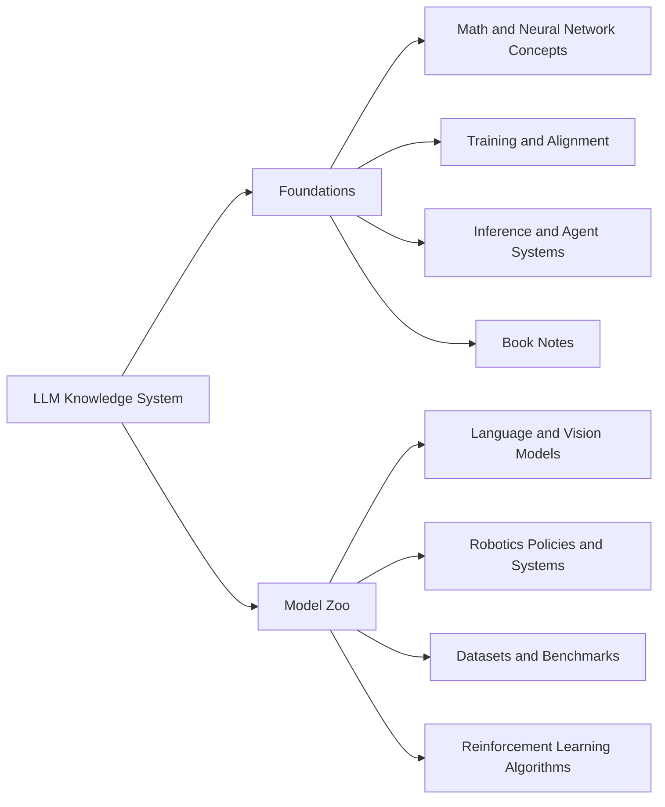

# LLM Knowledge System

Notes are organized under two directories:

- `docs/Foundations/`: reusable concepts, engineering techniques, and chapter-by-chapter book notes.
- `docs/Model_Zoo/`: studies of specific models, algorithms, robot policies, systems, and benchmarks.

The index groups foundation notes by knowledge domain and model studies by application area.

## Visual Map


The diagram gives a high-level overview; the sections below act as the detailed index.

| Domain | Focus | Core Topics |
|:---|:---|:---|
| Core Concepts | Math, optimization, losses, normalization, and Transformer building blocks | SVD, dtypes, AdamW, learning rate schedulers, Sigmoid, GELU, LayerNorm, RMSNorm, BatchNorm, GroupNorm, MHA/MQA/GQA, RoPE, SwiGLU |
| Architecture & Scaling | Efficient training and large-scale model design | FlashAttention, MLA, DeepSeekMoE, TP/PP/EP/FSDP, Gradient Checkpointing, Mixed Precision Training |
| Adaptation & Alignment | Task adaptation and preference learning | LoRA family, SFT, RLHF, DPO, PPO, GRPO |
| Agent Systems | Retrieval, memory, tool use, API interfaces, and task orchestration | Agent Basics, Memory Systems, RAG Systems, OpenAI API Interfaces |
| Inference & Serving | Latency, memory, and deployment efficiency | Speculative Decoding, Continuous Batching, Quantization, TensorRT-LLM, Hallucination Mitigation |
| Model Zoo | Language models, vision models, vision-language models, robotics systems, and RL algorithms | DeepSeek, Gemma, ViT, DINOv2, DINOv3, CLIP, SigLIP, SmolVLM, robot policies, grasp prediction, agentic robotics, embodied datasets, real-time policy inference, PPO, and SAC |
| Book Notes | Chapter-by-chapter foundations with compact definitions, equations, and examples | Modern Robotics; Reinforcement Learning: An Introduction |

## 1. Foundations

### 1.1 Core Concepts

- Math and numerical basics: [SVD](./docs/Foundations/Math/SVD.md), [dtypes](./docs/Foundations/Math/dtypes.md), [Memory Estimation](./docs/Foundations/Math/Memory_Estimation.md), [AdamW](./docs/Foundations/Optimizer/AdamW.md), [Learning Rate Schedulers](./docs/Foundations/Scheduler/Scheduler_Basics.md)
- Activation basics: [Sigmoid](./docs/Foundations/Activation_Layers/Sigmoid.md), [GELU](./docs/Foundations/Activation_Layers/GELU.md)
- Normalization basics: [LayerNorm](./docs/Foundations/Norm/LayerNorm.md), [RMSNorm](./docs/Foundations/Norm/RMSNorm.md), [BatchNorm](./docs/Foundations/Norm/BatchNorm.md), [GroupNorm](./docs/Foundations/Norm/GroupNorm.md)
- Attention mechanisms: [SVD + Attention](./docs/Foundations/Attention_Mechanisms/SVD_Attention.md), [MHA](./docs/Foundations/Attention_Mechanisms/MHA.md), [MQA](./docs/Foundations/Attention_Mechanisms/MQA.md), [GQA](./docs/Foundations/Attention_Mechanisms/GQA.md)
- Position and FFN blocks: [Sinusoidal Position Embedding](./docs/Foundations/Position_Embeddings/Sinusoidal_Position_Embedding.md), [RoPE](./docs/Foundations/Position_Embeddings/RoPE.md), [SwiGLU](./docs/Foundations/Activation_Layers/SwiGLU.md)

### 1.2 Architecture & Scaling

- Efficient attention: [FlashAttention](./docs/Foundations/Attention_Mechanisms/FlashAttention.md), [MLA](./docs/Foundations/Attention_Mechanisms/MLA.md)
- Sparse architecture: [DeepSeekMoE](./docs/Foundations/MoE/DeepSeekMoE.md)
- Training memory and numerics: [Gradient Checkpointing](./docs/Foundations/Training_Optimization/Gradient_Checkpointing.md), [Mixed Precision Training](./docs/Foundations/Training_Optimization/Mixed_Precision_Training.md)
- Distributed training: [TP](./docs/Foundations/Parallelism/TP.md), [PP](./docs/Foundations/Parallelism/PP.md), [EP](./docs/Foundations/Parallelism/EP.md), [FSDP](./docs/Foundations/Parallelism/FSDP.md)

### 1.3 Adaptation & Alignment

- PEFT: [LoRA](./docs/Foundations/PEFT/LoRA.md), [QLoRA](./docs/Foundations/PEFT/QLoRA.md), [DoRA](./docs/Foundations/PEFT/DoRA.md), [Specialized LoRA Variants](./docs/Foundations/PEFT/Specialized_LoRA.md)
- Supervised and preference alignment: [SFT](./docs/Foundations/Preference_Alignment/SFT.md), [RLHF](./docs/Foundations/Preference_Alignment/RLHF.md), [DPO](./docs/Foundations/Preference_Alignment/DPO.md), [PPO](./docs/Foundations/Preference_Alignment/PPO.md), [GRPO](./docs/Foundations/Preference_Alignment/GRPO.md)

### 1.4 Inference & Serving

- Decoding acceleration: [Speculative Decoding (Medusa/Lookahead)](./docs/Foundations/Inference_Optimization/speculative_decoding.md)
- Serving systems: [Continuous Batching & PagedAttention](./docs/Foundations/Inference_Optimization/continuous_batching.md), [TensorRT-LLM & Multi-LoRA Serving](./docs/Foundations/Inference_Optimization/tensorrt_multilora.md)
- Compression and reliability: [Post-Training Quantization (AWQ/GPTQ)](./docs/Foundations/Inference_Optimization/quantization_inference.md), [Hallucination Mitigation at Inference](./docs/Foundations/Inference_Optimization/hallucination_mitigation.md)

### 1.5 Agent Systems

- Core concepts: [Agent Systems Basics](./docs/Foundations/Agent_Systems/Agent_Basics.md)
- Memory design: [Memory Systems for Agents](./docs/Foundations/Agent_Systems/Memory_Systems.md)
- Retrieval grounding: [RAG Systems](./docs/Foundations/Agent_Systems/RAG_Systems.md)
- Reusable task methods: [Skill Systems](./docs/Foundations/Agent_Systems/Skill_Systems.md)
- Tool architecture: [Tool Registry and Function Calling](./docs/Foundations/Agent_Systems/Tool_Registry_and_Function_Calling.md)
- API interface format: [OpenAI API Interface Format](./docs/Foundations/Agent_Systems/OpenAI_API_Interface_Format.md)
- Protocol layer: [Model Context Protocol (MCP)](./docs/Foundations/Agent_Systems/MCP_Protocol.md)

### 1.6 Book Notes

- Robotics: [Modern Robotics: Mechanics, Planning, and Control](./docs/Foundations/Books/Robotics/Modern_Robotics.md)
- Reinforcement learning: [Reinforcement Learning: An Introduction](./docs/Foundations/Books/Reinforcement_Learning/Reinforcement_Learning_An_Introduction.md)

## 2. Model Zoo

- Reinforcement learning algorithms: [PPO](./docs/Model_Zoo/Reinforcement_Learning/PPO.md), [SAC](./docs/Model_Zoo/Reinforcement_Learning/SAC.md)
- Language models: [DeepSeek-V2](./docs/Model_Zoo/Language_Models/DeepSeek_V2.md), [DeepSeek-V3](./docs/Model_Zoo/Language_Models/DeepSeek_V3.md), [DeepSeek-V3.2](./docs/Model_Zoo/Language_Models/DeepSeek_V32.md), [DeepSeek-R1](./docs/Model_Zoo/Language_Models/DeepSeek_R1.md)
- Vision models: [ViT](./docs/Model_Zoo/Vision_Models/ViT.md), [DINOv2](./docs/Model_Zoo/Vision_Models/DINOv2.md), [DINOv3](./docs/Model_Zoo/Vision_Models/DINOv3.md)
- Vision-language models: [CLIP](./docs/Model_Zoo/Vision_Language_Models/CLIP.md), [SigLIP](./docs/Model_Zoo/Vision_Language_Models/SigLIP.md), [PaliGemma](./docs/Model_Zoo/Vision_Language_Models/PaliGemma.md), [SmolVLM](./docs/Model_Zoo/Vision_Language_Models/SmolVLM.md), [Gemma 3](./docs/Model_Zoo/Vision_Language_Models/Gemma_3.md), [Gemma 4](./docs/Model_Zoo/Vision_Language_Models/Gemma_4.md), [DeepSeek-VL](./docs/Model_Zoo/Vision_Language_Models/DeepSeek_VL.md), [DeepSeek-VL2](./docs/Model_Zoo/Vision_Language_Models/DeepSeek_VL2.md)
- Robotics datasets: [LIBERO](./docs/Model_Zoo/Robotics/Datasets/LIBERO.md), [Open X-Embodiment](./docs/Model_Zoo/Robotics/Datasets/Open_X_Embodiment.md), [RoboCasa365](./docs/Model_Zoo/Robotics/Datasets/RoboCasa365.md)
- Grasping: [AnyGrasp](./docs/Model_Zoo/Robotics/Grasping/AnyGrasp.md), [GraspGen](./docs/Model_Zoo/Robotics/Grasping/GraspGen.md), [GraspNet](./docs/Model_Zoo/Robotics/Grasping/GraspNet.md)
- Robot policies: [ACT / ALOHA](./docs/Model_Zoo/Robotics/Policies/ACT.md), [Diffusion Policy](./docs/Model_Zoo/Robotics/Policies/Diffusion_Policy.md), [Fast-WAM](./docs/Model_Zoo/Robotics/Policies/Fast_WAM.md), [GR00T N1](./docs/Model_Zoo/Robotics/Policies/GR00T_N1.md), [GR00T 2](./docs/Model_Zoo/Robotics/Policies/GR00T_2.md), [MolmoAct2](./docs/Model_Zoo/Robotics/Policies/MolmoAct2.md), [Octo](./docs/Model_Zoo/Robotics/Policies/Octo.md), [RDT-1B](./docs/Model_Zoo/Robotics/Policies/RDT_1B.md), [RT-1](./docs/Model_Zoo/Robotics/Policies/RT_1.md), [RT-2](./docs/Model_Zoo/Robotics/Policies/RT_2.md), [OpenVLA](./docs/Model_Zoo/Robotics/Policies/OpenVLA.md), [PolicyIK — learned IK controller](./docs/Model_Zoo/Robotics/Policies/PolicyIK.md), [SmolVLA](./docs/Model_Zoo/Robotics/Policies/SmolVLA.md), [WALL-OSS](./docs/Model_Zoo/Robotics/Policies/WALL_OSS.md), [pi0](./docs/Model_Zoo/Robotics/Policies/Pi_0.md), [pi0-FAST](./docs/Model_Zoo/Robotics/Policies/Pi_0_FAST.md), [Hi Robot](./docs/Model_Zoo/Robotics/Policies/Pi_Hi_Robot.md), [Human-to-Robot Transfer](./docs/Model_Zoo/Robotics/Policies/Pi_Human_to_Robot.md), [MEM](./docs/Model_Zoo/Robotics/Policies/Pi_MEM.md), [pi0.5](./docs/Model_Zoo/Robotics/Policies/Pi_0_5.md), [pi0.5-KI](./docs/Model_Zoo/Robotics/Policies/Pi_0_5_KI.md), [pi0.6*](./docs/Model_Zoo/Robotics/Policies/Pi_0_6.md)
- Robotics inference: [Real-Time Chunking](./docs/Model_Zoo/Robotics/Inference/RTC.md)
- Agentic robotics systems: [AdaHVLA](./docs/Model_Zoo/Robotics/Agentic_Systems/AdaHVLA.md), [ASPIRE](./docs/Model_Zoo/Robotics/Agentic_Systems/ASPIRE.md), [EmbodiedRSI](./docs/Model_Zoo/Robotics/Agentic_Systems/EmbodiedRSI.md), [Harness VLA](./docs/Model_Zoo/Robotics/Agentic_Systems/Harness_VLA.md), [RegenHarness](./docs/Model_Zoo/Robotics/Agentic_Systems/RegenHarness.md), [ReKep](./docs/Model_Zoo/Robotics/Agentic_Systems/ReKep.md), [RoboHarness](./docs/Model_Zoo/Robotics/Agentic_Systems/RoboHarness.md), [SenseNova-RoboRSI](./docs/Model_Zoo/Robotics/Agentic_Systems/SenseNova_RoboRSI.md), [Show-Harness](./docs/Model_Zoo/Robotics/Agentic_Systems/Show_Harness.md), [Spotter](./docs/Model_Zoo/Robotics/Agentic_Systems/Spotter.md), [Zetta](./docs/Model_Zoo/Robotics/Agentic_Systems/Zetta.md)

---

# File Structure
Images are grouped by model or topic under `assets/`; notes link to the corresponding folder.

```text
.
|-- assets/
|   ...
`-- docs/
    |-- Foundations/
    |   |-- Activation_Layers/
    |   |   |-- GELU.md
    |   |   |-- Sigmoid.md
    |   |   `-- SwiGLU.md
    |   |-- Agent_Systems/
    |   |   |-- Agent_Basics.md
    |   |   |-- MCP_Protocol.md
    |   |   |-- Memory_Systems.md
    |   |   |-- OpenAI_API_Interface_Format.md
    |   |   |-- RAG_Systems.md
    |   |   |-- Skill_Systems.md
    |   |   `-- Tool_Registry_and_Function_Calling.md
    |   |-- Attention_Mechanisms/
    |   |   |-- FlashAttention.md
    |   |   |-- GQA.md
    |   |   |-- MHA.md
    |   |   |-- MLA.md
    |   |   |-- MQA.md
    |   |   `-- SVD_Attention.md
    |   |-- Books/
    |   |   |-- Reinforcement_Learning/
    |   |   |   `-- Reinforcement_Learning_An_Introduction.md
    |   |   `-- Robotics/
    |   |       `-- Modern_Robotics.md
    |   |-- Inference_Optimization/
    |   |   |-- continuous_batching.md
    |   |   |-- hallucination_mitigation.md
    |   |   |-- quantization_inference.md
    |   |   |-- speculative_decoding.md
    |   |   `-- tensorrt_multilora.md
    |   |-- Math/
    |   |   |-- dtypes.md
    |   |   |-- Memory_Estimation.md
    |   |   `-- SVD.md
    |   |-- MoE/
    |   |   `-- DeepSeekMoE.md
    |   |-- Norm/
    |   |   |-- BatchNorm.md
    |   |   |-- GroupNorm.md
    |   |   |-- LayerNorm.md
    |   |   `-- RMSNorm.md
    |   |-- Optimizer/
    |   |   `-- AdamW.md
    |   |-- Parallelism/
    |   |   |-- EP.md
    |   |   |-- FSDP.md
    |   |   |-- PP.md
    |   |   `-- TP.md
    |   |-- PEFT/
    |   |   |-- DoRA.md
    |   |   |-- LoRA.md
    |   |   |-- QLoRA.md
    |   |   `-- Specialized_LoRA.md
    |   |-- Position_Embeddings/
    |   |   |-- RoPE.md
    |   |   `-- Sinusoidal_Position_Embedding.md
    |   |-- Preference_Alignment/
    |   |   |-- DPO.md
    |   |   |-- GRPO.md
    |   |   |-- PPO.md
    |   |   |-- RLHF.md
    |   |   `-- SFT.md
    |   |-- Scheduler/
    |   |   |-- Cyclical_and_Restart.md
    |   |   |-- LLM_Training_Recipes.md
    |   |   |-- Metric_Adaptive.md
    |   |   |-- Scheduler_Basics.md
    |   |   `-- Warmup_and_Decay.md
    |   `-- Training_Optimization/
    |       |-- Gradient_Checkpointing.md
    |       `-- Mixed_Precision_Training.md
    `-- Model_Zoo/
        |-- Language_Models/
        |   |-- DeepSeek_R1.md
        |   |-- DeepSeek_V2.md
        |   |-- DeepSeek_V3.md
        |   `-- DeepSeek_V32.md
        |-- Reinforcement_Learning/
        |   |-- PPO.md
        |   `-- SAC.md
        |-- Robotics/
        |   |-- Agentic_Systems/
        |   |   |-- AdaHVLA.md
        |   |   |-- ASPIRE.md
        |   |   |-- EmbodiedRSI.md
        |   |   |-- Harness_VLA.md
        |   |   |-- RegenHarness.md
        |   |   |-- ReKep.md
        |   |   |-- RoboHarness.md
        |   |   |-- SenseNova_RoboRSI.md
        |   |   |-- Show_Harness.md
        |   |   |-- Spotter.md
        |   |   `-- Zetta.md
        |   |-- Datasets/
        |   |   |-- LIBERO.md
        |   |   |-- Open_X_Embodiment.md
        |   |   `-- RoboCasa365.md
        |   |-- Grasping/
        |   |   |-- AnyGrasp.md
        |   |   |-- GraspGen.md
        |   |   `-- GraspNet.md
        |   |-- Inference/
        |   |   `-- RTC.md
        |   `-- Policies/
        |       |-- ACT.md
        |       |-- Diffusion_Policy.md
        |       |-- Fast_WAM.md
        |       |-- GR00T_2.md
        |       |-- GR00T_N1.md
        |       |-- MolmoAct2.md
        |       |-- Octo.md
        |       |-- OpenVLA.md
        |       |-- Pi_0.md
        |       |-- Pi_0_5.md
        |       |-- Pi_0_5_KI.md
        |       |-- Pi_0_6.md
        |       |-- Pi_0_FAST.md
        |       |-- Pi_Hi_Robot.md
        |       |-- Pi_Human_to_Robot.md
        |       |-- Pi_MEM.md
        |       |-- PolicyIK.md
        |       |-- RDT_1B.md
        |       |-- RT_1.md
        |       |-- RT_2.md
        |       |-- SmolVLA.md
        |       `-- WALL_OSS.md
        |-- Vision_Language_Models/
        |   |-- CLIP.md
        |   |-- DeepSeek_VL.md
        |   |-- DeepSeek_VL2.md
        |   |-- Gemma_3.md
        |   |-- Gemma_4.md
        |   |-- PaliGemma.md
        |   |-- SigLIP.md
        |   `-- SmolVLM.md
        `-- Vision_Models/
            |-- DINOv2.md
            |-- DINOv3.md
            `-- ViT.md
```

---

# Learning Resource Recommendation
- [Datawhale / happy-llm](https://github.com/datawhalechina/happy-llm)
- [Datawhale / hello-agents](https://github.com/datawhalechina/Hello-Agents)
- [Datawhale / all-in-rag](https://github.com/datawhalechina/all-in-rag)
- [Hugging Face / LeRobot](https://huggingface.co/docs/lerobot/main/en/index)
- [Physical Intelligence / Home](https://www.pi.website/)
