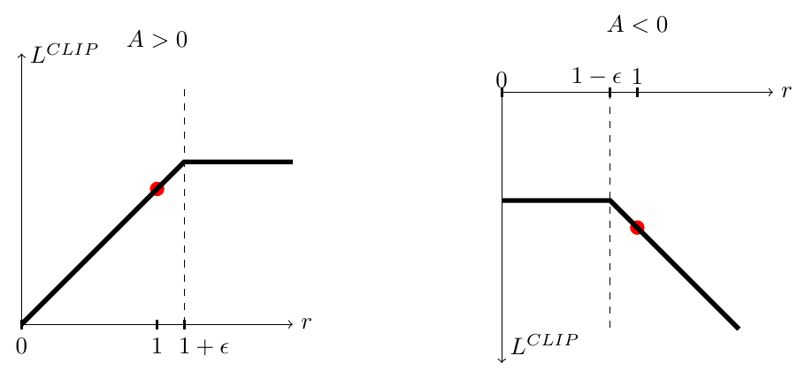
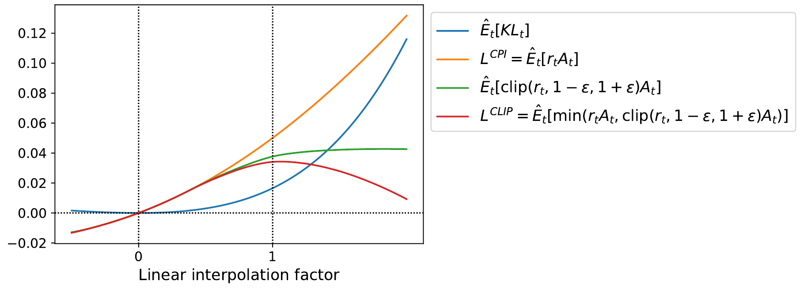
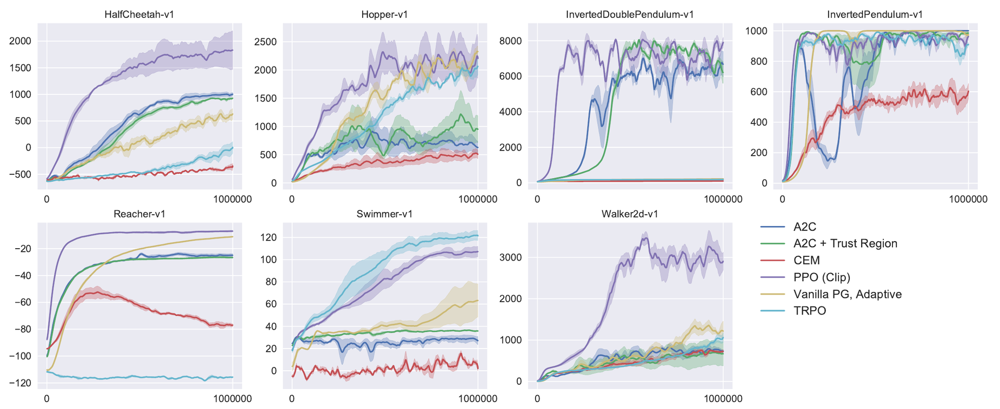
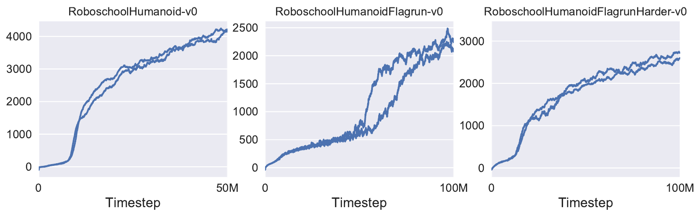
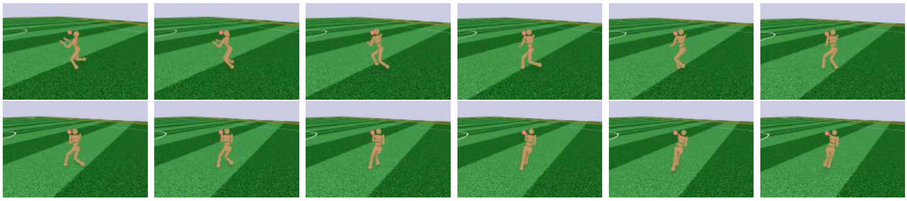
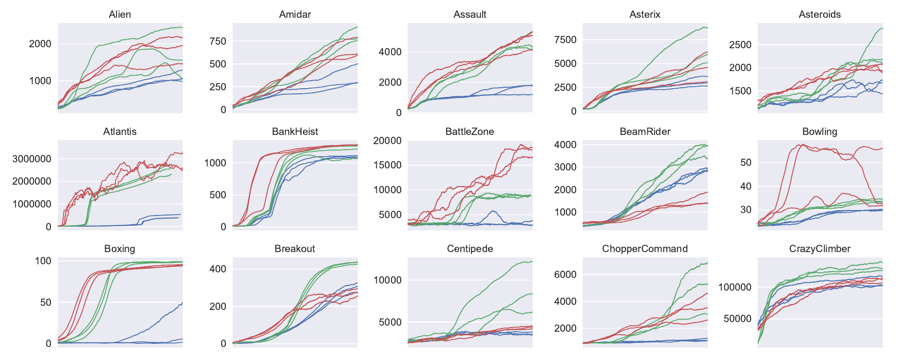
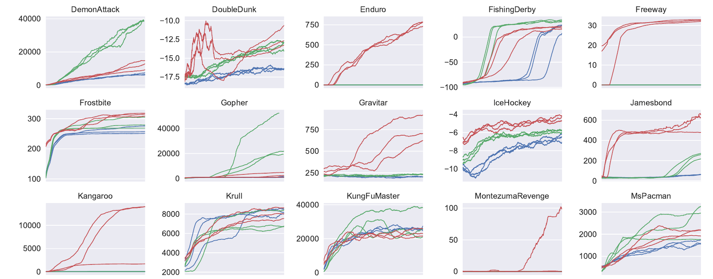
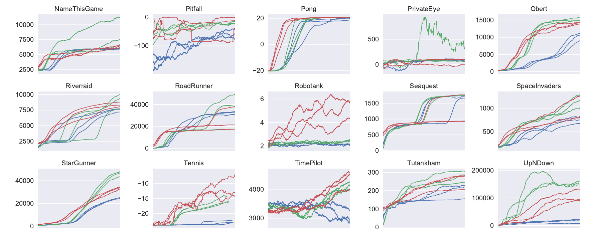
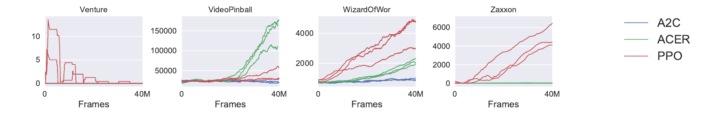

# [PPO: Proximal Policy Optimization Algorithms](https://arxiv.org/abs/1707.06347v2)

**Proximal Policy Optimization (PPO)** collects experience with the current policy and trains on that batch for several passes. Its main variant, PPO-Clip, reduces the incentive to keep changing an action's probability once the change is already large in the direction favored by the batch. Fresh rollouts then show what the updated policy actually does.

The method, figures, and experiments below follow the original paper by John Schulman, Filip Wolski, Prafulla Dhariwal, Alec Radford, and Oleg Klimov, revised August 2017. [Paper PDF, arXiv:1707.06347v2](https://arxiv.org/pdf/1707.06347v2)

## Convenient Links

- Policy gradients and actor–critic methods. [Reinforcement Learning: An Introduction, Chapter 13](../../Foundations/Books/Reinforcement_Learning/Reinforcement_Learning_An_Introduction.md#chapter-13-policy-gradient-methods)
- Applying PPO to language model alignment. [PPO for RLHF](../../Foundations/Preference_Alignment/PPO.md)
- A continuous-control algorithm that reuses experience from many previous policies. [Soft Actor-Critic](./SAC.md)

## 1. Why Does Reusing a Rollout Make the Update Harder?

Suppose a simulated robot usually steps straight ahead. One sampled wider step helps it regain balance. The policy should try that step more often in similar situations. After several updates, however, the robot might take wider steps much more often and reach different poses. The original rollout tells us what happened when the old policy took that one step and then continued as usual. It contains little evidence about what happens when the updated policy takes wider steps repeatedly.

PPO uses an **advantage** to encode the first judgment. At a state $s$, the state value $V^\pi(s)$ is the expected discounted sum of future rewards when following policy $\pi$. The action value $Q^\pi(s,a)$ makes the same prediction after first taking action $a$. Their difference, $A^\pi(s,a)=Q^\pi(s,a)-V^\pi(s)$, measures how taking that action changes the expected outcome relative to the policy's usual behavior at that state.

In a sampled rollout, $\hat A_t$ estimates this difference for the recorded action $a_t$ at step $t$. A positive estimate favors making the action more likely, and a negative estimate favors making it less likely. A zero estimate contributes zero to the policy objective. Section 3 builds these estimates from rewards and a value network.

### 1.1 Measure the Change against the Policy That Generated the Data

Let $\pi_{\mathrm{old}}$ be the policy used to collect the batch, and let $\pi_\theta$ be the current policy with trainable parameters $\theta$. For each recorded state $s_t$ and action $a_t$, PPO evaluates the action under both policies.

$$
r_t(\theta)=\frac{\pi_\theta(a_t\mid s_t)}{\pi_{\mathrm{old}}(a_t\mid s_t)}
=\exp\!\bigl(\log\pi_\theta(a_t\mid s_t)-\log\pi_{\mathrm{old}}(a_t\mid s_t)\bigr).
$$

For the illustrative wider step, a rollout probability of $0.25$ and a current probability of $0.35$ give $r_t=1.4$. The step is now 40% more likely at that state. The numerator evaluates the recorded step under the current policy even if that policy would sample a different step on a fresh visit. For continuous actions, the two terms are probability densities evaluated at the same recorded action. For independent coordinates of a continuous action, add their log densities before computing the ratio so it represents the whole action.

The paper's **conservative policy iteration (CPI) surrogate** averages the product of ratio and advantage over the stored batch.

$$
L^{\mathrm{CPI}}(\theta)=\widehat{\mathbb E}_t[r_t(\theta)\hat A_t],
$$

where $\widehat{\mathbb E}_t$ is a finite sample average. At the start of optimization, $\pi_\theta =\pi_{\mathrm{old}}$, so every ratio is one. Differentiating $r_t$ gives $r_t\nabla_\theta \log\pi_\theta(a_t\mid s_t)$. At ratio one this recovers the usual policy-gradient contribution $\hat A_t\nabla_\theta \log\pi_\theta(a_t\mid s_t)$. The ratio starts at one while its gradient still responds to changes in $\theta$.

For a fixed positive advantage, the unclipped contribution keeps growing as the ratio grows. The ratio adjusts action weighting at the **recorded states**. Those states and their estimated advantages still come from the old rollout. Repeated updates therefore benefit from a way to reduce the incentive for large changes.

### 1.2 TRPO Limits the Change through a Constraint

Trust Region Policy Optimization (TRPO) uses the ratio-weighted surrogate and constrains the average Kullback–Leibler (KL) divergence from the rollout policy to the candidate policy.

$$
\widehat{\mathbb E}_t\!\left[
D_{\mathrm{KL}}\bigl(\pi_{\mathrm{old}}(\cdot\mid s_t)\Vert
\pi_\theta(\cdot\mid s_t)\bigr)\right]\leq\delta_{\mathrm{KL}}.
$$

The budget $\delta_{\mathrm{KL}}$ is measured on states from the batch. At each state, KL compares the full action distributions. For instance, two candidate policies can give the recorded wider step probability $0.35$ while distributing the remaining $0.65$ very differently among other actions. The recorded step has the same ratio under both candidates, but their divergences from the old distribution can differ.

TRPO approximates the constrained step using curvature and a conjugate-gradient solve. PPO-Clip changes the objective itself so that ordinary first-order minibatch optimization can use it. [Trust Region Policy Optimization](https://arxiv.org/abs/1502.05477)

## 2. How Does PPO-Clip Stop Rewarding Large Changes?

### 2.1 Compare the Ordinary Score with a Clipped Score

Suppose the wider step has estimated advantage $+2$ and the clip width is $\epsilon=0.2$. A current probability of $0.28$ gives a ratio of $1.12$ and an ordinary score of $2.24$. At probability $0.35$, the ratio is $1.4$ and the ordinary score is $2.8$. Evaluating the latter at the upper threshold $1.2$ gives a score of $2.4$. PPO keeps the smaller score, so further increases above ratio $1.2$ earn the same credit for that sample.

The second candidate score uses a clipped **copy** of the ratio. The minimum ensures that a large change in the unfavorable direction still reduces the objective. For example, if the wider-step probability falls to $0.15$, the actual ratio $0.6$ gives a score of $1.2$. Clipping it to $0.8$ would raise the score to $1.6$. Taking the minimum keeps $1.2$, so raising the ratio again still improves that term.

$$
\begin{aligned}
u_t &= \operatorname{clip}(r_t,1-\epsilon,1+\epsilon),\\
\ell_t &= \min(r_t\hat A_t,\ u_t\hat A_t),\\
L^{\mathrm{CLIP}} &= \widehat{\mathbb E}_t[\ell_t].
\end{aligned}
$$

*Paper Equation (7). The comparison is made for each sample before averaging.*

When $\hat A_t<0$, multiplying by it reverses the ordering of the two ratios. This shifts the flat side to the **lower** threshold. The table follows both signs through the same calculation.

| Illustrative advantage | Actual ratio | Ordinary score $r_t\hat A_t$ | Score using $u_t$ | PPO keeps | Effect of further movement in that direction |
|---:|---:|---:|---:|---:|---|
| $+2$ | $1.4$ | $2.8$ | $2.4$ | $2.4$ | Increasing the ratio earns no more credit |
| $+2$ | $0.6$ | $1.2$ | $1.6$ | $1.2$ | Decreasing the ratio lowers the score |
| $-1$ | $0.6$ | $-0.6$ | $-0.8$ | $-0.8$ | Decreasing the ratio earns no more credit |
| $-1$ | $1.4$ | $-1.4$ | $-1.2$ | $-1.4$ | Increasing the ratio lowers the score |



*Paper Figure 1. The red dots mark $r=1$. The positive-advantage curve rises to the upper threshold and flattens. The negative-advantage curve flattens below the lower threshold and slopes down above it.*

For positive advantages the contribution is $\hat A_t\min(r_t,1+\epsilon)$. For negative advantages it is $\hat A_t\max(r_t,1-\epsilon)$. At the relevant threshold both branches give the same value. The curve is continuous with a corner there. Inside the interval the ordinary score applies, including near $r=1$, where PPO retains the usual policy-gradient direction.

### 2.2 A Flat Sample Can Still Move with the Rest of the Batch

Consider the wider-step example at ratio $1.4$. Its term is flat with respect to its own ratio. Another state can still give a gradient through parameters shared with the wider-step distribution. If an update driven by that other state raises the wider-step probability to $0.37$, its new ratio is $1.48$ and its contribution remains $2.4$. This is how a ratio can move beyond the interval even after its sample stops rewarding the move.

For the same batch and policy parameters, the minimum ensures that $L^{\mathrm{CLIP}}\le L^{\mathrm{CPI}}$. It compares two scores computed from rollout data. The new policy's actual return depends on which states and actions it visits after deployment. Clipping is an incentive in the objective, so the update has no hard ratio or KL constraint and actual return can fall.



*Paper Figure 2. Horizontal position 0 is the rollout policy and 1 is the resulting policy. Along this parameter direction, the ordinary surrogate (orange) keeps rising while the PPO surrogate (red) peaks around the update and then falls. The mean KL (blue) is about 0.02 at the update.*

This plot uses many samples from the first Hopper update. Some contributions flatten while others can worsen, so the average can peak and decline even though either single-sample curve in Figure 1 only slopes in one direction. The plotted KL belongs to this run and this update direction.

### 2.3 Adaptive KL Penalty Changes the Cost of a Policy Update

The other PPO variant in the paper subtracts the mean old-to-current KL from the ratio-weighted score, scaled by a coefficient $\beta$.

$$
L^{\mathrm{KLPEN}}(\theta)=\widehat{\mathbb E}_t\!\left[
r_t(\theta)\hat A_t-\beta
D_{\mathrm{KL}}\bigl(\pi_{\mathrm{old}}(\cdot\mid s_t)\Vert
\pi_\theta(\cdot\mid s_t)\bigr)\right].
$$

The optimizer holds $\beta$ fixed for the batch. After the minibatch epochs, measure mean KL $d$ and compare it with a target $d_{\mathrm{targ}}$. Halve $\beta$ if $d<d_{\mathrm{targ}}/1.5$, double it if $d>1.5d_{\mathrm{targ}}$, and keep it at or between those boundaries. The revised coefficient applies to the next batch.

For an illustrative target of $0.01$ and $\beta=1$, a measured KL of $0.02$ sets the next coefficient to $2$. A low KL of $0.005$ would set it to $0.5$, and $0.015$ leaves it at $1$ because the upper test is strict. The feedback regulates future updates. The paper evaluates this variant separately from clipping and also allows the two to be combined.

## 3. Where Does the Advantage Come From?

### 3.1 Compare Each Observed Transition with the Critic's Prediction

The **actor** maps a state to an action distribution. The **critic** estimates the return from the state, giving the actor a baseline for evaluating a recorded action. PPO commonly uses **generalized advantage estimation (GAE)** to combine several successive corrections to that baseline. The temporal-difference (TD) error compares the critic's current-state prediction with the observed reward plus its discounted successor prediction.

Let $R_{t+1}$ be the reward received for the transition to $s_{t+1}$, $\gamma$ the reward discount, and $V_{\mathrm{old}}$ the rollout-time critic used to prepare the batch. For a true terminal transition, use zero for the successor value. The error and the finite-segment advantage are

$$
\begin{aligned}
\delta_t &= R_{t+1}+\gamma V_{\mathrm{old}}(s_{t+1})-V_{\mathrm{old}}(s_t),\\
\hat A_t &= \delta_t+\gamma\lambda\hat A_{t+1}.
\end{aligned}
$$

Compute the recursion backward from zero residual advantage after the last collected step. The coefficient $\lambda\in [0,1]$ controls how much later TD errors affect today's estimate. High $\lambda$ uses more observed rewards before relying on the critic at the end of the segment. Low $\lambda$ leans more on the critic's near-term values, which can reduce sampling noise while retaining more of its prediction error.

### 3.2 Work a Two-Step Rollout Backward

In this illustrative rollout the first action is the wider step. The robot regains balance briefly and then the episode ends. Use $\gamma=0.8$, $\lambda=0.5$, and therefore $\gamma\lambda=0.4$. Rewards and values use the same reward units.

| Step | Current value | Reward | Successor value | TD error $\delta_t$ | Advantage $\hat A_t$ |
|---|---:|---:|---:|---:|---:|
| 0, wider step | 0.2 | 1 | 2.0 | $1+0.8(2)-0.2=2.4$ | $2.4+0.4(-1)=2$ |
| 1, episode ends | 2.0 | 1 | 0 | $1+0.8(0)-2=-1$ | $-1$ |

Step 1 gives a positive reward but falls short of the critic's prediction. Its negative error reduces the credit assigned to step 0, which still has positive advantage. These are the two advantages used in the clipping table. The actor evaluates their new ratios independently on the same batch.

With $\lambda=0$, step 0 would use its one-step error $2.4$. With $\lambda=1$, the intermediate critic prediction cancels and the advantage becomes the discounted segment return minus the initial critic value, $1+0.8(1)-0.2=1.6$. The same cancellation leaves a discounted final value if the segment ends while the episode continues.

### 3.3 A Terminal State and a Collection Cutoff Have Different Values

**Bootstrapping** uses a value estimate for rewards beyond the available data. Taking a bootstrap from the actual successor and continuing the advantage recursion are separate decisions.

| Boundary after a stored transition | Include successor value in $\delta_t$? | Carry the next stored advantage backward? |
|---|---|---|
| Ordinary step within the segment | Yes | Yes |
| True episode termination | Use zero | Stop |
| Batch cutoff in an ongoing episode | Yes | Stop at the batch boundary |
| Time limit used only to truncate an ongoing task | Yes, from the final observation before reset | Stop before the reset |

For example, if step 1 above were a collection cutoff with successor value $0.5$, its error would be $1+0.8(0.5)-2=-0.6$. The trace still ends there, so step 0 would become $2.4+0.4(-0.6)=2.16$. Using the next episode's initial observation would introduce value from an unrelated trajectory.

The same advantages can produce a fixed critic target. One GAE-based choice is $V_t^{\mathrm{targ}}=V_{\mathrm{old}}(s_t)+\hat A_t$, which gives $2.2$ and $1.0$ for the terminal example. If the actor advantages are normalized, use the raw advantages to construct these value targets so they remain in reward units.

## 4. What Stays Fixed as the Actor Learns?

### 4.1 Collect Once, Update Several Times, Then Collect Again

At the start of a training iteration, use the current policy as the rollout policy. Each of $N$ parallel environment workers collects $T$ transitions, for a total batch size $B=NT$. Store the observations, recorded actions, rewards, actual successor and boundary information, old action log-probabilities, and values needed for advantage estimation.

1. **Prepare targets.** Compute the advantages and value targets from the rollout. The sampled data, old log-probabilities, and targets stay fixed throughout the update.
2. **Run $K$ epochs.** An epoch is one pass through the batch. Divide it into minibatches of size $M$ and recompute each sampled action's log-probability under the current actor. Recompute the critic's current prediction for its loss. Each optimizer step changes the current networks.
3. **Refresh the rollout.** After the final epoch, use the updated actor to generate the next batch, with its own log-probabilities and new estimates. Clipping uses the new denominators from then on.

*Training sequence adapted from paper Algorithm 1. Caching the sampled actions' old log-probabilities is sufficient for PPO-Clip. Computing the original KL penalty also requires the old action distributions at sampled states.*

The wider step illustrates why the denominator has to follow the data. If its probability starts at 0.25 and moves to 0.30 then 0.35 across optimizer steps, the same batch sees ratios $1$, $1.2$, and $1.4$. Resetting the denominator to 0.30 partway through would give $0.35/0.30\approx1.17$, putting the same update below the upper threshold and restoring the incentive to increase the probability. The batch still came from the policy with probability 0.25. Once the next rollout is collected at 0.35, its own ratio starts at $0.35/0.35=1$. This limited reuse of a batch from the current rollout policy is why PPO is classified as on-policy.

### 4.2 Combine the Policy, Value, and Entropy Terms

When sharing features between actor and critic, the paper combines the policy surrogate with squared value error and an entropy bonus. For an optimizer that **minimizes** a loss, reverse the signs of the paper's maximization objective.

$$
\mathcal L=\widehat{\mathbb E}_t\left[
-\ell_t
+c_1\bigl(V_\phi(s_t)-V_t^{\mathrm{targ}}\bigr)^2
-c_2\mathcal H\bigl(\pi_\theta(\cdot\mid s_t)\bigr)
\right].
$$

Here $\phi$ denotes the critic's parameters, which can include parameters shared with $\theta$. The first term adjusts the probability of stored actions using their advantages. The second fits the critic to targets for estimating future returns. The third favors higher entropy, $\mathcal H$, meaning a broader distribution that can explore more actions. The coefficients $c_1$ and $c_2$ control the strength of those two auxiliary terms. A value or entropy gradient through shared features can affect the actor even when an individual clipped policy term is flat.

For an illustrative minibatch containing the two steps above, suppose the positive-advantage ratio is $1.4$ and the negative-advantage ratio is $0.6$. The clipped policy average is $(2.4-0.8)/2=0.8$. If the mean squared value error is $0.05$, mean entropy is $0.60$ nats, and the coefficients are $c_1=1$ and $c_2=0.01$, then the **total minimized loss** is $-0.8+0.05-0.006=-0.756$. The value and entropy numbers illustrate the objective arithmetic. They are separate from the policy score.

The MuJoCo experiments use separate networks and omit the entropy bonus. Their actor is a fully connected network with two 64-unit tanh layers, a Gaussian action mean, and adjustable standard deviations. In the paper's shared-network formulation, the value term is ordinary squared error. Some implementations additionally normalize advantages, clip value updates or gradient norms, or stop epochs based on measured KL. Those choices have their own effects and can be considered separately from the paper's policy objective.

### 4.3 Acting after Training

To act, evaluate the actor on the current observation and sample from its action distribution. A deterministic evaluation may instead take the mode or Gaussian mean, which changes the action selection rule. Fresh trajectories, critic targets, and ratio calculations are used when training resumes.

## 5. What Do the Experiments Establish?

### 5.1 Which Surrogate Works Best in the Same MuJoCo Setup?

The authors compare objectives on seven MuJoCo tasks using one million environment timesteps per run and three seeds per task. Most settings are held fixed while the clipping width or KL penalty is varied. Each run is scored by mean episode reward over its last 100 episodes. The authors scale each environment's scores so a random policy gives 0 and the best observed result gives 1, then average 21 runs for each setting. A negative normalized score represents performance below the random baseline on that scale.

| Objective | Setting | Average normalized score |
|---|---:|---:|
| Unclipped surrogate | No clipping or penalty | −0.39 |
| PPO-Clip | $\epsilon=0.1$ | 0.76 |
| PPO-Clip | $\epsilon=0.2$ | **0.82** |
| PPO-Clip | $\epsilon=0.3$ | 0.70 |
| Adaptive KL | $d_{\mathrm{targ}}=0.003$ | 0.68 |
| Adaptive KL | $d_{\mathrm{targ}}=0.01$ | 0.74 |
| Adaptive KL | $d_{\mathrm{targ}}=0.03$ | 0.71 |
| Fixed KL | $\beta=0.3$ | 0.62 |
| Fixed KL | $\beta=1$ | 0.71 |
| Fixed KL | $\beta=3$ | 0.72 |
| Fixed KL | $\beta=10$ | 0.69 |

*Paper Table 1, all settings. The adaptive penalty starts with $\beta=1$.*

The result supports using clipping in this setup. The unregularized run's particularly poor HalfCheetah scores pull its average below zero. Among the tested settings, $\epsilon=0.2$ leads with 0.82 versus 0.74 for the strongest adaptive KL setting. This comparison is specific to the paper's tasks, training budgets, and tested hyperparameters.

### 5.2 How Does PPO Compare with Other Continuous-Control Algorithms?



*Paper Figure 3. Each panel plots reward against environment timesteps on its own scale, from 0 to one million timesteps. The purple curve is PPO-Clip with $\epsilon=0.2$. The legend identifies advantage actor–critic (A2C), its trust-region version, the cross-entropy method (CEM), vanilla policy gradient (PG) with an adaptive step size, and TRPO.*

The curves let us compare reward at a fixed interaction budget. PPO rises much faster and ends higher than the displayed baselines in HalfCheetah and Walker2d. In Swimmer, TRPO finishes higher. This experiment compares whole algorithms with tuned baselines. The surrogate comparison in Table 1 more directly isolates the choice of objective.

### 5.3 Can PPO Learn to Run, Turn, and Recover in Simulation?



*Paper Figure 4. The left task rewards forward locomotion. Flagrun in the middle changes the target location, and FlagrunHarder on the right adds disturbances and requires getting back up. The runs contain 50 million timesteps for locomotion and 100 million for each Flagrun variant.*



*Paper Figure 5. Read left to right across each row. The humanoid runs toward the first target in the top row. After the target changes, the bottom row shows the policy turning toward the new location.*

The rising curves show learning on all three simulated problems, and the frames illustrate one response to a target change. These runs extend the evaluation to higher-dimensional control with longer training budgets. Figure 3 supplies the comparison against other algorithms.

### 5.4 Atari Separates Learning Speed from Final Performance

The paper compares PPO, A2C, and Actor-Critic with Experience Replay (ACER) on 49 Atari games. The methods share the same policy architecture. Training lasts 40 million game frames, equivalent to 10 million agent timesteps in this setup. The reported game winner for each metric is determined using the mean over three trials.

| Metric used to choose each game's winner | A2C | ACER | PPO | Ties |
|---|---:|---:|---:|---:|
| Mean episode reward across training | 1 | 18 | **30** | 0 |
| Mean episode reward over the final 100 episodes | 1 | **28** | 19 | 1 |

*Paper Table 2, game-wise win counts. Each row counts 49 games.*

PPO leads in more games when the metric rewards performance throughout training. ACER leads in more games when the metric emphasizes the end of training. A method can earn more reward early and still be overtaken later.

| Game | A2C | ACER | PPO |
|---|---:|---:|---:|
| Breakout | 303.0 | **456.4** | 274.8 |
| Enduro | 0.0 | 0.0 | **758.3** |
| Kangaroo | 45.3 | 50.0 | **9,928.7** |
| MontezumaRevenge | 0.0 | 0.3 | **42.0** |

*Selected rows from paper Table 6. Scores are mean rewards per episode over the last 100 episodes after 40 million frames. Interpret differences within each game because the reward scales differ.*

Figure 6's panels below preserve the three seed curves for each method. The colors identify A2C (blue), ACER (green), and PPO (red). Each panel spans 0–40 million frames and uses its own reward scale.



*Paper Figure 6, first three rows. Breakout illustrates how later ACER gains can lead to a higher final score.*



*Paper Figure 6, rows four through six. Enduro shows repeated gains for PPO. MontezumaRevenge shows one PPO seed breaking away, making variation across runs visible behind the mean.*



*Paper Figure 6, rows seven through nine. In Pong, methods learn at different rates and later approach similar rewards.*



*Paper Figure 6, final row and legend. The horizontal axis counts game frames.*

### 5.5 How Much Work Happens per Rollout?

| Setting | MuJoCo | Roboschool | Atari |
|---|---:|---:|---:|
| Horizon $T$ per worker | 2,048 | 512 | 128 |
| Workers $N$ | — | 32 locomotion, 128 Flagrun | 8 |
| Epochs $K$ | 10 | 15 | 3 |
| Minibatch size $M$ | 64 | 4,096 | 256 |
| Adam step size | $3\times10^{-4}$ | Adjusted using target KL | $2.5\times10^{-4}\alpha$ |
| Reward discount $\gamma$ | 0.99 | 0.99 | 0.99 |
| GAE weight $\lambda$ | 0.95 | 0.95 | 0.95 |
| Clip width $\epsilon$ | $0.2$ in Section 6.2 | — | $0.1\alpha$ |
| Value coefficient $c_1$ | Separate networks | — | 1 |
| Entropy coefficient $c_2$ | 0 | — | 0.01 |
| Action log standard deviation schedule | — | Linear from −0.7 to −1.6 | — |

*Combined summary of paper Tables 3–5 and Sections 6.1–6.2. Dashes mark settings unlisted in those sources. Atari's $\alpha$ decreases linearly from 1 to 0, shrinking both its learning rate and clip width. Roboschool's KL-based learning rate adjustment is distinct from the adaptive objective coefficient in Section 2.3.*

For Atari, $NT=8\times128=1{,}024$ transitions form one batch. Each epoch has $1{,}024/256=4$ optimizer steps, so three epochs give 12 steps per collection iteration. This distinguishes the amount of new environment interaction from the amount of optimization. The number of epochs, learning rate, and clip width jointly affect how far the policy can move before collecting again.

## 6. Check the Worked Examples in Python

Run the following block with Python 3 to check the clipping, GAE, and combined-loss arithmetic. The successor values belong to the recorded transitions. Bootstrap and trace masks handle terminal states and reset boundaries independently.

```python
from math import isclose


def clipped_score(ratio, advantage, epsilon=0.2):
    bounded_ratio = min(max(ratio, 1 - epsilon), 1 + epsilon)
    return min(ratio * advantage, bounded_ratio * advantage)


def gae(rewards, values, successor_values, bootstrap, continue_trace,
        gamma=0.8, lam=0.5):
    advantages = [0.0] * len(rewards)
    future = 0.0
    for t in reversed(range(len(rewards))):
        delta = rewards[t] + gamma * bootstrap[t] * successor_values[t] - values[t]
        future = delta + gamma * lam * continue_trace[t] * future
        advantages[t] = future
    return advantages


for ratio, advantage, expected in [
    (1.4, 2, 2.4), (0.6, 2, 1.2), (0.6, -1, -0.8), (1.4, -1, -1.4),
    (1.2, 2, 2.4), (0.8, -1, -0.8), (1.4, 0, 0),
]:
    assert isclose(clipped_score(ratio, advantage), expected)

rewards = [1, 1]
values = [0.2, 2.0]
terminal = gae(rewards, values, [2.0, 0.0], [1, 0], [1, 0])
cutoff = gae(rewards, values, [2.0, 0.5], [1, 1], [1, 0])
assert all(isclose(a, b) for a, b in zip(terminal, [2.0, -1.0]))
assert all(isclose(a, b) for a, b in zip(cutoff, [2.16, -0.6]))

policy_average = (clipped_score(1.4, 2) + clipped_score(0.6, -1)) / 2
assert isclose(-policy_average + 0.05 - 0.01 * 0.60, -0.756)
print("PPO examples passed.")
```
