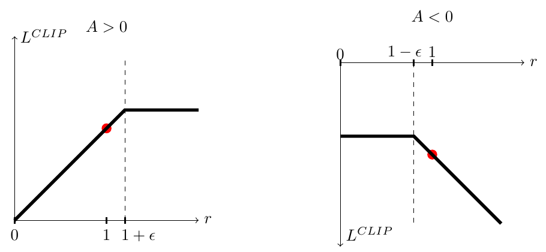

# [PPO: Proximal Policy Optimization Algorithms](https://arxiv.org/abs/1707.06347)

**PPO** is a family of on-policy reinforcement learning algorithms that alternate between collecting fresh trajectories and performing several minibatch optimization epochs on those trajectories. Its main contribution is a simple first-order objective, especially **probability-ratio clipping**, that discourages excessively large policy updates while allowing more reuse of each rollout batch.

**Source:** the supplied Schulman et al. paper, arXiv:1707.06347v2 (2017), especially Sections 2-6 and Appendix A. This note covers the original algorithm and experiments, not a particular modern library's implementation.

## Convenient Links

* [Paper](https://arxiv.org/abs/1707.06347)
* [SAC](./SAC.md): an off-policy alternative using replay and a maximum-entropy objective.
* [Policy-gradient foundations](../../Books/Reinforcement_Learning/Reinforcement_Learning_An_Introduction.md#chapter-13-policy-gradient-methods) / [Eligibility traces](../../Books/Reinforcement_Learning/Reinforcement_Learning_An_Introduction.md#chapter-12-eligibility-traces)
* [PPO for RLHF](../../Preference_Alignment/PPO.md): a separate application note covering reward models and a reference policy.

## 1. Why PPO: Reusing Data Without Unrestricted Updates

A policy-gradient update increases the probability of actions with positive estimated advantage and decreases it for negative ones:

$$
\hat g=\hat{\mathbb E}_t
\left[\nabla_\theta\log\pi_\theta(a_t\mid s_t)\hat A_t\right],
\qquad
A_\pi(s,a)=q_\pi(s,a)-v_\pi(s).
$$

Here $\pi_\theta$ is the actor, $\hat A_t$ estimates how much better the sampled action was than the state's usual outcome, and $\hat{\mathbb E}_t$ is an empirical batch average. These are the paper's sampled surrogate objectives; they are not an exact evaluation of a new policy's return.

One update per batch uses expensive environment interaction inefficiently. But repeatedly optimizing $\hat{\mathbb E}_t[\log\pi_\theta(a_t\mid s_t)\hat A_t]$ on the same data can move the policy far from the one that generated it. Its fixed advantage estimates then become a poor guide to further improvement.

### 1.1 The Old-Policy Ratio and the [Trust Region Policy Optimization (TRPO)](https://arxiv.org/abs/1502.05477) Connection

Freeze the rollout policy $\pi_{\theta_{\mathrm{old}}}$ and define

$$
r_t(\theta)=\frac{\pi_\theta(a_t\mid s_t)}
{\pi_{\theta_{\mathrm{old}}}(a_t\mid s_t)},
\qquad
L^{\mathrm{CPI}}(\theta)=\hat{\mathbb E}_t[r_t(\theta)\hat A_t].
$$

The ratio compares the **same stored action in the same stored state** under the current and behavior policies. It is not a ratio of their separately sampled actions. At $\theta=\theta_{\mathrm{old}}$, $r_t=1$ and

$$
\left.\nabla_\theta L^{\mathrm{CPI}}\right|_{\theta_{\mathrm{old}}}
=\hat{\mathbb E}_t[\hat A_t\nabla_\theta\log\pi_\theta(a_t\mid s_t)].
$$

Thus the surrogate has the usual policy-gradient direction at the rollout policy. The ratio corrects action probabilities at sampled states, **not the change in future state visitation**; it does not make arbitrarily stale trajectories safe for unlimited reuse.

TRPO maximizes this surrogate subject to

$$
\hat{\mathbb E}_t\left[
D_{\mathrm{KL}}\bigl(\pi_{\mathrm{old}}(\cdot\mid s_t)\Vert
\pi_\theta(\cdot\mid s_t)\bigr)\right]\le\delta_{\mathrm{KL}}.
$$

Its approximate constrained update requires more machinery, including curvature information and conjugate gradients. PPO instead seeks a surrogate that ordinary first-order optimizers such as Adam can improve for multiple epochs.

## 2. The Clipped Objective

PPO-Clip maximizes

$$
\boxed{L^{\mathrm{CLIP}}(\theta)=\hat{\mathbb E}_t\left[
\min\left(r_t(\theta)\hat A_t,
\operatorname{clip}(r_t(\theta),1-\epsilon,1+\epsilon)\hat A_t\right)
\right].}
$$

The minimum is essential: clipping alone would also remove the learning signal for changes in the **wrong** direction. Written by advantage sign, each sample contributes

$$
\ell_t(\theta)=
\begin{cases}
\hat A_t\min(r_t,1+\epsilon),&\hat A_t\ge0,\\
\hat A_t\max(r_t,1-\epsilon),&\hat A_t<0.
\end{cases}
$$

* **Positive advantage:** increasing the action probability is favorable, but there is no further benefit from this term once $r_t>1+\epsilon$. An unfavorable decrease remains penalized.
* **Negative advantage:** decreasing the action probability is favorable, but there is no further benefit once $r_t<1-\epsilon$. An unfavorable increase remains penalized.



*Paper Figure 1: the positive-advantage term flattens above the upper threshold, while the negative-advantage term flattens below the lower threshold. Red dots mark the initial ratio $r=1$.*

For $\epsilon=0.2$, four cases make the asymmetry concrete:

| Advantage | Ratio | Unclipped $r\hat A$ | Clipped surrogate $\ell$ | Meaning |
|:--:|:--:|:--:|:--:|:--|
| $+2$ | $1.4$ | $2.8$ | $2.4$ | Further favorable increase gives no additional benefit |
| $+2$ | $0.6$ | $1.2$ | $1.2$ | Unfavorable decrease still has a corrective gradient |
| $-2$ | $0.6$ | $-1.2$ | $-1.6$ | Further favorable decrease gives no additional benefit |
| $-2$ | $1.4$ | $-2.8$ | $-2.8$ | Unfavorable increase still has a corrective gradient |

**What clipping does not guarantee:** it does not project the policy into a feasible set or force every ratio into $[1-\epsilon,1+\epsilon]$. Shared parameters, other samples, and auxiliary losses can keep changing a ratio after its own policy-loss term becomes flat. Nor does clipping guarantee a bound on KL divergence or monotonic reward improvement.

The exact lower-bound statement is $L^{\mathrm{CLIP}}\le L^{\mathrm{CPI}}$ on the same batch. This is **not by itself a certified lower bound on the true environment return**. PPO retains the unclipped surrogate's first-order behavior around $r=1$ and becomes pessimistic about large favorable changes farther away.

### 2.1 The Paper's Alternative: Adaptive KL Penalty

The paper also studies PPO with

$$
L^{\mathrm{KLPEN}}(\theta)=\hat{\mathbb E}_t\left[
r_t(\theta)\hat A_t-\beta
D_{\mathrm{KL}}(\pi_{\mathrm{old}}(\cdot\mid s_t)\Vert\pi_\theta(\cdot\mid s_t))
\right].
$$

After optimizing a batch, measure its mean KL $d$. For a target $d_{\mathrm{targ}}$, halve $\beta$ if $d<d_{\mathrm{targ}}/1.5$, and double it if $d>1.5d_{\mathrm{targ}}$; otherwise retain it. Use the revised coefficient on the next policy update.

This is an alternative to clipping, although the paper allows combining them. Its experiments favor clipping. **An explicit KL penalty is not required by PPO-Clip**, and this old-to-new KL is not the fixed-reference KL used in RLHF.

## 3. What Modules and Data Does PPO Use?

PPO is an optimization algorithm, not a prescribed backbone. Its actor-critic implementation has these roles:

| Component | Input and output | Role |
|:--|:--|:--|
| Actor $\pi_\theta$ | Observation/state $s_t$ -> action distribution -> sampled action $a_t$ | Interact with the environment and compute action log-probabilities |
| Critic $V_\phi$ | $s_t$ -> scalar expected return | Estimate advantages and provide a bootstrap at rollout cutoffs |
| Old-policy information | Stored $\log\pi_{\mathrm{old}}(a_t\mid s_t)$; old distribution parameters if needed for KL | Fixed denominator during all epochs on one rollout batch |
| Environment | $a_t$ -> reward $R_{t+1}$, successor $s_{t+1}$, episode status | Generate training experience |

The actor and critic can have separate networks or a shared feature extractor with separate output heads. In the paper's MuJoCo experiments, they are **separate**; the actor is a two-hidden-layer MLP with 64 units per layer and tanh activations, producing a Gaussian mean with variable standard deviations. The Atari comparison uses the same policy architecture across PPO, A2C, and ACER, rather than introducing a new PPO-specific architecture.

For an independent multidimensional Gaussian, sum the per-coordinate log densities to obtain the **joint action log-probability** before taking the ratio. For discrete actions, use the categorical log-probability of the sampled action.

No reward model or permanently frozen reference model is required by the original method. There is also no offline pre-training dataset in these experiments: training data are fresh interactions from the evolving policy.

## 4. Training Pipeline: Rollout, Estimate, Reuse, Refresh

### 4.1 Collect and Freeze One Rollout Batch

At the start of an iteration, set $\theta_{\mathrm{old}}\leftarrow\theta$. Each of $N$ parallel actors collects $T$ transitions, giving a batch of $B=NT$ transitions. Store observations, actions, rewards, successor/episode information, old log-probabilities, and rollout-time critic predictions.

The rollout policy is fixed during collection. During optimization, **only the numerator policy changes**; old log-probabilities, advantages, and value targets are treated as fixed data. Stored old log-probabilities suffice for PPO-Clip; a complete frozen actor need not be evaluated on every minibatch.

### 4.2 Turn Rewards and Values into Advantages

With a rollout ending just before time $T$, the paper's truncated generalized advantage estimator (GAE) is

$$
\delta_t=R_{t+1}+\gamma V_{\mathrm{old}}(s_{t+1})-V_{\mathrm{old}}(s_t),
\qquad
\hat A_t=\sum_{l=0}^{T-t-1}(\gamma\lambda)^l\delta_{t+l}.
$$

$\gamma$ discounts rewards, while $\lambda$ controls how much the estimate relies on longer sequences of TD errors. Compute the same sum backward using $\hat A_t=\delta_t+\gamma\lambda\hat A_{t+1}$, with no residual advantage beyond the collected segment. At $\lambda=0$, this is a one-step TD error; at $\lambda=1$, it telescopes to a bootstrapped segment return minus $V_{\mathrm{old}}(s_t)$.

For example, rewards $(1,2)$, rollout values $(0.5,1,0)$ with a terminal final state, $\gamma=0.9$, and $\lambda=0.95$ give $\delta_0=1.4$, $\delta_1=1$, and $\hat A_0=2.255$, $\hat A_1=1$.

**Episode boundaries matter.** A true terminal state has zero bootstrap value, and the advantage recursion must not continue into a reset episode. A rollout cutoff in an ongoing episode instead uses the critic's value of the actual successor. If a time limit is only a collection truncation, bootstrap from its final observation but stop the trace across the reset. These boundary rules explain how to implement the finite-segment equations; a single undifferentiated `done` flag can incorrectly erase a needed bootstrap.

The paper writes the value loss using a target $V_t^{\mathrm{targ}}$. A consistent GAE-based implementation chooses $V_t^{\mathrm{targ}}=V_{\mathrm{old}}(s_t)+\hat A_t$, detached from gradients. This is a target-construction choice, not a new PPO objective. If normalizing actor advantages, construct value targets from the **raw** advantages, not the normalized ones.

### 4.3 Optimize the Same Batch for Several Epochs

Re-evaluate the stored actions under the current actor:

$$
r_t(\theta)=\exp\bigl(\log\pi_\theta(a_t\mid s_t)
-\log\pi_{\mathrm{old}}(a_t\mid s_t)\bigr).
$$

For joint actor-critic training, the paper maximizes

$$
\hat{\mathbb E}_t\left[
\ell_t(\theta)-c_1\bigl(V_\phi(s_t)-V_t^{\mathrm{targ}}\bigr)^2
+c_2\mathcal H(\pi_\theta(\cdot\mid s_t))\right],
$$

where $c_1$ weights value fitting and $c_2$ weights entropy to encourage exploration. A minimization-based optimizer uses the negative policy surrogate, **plus** value error, **minus** entropy.

```text
repeat:
    collect N * T transitions with the current rollout policy
    cache old action log-probabilities and rollout value predictions
    compute fixed advantages and value targets, respecting episode boundaries
    for epoch = 1,...,K:
        shuffle the collected batch into minibatches of size M
        evaluate current log-probabilities, values, and entropy
        take an Adam step on -policy_surrogate + c1 * value_error - c2 * entropy
    discard this batch and collect fresh experience with the updated policy
```

One **iteration** includes collection plus $K$ optimization epochs, not just one gradient step. If minibatches divide the batch evenly, it performs $KNT/M$ optimizer steps. Do not refresh the denominator after each step: it must remain the policy that actually generated these actions.

PPO is normally classified as **on-policy with limited batch reuse**, not a replay-buffer algorithm like SAC. After several updates, the frozen data become less representative, so the next iteration refreshes the experience. Clipping is not permission to train indefinitely on a fixed dataset.

### 4.4 Inference

At deployment, the actor alone maps the current observation to an action distribution. Sampling preserves its stochastic policy; choosing a mode or Gaussian mean is an evaluation choice that changes that policy. The critic, rollout buffer, advantages, and old-policy denominator are training machinery, not required for action selection.

## 5. What the Experiments Establish

### 5.1 Surrogate Ablation and Continuous Control

The main MuJoCo benchmark uses seven tasks: HalfCheetah, Hopper, InvertedDoublePendulum, InvertedPendulum, Reacher, Swimmer, and Walker2d, all the paper's `-v1` versions. Each run trains for one million environment timesteps, with three seeds per task. Scores use the final 100 episodes, normalized per environment so a random policy scores zero and the best observed result scores one, then averaged over 21 runs.

| Surrogate setting | Average normalized score, paper Table 1 |
|:--|:--:|
| No clipping or KL penalty | -0.39 |
| Clip $\epsilon=0.1$ | 0.76 |
| Clip $\epsilon=0.2$ | **0.82** |
| Clip $\epsilon=0.3$ | 0.70 |
| Best tested adaptive KL setting, $d_{\mathrm{targ}}=0.01$ | 0.74 |
| Best tested fixed KL setting, $\beta=3$ | 0.72 |

The negative unregularized score is driven by a particularly poor HalfCheetah result. The comparison supports clipping over the tested alternatives, but it is not evidence that $\epsilon=0.2$ is universally optimal. The separate algorithm comparison reports strong performance against tuned TRPO, vanilla policy gradient, A2C, trust-region A2C, and CEM on these tasks.

The Roboschool humanoid experiments additionally demonstrate running, steering toward changing targets, and recovering under disturbances. They use much longer runs and a different configuration; they are not another one-million-step benchmark or a pre-training/fine-tuning pipeline.

### 5.2 Atari: Learning Speed Versus Final Performance

The Atari evaluation covers 49 games, three seeds, and 40 million game frames (10 million timesteps). Table 2 counts which method wins each game:

| Scoring criterion | A2C wins | ACER wins | PPO wins | Ties |
|:--|:--:|:--:|:--:|:--:|
| Average episode reward across training | 1 | 18 | **30** | 0 |
| Average reward over final 100 episodes | 1 | **28** | 19 | 1 |

PPO wins more games on the metric favoring fast learning, but ACER wins more on final performance. These are **counts of game-wise wins**, not pooled reward scores; the paper does not establish PPO as best on every task or metric.

### 5.3 Reported Configurations, Not Universal Defaults

| Setting | MuJoCo, Appendix Table 3 | Atari, Appendix Table 5 |
|:--|:--|:--|
| Rollout horizon $T$ | 2048 | 128 per actor |
| Parallel actors $N$ | Not listed in Table 3 | 8 |
| Optimization epochs $K$ | 10 | 3 |
| Minibatch size $M$ | 64 | 256 |
| Adam learning rate | $3\times10^{-4}$ | $2.5\times10^{-4}u$ |
| Discount / GAE | $\gamma=0.99$, $\lambda=0.95$ | Same |
| Clip range | $0.2$ in the main algorithm comparison | $0.1u$ |
| Value / entropy | Separate networks; no entropy bonus | $c_1=1$, $c_2=0.01$ |

For Atari, $u$ decreases linearly from one to zero over training. The batch contains $8\times128=1024$ transitions, giving $3\times1024/256=12$ optimizer steps per collection iteration. The Roboschool setup instead uses horizon 512, 15 epochs, minibatches of 4096, and 32 or 128 actors depending on the task, with KL-adjusted learning rate and annealed action log-standard-deviation (Appendix Table 4).

The paper's displayed value loss is ordinary squared error. Value-loss clipping, advantage normalization, gradient-norm clipping, or KL-based early stopping should be identified as implementation choices when used, not silently treated as terms required by Equation (7).

## 6. Minimal Numerical Check

This standard-library Python example checks the clipping signs and the GAE example above. It isolates objective arithmetic rather than implementing a full trainer; run the block with Python 3.

```python
from math import exp, isclose, log


def clipped_surrogate(logp, old_logp, advantage, epsilon=0.2):
    ratio = exp(logp - old_logp)
    clipped = min(max(ratio, 1.0 - epsilon), 1.0 + epsilon)
    return min(ratio * advantage, clipped * advantage)


def gae_segment(rewards, values, bootstrap, trace, gamma=0.9, lam=0.95):
    # values includes the actual final successor; masks handle termination/reset.
    if not (len(values) == len(rewards) + 1
            and len(bootstrap) == len(trace) == len(rewards)):
        raise ValueError("inconsistent rollout lengths")
    advantages = [0.0] * len(rewards)
    future = 0.0
    for t in range(len(rewards) - 1, -1, -1):
        delta = rewards[t] + gamma * bootstrap[t] * values[t + 1] - values[t]
        future = delta + gamma * lam * trace[t] * future
        advantages[t] = future
    return advantages


for ratio, advantage, expected in [(1.4, 2, 2.4), (0.6, 2, 1.2),
                                    (0.6, -2, -1.6), (1.4, -2, -2.8)]:
    result = clipped_surrogate(log(ratio), 0.0, advantage)
    assert isclose(result, expected)

advantages = gae_segment([1, 2], [0.5, 1, 0], [1, 0], [1, 0])
assert isclose(advantages[0], 2.255) and isclose(advantages[1], 1.0)
# Collection cutoff: bootstrap is allowed, but no trace crosses the boundary.
assert isclose(gae_segment([1], [0.5, 2], [1], [0])[0], 2.3)
print("PPO clipping and GAE checks passed.")
```

Here `bootstrap[t]` is zero for true termination; `trace[t]` is zero where the advantage recursion must stop. The example represents one contiguous segment. For buffers spanning resets, store each transition's actual successor value explicitly rather than accidentally using the next episode's initial observation. In autodiff code, detach old log-probabilities, advantages, and value targets, while keeping current log-probabilities differentiable; $r=1$ initially does **not** mean its gradient is zero.

## 7. Key Distinctions to Remember

* **Clipped objective, not a hard trust region:** PPO removes some incentives for large favorable changes; ratios and KL can still move substantially.
* **Actor and critic, not four mandatory models:** the original method does not require a learned reward model or fixed reference policy.
* **Old policy versus RLHF reference:** the old policy refreshes with each rollout iteration; an RLHF reference is a separate alignment anchor. See [PPO for RLHF](../../Preference_Alignment/PPO.md).
* **Batch reuse, not unlimited replay:** old-policy ratios and advantage estimates stay fixed over a limited number of optimization epochs, then experience is refreshed.
* **Empirical robustness, not monotonic improvement:** hyperparameters, advantage quality, policy parameterization, and task dynamics still affect stability.

**In one sentence:** PPO turns a rollout policy's advantage estimates into several first-order policy updates, using a clipped surrogate or adaptive KL penalty to discourage moving too far before collecting new experience.
