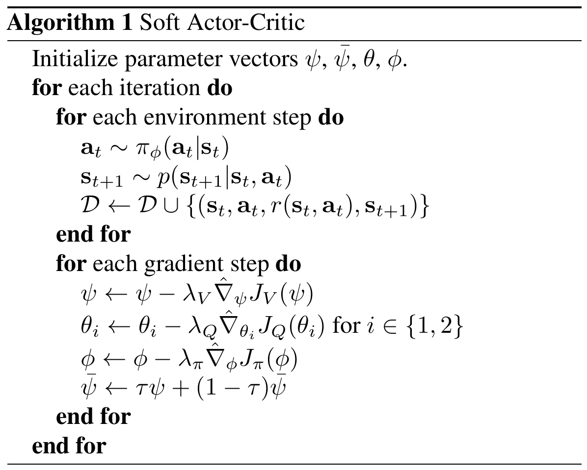
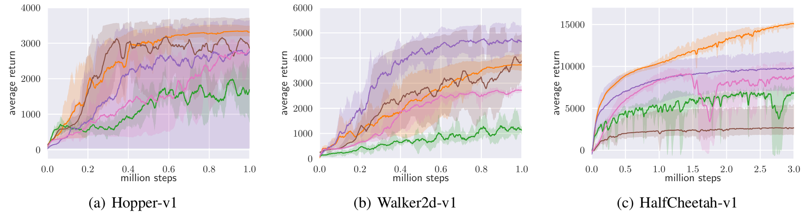
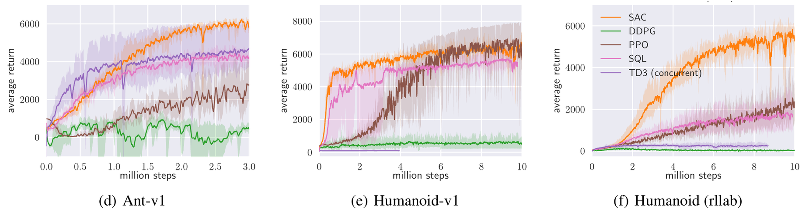
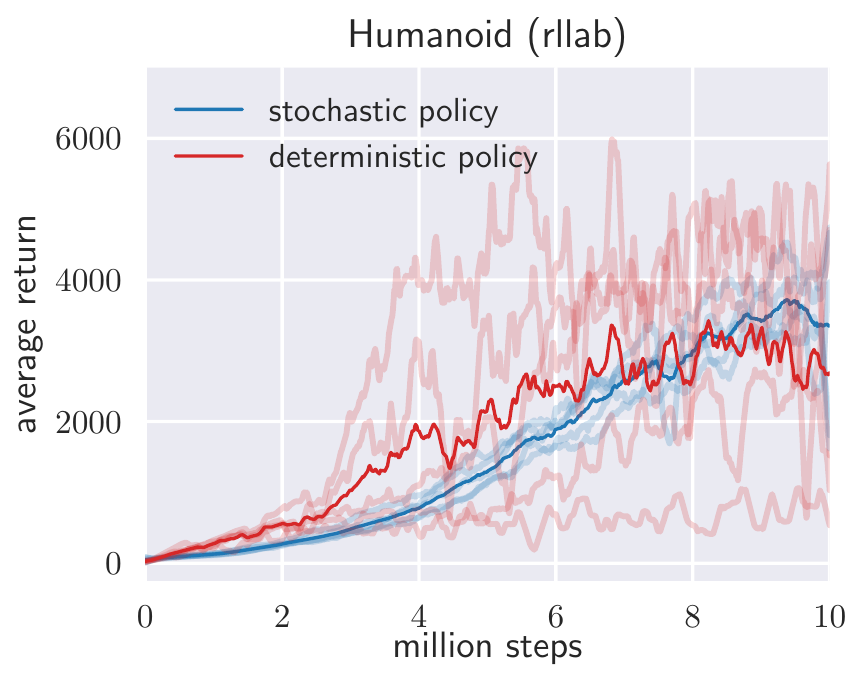
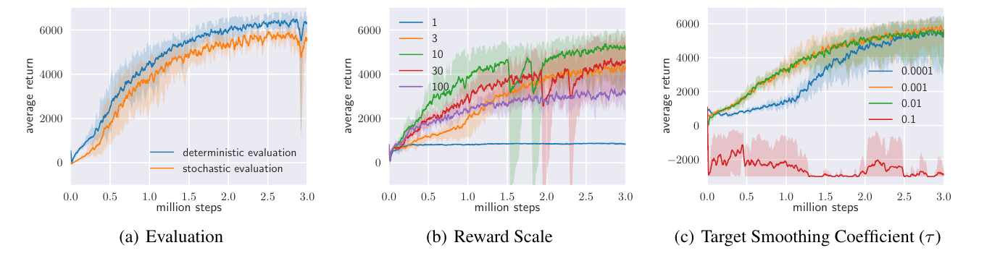
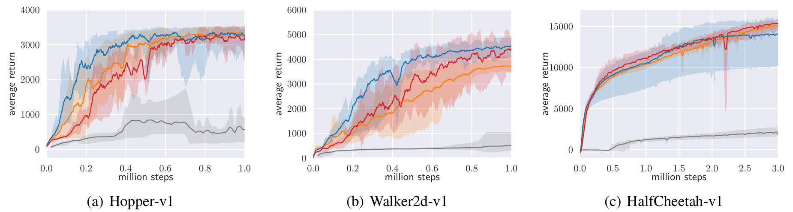
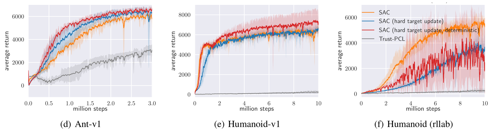

# [SAC: Soft Actor-Critic](https://arxiv.org/abs/1801.01290v2)

**Soft Actor-Critic (SAC)** learns continuous control from a replay buffer and trains its policy to balance reward with entropy. The critics learn from recorded actions and their outcomes. The actor draws fresh actions at the same states and uses the critics to improve those choices. Entropy enters both the actor's objective and the critics' estimates of future value.

This note follows the original 2018 formulation by Tuomas Haarnoja, Aurick Zhou, Pieter Abbeel, and Sergey Levine. That version uses two action-value networks, a separate state-value network and its target copy, and a reward scale chosen per task. [Paper PDF with appendices](https://arxiv.org/pdf/1801.01290v2) · [ICML proceedings](https://proceedings.mlr.press/v80/haarnoja18b.html)

## Convenient Links

- Original implementation. [haarnoja/sac](https://github.com/haarnoja/sac)
- An on-policy comparison. [PPO](./PPO.md)
- Background on actors and critics. [Reinforcement Learning: An Introduction, Section 13.5](../../Foundations/Books/Reinforcement_Learning/Reinforcement_Learning_An_Introduction.md#135-actor-critic-methods)

## 1. What Does SAC Gain from Replay and Entropy?

Suppose a simulated robot tries two ways to regain balance from the same pose. It can reuse the recorded outcome of each attempt while learning from later trials. Once its policy changes, the outcomes remain evidence about the actions that actually ran. The transition answers “what happened when the robot applied this command here?” even if the current policy would now choose a different command.

SAC stores these transitions in a **replay buffer** $\mathcal D$. Training is **off-policy** because a sampled record can come from an earlier version of the actor, while the critic estimates future behavior under the current actor. Each record gives a state $s$, a commanded action $a$, its reward $R$, and the observed successor $s'$. Reuse assumes the environment still responds to the same state and action according to the same dynamics. Useful policy improvement also depends on replay covering enough of the states and actions the learner needs to evaluate.

### 1.1 Reward and Entropy Favor Different Properties of a Policy

If several actions look promising, early value estimates may differ just because some actions have been tried more often. A policy trained to concentrate on the current winner can stop collecting evidence about alternatives. SAC gives the policy a reason to keep several options available by rewarding **entropy**, a measure of the spread of its action distribution.

For a finite sequence of decisions, the paper's objective adds the policy's entropy at each visited state to the expected task reward.

$$
J(\pi)=\sum_t \mathbb E_{(s_t,a_t)\sim\rho_\pi}
\left[r(s_t,a_t)+\alpha\mathcal H\bigl(\pi(\cdot\mid s_t)\bigr)\right],
\qquad
\mathcal H\bigl(\pi(\cdot\mid s)\bigr)
=-\mathbb E_{a\sim\pi(\cdot\mid s)}[\log\pi(a\mid s)].
$$

Here $\pi(a\mid s)$ is the action distribution, $r(s,a)$ is the reward associated with a state and action, and $\rho_\pi$ describes the state and action pairs encountered by following $\pi$. The **temperature** $\alpha>0$ sets the importance of entropy relative to reward. With natural logarithms, entropy is measured in nats, and $\alpha$ converts it into reward units. For continuous actions, $\pi(a\mid s)$ is a density and the formula gives differential entropy. Densities can exceed one, so the entropy contribution can be negative.

**Illustrative two-action example.** Suppose either of two commands earns reward 4 and the episode then ends. Always choosing one earns 4 with zero entropy. Choosing each half the time also earns 4 and adds $0.2\log 2\approx0.139$ when $\alpha=0.2$. If one command earns substantially less reward, mixing the commands can cost more reward than the entropy is worth. Section 2 shows how their value gap controls the resulting probabilities.

### 1.2 Reward Scaling Changes the Same Trade-off

The paper writes its algorithm with a unit entropy coefficient and multiplies task rewards by a positive scale $c$. This note keeps $\alpha$ explicit and uses unscaled rewards in the equations. Multiplying $r+\alpha\mathcal H$ by $c=1/\alpha$ gives $cr+\mathcal H$. The two expressions rank policies the same under the corresponding change of value units, although numerical training can respond differently to the change in scale.

For example, multiplying rewards by 5 in the paper's convention corresponds to $\alpha=0.2$ in the unscaled convention. Increasing $c$ gives a fixed reward difference more weight relative to entropy, as lowering the temperature does. The paper chooses $c$ before training and studies its effect in Figure 3.

## 2. How Does Entropy Change Evaluation and Improvement?

### 2.1 Q Fixes This Action While V Includes the Current Choice

The critic needs to know whether today's action leads to useful future choices. To track where the entropy enters, distinguish evaluating one specified action from evaluating the policy's whole distribution at a state.

$$
\begin{aligned}
Q^\pi(s,a)&=r(s,a)+\gamma\,\mathbb E_{s'\sim p(\cdot\mid s,a)}[V^\pi(s')],\\
V^\pi(s)&=\mathbb E_{a\sim\pi(\cdot\mid s)}
\left[Q^\pi(s,a)-\alpha\log\pi(a\mid s)\right].
\end{aligned}
$$

*Paper Equations (2)–(3), with temperature shown explicitly.*

The transition distribution $p(\cdot\mid s,a)$ describes the environment's possible successors, and $\gamma$ discounts the future. $Q^\pi(s,a)$ takes the reward for the fixed current command and adds the value of following the policy from its successor. At that successor, $V^\pi$ already includes the entropy of the next choice. At the current state, $V^\pi(s)$ also averages over today's actions and includes the entropy of drawing one. The two equations therefore count each choice's entropy once.

Take the two equally good terminal commands from Section 1 as the choices at a successor state $s'$. An action that reaches $s'$ deterministically and earns immediate reward $1$ has $Q^\pi(s,a)=1+0.9(4.139)\approx4.725$ for $\gamma=0.9$ and the uniform policy at $s'$. If the policy at $s'$ always uses one command, the same preceding action has value $1+0.9(4)=4.6$. The immediate rewards are identical. The difference comes from the next state's freedom to choose between equally good actions.

The paper's practical Bellman updates discount future rewards and entropy. Its Appendix A discusses how this discount differs from discounting the state distribution itself. The actor update below uses the states represented in replay.

### 2.2 Turn Value Differences into Action Probabilities

Once the current policy has been evaluated, the improvement step seeks actions with larger soft Q-values while accounting for the entropy of the new distribution. With fixed $Q$, the distribution that maximizes $\mathbb E[Q(s,a)]+\alpha\mathcal H$ at a state is the **Boltzmann distribution**.

$$
p_Q(a\mid s)=\frac{\exp(Q(s,a)/\alpha)}{Z(s)},
\qquad Z(s)=\int \exp(Q(s,a)/\alpha)\,da .
$$

$Z(s)$ is the normalizer, with a sum in the discrete case. For two illustrative commands with Q-values 2 and 1, the ratio of their desired probabilities is $\exp((2-1)/\alpha)$.

| Temperature $\alpha$ | Probability of command valued at 2 | Probability of command valued at 1 |
|---:|---:|---:|
| 0.5 | 0.881 | 0.119 |
| 2.0 | 0.622 | 0.378 |

The larger temperature makes the same value gap less decisive. Equal Q-values give equal mass in this two-action example. As temperature goes to zero, the higher-valued action takes nearly all the mass.

An exact normalizer involves an integral over the entire action space, which can be expensive for a neural Q-function. The paper fits a tractable actor $\pi_\phi$ by minimizing the Kullback–Leibler (KL) divergence from that actor to $p_Q$. Expanding the divergence gives

$$
\alpha D_{\mathrm{KL}}\bigl(\pi_\phi(\cdot\mid s)\Vert p_Q(\cdot\mid s)\bigr)
=\mathbb E_{a\sim\pi_\phi(\cdot\mid s)}
   [\,\alpha\log\pi_\phi(a\mid s)-Q(s,a)\,]
+\alpha\log Z(s).
$$

The expectation samples actions from the actor. The critic stays fixed during this update, so $Z(s)$ depends on the state and critic but is constant with respect to the actor parameters $\phi$. Minimizing the expectation alone gives the same actor gradient. In a continuous problem this lets the actor learn to propose high-value actions without solving a new integration or search problem at every control step. A limited policy family, such as a single squashed Gaussian, can only approximate the desired distribution.

### 2.3 What the Exact Policy Iteration Result Covers

In the finite-action analysis, repeated soft Bellman backups evaluate a fixed policy. When comparing two Q-estimates under the same policy, the reward and entropy terms cancel in their difference. Averaging successor values and discounting with $\gamma<1$ then shrinks the maximum difference, which gives convergence for bounded values. The KL projection then improves the policy because the old policy belongs to the same admissible class and is one candidate in the minimization. Reevaluating the improved policy propagates that change through future states. The paper proves convergence within the policy class for exact soft evaluation and improvement under its stated assumptions. Neural SAC uses shared function approximators and finite minibatch updates for both operations, so its deep-control results are evaluated empirically.

## 3. How Does the Actor Generate a Bounded, Differentiable Action?

A continuous command needs to stay within the range the environment accepts. The paper samples from a Gaussian and applies $\tanh$ coordinate by coordinate. Writing the random draw as fixed-distribution noise $\epsilon$ separates the random input from the trainable transformation.

$$
\epsilon\sim\mathcal N(0,I),\qquad
u=\mu_\phi(s)+\sigma_\phi(s)\odot\epsilon,\qquad
\tilde a=\tanh(u)=f_\phi(\epsilon;s).
$$

The actor predicts a mean vector $\mu_\phi$ and positive standard deviations $\sigma_\phi$. The symbol $\odot$ denotes elementwise multiplication. Each normalized command coordinate lies in $(-1,1)$. At a fixed noise draw, changing the mean or scale changes the command smoothly, which lets the actor learn from the critic's derivative with respect to the command.

### 3.1 Use the Density of the Command after Squashing

Squashing compresses wide intervals of raw Gaussian samples near the action limits. In one dimension, a short interval $du$ becomes $da=(1-\tanh^2u)\,du$. The interval keeps its probability mass, so the density per unit of action changes by the inverse factor. The entropy term therefore uses the transformed density.

$$
\log\pi_\phi(\tilde a\mid s)
=\log\mathcal N\!\left(u;\mu_\phi(s),\operatorname{diag}(\sigma_\phi(s)^2)\right)
-\sum_{j=1}^{D}\log\!\left(1-\tanh^2(u_j)\right),
$$

where $D$ is the number of action coordinates. The sum gives a single change-of-variables correction for the joint action density. Close to saturation, implementations can evaluate the log Jacobian directly from $u$ using a stable identity, as in the numerical check at the end. [Paper Appendix C](https://arxiv.org/pdf/1801.01290v2#page=12)

**Illustrative sample.** In one dimension let $u=0.8$, the mean be $0.8$, and the standard deviation be $1$. The command is $\tilde a\approx0.664$, and the derivative of $\tanh$ there is about $0.559$. The Gaussian log density at its mean is about $-0.919$. Subtracting $\log(0.559)$ gives a bounded-action log density of about $-0.337$. This correction changes the entropy term in both the actor and state-value updates.

## 4. How Does One Replay Transition Train Four Networks?

The actor collects experience by sampling a command and executing it. A training round then draws a minibatch from replay. Each stored command has an observed outcome. The current actor supplies new candidate commands at the sampled states, and the critics provide estimates for those commands.

| Network | Input and output | Information it uses to learn |
|---|---|---|
| Actor $\pi_\phi$ | State → distribution over bounded actions | Soft Q and log density evaluated at a fresh, differentiable sample |
| Two action-value critics $Q_{\theta_1}$, $Q_{\theta_2}$ | State and action → soft action value | Stored action, observed reward, and target value at the observed successor |
| State-value network $V_\psi$ | State → soft state value | Soft Q and entropy sampled under the current actor |
| Target state-value network $V_{\bar\psi}$ | Successor state → bootstrap value | A delayed copy of the state-value network's parameters |

*Component summary based on Section 4.2 and Algorithm 1. The actor, two critics, and state-value network have separate training objectives. The target value copy is updated from $\psi$.*



*Paper Algorithm 1. The first loop adds transitions to replay. Each learning round updates $V_\psi$, both Q-networks, and the actor in that order, then moves the target weights $\bar\psi$ toward $\psi$. The three $\lambda$ symbols in the algorithm denote the respective learning rates.*

### 4.1 Fit V Using a Fresh Action at a Replay State

To fit $V_\psi(s)$, estimate the expectation from Section 2 by sampling a command $\tilde a$ from the current actor at state $s$. The two Q-networks can disagree about that command. When one critic happens to assign a large value to a poor command, an actor trained against it can learn to seek that prediction error. SAC uses the lower estimate for each candidate in both the value and actor updates.

$$
Q_{\min}(s,\tilde a)=\min\{Q_{\theta_1}(s,\tilde a),Q_{\theta_2}(s,\tilde a)\},
\qquad
y_V=Q_{\min}(s,\tilde a)-\alpha\log\pi_\phi(\tilde a\mid s).
$$

For instance, suppose the command from Section 3 has two illustrative Q-estimates of 5 and 6. A different command has estimates of 4 and 9. If we hold the entropy contributions equal, the second critic by itself favors the second command, while using the two minima favors the first. The rule reduces the influence of isolated high estimates. Both critics can still be wrong in the same direction.

Continue with the fresh command $\tilde a\approx0.664$. Its log density is about $-0.337$ and $\alpha=0.2$, so $y_V=5-0.2(-0.337)\approx5.067$. If the current state-value prediction is $4.8$, its squared-error update moves it toward $5.067$. The sampled target estimates the policy expectation at that state. The update minimizes

$$
J_V(\psi)=\mathbb E\!\left[\tfrac12
  \bigl(V_\psi(s)-\operatorname{stopgrad}(y_V)\bigr)^2\right].
$$

The expectation here draws states from replay and actions from the current actor. $\operatorname{stopgrad}$ keeps the computed target fixed for differentiation. The actor and both critics supply numbers for this step, while only the state-value network receives a gradient. The separate $V_\psi$ fits these samples over many updates and can supply a next-state value without drawing another action when computing the Q target.

### 4.2 Fit Both Q-Networks Using the Command That Actually Ran

At the same recorded state, suppose the buffer contains an older command $a=-0.3$ that earned $R=1$ and reached $s'$. The observed outcome belongs to $a=-0.3$. The fresh $0.664$ command can be scored by the critics, but it has no observed reward or successor in this record.

For this stored transition, the Q target comes from the reward and the slowly updated state-value prediction at $s'$. Each critic fits this same target with its own squared residual.

$$
y_Q=R+\gamma(1-d)V_{\bar\psi}(s'),\qquad
J_Q(\theta_i)=
\mathbb E_{(s,a,R,s',d)\sim\mathcal D}\!\left[
  \tfrac12\bigl(Q_{\theta_i}(s,a)-\operatorname{stopgrad}(y_Q)\bigr)^2
\right],\quad i\in\{1,2\}.
$$

Here $d=1$ denotes true termination and $d=0$ permits bootstrapping, meaning the use of a prediction for rewards beyond the transition. If $V_{\bar\psi}(s')=4$, $\gamma=0.9$, and the episode continues, both critics train toward $1+0.9(4)=4.6$ at $a=-0.3$. A prediction of $4.2$ moves up, and a prediction of $4.9$ moves down. The fresh-action value target $5.067$ belongs to the separate state-value regression. Entropy from the next choice is already included in $V_{\bar\psi}(s')$.

The termination mask makes the continuing-task backup practical in episodic settings. On true termination, $y_Q=1$ in this example. If collection stops at a time limit that merely truncates the underlying task, keep the bootstrap and use the transition's actual final observation before reset. The reset observation belongs to the next episode.

### 4.3 Improve the Actor Through the Action It Generates

The actor update uses the KL-derived objective from Section 2 and the differentiable sampler from Section 3. It draws noise $\epsilon$, obtains a current action, and measures its log density and Q-value.

$$
J_\pi(\phi)=\mathbb E_{s\sim\mathcal D,\ \epsilon\sim\mathcal N(0,I)}
  \left[\alpha\log\pi_\phi(\tilde a\mid s)-Q_{\min}(s,\tilde a)\right],
\qquad \tilde a=f_\phi(\epsilon;s).
$$

For the illustrative command in the value example, holding the critic evaluations fixed for comparison gives a sample loss of approximately $-5.067$. This is the negative of the quantity used to train V at that action. The two updates differentiate different things. V fits a detached number, while the actor changes its own distribution and the action that produced the number.

To see what the actor can change, write $g_\phi(s,a)=\log\pi_\phi(a\mid s)$. With the noise draw fixed, the gradient of one sample loss is

$$
\alpha\nabla_\phi g_\phi(s,a)\big|_{a\ \mathrm{fixed}}
+\left(\frac{\partial f_\phi}{\partial\phi}\right)^{\!\top}
   \left[\alpha\nabla_a g_\phi(s,a)-\nabla_a Q_{\min}(s,a)\right],
\qquad a=f_\phi(\epsilon;s).
$$

The first term accounts for direct changes in log density at the same action. The second follows the change in the sampled action as the actor's parameters move. The critic's parameters stay fixed, and its derivative with respect to the action is available to the actor. Detaching the action at the critic input would discard the last term in brackets, which supplies the task-value direction.

**Illustrative local update.** Use the one-dimensional draw from Section 3 with mean $\mu=0.8$, standard deviation $1$, and noise draw $\epsilon=0$. Suppose the lower critic has local slope $\partial Q_{\min}/\partial a=1$ and stays the lower critic near this command. Increasing $\mu$ increases the command at rate $1-\tilde a^2\approx0.559$. The raw Gaussian log density stays constant along this noise path. The Jacobian correction changes the bounded-action log density at rate $2\tanh\mu\approx1.328$. Therefore the derivative of the sample loss with respect to $\mu$ is $0.2(1.328)-0.559\approx-0.293$. A small gradient descent step increases the mean, because this sample's local gain in Q outweighs the log-density cost.

This is a **pathwise gradient** because it follows how the draw changes with the actor weights. The states used for training come from replay, and the sampled actions already come from the policy optimized by this objective. This explains why the update can use replay without comparing the old and current probabilities of the recorded command.

### 4.4 Move the Target Value Weights a Little at a Time

If a critic trains against a bootstrap that moves every time the other networks learn, its target can change rapidly. SAC smooths the value-network parameters used for the bootstrap. Start with a copy of $\psi$ and use the following update after each scheduled round:

$$
\bar\psi\leftarrow\bar\psi+\tau(\psi-\bar\psi).
$$

The parameter $\tau$ controls the fraction of the gap closed at each target update. For one illustrative weight, let the target have value 2 and the online weight have value 10. With $\tau=0.005$, the target moves to 2.04. If the online weight stays at 10 through the next update, the target moves to 2.0798. This is an average of **weights**. A nonlinear network's predicted values need not follow the same numerical average.

A zero coefficient keeps the target fixed. With $\tau=1$, one scheduled update copies the online weights in full. The original experiments use a small update each learning round. The appendix also studies a full copy every 1,000 gradient steps. Replay and network parameters persist across episodes. An environment reset starts a new trajectory while the learner continues to use previously stored transitions.

## 5. What Does the Trained Policy Do at Evaluation?

The actor alone maps the current observation to a command. It can still sample from its learned distribution. The paper's main SAC comparison uses the deterministic center action instead. For the squashed Gaussian, setting the Gaussian noise to zero gives $\tanh\mu_\phi(s)$. This is the transformed Gaussian mean and can differ from the expectation or mode of the bounded-action distribution.

The experiments report **environment return**, the sum of task rewards along a rollout. SAC trains with entropy as well. A deterministic run can earn a higher plotted return by avoiding lower-value sampled commands, while the stochastic actor continues to serve the exploration objective during training. Figure 3(a) tests this evaluation choice on Ant.

## 6. What Do the Experiments Establish?

### 6.1 Performance at a Fixed Interaction Budget

The six benchmarks are simulated continuous-control tasks. Each run learns from its own environment interactions. The comparison asks how much return each method achieves after the same number of environment steps, so its horizontal axis measures sample efficiency. Table 2 shows that the action space grows from three dimensions in Hopper to 21 in rllab Humanoid. Each task also has its own training reward scale.

| Environment | Action dimensions | Training reward multiplier | Plotted budget |
|---|---:|---:|---:|
| Hopper-v1 | 3 | 5 | 1 million steps |
| Walker2d-v1 | 6 | 5 | 1 million steps |
| HalfCheetah-v1 | 6 | 5 | 3 million steps |
| Ant-v1 | 8 | 5 | 3 million steps |
| Humanoid-v1 | 17 | 20 | 10 million steps |
| Humanoid (rllab) | 21 | 10 | 10 million steps |

*Paper Table 2, complete, with interaction budgets from Figure 1. The reward multiplier is a training setting. The curves report task return with the original reward scale.*

Figure 1 compares SAC with deep deterministic policy gradient (DDPG), proximal policy optimization (PPO), soft Q-learning (SQL), and the concurrent twin delayed deep deterministic policy gradient method (TD3). The SQL implementation also uses two Q-networks. The paper runs five seeds per method with one evaluation rollout every 1,000 environment steps. Lines show the mean, and shaded bands span the minimum and maximum across runs. The bands show observed seed variability.



*Paper Figure 1(a–c). Each panel has its own return scale and step budget. SAC is orange, DDPG green, PPO brown, SQL pink, and TD3 purple. The shared legend appears in the second crop.*



*Paper Figure 1(d–f). Humanoid-v1 and rllab Humanoid are different benchmark environments. Read cross-method differences within a panel.*

SAC stays competitive in Hopper, leads on HalfCheetah and Ant in these runs, and has a particularly large lead on rllab Humanoid. At 10 million steps, the rllab curve shows roughly 5,500 return for SAC and roughly 2,000–2,500 for PPO. These are approximate readings of the graph. Walker2d provides a counterexample to universal superiority, with TD3 finishing higher than SAC. In Humanoid-v1, SAC learns faster early and PPO catches up later.

The baselines compare full learning systems. Their architectures, objectives, update rules, and evaluation conventions can differ. In particular, the paper reports turning off exploration noise for DDPG and PPO, sampling during SQL evaluation, and using the center action for SAC. The following studies help identify which choices within SAC matter.

### 6.2 Stochastic Training and Seed Variability



*Paper Figure 2. Red deterministic runs spread much farther apart than blue stochastic runs on the same benchmark. This comparison uses periodic hard target updates.*

The stochastic variant achieves more consistent learning across seeds. The deterministic variant also drops the entropy terms, uses fixed Gaussian exploration noise, and uses target Q-networks in place of the separate state-value network. The result therefore compares two combinations of design choices. It supports the stochastic SAC recipe on this benchmark without measuring the separate effect of changing only the entropy coefficient. The paper's Section 4.2 also reports faster learning with two Q-networks than with one, especially on harder tasks. It provides the observation in prose.

### 6.3 Read the Three Ant Sensitivity Panels Together



*Paper Figure 3, Ant-v1. Panel (a) compares ways to act at evaluation. Panels (b) and (c) compare different training settings. All three plot environment return against millions of steps.*

| Panel | What changes | What the curves show |
|---|---|---|
| (a) Evaluation | Center action or stochastic sampling | Center actions generally earn higher task return in this run. This tests the action selection rule described in Section 5. |
| (b) Reward scale | Multiplier on task reward while the entropy coefficient stays at one | A multiplier of 1 learns little. A setting of 10 achieves the highest late return of the plotted runs. The main Ant run in Figure 1 uses 5, which is outside this sweep's displayed settings. Setting the multiplier too high also hurts performance, as the scale of 100 illustrates. |
| (c) Target smoothing | Fraction $\tau$ of the weight gap closed at each update | With $\tau=0.0001$, the target tracks so slowly that learning starts more slowly. At $\tau=0.1$, return deteriorates. The main comparative runs use $\tau=0.005$, between the tested $\tau=0.001$ and $0.01$. |

These panels distinguish the effect of how the actor is evaluated from how it learns. Reward scale changes the policy's incentive to explore. Target smoothing changes how fast a critic's regression target tracks the value network.

### 6.4 Compare Hard Target Copies with Smoothing



*Paper Figure 4(a–c). Standard SAC is orange, stochastic SAC with hard target updates is blue, the deterministic variant is red, and trust region path consistency learning (Trust-PCL) is gray.*



*Paper Figure 4(d–f). The hard-update and deterministic variants are competitive on several tasks. The rllab Humanoid panel shows the clearest advantage for the standard recipe.*

The blue variant keeps the explicit state-value network and copies its weights periodically. The red variant is the deterministic comparison described above. Trust-PCL shows lower return over the plotted budgets. The hard-update variant also takes four learning rounds per environment step on four of the six tasks, as Table 1 shows. Equal environment steps in those panels can therefore entail different numbers of gradient updates. The curves compare environment interaction efficiency for the tested recipes, including their different amounts of optimization.

### 6.5 Reported Training Configuration

| Setting | Paper value |
|---|---|
| Optimizer | Adam |
| Learning rate | $3\times10^{-4}$ |
| Discount $\gamma$ | 0.99 |
| Replay capacity | $10^6$ transitions |
| Minibatch size | 256 samples |
| Network hidden layers | 2 per network |
| Hidden units and activation | 256 per layer, rectified linear unit (ReLU) |

| Schedule | Standard SAC | Stochastic SAC with hard target copies |
|---|---:|---:|
| Target coefficient $\tau$ | 0.005 | 1 |
| Target update interval, in gradient rounds | 1 | 1,000 |
| Gradient rounds per environment step | 1 | 4 except humanoids, where it is 1 |

*Paper Table 1, shared settings and variant schedules, reorganized. A gradient round in Algorithm 1 includes an update to V, each Q-network, and the actor, with a target update when scheduled.*

The replay-based loop differs from PPO at the point where the actor learns. PPO scores stored actions against a fixed rollout policy and advantage estimate. SAC learns a soft Q-function from stored transitions and improves fresh policy samples through that function. Its entropy term is also part of the future value propagated by the critics. [PPO note](./PPO.md)

## 7. Check the Worked Example in Python

Run this block with Python 3 to check the two-action probabilities, the replay and value targets, the gradient through the action, and two target updates. The local Q slope from Section 4.3 is represented by a linear function around the worked command.

```python
from math import exp, isclose, log, log1p, pi, tanh


def first_action_probability(high_value, low_value, temperature):
    return 1 / (1 + exp((low_value - high_value) / temperature))


def q_target(reward, next_value, discount, terminal=False):
    return reward + discount * (1 - terminal) * next_value


def softplus(x):
    return max(x, 0.0) + log1p(exp(-abs(x)))


def log_density_at_zero_noise(mean):
    # Standard deviation is one and the Gaussian sample equals its mean.
    log_gaussian = -0.5 * log(2 * pi)
    log_jacobian = 2 * (log(2) - mean - softplus(-2 * mean))
    return log_gaussian - log_jacobian


mean = 0.8
temperature = 0.2
action = tanh(mean)
log_density = log_density_at_zero_noise(mean)
state_target = min(5, 6) - temperature * log_density

assert isclose(first_action_probability(2, 1, 0.5), 0.881, abs_tol=0.0005)
assert isclose(first_action_probability(2, 1, 2.0), 0.622, abs_tol=0.0005)
assert isclose(q_target(1, 4, 0.9), 4.6)
assert q_target(1, 4, 0.9, terminal=True) == 1
assert isclose(state_target, 5.067, abs_tol=0.0005)


def local_actor_loss(candidate_mean):
    local_q = 5 + tanh(candidate_mean) - action
    return temperature * log_density_at_zero_noise(candidate_mean) - local_q


step = 1e-5
slope = (local_actor_loss(mean + step) - local_actor_loss(mean - step)) / (2 * step)
analytic_slope = temperature * 2 * action - (1 - action**2)
assert isclose(slope, analytic_slope, abs_tol=1e-7)
assert local_actor_loss(mean + 0.01) < local_actor_loss(mean)

target, online, tau = 2.0, 10.0, 0.005
target += tau * (online - target)
assert isclose(target, 2.04)
target += tau * (online - target)
assert isclose(target, 2.0798)
print("SAC examples passed.")
```
