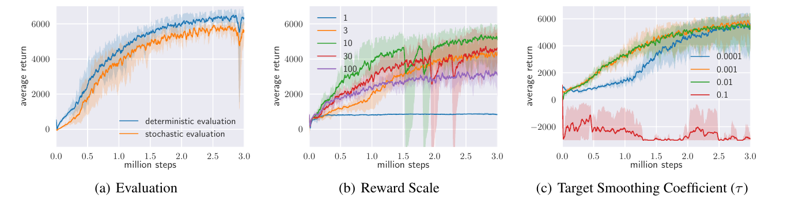

# [SAC: Soft Actor-Critic](https://arxiv.org/abs/1801.01290)

**Soft Actor-Critic (SAC)** combines replay-based off-policy learning with a stochastic actor that maximizes both reward and entropy. Soft value learning evaluates that objective, while a reparameterized policy update learns high-value continuous actions without solving an action-space maximization problem at every step.

**Source:** the supplied Haarnoja et al. paper, *Soft Actor-Critic: Off-Policy Maximum Entropy Deep Reinforcement Learning with a Stochastic Actor*, ICML 2018, arXiv:1801.01290v2. The core method is in Sections 3-5; Appendices B-D provide proofs, action-bound handling, and hyperparameters.

**Version boundary:** this paper uses **two Q-networks, an explicit soft state-value network, and a target copy of the value network**. Its experiments tune a reward scale rather than learn a temperature automatically. Do not replace its value-network target or add an automatic-temperature loss when reproducing this formulation.

## Convenient Links

* [Paper](https://arxiv.org/abs/1801.01290) / [Paper's code repository](https://github.com/haarnoja/sac)
* [PPO](./PPO.md) / [Actor-critic foundations](../../Books/Reinforcement_Learning/Reinforcement_Learning_An_Introduction.md#135-actor-critic-methods) / [Continuous-action policy gradients](../../Books/Reinforcement_Learning/Reinforcement_Learning_An_Introduction.md#137-policy-parameterization-for-continuous-actions)

## 1. Why Combine Replay with Maximum Entropy?

[PPO](./PPO.md) reuses a recent rollout batch for a limited number of updates, then collects fresh experience. SAC instead keeps a **replay buffer** containing transitions from many previous policies. This can reduce the amount of new environment interaction required, but puts more pressure on the stability and accuracy of value learning.

SAC's second ingredient is not merely extra exploration noise. It changes the objective so the policy values both task reward and retained randomness. In the paper's finite-horizon notation,

$$
J(\pi)=\sum_{t=0}^{T}\mathbb E_{(s_t,a_t)\sim\rho_\pi}
\left[r(s_t,a_t)+\alpha\mathcal H(\pi(\cdot\mid s_t))\right],
\qquad
\mathcal H(\pi(\cdot\mid s))=-\mathbb E_{a\sim\pi}[\log\pi(a\mid s)].
$$

Here $\rho_\pi$ denotes the policy-induced state/action distribution, and $\alpha>0$ controls entropy relative to reward. For continuous actions, this is **differential entropy**: $\pi(a\mid s)$ is a density, and neither entropy nor $-\log\pi(a\mid s)$ must be positive.

Larger $\alpha$ favors broader action distributions; smaller $\alpha$ favors concentrating on high-reward behavior. This is not "be random regardless of reward": low-value actions remain unattractive, while multiple good choices can retain probability mass. A restricted policy family may still fail to represent all desirable modes.

The paper suppresses $\alpha$ after Section 3.2 by scaling rewards by $1/\alpha$. **This note retains $\alpha$ explicitly**, with Q and V measured in the corresponding unscaled reward units. In the paper's unit-entropy convention, multiplying rewards by $c$ is equivalent, at the objective level, to using effective temperature $\alpha=1/c$ with unscaled rewards. These conventions should not be applied twice.

The algorithm introduces discount $\gamma$ in its Bellman backups. Appendix A discusses the distinction between discounting future returns and weighting state visitation; the practical replay-state actor objective below should not be mistaken for an exact on-policy gradient of a fixed-start discounted return.

## 2. From Soft Values to a Policy Objective

### 2.1 Evaluate Both Reward and Future Entropy

The soft Bellman equations are

$$
\begin{aligned}
Q^\pi(s,a)&=r(s,a)+\gamma\mathbb E_{s'\sim p}[V^\pi(s')],\\
V^\pi(s)&=\mathbb E_{a\sim\pi}
\left[Q^\pi(s,a)-\alpha\log\pi(a\mid s)\right].
\end{aligned}
$$

$Q^\pi(s,a)$ evaluates taking a specified action and then following the policy, including entropy at future states. $V^\pi(s)$ also averages over the **current** action and includes its entropy. Consequently the Q backup does not separately subtract $\alpha\log\pi(a\mid s)$ for the fixed replay action: that would change this value convention.

This placement makes entropy affect not only today's actor update but also which **future states** the critic considers valuable. A state offering several good action choices can be preferable to one permitting only a single viable choice.

### 2.2 Improve the Policy Toward High Soft Q-Values

For a fixed Q-function, the unrestricted entropy-regularized improvement distribution is

$$
\pi_{\mathrm{Boltzmann}}(a\mid s)
=\frac{\exp(Q(s,a)/\alpha)}{Z(s)},
\qquad Z(s)=\int\exp(Q(s,a)/\alpha)\,da.
$$

For two discrete actions with Q-values $(2,1)$, $\alpha=0.5$ gives probabilities approximately $(0.881,0.119)$, while $\alpha=2$ gives $(0.622,0.378)$. The relative value gap is unchanged, but temperature controls how decisively the policy exploits it.

In continuous spaces, computing $Z(s)$ and sampling this density exactly may be impractical. Restrict the actor to a tractable family $\Pi$, such as a squashed Gaussian, and minimize

$$
D_{\mathrm{KL}}\left(\pi_\phi(\cdot\mid s)
\,\Vert\,\frac{\exp(Q(s,\cdot)/\alpha)}{Z(s)}\right).
$$

Expanding and multiplying by $\alpha$ gives

$$
\alpha D_{\mathrm{KL}}
=\mathbb E_{a\sim\pi_\phi}
\left[\alpha\log\pi_\phi(a\mid s)-Q(s,a)\right]
+\alpha\log Z(s).
$$

During this policy-improvement step, Q is fixed, so $Z(s)$ has no dependence on actor parameters $\phi$. Dropping that constant gives the SAC actor loss. This is why SAC can improve the policy without evaluating the partition function.

The paper proves improvement and convergence for **exact soft policy iteration with finite actions and bounded quantities**, under its stated policy-class assumptions. Neural SAC replaces exact evaluation and per-state optimization with shared approximators and finite stochastic updates. The theorem is not a guarantee of globally optimal or stable deep-network training.

## 3. Network Structure in This Paper

Use the paper's parameter notation: $\phi$ for the actor, $\theta_1,\theta_2$ for Q-functions, $\psi$ for V, and $\bar\psi$ for its target copy.

| Module | Input -> output | Role |
|:--|:--|:--|
| Actor $\pi_\phi$ | State $s$ -> Gaussian mean and scale -> bounded sampled action | Behavior and differentiable policy improvement |
| $Q_{\theta_1}$ and $Q_{\theta_2}$ | State-action pair $(s,a)$ -> scalar soft Q-value each | Fit replay transitions; reduce optimistic actor/value estimates by taking their minimum |
| Soft value $V_\psi$ | State $s$ -> scalar | Approximate the current policy expectation of Q plus entropy |
| Target value $V_{\bar\psi}$ | Successor state $s'$ -> scalar | Slowly moving bootstrap for both Q-networks |
| Replay buffer $\mathcal D$ | Stored $(s,a,R,s',d)$ transitions | Reuse experience collected by earlier policies |

The implementation uses two hidden layers of 256 units and ReLU activations for all networks (Appendix D). There are four trainable networks plus one target value copy. The main algorithm has **no target actor or target Q-networks**; its target is $V_{\bar\psi}$.

The two Q-networks learn the same target, but separate estimates allow

$$
Q_{\min}(s,a)=\min_{i\in\{1,2\}}Q_{\theta_i}(s,a)
$$

to reduce exploitation of overestimated values. The paper uses this minimum in **both the V target and the actor loss**. It is a bias-control heuristic, not a guarantee that the result is a true lower bound on $Q^\pi$.

### 3.1 Bounded Actions and Their Correct Log Density

For a diagonal Gaussian actor, sample noise and transform it:

$$
\epsilon\sim\mathcal N(0,I),\qquad
u=\mu_\phi(s)+\sigma_\phi(s)\odot\epsilon,\qquad
\tilde a=\tanh(u)=f_\phi(\epsilon;s).
$$

The raw variable $u$ is Gaussian; the action $\tilde a$ lies in $(-1,1)^D$ and is **not Gaussian**. Appendix C gives its change-of-variables density:

$$
\boxed{\log\pi_\phi(\tilde a\mid s)
=\log\mathcal N(u;\mu_\phi(s),\operatorname{diag}(\sigma_\phi(s)^2))
-\sum_{j=1}^{D}\log\left(1-\tanh^2(u_j)\right).}
$$

Sum across action dimensions to get one joint log density per sample. Omitting the Jacobian correction gives the wrong entropy and actor loss. Numerical implementations should evaluate this correction stably near saturation; simply clipping Gaussian samples is not equivalent to this invertible transformation.

## 4. Training Pipeline and Gradient Flow

### 4.1 Two Different Sources of Actions

An environment step samples $a\sim\pi_\phi(\cdot\mid s)$, executes it, and stores $(s,a,R,s',d)$ in replay, where $d$ marks genuine termination. For each gradient step, sample a minibatch from replay:

* **Q update:** use the stored action $a$ and its observed reward/successor.
* **V and actor updates:** use replay states $s$, but sample **fresh actions $\tilde a\sim\pi_\phi(\cdot\mid s)$** from the current actor.

The distinction is crucial: replay actions teach the critics what happened, while current actions teach the actor what it should do now. There is no frozen old-policy probability ratio or PPO-style batch advantage in these losses.

### 4.2 Fit the Soft State Value

For each replay state, draw a current-policy action and form

$$
y_V=Q_{\min}(s,\tilde a)-\alpha\log\pi_\phi(\tilde a\mid s),
\qquad
J_V(\psi)=\mathbb E_{s\sim\mathcal D}
\left[\tfrac12\bigl(V_\psi(s)-\operatorname{stopgrad}(y_V)\bigr)^2\right].
$$

The paper defines the target as an expectation over the policy and estimates its gradient with an action sample. The sampled target is an unbiased estimate of that expectation for the fixed networks; the resulting value-gradient estimate has the intended expectation. Fit **only V** in this step, not the Q-networks or actor through the target.

### 4.3 Fit Both Q-Functions from Replay Transitions

The recorded successor supplies the one-step soft Bellman target:

$$
y_Q=R+\gamma(1-d)V_{\bar\psi}(s'),
\qquad
J_Q(\theta_i)=\mathbb E_{(s,a,R,s',d)\sim\mathcal D}
\left[\tfrac12\bigl(Q_{\theta_i}(s,a)-\operatorname{stopgrad}(y_Q)\bigr)^2\right].
$$

The target V already summarizes the next state's policy expectation and entropy. Do not append another next-action entropy term to this particular backup. Both critics use the same detached $y_Q$, but each minimizes its own residual.

The termination mask is an implementation boundary added to the paper's continuing-task equation: for true termination, $y_Q=R$. A collection cutoff that leaves the underlying task ongoing should still bootstrap from the actual final observation, not the reset state.

### 4.4 Improve the Actor Through Sampled Actions

Minimize the policy-improvement objective derived in Section 2:

$$
\boxed{J_\pi(\phi)=\mathbb E_{s\sim\mathcal D,\epsilon\sim\mathcal N}
\left[\alpha\log\pi_\phi(f_\phi(\epsilon;s)\mid s)
-Q_{\min}(s,f_\phi(\epsilon;s))\right].}
$$

The action is reparameterized as a differentiable function of parameters and fixed-distribution noise. Suppressing the sampled-state notation, the gradient has the form

$$
\nabla_\phi J_\pi
=\mathbb E\left[
\alpha\,\partial_\phi\log\pi_\phi(a\mid s)
+\bigl(\alpha\nabla_a\log\pi_\phi(a\mid s)-\nabla_aQ_{\min}(s,a)\bigr)
\nabla_\phi f_\phi(\epsilon;s)\right],
$$

where $\partial_\phi$ denotes direct parameter dependence holding $a$ fixed; the second term includes dependence through the sampled action. Hold the critic parameters fixed while allowing **Q's action gradient to flow into the actor**. Detaching the sampled action or evaluating Q under a blanket no-gradient context would remove the reward-seeking part of this update.

This differs from the score-function REINFORCE estimator in the book notes, which holds the sampled action fixed when differentiating log-probability. SAC uses the differentiable critic and reparameterized action to obtain a lower-variance pathwise estimator of its actor objective. That estimator does not eliminate error in the learned Q-function.

Why no importance ratio? The actor objective is explicitly an expectation over **replay states and fresh current-policy actions**, not an attempt to reuse behavior actions as on-policy REINFORCE samples. Conditional environment transitions also remain valid training data for the Bellman residual. Sufficient replay coverage and reliable Q estimates still matter; off-policy does not mean distribution mismatch is harmless.

### 4.5 Slowly Update the Target and Continue Interacting

After the learning updates, use

$$
\bar\psi\leftarrow\tau\psi+(1-\tau)\bar\psi.
$$

Initialize $\bar\psi$ as a copy of $\psi$. Small $\tau$ smooths the moving bootstrap target; $\tau=1$ copies V immediately. The main experiments use $\tau=0.005$ every gradient step.

```text
initialize actor, Q1, Q2, V, target_V = copy(V), and replay
repeat:
    sample an action from the current actor and step the environment
    append the transition to replay
    for each scheduled gradient step:
        sample a replay minibatch
        update V toward detached min(Q1, Q2) - alpha * log_policy
            using fresh current-policy actions at replay states
        update Q1 and Q2 toward detached reward + gamma * target_V(next_state)
            using replay actions and the true-terminal mask
        update actor to minimize alpha * log_policy - min(Q1, Q2)
            using differentiable current-policy action samples
        softly update target_V
```

This follows the update order in Algorithm 1. Actor actions can be resampled for its step; no old log-probabilities or trajectory-wide returns are required. The default experiments perform one gradient-update round per environment step. Each round updates several networks, so it is not just one optimizer call.

**One numerical transition:** let $R=1$, $\gamma=0.9$, $V_{\bar\psi}(s')=4$, and $d=0$. Both stored-action Q estimates train toward $y_Q=4.6$. Separately, suppose a fresh action at $s$ has Q-values $(5,6)$, log density $-0.7$, and $\alpha=0.2$. Then $y_V=5.14$ and the actor sample loss is $-5.14$. These are three different computations; $5.14$ is not the replay-action Bellman target.

## 5. Training, Evaluation, and Empirical Findings

### 5.1 Experimental Setup

The paper trains from environment interaction on six continuous-control benchmarks. There is no separate offline dataset, pre-training stage, or task-specific fine-tuning stage.

| Environment | Action dimensions | Reward multiplier in the paper |
|:--|:--:|:--:|
| Hopper-v1 | 3 | 5 |
| Walker2d-v1 | 6 | 5 |
| HalfCheetah-v1 | 6 | 5 |
| Ant-v1 | 8 | 5 |
| Humanoid-v1 | 17 | 20 |
| Humanoid (rllab) | 21 | 10 |

Common settings from Appendix D: Adam with learning rate $3\times10^{-4}$, $\gamma=0.99$, replay capacity $10^6$, minibatch size 256, two 256-unit ReLU hidden layers per network, one gradient round per environment step, and target update interval one with $\tau=0.005$.

Figure 1 compares SAC with DDPG, PPO, soft Q-learning (SQL), and concurrent TD3. Each method has five random seeds and one evaluation rollout every 1,000 environment steps. Curves show **mean return with minimum-to-maximum shading**, not confidence intervals. The plotted budgets are one million steps for Hopper/Walker2d, three million for HalfCheetah/Ant, and ten million for the humanoids.

SAC is competitive on easier tasks and stronger on the challenging humanoid tasks in these experiments, with faster learning than PPO and better stability than the compared DDPG runs. SQL also learns the tasks but is slower and has worse final performance in the reported comparison. These are results for the paper's tasks and implementations, not a universal ordering of algorithms.

### 5.2 What the Ablations Explain



*Paper Figure 3: deterministic evaluation can improve raw reward; reward scale changes the reward-entropy balance; targets that move too quickly can destabilize learning, while very slow targets delay it.*

* **Stochastic training:** a deterministic, no-entropy variant has much higher seed-to-seed variability on Humanoid (rllab). This comparison changes stochasticity and entropy together, so it is not an isolated test of one loss coefficient.
* **Reward scale:** too small a reward relative to entropy can prevent exploitation; too large a scale can drive premature concentration and poor exploration. The paper tunes this scale per environment rather than claiming temperature-free robustness.
* **Target smoothing:** large $\tau$ can destabilize training, while small $\tau$ slows it. The same $0.005$ is used across the main tasks. Appendix E also studies hard value-target copies every 1,000 gradient steps, with a different update schedule.
* **Two Q-functions:** the paper reports faster learning, especially on harder tasks, compared with using one Q-function. Taking the minimum addresses optimistic estimates; it is distinct from the entropy objective and the slow target network.

### 5.3 Inference Is Simpler Than Training

Only the actor is needed to choose an action at deployment. Sampling preserves the learned stochastic policy; the paper's main SAC evaluations instead use a deterministic mean-action choice and report **environment reward without the entropy bonus**.

For the squashed Gaussian, the usual zero-noise action is $\tanh(\mu_\phi(s))$. This is not generally the expectation or exact mode of the transformed density. Determinizing the actor changes the evaluated policy and can improve raw reward without improving the maximum-entropy objective. The critics, V target, and replay buffer are training machinery.

## 6. SAC Versus PPO

| Question | PPO-Clip | SAC in this paper |
|:--|:--|:--|
| Which experience is reused? | A recent rollout batch for a limited number of epochs | A replay buffer spanning earlier policies |
| Which actions train the actor? | Stored rollout actions with an old/current probability ratio | Fresh current-policy actions at replay states |
| Actor signal | Clipped ratio times fixed advantage | Reparameterized $\alpha\log\pi-Q_{\min}$ |
| Role of entropy | Optional auxiliary bonus in the PPO objective | Part of both policy improvement and soft value evaluation |
| Value machinery | Usually a state-value critic for advantages | Two Q-functions, V, and target V |
| Main update safeguards | Clipped surrogate, optionally KL-related controls | Twin Q minimum, slow value target, stochastic entropy-regularized actor |

SAC is not PPO with a replay buffer added: its policy-improvement objective and value-learning pipeline are different. Likewise, its KL derivation projects toward a Q-induced Boltzmann distribution, **not toward an old policy or an RLHF reference model**.

## 7. Minimal Numerical Check

Run this standard-library block with Python 3. It verifies the distinct targets, the reward/temperature tradeoff, and the squashed-Gaussian density correction; it is not a full SAC trainer.

```python
from math import exp, isclose, log, log1p, pi, tanh


def softmax_q(q_values, alpha):
    if alpha <= 0:
        raise ValueError("temperature must be positive")
    weights = [exp((q - max(q_values)) / alpha) for q in q_values]
    return [w / sum(weights) for w in weights]


def q_target(reward, next_value, gamma, terminal=False):
    return reward + (0.0 if terminal else gamma * next_value)


def value_target(q1, q2, log_prob, alpha):
    return min(q1, q2) - alpha * log_prob


def softplus(x):
    return max(x, 0.0) + log1p(exp(-abs(x)))


def squashed_log_prob(u, mean, log_std):
    if not (len(u) == len(mean) == len(log_std)):
        raise ValueError("action dimensions must match")
    total = 0.0
    for ui, mu, ls in zip(u, mean, log_std):
        gaussian = -0.5 * ((ui - mu) / exp(ls)) ** 2 - ls - 0.5 * log(2 * pi)
        # Stable form of log(1 - tanh(ui)**2), including saturated inputs.
        log_jacobian = 2.0 * (log(2.0) - ui - softplus(-2.0 * ui))
        total += gaussian - log_jacobian
    return total


assert isclose(q_target(1, 4, 0.9), 4.6)
assert q_target(1, 4, 0.9, terminal=True) == 1
assert isclose(value_target(5, 6, -0.7, 0.2), 5.14)
assert isclose(0.2 * (-0.7) - min(5, 6), -5.14)
assert isclose(softmax_q([2, 1], 0.5)[0], 0.8807970779778823)
assert softmax_q([2, 1], 2.0)[0] < softmax_q([2, 1], 0.5)[0]

u = 0.8
direct = -0.5 * u * u - 0.5 * log(2 * pi) - log(1 - tanh(u) ** 2)
assert isclose(squashed_log_prob([u], [0], [0]), direct)
assert isclose(0.005 * 10 + 0.995 * 2, 2.04)
print("SAC target and density checks passed.")
```

## 8. Key Distinctions to Remember

* **Original formulation:** explicit V and target V, twin Q-functions, and manually selected reward scale; no learned-temperature loss in this paper.
* **Replay action versus actor sample:** Q learns from the recorded action; V and the policy use current-policy samples at replay states.
* **Detach targets, not the actor's action path:** critic/value targets are fixed regression targets, while the actor needs gradients through both its sample and Q's action input.
* **Soft Q is not ordinary return Q:** entropy enters its future value through V; adding an extra entropy term to the original Q target would double-count it.
* **Tanh changes the density:** its Jacobian belongs in the log-probability and therefore in both entropy-related losses.
* **Theory versus practice:** exact soft policy iteration has a convergence argument; deep replay-based SAC relies on approximations and remains sensitive to reward scale and optimization choices.

**In one sentence:** SAC reuses old transitions to fit soft values, then trains a stochastic actor through fresh actions to seek high Q-values while preserving entropy, with twin critics and a slow value target helping stabilize the loop.
