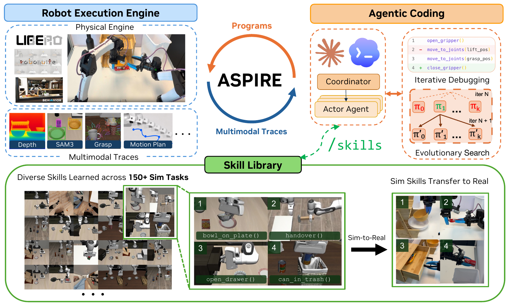
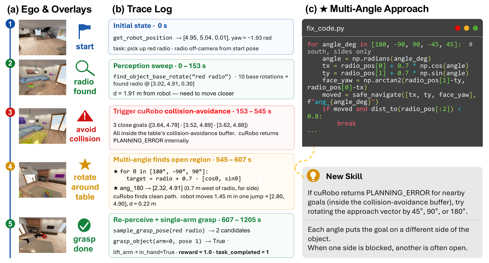

# [ASPIRE: Agentic /Skills Discovery for Robotics](https://arxiv.org/abs/2607.00272)

> **Brief:** ASPIRE writes and debugs **robot-control programs**, then distills validated fixes into a shared library of reusable skills. Its execution engine exposes evidence from individual perception, planning, and control calls; coding agents use that evidence to repair programs, search alternative strategies, and help later tasks. Learning changes **programs and in-context guidance**, without updating the coding model's weights.

**Source:** Lu et al., 2026; supplied 41-page PDF, arXiv:2607.00272v2 dated October 20, 2026, including Appendices A–G. Main Opus 4.6 results, stronger-model ablations, zero-shot transfer, and real-robot adaptation are distinguished below.

## Convenient Links

- [Paper](https://arxiv.org/abs/2607.00272), [project](https://research.nvidia.com/labs/gear/aspire/), [official code](https://github.com/NVlabs/ASPIRE)
- Related systems: [Zetta](./Zetta.md), [AdaHVLA](./AdaHVLA.md), [EmbodiedRSI](./EmbodiedRSI.md), [Spotter](./Spotter.md), [Harness VLA](./Harness_VLA.md)
- Background: [Skill Systems](../../../Agent_Systems/Skill_Systems.md), [Agent Memory](../../../Agent_Systems/Memory_Systems.md), [Tool Interfaces](../../../Agent_Systems/Tool_Registry_and_Function_Calling.md), [LIBERO](../Datasets/LIBERO.md)

## 1. Why Does a Failed Robot Program Need More Than Another Attempt?

Suppose a mobile robot must pick up a radio from a table. It finds the radio correctly but repeatedly fails to approach it. A final “task failed” signal does not reveal whether detection was wrong, navigation was blocked, or the eventual grasp was unstable. Retrying the same program may repeat the same error.

ASPIRE—**Agentic Skill Programming through Iterative Robot Exploration**—treats this as a programming problem. The agent needs to inspect what individual calls did, identify the failed subsystem, change the program, and test that change physically.

Its second observation is that the useful lesson is often smaller than the whole program. “When nearby navigation goals fall inside an obstacle buffer, try approaching from another side” can help many tasks, even if they involve different objects.

This leads to three connected components:

1. **Execution evidence** makes failures diagnosable.
2. **Iterative debugging and evolutionary search** turn diagnoses into better programs.
3. **A skill library** preserves reusable repairs so later tasks can start with more experience.

Here, **code-as-policy** means that executable Python composes perception, geometry, planning, and control APIs into robot behavior. A **skill** is reusable programming guidance, often with a code sketch. It is not necessarily a newly trained motor policy. Unlike systems whose central mechanism redirects a frozen VLA, ASPIRE's main control artifact is the agent-written program itself.

## 2. Who Writes, Executes, and Validates the Programs?



*Paper Figure 1, cropped from PDF page 2. Actors submit programs to the robot execution engine and receive diagnostic traces. The $\pi$ boxes are candidate programs in successive search generations. A coordinator manages tasks and shared experience. Validated repair knowledge becomes guidance for future actors and selected real-robot adaptations.*

| Component | Responsibility |
|---|---|
| **Coordinator** | Choose and dispatch tasks, manage the shared library, and admit verified skills |
| **Actor** | A coding agent assigned a task; write, run, inspect, and revise its robot program |
| **Robot execution engine** | Execute API calls and record their inputs, outputs, status, and visual evidence |
| **Verifier actor** | Independently test a proposed skill before library admission |
| **Skill library** | Store compact repair knowledge that actors retrieve as context |

Actors do not pass complete conversations or raw rollout histories to one another. Shared experience is distilled into skills, while each actor concentrates on its own task, program, and relevant traces.

The **robot API is predefined**. Programs can compose its tools into new routines, change parameters, add conditions, and reorganize execution. ASPIRE does not generally extend the underlying sensing or actuation API during discovery.

This separation explains what changes during learning. The model and available primitive interfaces stay fixed, while program source and library contents grow. At runtime, a program can still inspect fresh observations and branch on feedback; reusing its source across episodes does not imply replaying one fixed motion trajectory.

## 3. How Do Execution Traces Turn a Failure into a Skill?

### 3.1 Record Evidence at the Primitive That Produced It

A **primitive** is an exposed operation such as localizing an object, sampling grasps, planning motion, or moving the robot. A **trace** records that operation's API name, arguments, result, return status, and relevant observations.

The engine retains keyframes immediately **before and after each call**, together with overlays and tool outputs. It does not simply send the actor an entire video stream. The actor can inspect calls implicated by a failure instead of searching an undifferentiated recording.

For example:

- A localization result establishes whether an object was found and where.
- A planning error distinguishes an infeasible target from a successful motion.
- A grasp result and lift observation distinguish commanding closure from actually holding the object.

The loop is **execute → inspect evidence → diagnose → patch code → re-execute**. Re-execution matters because a plausible explanation or a syntactically valid patch does not establish that the robot now succeeds.

### 3.2 Follow the Radio Example Through Diagnosis and Repair



*Paper Figure 2, cropped from PDF page 4. Perception finds the radio, but nearby navigation targets violate a table collision buffer. The repair changes the approach geometry, then re-localizes and grasps. The resulting lesson becomes the Multi-Angle Approach skill.*

The worked example proceeds in four steps:

1. **Localize the failure.** The robot finds the radio, so changing the object-recognition prompt would address the wrong subsystem. Repeated `navigate_to_pose` calls instead return `PLANNING_ERROR`.
2. **Explain the planning error.** Proposed navigation targets lie too close to the table boundary, within its collision-avoidance buffer. This buffer reserves extra clearance around the obstacle, so a pose can be rejected even without lying inside the table itself. Moving closer along the same approach keeps producing infeasible goals.
3. **Change the strategy.** The actor writes a routine that samples approach directions around the radio. One side may be blocked while another provides a reachable pose.
4. **Validate the consequence.** From an accessible side, the robot re-perceives the object, generates a grasp, and completes pickup.

The geometric idea is to vary the robot's destination around the object rather than repeatedly perturbing one blocked destination. For object position $(x_o,y_o)$, an illustrative target construction is

$$
(x_{\mathrm{goal}},y_{\mathrm{goal}})
=
(x_o+\rho\cos\alpha,\ y_o+\rho\sin\alpha),
$$

where $\rho$ is a stand-off distance and $\alpha$ an approach angle. The robot faces the object from each proposed location. Figure 2's repair uses a **0.7 m** radius and several candidate angles; this is an example configuration, not a universal navigation clearance.

The reusable result is a conditional strategy: repeated planner errors near an obstacle boundary should trigger a search over alternative approach sides. It does not require retaining the original radio coordinates.

### 3.3 A Skill Must Say When Its Repair Applies

A successful debugging run provides evidence about one task. A **skill** turns that experience into reusable knowledge: what failed, when a repair is appropriate, how to perform it, and how it was validated.

In the radio example, the actor discovers that approaching from another side succeeds. A complete radio-pickup program includes task-specific details, while “try a different angle” omits the circumstances that made the repair useful. ASPIRE instead records a conditional repair pattern:

| Field | Question it answers | Multi-Angle Approach example |
|---|---|---|
| **Failure signature** | What symptom appeared during execution? | Repeated `PLANNING_ERROR` returns for nearby navigation goals |
| **When-to-apply condition** | In what situation is this repair appropriate? | The proposed goals lie inside an obstacle's collision buffer |
| **Repair strategy** | What should the program do differently? | Sample alternative approach directions, then refresh perception and attempt pickup |
| **Code sketch and provenance** | How can it be implemented, and what evidence supports it? | Object-relative target construction, source task, development seeds, and validation results |

The distinction between **symptom** and **applicability** matters. A planning error can result from many problems; another approach angle is useful when the original approach is blocked. It need not help when the target was localized incorrectly or lies outside the robot's workspace. The when-to-apply condition helps a future actor decide whether the repair fits its current failure.

**Admission requires independent reproduction.** Section 2.2 and Appendix G.1 describe four steps:

1. **Discover and validate a fix.** The actor repairs its program and tests it on development configurations.
2. **Propose a skill.** It reports the observed failure, validated repair, transferable pattern, and relevant task-specific details.
3. **Test with a fresh verifier.** A separate actor receives the proposal alone and independently attempts the source task on a subset of its environment seeds, which specify initial task configurations. It records whether proposed entries are sound, defective, or untested.
4. **Let the coordinator decide.** The coordinator checks allowed-API compliance and admits reusable entries whose success the verifier reproduced. Entries without reproduced success are not admitted.

Why use a fresh verifier? An actor may succeed after many edits, while its proposed skill omits a helper function or an assumption that mattered. Independent reproduction checks whether the **communicated knowledge** is sufficient for another actor to use, rather than relying on the original actor's accumulated context. This strengthens the evidence for the source-task repair; it does not guarantee success on every future task.

**Storage makes the verified knowledge available to later actors.** The library is organized in Markdown files under:

```text
.claude/skills/iterative-debugging/skills/
├── grasp.md
├── localize.md
├── transport.md
├── manipulation.md
└── task-exploration.md
```

The directory's `README.md` indexes the library. Entries contain explanations and useful code sketches; the pipeline's separate `SKILL.md` files define how the agents run the debugging workflow.

When another actor starts a task, relevant entries can be retrieved into its model context. For illustration:

```text
Task: Pick up a soda can.

Retrieved guidance:
If nearby navigation goals repeatedly fail because they lie
inside an obstacle's collision buffer, sample alternative
approach directions before retrying perception and grasping.
```

The actor can use the can's current position to generate a new approach routine. It reuses the repair principle without reusing coordinates from the radio scene.

Topics such as grasping, localization, and navigation emerge from discovered repairs; the Markdown organization does not prescribe a fixed repertoire of behaviors. The library acts like an experienced robot engineer's notebook: later actors can read and adapt verified debugging knowledge instead of rediscovering it. **Learning accumulates in external knowledge supplied through context; the LLM's weights remain fixed.**

## 4. Why Search Multiple Programs Instead of Patching One Forever?

Iterative debugging can improve one strategy while never questioning it. An actor may keep adjusting a blocked approach when a different manipulation strategy would work better.

**Evolutionary search** keeps a history of candidate programs, scores, and traces, then proposes alternatives conditioned on successful candidates and their remaining failures. The objects being searched are programs, not model parameters.

For binary task completion, a program's debug score can be written as

$$
r_{\mathrm{dbg}}(P)
=
\frac{1}{|S_{\mathrm{dbg}}|}
\sum_{s\in S_{\mathrm{dbg}}}
\mathbf{1}[\operatorname{TaskSuccess}(P,s)].
$$

$P$ is a robot program, $S_{\mathrm{dbg}}$ the development seed set, and $s$ a seed fixing an environment instance. The score is the fraction of those instances completed successfully.

Algorithm 1 implements the search:

1. Execute the initial program on debug seeds and retain its score and traces.
2. Condition proposals on the **top three historical programs**, the skill library, and debugging history.
3. Generate a population of **$K$ candidates** and execute each on debug seeds.
4. Add their evidence to the history and retain the best debug-scoring program.
5. Stop when that score reaches threshold $\theta$ or the budget of **$T$ rounds** is exhausted.

The top-three parent context is not the population size $K$. Likewise, a search round is not a robot timestep: it can contain several full program evaluations.

Validated patterns are extracted from **debugging history**, and the selected program is then tested on separate evaluation seeds. For the main LIBERO-Pro comparison, Appendix E additionally selects between the iteratively repaired and evolutionary programs using a separate validation partition.

Search encourages strategy diversity, but it does not make generalization automatic. Appendix E.3 shows that held-out success can fall between iterations even when candidates are selected as best on development evidence.

The coordinator also chooses a **curriculum**, selecting tasks that can fill library gaps or reuse recent findings. Actors can be dispatched in parallel, but the knowledge available to an actor depends on what has already been admitted. After a campaign, one separate rerun of low-scoring tasks can use the completed library; this is the paper's **backward skill transfer**.

## 5. What Is Learned, and What Is Kept Separate for Evaluation?

### 5.1 Program Learning Does Not Train a New Neural Policy

The main simulation agent is **Claude Code with Claude Opus 4.6 and a 1M-token context window**. It writes Python using the same perception, geometry, and planning interfaces across benchmarks.

ASPIRE introduces no coding-model fine-tuning or new neural motor-policy training in this loop. Development produces executable programs and reusable skills. Stronger-model ablations replace the coding model between experiments; they are not model-weight improvements learned by ASPIRE.

A **seed** fixes an environment instance, including object layouts and initial states. The principal splits are:

| Benchmark | Development seeds | Final evaluation seeds | Execution during evaluation |
|---|---|---|---|
| LIBERO-Pro | 51–65 | 1–50 | One selected program per task across 50 seeds |
| Robosuite | 101–125 | 1–100 | One selected program per task across 100 trials |
| BEHAVIOR-1K | 26–35 | 1–25 | Generate successive code blocks from the current trace |

For main LIBERO-Pro results, **seeds 66–80** provide the additional program-selection validation set described in Appendix E.1. They are distinct from the final 1–50 test seeds.

This distinction matters when interpreting robustness. The main LIBERO-Pro/Robosuite results adapt programs to a task on development instances, then test new instances of that task. They are not, by themselves, transfer to unseen task identities.

### 5.2 The Baseline Has a Different Use of Test-Time Reasoning

The primary coding baseline, **CaP-Agent0**, uses visual differencing, a predefined skill library, and per-episode retries. It regenerates a program for each evaluation seed. ASPIRE instead amortizes development into one program per LIBERO-Pro/Robosuite task.

BEHAVIOR-1K is a separate interactive setting: the actor writes the next code block using current execution feedback. Consequently, “one program per task” should not be applied indiscriminately to every benchmark.

The paper's search algorithm specifies $K$, $T$, and $\theta$ as budget parameters, while Appendix G points to campaign configuration files. The PDF does not give one universal numerical setting for every run. Comparison therefore requires the reported benchmark and development protocol, not just a final success number.

## 6. What Do the Simulation Results Establish?

### 6.1 Main Opus 4.6 Results

LIBERO-Pro changes the original tasks through **position perturbations (Pos)** and **task/instruction redirection (Task)**. Main results cover Object, Goal, and Spatial: **three families × ten tasks × two perturbations = 60 task settings**.

Selected Appendix B, Table 5 results:

| Family | CaP-Agent0 Pos | CaP-Agent0 Task | ASPIRE Pos | ASPIRE Task |
|---|---:|---:|---:|---:|
| Object | 22.0% | 18.0% | **98.0%** | **95.0%** |
| Goal | 26.0% | 17.0% | **81.0%** | **45.0%** |
| Spatial | 12.0% | 14.0% | **51.0%** | **60.0%** |
| Overall | 20.0% | 16.0% | **77.0%** | **67.0%** |

The mean across all 60 settings is **72.0% versus 18.0%**, a **54-percentage-point gain**. The improvement is uneven: Object is almost saturated, while Goal and Spatial still contain substantial failures.

On **seven Robosuite tasks**, the macro-average rises from **68% to 81%**. Selected Table 6 results show both the gain and its limits:

| Task | CaP-Agent0 | ASPIRE |
|---|---:|---:|
| Bimanual handover | 20% | **92%** |
| Bimanual lift | **74%** | 71% |
| Nut assembly | 0% | **9%** |
| All seven tasks | 68% | **81%** |

On **two BEHAVIOR-1K household tasks**, final pickup success reaches **88% for both soda can and radio**, compared with CaP-Agent0's 72% and 56%. Navigation succeeds at 92% and 100%, respectively. Finding a reachable region and completing pickup are separate metrics; this is not an evaluation across all 1,000 task types.

### 6.2 Traces Provide Most of the Initial Gain; Search Helps Residual Failures

The execution-engine ablation raises average LIBERO-Pro success from approximately **14% to 62%**; evolutionary search further raises it to **72%**.

The base condition is zero-shot Opus 4.6 with **15 example programs**, without the diagnostic engine and evolutionary search. Thus the comparison tests whether structured execution evidence and repair help beyond examples alone.

The engine gives the actor information needed to distinguish failure sources. Search then broadens the strategies considered after ordinary debugging stalls. This supports their complementary roles; it does not isolate every effect of library retrieval, validation, and additional execution budget.

### 6.3 A Stronger Coding Model Changes What the System Can Discover

The paper also holds the robot API and seed protocols fixed while varying the coding model. Table 18 isolates **Goal under position perturbation**, using iterative debugging, an initially empty library, and **no evolutionary search**:

| Coding model | Success |
|---|---:|
| Claude Opus 4.6 | 55.6% |
| Kimi K3 | 78.4% |
| GPT-6 Astra | 94.4% |
| Claude Opus 5.5 | **99.2%** |

The 55.6% condition differs from the main Goal-Pos result of 81%: the latter belongs to the library-sharing/search campaign. Mixing these figures would hide changes in the experimental setup.

With Opus 5.5, the paper reports roughly **99% across all 80 LIBERO-Pro task settings**, including Long; **100% across the seven Robosuite tasks**; and **100% on the two selected BEHAVIOR-1K tasks**. These are stronger-model, task-adapted results, not the zero-shot Long transfer experiment below.

The case studies show why model capability matters beyond code syntax. For a plate blocked by clutter, one model clears the obstacles and pushes, while another lifts the plate over them. Different programs can satisfy the goal through different physical strategies.

## 7. Does the Library Transfer Beyond the Task That Produced It?

### 7.1 Zero-Shot Transfer from LIBERO-90 to Long

This experiment builds libraries from **$N=0,25,50,90$ source tasks in LIBERO-90**. $N$ counts source tasks, not skill entries or demonstrations.

For each held-out LIBERO-Pro Long task, Opus 4.6 generates one program and evaluates it without additional target-task debugging, retries, or library updates. Table 8 reports:

| Library source tasks | Pos success | Task success | Overall |
|---|---:|---:|---:|
| 0 | 0.0% | 9.4% | 4.7% |
| 25 | 5.6% | 21.8% | 13.7% |
| 50 | 13.8% | 29.2% | 21.5% |
| 90 | **22.6%** | **38.3%** | **30.5%** |
| CaP-Agent0 baseline | 5.2% | 2.4% | 3.8% |

This is the source of the abstract's rounded **31% versus 4%** comparison. It is evidence of task-level reuse of repair knowledge, rather than only fitting new seeds of the source task.

Aggregate performance improves as the source library grows, but individual tasks can regress, and some drawer/microwave tasks remain at zero in this setting. Admission on a source task therefore does not guarantee that retrieval will help every target.

### 7.2 Backward Transfer Requires Another Adaptation Stage

Early tasks may fail because the library was still small. In an **Opus 5 Long campaign**, the coordinator reruns five initially low-scoring tasks after completing the library.

Four improve. Across all 20 Long task settings, success rises from **74.6% to 82.2%**; two drawer tasks improve from zero to 52% and 72%, while the mug-to-microwave position task remains at zero.

The revised programs are evaluated on the same 50 held-out layouts per task. This measures the benefit of a full-library rerun with further debugging. It is distinct from generating a target program with no target-task adaptation in Section 7.1.

## 8. What Transfers to a Physical Robot?

### 8.1 Simulation Skills Guide New Programs Across Embodiments

Three skills discovered in Franka-based simulation—bowl placement, soda-can pickup, and drawer manipulation—are supplied to a coding agent on a **bimanual YAM station** with different robot APIs.

The agent is **GPT-5.5 in Codex, reasoning-xhigh**. It still runs real-robot programs, inspects traces, and debugs. The experiment tests whether simulation guidance reduces that work; it is not direct deployment of an unchanged simulator policy.

Table 1 reports total model tokens, in millions, until the first successful program or budget exhaustion, followed by evaluation:

| Task | Tokens without skill | Tokens with skill | Success without skill | Success with skill |
|---|---:|---:|---:|---:|
| Bowl on plate | 8.65 M | **5.11 M** | 20/20 | 20/20 |
| Lift soda can | 61.94 M | **6.58 M** | 13/20 | **19/20** |
| Open/push drawer | 334.92 M | **81.67 M** | 0/20 | **11/20** |

The drawer baseline exhausts its budget without a successful evaluation program, so its token count is not “tokens to success.” The bowl result shows reduced programming effort without a success-rate increase; the can and drawer results improve both outcomes.

Appendix D's interactive robot harness uses a persistent runtime connected through the **Model Context Protocol (MCP)**. Action calls return terminal status, measured state, and images. A completed motion command still needs a physical task check. The robot's **30 Hz control loop** is separate from the coding agent's observation/reasoning cycle.

### 8.2 Online Cube Learning Accumulates Physical Execution Knowledge

On the same platform, **GPT-6 Astra** attempts a Rubik's Cube over three sequential episodes in one session. It perceives cube colors, may call a **Kociemba symbolic solver** for the move sequence, and must physically perform and verify the turns.

What it learns concerns manipulation: stabilizing two layers while isolating one, aligning axes, coordinating handovers, and recovering slips. The symbolic solution algorithm is supplied; model weights are unchanged.

| Episode | Outcome | Completed face turns | Total time | Time per completed turn |
|---|---|---:|---:|---:|
| 1 | Unsolved | 3 | 50 min 54 s | 16 min 58 s |
| 2 | Solved | 5 | 39 min | 7 min 48 s |
| 3 | Solved | 25 | 77 min 10 s | 3 min 05 s |

A half-turn counts as one move; whole-cube reorientation is excluded. Tokens per completed turn fall from **11.27 M to 2.01 M** between episodes 1 and 3. These amortized metrics include failed attempts, recovery, and context compaction.

Efficiency per turn improves, but total solve time is not monotonic: episode 3 performs many more turns. Humans still provide initial guidance, scramble the cube, and reset between episodes. Three continued-session episodes demonstrate useful accumulation of experience, not fully autonomous lifelong operation.

## 9. How Should ASPIRE's Contribution Be Interpreted?

ASPIRE's main result is the connection between **inspectable execution → tested program repair → reusable guidance → better later program synthesis**. The skill library passes knowledge between actors without requiring shared conversations or model-weight learning.

Compared with [Zetta](./Zetta.md), which emphasizes evolving runtime critics and recovery mechanisms, ASPIRE emphasizes general program debugging and the discovery of varied repair knowledge. [AdaHVLA](./AdaHVLA.md) revises coordination code around a frozen VLA; ASPIRE's main evaluated artifact is a code-as-policy program. [EmbodiedRSI](./EmbodiedRSI.md) additionally learns experiment/memory selection, whereas ASPIRE uses coordinator-directed curriculum, verification, and program search.

Its limits follow from this design. The fixed API bounds what programs can express. Skill verification happens at admission, without continual revalidation or pruning, so entries can become stale or misleading. Debugging consumes many model calls and robot/simulator trials. Strong results also depend heavily on the coding model.

The reported near-saturation results should therefore be read with their model, task subset, development budget, and evaluation mode attached. Task-adapted success, zero-shot library transfer, cross-embodiment debugging, and continued-session hardware learning establish different capabilities.
