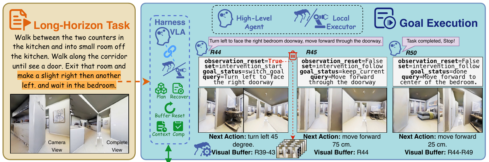
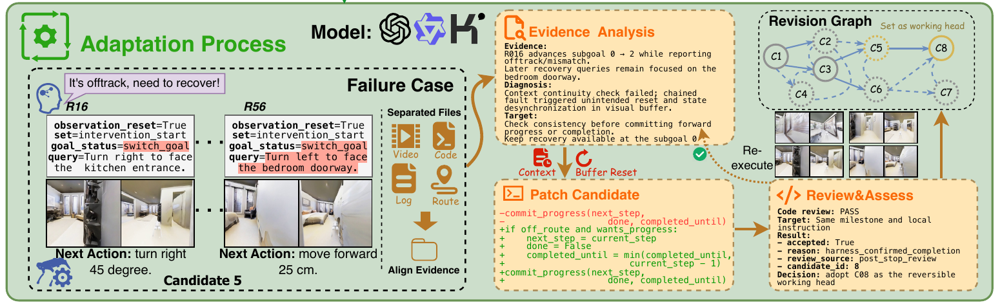

# [AdaHVLA: Adaptive Harnesses for Long-Horizon Vision-Language-Action Execution](https://arxiv.org/abs/2609.29204)

> **Brief:** AdaHVLA improves long-horizon robot execution by revising the **code that coordinates a reasoning agent and a frozen VLA**. Between rollouts, separate agent contexts analyze evidence, propose code patches, and assess whether those patches produce their predicted behavioral effects. A revision graph preserves alternative harnesses and adaptation memory; the selected code stays fixed during held-out evaluation.

**Source:** Tang et al., 2026; supplied PDF, arXiv v1 dated September 24, 2026. Model names and numerical results below follow this version.

## Convenient Links

- [Paper](https://arxiv.org/abs/2609.29204)
- [Code linked by the paper](https://github.com/Haaareally/AdaHVLA-Adaptive_Harness_VLA)
- Related systems: [Harness VLA](./Harness_VLA.md), [RegenHarness](./RegenHarness.md), [RoboHarness](./RoboHarness.md), [Hi Robot](../Policies/Pi_Hi_Robot.md)
- VLA backgrounds: [SmolVLA](../Policies/SmolVLA.md), [OpenVLA](../Policies/OpenVLA.md), [pi0.5](../Policies/Pi_0_5.md)
- Background: [Agent Memory](../../../Agent_Systems/Memory_Systems.md)

## 1. Why Adapt the Harness Code?

Suppose a robot must pass through a doorway and then enter a bedroom. Turning toward the doorway is a valid local action, but **facing the doorway is not the same as passing through it**. If the harness advances the goal too early, later VLA instructions can point toward the bedroom while the robot is still outside the passage.

A high-level planner alone does not resolve this: the surrounding program still decides when to accept progress, which history to keep, when to refresh images, and how long recovery guidance persists. Incorrect rules can turn reasonable local decisions into a failed long-horizon trajectory.

AdaHVLA therefore adapts those **executable coordination rules**, rather than only changing the current plan or fine-tuning the action model. It separates two timescales:

| Loop | What changes? | What remains fixed? |
|---|---|---|
| **Within a rollout** | Runtime state, observations, local instructions, recovery decisions | Harness source revision and VLA weights |
| **Between adaptation rollouts** | Harness code, candidate assessments, adaptation memory | VLA parameters and controllers |
| **Held-out testing** | Online reasoning and runtime state | Selected harness source; no test-driven code revision |

Thus, fixed code does not mean an open-loop action sequence. The code can make different decisions as observations change; adaptation changes the rules governing those decisions.

## 2. Architecture and Online Data Flow



*Paper Figure 2, execution panel. The harness maintains goals and context, carries corrective guidance across requests, and lets the local executor produce robot commands. R44, R45, and R50 are interaction request IDs, not individual motor timesteps.*

### 2.1 The Harness Coordinates; the VLA Acts

For task instance $\xi=(x,\mathcal{E},s_0)$, $x$ is the instruction, $\mathcal{E}$ the environment, and $s_0$ the initial robot/scene state. At decision boundary $t$, define history $H_t=(x,o_{\leq t},a_{<t})$, with observations $o_t$, and runtime state $m_t$. For frozen VLA parameters $\theta$, the paper writes

$$
(q_t,\kappa_t,m_{t+1},z_t)\sim H_c(\cdot\mid H_t,m_t),
$$

$$
a_t\sim\pi_\theta(\cdot\mid q_t,\kappa_t),\qquad z_t=0.
$$

- $H_c$: coordination policy induced by source revision $c$ together with reasoning-agent calls; it is not a newly trained neural action head.
- $q_t$: original instruction or local guidance selected for the VLA.
- $\kappa_t$: observation context supplied through the executor's adapter.
- $m_t$: current progress, retained context, and correction state.
- $z_t$: harness termination flag; $z_t=1$ ends the rollout.
- $a_t$: executor command or action sequence, passed to the controller.

The resulting pipeline is:

```text
Task instruction + new observations + execution history
  -> harness selects context for the runtime reasoning agent
  -> reasoning proposes progress, guidance, or recovery decisions
  -> harness code applies coordination rules and updates runtime state
  -> local instruction q_t + executor observation context kappa_t
  -> frozen VLA -> command/action sequence -> robot controller
  -> new observations and request-linked execution records
  -> next harness decision, until its completion logic terminates
```

The coupling is through **instructions, observations, and program state**, not shared Transformer attention. The paper does not prescribe one universal image-history or proprioception tensor: inputs follow the VLA adapter. Navigation uses NaVILA commands followed by a locomotion controller; manipulation uses the chosen VLA's robot-action interface.

### 2.2 Which Rules Are Editable?

| Coordination function | Decision made by the harness | Doorway example |
|---|---|---|
| Task progress and guidance | Advance an ordered subgoal; retain the full instruction or issue local guidance | Do not advance merely because the robot faces the entrance |
| Context selection | Retain observations, progress records, and ongoing corrections for reasoning | Remember the intended passage and why recovery started |
| Visual refresh | Refresh executor-facing visual history/context | Use the new view after turning instead of stale local-execution images |
| Recovery | Start, maintain, and end corrective guidance | Continue from turning toward the doorway to moving through it |
| Completion | Check remaining task goals before terminating | A local stop must not imply that the bedroom has been reached |

These functions interact. Advancing a goal can change both the next instruction and context-reset behavior, so an incorrect transition can lose the history needed to recover. Conversely, **route-reasoning history can remain useful after an executor's visual buffer should be refreshed**. Keeping all history and clearing all history are not interchangeable solutions.

Figure 2 illustrates sustained guidance: R44 turns toward the intended doorway, R45 moves through it, and later requests continue toward the bedroom. The harness must preserve the purpose of the correction across those calls while supplying appropriate current observations.

## 3. Adaptation Pipeline: Evidence to Code to Behavior



*Paper Figure 2, adaptation panel. Request-aligned videos/logs and source revisions support a testable diagnosis. A patch is reviewed, executed, and assessed before its evidence informs further revision.*

### 3.1 This Is Code Search, Not VLA Training

For candidate revisions $\mathcal{C}$, the stated objective is

$$
\max_{c\in\mathcal{C}}
\mathbb{E}_{\xi\sim\mathcal{D},\,\tau\sim P_c(\cdot\mid\xi)}
[R(\tau;\xi)],
$$

where $\mathcal{D}$ is the task distribution, $\tau$ a robot rollout, $P_c$ the rollout distribution induced by revision $c$, and $R\in\{0,1\}$ the benchmark success indicator. In practice, a finite adaptation set supplies the experience used to propose and select code versions.

This is an **objective for searching executable programs**, not a policy-gradient loss optimized over $\theta$. AdaHVLA introduces no VLA pre-training or post-training stage; VLA fine-tuning from selected experiences is future work. Prior training of the underlying backbones is separate from this experiment.

### 3.2 Separate Observation, Explanation, and Assessment

The adaptation process uses distinct agent working contexts and exchanges structured records:

| Role | Receives | Produces |
|---|---|---|
| Evidence analysis | Camera observations, logs, trajectory segments aligned by request ID and source revision | Observed events, a suspected coordination mechanism, supporting evidence, predicted effect, observable indicator |
| Harness revision | Source code, hypothesis, related attempts | Patch $\Delta$ and recorded prediction for $c'=c\oplus\Delta$ |
| Behavioral assessment | Parent and candidate rollouts on the same task instance, in a fresh context | Whether the target mechanism changed, overall behavior, and final success, assessed separately |

Here $\oplus$ means applying a code patch. Source inspection may revise the diagnosis, but the hypothesis and expected effect are recorded **before** the new rollout. A separate source/interface review checks execution eligibility; passing code review is not evidence that robot behavior improved.

These are separated roles and contexts, not necessarily three different foundation models. The key constraint is that a reviewer evaluates the execution evidence instead of simply inheriting the patch author's explanation.

### 3.3 A Concrete Revision and Its Attribution Check

In Figure 2, a request advances subgoal 0 to 2 while also reporting an off-route mismatch. The diagnosis links this inconsistent progress update to unwanted resets and loss of context continuity. A proposed guard retains the current goal rather than accepting forward progress while off-route.

The following simplifies the illustrated patch, rather than reproducing a complete implementation:

```python
if off_route and wants_progress:
    next_step = current_step
    done = False
    completed_until = min(completed_until, current_step - 1)
commit_progress(next_step, done, completed_until)
```

The testable prediction is **preserved goal/context alignment when that inconsistent transition occurs**. A successful run alone cannot establish this: perhaps it never went off-route, so the guard was never used.

AdaHVLA therefore assesses $\hat u$, whether the modified mechanism was triggered, and $\hat v$, whether parent/candidate trajectories had already diverged before that trigger. Each can be true, false, or undetermined. Hypothesis support can change only when

$$
\chi=\mathbf{1}\{\hat u=1\land\hat v=0\}.
$$

| Comparison | Interpretation |
|---|---|
| Patch triggered; no earlier divergence | Eligible to update support for the predicted effect |
| Patch never triggered | Outcome does not test this mechanism |
| Earlier divergence, or either condition undetermined | Preserve support rather than attributing the outcome to the patch |

For eligible comparisons, a targeted improvement strengthens support; unchanged or degraded effects weaken it when the candidate is discontinued. Other outcomes are still stored for future refinement.

**This gate controls attribution, not robot safety or task completion.** It reduces unsupported explanations but is not a guarantee of causal identification. Agent judgments can be wrong, and repeatability requires additional rollouts.

## 4. Revision Graph and Persistent Memory

### 4.1 Why Keep More Than the Latest Patch?

A guard may fix premature goal advancement yet expose a later navigation failure. Discarding that candidate solely because the whole task still failed would lose useful progress; blindly extending the newest revision can instead accumulate unrelated mistakes.

The revision graph links **code versions, hypotheses, rollout evidence, and behavioral assessments**, preserving alternative branches. Candidate priority starts with task success, then considers targeted and overall behavioral effects. A candidate can be extended after a targeted improvement or newly exposed failure, subject to the adaptation budget and graph capacity.

The paper denotes maximum active candidate leaves by $W$ and maximum revision depth within the current task by $D$. These bound exploration; they are not neural-network dimensions. Inactive branches remain retrievable. Further rollouts and checks on previously successful adaptation tasks examine whether improvements recur.

Crucially, **choosing a candidate to investigate is different from increasing confidence in its hypothesis**. An informative failure can motivate another patch even when the attribution gate did not permit a support update.

### 4.2 What Persists Across Tasks?

| State | Lifetime and purpose |
|---|---|
| Runtime state $m_t$ | Initialized per rollout; tracks the current task and ongoing execution |
| Harness source $c$ | Fixed within a rollout; an adapted version can carry into subsequent tasks |
| Revision graph and adaptation memory | Retain issues, hypotheses, changes, observed effects, evaluation conditions, and evidence links |
| Agent working contexts | Scoped by role/assignment; revision contexts are rebuilt for unrelated work and each behavioral assessment starts fresh |

Across task switches, the selected harness and relevant retained context persist, while runtime state and local exploration depth reset. Condensed summaries help new hypotheses without requiring every agent to share one ever-growing conversation.

The final harness is selected using adaptation evidence alone. During held-out testing its code stays fixed, although online reasoning, observations, and task-state updates continue. This tests reuse of the adapted coordination policy, not code learning from test outcomes.

## 5. Experimental Setup and Results

### 5.1 Separate the Models and Data Splits

| Setting | Robot, simulator, and executor | Adaptation / held-out instances |
|---|---|---|
| NaVILA-LH | Unitree Go2; Matterport3D scenes through Isaac Lab/Isaac Sim; NaVILA plus pretrained locomotion controller | 10 / 40, selected from 50 NaVILA-Bench instances |
| VLA-Arena L1 | Panda; RoboSuite/MuJoCo; SmolVLA, OpenVLA-OFT, or pi0.5 | 10 / 40; independent atomic skills composed into longer tasks |
| VLA-Arena L2 | Same manipulation setup; longer workflows with inter-stage dependencies | 10 / 40; separate split at this level |

The manipulation environment supplies RGB observations and seven-dimensional actions, with observation handling delegated to each adapter. The shared adaptation architecture specializes coordination for each robot/executor setting; the results do not establish one universal adapted code version for all backbones.

All harnesses use **Qwen3.7-Flash as the runtime reasoning agent**. Navigation varies six adaptation-model configurations; manipulation uses **GPT-5.6-sol Max**. These adaptation models analyze and revise the harness, not replace the VLA at every action call.

For each configuration, adaptation restarts three times from the initial harness on the same split, evaluating **up to 16 candidates per run, indexed 0-15 including the initial harness**. A candidate may require multiple rollouts, so 16 candidates does not mean 16 robot episodes. Fixed baselines receive repeated evaluation; adapted-policy results come from the three restarts.

Reported means summarize 30 adaptation-instance or 120 test-instance evaluations, not 30/120 distinct tasks or the total revision-search rollout budget. Benchmark completion defines success rate (SR), separately from the harness's own termination decision.

### 5.2 Navigation: Initial Coordination Versus Code Adaptation

Table I reports held-out NaVILA-LH test SR:

| System / adaptation model | Mean test SR |
|---|---:|
| Single VLA | 2.5% |
| Initial Harness VLA | 22.5% |
| AdaHVLA: GPT-5.6-sol Max | 57.5% |
| AdaHVLA: GPT-5.6-terra Max | 48.3% |
| AdaHVLA: Kimi K3 | 43.3% |
| AdaHVLA: Qwen3.7-Max | 40.0% |
| AdaHVLA: GPT-5.6-luna Max | 35.0% |
| AdaHVLA: Qwen3.6-Max | 31.7% |

The initial harness adds **20.0 percentage points** over direct execution. Adaptation then adds **9.2-35.0 points over that initial harness**, with the runtime agent and executor unchanged. Here "Initial Harness VLA" is this paper's non-adapted baseline, not a reported result from the separate *Harness VLA* paper.

The strongest configuration's three test rates are 62.5%, 52.5%, and 57.5%. Table I's separate **Overall SR** pools adaptation and test splits; its 60.7% value is not held-out test SR. Candidate curves in Figure 3 also use test data only for reporting, not revision or selection.

### 5.3 Manipulation: Gains Across Frozen Backbones

Table II, held-out test SR (%):

| Level | Frozen VLA | Single VLA | Initial harness | Adapted harness |
|---|---|---:|---:|---:|
| L1 | SmolVLA | 7.5 | 11.7 | 25.8 |
| L1 | OpenVLA-OFT | 15.0 | 20.8 | 40.8 |
| L1 | pi0.5 | 20.0 | 25.0 | 55.8 |
| L2 | SmolVLA | 1.7 | 2.5 | 10.8 |
| L2 | OpenVLA-OFT | 4.2 | 7.5 | 23.3 |
| L2 | pi0.5 | 6.7 | 10.0 | 38.3 |

Adaptation improves every listed backbone/level combination. For pi0.5, gains over the initial harness are **30.8 points on L1** and **28.3 on L2**. L2 remains harder, but it changes both workflow length and dependencies, so the experiment does not isolate either factor's individual effect.

## 6. What the Ablations and Execution Traces Show

### 6.1 Runtime Functions and Adaptation Mechanisms Are Different Tests

Figure 4(a) removes runtime functions **without readaptation**. It tests the finished harness's dependence on those functions, not whether a new harness could learn to compensate for their removal.

| Runtime change | Reported test SR change | Interpretation |
|---|---|---|
| Remove completion check | Navigation: 57.5 -> 29.2 | Termination logic is central to long-horizon navigation |
| Compact runtime context | Navigation: 57.5 -> 33.3; L2: 38.3 -> 22.5 | Task plus concise progress is weaker than the fuller retained context |
| Disable visual refresh | L1: 55.8 -> 37.5 | Stale image context harms local manipulation decisions |
| Remove recovery | L1: 55.8 -> 56.7; L2: 38.3 -> 23.3 | Recovery matters more in the tested dependent workflows; it is not uniformly beneficial |

"W/O Context" still retains the task and concise progress; it is not memory-free. "W/O Buffer Reset" affects VLA visual history in navigation but harness image context in manipulation, so it is not an identical buffer operation across backbones.

Figure 4(b) instead **reruns adaptation under the same candidate budget**. Manipulation ablations use pi0.5.

| Adaptation variant | Navigation | L1 | L2 |
|---|---:|---:|---:|
| Full | 57.5 | 55.8 | 38.3 |
| Flat history instead of revision graph | 42.5 | 50.8 | 26.7 |
| Select candidates using success alone | 38.3 | 48.3 | 25.0 |
| Share all working contexts across roles/tasks | 49.2 | 55.0 | 30.0 |

Flat history still retains code versions and rollback: the comparison supports **organizing related revisions and behavioral evidence**, not merely saving files. Success-only selection still lets the revision agent read trajectories and does not forbid failed candidates; it removes behavioral evidence from choosing what to refine next.

Single-agent adaptation and merging evidence with hypotheses also reduce navigation SR. Benefits are task-dependent: merging evidence/hypotheses reaches 56.7% on L1 versus 55.8% for Full. Close means over three runs do not establish a reliable ordering.

### 6.2 Real-World Recovery Is Illustrative, Not a Success-Rate Benchmark

In the real Unitree Go2 trace (Figure 5), the robot finishes Goal 1, deviates while approaching Goal 2 at R59, and receives persistent corrective guidance through R67-R72. It reaches Goal 2 at R75 and continues without restarting or modifying source code during the episode.

This demonstrates the intended division: **the harness preserves the pending goal; the VLA executes successive corrections**. The supplied paper presents this as qualitative deployment evidence, not a separately tabulated real-world success-rate evaluation.

## 7. Relation to Other Harnesses and Limits

| System | Primary adaptation mechanism |
|---|---|
| [Harness VLA](./Harness_VLA.md) | Compose frozen VLA contact skills with analytic primitives using task/global memory |
| [RoboHarness](./RoboHarness.md) | Retrieve success/failure cases and intervene on VLA inputs and execution flow |
| [RegenHarness](./RegenHarness.md) | Accept task progress through evidence-bound checks; specify gated configuration revisions across missions |
| **AdaHVLA** | Search executable coordination-code revisions, using mechanism-level behavioral assessments and a branching revision graph |

AdaHVLA's attribution gate asks **whether evidence supports a patch's predicted effect**. RegenHarness's commit gate asks **whether a result may update trusted task state**. They operate on different decisions and should not be conflated.

The main limits are:

- **Existing executor capability:** adapting coordination does not teach missing motor skills; VLA weight updates are outside this method.
- **Fallible evidence interpretation:** separate contexts do not remove shared visual/spatial reasoning errors or guarantee causal attribution.
- **Limited evaluation scope:** each split has only 10 adaptation and 40 test instances, reused across three runs; real-world evidence is qualitative.
- **Non-monotonic improvement:** later patches can regress, which motivates retaining alternatives. Candidate count alone also does not quantify total rollout, token, or latency cost.

**Mental model:** within a rollout, a fixed program coordinates reasoning and local actions; between rollouts, structured behavioral evidence helps rewrite that program without retraining the VLA.
