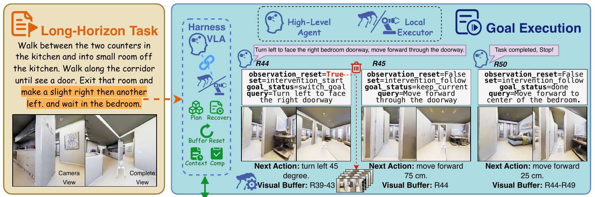
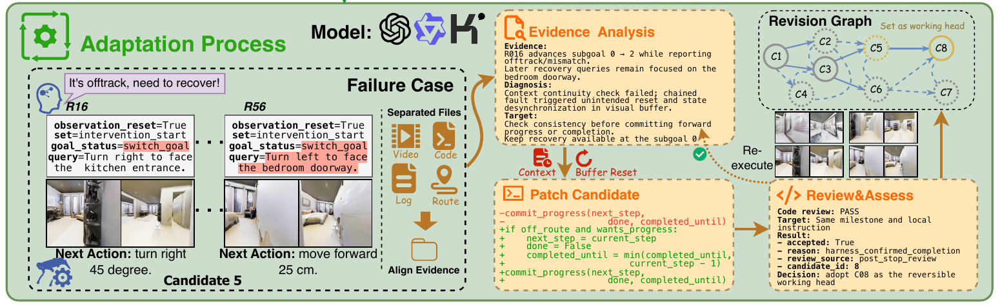

# [AdaHVLA: Adaptive Harnesses for Long-Horizon Vision-Language-Action Execution](https://arxiv.org/abs/2609.29204)

> **Brief:** AdaHVLA improves long-horizon robot tasks by adapting the **code that coordinates a reasoning agent and a frozen vision-language-action model (VLA)**. Agents inspect failed executions, propose changes to progress tracking, context, or recovery, and test whether those changes produce the expected behavior. A revision graph retains alternative implementations and their evidence so adaptation can build on earlier attempts.

**Source:** Tang et al., 2026; [paper PDF, arXiv v1, September 24, 2026](https://arxiv.org/pdf/2609.29204v1). The explanation and results below follow this nine-page version.

## Convenient Links

- [Paper](https://arxiv.org/abs/2609.29204), [code linked by the paper](https://github.com/Haaareally/AdaHVLA-Adaptive_Harness_VLA)
- Related systems: [Harness VLA](./Harness_VLA.md), [ASPIRE](./ASPIRE.md), [RegenHarness](./RegenHarness.md), [RoboHarness](./RoboHarness.md), [Hi Robot](../Policies/Pi_Hi_Robot.md)
- VLA backgrounds: [SmolVLA](../Policies/SmolVLA.md), [OpenVLA](../Policies/OpenVLA.md), [pi0.5](../Policies/Pi_0_5.md)
- Background: [Agent Memory](../../../Foundations/Agent_Systems/Memory_Systems.md)

## 1. Why Can a Correct Local Action Still Fail the Task?

Consider a simplified example of the paper's doorway problem: **“Go through the doorway into the bedroom, then turn right.”** The robot starts outside the bedroom and must first turn left to face the doorway.

Three components work together. A **reasoning agent** examines camera images and task history to decide what the robot should do next. A **VLA** converts an instruction and visual observations into local robot actions. The **harness** is the code connecting them: it stores the current goal, prepares their inputs, and decides when to accept progress or end the task.

The current goal is **“enter the bedroom.”** To start, the reasoning agent asks for **“turn left to face the doorway.”** The VLA executes that turn correctly. The robot now faces the doorway, but it is still outside the room. **The requested turn is finished; the goal of entering the bedroom is unfinished.**

Suppose the harness nevertheless records “enter the bedroom” as complete. The system can now issue the next instruction, “turn right,” while the robot is still outside. That premature instruction turns it away from the doorway. The error is accepting an unfinished goal as complete, even though the VLA performed the requested turn correctly.

The correct sequence is to inspect the new observation, keep “enter the bedroom” as the current goal, and request movement through the doorway. Only after observations support that the robot has entered should the system advance to “turn right.” This requires a rule about **when to accept goal completion**, as well as a model capable of turning and walking.

AdaHVLA adapts such rules in the harness code. It runs the robot, investigates coordination failures, changes the relevant code, and tests the change in another run. The VLA's weights stay fixed. To follow the method, distinguish three phases:

| Phase | What can change? | What stays fixed? |
|---|---|---|
| **One rollout**: one complete task attempt | Observations, active goals, instructions, retained context, and recovery state | Harness source code and VLA weights |
| **Adaptation between rollouts** | Harness source, candidate assessments, and accumulated adaptation knowledge | VLA weights and robot controllers |
| **Held-out evaluation** | Online reasoning and runtime state | Selected harness source; test outcomes do not drive revisions |

A fixed program can therefore remain **closed-loop**: it responds to new observations throughout execution. Adaptation changes the rules for responding, rather than writing a new program at every robot step.

## 2. How Does One Harness Revision Run a Task?

### 2.1 From Task State to Local Robot Action

During a rollout, the harness repeatedly connects a reasoning decision to physical execution. In the doorway example, the loop works as follows:

1. **Prepare the evidence.** Supply the reasoning agent with the task, current camera observations, and useful history, including that “enter the bedroom” remains unfinished.
2. **Reason about the next request.** The agent interprets the evidence and proposes local guidance, a progress update, or a correction. Before the turn, the guidance might be “turn left to face the doorway.”
3. **Apply the harness rules.** The code processes that proposal and updates its stored task state. A proposed goal completion need not be accepted merely because a local action finished.
4. **Execute a local instruction.** Pass the selected instruction and observation context to the frozen VLA. Its output is a command or action sequence that the robot controller executes.
5. **Observe and repeat.** Obtain new observations and execution records. After the turn, the robot still being outside means that entry remains unfinished; the next request should continue toward that goal. The rollout ends when the harness's completion logic decides to stop.

These are different responsibilities: the reasoning agent proposes what should happen, the harness determines how that proposal changes execution and stored progress, and the VLA supplies local actions. The benchmark separately checks whether the final task was actually accomplished.

### 2.2 Which Decisions Need Coordination?

The loop explains why choosing a useful instruction is only part of the problem. The harness also needs rules for accepting progress, remembering unfinished work, and continuing a correction:

| Editable rule | Operational decision | Why the doorway task needs it |
|---|---|---|
| **Progress and guidance** | Decide whether the current goal is complete and select the next instruction | Keep “enter the bedroom” active after the robot turns toward its entrance |
| **Context retention** | Select past observations, progress records, and ongoing corrections for reasoning | Remember which passage remains unfinished |
| **Visual refresh** | Decide when to clear or refresh the recent images retained for the executor | Old views can mislead local control after a turn |
| **Recovery** | Start, maintain, and end corrective guidance | A corrective turn must be followed by movement through the doorway |
| **Completion** | Check remaining goals before terminating | Finishing a local command must not imply reaching the bedroom |

These rules interact. Advancing a goal can also reset context. For example, accepting “enter the bedroom” as complete might both trigger “turn right” too early and discard the record that entry is still pending. A progress error can therefore make the next reasoning decision harder to correct.

Conversely, different consumers can need different history. A previous image may still help the reasoning agent remember the route, while the same image is stale for the VLA choosing its next local motion. **Refreshing executor observations need not erase task-level reasoning history.**

### 2.3 Follow the Correction Across Several Requests



*Paper Figure 2, execution panel. The robot first turns toward the doorway, then moves through it, and continues toward the bedroom. Each R-number identifies a harness–VLA request, which can involve multiple control steps.*

The example makes persistent recovery concrete:

1. **R44: establish the approach.** Guidance asks the robot to face the intended doorway. The request starts an intervention—an episode of corrective guidance—and requests a visual-buffer refresh. The local executor chooses a left turn.
2. **R45: continue the same correction.** The next instruction asks the robot to move through the doorway. The intervention continues and the current goal is retained, so finishing the turn does not prematurely advance the task.
3. **Later requests: finish the destination.** Guidance continues toward the bedroom; R50 illustrates movement toward its center. Overall completion must be judged against the remaining task goals.

The figure's `query` is the local instruction. `intervention_start` and `intervention_follow` distinguish beginning from continuing corrective guidance; `goal_status` records whether to switch, retain, or finish a goal. `observation_reset` requests a visual-buffer refresh, not a scene reset or an erasure of all memory.

The trace shows the desired behavior: guidance continues from turning to moving through the doorway while the code stays fixed. The paper expresses this execution loop mathematically as follows.

### 2.4 Connect the Execution Loop to the Paper's Notation

At a decision boundary $t$—one harness decision, which can span many motor-control steps—the harness combines interaction history $H_t$ with stored runtime state $m_t$. The history contains the instruction, observations, and previous actions; the runtime state includes the current goal and ongoing correction. The resulting interface is

$$
(q_t,\kappa_t,m_{t+1},z_t)\sim H_c(\cdot\mid H_t,m_t),
\qquad
a_t\sim\pi_\theta(\cdot\mid q_t,\kappa_t)\quad\text{if }z_t=0.
$$

$H_c$ denotes the coordination policy produced by source revision $c$ together with reasoning-agent calls. It outputs four things: the VLA instruction $q_t$, its observation context $\kappa_t$, updated runtime state $m_{t+1}$, and a termination flag $z_t$. If $z_t=1$, the rollout ends. Otherwise, the frozen VLA $\pi_\theta$ uses the instruction and context to produce command or action sequence $a_t$; $\theta$ denotes its unchanged weights.

For the turn above, $q_t$ asks the robot to face the doorway, $a_t$ executes the turn, and $m_{t+1}$ should still record that room entry is unfinished. This is how the notation distinguishes the action being executed from the goal being tracked.

Observation inputs follow the selected VLA adapter, rather than one shared image-history or robot-state tensor. Navigation uses NaVILA commands followed by a locomotion controller; manipulation uses the selected VLA's action interface. In either case, adaptation changes the harness code between rollouts. The next section explains how a failed execution guides that change.

## 3. How Does a Failed Rollout Become a Tested Code Change?

### 3.1 Separate What Happened from Why It Happened

A failed outcome alone is too coarse to tell the system what to edit. AdaHVLA aligns camera observations, logs, and trajectory segments by request ID and links them to the source revision that produced them. An analysis agent can then distinguish an observed event from an explanation of that event.

Figure 2 provides the continuing doorway example:

| Record | Content | Role in adaptation |
|---|---|---|
| **Observation** | R16 advances subgoal 0 to 2 while also reporting that execution is off-route | Establishes an inconsistent state transition in the trace |
| **Hypothesis** | Accepting progress while off-route causes unwanted resets and loss of context continuity | Proposes a coordination mechanism that code can change |
| **Predicted effect** | Retaining the current goal should preserve guidance toward the unfinished passage | States what a new rollout must show |

A **testable coordination hypothesis** thus contains a suspected mechanism, supporting evidence, an expected behavioral change, and an observable indicator of that change. “The robot should do better” is insufficient: it does not identify which interaction should differ.

AdaHVLA gives evidence analysis, code revision, and behavioral assessment **separate agent working contexts**, exchanging structured records rather than one shared conversation. These roles need not use different foundation models. Their separation lets a reviewer inspect execution evidence without automatically inheriting the patch author's account.

### 3.2 Make the Prediction Concrete Before Executing the Patch

The revision agent reads the source, hypothesis, and related attempts. Source inspection can change the diagnosis, but the hypothesis and predicted effect are recorded **before** running the candidate.

For the inconsistent progress update, Figure 2 shows a guard that blocks forward progress while off-route. This simplified sketch preserves its intent:

```python
if off_route and wants_progress:
    next_step = current_step
    done = False
    completed_until = min(completed_until, current_step - 1)

commit_progress(next_step, done, completed_until)
```

Here, `current_step` is the active subgoal index, `next_step` the proposed index, and `wants_progress` indicates an attempted advancement. `completed_until` records how far completion has been accepted. Holding the current step, clearing the proposed completion flag, and limiting that record prevent the inconsistent update from marking the unfinished stage complete.

The intended consequence is **preserved alignment between the pending goal and its context** when this condition occurs. The guard does not itself generate a route or guarantee that the VLA can finish the passage.

Before execution, a separate source/interface review checks whether the patch is eligible to run. Passing that review establishes code/interface acceptability; a new robot rollout is still needed to test the behavioral prediction.

### 3.3 Why Task Success Alone Cannot Validate the Hypothesis

A separate assessor compares parent and candidate rollouts on the **same task instance**, starting with a fresh working context. It judges three outcomes separately:

- **Targeted effect:** did the changed mechanism produce the predicted behavior?
- **Overall behavior:** did the trajectory improve or degrade in other ways?
- **Final success:** did the benchmark's completion condition hold?

These can disagree. The guard might preserve the correct goal but expose a later navigation failure. Alternatively, the candidate might succeed without ever encountering the guarded condition, leaving the hypothesis untested.

AdaHVLA therefore checks two questions before updating confidence in the hypothesis: **was the changed mechanism triggered, and had the trajectories already diverged before that point?** If the rollouts reached different locations before the guard ran, their later differences cannot be attributed to the guard alone. In the paper,

$$
\chi=\mathbf{1}\{\hat u=1\land\hat v=0\},
$$

where $\hat u$ indicates that the modified mechanism was triggered, $\hat v$ indicates earlier trajectory divergence, and $\mathbf{1}$ returns one when the stated condition holds. Each judgment can be true (1), false (0), or undetermined. The **attribution gate** $\chi$ decides whether a comparison can update hypothesis support:

| Evidence from the comparison | Consequence |
|---|---|
| Guard triggered; no earlier divergence | The comparison can update support for its predicted effect |
| Guard never triggered | Final success or failure does not test this repair mechanism |
| Trajectories diverged earlier, or either judgment is undetermined | Retain existing support; do not attribute the outcome to this mechanism |

For an eligible comparison, the targeted improvement strengthens support. Unchanged or degraded effects weaken support when the candidate is discontinued. All outcomes remain available for further refinement, including comparisons that cannot update support.

The gate is an **evidence rule for adaptation**. It does not control runtime termination and does not prove causality: earlier visual or spatial judgments may be wrong, and repeatability still requires more rollouts.

## 4. How Does Adaptation Accumulate Instead of Repeating Old Mistakes?

### 4.1 Keep Alternative Revisions and Their Evidence

Suppose the guard prevents premature advancement, but the robot later fails to enter the bedroom. Discarding it solely because the task still failed loses a useful improvement. Always extending the latest patch is also problematic: later changes may introduce regressions or mix unrelated failures.

The **revision graph** retains alternative source versions and links them to hypotheses, rollout evidence, and assessments. This lets the system return to an earlier branch, inspect what it fixed, and decide which unresolved problem to address next.



*Paper Figure 2, adaptation panel. The left-to-right process turns an observed failure into a patch and a new execution assessment. Each C-node in the graph is a candidate source revision; links preserve revision relationships. The working head is the selected candidate from which adaptation can continue.*

Candidates are prioritized by task success, then by targeted and overall behavioral effects. Within the budget, a candidate can be extended when its assessment identifies a targeted improvement or a newly exposed failure and graph capacity remains. Consequently, **choosing a candidate to investigate is different from increasing confidence in its hypothesis**. An incomplete task can still suggest a useful next experiment.

The paper bounds exploration by $W$, the maximum number of active candidate leaves (branches available for extension), and $D$, the maximum revision depth within the current task focus. Inactive branches and evidence remain retrievable. Repeated rollouts test whether an effect recurs; checks on previously successful adaptation tasks examine whether a change sacrifices earlier gains.

### 4.2 Distinguish Runtime Memory from Adaptation Memory

The graph is useful only if later work can recover its lessons. AdaHVLA condenses relevant agent context into persistent **adaptation memory**: issues, tested hypotheses, changes, observed effects, evaluation conditions, and links to evidence.

| Retained information | Lifetime | What it enables |
|---|---|---|
| **Runtime state** $m_t$ | Initialized for each rollout | Track the current goal, history, and ongoing correction |
| **Harness source** $c$ | Fixed within a rollout; an adapted version can carry across tasks | Execute the coordination rules learned so far |
| **Revision graph and adaptation memory** | Persist across adaptation attempts and tasks | Reuse evidence, revisit alternatives, and guide new revisions |
| **Agent working context** | Scoped to an assignment or review | Analyze the current problem without inheriting every earlier conversation |

At a task switch, the selected harness and relevant retained context persist, while runtime state and local exploration depth reset. Revision contexts are rebuilt for unrelated work, and behavioral assessments start fresh. Persistent knowledge therefore does not require sharing one ever-growing conversation among all agents.

The final harness is selected using **adaptation evidence alone**. Its source then remains fixed on held-out instances, while observations, reasoning, and runtime state continue to evolve. This tests whether adapted coordination transfers beyond the instances used to revise it.

AdaHVLA performs no VLA pre-training, post-training, or fine-tuning in this loop. Prior training of its executors is separate. The artifacts learned here are **executable coordination code and external adaptation knowledge**; selecting experience for later VLA fine-tuning is future work.

## 5. What Do the Main Experiments Test?

### 5.1 Establish the Splits and Controlled Comparisons

The evaluation asks whether code adapted on a small set of instances improves execution on held-out instances.

| Setting | Robot and execution setup | Adaptation / held-out instances |
|---|---|---|
| **NaVILA-LH** | Unitree Go2 navigation in Matterport3D scenes through Isaac Lab/Isaac Sim; NaVILA plus a pretrained locomotion controller | 10 / 40, drawn from 50 NaVILA-Bench instances |
| **VLA-Arena L1** | Panda manipulation in RoboSuite/MuJoCo; independent atomic skills composed into longer tasks | 10 / 40 |
| **VLA-Arena L2** | Same manipulation setup; longer workflows with dependencies between stages | 10 / 40, with its own split |

Manipulation uses SmolVLA, OpenVLA-OFT, or pi0.5. The environment supplies RGB observations and seven-dimensional actions, with observation handling following each adapter.

The three comparisons isolate two increments:

1. **Single VLA** directly executes the long-horizon instruction.
2. **Initial Harness VLA** adds coordination, including online reasoning and state updates, but receives no code adaptation.
3. **AdaHVLA** revises that harness on adaptation instances before testing it.

All harnesses use **Qwen3.7-Flash for runtime reasoning**. Navigation varies six adaptation-model configurations; manipulation uses **GPT-5.6-sol Max**. These names follow the paper. The adaptation model analyzes and edits code between rollouts; it is distinct from the runtime agent and the frozen VLA.

For each configuration, adaptation restarts three times from the initial harness on the same split. Each run evaluates **up to 16 candidate versions, numbered 0–15 including the initial version**. A candidate can require multiple rollouts, so this is not a 16-episode budget.

**Success rate (SR)** is the fraction satisfying the benchmark completion condition, rather than the harness's own declaration of completion. Reported means combine three runs: adaptation restarts for adapted policies and repeated evaluations for fixed baselines. Thus, a test mean summarizes $3\times40=120$ evaluations on 40 instances, not 120 distinct tasks.

### 5.2 Navigation: Does Adaptation Add Value Beyond an Initial Harness?

Table I reports held-out NaVILA-LH success:

| System / adaptation model | Mean test SR |
|---|---:|
| Single VLA | 2.5% |
| Initial Harness VLA | 22.5% |
| AdaHVLA: GPT-5.6-sol Max | 57.5% |
| AdaHVLA: GPT-5.6-terra Max | 48.3% |
| AdaHVLA: Kimi K3 | 43.3% |
| AdaHVLA: Qwen3.7-Max | 40.0% |
| AdaHVLA: GPT-5.6-luna Max | 35.0% |
| AdaHVLA: Qwen3.6-Max | 31.7% |

Introducing the initial harness adds **20.0 percentage points** over direct execution. Code adaptation then adds **9.2–35.0 points** over the initial harness while retaining the runtime agent and executor. This supports improving how existing components cooperate, beyond the benefit of adding a planner in the first place.

The strongest configuration's test rates are 62.5%, 52.5%, and 57.5% across its three restarts. Its Table I **Overall SR** of 60.7% pools adaptation and test instances; it is not the held-out result. Candidate curves in Figure 3 use test outcomes for reporting only, not revision or selection, and later candidates can regress.

The spread across adaptation models shows that the editing/review process depends on model capability. Published coding and visual-reasoning benchmarks use different protocols and are only external references, not a controlled explanation of that spread.

Here, “Initial Harness VLA” names this paper's baseline. It should not be read as a result imported from the separate *Harness VLA* paper.

### 5.3 Manipulation: Does the Gain Depend on One Executor?

Table II tests adaptation around three frozen backbones. Held-out SR (%):

| Level | Frozen VLA | Single VLA | Initial harness | Adapted harness |
|---|---|---:|---:|---:|
| L1 | SmolVLA | 7.5 | 11.7 | 25.8 |
| L1 | OpenVLA-OFT | 15.0 | 20.8 | 40.8 |
| L1 | pi0.5 | 20.0 | 25.0 | 55.8 |
| L2 | SmolVLA | 1.7 | 2.5 | 10.8 |
| L2 | OpenVLA-OFT | 4.2 | 7.5 | 23.3 |
| L2 | pi0.5 | 6.7 | 10.0 | 38.3 |

Adaptation improves every backbone/level combination. With pi0.5, it adds **30.8 points on L1** and **28.3 on L2** over the initial harness. Repeated gains within each backbone support the value of coordination changes without attributing them to a stronger action model.

L2 remains harder, but it changes both workflow length and stage dependencies, so these results do not separate those factors. Likewise, the experiments support a common adaptation architecture that specializes coordination for each setting; they do not establish one universal adapted source version shared across all backbones.

## 6. Which Components Explain the Improvement?

### 6.1 Remove Runtime Functions to Test What the Finished Harness Uses

Figure 4(a) disables functions **after adaptation, without readaptation**. It asks which functions the learned harness depends on, rather than whether a new adaptation run could compensate for their removal.

| Runtime change | Test SR change | What the comparison suggests |
|---|---|---|
| Bypass completion checks | Navigation: 57.5 → 29.2 | Deciding when the full task is finished is a major source of reliability |
| Keep only compact context | Navigation: 57.5 → 33.3; L2: 38.3 → 22.5 | Retained execution context helps beyond the task plus concise progress |
| Disable visual refresh | L1: 55.8 → 37.5 | Local manipulation is sensitive to stale visual context |
| Remove corrective guidance | L1: 55.8 → 56.7; L2: 38.3 → 23.3 | Recovery matters more in the tested dependent workflows than in L1 |

The paper's **W/O Context** variant still retains the task and concise progress; it is not memory-free. **W/O Buffer Reset** disables VLA visual-history refresh in navigation and harness image-context refresh in manipulation, so the interface operation differs across settings.

These comparisons connect back to the doorway example: correct local motion is insufficient if completion is premature, context loses the pending goal, or a correction ends before its purpose is fulfilled. The small L1 increase after removing recovery also cautions against assuming every component helps every task.

### 6.2 Rerun Adaptation to Test How the Harness Is Learned

Figure 4(b) changes the adaptation process and **repeats it under the same candidate budget**. Manipulation uses pi0.5.

| Adaptation process | Navigation | L1 | L2 |
|---|---:|---:|---:|
| Full AdaHVLA | 57.5 | 55.8 | 38.3 |
| Flat history instead of revision graph | 42.5 | 50.8 | 26.7 |
| Select candidates using success alone | 38.3 | 48.3 | 25.0 |
| Share working contexts across roles and tasks | 49.2 | 55.0 | 30.0 |

Flat history retains code versions and rollback. Its lower performance therefore supports **linking related revisions to their behavioral evidence**, beyond simply saving old programs.

Success-only selection still allows the revision agent to read trajectories and failed candidates to remain eligible. What it removes is behavioral evidence from choosing which candidate to refine. The drop is consistent with the earlier example: a repair can fix premature progress yet fail later, and a binary failure score conceals that useful intermediate change.

Shared context carries all agent working contexts across tasks. The navigation and L2 losses support retaining structured experience while giving each analysis or review an appropriate scope.

Assigning the adaptation roles to one agent, or merging observed events with hypotheses, also lowers navigation SR. Effects vary: merging evidence and hypotheses reaches 56.7% on L1 versus 55.8% for Full. Close means over three runs do not establish a reliable ordering or prove that separate contexts eliminate reasoning errors.

## 7. What Does Real-World Execution Add, and What Remains Uncertain?

Figure 5's real Unitree Go2 trace illustrates the intended runtime behavior. After completing Goal 1, the robot deviates while approaching Goal 2 at R59. Corrective guidance persists through R67–R72, Goal 2 is reached at R75, and execution continues without restarting or changing source code during the episode.

This is the doorway principle in deployment: **retain the pending goal while the VLA executes successive corrections**. The paper presents it as qualitative evidence, rather than a separately tabulated real-world success-rate benchmark.

The simulation results provide the quantitative evidence for held-out improvement. Their scope is coordination around the tested executors and task distributions. Visual or spatial reasoning errors can affect both the proposed patch and its assessment; separate contexts can still share mistakes from the same base model. The attribution gate limits unsupported conclusions, while repeated execution remains necessary to assess reliability.
