# [CaP-X: A Framework for Benchmarking and Improving Coding Agents for Robot Manipulation](https://arxiv.org/abs/2603.22435v2)

> **Brief:** CaP-X studies how a coding agent can control a robot by writing and executing Python programs. It asks how much success comes from the model and how much comes from the tools supplied to it. A tiered benchmark exposes that dependence; CaP-Agent0 improves a frozen model through feedback, reusable code, and program synthesis, while CaP-RL separately improves the coding model's weights through reinforcement learning.

**Source:** Fu et al., 2026; [arXiv:2603.22435v2, July 2, 2026](https://arxiv.org/pdf/2603.22435v2), 58 pages. The explanations below use the main paper and its API, agent, case-study, and evaluation appendices.

## Convenient Links

- [Project](https://capgym.github.io/), [paper HTML](https://arxiv.org/html/2603.22435v2)
- Start here: [Eight-tier summary](#2-tier-summary-what-changes-between-s1s4-and-m1m4), [Agent loop](#5-how-does-cap-agent0-combine-these-lessons), [Results](#6-what-do-the-cap-agent0-results-establish), [CaP-RL](#8-what-does-cap-rl-change-through-training)
- Related systems: [Envisioning Agentic Robotics](./Envisioning_Agentic_Robotics.md), [ASPIRE](./ASPIRE.md), [Zetta](./Zetta.md), [Spotter](./Spotter.md), [Harness VLA](./Harness_VLA.md)
- Background: [Tool Interfaces](../../../Foundations/Agent_Systems/Tool_Registry_and_Function_Calling.md), [Skill Systems](../../../Foundations/Agent_Systems/Skill_Systems.md), [Modern Robotics](../../../Foundations/Books/Robotics/Modern_Robotics.md), [LIBERO](../Datasets/LIBERO.md), [GRPO](../../../Foundations/Preference_Alignment/GRPO.md)

## 1. What Does It Mean to Control a Robot by Writing Code?

Suppose a robot is asked to lift a red cube. A coding agent writes a program that finds the cube, chooses a grasp, approaches it, closes the gripper, and lifts. The robot's existing perception and control software executes those calls. **The generated program is the policy artifact**; the language model does not predict every motor command.

This is **Code-as-Policy (CaP)**. A program can express geometry, loops, conditions, and recovery strategies, rather than only select the next action from a fixed list. But a program can also run without an exception while the gripper closes on empty space. Software execution and physical task completion must be evaluated separately.

A second complication is that the API can already contain much of the solution. Calling a human-written grasp macro requires less perception and geometric reasoning than constructing the same operation from camera images, segmentation, grasp proposals, and inverse kinematics. CaP-X calls this supplied structure **scaffolding**. A high score with strong scaffolding does not isolate what the coding model can construct itself.

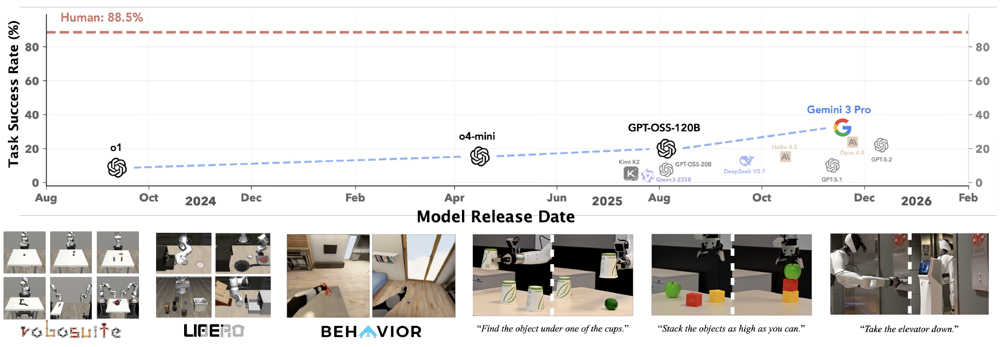

*Paper Figure 1, PDF page 2. The upper panel plots the paper's single-turn comparison by model release date; the lower panel illustrates simulation environments and physical tasks. The dashed 88.5% human reference comes from extensively debugged expert programs, not first-attempt human code.*

Read the upper panel as a gap under the paper's specified interfaces and protocol. Release date is not a controlled explanation for the differences between models. The lower panel shows the breadth the platform supports, rather than establishing the same quantitative reliability on every pictured task.

### 1.1 Four Components Answer Four Different Questions

| Component | Question it answers | What it supplies |
|---|---|---|
| **CaP-Gym** | Where can robot programs run and return feedback? | A stateful code executor connected to simulated or physical perception/control |
| **CaP-Bench** | How do tool abstraction, interaction, and perception affect success? | Controlled evaluation tiers and tasks |
| **CaP-Agent0** | Can a frozen model construct more reliable programs? | Visual feedback in text, a synthesized helper library, and parallel proposals combined into one program |
| **CaP-RL** | Can robot outcomes improve the coding model itself? | Reinforcement learning that updates the model's weights |

The progression matters: the environment makes executions measurable; the benchmark reveals failures; Agent0 addresses those failures through inference-time support; RL is a separate training experiment. The paper does not evaluate one system that combines every Agent0 ensemble component with the RL-trained model.

## 2. Tier Summary: What Changes Between S1–S4 and M1–M4?

The tiers are **experimental configurations**, not autonomy levels. **S means single-turn**, and **M means multi-turn**. These labels also differ from the System 2/System 1/System 0 responsibilities used in some robotics architectures.

A **turn** is one exchange in which the coding agent generates a program and receives its execution result. A single-turn program can still contain many robot actions, sensor calls, loops, and checks. Multi-turn operation additionally lets the model inspect what happened and write another program.

### 2.1 Read Table 1 as a Set of Available Supports

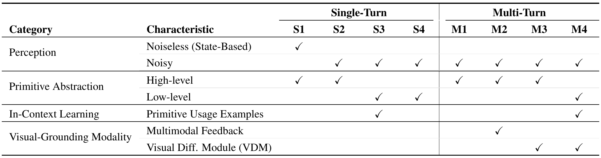

*Paper Table 1, PDF page 3; complete table body. Each column is a configuration. A check mark means that support is available; it is not a score or a capability the model has demonstrated.*

The same table in operational terms is:

| Tier | Robot tools and perception | What the coding model receives after execution | Meaning in practice |
|---|---|---|---|
| **S1** | High-level primitives with correct simulator-derived masks/poses | No next model turn | Generate one program with perception noise removed |
| **S2** | High-level primitives using actual, noisy perception modules | No next model turn | Generate one program while relying on imperfect perception |
| **S3** | Low-level primitives, noisy perception, and API usage examples | No next model turn | Compose perception, geometry, and control from smaller tools |
| **S4** | The same low-level primitives and noisy perception, without usage examples | No next model turn | Infer API composition from signatures and documentation alone |
| **M1** | High-level primitives and noisy perception | Printed output and Python error traces | Diagnose and revise code across turns without automatic image feedback |
| **M2** | The same high-level setting | M1's traces plus current RGB images | The coding model directly interprets visual feedback; requires an image-capable model |
| **M3** | The same high-level setting | M1's traces plus visual descriptions/differences produced by an auxiliary VLM | Receive visual evidence as task-relevant text |
| **M4** | Low-level primitives and usage examples, as in S3 | Execution traces plus the same visual-differencing mechanism as M3 | Recover and replan while retaining the lower-level interface |

*Operational paraphrase of paper Table 1 and Sections 3.1–3.2. A VLM is a vision-language model. API documentation remains available in S4; the removed material is the usage examples.*

**Privileged perception** in S1 means accessing correct simulation state instead of asking a vision model to estimate it. It does not remove all planning or execution difficulty. Conversely, a text-only M1 agent can still call perception APIs and print their numerical estimates; “text-only” describes what enters its model context, not a robot without cameras.

### 2.2 Which Comparisons Answer Which Questions?

| Comparison | Main change | Question it addresses |
|---|---|---|
| **S1 versus S2** | Correct state versus noisy perception under high-level APIs | How much does perception error hurt? |
| **S3 versus S4** | Add or remove usage examples under the same low-level APIs | Does showing API composition help? |
| **S2 versus M1** | Allow another model turn using execution traces | Can the model diagnose and repair its program? |
| **M1 versus M2** | Add raw RGB to an image-capable coding model | Does direct visual feedback help this configuration? |
| **M1 versus M3** | Add an auxiliary VLM that translates visual changes into text | Does this visual-grounding system help? |
| **M3 versus M4** | Change high-level tools to low-level tools with examples | How well can interaction compensate for reduced abstraction? |

These are not eight rungs of a single difficulty ladder. For example, **S3 → M4 adds both more model turns and visual differencing**. Its gain cannot identify the contribution of either change alone. Similarly, M3 adds another strong model, so M2 versus M3 does not isolate text formatting at equal computation.

The main study uses **seven Robosuite tasks and 12 coding models**, with **100 trials per evaluated task/model/tier setting**. The tasks are lift, stack, wipe, peg insertion, restack, two-arm lift, and two-arm handover. Some cells are unavailable or unreported: M2 requires image input, and Appendix Figure 17 explains why single-turn restacking was not fully evaluated. Missing cells should not be read as measured zero success.

The broader CaP-Gym release has **187 tasks: 7 Robosuite + 130 LIBERO-PRO + 50 BEHAVIOR**. That is platform coverage, not the size of the complete 12-model controlled study.

## 3. How Does a Program Turn Pixels into a Grasp?

### 3.1 A High-Level Call Hides Several Necessary Operations

A high-level primitive such as `sample_grasp_pose("red cube")` returns a grasp using an object description. Under low-level access, the coding agent must construct the intermediate steps that make that result possible.

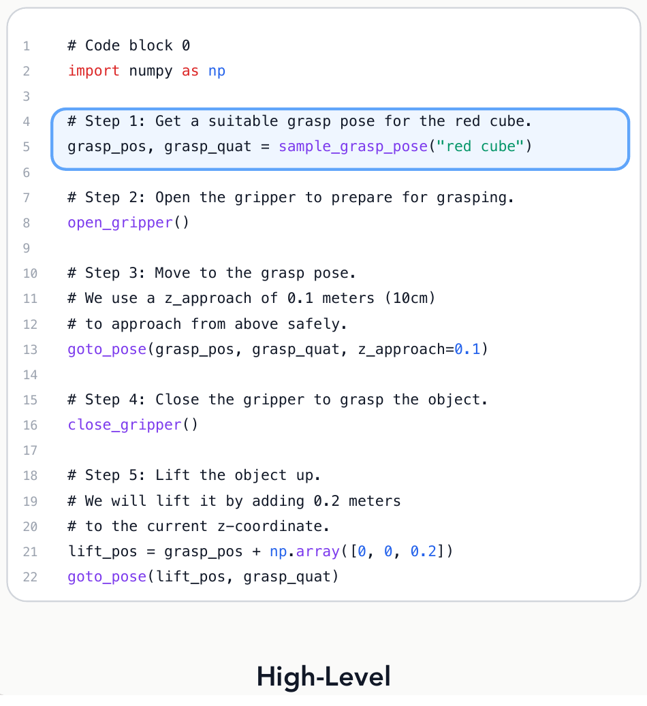

*Paper Figure 2, left panel, PDF page 4. The highlighted call bundles the grasp-construction work. The panel below expands that work using lower-level APIs.*

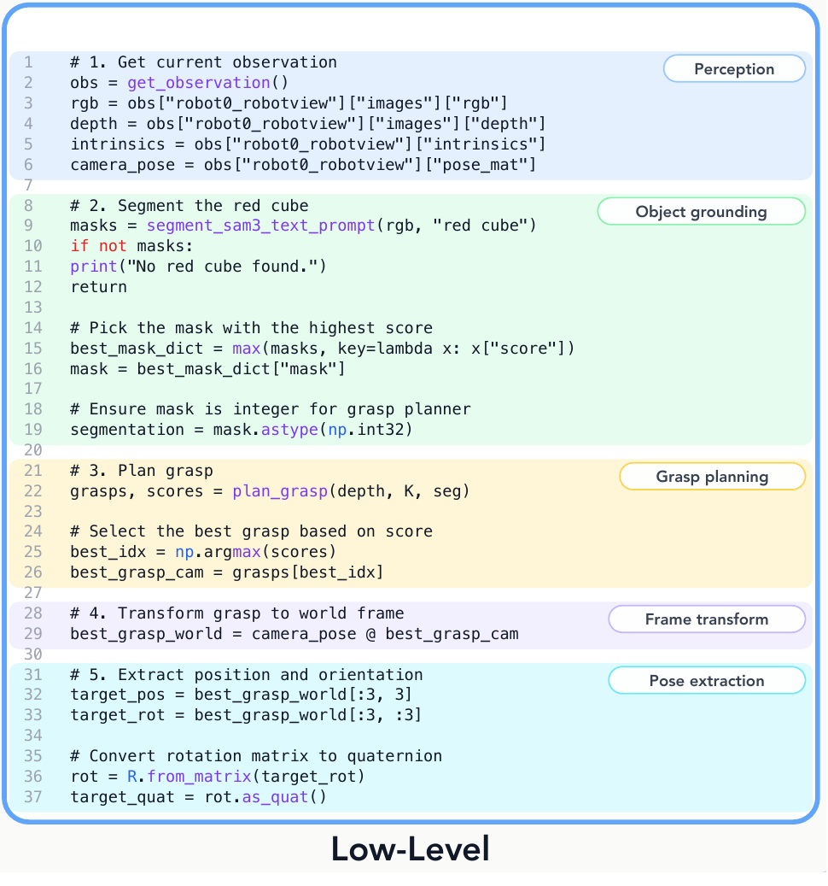

*Paper Figure 2, right panel, PDF page 4. This constructs a grasp rather than executing the entire lifting routine. The panels are separated for legibility. They show generated code, not a reference implementation to copy unchanged.*

Follow the data through the lower-level panel:

| Step | Input → output | Why the next step needs it |
|---|---|---|
| **Observe** | Camera → RGB, depth, intrinsics, and camera pose | Appearance identifies the object; depth/calibration locate it in 3D |
| **Segment** | RGB and “red cube” → target mask | The grasp planner must know which image region belongs to the target |
| **Propose grasps** | Depth, intrinsics, and mask → candidate poses and confidence scores | A target object's location alone does not specify a gripper orientation or contact |
| **Transform and select** | Camera-frame grasp → pose in the required reference frame | The controller cannot use camera-relative coordinates as if they were robot-relative |
| **Execute** | Tool pose → inverse kinematics, joint motion, and gripper commands | The planned grasp must become physical movement |
| **Verify** | Fresh observations → estimate of whether the object moved with the gripper | A finished movement does not establish successful pickup |

A mask normally has one value per image pixel; a grasp pose is a **6-DoF pose**, with three position and three orientation degrees of freedom. CaP-Gym exposes pretrained/engineered tools including SAM3 segmentation, Molmo pointing, Contact-GraspNet grasp proposals, and PyRoki inverse kinematics. Lower-level access still depends on those tools. The agent is learning to compose them, rather than learning motors and perception from scratch.

### 3.2 The Same Point Has Different Coordinates in Different Frames

A correct grasp estimate can produce an incorrect command if its coordinates are interpreted in the wrong frame.

Let $C$ be the camera frame, $G$ the grasp frame, and $W$ a common reference frame. A $4\times4$ rigid transform $T_{AB}$ maps coordinates from frame $B$ into frame $A$. The grasp conversion is

$$
T_{WG}=T_{WC}T_{CG},
\qquad
p_W=R_{WC}p_C+t_{WC}.
$$

Here $R_{WC}$ is a $3\times3$ rotation, $t_{WC}$ is a three-dimensional translation in meters, and $p_C,p_W$ describe the same position. The multiplication composes **grasp → camera → reference**; it does not change the intended physical grasp.

For an **illustrative translation-only example**, assume aligned axes. The camera origin is $(0.40,-0.10,0.20)$ m in $W$, and a grasp is $(0.05,0.02,0.30)$ m relative to the camera. Then

$$
p_W=(0.40,-0.10,0.20)+(0.05,0.02,0.30)
=(0.45,-0.08,0.50)\ \mathrm{m}.
$$

Sending $(0.05,0.02,0.30)$ directly as a reference-frame target would move toward another location. Real conversions also include rotation and, where required, a further transform into the robot-base frame.

Orientation conventions introduce another trap. The API/helper specifications use quaternions ordered **$[w,x,y,z]$**, while SciPy's usual output is **$[x,y,z,w]$**. Identity rotation is therefore $[1,0,0,0]$ in the first convention and $[0,0,0,1]$ in the second. The values must be reordered before crossing that interface.

Correct coordinate conversion still does not prove reachability, collision avoidance, or stable contact. Those remaining requirements explain why code correctness alone is a weak task metric.

### 3.3 What Persists When the Model Gets Another Turn?

CaP-Gym runs programs in a stateful **read–evaluate–print loop (REPL)**. Within a trial, later programs can reuse state in the executor and inspect printed output or errors. More importantly, **the physical scene is not reset between model turns**.

If a program moves one obstructing cube and then encounters an error, its effects remain. The next program should continue from that changed scene, not replay the original plan blindly. A stored object pose is only an earlier estimate; moving the object or camera can invalidate it.

The paper uses zero-shot **Pass@1 at the trial level**: one attempt on a task instance can contain several model turns. Nine proposed programs or three recovery turns do not become nine or three independent reset-and-retry trials.

The benchmark also distinguishes:

- **Code compilation/execution success:** whether the generated code executes under the reported code metric.
- **Task success:** whether the environment's physical goal is achieved.
- **Dense task reward:** a partial-progress metric reported in the analysis; progress need not meet the success condition. This metric is distinct from the observations and traces supplied to the acting model.

For example, approaching the cube and closing an empty gripper can execute correctly and make some progress while still failing pickup. The next section asks which supports reduce that gap.

## 4. What Do the Tier Experiments Reveal?

### 4.1 Easier APIs Help More Than They Improve Python Correctness Alone

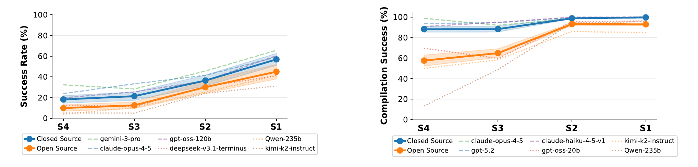

*Paper Figures 3 and 4, PDF page 5. Left: physical task success. Right: code execution/compilation success. Both use the S4 → S3 → S2 → S1 ordering; it changes examples, abstraction, and finally perception privilege.*

The two plots answer different questions. More supplied structure generally raises task success, but successful execution is already much more common than physical success. Therefore, the manipulation gap is not explained solely by syntax errors or unavailable Python names. A runnable program can choose the wrong grasp, frame, order of operations, or completion test.

High-level macros reduce this burden by embedding useful decisions in software. They also restrict expressivity: an agent cannot construct an alternative perception fallback if the macro exposes only an object-name-to-grasp result. CaP-X therefore studies whether a model can recover useful structure while keeping access to the constituent tools.

Usage examples are one comparatively cheap support:

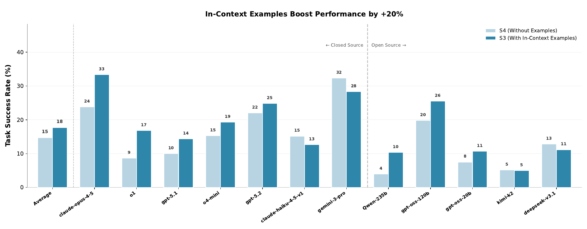

*Paper Figure 18, PDF page 28. The bars compare the same low-level APIs without and with examples. The displayed average rises from about 15% to 18%; some individual models decline.*

The improvement is about **3 percentage points**, or **20% relative to a 15% baseline**. It is not a 20-point gain. Examples help many models connect array shapes, frames, and function outputs correctly, but the per-model exceptions show that they are not a universal remedy.

### 4.2 Feedback Helps Only If It Exposes What Went Wrong

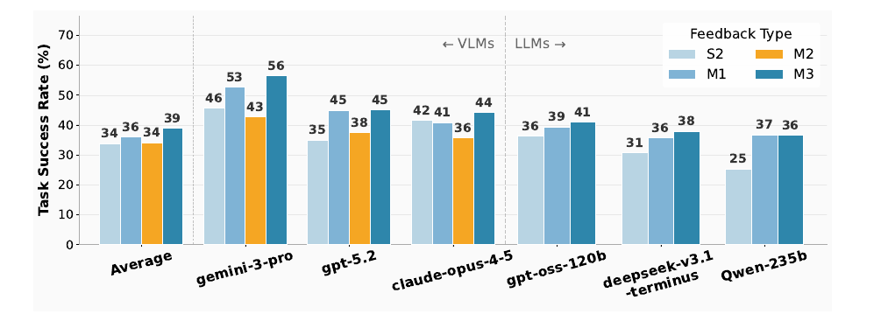

*Paper Figure 5, PDF page 6. S2 has one model turn; M1 adds execution traces, M2 adds raw RGB, and M3 uses an auxiliary VLM's textual visual feedback. M2 is unavailable to text-only models.*

A failed grasp need not raise an exception. In M1, the coding agent can instrument its own program: call perception after lifting, print the estimated object height, and compare it with the earlier estimate. That makes a physical discrepancy visible in the returned text.

For an **illustrative observation sequence**, suppose the cube's estimated center stays at 0.03 m after the gripper lifts. A printed “lift motion completed” establishes that the command ended; the unchanged object height suggests that pickup failed. A subsequent turn can choose another grasp and observe again. The height is noisy evidence, not a universal success threshold.

In the paper's tested configurations, raw RGB feedback in M2 performs worse than execution-only M1, while M3's visual-to-text feedback improves success. The authors suggest difficulty jointly reasoning over robot images and code. The comparison demonstrates the usefulness of their supporting VLM system; it does not establish that text always beats images or that the gain comes from formatting alone.

### 4.3 Interaction Can Recover Some Capability Lost with Smaller Tools

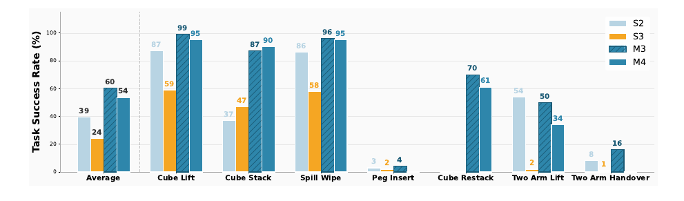

*Paper Figure 6, PDF page 6. S2/S3 are high-/low-level single-turn settings; M3/M4 are their interactive counterparts with visual differencing. Read each task group separately as well as the mean.*

The plotted means are approximately **39% for S2, 24% for S3, 60% for M3, and 54% for M4**. Low-level code with feedback can outperform high-level code written once. Yet high-level interactive M3 remains stronger on several tasks, and peg insertion stays near zero. Interaction compensates for some missing scaffolding; it does not eliminate all control difficulties.

These findings motivate three different interventions: provide useful observations after execution, reuse recurring geometric code, and explore alternative programs before executing one. CaP-Agent0 combines them.

## 5. How Does CaP-Agent0 Combine These Lessons?

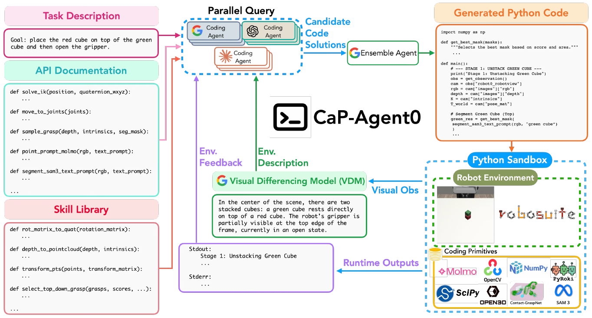

*Paper Figure 7, PDF page 7. Follow the arrows from task/API/library context to candidate programs, then to one synthesized program and the Python sandbox. Images and execution traces return through different feedback paths.*

### 5.1 Visual Differencing Describes the Initial State and Later Changes

The **Visual Differencing Module (VDM)** uses Gemini-3-Pro to turn images into task-relevant text. On the first turn, it describes the scene given the instruction. On later turns, it compares earlier and current observations, describes changes, and assesses whether the task appears complete.

This is semantic comparison, not pixel subtraction. “The gripper moved upward, but the cube stayed on the table” is more useful to the coding model than an unstructured collection of changed pixels. The coding model receives that description alongside executed code, printed output, and error traces.

The distinction between initial description and subsequent differences matters. An initial scene interpretation supports the first plan. A later difference tells the model which part of that plan actually happened, so it can retain valid progress and repair the remaining work.

Consider the paper's real-world instruction **“place the blue cube on top of the yellow cube.”** Initially, blue supports yellow, and yellow supports green. One feasible strategy removes green, moves yellow aside, and then places blue on yellow.

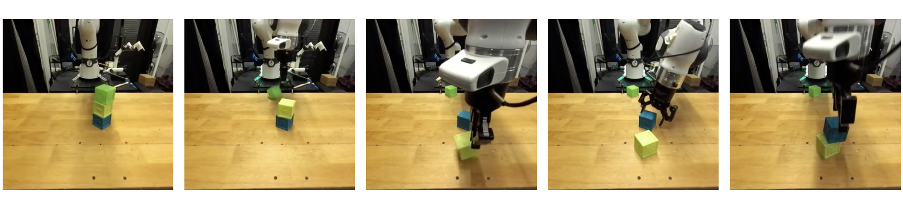

*Paper Figure 22, PDF page 31. The frames show a reported physical case, not an aggregate success rate.*

The following is an **illustrative recovery trace**, not the exact model-turn sequence of that demonstration:

| Turn | Starting state and returned evidence | Model decision and resulting state |
|---|---|---|
| **1** | Initial image: green on yellow on blue | Generate an unstack-and-restack program. Suppose green moves aside, but the program stops before moving yellow; that partial change remains |
| **2** | Fresh image and traces: green is aside; yellow still blocks blue | Continue by moving yellow, re-localize it at its new position, and place blue on it |
| **3** | New image: blue appears supported by yellow and the gripper is released | Assess the evidence and choose FINISH, or generate another check/repair if uncertain |

A turn can execute the entire sequence if it works; the table does not prescribe one action per turn. Its point is that recovery starts from the **current** scene. Reusing yellow's original position after moving it would invalidate the placement target.

VDM's judgment and the agent's **FINISH** decision remain fallible. The environment's success condition decides benchmark success; the agent cannot make a failed trial successful by declaring completion.

### 5.2 A Persistent Library Removes Repeated Geometric Work

Even with good feedback, a low-level program repeatedly needs the same conversions and geometric routines. Re-deriving them on every task creates repeated opportunities for mistakes.

The reported library is built offline in one synthesis pass:

1. Pool successful **S3 rollouts from all 12 models and seven Robosuite tasks**.
2. Extract function definitions from those programs.
3. Ask Gemini-3-Pro to identify recurring, task-agnostic logic.
4. Make the resulting **nine helpers** available across trials.

| Helpers in Appendix H.1 | Reusable work they perform |
|---|---|
| `rotation_matrix_to_quaternion`, `decompose_transform` | Convert a grasp transform into position and the required quaternion representation |
| `depth_to_point_cloud`, `mask_to_world_points`, `pixel_to_world_point` | Recover 3D geometry from depth, camera calibration, and selected pixels |
| `transform_points` | Express points in another reference frame |
| `interpolate_segment`, `normalize_vector` | Construct geometric paths and directions |
| `select_top_down_grasp` | Filter grasp proposals by approach direction, then rank eligible candidates |

*Complete nine-function inventory, grouped and paraphrased from Appendix H.1; these are helpers, not nine complete task policies.*

The library persists across trials, while each trial starts with its own physical scene and execution history. The paper discusses future iterative library growth, but the reported system uses one synthesis pass. It does not demonstrate an indefinitely running online skill-discovery loop.

A grasp filter gives a concrete example of what reuse changes. Contact-GraspNet can score a side grasp highly even when a downward approach is preferable for this tabletop task. The helper first transforms each grasp into the common reference frame. It then compares the grasp's approach direction with downward vertical.

Appendix H.1 uses the gripper's local $z$ axis as its approach direction; this convention must match the gripper model. Let $a_i$ be that unit approach vector for candidate $i$ expressed in the reference frame, and let $e_z=(0,0,1)$ point upward. The helper computes

$$
\alpha_i=-a_i^\top e_z
$$

and keeps candidates with **$\alpha_i>\tau$**, using a default $\tau=0.8$. It returns the highest grasp-confidence score **among eligible candidates**.

For **illustrative candidates already expressed in the same frame**:

| Candidate | Approach vector $a_i$ | Confidence | $\alpha_i$ | Passes $\alpha_i>0.8$? |
|---|---|---:|---:|---|
| Sideways | $(1,0,0)$ | 0.95 | 0 | No |
| Downward | $(0,0,-1)$ | 0.80 | 1 | Yes |
| Threshold boundary | $(0.6,0,-0.8)$ | 0.90 | 0.8 | No |

The selected candidate is the downward one despite its lower confidence. Filtering enforces the approach preference; confidence ranks the survivors. Equality fails the strict test. If every candidate fails, the library helper returns no grasp; the **calling program** must decide whether to re-observe or use a fallback. Some generated case-study programs implement such fallbacks, but they are not guaranteed by the helper itself.

**Training-free means frozen coding-model weights here.** The library still contains robot-execution-derived experience, and its perception/control dependencies are pretrained or engineered. Automatically recovering reusable structure is a contribution; absence of model fine-tuning is not absence of prior information.

### 5.3 Nine Candidate Programs Become One Executed Program

A single proposal can overlook the obstruction order or omit a fallback. CaP-Agent0 considers alternatives before committing to action:

| Proposal configuration | How nine candidates are generated |
|---|---|
| **One model, labeled +1M** | Nine Gemini-3-Pro queries at temperatures 0.1 through 0.9 |
| **Three models, labeled +3M** | Three queries each to Gemini-3-Pro, GPT-5.2, and Claude Opus 4.5, at temperatures 0.1, 0.5, and 0.9 |

A central coding agent critiques and synthesizes the proposals into **one program**. It can combine one candidate's correct unstacking order with another's checks for empty segmentation or missing grasps. This is program synthesis, not simply majority voting or executing all nine candidates.

On subsequent turns, the synthesis produces **FINISH** or **REGENERATE** followed by new Python. The nine proposals share the current task context; physical feedback arrives only after the chosen synthesis executes.

Also distinguish **M1**, the execution-only benchmark tier, from **+1M**, the one-model proposal ensemble. The similar labels refer to different parts of the experiment.

The one-model and three-model configurations keep the number of proposals at nine. That controls candidate count while changing model diversity; it does not equalize token cost, price, or model computation.

## 6. What Do the CaP-Agent0 Results Establish?

### 6.1 The Largest Reported Gain Comes from Closing the Loop

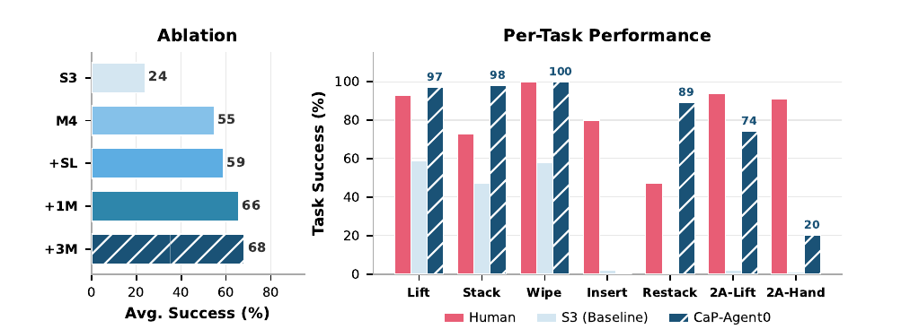

*Paper Figure 8, PDF page 7. Left: progressively add interaction/VDM, the skill library (SL), and one-/three-model proposal ensembles (+1M/+3M). Right: compare the final system with S3 and human programs on each task.*

The left panel reports these rounded mean success rates:

| Configuration | Mean success | What changed from the preceding row |
|---|---:|---|
| **S3** | 24% | Low-level APIs with examples; one generated program |
| **M4** | 55% | Add multiple turns and visual differencing together |
| **+SL** | 59% | Add the synthesized nine-function library |
| **+1M** | 66% | Add nine one-model proposals and synthesis |
| **+3M** | 68% | Keep nine proposals but diversify across three models |

The largest jump adds a feedback loop, not a change to the coding model's weights. Reuse and proposal synthesis then improve the reported mean further. The last comparison suggests a smaller gain from model diversity once parallel proposals are already available.

These are Figure 8's rounded labels. Baselines differ between some plots: Gemini's S2 mean is 46% in Figure 5 but 39% in Figure 6, and M4 is 54% in Figure 6 versus 55% in Figure 8. The paper does not reconcile these differences. Interpret each comparison within its own panel rather than joining the figures into one exact numerical sequence.

### 6.2 A High Mean Hides Contact and Coordination Failures

The full **paper Table 5**, transposed below, also tests an additional prompt that emphasizes debugging and completion verification:

| Task | CaP-Agent0, +3M | +3M with extra debugging prompt |
|---|---:|---:|
| Cube lift | 97% | 94% |
| Cube stack | 98% | 100% |
| Spill wipe | 100% | 98% |
| Peg insertion | 0% | 0% |
| Cube restack | 89% | 88% |
| Two-arm lift | 74% | 66% |
| Two-arm handover | 20% | 12% |
| **Seven-task mean** | **68.29%** | **65.43%** |

*Complete results from Table 5, PDF page 48. The +3M column also supplies the exact task percentages behind Figure 8's final-system bars; values are success percentages, not dense reward.*

The paper's near-human claim concerns **four of seven tasks**, not uniformly human-level manipulation. Peg insertion remains unsolved here, and handover is much less reliable than lifting or wiping. A program that can plan the right stages can still lack the fine contact control needed to complete them.

The debugging prompt improves stacking in this sample but lowers the overall mean. It demonstrates that asking for more careful verification is not, by itself, a reliable replacement for better evidence or execution. The table does not establish statistical significance for each small per-task difference.

The human reference also needs its development conditions. Seven authors with at least two years of robotics-programming experience iterated on scripts using the same tier's primitives. Simple pick-and-place programs took hours to under a day; difficult contact/bimanual solutions involved two to three weeks of development, including toolchain work. The scripts were fixed for evaluation. CaP-Agent0 instead performs reasoning and recovery during the trial. This comparison controls available primitives, but not human development effort against inference-time compute.

### 6.3 Fewer Model Turns Do Not Necessarily Mean Lower Compute

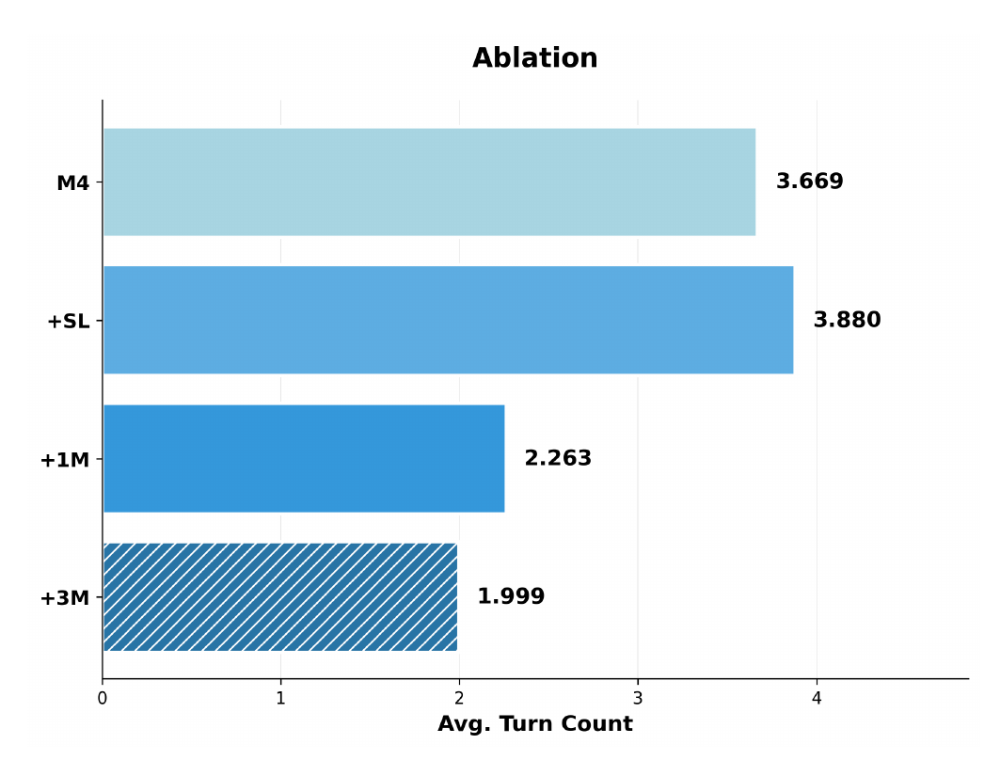

*Paper Figure 23, PDF page 49. The reported average turn count is about 3.67 for M4, 3.88 with the library, 2.26 with +1M, and 2.00 with +3M.*

The ensemble can anticipate missing-grasp or empty-mask cases before the first execution, whereas a single proposal may add a fallback only after encountering the failure. Appendix F.2.4 gives examples of this difference.

The library alone slightly increases the plotted turn count despite improving success; adding proposals reduces it. However, an ensemble turn now generates nine candidates and performs synthesis. Two such turns can consume more model calls than four single-proposal turns. Turn efficiency and total computation are different measurements; Section 9 returns to wall-clock timing.

## 7. Does the Method Work Beyond the Seven Core Tasks?

### 7.1 Changed Instructions and Changed Positions Test Different Strengths

**CaP-Bench++** evaluates CaP-Agent0 on 30 LIBERO-PRO tasks and two BEHAVIOR tasks. It does not repeat all eight tiers and 12 models across all 187 released tasks.

LIBERO-PRO makes two relevant changes:

- **Position perturbation (Pos):** swap initial object locations, such as the frypan and moka pot.
- **Instruction perturbation (Task):** change which object the instruction requests, such as asking for the frypan instead of the moka pot.

The first tests dependence on familiar geometry/layout. The second tests whether behavior follows a changed request, rather than reproducing the usual task's object choice.

**Paper Table 2**, reproduced as reported with fractions converted to percentages:

| Method | Object: Pos | Object: Task | Goal: Pos | Goal: Task | Spatial: Pos | Spatial: Task |
|---|---:|---:|---:|---:|---:|---:|
| OpenVLA | 0% | 0% | 0% | 0% | 0% | 0% |
| pi0 | 0% | 0% | 0% | 0% | 0% | 0% |
| pi0.5 | 17% | 1% | 38% | 0% | 20% | 1% |
| **CaP-Agent0** | **22%** | **18%** | **26%** | **17%** | **12%** | **14%** |

*Complete main-table summary, PDF page 8. These are the paper's rounded split averages under its evaluation settings. “Task” denotes instruction perturbation, not an ordinary completion metric for the unperturbed task.*

CaP-Agent0 is stronger under changed instructions, but pi0.5 is stronger under position perturbations in two splits. This supports complementary strengths rather than general dominance by coding agents. Absolute success remains low: even the stronger instruction result is below 20%.

Selected rows from **Appendix Tables 6–8** show why averages need a task-level interpretation. Each original task is evaluated over 50 trials per reported setting:

| Source and original task family | pi0.5: Pos / Task | CaP-Agent0: Pos / Task |
|---|---:|---:|
| **Table 6:** put barbecue sauce in basket | 100% / 2% | 12% / 42% |
| **Table 7:** put cream cheese in bowl | 98% / 2% | 4% / 34% |
| **Table 8:** move black bowl from ramekin to plate | 98% / 2% | 2% / 20% |

*Selected, paraphrased rows, not the complete appendix tables. Pos and Task are different perturbation conditions; the nominal task label identifies the task family.*

For these rows, the same broad pattern is pronounced: the learned policy is strong under one change and weak under the other, while the coding agent has the opposite strengths. Appendix J also identifies concrete coding-agent failures: confusing similar object labels during segmentation, proposing angled grasps in clutter, and knocking objects over when collision-aware planning is absent. Correctly interpreting the instruction does not eliminate those physical failures.

### 7.2 Arriving Near an Object Is Not Completing Pickup

BEHAVIOR uses an R1Pro wheeled humanoid that must search, navigate, and manipulate. Navigation success means reaching within **1 m of the target**. Full task success additionally requires pickup.

**Paper Table 3**, complete results over 25 trials per task:

| Task | Human: navigation | S3: navigation | Agent0: navigation | Human: completion | S3: completion | Agent0: completion |
|---|---:|---:|---:|---:|---:|---:|
| Pick up radio | 88% | 72% | 80% | 36% | 24% | 56% |
| Pick up soda can | 80% | 52% | 84% | 72% | 32% | 72% |

Radio navigation succeeds in 80% of Agent0 trials, but complete pickup succeeds in 56%. The gap shows that target finding and approach do not guarantee a useful view, feasible grasp, or successful contact. Human programs also exhibit a large gap on that task.

The reported recoveries address those causes: reposition after moving too close and losing the target from view; adjust search and camera height; resample grasps after disturbing a small can. Repeating the identical grasp call without changing its failed conditions would not provide the same benefit.

### 7.3 Physical Demonstrations Show Mechanisms, with Different Levels of Assistance

The physical cases use Franka Panda and AgiBot G1. They show that generated code can connect semantic reasoning to real perception and motion. They are not a quantitative reliability study over all the illustrated tasks.

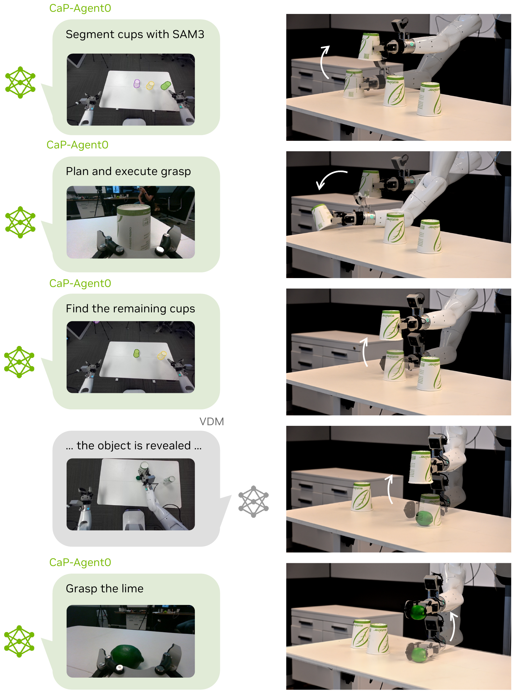

*Paper Figure 12, PDF page 22. Left: condensed planning/perception steps. Right: physical execution. Read downward; the VDM observation of the revealed object changes the next decision.*

Initially, the lime is hidden, so the first image provides no direct grasp evidence for it. The robot moves a cup, observes the newly exposed region, and continues searching if the target is absent. Once the lime is revealed, the problem changes from search to grasping. The important capability is using the outcome of a **physical information-gathering action** to decide what to do next.

A separate case includes human correction:

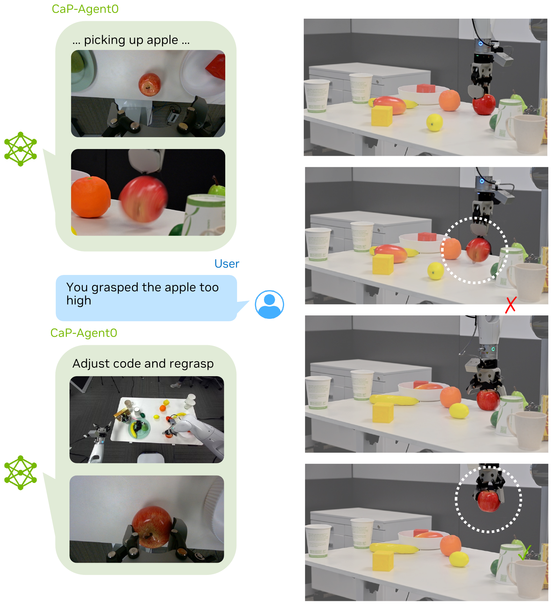

*Paper Figure 14, PDF page 24. This demonstration includes a human intervention between turns: the user identifies that the grasp was too high.*

The feedback changes the next program's grasp choice within the ongoing trial. It is contextual correction, not evidence that the model's weights were updated. This case should therefore be distinguished from autonomous recovery based only on tool traces and VDM. The same interface can support both modes, but their assistance budgets differ.

## 8. What Does CaP-RL Change Through Training?

### 8.1 Update the Coding Model, Not a Separate Motor Policy

CaP-RL uses **reinforcement learning with verifiable rewards (RLVR)**: execute generated programs, evaluate their effects using environment rewards, and update the coding model to favor better-performing programs. The experiment starts with **Qwen2.5-Coder-7B-Instruct** and applies **Group Relative Policy Optimization (GRPO)**.

The object being trained is the program-generating language model. This differs from using a frozen LLM to write a reward function for a separate robot policy. It also differs from Agent0's external helper library and inference-time proposals.

A correct program can receive a poor outcome because a detector selected the wrong object. Penalizing that program then confuses a perception failure with a code-generation failure. Training with S1's correct state removes this source of ambiguity; evaluating with S2 afterward tests whether the learned composition still works with noisy perception.

| Phase | Setting in the paper | Why this choice matters |
|---|---|---|
| **Starting model** | Qwen2.5-Coder-7B-Instruct | A pretrained coding model, before robotics RL post-training |
| **RL training** | Cube lift, cube stack, and spill wipe; 50 iterations per task | Tests whether task outcomes improve code generation on these task families |
| **Training interface** | S1: high-level tools with privileged state | Reduces perception-induced reward noise and makes program credit assignment easier |
| **Evaluation interface** | S2: high-level tools with noisy perception, including physical deployment | Tests whether the learned sequencing/composition survives non-privileged perception |

For intuition, consider two illustrative programs that both execute: one moves an empty gripper above the destination, while another first grasps and transports the object. Their physical outcomes differ, so environment reward can favor the second even when a Python-only checker accepts both. GRPO uses relative performance within sampled groups to update the model; the paper does not provide a complete numerical reward/optimizer configuration that would reproduce training from this description alone.

### 8.2 The Learned Program Must Respect Physical Prerequisites

Appendix E compares programs for “stack red on green.” Before RL, an example obtains object poses, moves above the green cube, and opens the gripper **without first picking up the red cube**. It specifies a plausible destination while omitting the causal prerequisite for placing an object there.

After RL, the example samples a red-cube grasp, approaches it, closes the gripper, transports the object, and releases it. It also uses object dimensions to compute placement height.

For upright objects sharing a frame whose $z$ axis points upward, the desired red-object center is

$$
z_{\mathrm{red,target}}
=z_{\mathrm{green}}
+\frac{h_{\mathrm{green}}}{2}
+\frac{h_{\mathrm{red}}}{2}.
$$

Here $z_{\mathrm{green}}$ is the green object's center height in meters, and $h$ denotes full object height. The first half-height reaches the supporting surface; the second raises the placed object's center above it.

For an **illustrative example**, let $z_{\mathrm{green}}=0.02$ m, $h_{\mathrm{green}}=0.04$ m, and $h_{\mathrm{red}}=0.06$ m. Then the target center is **0.07 m**. Its bottom is at $0.07-0.03=0.04$ m, matching the supporting object's top at $0.02+0.02=0.04$ m.

This computes an **object placement**, not automatically a gripper target. Actual execution must account for the tool/object offset and grasp geometry. The before/after code illustrates improved sequencing and geometric use; it does not establish a general physical reasoning algorithm from two snippets.

### 8.3 What Transfers to the Real Robot?

**Paper Table 4**, transposed with all reported settings:

| Evaluation setting | Base Qwen model | With CaP-RL | Human program |
|---|---:|---:|---:|
| Simulation: cube lift | 25% | 80% | 93% |
| Simulation: cube stack | 4% | 44% | 73% |
| Simulation: spill wipe | 30% | 93% | 100% |
| Real robot: cube lift | 24% | 84% | 92% |
| Real robot: cube stack | 12% | 76% | 84% |

*Complete Table 4 results, PDF page 9. Simulation uses 100 trials per task; physical Franka deployment uses 25. The physical evaluation does not include spill wiping.*

The main evidence is a substantial improvement over the same base coding model on the trained task families. A shared **code-as-action interface** helps transfer: the model composes compatible perception/control operations in simulation and reality, while each environment supplies the implementation. It does not directly transfer a raw image-to-motor mapping.

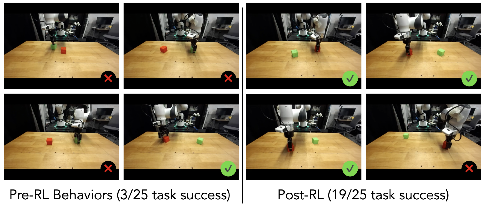

*Paper Figure 19, PDF page 30. The pre-/post-RL counts correspond to 12% and 76% stacking success in Table 4. Selected frames illustrate behaviors; the success counts come from the reported trial set.*

The source also shows successful variants:

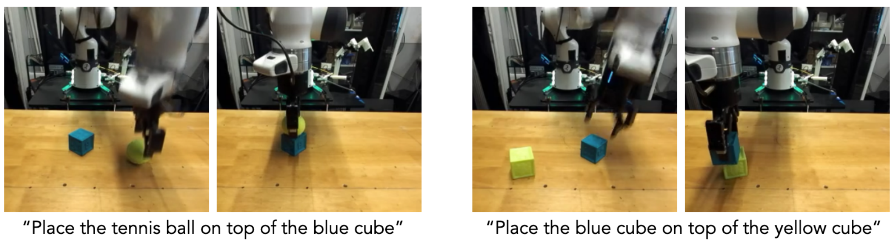

*Paper Figure 20, PDF page 30. These are qualitative task-variant demonstrations, not additional measured success rates.*

The model can follow changed object descriptions in these examples, but transfer still depends on perception, calibration, control, and feasible grasps. The simulation and hardware trials are not matched enough to read the higher physical stacking percentage as a universal reversal of the sim-to-real gap. Two physical task families also do not establish broad cross-body reliability.

## 9. What Limits the Claims and the Practical System?

### 9.1 Extra Interaction Trades Time for Feedback

**Paper Table 9**, with its reported timing columns, measures Gemini-3-Pro cube stacking over 20 trials on the same hardware and perception/control stack:

| Tier | Average LLM code-generation time, as reported | Average total trial time |
|---|---:|---:|
| S1 | 6.8 s | 12.9 s |
| S2 | 9.6 s | 20.0 s |
| S3 | 23.8 s | 28.4 s |
| M1 | 20.1 s | 60.8 s |
| M3 | 15.8 s | 113.6 s |

The complete trial is the relevant unit for deployment: it includes model interaction and execution. M3 takes much longer than S2 despite the smaller displayed code-generation average. That average should not be mistaken for the sum of all costs across a multi-turn, multi-model agent. This table is also not a complete cost breakdown for the nine-proposal CaP-Agent0 system.

A VLA inference often emits an action or action chunk, whereas a code-generation turn can produce an entire sequence. Comparing their per-call latencies directly would compare different quantities. A useful deployment comparison needs task success, time, calls/tokens, and assistance under matched budgets.

### 9.2 Observed Turn Counts Are Not a Controlled Scaling Law

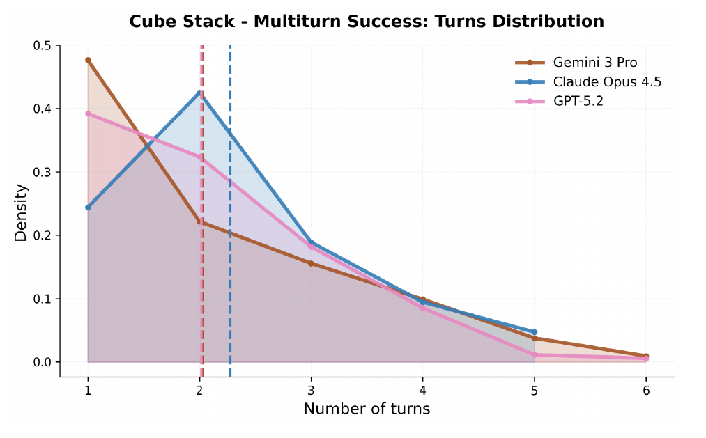

*Paper Figure 24, PDF page 55. The horizontal axis is turn count; the vertical axis is density among successes. Results aggregate M1–M3. This is not success probability for all attempted trials.*

Many successful runs finish early, while later turns provide opportunities for recovery. That describes **when successes occur**, rather than the success rate of every trial that reaches a given turn.

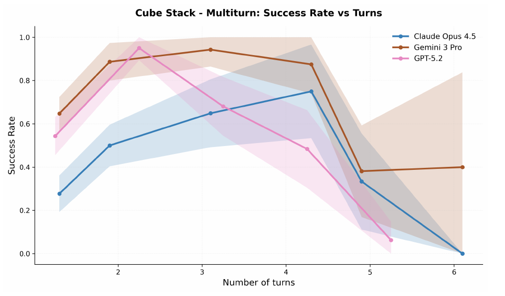

*Paper Figure 26, PDF page 56. The curves are nonmonotonic and average M1–M3. They are not a cumulative pass-versus-budget curve; the paper does not fully specify the estimator or uncertainty bands.*

A cumulative chance of having succeeded by a larger allowed budget cannot fall merely because more turns become available. Therefore, this plot should not be read as that quantity. Harder or unsuccessful trials may themselves produce more turns, so the association does not establish that giving an otherwise identical trial more computation causes failure. The controlled tier and harness comparisons supply stronger evidence for the paper's improvement mechanisms.

### 9.3 A Better Agent Still Inherits Its Tool Failures

Noisy segmentation can identify the wrong object; a grasp proposal can be unsuitable; inverse kinematics can find a pose without providing a collision-free path or the contact feedback needed for insertion. Agent0 changes composition and recovery logic, but it cannot guarantee that those tools succeed.

This explains both the strong lifting/stacking results and the persistent peg-insertion failure. The paper proposes hybrid CaP–VLA control as future work: code could manage task logic and recovery while a learned policy handles continuous contact-rich execution. That hybrid is a direction, not an evaluated component of the reported system.

Finally, keep the empirical scopes separate: **187 released tasks**, **seven tasks in the main controlled study**, **30 LIBERO-PRO plus two BEHAVIOR tasks in the extension**, and **three task families for RL training with two quantitative physical evaluations**. The evidence supports useful programmatic control and specific agent improvements within those settings. It does not establish reliable open-ended manipulation simply from the platform's breadth or the presence of a feedback loop.
