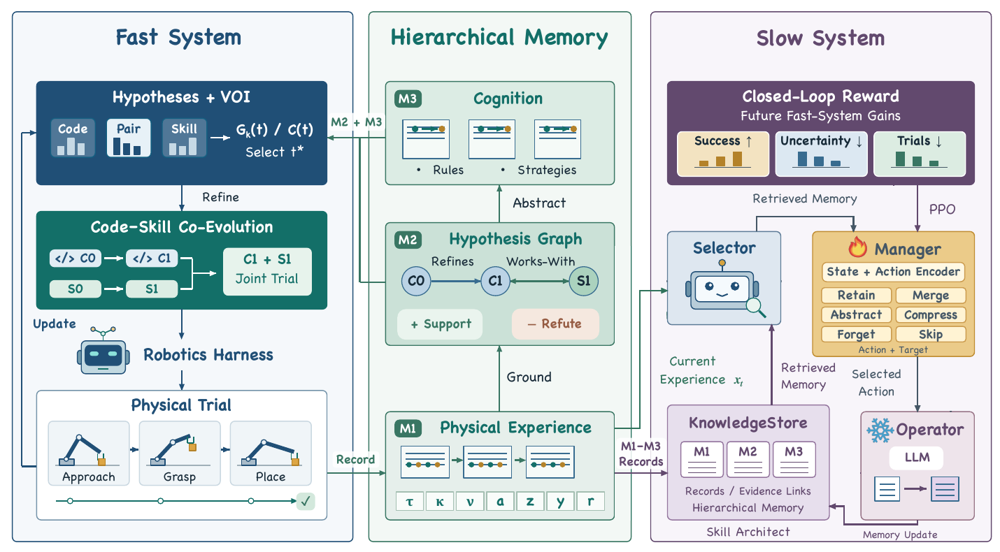
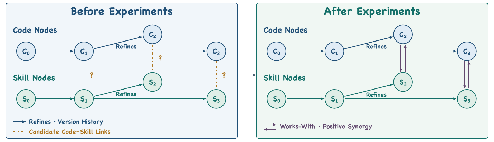

# [EmbodiedRSI: Active Continual Robot Learning Through Hypothesis-Guided Co-Evolution](https://arxiv.org/abs/2610.10498)

> **Brief:** EmbodiedRSI improves a harness around a frozen robot foundation model by **choosing informative experiments, revising code and skills together, and learning which memory updates help future adaptation**. A Fast System maintains hypotheses and selects trials by expected information gain per cost. A Slow System organizes the evidence and uses PPO to train a memory-action selector, not the robot policy.

**Source:** Song et al., 2026; supplied PDF, arXiv v1 dated October 7, 2026. The 12-page file ends with references and does **not** contain the appendices cited by its main text. Settings delegated to those appendices are marked as unavailable below.

## Convenient Links

- [Paper](https://arxiv.org/abs/2610.10498)
- [Project](https://geeksongs.github.io/agentic_robotics/)
- Related systems: [AdaHVLA](./AdaHVLA.md), [Harness VLA](./Harness_VLA.md), [RoboHarness](./RoboHarness.md), [RegenHarness](./RegenHarness.md)
- Background: [Agent Memory](../../../Agent_Systems/Memory_Systems.md), [PPO](../../Reinforcement_Learning/PPO.md), [SmolVLA](../Policies/SmolVLA.md), [LIBERO](../Datasets/LIBERO.md)

## 1. Why Choose Experiments, Not Just Patches?

A failed grasp can have several explanations: the approach program stages the robot poorly, the grasp procedure closes too early, or both need changing. Trying arbitrary patches may consume many robot episodes without distinguishing these explanations.

EmbodiedRSI treats interaction as a limited experimental budget. Its next trial should answer a question about a proposed change, not merely attempt the task again. This creates a connected learning loop:

1. **Hypotheses** describe candidate code or skill improvements.
2. **Experiment selection** chooses which uncertainty is worth resolving at the available cost.
3. **Matched trials** assess individual changes and their combination.
4. **Memory learning** preserves or abstracts evidence according to its usefulness for later improvement.

Here, code concerns executable harness behavior, while skills concern reusable behaviors composed by that harness. This is a functional distinction, not two neural-network branches. The main text does not specify their complete implementation schemas. Both evolve outside the frozen VLA; a skill update does not imply training a new motor-policy head.

## 2. Architecture and End-to-End Data Flow



*Paper Figure 2. Physical trials update hypotheses and executable behavior. Their records also feed a memory manager whose decisions are rewarded by subsequent Fast-System gains.*

| Component | Receives | Produces or changes |
|---|---|---|
| Fast System | Current code/skills, hypothesis evidence, retrieved knowledge | Candidate experiments, selected trial, executable revisions |
| Robot harness and frozen VLA | Selected experiment, task conditioning, live policy inputs | Actions, trajectory, telemetry, outcome, task reward |
| Hypothesis Graph | Matched experimental outcomes | Support counts, revision links, code-skill compatibility links |
| Slow-System Manager | Current experience, retrieved records, applicable memory actions | A selected action and its target records |
| Frozen memory Operator | Selected memory action and evidence | Updated retrieval index or high-level knowledge |
| PPO training | Memory decisions and later outcomes/costs | Updated memory-selection network parameters |

```text
Current harness + M2 hypotheses + M3 reusable knowledge
  -> generate code, skill, and joint candidate experiments
  -> rank expected information gain / experiment cost
  -> execute selected matched trial using the frozen robot policy
  -> record trajectory, tool/VLA calls, actions, telemetry, outcome
  -> update hypothesis evidence and code-skill relations
  -> retain executable improvements
  -> Manager chooses a memory action; frozen Operator applies it
  -> next Fast-System experiment retrieves the updated memory
  -> resulting task gain, uncertainty change, and cost reward the Manager
```

**Fast/Slow describes two adaptation roles**, not a specified motor-control frequency or two VLA inference passes. The graph and memories guide the harness; the paper does not introduce a shared-attention architecture that injects them directly into a new VLA encoder.

Let $k$ count interaction episodes and $B$ be the available episode budget. The goal is a harness that achieves high evaluation success after those $B$ episodes. The paper's term **physical experiment** also covers embodied trials in simulation; the simulation results are not hardware-trial counts.

## 3. Fast System: Which Trial Is Worth Running?

### 3.1 Separate Hypothesis Confidence from Task Success

Each hypothesis $h_i$ has a support rate $\theta_i$ with a common prior $\operatorname{Beta}(\alpha,\beta)$. Evidence contributes supporting and refuting counts, $n_{\mathrm{sup},i}$ and $n_{\mathrm{ref},i}$. The corresponding posterior and its mean are

$$
\theta_i\mid D_k\sim
\operatorname{Beta}(\alpha+n_{\mathrm{sup},i},\,
\beta+n_{\mathrm{ref},i}),
$$

$$
c_i=\mathbb{E}[\theta_i\mid D_k]
=\frac{n_{\mathrm{sup},i}+\alpha}
{n_{\mathrm{sup},i}+n_{\mathrm{ref},i}+\alpha+\beta}.
$$

$D_k$ denotes accumulated matched outcomes. Support is assigned from **matched performance differences**, holding initial states and other calls/order constant, not by treating every successful task as support for every active hypothesis. New hypotheses first receive a matched trial before adaptive selection of further experiments.

Several hypotheses can help simultaneously. Their confidences therefore do not form a categorical distribution over one winning explanation. Nor is $c_i$ the robot's task success probability.

To measure unresolved support, the method uses

$$
q_i=P(\theta_i>1/2\mid D_k),
\qquad
H_{\mathrm{exp}}(D_k)=\sum_{h_i\in\mathcal H}h_2(q_i),
$$

$$
h_2(q)=-q\log_2q-(1-q)\log_2(1-q).
$$

This is a **sum of binary marginal entropies** about whether each support rate exceeds one-half, not the entropy of the Beta density or an entropy over normalized $c_i$ values. Uncertainty is high when $q_i$ is near 0.5 and low when evidence favors either support or refutation.

For illustration only, a uniform prior and three supporting versus one refuting outcomes give $\operatorname{Beta}(4,2)$: $c_i=2/3$, but $q_i=13/16$. The mean support rate and confidence that it exceeds one-half answer different questions. The paper's actual prior values are not available in the supplied file.

### 3.2 Value of Information per Cost

An experiment $t$ declares which hypotheses $S_t\subseteq\mathcal H$ its outcome can update. Here $t$ labels an experiment, not a robot timestep. Its expected information gain is

$$
G_k(t)=H_{\mathrm{exp}}(D_k)
-\mathbb{E}_{e\sim P(e\mid D_k,t)}
\left[H_{\mathrm{exp}}(D_k\cup\{e\})\right].
$$

Because a highly informative trial can also be expensive, the score accounts for elapsed time $T_t$, simulator steps $N_{\mathrm{step},t}$, GPU cost $C_{\mathrm{GPU},t}$, and reset cost $C_{\mathrm{reset},t}$:

$$
C(t)=w_\tau T_t+w_sN_{\mathrm{step},t}
+w_gC_{\mathrm{GPU},t}+w_rC_{\mathrm{reset},t},
$$

$$
\operatorname{VOI}_k(t)=\frac{G_k(t)}{C(t)},
\qquad
t_k^*=\arg\max_{t\in\mathcal T_k}\operatorname{VOI}_k(t).
$$

The weights put different resource costs on a comparable scale. The selected outcome changes the posteriors, which changes the next ranking. A trial can be valuable because it **rules out** a tempting change; immediate task success is not the selection objective.

Broad exploration stops when uncertainty or maximum VOI falls below its threshold, the rollout budget is exhausted, or every hypothesis reaches its evaluation cap. The predictive outcome model $P(e\mid D_k,t)$, numerical weights, thresholds, and caps are referred to missing Appendices D/E; the equations alone do not specify a reproducible selection implementation.

## 4. Code-Skill Co-Evolution: Does the Pair Help?

Choosing a trial identifies where evidence is needed. The next question is whether a gain comes from code, a skill, or their combination.

For code candidate $C_i$ and skill candidate $S_j$, matched initial states are used to measure joint success $R(C_i,S_j)$, code-only success $R(C_i)$, and skill-only success $R(S_j)$. The paper defines

$$
w_{ij}=R(C_i,S_j)-\max\{R(C_i),R(S_j)\}.
$$

Code-only changes leave skills fixed; skill-only changes leave executable code fixed. Positive $w_{ij}$ means the combination outperforms the better individual change in these trials. It is not an additive interaction estimate or a guarantee of future performance.

Continuing the illustrative grasp example, suppose revised approach code succeeds at 50%, a revised grasp procedure at 60%, and their combination at 80%. Then $w_{ij}=0.20$, a **20-percentage-point joint gain**. The result motivates retaining the combination rather than assuming whichever component looked best alone is sufficient. These numbers explain the formula, not a reported experiment.



*Paper Figure 3. Directed `refines` edges retain revision history. Bidirectional `works-with` edges record code-skill pairs supported by positive measured joint gain.*

The two edge types encode different knowledge: **how a candidate changed** versus **which candidates work better together**. The Slow System records positive relations, prioritizing the strongest, while the Fast System uses the evidence to retain executable improvements and propose later tests.

## 5. Slow System: Learn What to Remember

### 5.1 From Raw Experience to Reusable Knowledge

| Level | Content | Why it is needed |
|---|---|---|
| **M1: Physical experience** | Trajectory $\tau$, tools $\kappa$, VLA invocation times $\nu$, executed actions $a$, telemetry $z$, outcome $y$, task reward $r$ | Keeps the evidence behind a success, failure, or comparison |
| **M2: Hypothesis Graph** | Code/skill hypotheses, confidence, revision and compatibility links | Records what has been tested and what remains uncertain |
| **M3: Cognition** | Reusable rules and strategies abstracted from repeated M1/M2 evidence | Transfers useful conclusions beyond individual episodes |

Every episode is automatically recorded in M1. Matched evidence updates M2 under the Fast-System rules; recurring evidence can be abstracted into M3. Before the next episode, the Fast System retrieves M2 and M3 to guide experiment proposals.

The hierarchy is therefore **evidence -> tested explanation -> reusable guidance**. An abstract rule should not replace the underlying execution record or invent support for a hypothesis.

### 5.2 The Trainable Module Selects Memory Actions

At memory-decision step $t$, experience $x_t$ retrieves $N_{\mathrm{ret}}$ relevant records $m_{t,\ell}$ from M1-M3, including confidence and evidence links. Each applicable candidate $s_i$ specifies a memory action **and its target record/group**.

The action vocabulary is `Retain`, `Merge`, `Abstract`, `Compress`, `Forget`, and `Skip`. The described network can be summarized as

$$
h_t=f_{\theta_{\mathrm{ctx}}}
\left(e(x_t),\{e(m_{t,\ell})\}_{\ell=1}^{N_{\mathrm{ret}}}\right),
$$

$$
u_i=f_{\theta_{\mathrm{skill}}}\bigl(e(\operatorname{desc}(s_i))\bigr),
\qquad
z_{t,i}=f_{\theta_{\mathrm{score}}}([h_t,u_i]),
$$

$$
\pi_\theta(i\mid h_t)=\operatorname{softmax}(z_t)_i.
$$

Here $e$ is frozen **Qwen3-Embedding-0.6B**. The trainable context, candidate-encoding, and scoring functions produce a distribution over applicable memory operations. Despite its name, $f_{\theta_{\mathrm{skill}}}$ encodes **memory-action descriptions**, not robot grasp skills.

After the Manager selects an action/target, the Operator uses frozen **Qwen3.5-122B-A10B** to update the retrieval index or M3. Raw M1 records and M2 evidence updates are preserved: `Forget` must not be read as permission to erase physical evidence. Exact per-action rules are delegated to absent Appendix C. An architect may also refine action instructions from recurring experience; its detailed procedure is not specified here.

### 5.3 Reward Comes from the Next Experiment

A polished memory summary is useful only if it improves later decisions. The selected action is therefore scored after the next Fast-System experiment:

$$
r_t^{\mathrm{mem}}
=\lambda_1(R_{t+1}-R_t)
+\lambda_2(H_t-H_{t+1})
-\lambda_3C_{t+1}.
$$

$R_t$ estimates current harness task success, $H_t$ is exploration uncertainty, and $C_{t+1}$ is the realized next-experiment cost. Success estimates use the same evaluation protocol, and uncertainty changes use the **same hypothesis set**, avoiding apparent gains caused merely by changing which hypotheses are counted.

The reward combines task improvement, uncertainty reduction, and experiment cost. PPO trains the memory policy to maximize discounted return

$$
J_t^{\mathrm{mem}}=\sum_{j=0}^{L-1}\gamma^j r_{t+j}^{\mathrm{mem}},
\qquad \gamma\in(0,1].
$$

Here $L$ is the memory-decision horizon. Thus, **PPO acts on memory operations, not joint torques, VLA actions, or a trainable Operator LLM**. Code/skill revisions arise through experiment-guided harness evolution; the explicitly parameter-trained component is the memory Manager. PPO hyperparameters and network dimensions are unavailable because Appendix F is missing.

## 6. Evaluation: What Was Trained and What Transfers?

### 6.1 Simulation Protocol

RoboCasa365 evaluates Atomic-Seen, Composite-Seen, and Composite-Unseen tasks. "Unseen" describes compositions absent from policy pretraining; it does not by itself prove that the harness had no adaptation exposure to those task identities.

LIBERO-Pro uses **T**, instruction redirection, and **S**, position swapping. The paper states 10 evolution seeds and 10 mutually disjoint evaluation seeds, with 10 trials per evaluation seed per task. Seed-disjoint evaluation should not be confused with a documented task-disjoint adaptation split.

The robot foundation model remains frozen during harness evolution. Exact simulation backbone/checkpoint settings are delegated to absent Appendix I, so they cannot safely be inferred from the listed baselines. Main-result evolution budgets and full PPO training settings are likewise not recoverable from this PDF.

### 6.2 Simulation Results

Selected RoboCasa365 results from Table 1, success rates (%):

| Method | Atomic-Seen | Composite-Seen | Composite-Unseen | Overall |
|---|---:|---:|---:|---:|
| RLDX-1 | 60.0 | 21.3 | 5.0 | 30.0 |
| Xiaomi-Robotics-1 | 80.2 | 57.1 | 32.1 | 57.4 |
| Harness VLA | 91.3 | 55.8 | 40.1 | 63.6 |
| EmbodiedRSI | 94.4 | 63.1 | 71.3 | 77.0 |

The reported gains over Harness VLA are **13.4 percentage points overall** and **31.2 on Composite-Unseen**. Overall values are reproduced as reported, not recomputed as unweighted averages of suite scores. Baseline values belong to this paper's comparison and should not be silently merged with differently configured results in the separate Harness VLA note.

Table 2's LIBERO-Pro comparison:

| Family | Harness VLA: T | EmbodiedRSI: T | Harness VLA: S | EmbodiedRSI: S |
|---|---:|---:|---:|---:|
| SPATIAL | 81.0 | 100.0 | 69.0 | 93.0 |
| OBJECT | 94.0 | 100.0 | 91.0 | 96.0 |
| GOAL | 75.0 | 78.0 | 66.0 | 90.0 |
| LIBERO-10 | 52.0 | 66.0 | 49.0 | 71.0 |

EmbodiedRSI reaches **86.8% overall versus 72.1%**, improving all eight cells against Harness VLA. It does not lead every other method in every cell: Zetta reports 92.5% on Goal-T versus 78.0%. Baselines with missing cells also have different coverage, so their overall values require care.

### 6.3 Real Robot: Zero-Shot Harness Transfer, Not Zero Robot Training

The simulation-evolved code and skills are deployed on an **SO-101 arm with SmolVLA**. Before evaluation, the authors collect **50 teleoperated demonstrations per task** and fully fine-tune SmolVLA for **20,000 steps on four NVIDIA H200 GPUs**. The backbone is then frozen for both direct and harness evaluations.

Thus, "zero-shot" refers to transferring the **harness** without real-world harness evolution, not using an untrained robot model or avoiding real demonstrations. Table 3 reports 30 trials per condition for each task:

| Task | SmolVLA | EmbodiedRSI |
|---|---:|---:|
| Oreo to red bowl | 70.0% | 86.7% |
| Select chip whose value times five equals 100 | 10.0% | 90.0% |
| Stack two cakes on a can | 63.3% | 76.7% |
| Grasp glasses at the bridge | 60.0% | 56.7% |
| Towel folding | 26.7% | 46.7% |
| Overall | 46.0% | 71.3% |

The chip task requires selecting value 20 under shuffled positions/orientations, illustrating how semantic selection can help the same motor policy. Overall improvement is **25.3 points**, but precision grasping does not improve: the glasses result falls by one success out of 30 trials. The harness is not a uniform cure for low-level control limitations.

## 7. What Supports the Proposed Mechanism?

### 7.1 Joint Evolution and Active Exploration

The code/skill ablation holds the VLA, suites, experiment budget, and evaluation protocol fixed. Joint evolution reaches **71.3% Composite-Unseen success versus 55.6% for skill-only evolution**. Code-only is stronger than skill-only on Atomic-Seen, but weaker on Composite-Unseen, supporting the need to consider both rather than choosing one universally.

Table 4 compares learning efficiency at a fixed 50-episode point:

| Method | Overall success at 50 episodes | Learning AUC |
|---|---:|---:|
| Random exploration | 27.1% | 0.309 |
| EmbodiedRSI | 72.9% | 0.635 |

This is a separate learning-efficiency result, not a replacement for Table 1's 77.0%. The PDF does not fully specify the AUC computation details. A separate representative SPAT-T curve reaches sustained **100% eight-episode rolling success at episode 48** with VOI selection. That is one learning case, not 100% benchmark-wide success or a universal 48-episode sample requirement.

### 7.2 Memory Must Help Future Learning

Table 5 isolates memory-selection variants:

| Variant | Composite-Unseen | Learning AUC |
|---|---:|---:|
| Retrieval-based | 61.7% | 0.556 |
| PPO with task reward only | 65.2% | 0.589 |
| Full memory-learning reward | 71.3% | 0.635 |

These results support including uncertainty and cost in the memory objective, not merely accumulating more records. They do not establish that PPO trains the VLA; only the memory-selection mechanism is changed by this ablation.

## 8. Relation to Other Harnesses and Limits

| System | Main adaptation target |
|---|---|
| [Harness VLA](./Harness_VLA.md) | Memory-guided composition of a frozen contact policy with analytic primitives |
| [AdaHVLA](./AdaHVLA.md) | Coordination-code revisions assessed through predicted behavioral effects |
| [RegenHarness](./RegenHarness.md) | Evidence-gated task-state acceptance and governed configuration revisions |
| **EmbodiedRSI** | Experiment allocation, joint code/skill evolution, and PPO-trained memory-action selection |

EmbodiedRSI adds an explicit **which experiment next?** objective and learns memory decisions from downstream outcomes. Its Beta confidence and empirical joint gains remain dependent on matched-trial quality; they are not proofs that a diagnosis is causal or a policy is safe.

The supplied version leaves reproducibility gaps: exact code/skill schemas, support/refutation rules, experiment outcome probabilities, simulation backbones, cost/threshold settings, and training hyperparameters are absent or delegated to missing appendices. The reported results are useful evidence, but these omissions limit conclusions about budget-matched comparisons and exact reproduction.

**Mental model:** keep the motor model fixed, spend trials to distinguish useful harness changes, retain combinations that work, and train the memory manager on whether its choices make subsequent learning better.
