# [Envisioning Agentic Robotics: A New Era of Robotic Systems](https://arxiv.org/abs/2611.18359v1)

> **Brief:** This position paper organizes agentic robotics around **Embodied System 2: a foundation model together with an embodied harness**. It separates goal-directed decisions from callable skills and body control, explains how execution must return evidence for subsequent decisions, and proposes evaluation principles and a roadmap from individual operations to sustained responsibilities.

**Source:** Grid Robotics, 2026; [84-page paper, arXiv:2611.18359v1, November 13, 2026](https://arxiv.org/pdf/2611.18359v1). The architecture and roadmap are proposals. The numerical evidence is a synthesis of other studies, reported by the authors without independent reproduction; this paper does not introduce a newly trained robot policy or a new benchmark campaign.

## Convenient Links

- [Paper HTML](https://arxiv.org/html/2611.18359v1)
- Tier summaries: [L1–L4 responsibility tiers](#11-summary-of-the-four-responsibility-tiers), [S2/S1/S0 system roles](#21-s2-s1-and-s0-are-functional-responsibilities), [Detailed delegation roadmap](#9-what-does-it-mean-to-delegate-more-responsibility)
- Foundations: [Agent Systems Basics](../../../Foundations/Agent_Systems/Agent_Basics.md), [Memory Systems](../../../Foundations/Agent_Systems/Memory_Systems.md), [Tool Interfaces](../../../Foundations/Agent_Systems/Tool_Registry_and_Function_Calling.md), [Skill Systems](../../../Foundations/Agent_Systems/Skill_Systems.md)
- Concrete systems: [CaP-X](./CaP_X.md), [ASPIRE](./ASPIRE.md), [Harness VLA](./Harness_VLA.md), [RegenHarness](./RegenHarness.md)
- Policy/control context: [GR00T 2](../Policies/GR00T_2.md), [PolicyIK](../Policies/PolicyIK.md), [Modern Robotics](../../../Foundations/Books/Robotics/Modern_Robotics.md)

## 1. What Changes When a Robot Is Responsible for an Outcome?

Consider the paper's request: **“Find the red cup and bring it to the dining table.”** A robot may correctly execute a gripper-closing command while missing the cup. It may grasp the cup successfully and later drop it. The user may also interrupt: “Not the red cup, the blue one.”

Producing suitable motor targets is necessary, but the complete system must also decide what the current goal means, whether an action achieved it, and what to do when the goal or scene changes. The paper places that responsibility at the center of **agentic robotics**.

### 1.1 Summary of the Four Responsibility Tiers

The paper's four tiers answer **how much work the robot is responsible for completing without a person repeatedly directing it**. Each higher tier includes the capabilities needed below it and adds a broader responsibility.

| Tier | Delegated work and example | What the robot must manage | When its responsibility ends |
|---|---|---|---|
| **L1 — Primitive** | One operation: pick up a cup | Execute the local skill and check its physical result, such as whether the cup is held | When that operation's intended result is established |
| **L2 — Task** | One complete request: make coffee and deliver it | Coordinate several skills, verify intermediate outcomes, and recover from failures | When the complete request's acceptance criteria are met |
| **L3 — Workflow** | Several interdependent tasks: prepare breakfast for four, ready together | Schedule tasks around shared resources, priorities, and deadlines; revise the schedule when something changes | When the coordinated overall result, including its timing constraints, is achieved |
| **L4 — Role** | A continuing responsibility: manage daily breakfast | Organize successive tasks and workflows, retain preferences and commitments, and take initiative within the agreed responsibility | The role continues after one breakfast; it ends when the agreed responsibility expires or is withdrawn |

*Tier summary paraphrased from paper Section 6.1 and Figures 1 and 12. The tiers measure delegated responsibility; their illustrative durations are not classification thresholds.*

The important step from L2 to L3 is **coordination between tasks**: making four breakfasts eventually is insufficient if they must be ready together. The step from L3 to L4 is **continuing responsibility**: completing today's breakfast does not establish that the robot will organize tomorrow's.

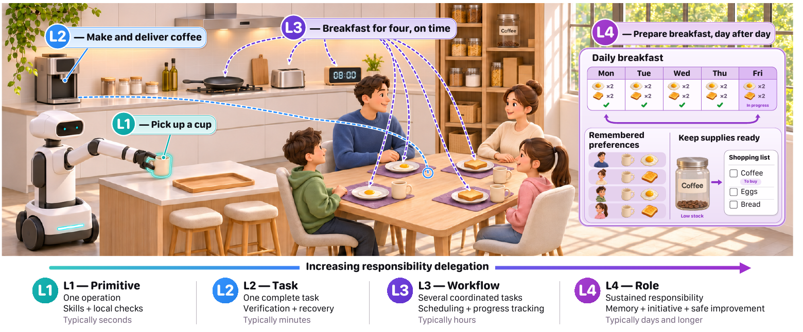

*Paper Figure 1, PDF page 1. The breakfast scenario illustrates increasing responsibility. These are proposed tiers, not measurements of an implemented robot's autonomy.*

Read the scene using the table: the cup pickup is one operation inside coffee delivery; coffee delivery is one task inside the coordinated breakfast; daily breakfast management continues across those workflows. Section 9 explains what evidence would justify claiming each tier.

These **L1–L4 tiers** and the **S2/S1/S0 roles** introduced in Section 2 answer different questions. The tiers describe the scope of delegated work; the system roles describe which components decide, execute skills, and control the body. An L2 delivery system can already contain all three system roles.

### 1.2 Broader Responsibility Requires Decisions About Outcomes

A **vision-language-action (VLA)** policy maps visual observations and language instructions to actions. A **world-action model (WAM)** additionally models visual futures alongside action generation. Such policies can already include reasoning, memory, and subtask prediction. The authors therefore do not draw the boundary simply between “a policy without reasoning” and “an agent with reasoning.”

Instead, the architectural shift is to organize available capabilities around a continuing loop:

**Interpret intent → decide → invoke a capability → execute → verify the outcome → adapt the next decision.**

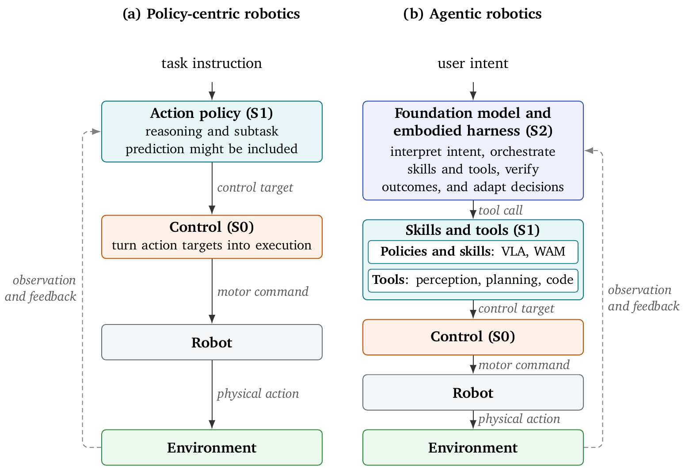

*Paper Figure 2, PDF page 5. Both arrangements receive feedback. The right-hand arrangement explicitly assigns intent interpretation, capability orchestration, outcome verification, and decision revision to S2.*

Follow the downward arrows to distinguish a **control target**, such as a desired gripper pose, from a **tool call**, such as “grasp this cup.” Follow the returning observation arrows to see why neither arrangement is merely an open-loop command list. The question is which component accepts responsibility for judging the result and changing what happens next. The next section assigns names to those roles.

The contribution is a common language for assigning those responsibilities, evaluating where improvements come from, and asking how far a robot can be trusted to work without a person repeatedly repairing its plan.

## 2. Who Decides, Who Performs a Skill, and Who Controls the Body?

### 2.1 S2, S1, and S0 Are Functional Responsibilities

The paper separates three roles. They describe what a component does, rather than requiring three separate neural networks.

| Role | Responsibility | Cup-delivery example |
|---|---|---|
| **System 2 (S2)** | Interpret intent, choose and revise decisions, orchestrate capabilities, and judge outcomes | Decide which cup is wanted, whether pickup succeeded, and whether to retry or continue |
| **System 1 (S1)** | Provide callable skills and modules, including policies, perception, and motion planning | Locate the cup, run a grasp policy, or plan transport |
| **System 0 (S0)** | Provide the body interface and local real-time control | Track arm targets, control the gripper, and maintain balance or base motion |

One model can participate in several roles, and one role can span several components. In particular, **Embodied S2 includes both the foundation model and its harness**.

The model contributes knowledge, understanding, and reasoning. The **embodied harness** is the runtime around it: it assembles observations and state, exposes tools, maintains plans and memory, manages execution, and supplies verification. A model cannot decide whether the cup is still held if its context contains only an old “grasp succeeded” message.

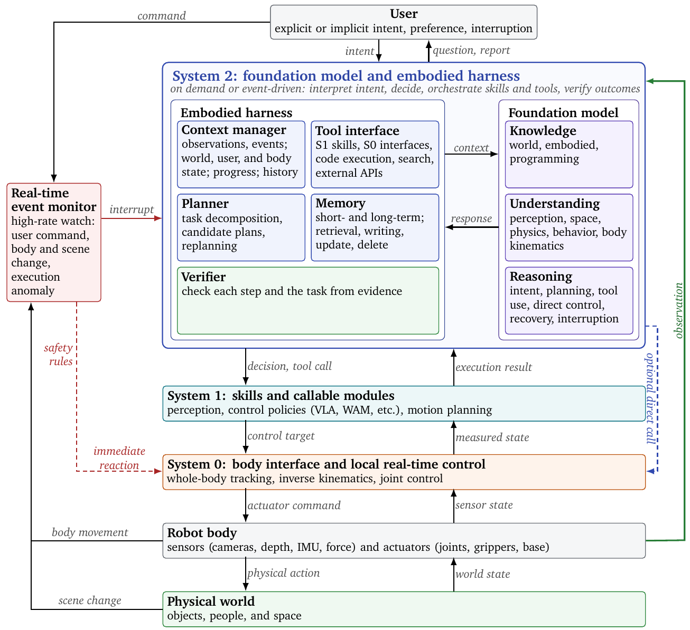

*Paper Figure 3, cropped from PDF page 7. Commands flow toward skills and body control; observations and execution evidence return to the decision layer. The event monitor can interrupt S2 and trigger a protective S0 response without waiting for model deliberation.*

### 2.2 How Can We Tell Whether a Component Really Performs S2's Role?

The authors require two identifiable kinds of decision:

1. **How to proceed:** choose the next goal, skill, action target, retry, clarification, or stop.
2. **How to judge the outcome:** decide from evidence whether the previous step or complete task achieved its goal, and let that judgment affect subsequent behavior.

A planner that only sequences skills performs part of S2. A success detector supplies evidence, but another component decides whether its score establishes completion and what should happen next. Combining the planner, outcome judgment, and runtime can close the required loop.

These decisions must be visible through the interface or supported by a controlled replacement experiment. An upper network that emits only latent features cannot be classified as S2 merely because its developer calls it a “brain.” Conversely, shared weights do not prevent a model from performing both S2 and S1 functions.

This is a functional criterion that can also describe classical implementations. The paper's specific focus is realizing the role through a foundation model plus an embodied harness. Neither slow reasoning nor natural-language output is sufficient to establish S2.

### 2.3 There Are Three Execution Paths

S2 does not always have to call a high-level learned policy:

| Path | What S2 supplies | What executes it |
|---|---|---|
| **Layered orchestration** | A skill/tool call, such as grasping the cup | S1 produces control targets that S0 tracks |
| **Direct control interface** | A permitted end-effector pose, joint target, or similar command | S0's body-specific control loop |
| **Code as policy** | A program composing observations, geometry, and actions | The program runs in the role of S1 and invokes the body interface |

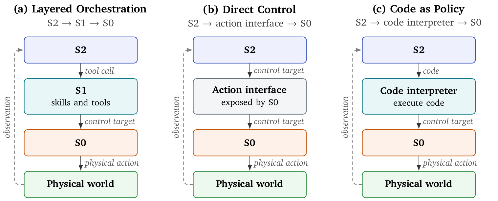

*Paper Figure 4, PDF page 9. Read each column from top to bottom. The middle box changes from a callable skill to a body interface or a code interpreter; S0 still performs local control in every path. The robot body is omitted from the drawing.*

One task can use all three. A robot might call a grasp policy, execute a generated transport routine, then request a small pose adjustment.

**Direct control does not put the foundation model in the motor loop.** S0 continues tracking and enforcing body limits between model decisions. The distinction concerns the interface through which S2 acts.

## 3. Follow the Cup Request from Intent to Verified Completion

### 3.1 The Six-Step Loop

The paper's loop can be followed through one attempted delivery:

1. **Interpret intent.** The goal is to deliver the requested cup to the dining table. If cup identity or destination is ambiguous, observing again or asking a question is a valid decision.
2. **Decide.** Choose a feasible sequence: locate, grasp, transport, and place. Check that the available body and skills can perform it.
3. **Invoke.** Call perception or a manipulation skill with the correct object identifier, units, reference frame, and preconditions.
4. **Execute.** The skill runs while local control continues. It may finish, fail, pause, or be canceled.
5. **Verify.** Inspect evidence of the intended physical effect. After pickup, establish that the cup is held; after placement, establish that it is supported at the destination.
6. **Continue, replan, ask, or report.** Proceed only on the basis of the verified state. If the grasp missed, change the approach or obtain a better view before another attempt.

Verification is necessary at intermediate steps because later operations depend on them. A transport plan that assumes the cup is held is invalid if the gripper closed on empty space.

### 3.2 Four Questions That a “Success” Message Can Hide

The paper separates four judgments:

| Question | What it establishes | What it does not establish |
|---|---|---|
| Was the request **accepted**? | The execution system admitted the call | Motion occurred |
| Has execution **terminated**? | The call ended, possibly through completion, failure, or cancellation | The intended physical effect occurred |
| Does the **physical effect** hold? | Evidence supports a state such as “cup is held” | This is the cup or result currently wanted |
| Is the **user's intent** satisfied? | The final outcome meets the active goal and constraints | That earlier tool statuses alone proved it |

A useful mixed case is a perfectly successful grasp of the red cup after the user requested the blue one. Acceptance, termination, and the grasp's physical effect may all be true while intent fulfillment is false.

Another case is the paper's missed grasp: the tool reports success, but the wrist camera shows the blue cup still on the shelf. S2 attributes the miss to a grasp point occluded by the handle. It records an unsuccessful pickup, obtains a view from another side, and tries a different grasp. Repeating the same call would not address that diagnosis.

### 3.3 An Interruption Changes Both the Goal and the Execution State

When the user changes the request from red to blue during grasping, an event monitor detects the interjection and interrupts S2. S2 revises the active goal and requests that the red-cup action pause or cancel.

The harness must then establish what is still running. **Cancellation requested, cancellation accepted, and cancellation completed are different states.** A response from the cancel endpoint is not enough to justify dispatching a conflicting blue-cup action.

After confirming termination and a suitable body state, the system refreshes observations and replans. S0 keeps the body controlled throughout. For an urgent physical hazard, the independent event monitor can trigger a predefined protective response in S0 without waiting for S2 to finish reasoning.

This example shows why the harness belongs inside Embodied S2: making the correct new plan is insufficient if the runtime still executes the old one.

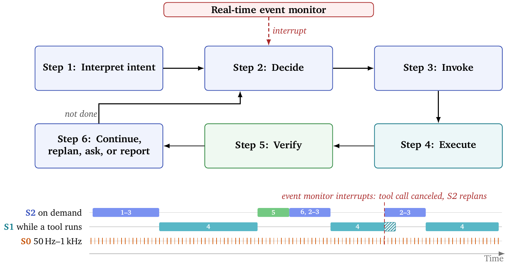

*Paper Figure 5, PDF page 10. The upper panel gives the decision cycle; the lower panel shows how the same cycle unfolds over time. The trace is schematic.*

Read the lower panel from left to right. S2 decides and invokes a tool, S1 runs that tool, and S2 resumes to verify its result. At the marked interruption, the hatched part of the S1 bar is canceled while S2 replans. **The S0 ticks continue throughout.** This is why stopping an obsolete task plan need not interrupt the controller that keeps the robot stable.

## 4. What Must the Harness Preserve and Enforce?

### 4.1 Build Current Context from World, User, and Body State

A camera frame does not contain the complete decision state. The harness needs three kinds of context:

- **World:** objects, locations, relationships, and the time and source of observations.
- **User:** the current request, corrections, preferences, and continuing commitments.
- **Body:** geometry, calibration, current condition, available skills, interface conventions, and validated limits.

Paper Table 1 separates **five core components** from **three augmentations**. The core components organize the decision-and-execution loop. The augmentations add admission checks, resource limits, and a process for improving future runs; they build on that loop.

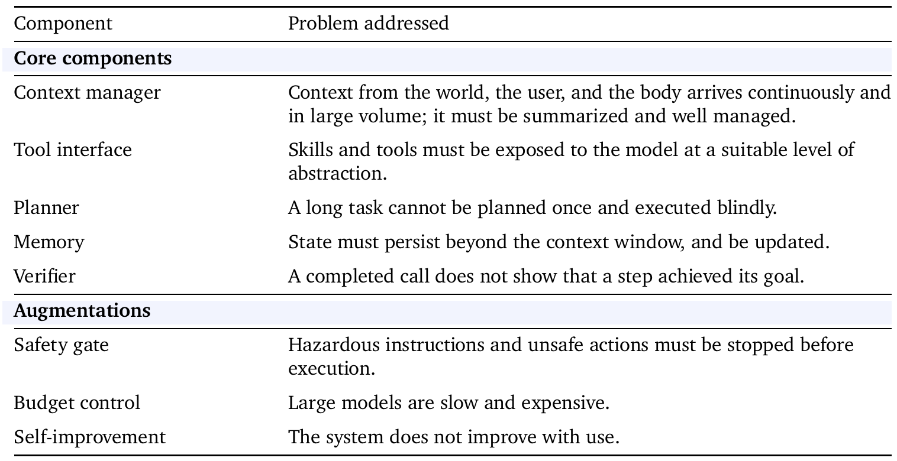

*Paper Table 1, PDF page 16. The complete table body is shown. The two groups describe component responsibilities, not stages that a robot must pass through or proof that every proposed function has been implemented.*

Follow the cup failure through the five core components. The **context manager** assembles the active blue-cup request, recent wrist image, and body state. The **tool interface** defines how to call perception and grasping, including frames and units. The **planner** keeps carrying dependent on successful pickup. The **verifier** establishes that the cup remains on the shelf, so the planner must revise the pickup rather than proceed to carrying. **Memory** retains the failed approach and verified state for later decisions, without treating the tool's success message as proof that the cup is held. These components exchange state; they are not five independent features whose mere presence guarantees success.

The augmentations address different remaining problems. A **safety gate** can reject an unsafe proposed motion before dispatch; it does not wait until the verifier sees the resulting damage. **Budget control** limits time, calls, and other resources, so a retry plan must fit the remaining allowance. **Self-improvement** evaluates whether a repair should become a reusable change for future tasks. For example, changing viewpoint now is a planning decision; retaining a tested recovery procedure is an improvement decision. The paper proposes these functions without claiming that listing them establishes safe or improving behavior.

The model's knowledge, understanding, and reasoning contribute different things. Knowing how a gripper works is **knowledge**; recognizing that this gripper is empty is **understanding**; deciding to change the grasp approach is **reasoning**. The runtime must provide the evidence on which the latter two depend.

The following sections unpack two dependencies in this table: memory must preserve useful information without preserving stale assumptions, and the tool interface must give physical calls a meaning that the verifier can actually check.

### 4.2 Remembering an Event Is Different from Knowing the Current State

The paper calls one task an **episode** and a continuous period of use a **session**, which can contain several episodes. Within an episode, the harness tracks attempts and progress. Across sessions, it may retain maps, user preferences, body information, and learned procedures.

Consider two records:

- “The blue cup was grasped at time $t$.”
- “The blue cup is currently held.”

The first can remain historically true after the cup slips. The second must be revised. Keeping a longer transcript without updating the current-state estimate can preserve precisely the wrong assumption.

The harness therefore maintains a **belief state**: a revisable estimate built from partial observations, rather than a permanently correct database. Records need provenance and observation time, and memory must support correction, invalidation, and deletion as well as retrieval.

At a new episode, a remembered cup location should be checked when it matters; a relevant user preference may remain useful across episodes. Replacing the gripper or recalibrating a camera can invalidate body-specific experience. Persistence means retaining and revising useful information, not treating every old observation as current truth.

### 4.3 Give Every Physical Call an Execution Contract

A function signature alone does not specify what a robot action promises. The paper proposes four complementary records:

1. An **observation snapshot** identifies capture time, reference frame, and calibration.
2. A **capability contract** states inputs, units, preconditions, expected effects, time/resource limits, cancellation behavior, and the state left for subsequent skills.
3. An **invocation record** links the call to its task, subgoal, attempt, arguments, and execution status.
4. An **evidence bundle** records the observations, controller state, and verification results supporting the outcome judgment.

For a grasp, these distinguish the detected cup pose, the grasp skill's promise, this particular attempted pickup, and the evidence that the cup is actually held.

The proposed lifecycle is:

**Propose → admit → dispatch → execute → confirm terminal state → verify effect → commit progress.**

“Admit” checks whether the call is allowed and its preconditions hold. “Commit progress” means recording the subgoal as established after verification, so later actions can rely on it.

Failure, rejection, cancellation, and **unknown outcome** need explicit branches. A timeout is especially important: it does not prove that an action failed to run. For an illustrative cup-filling call, repeating a timed-out request could fill an already filled cup. The harness should inspect the execution handle and obtain fresh evidence before deciding to retry.

Handoffs also need compatible postconditions. A cup can be securely grasped in an orientation that makes the next pouring or placement skill infeasible. Success must therefore include the state required by the next operation, rather than only the previous skill's isolated objective.

### 4.4 Separate Reaction, Replanning, and Lasting Improvement

The paper distinguishes three feedback loops:

| Loop | What changes | Example |
|---|---|---|
| **Sensorimotor** | Commands responding to current physical state, mainly in S1/S0 | Adjust tracking or grip while carrying |
| **Planning** | The current task decision, mainly in S2 | Change viewpoint and retry after a missed grasp |
| **Evolution** | What future runs can use: memory, skills, tools, harness rules, or model weights | Retain a tested recovery routine for later deliveries |

A fixed program can react through sensor feedback, and a frozen model can improve its future behavior through external memory or revised tools. Neither observation alone demonstrates weight learning or recursive self-improvement.

Changes in the evolution loop need held-out evaluation, regression checks, and versioned rollback. Otherwise, a repair for today's cup can damage tomorrow's behavior while still looking like productive activity.

## 5. Why Must Reasoning Fit the World's Clock?

### 5.1 Layers Can Work at Different Speeds

The paper gives indicative S0 control rates of **50 Hz to 1 kHz**, or one update every **1–20 ms**. S1 control skills span roughly **5–200 Hz** in the cited systems; perception and planning tools instead run on demand. For a chunked policy, command execution rate can also differ from the rate of model calls that generate those chunks.

S2 is generally event-driven: a skill result, a new observation, or a user interruption can require another decision. A frontier model may take seconds to tens of seconds per call, while a specialized model can be faster. These are implementation characteristics, not definitions of the roles.

Fast control must therefore continue while slower decisions are being made. Keeping balance or responding to a slip cannot depend on the next long model response. The event monitor and local controllers supply that responsiveness; S2 handles decisions appropriate to its available time.

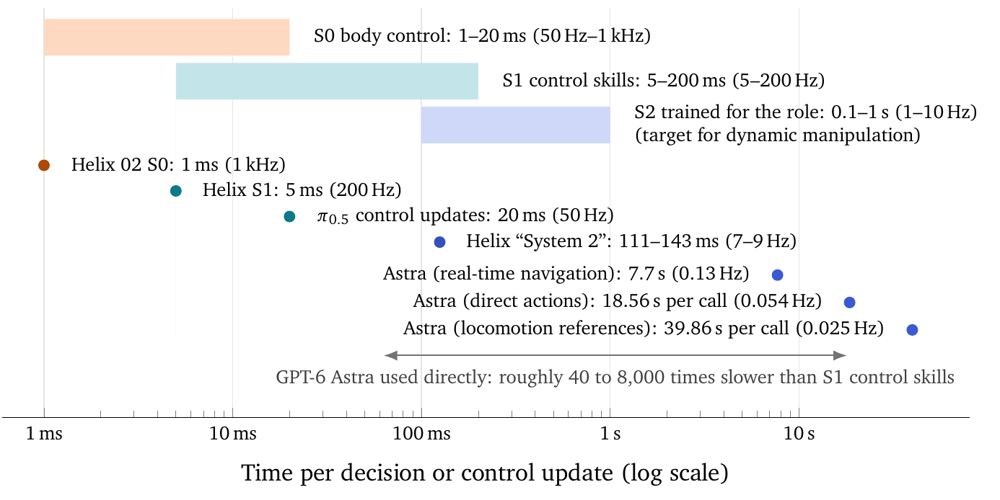

*Paper Figure 8, PDF page 20. The horizontal axis is time per update or decision on a logarithmic scale: each major tick is ten times longer. S0/S1 bands are indicative; the 0.1–1 s S2 band is a proposed target for dynamic manipulation.*

The plot makes the scheduling problem visible: existing frontier-model calls can last much longer than the control updates they coordinate. Its Astra points come from different tasks and settings, so their latencies do not rank model configurations under a common test. Similarly, Helix's plotted “System 2” is the vendor's label for a latent-producing upper module; it does not meet this paper's S2 criterion. A position on the time axis alone cannot establish an architectural role.

### 5.2 Capped Scaling Means Better Decisions Within a Deadline

The authors contrast spending more computation for a better answer with **capped scaling**: improving decision quality within the response deadline imposed by the task.

Extra reasoning may help a static rearrangement, but it can miss the opportunity to stop a rolling object or respond to a slipping grasp. The proposed objective is therefore not simply shorter reasoning or maximum deliberation. It is choosing appropriate computation, delegation, and observation while useful action remains possible.

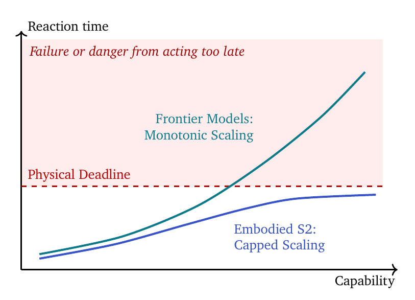

*Paper Figure 7, PDF page 18. Capability increases to the right; reaction time increases upward. The dashed line is a physical deadline, and the shaded region represents decisions that arrive too late. These curves are conceptual, not measured scaling laws.*

The intended improvement moves capability to the right while keeping reaction time below the line. A more accurate decision above the line can still fail because its opportunity to act has passed. The drawing expresses a research objective; neither its curve nor Figure 8's target band demonstrates that an implemented S2 already meets that objective.

### 5.3 Measure Observation Age, Not Only Model Latency

A decision can be based on an outdated scene even when inference itself seems fast. The paper defines **observation age** as

$$
\Delta t_{\mathrm{obs}}
=t_{\mathrm{effect}}-t_{\mathrm{capture}},
$$

where $t_{\mathrm{capture}}$ is when the observation supporting the decision was captured, and $t_{\mathrm{effect}}$ is when the resulting action takes effect.

For illustrative synchronized timestamps:

| Event | Time |
|---|---:|
| Capture the cup image | 13.0 s |
| Start model inference after preparation/communication | 13.2 s |
| Finish model inference | 13.8 s |
| The command takes effect after dispatch/queuing | 14.1 s |

Model inference took 0.6 s, but observation age is **1.1 s**. If another person moved the cup, the commanded pose may no longer describe it.

Fresh observations, explicit uncertainty, and commands expressed relative to meaningful objects can reduce this problem. They do not remove the need to validate that a decision's assumptions still hold. Paused simulation can diagnose decision quality; live execution is needed to establish whether that quality survives real timing.

## 6. Which Lessons from Digital Agents Transfer to Robots?

The paper argues that the organizational principles transfer more easily than the assumptions behind successful software agents.

A coding agent can often inspect files, run tests, restore a snapshot, and launch another sandbox cheaply. A robot must reconstruct hidden state from sensors, establish physical effects, and pay for failed attempts and scene resets.

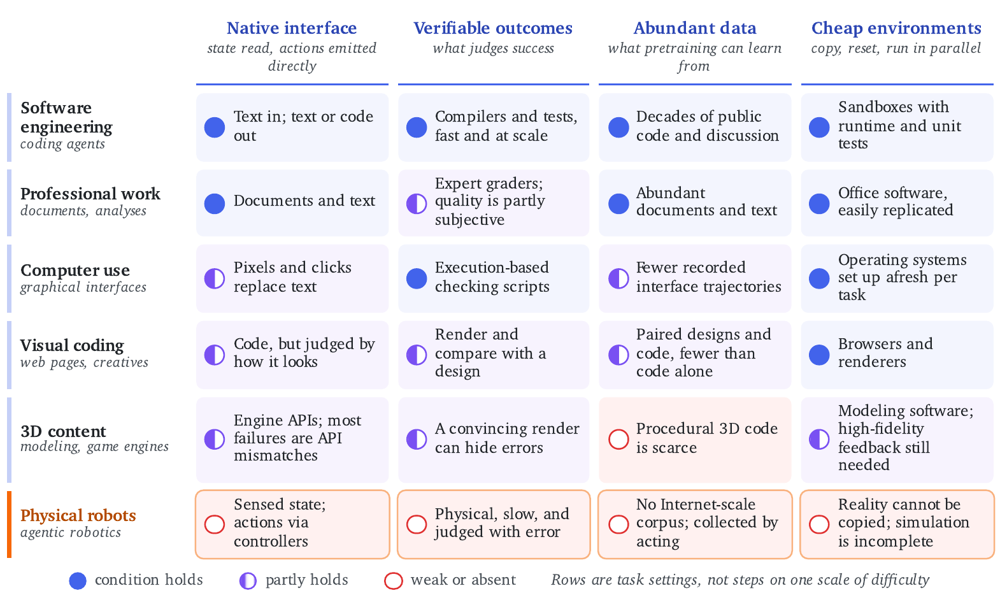

*Paper Figure 10, PDF page 38. Columns are enabling conditions; rows are task settings. Filled, half-filled, and empty circles indicate the authors' qualitative judgments of whether a condition holds, partly holds, or is weak/absent. They are not measured success rates or a ranking of domain difficulty.*

For example, software engineering often has executable tests, while judging a visual design can remain partly subjective. Moving down the rows therefore does not describe a single ladder of intelligence. The physical-robot row highlights a different concern: all four favorable conditions weaken together.

The following table paraphrases the physical contrasts in **paper Table 10** and their proposed replacements in **Figure 11**:

| Favorable condition in a coding sandbox | What weakens it in robotics | What must be built |
|---|---|---|
| State and actions have a native, readable/writable interface | Sensing is partial, noisy, delayed, and frame-dependent; commands act through controllers | Grounded state estimates and explicit physical action contracts |
| Outcomes have fast executable checks | A cup can look placed while remaining unstable; force/contact may be invisible | Calibrated verifiers with known error rates and appropriate sensing |
| Large public corpora cover the domain | Robot interaction and tactile data are costly to collect; video lacks many action/contact labels | Data engines combining deployment, corrections, teleoperation, human video, and simulation |
| Environments are cheap to copy and reset | Real resets cost time or human effort, and simulated contacts may not match reality | Simulation calibrated against physical trials and better autonomous reset capabilities |

The useful principles remain: close the loop on evidence, give tools contracts, maintain durable state outside the prompt, separate doing from judging, and package validated capabilities for reuse.

Their physical implementations need more care. Retrying a failed test in a restored sandbox does not have the same consequences as repeating an action whose physical outcome is unknown. A longer context does not automatically replace a current-state estimate. Simulation supplies scale only where its relevant observations, dynamics, and failures are faithful enough.

This comparison concerns favorable coding environments, not all digital tasks. Web and computer-use agents can also face hidden state, changing environments, and irreversible actions. Robotics combines these difficulties with embodiment: calibration drifts, actuators heat or wear, and battery condition changes what the same command can achieve.

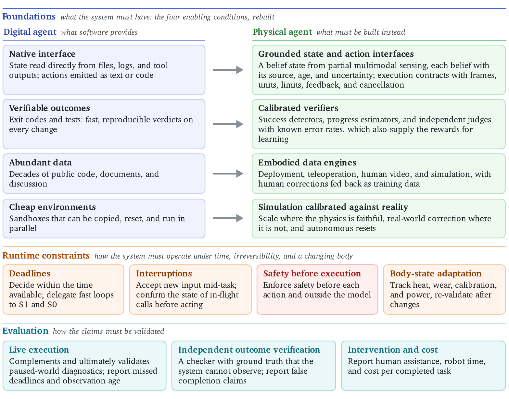

*Paper Figure 11, PDF page 43. The top band maps digital-agent assumptions to physical replacements; the middle band adds runtime constraints; the bottom band states how claims must be evaluated.*

These bands divide the work. A calibrated verifier is a **foundation** for judging outcomes. Checking an action before dispatch and honoring an interruption are **runtime responsibilities**. An independent checker and reports of live execution, assistance, and cost are **evaluation requirements**. Building one band does not establish the others: a robot can have good sensing yet still cancel too late, or execute successfully while being evaluated with privileged feedback. This motivates the next section's separation of capability tests from complete-system trials.

## 7. How Should Such a System Be Evaluated?

### 7.1 Test the Model and the Complete System Separately

A model-level probe asks whether the foundation model can recognize a state or choose an appropriate decision under specified information. A system-level trial asks whether the model, harness, skills, and controller can achieve the result when actions actually execute.

For cup pickup, recognizing an empty gripper tests understanding. Choosing a better viewpoint after the miss tests reasoning. Successfully executing that recovery additionally depends on the camera, context, tool parameters, controller, and available time.

Neither test replaces the other. Replaying the observations available at a failure can help diagnose a model decision, while controlled changes to the harness or execution stack can reveal integration problems. Task success alone cannot attribute a gain to one component.

The paper proposes **nine evaluation dimensions, with 53 sub-dimensions**; 29 are specific to embodiment or strongly depend on it. The nine comprise eight abilities plus cost:

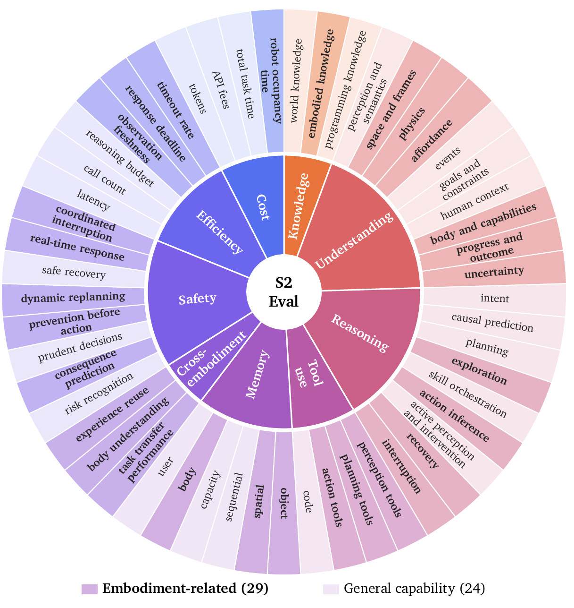

*Paper Figure 9, PDF page 21. Read from an inner dimension to its outer subdivisions. Darker outer cells mark the 29 embodiment-related sub-dimensions; the shading is a classification, not a performance score.*

| Dimension | Question to test |
|---|---|
| **Knowledge** | Does the model know relevant facts, physical principles, and programming procedures? |
| **Understanding** | Can it infer the current world, user, and body state, including what remains uncertain? |
| **Reasoning** | Can it choose and revise feasible, goal-consistent decisions after new evidence? |
| **Tool use** | Does it select, parameterize, compose, and assess the available interfaces correctly? |
| **Memory** | Does earlier information improve later decisions, and is stale information replaced? |
| **Cross-embodiment** | Can the same objective be achieved on another body, with adaptation and target-body exposure disclosed? |
| **Safety** | Does the action chain recognize risk, prevent harm, recover, and stop effectively within the available time? |
| **Efficiency** | How quickly and with how few calls/tokens does the system decide, with what observation age and deadline misses? |
| **Cost** | What resources does each attempt and successful task consume, including failures, retries, robot time, and assistance? |

These dimensions overlap and should form a **profile**, not a single sum. Cost is a resource measurement, not a ninth cognitive ability. Fulfillment of user intent is the end-to-end objective that the dimensions support, rather than an extra isolated score.

Memory illustrates how to use the wheel. Its outer cells separate object, spatial, sequential, capacity, body, and user memory. Remembering an occluded cup differs from remembering a sequence, several facts at once, the body's current capabilities, or a user's preference across sessions. Existing memory benchmarks reviewed by the paper cover these unevenly; object-memory success does not establish body or user memory.

To turn those dimensions into tests, the paper pairs abilities with candidate benchmarks. The following is a **selected, paraphrased summary of Tables 2–7**, not their complete benchmark inventory:

| Source and dimension | Example in the paper | What the test can establish, and its limit |
|---|---|---|
| **Table 2 — Understanding** | FailBench: estimating whether the intended physical effect occurred | Can test recognizing a missed grasp; recognition alone does not show that the robot can repair it |
| **Table 3 — Reasoning** | Ask-to-Act: interpreting an underspecified request and deciding whether to clarify | Can test a decision to ask which cup is wanted; it does not by itself establish successful physical delivery |
| **Table 4 — Tool use** | CaP-Bench: programs composing perception and control; 7 core tasks and 187 tasks in the full CaP-Gym release | Tests executable API composition under specified interfaces; comparisons must still control the capabilities those APIs supply |
| **Table 5 — Memory** | RoboMME: counting, permanence, reference, and imitation; 16 tasks with 50 test episodes each | Tests several forms of episode memory; these do not establish persistent body or user memory |
| **Table 6 — Cross-embodiment** | OmniNavBench: the same navigation instructions for wheeled, quadruped, and humanoid agents | Supports paired navigation comparisons across bodies; it does not cover manipulation transfer |
| **Table 7 — Safety** | RT-Safe: collisions and response timing while the simulated world continues during inference | Reveals failures hidden by paused execution; it does not establish end-to-end safety timing on physical robots |

The cup example also shows why the dimensions interact: identifying an empty gripper is understanding, choosing another viewpoint is reasoning, invoking the camera correctly is tool use, and retaining the corrected cup identity is memory. A task score bundles these dependencies. The next comparison rules are needed to identify which one changed.

### 7.2 Control What Changes in a Comparison

Three experiments answer different questions:

1. **Fix the harness and tools, vary the foundation model:** measure how models use the same support.
2. **Fix the model, vary the harness:** measure the effects of memory, verification, prompting, or scheduling.
3. **Fix the model and other conditions, vary the callable interface:** measure what is gained or lost through skill-only, direct-control, or hybrid access.

Keep the robot, sensors, task instances, observation access, and budgets matched in all three comparisons.

If several layers change together, report a comparison of complete systems. A tool name is insufficient control: a “grasp” API might bundle detection, grasp selection, collision checking, and execution. “No skills” can still mean access to native end-effector and gripper tools.

For cross-embodiment claims, pair feasible objectives and scenes, report each body separately, and disclose target-body demonstrations, calibration, tools, controller changes, and adaptation. Reusing the goal “deliver the cup” does not eliminate the need to check a larger arm's swept volume or a wheeled robot's route.

### 7.3 Keep the Evaluator Separate from the Acting System

The runtime verifier helps the robot decide what to do next. The **external evaluator** decides whether a benchmark trial counts as successful. They have different responsibilities.

The paper recommends an independent checker whose ground truth and grading logic are inaccessible to the acting system. Otherwise, success signals, simulator object files, or test code can supply information that a physical robot would not have.

A robot may use sensors and task-progress estimates during execution. What must be disclosed is exactly which estimates it receives and whether they reveal the hidden answer. A successful tool return or the model's own completion claim should not substitute for external acceptance.

Evaluation should record false completion claims as well as ordinary failures. Safety similarly requires separate reporting of safe completion, refusal, excessive refusal, and violations; a high refusal rate alone does not show that the robot can work safely.

### 7.4 Measure Repeatability and Match the Budgets

One favorable attempt is different from dependable repeated performance. The paper recommends reporting repetition counts, per-task results, uncertainty, and reliability across multiple runs.

For a simple **illustration assuming independent trials**, let each run succeed with probability $p=0.8$. Across three trials:

$$
\Pr(\text{at least one success})=1-(1-p)^3=0.992,
$$

$$
\Pr(\text{all three succeed})=p^3=0.512.
$$

The first is the distinction captured by **pass@3**; the second reflects all-runs reliability. A 99.2% chance of demonstrating success at least once coexists with only a 51.2% chance of three uninterrupted successes. Actual robot trials can have correlated failures and changing conditions, so repeated reliability must be measured rather than inferred blindly from this toy calculation.

Budgets must include calls, actions, reasoning effort, retries, and wall-clock time. Compare proposed improvement mechanisms with retry baselines under equal budgets, and keep development tasks separate from evaluation. Longer physical trials also need reports of operator assistance, scene resets, and the conditions under which the result was accepted.

### 7.5 Document the Experiment with a Harness Card

The authors propose a **harness card** recording:

- Foundation model/version and reasoning budget.
- Harness version, prompts, skills, memory, and verifiers.
- Body, S1/S0 interfaces, action abstraction, and control rates.
- Observation sources, history, calibration-related assumptions, and privileged information.
- Whether the world pauses during inference and how response timing is measured.
- Runs, seeds, confidence intervals, and budgets.
- Human/rule-based interventions and the cancellation/takeover paths.

A body **capability card** is narrower: it describes frames, units, geometry, sensing, tools, controller versions, and validated limits. It helps S2 use a particular robot. The harness card records the larger experimental configuration so that a reported score can be interpreted.

## 8. What Does the Existing Evidence Actually Support?

Section 4.3 compiles published studies rather than running a new common evaluation. The authors use recent general-model results, especially GPT-6 Astra, to motivate the architecture, but explicitly warn against cross-paper rankings.

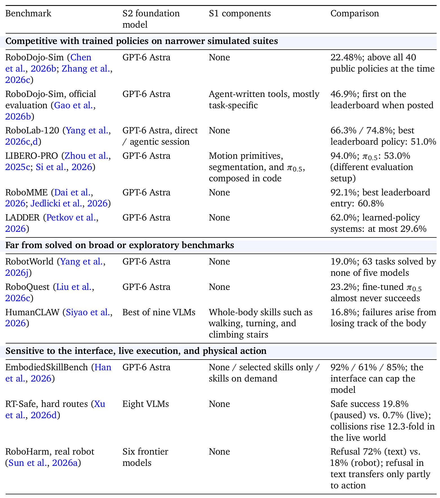

*Paper Table 8, PDF page 32: the complete table body of the authors' October 2026 snapshot. Tasks, tools, baselines, and timing differ, and several simulations pause during deliberation. Rows are not a common leaderboard.*

Read the three row groups as three separate claims: competitiveness on selected narrow suites, remaining failures on broad suites, and sensitivity to the interface and execution conditions. The **S1 components** column is essential context for every score. “None” means direct end-effector, joint, or motion targets through low-level control, rather than absence of a controller. The following subsections interpret these groups instead of treating the largest percentage as the strongest system.

### 8.1 Competitiveness on Selected Suites Coexists with Broad Failures

Some general-model systems match or exceed trained policies on narrower simulated suites, especially where semantic reasoning, memory, or composition matters. Yet the compiled studies report only **19.0% on RobotWorld**, which spans robotic tasks across domains, and **23.2% on RoboQuest**, which emphasizes active exploration. Substantial weaknesses remain in exploration, contact-rich action, and outcome judgment.

These rates come from different protocols and cannot be averaged into a general intelligence score. Likewise, finding an object is not completing the task: the cited HumanCLAW humanoid-navigation study reports 64.9% target finding but only 16.8% completion.

The supported conclusion is that foundation models provide useful decision capabilities while complete physical autonomy remains uneven. Strong results on a selected benchmark do not establish reliable work across domains or sessions.

### 8.2 Four Protocol Choices Can Change the Apparent Result

The paper gives concrete examples of why reporting conditions is necessary:

| Choice | Finding quoted in the paper | What it shows |
|---|---|---|
| **Skill interface** | Skill-only execution raises GPT-5.6-Sol from 11% to 63%, but lowers Astra from 92% to 61%; allowing Astra selective use reaches 85% | The same abstraction can help one model and constrain another |
| **Live versus paused world** | On matched hard routes of RT-Safe, a simulated navigation benchmark, safe success falls from 19.8% to 0.7% in live execution, while collisions rise 12.3-fold | A completion score that ignores timing and collisions can conceal a major deployment failure |
| **Success feedback exposed to the agent** | An audit cited by the authors reports one system's mean score falling from 83.2 to 63.5 when tool returns no longer reveal success | Deciding when to finish is part of the agent's job; oracle feedback changes the test |
| **Action budget** | Recounting one result under the RoboDojo manipulation benchmark's native step limit changes success from 47.1% to 1.0% | Success after exceeding the allowed budget is a different result |

The RT-Safe comparison is particularly informative: ordinary task completion stays essentially unchanged while safe completion collapses. This demonstrates why outcome quality and action timing must be measured together.

The oracle-feedback values are **mean scores**, not a newly measured success rate. The audit and budget examples are reanalyses quoted by the position paper, not experiments performed by its authors.

Skill-only access removes the need to construct some low-level logic, but also restricts actions to what the library supports. Selective use retains reuse while leaving alternatives available. The reported scores show that the choice matters under that study's conditions; they do not establish a universal ordering of interfaces. Both the support provided and the evaluation contract must be considered before attributing a gain to the foundation model.

### 8.3 Important Evaluation Gaps Remain

The authors identify limited coverage of responsibility, space, and duration. Most tests involve one episode in a workcell or room; evidence for coordinating shared deadlines/resources or maintaining roles across days is sparse.

Selected rows from **paper Table 9**, paraphrased below, show why spatial extent and memory duration must be reported separately:

| Benchmark | Spatial scope | Time covered in the paper's survey |
|---|---|---|
| LIBERO and RoboMME | Workcell | Single episodes |
| RoboCasa365 | Kitchen/room | Single episodes |
| MessyMem | Kitchen/room | More than three hours: 25 consecutive tasks without resetting memory or the environment |
| EMem-Bench | Building/home | One task following a history |
| RT-Safe | Site/city routes | Continuous time |

A history-assisted test is different from maintaining a continuing responsibility. Likewise, a continuous navigation trial does not establish coordination of several tasks with shared deadlines. The survey reports no benchmark that tests the full workflow or standing-role requirement described in Section 9.

Simulation validity for Embodied S2 also remains open. A simulator that ranks action policies well does not automatically rank reasoning models and harnesses correctly. It must preserve the observations, failures, delays, and evidence that their decisions depend on.

Physical evaluation is expensive, and both success judges and failure detectors make mistakes. False success leaves work incomplete; false alarms can waste time and trigger unnecessary resets. Reliable evaluation therefore needs calibrated judgments and enough repeated physical trials, rather than only larger collections of completion claims.

## 9. What Does It Mean to Delegate More Responsibility?

The proposed **ladder of delegable work** measures what responsibility the robot can reliably carry, rather than how many actions or minutes a demonstration contains.

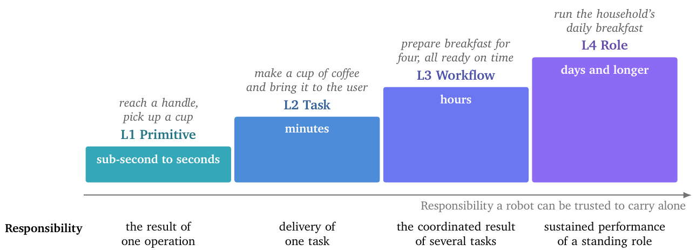

*Paper Figure 12, cropped from PDF page 44. The levels build on one another. Durations are illustrative; the distinguishing property is the scope of responsibility, not a time threshold.*

1. **L1 — Primitive:** pick up the cup and verify the local result. The responsibility ends with that operation.
2. **L2 — Task:** make coffee and deliver it. The system must coordinate several skills, verify intermediate results, recover from failures, and satisfy the complete request.
3. **L3 — Workflow:** prepare breakfast for four so everything is ready together. Separate tasks now share resources, priorities, and deadlines. A coffee machine cannot serve every request simultaneously, and delaying one item can spoil the overall result even if each individual task eventually succeeds.
4. **L4 — Role:** manage the household's daily breakfast across days. The responsibility persists after one breakfast ends: retain preferences, accommodate schedule changes, monitor supplies within the agreed scope, and organize future work until the role expires or is withdrawn.

L3 therefore requires coordination beyond executing a longer task list. L4 requires continuing responsibility beyond repeatedly invoking the same morning script.

Spatial scope is a separate axis: **workcell → room → building → site**. The same responsibility level can be attempted at different scopes and complexities.

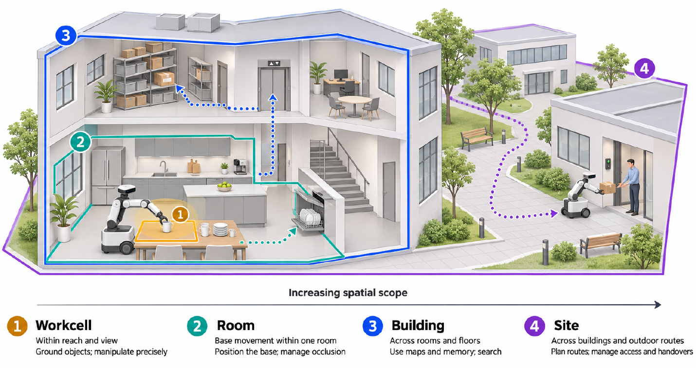

*Paper Figure 13, PDF page 45. The nested boundaries describe operating space, not the L1–L4 responsibility tiers. The illustration is conceptual.*

**Paper Table 11**, paraphrased here, explains what each larger boundary adds:

| Scope | Extent | Additional decision burden |
|---|---|---|
| **Workcell** | Within reach and view | Ground visible objects and actions; handle contact and precision |
| **Room** | The base must move within one room | Choose base placement and account for changing reachability |
| **Building** | Beyond one simultaneous view | Maintain maps and remembered object locations; search and explore |
| **Site** | Several buildings and outdoor routes | Plan longer routes, account for other people/robots, and manage handovers |

For example, delivering one cup between buildings remains an **L2 task** despite its larger spatial scope. Coordinating several breakfasts within one kitchen can be an **L3 workflow** despite its smaller space. The two axes expose different difficulties and should not be collapsed into one level.

A credible level claim should fix operating conditions, completion criteria, allowed help, and interruption rules in advance. Measure the amount of work using the time a skilled person would need, while reporting robot wall-clock time separately. A task taking an hour because the model deliberates slowly does not become an hour of human-equivalent workflow responsibility.

The authors describe current unstructured-environment systems as strongest at primitives and tasks, with early workflow demonstrations. They do not claim that sustained role-level autonomy without human repair has been established. Retaining a preference or running for many days is a supporting capability, not sufficient proof of role fulfillment.

## 10. What Research Would Turn the Architecture into Sustained Autonomy?

The paper proposes four connected directions.

**Reasoning under physical constraints.** Train and organize S2 for useful decisions before deadlines. This includes deciding when further deliberation is worthwhile, when to re-observe, and which routines can be delegated or compiled into skills. Embodied pretraining data, role-specific post-training, and distillation are candidate approaches, not a training recipe evaluated by this paper.

**Persistent and verifiable control across tasks and spaces.** Maintain trustworthy state over rooms and days, schedule interdependent work, and decide which checks belong inside a skill versus at S2. More memory is helpful only if its contents stay current and verified outcomes can support later decisions.

**Efficient adaptation across environments and bodies.** Reuse task knowledge and validated procedures while updating body-specific assumptions, interfaces, and skills. Capability descriptions and action–outcome experience may help, but transferred behavior still needs revalidation. A changed controller, gripper, or calibration can invalidate old experience.

**Continual improvement from physical experience.** Diagnose failures, decide what should change, evaluate the change on future work, and retain it only if benefits survive regression tests. The authors distinguish:

| Kind of change | Meaning | Example illustrating the distinction |
|---|---|---|
| **Adaptation** | Adjust behavior to the present situation | Observe the cup from another side during this attempt |
| **Continual improvement** | Retain a change that improves later work | Adopt a validated recovery routine that helps held-out future tasks |
| **Recursive self-improvement** | Improve the process that produces improvements | A better procedure for choosing practice and testing repairs makes subsequent improvement more effective under controlled resources |

Updating code, memory, or weights is not by itself evidence of improvement. Counting accepted revisions is also insufficient. Claims need gains on held-out work, preservation of existing abilities, and retirement of changes whose assumptions no longer hold. A recursive claim additionally needs evidence that the improved improvement procedure causes later gains, rather than merely receiving more attempts.

The directions depend on each other: timely reasoning needs trustworthy state; transferable behavior needs clear body interfaces; and lasting improvement needs reliable attribution and verification. The paper's architecture is a framework for organizing and testing those dependencies. It does not yet demonstrate a complete implementation that meets them across sustained real-world responsibilities.
