# [GaP: A Graph-as-Policy Multi-Agent Self-Learning Harness for Variational Automation](https://arxiv.org/abs/2607.05369v3)

> **Brief:** **Graph-as-Policy (GaP)** uses coding agents to build a robot policy as an executable graph of perception, planning, and control skills. It can rehearse that graph across varied simulated scenes, diagnose failures from physical state and contacts, and revise its connections, skill choices, scripts, and parameters. The resulting graph runs through an interpreter without keeping the authoring agents in the control loop. Learning improves a program artifact rather than updating the agents' model weights.

**Source:** Kaiyuan Chen, Shuangyu Xie, et al., CoRL 2026; the supplied 53-page paper, [arXiv:2607.05369v3, November 4, 2026](https://arxiv.org/pdf/2607.05369v3). This note includes the main results and the graph, skill-library, rehearsal, and prompt appendices.

## Convenient Links

- [Project and demonstrations](https://graph-robots.github.io/gap/), [official code](https://github.com/graph-robots/graph-as-policy), [documentation](https://graph-robots.github.io/graph-as-policy/)
- Read the method: [Graph execution](#2-what-makes-a-graph-a-robot-policy), [Agent responsibilities](#3-how-do-the-agents-build-a-valid-graph), [Simulation learning](#5-how-does-rehearsal-select-a-better-graph), [Popcorn example](#6-follow-the-popcorn-failure-through-a-complete-repair)
- Related systems: [CaP-X](./CaP_X.md), [ASPIRE](./ASPIRE.md), [Envisioning Agentic Robotics](./Envisioning_Agentic_Robotics.md)
- Components and benchmarks: [GraspGen](../Grasping/GraspGen.md), [LIBERO](../Datasets/LIBERO.md), [pi0.5](../Policies/Pi_0_5.md), [MolmoAct2](../Policies/MolmoAct2.md)

## 1. What Problem Is Variational Automation Trying to Solve?

Suppose a robot repeatedly packs groceries in the same workcell. The arm and cameras stay fixed, but the next soup can may arrive farther left, a different item may occupy its old location, and the basket may move. Replaying yesterday's joint trajectory can miss the item. Treating each attempt as an entirely new open-ended problem also wastes the geometry, calibration, and working procedures already available.

The paper calls this setting **Variational Automation (VA)**: persistent execution of one task class across changing object geometries and poses.

Its coding agents use **large language models (LLMs)** and **vision-language models (VLMs)** to interpret tasks and author programs. A **vision-language-action (VLA)** model additionally predicts robot actions; GaP can invoke one inside a graph skill.

| Setting | What repeats? | What changes? | Grocery example |
|---|---|---|---|
| **Fixed Automation (FA)** | Almost identical instances and motions | Little object or pose variation | Move identical boxes from the same conveyor pose |
| **Variational Automation (VA)** | A task class in a known workcell | Object identity/geometry and poses within a specified distribution | Locate and pack varying grocery items |
| **Generalist Robotics (GR)** | Broad robot capabilities across tasks | Tasks, environments, and objects can all vary substantially | Carry out different household chores in unfamiliar homes |

*Conceptual comparison from Sections 1–3. These are task regimes, not measured autonomy tiers or a claim that existing systems fit only one category.*

GaP exploits what VA makes reusable while still observing each new instance. Its inputs include a task description, known workspace geometry, robot and sensor configuration, object models, a distribution of instance variations, and performance criteria.

The paper writes these as $\mathcal T=\langle\mathcal L,\mathcal E,\mathcal R,\mathcal O,\mathcal X,\mathcal B,\mathcal J\rangle$. Operationally:

- $\mathcal L$ specifies the desired behavior; $\mathcal E$ and $\mathcal R$ provide the workcell, robot limits, and sensing setup.
- $\mathcal O$ lists possible objects and articulated parts; $\mathcal X$ contains robot configurations, object poses, and joint states.
- $\mathcal B$ specifies how instances vary; $\mathcal J$ evaluates success and efficiency.

**Belief space** $\mathcal B$ here primarily describes the task-instance distribution, such as randomized initial object poses. It should not be read as a demonstrated Bayesian state estimator that maintains a complete uncertainty distribution online. An object can be unknown in its current location even when its geometry and the workcell are known.

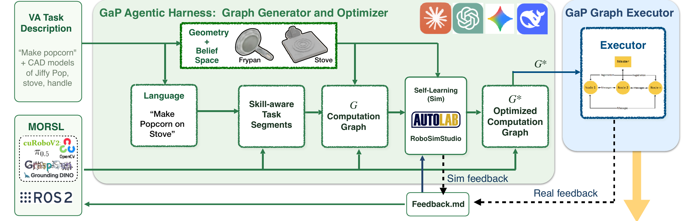

*Paper Figure 1, upper portion, PDF page 1. Read left to right: supplied task/resources → skill-aware decomposition → computation graph → rehearsal and revision → execution. The return arrows carry feedback for improvement; they do not require an authoring agent to choose every deployed motor command.*

The graph is the reusable artifact. The following sections explain how its nodes turn fresh observations into different actions, rather than merely replaying a fixed trajectory.

## 2. What Makes a Graph a Robot Policy?

### 2.1 Nodes Compute; Edges Carry Values and Decide What Runs Next

A graph $G=(V,E)$ contains **nodes** for operations and **directed edges** for dependencies. A node might obtain camera images, segment a target, compute a grasp, plan a trajectory, or execute it. A **subgraph** groups those operations into a task-level skill, such as locating an object or transporting it.

Two relationships matter:

| Relationship | Meaning | Example |
|---|---|---|
| **Data dependency** | A consumer needs a producer's typed output | Grasp planning consumes the target point cloud |
| **Control dependency** | An outcome selects the next operation or subgraph | `grasped` proceeds to transport; a grasp failure follows the configured failure route |

A point cloud is a collection of 3D points. A mask identifies pixels belonging to the target. An **oriented bounding box (OBB)** describes a 3D object's center, dimensions, and orientation; Appendix F stores its extent field as half-sizes. A **6-DoF pose** describes three position and three orientation degrees of freedom. These values are related, but cannot be substituted for one another without the required computation.

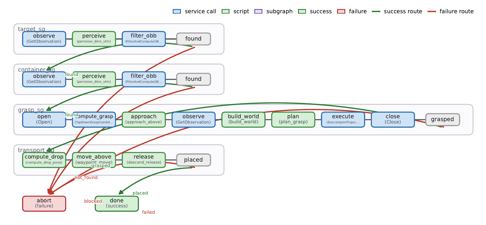

*Paper Appendix C.1, PDF page 19. Blue nodes call services, green nodes run scripts, and shaded groups are subgraphs. Green/red routes represent successful and failed exits. Some function labels are abbreviated in the source; the diagram explains composition rather than serving as complete API documentation.*

Follow a target through this graph:

1. Observe and identify the requested item; publish its mask, point cloud, and OBB.
2. Identify the destination basket and publish its geometry.
3. Construct grasp candidates, approach, observe the nearby scene, build a collision representation, plan, execute, and close the gripper.
4. Use the grasp and destination information to compute transport/release poses.
5. Follow the resulting exit to task completion or the configured failure handler.

A failed service can redirect execution without asking an LLM to invent the next action. Conversely, labeling a terminal node `grasped` does not physically establish that an item is held. That requires execution evidence, discussed in Section 5.

### 2.2 A Common Interface Lets Different Kinds of Skills Compose

The **Modular Open Robot Skill Library (MORSL)** supplies descriptions, typed inputs/outputs, parameters, and preconditions. It includes both engineered routines and pretrained models. GaP chooses and connects these capabilities; it does not learn every perception or control primitive from scratch.

| Main-paper category | Initial count | Representative functions |
|---|---:|---|
| Perception | 15 | Grounding DINO, SAM2/3, OWL-ViT, Molmo, VLM queries |
| Grasp planning | 5 | GraspGen, Contact-GraspNet, M2T2 |
| Motion planning | 8 | cuRobo/cuRobo v2 planning and constrained motion |
| Geometry/vision utilities | 15 | Point-cloud filtering, coordinate conversion, OBB geometry |
| Verification/control and other primitives | 8 | Robot Operating System (ROS) integration, Cartesian motion, interactive visuomotor behavior |
| **Total** | **51** | Supplied capabilities, rather than 51 skills newly discovered by the experiment |

*Category/count summary from Section 4.1. Appendix D also describes composite skills that expand into subgraphs, atomic skills implemented as classes, and primitive service methods.*

For example, the catalog distinguishes fast perception for uncluttered scenes, more robust perception alternatives, and subpart perception for small affordances such as handles. Its transport skill needs both destination geometry and information about the grasp. Its `run_policy` skill can execute an existing VLA in a closed loop.

A **skill description** tells a coding agent how to construct an operation. A **runtime skill implementation** actually performs it. Supplying the description alone does not create a deployed detector or motion planner. The agent's available catalog is filtered by which services are deployed.

### 2.3 Type Compatibility Does Not Resolve Every Geometric Mistake

Consider an **illustrative** camera point at $(0.1,0,0.5)$ m. If camera orientation equals world orientation and its world position is $(0.4,0.2,0)$ m, that point is $(0.5,0.2,0.5)$ m in the world frame. Sending the original camera coordinates to a world-frame controller would command the wrong location.

MORSL exposes operations such as `MaskToWorldPoints` that combine a mask, depth, camera intrinsics, and camera pose to produce world-frame points. This transformation is part of the policy's dataflow. The example simplifies the rotation to identity; general conversion also rotates the points.

Camera intrinsics relate pixels and depth to geometry in the camera frame; camera pose relates that frame to the world. Both are needed before image evidence can guide a world-frame robot motion.

Static checking can reject a `Mask` wired into a `PointCloud` input. It cannot establish physical correctness merely because two values share a pose or point-cloud type. Frame conventions, calibration, object identity, and the meaning of a grasp still matter. Rehearsal must test the consequences of an otherwise valid graph.

## 3. How Do the Agents Build a Valid Graph?

### 3.1 Separate Global Coordination from Local Implementation

A single prompt generating an entire robot program must simultaneously manage task order, service names, geometry, error routes, and output bindings. One incorrect reference can prevent execution even if the overall plan sounds sensible. GaP narrows each author's responsibility.

| Role or stage | Input | Output and purpose |
|---|---|---|
| **Orchestration/behavior agent** | Task, available skill descriptions, and workspace context | Top-level subgraphs, their interfaces, and routing |
| **Per-skill subgraph agent** | One selected skill, declared interface, filtered tools, and canonical scripts | The internal nodes and edges for that subgraph |
| **Inline-code support** | A missing small transformation not covered by existing tools/scripts | A helper script with a stated signature |
| **Validation and checkpoint pipeline** | Generated graph plus declared contracts | Structural errors or physical-outcome checks for rehearsal |
| **Refinement agents** | Rehearsal outcomes localized to graph stages | Proposed graph/parameter edits for another evaluation |

*Operational summary of Sections 4–5 and Appendix F. These are scoped responsibilities; the appendix uses a universal subgraph agent loaded with different skill guidance, rather than requiring a separately trained model for every skill.*

For grocery fulfillment, the coordinator can declare a grasp subgraph consuming `target_obb`, `target_mask`, and `target_cloud`, with an output `ee_pose_at_grasp`. The grasp author implements that contract. The transport author can then use the output without copying the grasp author's entire conversation into its context.

The harness encourages canonical scripts and available services, and offers a missing-capability report instead of inventing nonexistent tools. It also restricts graph-builder code and checks its output. These are concrete sources of structure, rather than an instruction to “be reliable.”

### 3.2 Reject Broken Wiring Before Running the Robot

Appendix F checks for undeclared nodes, unreachable nodes, missing outgoing routes, invalid references, unprovided inputs, and inconsistent success/failure exits. For example:

| Candidate wiring | Check result | Consequence |
|---|---|---|
| Transport references `ee_pose_at_grasp`, but no upstream subgraph produces it | Reject | The required grasp-state information would be missing |
| An edge targets a node name that was never declared | Reject | Execution cannot dispatch that destination |
| A grasp subgraph publishes the required pose and routes its declared exit to transport | Structurally plausible | It can proceed to execution/rehearsal, where grasp quality is tested |

A real tool failure can raise an exception that becomes the subgraph's failure exit. The top-level graph then maps that exit to another subgraph or an abort/recovery handler. The graph language distinguishes these failure symbols from ordinary executable nodes; confusing the namespaces is one of the validator's reported error classes.

The contribution is earlier detection and localized correction of program errors. A valid graph is still not a proof of collision-free motion, successful pickup, or safe operation under every scene variation.

## 4. How Can the Same Graph Handle the Next Grocery Item?

### 4.1 Reusing Source Does Not Mean Reusing Old Observations

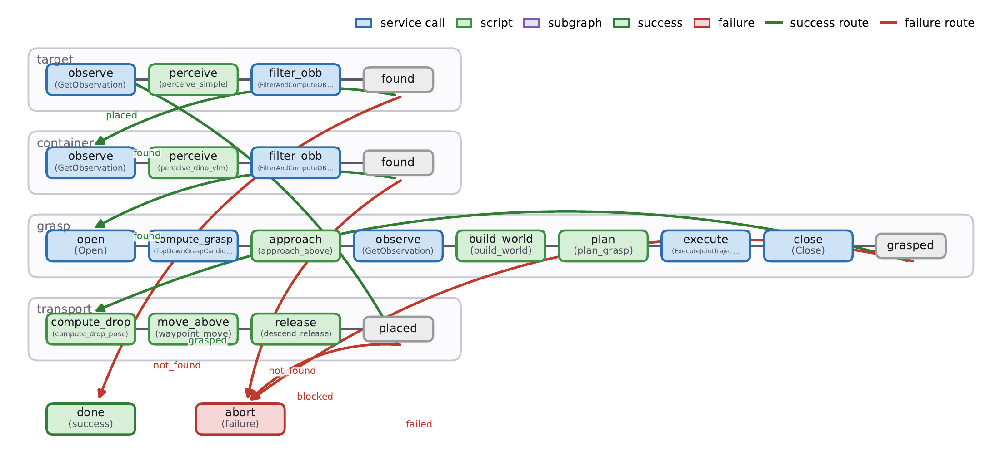

*Paper Appendix C.2, PDF page 19. Compare its backward `placed` route with the single-target graph in C.1. Packing returns to target perception; its completion condition differs from failing to find a specifically requested item.*

Take an **illustrative two-item packing instance**:

1. Fresh perception finds item A. Its geometry feeds grasping and transport.
2. After placement, the backward route invokes perception again. The old pose of A is not the next target.
3. Perception now finds B; the same grasp/transport graph computes different commands from B's geometry.
4. When no eligible item is found, this clean-all-items workflow can route to `done`.

The meaning of `not_found` depends on the task. For “find and pack the soup can,” absence is a failure. For “pack all remaining items,” absence can indicate completion. A missed detection can still cause premature completion; the routing rule does not make absence infallible.

Independent branches can execute concurrently, but a grasp that consumes target geometry must wait for that geometry. Appendix F specifies that multiple static outgoing edges denote parallel work, not an implicit sequence. Data and control dependencies must express the intended order.

### 4.2 Keep Runtime State Separate from Learned Graph Changes

Within an execution, the interpreter retains node outputs, active routes, and any skill-specific state. A tracker, for example, initializes from an observation, updates on new frames, and releases its state when the workflow terminates. Streaming consumers read its latest published snapshot.

Across task instances, the reusable object is the graph and its configured parameters. Instance observations and object poses must be refreshed for the new scene. Across self-learning iterations, the system additionally retains graph revisions and rehearsal feedback. The paper does not describe this as an expanding experiential skill notebook like [ASPIRE](./ASPIRE.md), nor as neural-network fine-tuning.

Once deployed, authoring agents need not run. **Perception models, VLM queries, planners, and learned policies inside graph nodes can still perform inference.** Removing the agentic authoring loop does not mean that every runtime model call disappears or that every model fits on the edge interpreter.

## 5. How Does Rehearsal Select a Better Graph?

### 5.1 Test Physical Outcomes, Not Just a Node's Own Success Message

RoboSimStudio builds an internal physics-based scene using the task geometry and configuration. GaP samples initial conditions from $\mathcal B$ and runs copies of the graph in parallel. Rehearsal records robot/object states and contacts before and after relevant stages.

A **postcondition checkpoint** tests the physical state promised by a subgraph: is the target held, or has it reached the container? A diagnostic **probe** records additional information without being the main acceptance condition. Checking simulator contacts or positions supplies evidence independent of a detector's own confidence score; using that confidence as proof of correct detection would be circular.

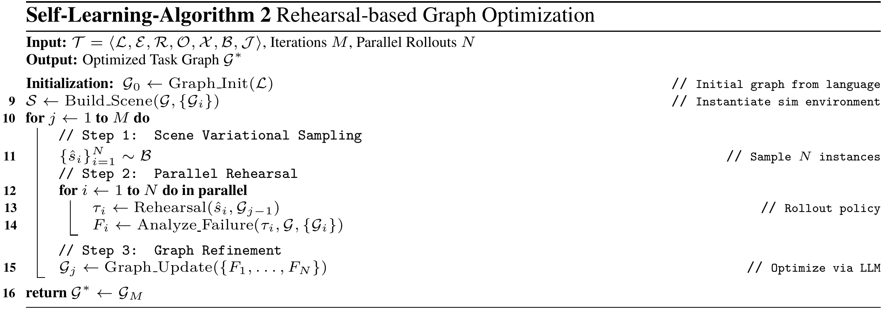

*Paper Self-Learning Algorithm 2, Appendix E.1, PDF page 32. It repeats the main-paper Algorithm 1 at a larger, readable size. The update acts on the graph; there is no gradient step training the coding model in this procedure.*

The loop is:

**Generate $G_0$ → sample scenes → execute and check → localize failures → propose edits → validate and re-evaluate.**

Allowed edits include changing prompts/inputs, rewiring outputs, revising an inline script, swapping skill nodes, and tuning motion or placement parameters. The provided harness also contains canonical stage-guided swaps. Learning searches within a substantial engineered vocabulary; it is not discovery of arbitrary new robot capabilities from nothing.

The sample feedback uses **30 parallel environments**. This is an example batch size, rather than a universal setting for every experiment. Section 4.2 separately describes checking proposed changes on **100 fresh task instances** and rejecting changes that degrade success rate or cycle time.

### 5.2 Success and Speed Enter Both the Objective and the Acceptance Rule

The paper's objective combines success and throughput:

$$
\mathcal J=w_s\,\mathbf 1[\mathrm{success}]+w_t\,\Phi,
\qquad \Phi=\frac{\text{success rate}}{\text{cycle time}}.
$$

Across instances, the success indicator averages to the success fraction. Cycle time is the duration of an attempt or task cycle under the chosen protocol. With time in seconds, successful cycles per hour are $3600s/t$, where $s$ is success fraction and $t$ is mean cycle time. The weights must account for the chosen throughput units; they are not universal interchangeable constants.

Maximizing a weighted score can permit a speed/reliability tradeoff. The stated **rejection rule is stricter**: do not retain an edit that makes either measured success or cycle time worse. An **illustrative** comparison makes the distinction concrete:

| Graph | Successes in 100 tests | Mean cycle time | $3600s/t$ | Decision under the stated rule |
|---|---:|---:|---:|---|
| Current graph | 96 | 60 s | 57.6/hour | Reference |
| Faster but less reliable | 94 | 45 s | 75.2/hour | Reject: success decreased, despite higher throughput |
| More reliable but slower | 97 | 65 s | About 53.7/hour | Reject: cycle time increased |
| Same reliability, faster | 96 | 50 s | About 69.1/hour | Eligible improvement: neither metric worsened |
| Same measured performance | 96 | 60 s | 57.6/hour | No measured gain; repeated lack of improvement can end the search |

These invented counts explain the rule, not the paper's measured rollouts. Fresh finite samples introduce estimation noise, so this procedure does not guarantee nondegradation throughout the whole distribution $\mathcal B$. The search ends at a plateau or reports unresolved failure reasons.

### 5.3 Rehearsal Verification Is Different from Real-Time Enforcement

The appendix's checkpoints use privileged simulation quantities such as object positions, contacts, and container bounds. Those measurements can supervise graph improvement even when the deployed perception system only receives images and depth.

Importantly, Appendix F marks the metadata option for enforcing these checkpoints during real execution as **currently a no-op**. The demonstrated rehearsal checks should therefore not be described as an implemented general physical postcondition gate on the real robot. Runtime services and graph error routes still provide feedback, but simulator-ground-truth checks do not automatically transfer with the graph.

## 6. Follow the Popcorn Failure Through a Complete Repair

### 6.1 Closing the Gripper Is Different from Grasping the Pan

The initial popcorn graph can operate the stove knob but has difficulty picking up and placing the pan, with **33% reported success**. Appendix E.2 illustrates why a final failure bit is insufficient.

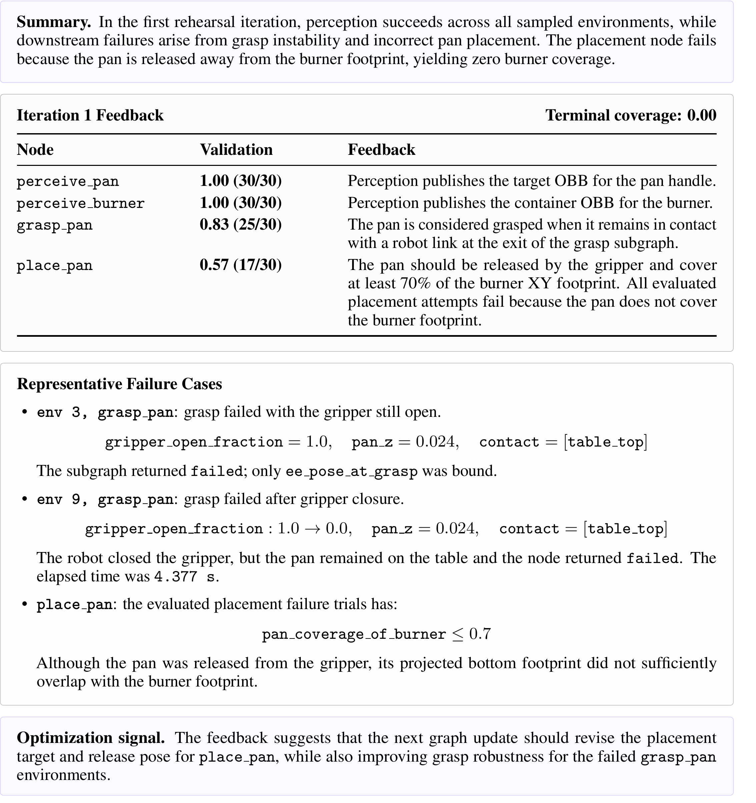

*Paper Appendix E.2, PDF page 33. This is example diagnostic feedback, not a separate evaluation benchmark. Its placement-validation count conflicts with its statement that every evaluated placement fails; the numbers should not be treated as an internally consistent placement success rate.*

In one recorded case, gripper opening changes from **1.0 to 0.0**, but the pan remains at **$z=0.024$ m** and contacts only the tabletop. The actuator command happened; the object was not picked up. Improving object detection would address the wrong stage when perception already supplied the intended target geometry.

Placement requires a different check: the pan must be released and cover the required portion of the burner footprint. The example uses a **70% overlap threshold**, rather than accepting any release near the stove. Illustratively, 20% coverage is inadequate while 80% clears that threshold. The appendix describes “at least 70%” but also writes a failure inequality including equality, leaving the exact boundary inconsistent; this note does not invent a resolution.

### 6.2 Repair the Grasp, Then Repair Its Downstream Geometry

The paper reports this progression:

1. **Improve grasp candidates.** Replace the original GraspGen-only choice with a mixture of GraspGen proposals and OBB-based grasp planning.
2. **Identify the graspable subpart.** Change perception to localize the pan handle, rather than treating the entire pan as equally suitable for grasping.
3. **Adjust transport/placement.** Retune the placement offset after the grasp strategy changes, so the pan reaches the burner in the intended pose.

Why does changing the grasp require a placement change? In an **illustrative one-dimensional, fixed-orientation case**, let pan center be $p$ and gripper position be $e=p+o$, where $o$ is the gripper's offset from the pan center while holding it.

- A center grasp has $o=0$. To place the pan center at $p^*=0.60$ m, command $e^*=0.60$ m.
- A handle grasp has $o=0.10$ m. The same pan target now requires $e^*=0.70$ m.
- Reusing the old $e^*=0.60$ m command would place the pan center at $0.50$ m: a 10 cm error.

This example assumes a rigid object, no slip, and unchanged orientation; the real pose relationship also includes rotation. It explains why a locally better grasp can break an old transport rule, and why grasp-state information must feed placement.

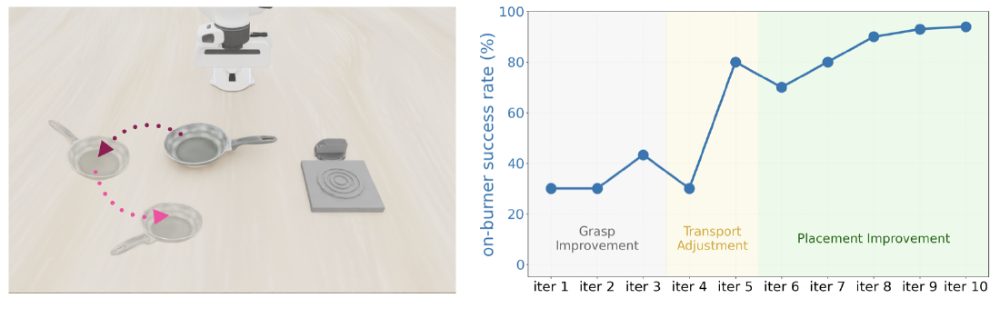

*Paper Figure 2, PDF page 9. Left: pan-pose variation. Right: on-burner success rate across graph revisions, with grasp, transport, and placement edit phases. The curve is not monotonic; it should not be read as a guarantee that every proposed graph improves.*

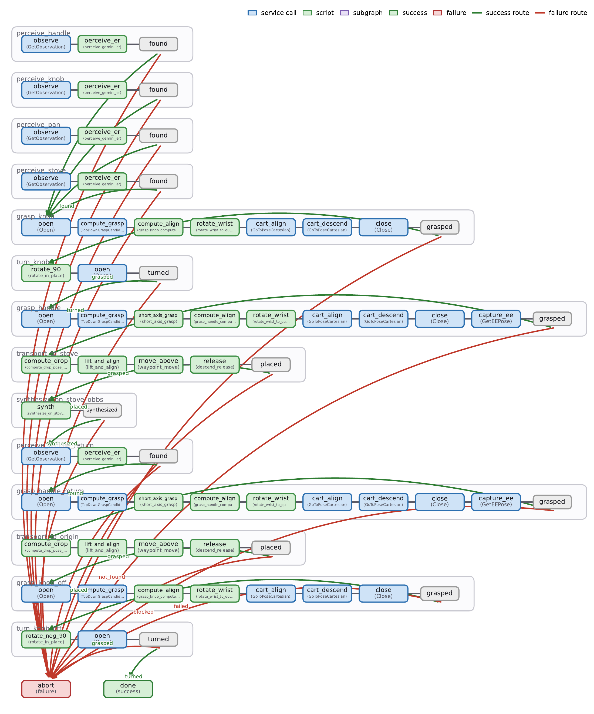

*Paper Appendix C.5, PDF page 21. Read the subgraph names down the left: perception precedes knob/handle operations; transport depends on grasp state; return and knob-off stages complete the sequence. Fine node labels are abbreviated in the source; the important structure is the stage dependencies and failure routes.*

The final graph reaches **94% in simulation** and **18/20 in real trials**. The two reported physical failures were an inverse-kinematics error during linear Cartesian motion and a misgrasp attributed to accumulated kinematic error. Simulation-based graph improvement transfers usefully here, while those remaining failures show the limit of equating simulation validation with physical certainty.

## 7. What Do the Eight Benchmarks Actually Evaluate?

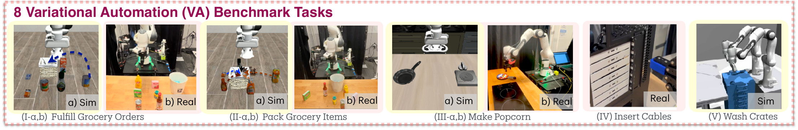

*Paper Figure 1, lower strip, PDF page 1. I–III each have simulation and physical versions; IV is physical cable insertion; V is simulated crate handling. This gives four simulation and four physical benchmarks, rather than eight physical demonstrations.*

| Benchmark | What varies? | What counts as performance? |
|---|---|---|
| **I-a/b: Fulfill Grocery Orders** | Item locations, target/basket swaps, distractor permutations; sim and real | Place the designated item into the basket |
| **II-a/b: Pack Grocery Items** | Multiple grocery objects and poses; sim and real | Number of six items packed after six grasp attempts |
| **III-a/b: Make Popcorn** | Pan pose and sequential stove/pan manipulation; sim and real | Complete the specified manipulation sequence |
| **IV: Insert USB-C Cables** | Port position/orientation and requested port sequence; real UR5 with wrist camera and force feedback | Individual insertion success, complete-sequence success, and time |
| **V: Wash Crates** | Crate yaw up to $\pm15^\circ$ and horizontal shifts up to $\pm2.5$ cm; simulated dual Franka arms | Lift, flip, and place the crate; success, duration, and sustained throughput |

*Task definitions from Section 5.1. Benchmark V models a washing-line handling operation; its score is not a measurement of cleaning quality.*

The **20×20 cm** grocery variation means sampling each object's position within a square centered on its original pose, corresponding to up to $\pm10$ cm per horizontal axis. An illustrative $+8$ cm/$-6$ cm displacement lies inside that square. It does not mean a $\pm20$ cm shift. Collision avoidance during instance generation prevents overlapping objects.

The comparisons also have different information and tuning conditions:

- **GaP** receives known environment/object geometry and modular skills. The main grocery study uses **Gemini-3.1-Flash-Lite**, temperature **0.1**, for LLM/VLM roles.
- **CaP-X** uses one agent, an initial image, and instructions in this experiment. The authors explicitly call it an **unequal comparison** because GaP receives additional VA structure. This result should not be generalized to every CaP-X configuration in its own paper.
- **pi0.5 and MolmoAct2** use official checkpoints fine-tuned on LIBERO training data.
- **TiPToP** uses a modular **task and motion planning (TAMP)** pipeline, with **128 cuTAMP particles**, a **60 s planning timeout**, and warmed planning cache for timing.

Most importantly, **the Table 1 grocery results do not use self-learning**: the authors retain the first graph because it already performs well. Those results test the generated graph and supplied capabilities, while the popcorn and later timing experiments test rehearsal-based improvement.

## 8. How Robust Are Grocery Graphs and VLA Handoffs?

### 8.1 Read Table 1 by Variation Type and Score Definition

The paper reports **5,500 simulation trials**, with 100 task instances per populated cell. For readability, Table 1 is reproduced below in two column groups; all method rows and reported values are retained. The dash is unreported, not zero.

| Method | LIBERO object | LIBERO-Pro object swap | X–Y 20×20 cm | Basket swap | Permutation | Mixed all |
|---|---:|---:|---:|---:|---:|---:|
| CaP-X | — | 0.22 | 0.07 | 0.05 | 0.11 | 0.10 |
| pi0.5 | 0.96 | 0.24 | 0.78 | 0.15 | 0.20 | 0.20 |
| MolmoAct2 | 0.97 | 0.43 | 0.90 | 0.26 | 0.10 | 0.20 |
| TiPToP | 0.22 | 0.22 | 0.29 | 0.24 | 0.31 | 0.24 |
| pi0.5 with GaP | 0.85 | 0.60 | 0.79 | 0.32 | 0.50 | 0.39 |
| MolmoAct2 with GaP | 0.70 | 0.62 | 0.84 | 0.58 | 0.39 | 0.66 |
| **GaP** | **0.95** | **0.95** | **0.95** | **0.97** | **0.93** | **0.97** |

*Paper Table 1, fulfillment column group, PDF page 8. “Mixed all” combines the listed variations. These are evaluated configurations, not guarantees for every possible location or object.*

| Method | Packing, fixed | Packing, varied |
|---|---:|---:|
| CaP-X | 0.01 | 0.01 |
| pi0.5 | 0.17 | 0.18 |
| MolmoAct2 | 0.18 | 0.18 |
| TiPToP | 0.34 | 0.46 |
| pi0.5 with GaP | 0.67 | 0.66 |
| MolmoAct2 with GaP | 0.59 | 0.59 |
| **GaP** | **0.99** | **0.98** |

*Paper Table 1, packing column group. Benchmark II defines an item-based score: items placed out of six attempts. A score of 0.98 must not be relabeled as 98% of complete six-item baskets successfully packed.*

The strongest result is robustness to the constructed variations: both VLAs reach 0.20 under mixed variation, while GaP reaches 0.97. The ordinary LIBERO column tells a different story: the original VLAs score slightly above GaP. Thus the evidence supports specialization to these VA conditions, rather than universal superiority over VLAs.

### 8.2 GaP Can Also Prepare a Scene for an Existing VLA

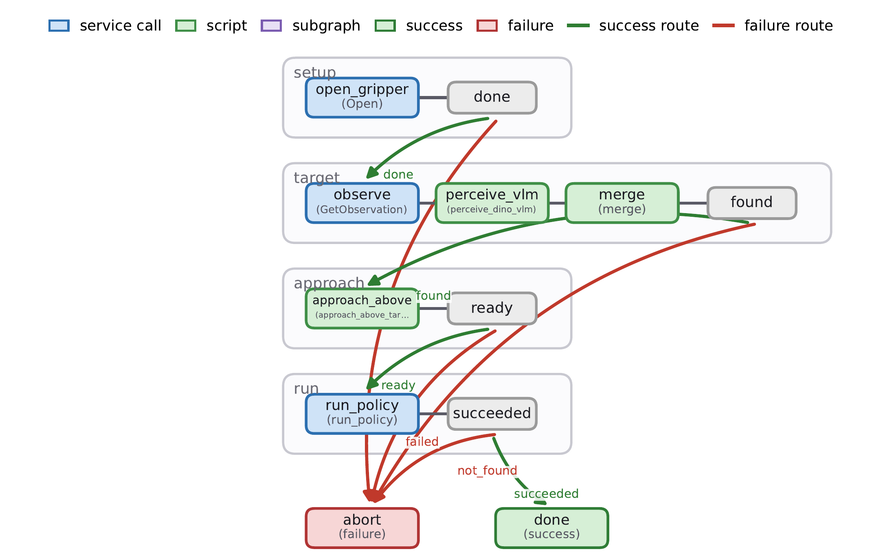

*Paper Appendix C.3, PDF page 20. The graph ends its explicit geometric approach with `run_policy`; the VLA then supplies the manipulation behavior. This is a hybrid graph, distinct from the fully modular GaP row.*

A VLA trained on familiar wrist-camera views may fail when a target appears elsewhere in the image. GaP can first locate the object and move the wrist camera to a pre-grasp view above it. The VLA then starts from a more familiar observation instead of having to recover from the original perturbation unaided.

This changes **the state and observation presented to the VLA**, not its weights. In the mixed-variation column, pi0.5 improves from **0.20 to 0.39**, and MolmoAct2 from **0.20 to 0.66**. However, both hybrids score lower than their unassisted VLA on ordinary LIBERO. Staging is useful in some distributions; it is not a universally beneficial preprocessing step.

### 8.3 Physical Results Are Encouraging but Small

| Physical test | TiPToP | GaP |
|---|---:|---:|
| **Fulfill Grocery Orders, total** | **8/25** | **25/25** |
| ↳ Ordinary object condition | 3/5 | 5/5 |
| ↳ 20×20 variation | 2/5 | 5/5 |
| ↳ Basket swap | 1/5 | 5/5 |
| ↳ Tall basket | 0/5 | 5/5 |
| ↳ Permutation | 2/5 | 5/5 |
| **Pack Grocery Items** | **10/30** | **28/30** |
| **Make Popcorn** | **0/20** | **18/20** |

*Paper Table 2, PDF page 8. Fulfillment's five subconditions sum to its total; they are not extra trials. Packing follows the benchmark's item-placement scoring and does not provide a separate all-six-items completion rate.*

The paper reports mean single pick-and-place completion times of **67 s for GaP** and **95 s for TiPToP**. Both identify objects, but the authors attribute many TiPToP failures to its grasp/motion stack being unable to find feasible plans in these scenes. The result therefore depends on the entire configured pipeline, not just which system chooses task order.

Twenty-five successful fulfillment attempts show useful transfer of the generated graph. They do not establish a 100% population success rate or long-duration industrial reliability.

## 9. Can Graph Learning Improve Speed as Well as Success?

### 9.1 Optimize Expensive Computation and Conservative Motion

After reliability becomes high, GaP can improve cycle time by choosing cheaper perception, tuning settling/motion parameters, and reusing perception results across graph nodes. These edits address different costs: fewer model calls save computation; shorter settling saves physical waiting; reuse avoids recomputing information that remains applicable.

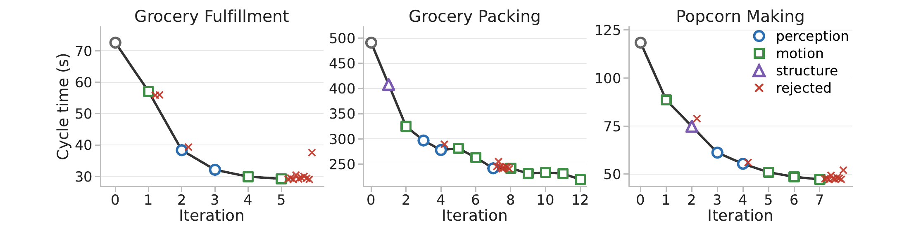

*Paper Figure 3, PDF page 10. The plotted vertical axis is cycle time in seconds. Marker types distinguish perception, motion, and topology edits; red crosses are rejected proposals. Although the source caption also mentions success-rate axes, the displayed plots should be read for their visible cycle-time traces; success values are provided in Table 3.*

A reusable basket estimate can save work while the basket remains stationary. Reusing the pose of a grocery item after moving it would instead be stale. Graph reuse and data reuse therefore have different validity conditions; the optimizer must test that an efficiency edit preserves task performance.

| Simulation benchmark | TiPToP success | TiPToP + MORSL success | GaP initial success | GaP learned success | Initial cycles/hour | Learned cycles/hour |
|---|---:|---:|---:|---:|---:|---:|
| I. Fulfillment | 0.24 | 0.53 | 0.97 | 0.97 | 49.7 | 124.1 |
| II. Packing | 0.34 | 0.60 | 0.97 | 0.97 | 7.3 | 16.2 |
| III. Popcorn | 0.00 | 0.00 | 0.33 | 0.94 | 30.5 | 76.6 |

*Paper Table 3, PDF page 10, complete rows/values with abbreviated headers. “TiPToP + MORSL” replaces TiPToP's perception and grasp planning with MORSL capabilities. Rates are reproduced in the table's own units, cycles/hour.*

The grocery rows isolate an important practical gain: reported success stays at **0.97** while reported cycle throughput rises by about **2.50×** for fulfillment and **2.22×** for packing. The popcorn row also includes the large reliability improvement, so it should not be interpreted as a pure speed-only ablation.

MORSL improves TiPToP too, confirming that stronger supplied components explain part of the overall advantage. GaP's remaining gain involves composition, motion choices, and graph refinement; these comparisons do not isolate graph representation from every other difference in the systems.

The text summarizes cycle-time reduction as **up to 57%**, while Table 3 reports cycle rates and the formal objective defines throughput using success fraction. The paper does not fully reconcile these timing/accounting conventions. Keep its reported cycle rates distinct from measured successful-output counts, and do not silently infer an exact cycle-time reduction or successful-items/hour from them.

### 9.2 Engineering and Simulation Still Consume Time

The paper reports **fewer than 30 LLM calls** for graph generation, at an approximate quoted cost of **USD 0.01**. Rehearsal dominates self-learning time: about **15 minutes per iteration**, up to **150 minutes total** for popcorn. These are reported implementation costs, not a universal budget across models and hardware.

The authoring cost is paid before repeated graph execution. Runtime perception and motion planning still dominate parts of the cycle, and the paper explicitly identifies them as remaining speed bottlenecks. A cheap generated program is not necessarily a fast physical process.

The qualitative ablations report zero success when graph generation is replaced by raw Python generation, and zero when specialized authoring is collapsed into one agent; interface errors and failed static verification dominate those configurations. Their descriptions do not provide a full matched numerical table with uncertainty. They support the value of this harness's structure, without proving that all single-agent code generation must fail.

## 10. How Does GaP Reuse Existing ROS Controllers for Cable Insertion?

### 10.1 Compose Four Supplied Controllers into Different Workflows

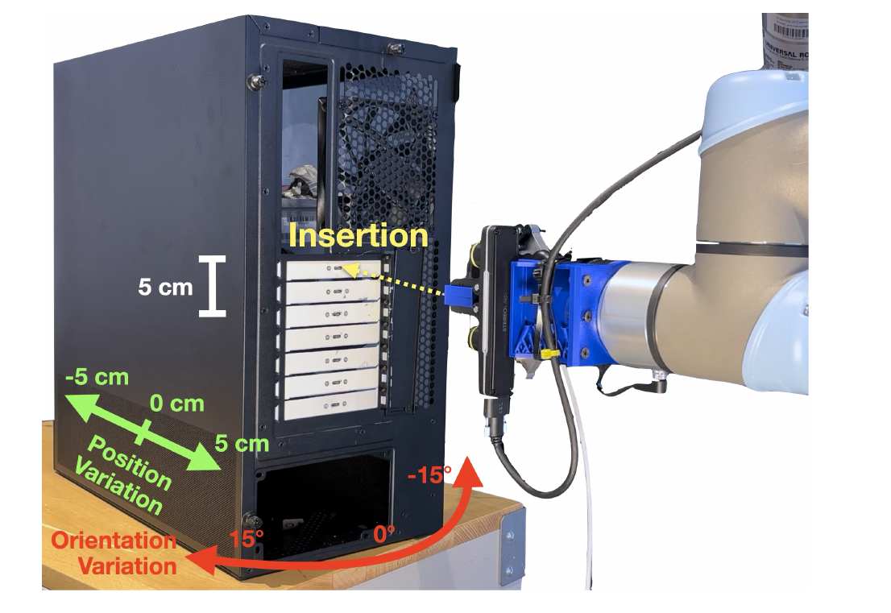

*Paper Figure 4, PDF page 10. A UR5 with a ZED Mini wrist camera aligns a cable with the port bank. The annotations show the tested translation/orientation variation; this is a physical benchmark.*

The underlying **Robot Operating System (ROS)** controllers perform alignment, contact, insertion, and extraction. GaP invokes them through a skill interface, waits for their status/data signals, and decides the next workflow step. It composes existing precision-control capabilities; the experiment does not show an LLM inventing force control from scratch.

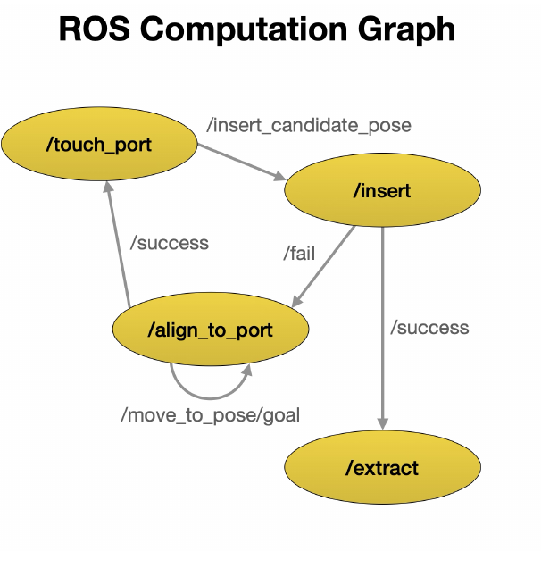

*Paper Figure 5, left panel, PDF page 11. Arrows carry ROS topics/statuses, including insertion failure returning toward alignment. The controller has recovery structure before GaP is added.*

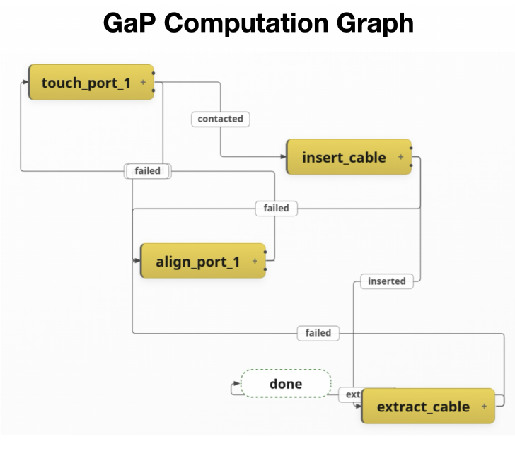

*Paper Figure 5, middle panel. Existing operations become callable graph nodes, retaining their returned status for routing.*

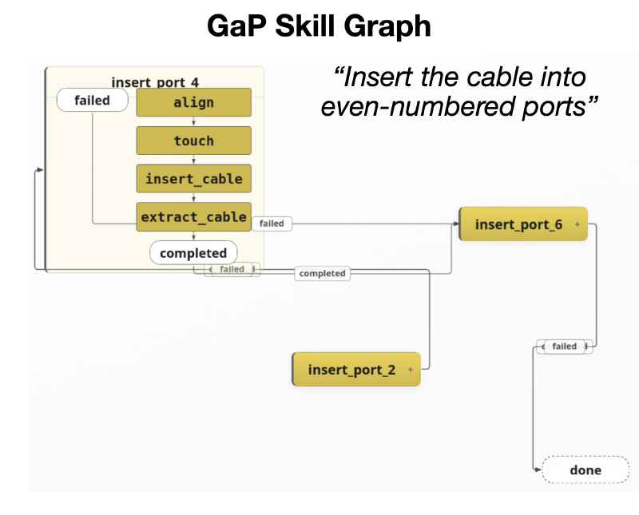

*Paper Figure 5, right panel. A port-insertion subgraph is reused within a longer requested sequence. Appendix Figure B.1 repeats this comparison and is omitted as a duplicate.*

The insertion routine searches a **1×1 cm area**, with **2 mm steps** in the contact-based fallback. The reported preliminary progress test requires **more than 3 mm** of motion at **less than 10 N** force. For example, 3.1 mm at 9 N passes that test; exactly 3 mm or 10 N does not. This is not yet full insertion: the paper separately describes completion at depth **greater than 6 mm**, with a **30 N** insertion condition. Extraction uses **2 Hz** wiggling while keeping lateral force below **20 N**.

These values describe the supplied controller's task-specific logic, not universal safety limits. Appendix B reports failures when the visual estimate lies outside the small fallback search region, depth error produces partial insertion, or lighting/shadows prevent port detection. A well-formed workflow cannot compensate for an arbitrary perception offset or inadequate search coverage.

### 10.2 Individual Insertions and Complete Sequences Have Different Denominators

| Variation | Individual insertion success | Complete-sequence success | Reported sequence/execution time (s) |
|---|---:|---:|---:|
| Individual port* | 5/5 | — | 26.0 |
| Ascending ports | 32/35 | 2/5 | 247.0 |
| Descending ports | 32/35 | 4/5 | 223.2 |
| Odd-indexed ports | 20/20 | 5/5 | 136.8 |
| Even-indexed ports | 14/15 | 4/5 | 104.6 |
| $-15^\circ$* | 4/5 | — | 24.0 |
| $+15^\circ$* | 5/5 | — | 25.6 |
| $-5$ cm* | 5/5 | — | 29.4 |
| $+5$ cm* | 4/5 | — | 28.0 |

*Paper Table 4, PDF page 10. Asterisked rows exclude extraction. The original headers distinguish per-insertion SR, all-sequence SR, and ET; the time column therefore must not be treated as a common per-insertion average across every row.*

The total is **121/130 successful insertions, about 93.1%**. The ascending and descending rows both have 32/35 insertions, yet different complete-sequence scores.

An **illustrative failure allocation consistent with those counts** explains how: five seven-port sequences contain 35 insertions. Three failures spread across three sequences leave only two sequences completely successful; three failures concentrated in one sequence leave four completely successful. The paper does not give that exact allocation, but it demonstrates why the two denominators answer different questions.

Generating the correct workflow for all five text-prompt types is a planning result. Completing every physical operation in a long sequence is a stricter execution result.

## 11. How Close Is Simulated Crate Handling to an Expert Graph?

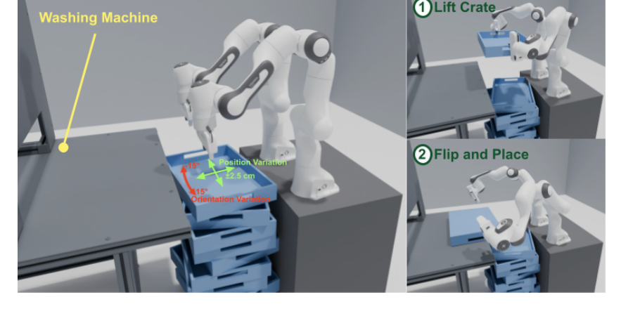

*Paper Table 6, PDF page 11, is a setup illustration rather than a numerical table. It depicts the industrial use case modeled by Benchmark V; the reported comparison is in simulation.*

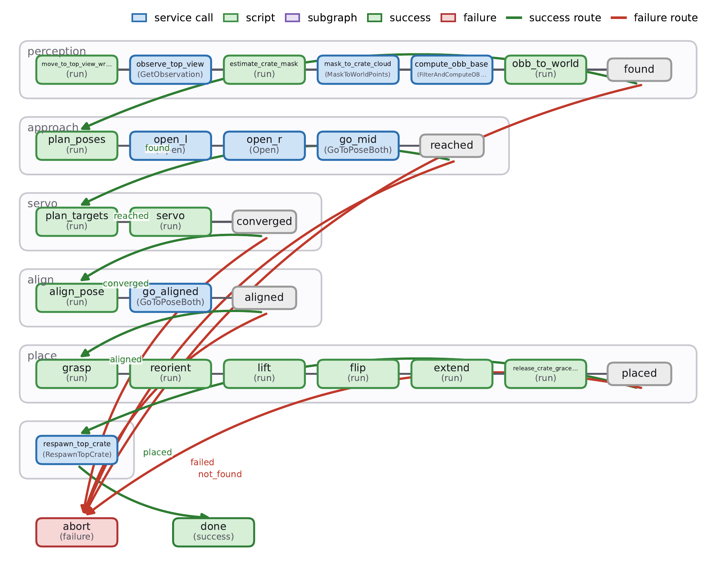

*Paper Appendix C.4, PDF page 20. Two-arm motion and alignment feed the coordinated handling stages. The reset operation belongs to the simulated benchmark; the graph does not establish an autonomous physical washing factory.*

Both arms must engage narrow side slits, lift the same object together, reorient it, and place it on the washing-machine table. This is more than two independent single-arm pick-and-place calls: their poses and timing must remain compatible with a shared crate.

| Simulation method | Success over 150 trials | Mean cycle duration | Successful cycles in 3-hour run | Sustained successes/hour |
|---|---:|---:|---:|---:|
| Hand-engineered graph | 148/150, 98.7% | 176.47 s | 58 of 59 attempts | 19.33 |
| GaP graph | 143/150, 95.3% | 179.13 s | 55 of 59 attempts | 18.33 |

*Paper Table 5 and its accompanying Section 5.8 text, PDF page 11. The original table rounds success, duration, and throughput; this version uses the more precise counts/times supplied in the text. The 150-trial evaluation and 3-hour continuous run are distinct measurements.*

For the continuous GaP run, $55/3\approx18.33$ successful cycles/hour. This measured count is different from simply taking the reciprocal of the average duration in the separate trial evaluation. It includes the outcomes actually observed during the fixed window.

GaP approaches the manually engineered baseline on this simulation but remains lower in reliability and slightly slower. This supports automated construction of a coordinated policy within the supplied setup, without establishing equivalent performance on physical crate washing.

## 12. What Has Been Learned, and What Remains Limited?

GaP's durable learned result is an **executable graph with revised structure and parameters**. A change can replace a grasp strategy, pass a missing pose between stages, reuse a stationary basket estimate, or tune motion waiting. These changes alter future robot behavior while keeping the authoring models' weights fixed. The graph's interpreted execution still reacts to new observations.

Its main dependencies and limits follow from that design:

- **Known task structure and geometry:** VA supplies a stationary workcell, calibrated robot/sensors, object models, and bounded variation. The results do not establish comparable robustness in arbitrary unfamiliar environments.
- **Supplied capabilities:** MORSL, ROS controllers, motion planners, canonical scripts, and pretrained perception/grasp models contribute substantial competence. Better skills also improve TiPToP; graph structure is only part of the comparison.
- **Simulation fidelity and verification scope:** privileged rehearsal checks diagnose failures, but errors in geometry, contacts, calibration, or real-world sensing can remain. The appendix's real-execution checkpoint flag is not implemented as a general enforcement mechanism.
- **Limited and heterogeneous evidence:** packing scores items, insertion scores both operations and sequences, crate handling is simulated, and physical grocery/popcorn samples are small. These results cannot be pooled into one overall “robot success rate.”
- **Industrial performance:** the paper itself says reliability and speed remain below its deployment goals. It cites about 500 units/hour as a motivating industrial rate, not a demonstrated universal standard that every VA task must meet.
- **Specification consistency:** some appendix prompt sections mix checkpoint-authoring and older/newer workflow conventions; the example placement feedback also conflicts with its reported validation count. These excerpts explain the architecture, but should not be copied as a fully consistent implementation specification without checking the released code.
