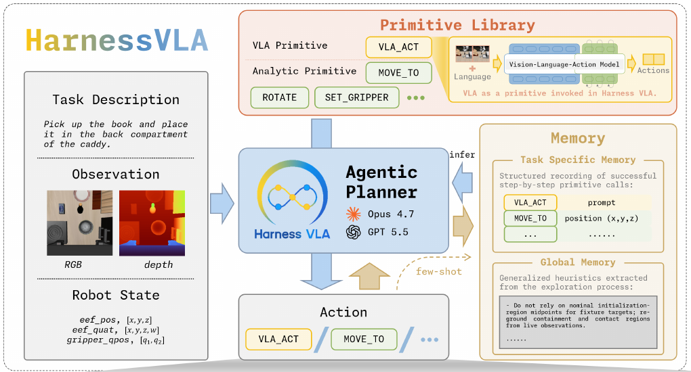
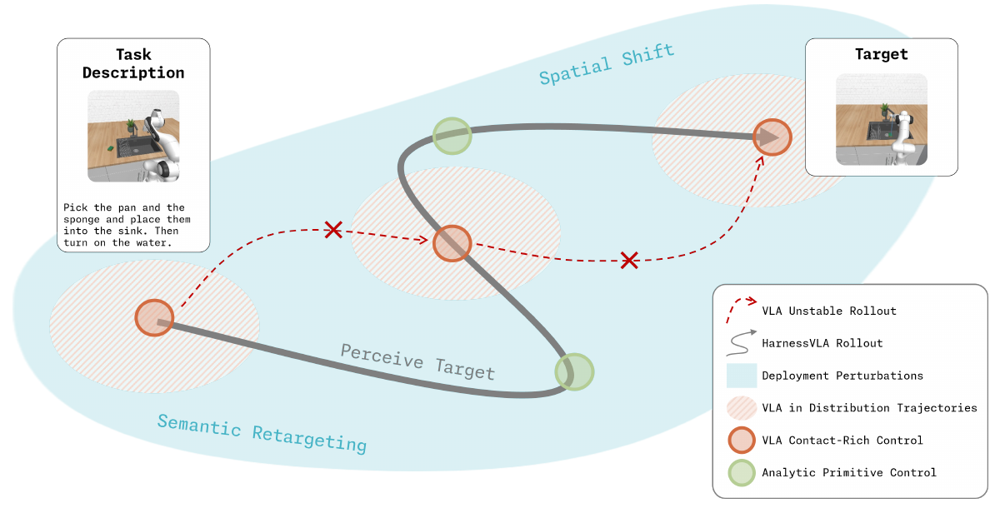

# [Harness VLA: Steering Frozen VLAs into Reliable Manipulation Primitives via Memory-Guided Agents](https://arxiv.org/abs/2607.08448)

> **Brief:** Harness VLA turns a frozen VLA into a callable, interruptible contact skill inside a memory-guided agent. The agent selects targets, stages the robot, verifies outcomes, and handles recovery; fixed analytic controllers perform geometric motions, while the VLA supplies learned contact-rich behavior. Adaptation mainly changes **how an existing policy is used**, not its weights.

**Source:** Zhang et al., 2026; supplied PDF, arXiv v5 dated September 24, 2026. Results and implementation details below refer to this version, including its appendices.

## Convenient Links

- [Paper](https://arxiv.org/abs/2607.08448)
- [Project](https://harnessvla.github.io/)
- [Official code: RPent](https://github.com/RLinf/RPent)
- Related policies: [pi0.5](../Policies/Pi_0_5.md), [Hi Robot](../Policies/Pi_Hi_Robot.md)
- Background: [Agent Memory](../../../Agent_Systems/Memory_Systems.md), [Tool Interfaces](../../../Agent_Systems/Tool_Registry_and_Function_Calling.md), [LIBERO](../Datasets/LIBERO.md)

## 1. Why Put an Agent Around a VLA?

A VLA trained on complete demonstrations may know how to grasp an object but still repeat the wrong overall routine when the instruction or layout changes. For example, it may successfully pick up a bowl yet carry it toward its training-time destination instead of a newly requested tray.

An agent can reason about the new destination and use geometric controllers to move there. But replacing the VLA entirely with scripted control creates another problem: reliable irregular-object grasping, fixture interaction, and constrained placement are difficult to express as simple pose commands.

Harness VLA therefore assigns each component the part it handles best:

| Responsibility | Component | Why this division helps |
|---|---|---|
| Interpret the task, identify targets, choose the next operation, diagnose failures | Multimodal agentic planner | Keeps semantic decisions outside a policy biased toward familiar trajectories |
| Approach, transport, reorient, navigate, and release | Analytic primitives | Explicit geometric targets need not be generated by a learned policy |
| Grasp, insert, actuate fixtures, or perform other delicate interactions | Frozen `VLA_ACT` primitive | Reuses learned visuomotor control where simple controllers are brittle |
| Remember useful sequences and operating conditions | Task Specific Memory + Global Memory | Avoids rediscovering the same orchestration and recovery rules |

The important distinction from a simple **planner -> VLA** pipeline is that the planner can **choose not to use the VLA** for substantial parts of execution. VLA calls and analytic control share one tool interface; the VLA is a tool, not the mandatory executor of every subtask.

## 2. Modules and Runtime Data Flow



*Paper Figure 1, left architecture panel. The planner reads observations and memory, selects a primitive, and receives feedback after execution. The learned VLA is one member of the fixed primitive library.*

### 2.1 Two Levels of Execution, Not Joint Model Training

Let $k$ index **planner turns**, each of which can contain many low-level controller steps. The planner receives

$$
o_k=(I_k^{\mathrm{RGB}},D_k,q_k),
$$

where $D_k$ is aligned metric depth and $q_k$ contains robot proprioception, including end-effector pose and gripper state. With task instruction $\ell$, task memory $M_{\mathrm{task}}$, and global memory $M_{\mathrm{global}}$, the interaction can be summarized as

$$
c_k=\Pi(o_k,\ell,M_{\mathrm{task}},M_{\mathrm{global}},\text{execution feedback}),
$$

$$
(o_{k+1},d_{k+1})=\operatorname{Execute}(c_k),
\qquad c_k\in\mathcal{P},
$$

where $\mathcal{P}$ is the fixed primitive library and $d_{k+1}$ contains status and diagnostic information. These equations summarize the interface, not an additional training objective.

```text
Task instruction + latest RGB-D + robot state + execution logs
                          + retrieved task/global memory
                                      |
                              Multimodal planner
                                      |
                         One structured JSON command
                                      |
                        Harness / environment worker
                         /                         \
                Analytic controller          Frozen VLA_ACT
                geometric set-points         prompt + live policy inputs
                         \                         /
                          Low-level robot execution
                                      |
                  Fresh observation + status + success signal
                                      |
                      Planner verifies and selects next call
```

The planner and VLA communicate through **commands, physical state changes, and refreshed observations**. They are not coupled Transformer branches, do not share hidden-state attention, and are not jointly optimized by Harness VLA.

### 2.2 What the Harness Actually Does

The harness is the runtime around the models. It exposes primitive schemas, dispatches commands, synchronizes execution, refreshes observations, retrieves memory, logs outcomes, and enforces reset and budget rules.

The implementation uses a synchronous file-mediated read-eval-print loop (REPL):

1. Read the current task/state, images, depth/world maps, memory, and diagnostics.
2. Write one primitive invocation to `command.json`.
3. Wait for the environment worker to finish, indicated by a completion flag or terminal file.
4. Read the new `state_NN.json`, `log_NN.json`, and perception files before deciding again.

The worker owns the simulator state. The planner is prohibited from reading privileged object poses or simulator internals. Robot proprioception and the benchmark success signal are available, but object positions must be derived from perception.

### 2.3 From Visual Identity to Metric Motion

An instruction such as "put the bowl on the tray" does not directly provide a Cartesian target. The planner first identifies the relevant entity in RGB, then samples corresponding pixels in a depth-derived world map to obtain metric coordinates. Multiple stable surface pixels, typically combined with a median, reduce errors from edges, gaps, and background pixels.

This connects **semantic grounding** (which tray?) to **geometric grounding** (where is its current support surface?). After the camera, object, base, or grasp changes, the planner re-localizes instead of reusing stale coordinates. Thus, memory can preserve the order of operations without fixing the scene geometry.

## 3. Turning a Frozen VLA into a Retryable Primitive

### 3.1 Fixed Vocabulary, Variable Composition

| Primitive | Main function |
|---|---|
| `MOVE_TO` | Move the end effector to a world-frame Cartesian target using the backend controller/solver |
| `MOVE_POSE` | Move while adjusting orientation variables, such as pitch |
| `ROTATE_WRIST`, `ROTATE_PITCH` | Adjust yaw or pitch while holding position |
| `SET_GRIPPER`, `RELEASE` | Set the gripper state or release under a post-condition |
| `VLA_ACT` | Run the frozen learned policy for a bounded contact-rich phase |
| `NAVIGATE_TO`, `MOVE_BASE` | RoboCasa-specific mobile-base staging and fine repositioning |

The shared vocabulary has **six analytic primitives and one VLA primitive**; availability varies by embodiment. RoboCasa adds the two base controls, while RoboTwin uses arm bindings for left/right or bimanual execution rather than introducing a new handover primitive. `RESET` is an exploration utility, not a deployment manipulation skill.

These APIs are fixed before evaluation. The agent can compose or retry them but cannot add a newly learned primitive during deployment.

### 3.2 What Happens Inside `VLA_ACT`?

The planner chooses a prompt, a maximum number of action chunks, and an early-return predicate. An illustrative call following the paper's interface is:

```json
{
  "action": "vla_act",
  "prompt": "grasp the black bowl",
  "max_chunks": 30,
  "stop": "object_lifted"
}
```

The chunk limit and supported stop predicates are backend-specific. The prompt is chosen for the frozen policy's operating conditions; it need not always be a shortened instruction, and global memory may recommend retaining full task context.

Inside this call, the frozen policy generates chunks from its normal live inputs. Schematically, at low-level time $t$:

$$
A_t=f_\theta(I_t^{\mathrm{policy}},q_t,\ell_k^{\mathrm{VLA}}),
\qquad A_t=(a_t,\ldots,a_{t+H-1}),
$$

where $H$ is the action-chunk length and $\theta$ remains fixed. The camera/state interface and chunk execution strategy depend on the selected VLA backend. The planner's RGB-D/world-map interface should not be confused with a requirement that every VLA directly consumes depth or memory files.

The worker executes action chunks until the local stop predicate is met or the budget is exhausted, then returns control to the planner. **One VLA invocation can contain several chunks; one planner turn is not one robot timestep.** The early-return predicate is a condition such as a confirmed lift, not flow-matching time.

A local return condition also does **not** establish overall task success. Lifting a bowl completes a grasp phase; placing it on the requested tray must still be checked using the benchmark's final completion predicate.

### 3.3 Why Staging and Retry Matter



*Paper Figure 2. Conceptual illustration: analytic control connects favorable local interaction states, while the frozen VLA handles contact-rich segments. These regions are explanatory, not a learned reachability map or a guaranteed success boundary.*

The agent changes the **state from which the VLA starts**: approach the correct object, adjust wrist/base pose, expose a useful camera view, and then invoke the policy. This can make a perturbed overall task resemble a familiar local interaction without changing the policy weights.

An illustrative bowl-to-tray sequence is:

1. Identify the current bowl and tray from the instruction and RGB-D.
2. Use analytic motion to stage a feasible pre-grasp pose.
3. Call `VLA_ACT` and inspect the resulting grasp.
4. If the gripper closed but the bowl did not move with it, diagnose an empty grasp, reopen, re-localize, re-stage, and retry within the remaining budget.
5. After a stable grasp, use analytic transport; invoke the VLA again if the destination requires constrained placement rather than simple release.
6. Release and verify the actual task predicate.

Retry therefore means **observe -> diagnose -> change the local conditions -> try again**, not blindly replay the same command. It localizes a contact failure instead of allowing it to derail the rest of a long trajectory.

## 4. What Is Learned, and What Stays Frozen?

### 4.1 Memory Construction Is the Main Adaptation Pipeline

Before memory-backed evaluation, the agent explores one reference seed for each task. It may reset and receives a more generous budget to search over primitive order, staging poses, VLA prompts, and stopping conditions. The output of this process is external memory, not a gradient update:

```text
Reference task/seed + fixed primitive library + frozen VLA
  -> trial, observe, diagnose, reset/retry during exploration
  -> successful procedure + useful failure observations
  -> task-specific JSONL commands and JSON strategy summary
  -> reusable rules and failure models in Global Memory
  -> retrieve and re-ground during held-out evaluation
```

| Memory | Stored content | How it affects the next rollout |
|---|---|---|
| Task Specific Memory: procedural JSONL | Primitive order, arguments, VLA invocation points, recovery steps | Supplies a task-level execution skeleton |
| Task Specific Memory: semantic JSON | Outcome, why the strategy worked, failure/recovery notes | Explains how to interpret and adapt that skeleton |
| Global Memory | Cross-task operating rules and failure models | Guides primitive selection, verification, and recovery |

**Reuse the procedure, not literal coordinates.** The main text describes parameterized traces; Appendix A also shows traces containing numeric reference coordinates. The consistent rule in Appendix E is that old `xyz`, base poses, pixel locations, and fixture coordinates are reference-scene bindings that must be re-grounded before execution.

Memory is refined through interaction: failures provide negative evidence, and later attempts can replace a trace with a shorter or more reliable procedure. Global memory is contextual guidance, not a new action model or an expanded skill library.

### 4.2 Deployment Is Closed-Loop, Not Trace Replay

In ordinary memory-backed evaluation, the agent retrieves the reference strategy, grounds targets in the current scene, executes one primitive, checks feedback, and adapts the next call. Scene reset is disabled and budgets are tighter than during exploration.

This is why the stored JSONL is a **structural prior**, not an open-loop robot trajectory. The online planner remains responsible for wrong objects, failed grasps, changed layouts, and deviations from the reference procedure. Fixed-order execution without online planning is the separate Flash Mode in Section 6.

### 4.3 Frozen During Deployment Does Not Mean Never Trained

| Benchmark | Frozen `VLA_ACT` backend | Preparation before harness evaluation |
|---|---|---|
| LIBERO / LIBERO-Pro | RLinf `pi05_libero130_fullshot`, called $\pi_{\mathrm{RLinf}}$ | Existing pi0.5 SFT checkpoint trained on LIBERO-130 |
| RoboCasa365 | RLDX-1 | Existing official RoboCasa checkpoint |
| RoboTwin C2R | LingBot-VLA | Authors post-train it on RoboTwin trajectories, then freeze it for both direct and harness evaluations |

For LingBot-VLA, Appendix Table 15 reports AdamW, learning rate $10^{-4}$ with $10^{-6}$ for the vision encoder, batch size 256, chunk size 50, 10 flow steps, and $224\times224$ top/left-wrist/right-wrist images. These are **backend post-training settings**, not training of the agent or memory mechanism.

The main planners are Codex and Claude Code, identified in Appendix H as GPT-5.5 and Opus-4.7. The paper does not introduce a gradient-based planner-training objective. Its central claim is no additional VLA fine-tuning during harness exploration or deployment, not the absence of prior robot-policy training or task-level exploration.

## 5. Evaluation: Which Generalization Is Being Tested?

### 5.1 Separate the Protocols Before Comparing Scores

| Setting | Memory available | Evaluation setup |
|---|---|---|
| Standard LIBERO | One reference-seed task memory + global guidance | 40 tasks, 10 held-out seeds/task; 400 rollouts |
| LIBERO-Pro, few-shot | Reference memory for each evaluated task/perturbation setting | 80 task-setting identities, 10 held-out seeds each; 800 rollouts |
| RoboCasa365 `target50` | One reference-seed memory per target task | 50 tasks, 5 held-out seeds/task; 250 rollouts |
| LIBERO-Pro Goal, memory-free | No target-setting Task Specific Memory or corresponding Global Memory | 10 tasks under each perturbation, 10 seeds/task |
| RoboTwin clean-to-randomized (C2R) | Task trace obtained in the clean setting | 50 tasks, 5 randomized seeds/task; no randomized-setting exploration or fine-tuning |

For LIBERO-Pro, **T** redirects the instruction to a different object/goal, while **S** swaps object positions with the instruction unchanged. Reference seed 0 is excluded from ordinary memory-backed evaluation scores.

Two qualifications matter: RoboTwin's "zero-shot" means transfer **from clean memory to randomized scenes**, not memory-free execution. Likewise, RoboCasa's "Composite-Unseen" means task templates unseen in policy pretraining; the few-shot harness still explores a reference seed of those target tasks.

### 5.2 Main Results and Fair Comparisons

Success rates below reproduce Tables 2-4 and 6. CC denotes Claude Code; dashes mean the corresponding main table does not report that entry.

| Benchmark | Direct frozen backend | Harness: Codex | Harness: CC |
|---|---:|---:|---:|
| Standard LIBERO | 95.3% | - | 96.0% |
| LIBERO-Pro | 50.0% | 72.1% | 82.4% |
| RoboCasa365 | 30.0% | 57.2% | 48.8% |
| RoboTwin C2R | 50.4% | 58.0% | 58.4% |

The strongest matched-backend gains are **+32.4 percentage points on LIBERO-Pro**, **+27.2 on RoboCasa using Table 4**, and **+8.0 on RoboTwin C2R**. Standard LIBERO mainly shows preservation of already strong in-distribution performance, not a large improvement.

**Source caveats:** The LIBERO-Pro headline gain of 38.6 points compares 82.4% with RATS's 43.8%, but RATS reports six cells whereas Harness reports eight. The matched eight-cell frozen baseline is the cleaner comparison. For RoboCasa, the abstract/body state 57.1% / 48.6% and a 27.1-point gain, while Tables 4 and 22 give 57.2% / 48.8%; this note uses the tables rather than silently merging the inconsistent values.

Appendix H additionally reports a planner labeled **GPT-6 Astra**: 92.63% on LIBERO-Pro (741/800) and 59.20% on RoboCasa (148/250). These are additional results in the supplied version, separate from the main Codex/CC comparison above.

### 5.3 What Supports the Proposed Mechanism?

**Memory helps most when geometry changes.** On LIBERO-Pro Goal with CC, removing target-setting memory drops position-swap success from **87% to 31%**, whereas instruction-redirection drops from **87% to 79%**. This suggests that online semantic reasoning transfers better than the staging and primitive organization learned through reference exploration. It does not isolate task memory from global memory, since both are withheld in the memory-free setting.

**More than one staged VLA call matters.** Figure 4 caps the number of VLA invocations per episode: success rises over the first few calls and then saturates. This supports bounded repeated invocation, but extra calls can represent both retries and distinct contact subtasks; the curve does not isolate retry alone.

**The VLA is not the continuous controller for everything.** Appendix F reports `VLA_ACT` as 15.8% of manipulation calls in the LIBERO Pro-family runs, 35.3% in RoboCasa, and 47.4% in RoboTwin. These are fractions of **primitive calls**, not robot steps or wall-clock time. A VLA call can internally execute many chunks.

The paper also attributes task completion to the primitive that triggers the final success predicate. This describes where a rollout ends, not which component deserves all causal credit: an analytic release may finish a task only because an earlier VLA grasp succeeded.

## 6. Flash Mode and Physical Deployment

### 6.1 Compile a Procedure Instead of Planning Every Turn

Flash Mode converts successful agent traces into task cards containing primitive order, VLA prompts, non-spatial arguments, and spatial anchors. At deployment, a VLM localizes the relevant objects; depth and camera calibration provide metric positions. The system updates waypoints and executes the card without online agent planning.

For a reference horizontal waypoint $x_i^{\mathrm{ref}}\in\mathbb{R}^2$ associated with anchor $a_j^{\mathrm{ref}}$, the LIBERO implementation uses

$$
\Delta x_i=x_i^{\mathrm{ref}}-a_j^{\mathrm{ref}},
\qquad
x_i^{\mathrm{run}}=\hat a_j^{\mathrm{run}}+\Delta x_i.
$$

Here $\hat a_j^{\mathrm{run}}$ is the currently localized anchor. The recorded height and non-spatial arguments are preserved; unanchored waypoints retain their coordinates. This is a limited relative-waypoint transformation, not arbitrary 3D replanning. Predefined grasp checks allow at most three attempts, skip transport after an unconfirmed grasp, and stop if a required anchor cannot be localized.

Flash is therefore suitable for **fixed subgoal order and anticipated recovery**, even for a long routine. New semantic decisions, changed action order, or unforeseen failures still require the online planner.

**Evaluation caveat:** Flash Mode (max) reports **72.63% (581/800)** on LIBERO-Pro, but candidate cards are selected on the same seeds used for reporting. This is a retrospective best-card result, not independent held-out evaluation. The reported 56.17 seconds measures source-trajectory tool durations, while Codex's 529.23 seconds measures planner durations; these do **not** establish an end-to-end speedup. The Flash comparison also uses a different Codex run batch from Table 3.

### 6.2 What the Real-Robot Demonstrations Show

On dual-Franka hardware, online planning uses a frozen pi0.5 desk-clearing policy, base/wrist camera observations, and a calibrated RealSense D455 for localization. Demonstrations redirect bowls from a basket to a box, impose ordering, route objects by a visible marker, and recover from missed grasps. Flash procedures compose the existing skills into pouring and wiping routines.

These demonstrations illustrate **new compositions of existing contact skills**, not newly trained VLA skills. They are qualitative, not comparative success-rate estimates. Humans restore scenes between attempts and confirm real-world success; objects are not reset within an evaluation attempt.

## 7. Takeaways and Limits

- **Main contribution:** a concrete execution-and-memory system that decides when, where, and how long to use a frozen VLA, rather than a new VLA architecture.
- **Why it works:** semantic re-grounding chooses the right target; analytic staging makes the local contact problem more familiar; bounded VLA calls and feedback make failures recoverable; memory preserves useful orchestration.
- **What it still assumes:** an adequate frozen contact policy, accurate RGB-D/calibration, usable robot controllers, suitable primitive schemas/stopping conditions, and enough exploration and reasoning budget. Staging cannot guarantee a contact skill the VLA never learned.
- **What the numbers do not prove:** training-free learning from scratch, memory-free generalization in every benchmark, universally better planners, or a demonstrated end-to-end Flash speedup.

**Mental model:** the VLA supplies contact behavior; the agent chooses its operating conditions; the harness makes those choices executable and observable; memory makes useful choices reusable.
