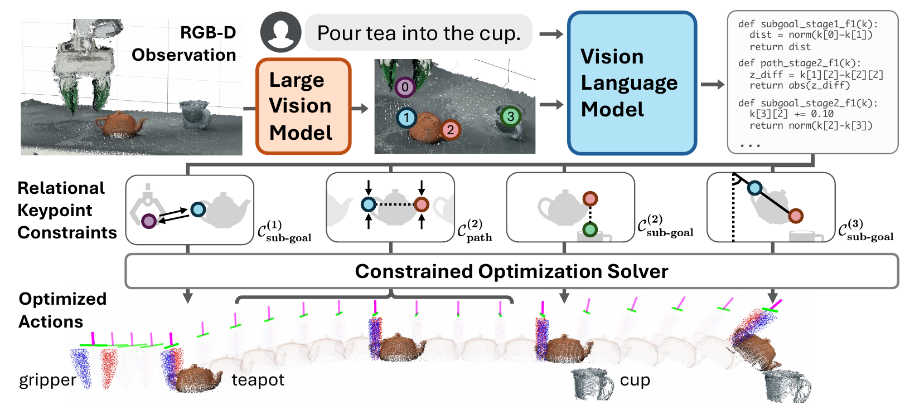
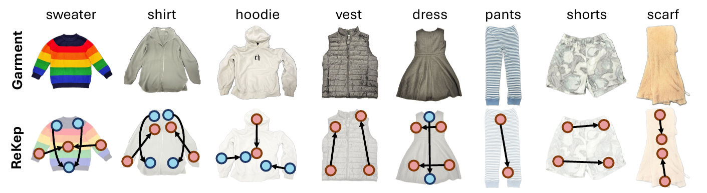

# [ReKep: Spatio-Temporal Reasoning of Relational Keypoint Constraints for Robotic Manipulation](https://arxiv.org/abs/2409.01652)

> **Brief:** ReKep turns manipulation instructions into **relationships between tracked 3-D keypoints**, expressed as Python constraint functions. A vision-language model specifies what should hold at each task stage and during its motion; numerical solvers then produce end-effector poses and repeatedly adjust them using visual feedback. The method requires no new task-specific training, but depends on perception, local motion assumptions, and robot-specific planning and control.

**Source:** Huang et al., CoRL 2024; [arXiv:2409.01652v2 PDF](https://arxiv.org/pdf/2409.01652v2), dated November 12, 2024, including Appendices A.1–A.14. Downloaded November 12, 2026. Method and experimental numbers below follow this 30-page version; the public-code boundary is identified separately.

## Convenient Links

- [Paper](https://arxiv.org/abs/2409.01652), [project and videos](https://rekep-robot.github.io/), [official code](https://github.com/huangwl18/ReKep)
- Components: [DINOv2](../../Vision_Models/DINOv2.md), [AnyGrasp](../Grasping/AnyGrasp.md)
- Related systems: [ASPIRE](./ASPIRE.md), [Zetta](./Zetta.md), [Spotter](./Spotter.md)
- Background: [Modern Robotics](../../../Books/Robotics/Modern_Robotics.md)

## 1. Why Describe Relationships Instead of Predicting One Target Pose?

Consider “pour tea into the cup.” Reaching the cup is insufficient: the robot must first grasp the teapot, transport it without premature tilting, align the spout above the opening, and then tilt while maintaining that alignment.

The task combines two requirements:

- **Spatial:** where object parts should be relative to one another.
- **Temporal:** which relationships must hold before, during, and after a motion.

A fixed target pose becomes stale if the cup moves. An object-center representation also omits details such as the spout and handle. ReKep instead describes the task through semantically useful points and relations that can be re-evaluated as their positions change.

Its division of labor is central: **vision proposes points; a vision-language model writes relations; tracking supplies current coordinates; optimization computes motion**. The language model does not repeatedly predict precise robot poses at control frequency.

## 2. What Is a Relational Keypoint Constraint?

### 2.1 A Scalar Function Tests a Spatial Relationship

A **keypoint** is a 3-D position associated with a meaningful scene location, such as a teapot handle, spout, or cup opening. Its coordinates are expressed in the robot's calibrated world frame.

For $K$ keypoints collected in an array $\mathbf{k}\in\mathbb{R}^{K\times3}$, a single **Relational Keypoint Constraint**, abbreviated ReKep, is

$$
f:\mathbb{R}^{K\times3}\rightarrow\mathbb{R},
\qquad
f(\mathbf{k})\leq0
\ \Longleftrightarrow\
\text{the specified relationship is satisfied}.
$$

The returned scalar is a cost or violation measure, not a success probability. Functions use stateless Python/NumPy arithmetic, including distances, differences, and dot products. A dummy end-effector point is also available for grasp constraints; the concrete prompt exposes it as a separate function argument.

Several points can represent richer geometry. Two define an axis; three non-collinear points on a rigid part can define a frame. Thus orientation can be constrained through point relationships without asking the language model to output a rotation matrix.

### 2.2 Endpoint Conditions and Path Conditions Serve Different Purposes

ReKep divides a task into ordered **stages**. Each stage $i$ has two constraint sets:

| Constraint set | When it must hold | Pouring example |
|---|---|---|
| **Subgoal constraints** $\mathcal{C}_{\mathrm{sub}}^{(i)}$ | At the end of the stage | The spout has reached a location above the cup |
| **Path constraints** $\mathcal{C}_{\mathrm{path}}^{(i)}$ | Throughout the stage's motion | The teapot remains upright while being transported |

A simple pouring sequence is:

| Stage | Endpoint condition | Condition during motion |
|---|---|---|
| Grasp | Reach the handle grasp pose | No additional task-specific path relation |
| Align | Put the spout above the opening | Retain the teapot and keep it upright |
| Pour | Reach the desired tilt | Keep the spout above the opening |

Collision avoidance and robot reachability are handled by additional solver costs, not by making the VLM describe every obstacle.

The distinction prevents a common error: “upright at the destination” would still allow tilting during transport. A path condition expresses that the orientation must be preserved along the route.

### 2.3 Concrete Functions Make the Representation Operational

For illustration, let $\mathbf{k}_s$ be the spout, $\mathbf{k}_c$ the cup opening, and $\mathbf{z}=[0,0,1]^\top$ the vertical direction. A tolerance-based alignment constraint is

$$
f_{\mathrm{align}}(\mathbf{k})
=
\left\|
\mathbf{k}_s-(\mathbf{k}_c+d\mathbf{z})
\right\|_2-\epsilon_p.
$$

Here $d$ is the desired height above the opening and $\epsilon_p$ the positional tolerance. The condition is satisfied when the spout is within that tolerance. Moving the cup changes the function's current inputs and therefore the desired target.

For an upright constraint, suppose distinct base and top points define a unit pot axis $\mathbf{v}=(\mathbf{k}_{\mathrm{top}}-\mathbf{k}_{\mathrm{base}})/\|\mathbf{k}_{\mathrm{top}}-\mathbf{k}_{\mathrm{base}}\|_2$.
Then

$$
f_{\mathrm{upright}}(\mathbf{k})
=
\cos\delta-\mathbf{v}^{\top}\mathbf{z}
$$

requires the axis to remain within angle $\delta$ of vertical. A different target dot product can specify a pouring angle.

These functions illustrate the mechanism rather than reproduce one task's generated code or prescribe universal tolerances. They also require the corresponding points to be available. One point alone cannot determine the pot's full orientation.

## 3. How Are the Points and Functions Obtained Automatically?

*Paper Figure 2, cropped from PDF page 4. Proposed points receive numeric labels in the image. GPT-4o writes stage-specific relations over those labels; the solver instantiates them using current 3-D coordinates. The lower panels show grasping, upright transport, alignment, and tilting.*

### 3.1 Propose Object-Part Candidates Before Asking the VLM to Reason

The proposal module identifies useful locations without requiring a separately trained keypoint detector for each object category. Appendix A.5 gives this implementation:

1. Extract dense features with **DINOv2 with registers, ViT-S/14**, then upsample them to image resolution.
2. Use **Segment Anything (SAM)** masks to keep clustering focused on individual objects rather than the background.
3. Within each mask, reduce features to three dimensions using PCA and cluster them into **five groups** with k-means.
4. Project candidate image locations into 3-D using calibrated RGB-D.
5. Reject points outside the workspace and merge nearby proposals using **8 cm Mean Shift bandwidth**.

DINOv2 features often distinguish parts such as a handle from a body; SAM supplies object regions. The proposal module does not itself certify that a point is the correct spout or grasp location. Missing a necessary part can make the later constraint specification impossible.

The system also remembers which points came from the same mask. This grouping is later used to predict how points move when their object is grasped.

### 3.2 Generate Relations Over Labels, Not Guessed Coordinates

The initial RGB image is overlaid with point indices and sent to **GPT-4o** with the instruction. The model chooses the number of stages and writes their subgoal and path functions.

The prompt separates grasping into its own stage and asks for arithmetic rather than branching `if` logic inside constraint functions. For grasping, the function associates the end effector with a scene point. For subsequent manipulation, relations concern the object points themselves.

The VLM chooses **which points and relationships matter**. Numerical coordinates are supplied when the functions are evaluated; they are not numerical pose estimates invented by the VLM.

No new task-specific demonstrations or parameter updates are used. The shared prompt does contain general rules and text-only illustrations, including pouring and folding; “no task-specific training” should not be confused with providing no prior task knowledge.

### 3.3 Keep Point Identities While Updating Their Locations

After initialization, tracking maintains the correspondence between each point index and its physical location. Otherwise, a correct function referring to “point 2” could start controlling the wrong part.

Appendix A.7 uses multi-camera DINOv2 feature matching. It records a fixed reference descriptor from observations within **2 cm** of each initial keypoint, then searches later images for similar features. It keeps up to **100 matches** above cosine similarity **0.6**, rejects outliers, and smooths positions.

The tracker runs at **20 Hz**. Thus the same generated function can follow a moving cup or a human-held blanket corner without repeatedly querying GPT-4o. Occlusion or descriptor confusion can still move a point to the wrong place; optimization cannot correct a mistaken input identity by itself.

## 4. How Do the Constraints Become Executable Motion?

### 4.1 Predict What a Candidate Gripper Motion Would Do to the Points

A solver must test hypothetical actions before executing them. ReKep uses a **local rigid-motion model**: points attached to the gripper or grasped object move with the candidate end-effector transform, while other points are temporarily treated as static.

For a candidate relative transform $(R_\Delta,\mathbf{t}_\Delta)$,

$$
\widehat{\mathbf{k}}_j=
\begin{cases}
R_\Delta\mathbf{k}_j+\mathbf{t}_\Delta,
& j\text{ belongs to the movable rigid group},\\
\mathbf{k}_j,
& \text{otherwise}.
\end{cases}
$$

The hat denotes a prediction used inside optimization. Actual positions are replaced by fresh tracker measurements on the next solve.

For the teapot, this predicts where the spout will be if the gripper rotates. The approximation is only expected to hold locally, over roughly **0.1 s**. It is not a learned model of liquid flow, cloth dynamics, slipping contact, or the complete environment.

### 4.2 Solve the Next Subgoal, Then a Path to It

Optimizing every stage and its transition timing jointly is expensive. ReKep instead repeatedly solves two smaller problems for the current stage.

Let $e\in SE(3)$ denote an end-effector pose: a 3-D position and orientation. Two-arm planning jointly optimizes a pair of poses, so the arms can satisfy shared relations while avoiding one another. The implementation represents each pose by position and Euler angles: six variables per arm. Using predicted point locations $\widehat{\mathbf{k}}(e)$, the subgoal problem is

$$
e_i^*=
\arg\min_e\lambda_{\mathrm{sub}}^{(i)}(e)
\quad\text{subject to}\quad
f(\widehat{\mathbf{k}}(e))\leq0,
\ \forall f\in\mathcal{C}_{\mathrm{sub}}^{(i)}.
$$

$\lambda_{\mathrm{sub}}$ is an auxiliary cost function. It prefers a feasible pose satisfying the desired task relations.

After choosing the endpoint, the path problem plans poses $e_{t:g_i}$ from current time $t$ to stage-end index $g_i$:

$$
\arg\min_{e_{t:g_i},\,g_i}
\lambda_{\mathrm{path}}^{(i)}(e_{t:g_i})
\quad\text{subject to}\quad
\begin{cases}
e_t=e_{\mathrm{current}},\qquad e_{g_i}=e_i^*,\\
f(\widehat{\mathbf{k}}_u)\leq0,
\quad\forall f\in\mathcal{C}_{\mathrm{path}}^{(i)},
\quad u=t,\ldots,g_i.
\end{cases}
$$

The path connects the current pose to the selected subgoal. Its auxiliary costs encourage collision avoidance, reachability, short motion, consistency with the previous solution, and separation between arms in the bimanual case.

This hierarchy connects semantic intent to geometry: the subgoal asks **where the stage should end**; the path asks **how to get there while preserving its requirements**.

### 4.3 Task Relations Need Robot-Specific Feasibility Checks

The backend adds several sources of information:

- **Scene clearance:** a depth-reconstructed Euclidean signed distance field gives obstacle distances for candidate gripper/object positions.
- **Reachability:** inverse-kinematics residuals estimate whether an arm can realize a candidate pose.
- **Grasp orientation:** a special **AnyGrasp** routine selects a 6-DoF grasp near the point named by the grasp constraint, outside repeated objective-function evaluations. A handle keypoint alone does not supply a complete grasp pose.
- **Motion regularity:** proximity and consistency costs discourage unnecessary changes between replans.

The equations express conceptual constraints. The implementation uses heavily weighted violation penalties, limited optimization time, and sampled collision checks. It should not be interpreted as exact enforcement of every continuous-time constraint.

Initial solutions use **Dual Annealing** global search followed by **SLSQP** local refinement, taking about **one second**. Subsequent solves start from previous solutions and use local optimization at approximately **10 Hz**. Paths use sparse intermediate poses, followed by interpolation for execution.

The VLM is outside this fast numerical loop. Its functions can be re-evaluated repeatedly with new coordinates at much lower cost than regenerating the task description.

### 4.4 Replan Within a Stage and Backtrack Across Stages

Only the next portion of the planned path is executed before updating observations and solving again. This is **receding-horizon control**: a plan is repeatedly revised instead of followed to completion without feedback.

When the robot reaches the current subgoal within tolerance, it advances to the next stage. During execution it also checks the **current stage's path constraints**. If one fails, Algorithm 1 steps backward until it finds an earlier stage whose path conditions hold, then replans.

For pouring, moving the cup can invalidate the alignment required during tilting, causing a return to alignment behavior. Losing the teapot can require returning to grasping. Recovery reuses the existing stage structure and constraints.

This is different from inventing a new task plan after every failure. The stage sequence stays fixed unless keypoint proposal and VLM generation are run again, which is one of the system's limits.

## 5. What Is Trained, and What Runs on the Robot?

ReKep uses pretrained **DINOv2, SAM, GPT-4o, and AnyGrasp**, together with numerical solvers and a feature-based tracker. It does not collect demonstrations or fine-tune these models for each evaluation task. Its new task-specific artifact is the generated constraint specification.

The “no environment models” claim means no pre-supplied object CAD models or task-specific learned dynamics. The actual system still reconstructs collision geometry from depth and uses the local rigid-grasp prediction model from Section 4.

The real platforms are:

| Platform | Hardware and sensing | Execution |
|---|---|---|
| Wheeled single arm | One Franka; two RGB-D cameras | The wheeled stand is manually repositioned; its base is unpowered |
| Stationary dual arm | Two Frankas; three RGB-D cameras | Jointly optimize and execute both end-effector pose sequences |

The first platform therefore demonstrates manipulation in different locations, not autonomous mobile navigation.

Both use 20 Hz pose-target execution with inverse kinematics and joint-impedance control. The documented interpolation steps are **5 mm translation and 1° rotation**. Camera acquisition and point tracking run at 20 Hz, while warm-started planning runs at approximately 10 Hz. These are different parts of the system, not a claim that GPT-4o is queried at motor-control frequency.

## 6. What Do the Experiments Establish?

### 6.1 Automatic Specifications Improve over the Baseline, but Leave a Gap

The main study uses **seven real-robot tasks, ten trials per setting**. Initial configurations are manually chosen to cover the workspace while remaining kinematically feasible. A human restores the scene and judges success using task-specific criteria.

The baseline, **VoxPoser**, uses language-generated value maps for motion. Its adaptation here uses the same GPT-4o and camera input, with prompting adjusted for the setting. This is a comparison between system implementations, not an isolated test with every backend component held identical.

Table 1 distinguishes:

- **Auto:** proposed keypoints and automatically generated ReKep specifications.
- **Annot.:** human-annotated ReKep specifications.

| Task | VoxPoser | ReKep Auto | ReKep Annot. |
|---|---:|---:|---:|
| Pour Tea | 0/10 | 3/10 | 8/10 |
| Recycle Can | 3/10 | 6/10 | 8/10 |
| Stow Book | 0/10 | 3/10 | 6/10 |
| Tape Box | 4/10 | 7/10 | 8/10 |
| Fold Garment | 0/10 | 5/10 | 6/10 |
| Pack Shoes | 0/10 | 3/10 | 5/10 |
| Collaborative Folding | 0/10 | 4/10 | 7/10 |
| Total | 10.0% | **44.3%** | **68.6%** |

The automatic system's result is **44.3%, not 68.6%**. The annotated variant shows what better specifications can enable, while its remaining failures show that correct task relations do not remove tracking and physical-execution problems.

Success definitions also matter. Pour Tea requires upright transport followed by a correctly aligned and tilted spout; no separate liquid-volume measure is reported. Tape Box starts with tape already unrolled and a human squeezing the box. These are useful manipulation tests with explicit setup conditions.

### 6.2 Disturbance Tests Measure Recovery Under Changed Object Poses

For Pour Tea, Tape Box, and Collaborative Folding, an operator applies **one preselected disturbance per trial** by moving task objects. Across 30 trials, Table 2 reports:

| System | Success under disturbances |
|---|---:|
| VoxPoser | 2/30: 6.7% |
| ReKep Auto | 8/30: **26.7%** |
| ReKep Annot. | 14/30: **46.7%** |

This supports the value of updating point relations and returning to earlier stages, but success remains far from universal. These are controlled disturbances, not arbitrary adversarial changes or evidence of unrestricted recovery.

### 6.3 Garment Strategy Quality and Conditional Execution Are Separate

*Garment panels from paper Figure 5, cropped from PDF page 8. Arrows show pairs of points to align; colors distinguish folding order. Different garments lead to different one- or two-arm strategies.*

Eight garment categories test whether the same representation can specify different folding plans. A sweater may require both sleeves to fold inward before the body folds; a narrow garment may need only one arm.

The study reports two metrics over ten trials per category:

| Metric | What is evaluated | Aggregate |
|---|---|---:|
| **Strategy success** | Human judgment that proposed points and constraints form a feasible, appropriate folding strategy | **52.5%** |
| **Execution success** | Robot execution using strategies already judged successful | **73.8%** |

The second number is **conditional on a successful strategy**, so it is not the automatic end-to-end success rate. Appendix A.4.3 also disables point tracking for this eight-category execution study because repeated folding made its tracks unstable.

Thus the result demonstrates expressive strategy generation and execution with selected strategies. It does not demonstrate 73.8% autonomous, continuously tracked folding across arbitrary clothes.

### 6.4 A Simulation Test Separates Seen Conditions from Generalization

Appendix A.12 evaluates **Pour Tea in OmniGibson** against an RVT-style Transformer imitation policy trained on **100 expert demonstrations** from privileged scripted policies. Reported rates use 100 trials:

| Method | Seen poses | Unseen poses | Unseen objects |
|---|---:|---:|---:|
| Imitation policy | **93%** | 31% | 14% |
| ReKep, no task training | 75% | **68%** | **72%** |

The learned policy is stronger in its familiar distribution, while ReKep transfers better in these new conditions. This supports the usefulness of re-evaluating geometric relations instead of relying only on demonstrated configurations.

It is one simulated task, with different learning assumptions for the two methods. The table does not establish a general ranking over robot policies or all manipulation tasks.

## 7. Where Does the System Fail, and What Does the Code Release Include?

The manual error analysis in Figure 4 identifies **point tracking as the largest contributor**, followed by substantial keypoint-proposal and VLM errors. Missing a useful point or binding a relation to the wrong point can invalidate otherwise reasonable optimization. This is failure attribution, rather than a controlled component-removal ablation.

Other limits follow directly from the method:

- **Local motion approximation:** rigid transport does not model arbitrary deformation or contact dynamics. Fast feedback reduces some prediction error but cannot eliminate it.
- **Task-space planning:** pose solutions can still be difficult to realize with joint limits and arm geometry, despite reachability costs.
- **Fixed stage order:** backtracking revisits existing stages; a genuinely different plan requires new perception/specification.
- **Restricted task coverage:** articulated-object manipulation is not studied in the main system.
- **Experimental collision handling:** collision checking is disabled for deformable-object tasks; the path solver also relaxes checks near endpoints.

The ten-stage **breakfast-tray case study** in Appendix A.14 is especially important to qualify. The automatic proposal/specification pipeline and persistent tracker were insufficient, so the demonstration uses **manually annotated points and constraints**, with keypoint detection at stage starts. It should not be counted as a fully automatic ten-stage result.

**Code boundary, checked November 12, 2026:** the [official README](https://github.com/huangwl18/ReKep) describes an OmniGibson demonstration that obtains tracking, masks, and distance-field information from simulation. It does not include the paper's complete real-world perception pipeline; deploying on hardware requires replacing those interfaces.

## 8. How Does ReKep Fit with the Other Agentic-System Notes?

[ASPIRE](./ASPIRE.md) learns reusable programming guidance through debugging and verification. ReKep generates mathematical specifications for the current task, then repeatedly solves them as observed geometry changes. It does not maintain ASPIRE-style cross-task repair learning.

[Zetta](./Zetta.md) emphasizes runtime failure critics and recovery mechanisms. In ReKep, path constraints provide explicit conditions for staying in a stage or backtracking, while optimization supplies the corrective motion.

Its distinctive contribution is the interface between semantic reasoning and continuous control: **the VLM specifies relationships, and numerical optimization determines the poses that realize them**. The experiments support this decomposition while showing that automatic grounding and reliable tracking remain major bottlenecks.
