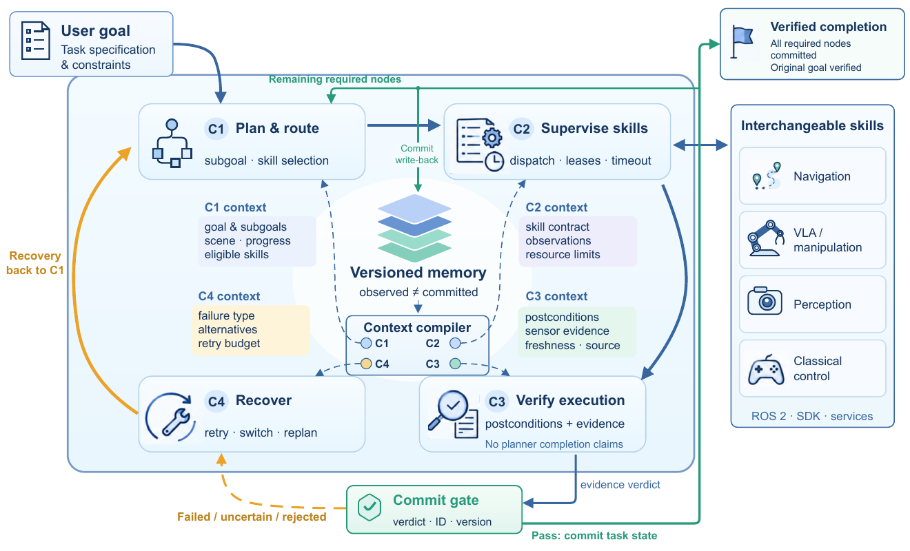
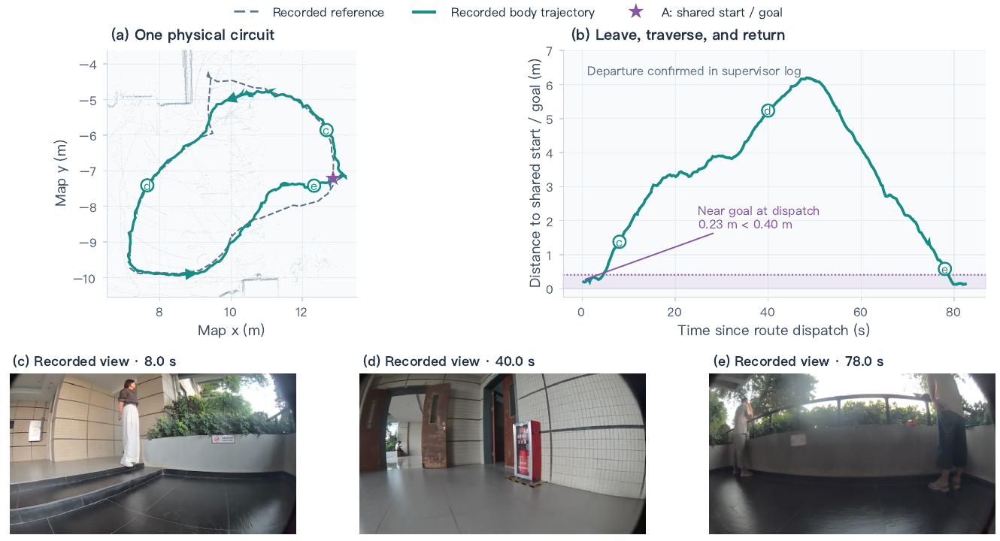

# [RegenHarness: A Robot Agent Harness with Evidence-Gated Recursive Self-Improvement](https://arxiv.org/abs/2609.27612)

> **Brief:** RegenHarness separates **a model's proposal, a skill's termination, and verified task completion**. Its runtime accepts progress only after checking evidence and its task/version identity. A second, cross-mission loop proposes changes to harness configuration, tests them against fixed acceptance checks, and releases approved versions without online model-weight updates.

**Source:** Wang et al., 2026; supplied PDF, arXiv v1 dated September 23, 2026. The paper describes runtime contracts, a reference implementation, and real quadruped deployment cases. Its recursive self-improvement evaluation is a specified protocol, not a reported sequence of measured improvement gains.

## Convenient Links

- [Paper](https://arxiv.org/abs/2609.27612)
- Related systems: [Harness VLA](./Harness_VLA.md), [RoboHarness](./RoboHarness.md), [Show-Harness](./Show_Harness.md)
- Background: [Agent Systems](../../../Agent_Systems/Agent_Basics.md), [Agent Memory](../../../Agent_Systems/Memory_Systems.md), [Tool Interfaces](../../../Agent_Systems/Tool_Registry_and_Function_Calling.md)

## 1. Why "Done" Is Not Enough

Suppose a robot is asked to inspect a storage area and return. A navigation controller reaching the storage waypoint does not prove that images were captured, inspected, delivered, or that the robot returned. Even a single skill's terminal status can mean only that a request was accepted or a controller stopped.

RegenHarness therefore treats these as distinct events:

$$
\text{controller done}\not\Rightarrow\text{node success}
\not\Rightarrow\text{goal success}.
$$

A **skill** is a bounded operation; a **provider/backend** implements it; the **harness** dispatches skills, collects evidence, and decides what counts as accepted task progress. A VLA can be one provider, but navigation, perception services, classical controllers, and task-and-motion planning (TAMP) fit the same interface.

The central problem is thus **authority over task state**, not a new robot policy architecture. A planner proposes work, a provider attempts it, a verifier checks the effect, and only a guarded state transition accepts that result.

## 2. Task Contracts and Two Kinds of Facts

### 2.1 Describe What Must Become True

The task contract is

$$
\mathcal{T}=(g,G,C_g,S,R),
$$

where $g$ is the original goal, $G$ an acyclic subgoal-dependency graph, $C_g$ the original completion conditions, $S$ the safety/resource constraints, and $R$ the recovery budgets.

A graph **node** is a stage such as reaching storage or capturing inspection images. An **invocation** is one attempt to execute that node using a particular provider. Retrying or switching provider creates a new attempt without changing the intended effect. A node becomes eligible only after its dependencies are accepted.

Each node specifies typed parameters, preconditions, target effects, required evidence, resources, timeout, and recovery limits. For navigation, a target needs a coordinate frame, position, and tolerance. For image capture, a valid frame and stable robot state may matter. These conditions are more precise than an instruction such as "finish inspection."

### 2.2 Observed Does Not Mean Committed

At logical state version $k$, the runtime distinguishes:

- **Observed facts $O_k$:** sensor measurements and other recent records with provenance and freshness, whose task meaning may remain unverified.
- **Committed facts $C_k$:** results admitted into the authoritative task record by the verification/commit path.

A pose sample belongs to $O_k$. The accepted conclusion "this navigation attempt reached this target" belongs to $C_k$. Committing means accepting checked progress, not issuing a motion command or certifying that sensors are infallible.

The version $k$ identifies runtime state, not robot time or a training iteration. Recording observations, rejected outcomes, or recovery expenditure can advance the overall version even when no new task progress is committed.

This separation enables the rest of the design: every component may see relevant evidence, but not every component may promote its interpretation into trusted progress.

## 3. Runtime Architecture and Information Flow



*Paper Figure 1. A shared versioned store supplies four role-specific contexts. Skills produce execution evidence; the verifier and commit gate control acceptance. Failed or uncertain results enter bounded recovery instead of directly advancing the task.*

### 3.1 Model Loop Versus Agent Loop

The **model loop** generates or revises a proposal from authorized context:

$$
c_k^{(r)}=\kappa_r(S_k),
\qquad
u_k^{(r)}=M_{\theta_r}(c_k^{(r)}).
$$

Here $S_k$ is runtime state, $r$ is a role, and $\kappa_r$ selects and formats that role's permitted inputs. New evidence can change $u_k^{(r)}$ while weights $\theta_r$ remain fixed. The proposal can be a subgoal, provider choice, or recovery suggestion; it is not necessarily a motor action.

The **agent loop** turns proposals into verified progress:

```text
Original goal + task graph + versioned observations/committed facts
  -> C1: propose an eligible node and provider
  -> C2: validate, acquire resources, dispatch and supervise
  -> provider executes and returns evidence
  -> C3: check the declared postconditions
  -> commit gate: check verdict, identity, version, evidence coverage
       pass -> atomically accept node/facts -> plan remaining work
       fail/uncertain -> C4: bounded recovery or escalation
  -> after all required nodes: verify the original goal
  -> only then report task completion
```

The loops do not run one-for-one. A long navigation skill may contain many controller updates and supervisor polls between planning calls. Deterministic planners and predicate verifiers can occupy these interfaces; the design does not require four neural models or access to model hidden reasoning.

### 3.2 Four Contexts, Not Four Independent Memories

| Context | Consumer | Included information | Decision |
|---|---|---|---|
| **C1** | Planner/router | Original goal, eligible graph frontier, committed progress, relevant scene state, high-level failures | What should happen next, and who should attempt it? |
| **C2** | Skill/supervisor | One subgoal, grounded targets, provider contract, bounded observations, resource limits, verified examples | How may this invocation execute? |
| **C3** | Verifier | Postconditions, before/after evidence, sources, timestamps, relevant committed facts | Did the required effect actually occur? |
| **C4** | Recovery | Typed failure, attempted actions, alternatives, exclusions, remaining budgets | Which response is justified and still allowed? |

The **context compiler is software**, not a neural compiler. It filters a common store by role, task/node scope, confidence, freshness, provenance, and item budget. Expired or superseded records are rejected; unresolved conflicts require re-observation or disambiguation.

Most importantly, C3 does not inherit the planner's conclusion as proof. A planner's "the cup is grasped" cannot replace evidence of a grasp. Role isolation limits circular self-confirmation, although verifiers can still share sensor errors or make mistakes.

### 3.3 Routing Chooses a Backend, Not a New Goal

Each provider publishes a **capability card**: identity/version, supported embodiments, parameter schema, preconditions, side effects, latency, resources, cancellation behavior, risk, failure vocabulary, and evidence requirements.

Routing first applies hard eligibility checks. A configurable score can then rank eligible providers by expected success, risk, uncertainty, latency, cost, and relevant failure history. The score is an interface for application preferences, not a learned routing policy validated by the reported navigation cases.

A VLA, navigation stack, or TAMP solver can therefore implement a suitable node. A world model may predict candidate effects to help selection, but predictions cannot certify post-execution success. Switching providers preserves the target effect and does not bypass dispatch or safety checks.

## 4. Execution, Verification, and Recovery

### 4.1 Supervision Prevents Duplicate or Conflicting Work

Before dispatch, the supervisor validates the request, records intent, reserves resources, and binds the invocation to an idempotency identity. The reference orchestrator uses task, node, and state version for dispatch identity.

- **Idempotent dispatch:** resending the same request returns its existing execution record instead of starting another physical action. An authorized retry is a new attempt, not a duplicate resend.
- **Resource lease:** a time-bounded reservation prevents conflicting exclusive use of a resource such as the mobile base. A lease is bookkeeping, not a physical emergency stop.
- **Lifecycle and deadlines:** providers expose accepted/queued/running/blocked and terminal states, progress, and evidence. Persisted handles support reattachment where the backend implements it.

These guarantees depend on backend contracts. Crash-boundary replay requires provider-side deduplication. Resource reassignment also requires confirmed stop or safe hold: the reference supervisor releases a lease when `cancel()` returns, so asynchronous cancellation requires an additional stop acknowledgment before another skill may take over.

### 4.2 Evidence Must Belong to This Attempt

A terminal invocation produces an evidence packet

$$
Z_k=(I,k_{\mathrm{ctx}},O_{\mathrm{before}},O_{\mathrm{after}},P,\widehat{\Delta}_k),
$$

where $I$ identifies the task/node/provider/execution/packet, $k_{\mathrm{ctx}}$ is the dispatch-context version, $P$ references pose or other state estimates, and $\widehat{\Delta}_k$ is the provider's proposed fact update. Evidence references retain sources, timestamps, confidence, file references/checksums, and coordinate frames where needed.

Required evidence depends on the skill: a camera task and a navigation task need different records. The packet is retained even if rejected, so failures remain auditable.

The node verifier checks postconditions, using evidence independent of the executing provider where possible. The reference predicate verifier distinguishes **satisfied, violated, and ambiguous**; identity/freshness/safety checks additionally reject stale or unsafe outcomes.

A useful summary of acceptance is:

$$
\operatorname{Admit}(Z_k)=
\operatorname{Satisfied}
\land\operatorname{IdentityMatch}
\land\operatorname{VersionMatch}
\land\operatorname{EvidenceCoverage}
\land\operatorname{FreshAndSafe}.
$$

This is a summary of the checks, not a separately trained classifier. **The verifier asks whether conditions hold; the gate asks whether that verdict may update this task version.** A correct arrival verdict from an earlier attempt cannot certify a new request with a different target.

On acceptance, node status and trusted facts change atomically. Otherwise, proposed facts are not committed. Even after all nodes are accepted, a separate verifier checks $C_g$, the original goal conditions, before the runtime emits a final success report.

### 4.3 Missing Evidence Leads to Recovery, Not Optimism

RegenHarness fails closed when evidence, a required verifier, or safety-critical state is missing. Ambiguity can trigger re-perception instead of being forced into a binary success.

Recovery routes typed failures through bounded responses, for example:

| Failure | Possible escalation |
|---|---|
| Target not found | Re-perceive, then change viewpoint |
| No progress | Replan locally, then switch provider |
| Unsafe action | Safe stop, then human handoff |

Every authorized recovery consumes both a per-action and total budget. The runtime records the failure, attempts, exclusions, evidence, and remaining allowance. Repeating the same failure without new evidence can be blocked; budget exhaustion leads to escalation or termination.

These budgets count **recovery decisions**, not low-level controller cycles. A navigation planner rejecting a collision candidate internally is not automatically a C4 recovery event.

## 5. Memory and Recursive Self-Improvement

### 5.1 An Audit Trail Before a Learning Loop

The memory design separates active working state, spatial records, verified episodes, provider-outcome history, and capability/rule knowledge. Long-term records carry provenance, confidence, validity, and verification status. Revisions append records that supersede or conflict with earlier ones instead of silently overwriting history.

**Event sourcing** means reconstructing current progress from ordered observation, commit, recovery-budget, and goal-verification records. It does not mean replaying physical actions. Exact reproduction of stochastic model decisions additionally needs their contexts, candidates, configurations, outputs, and randomness; the paper identifies complete capture as an integration requirement.

This durable history supplies the evidence for changing future harness behavior.

### 5.2 What RSI Actually Changes

Recursive self-improvement (RSI) adds a **cross-mission configuration loop**, distinct from proposal revision and task execution:

| Loop | Revises | Acceptance boundary |
|---|---|---|
| Model loop | A proposal under the current configuration | Runtime still checks and authorizes execution |
| Agent loop | Accepted progress within a mission | Evidence-bound node commit and original-goal verification |
| RSI loop | Configuration for subsequent missions | Regression tests, target improvement, release authorization |

The editable configuration includes context-selection rules, task templates, routing preferences, and bounded recovery policies. It does **not** include permission to update model weights online, weaken the commit gate, change its own acceptance predicate, or remove lower-level safety interlocks.

The revision pipeline is:

```text
Mission traces, evidence, failures, recovery expenditure
  -> candidate configuration + change manifest
  -> compare candidate and current version on fixed checks
  -> reject or authorize release
  -> deploy at a mission boundary, retaining rollback version
  -> new mission records motivate the next candidate
```

The manifest identifies the changed component, motivating traces, expected effect, and rollback version. With configuration $H_j$, candidate $\widetilde H_j$, and regression set $\mathcal{R}_j$:

$$
H_{j+1}=
\begin{cases}
\widetilde H_j,& A(\widetilde H_j,H_j,\mathcal{R}_j)=1,\\
H_j,&\text{otherwise}.
\end{cases}
$$

Here $A$ requires preserved safety/evidence contracts, no regression on designated checks, improvement on a **predeclared metric**, and release authorization. Tests include normal missions plus stale-evidence, duplicate-request, interruption, and resource-conflict cases. A held-out task set separates revision generation from evaluation.

Approved changes become available only at mission boundaries; active missions remain pinned to their original configuration. Failed releases return to the last accepted version. Recursion means that accepted configurations generate new records for another revision cycle, not that the agent can freely rewrite its own rules.

As an illustrative candidate, repeated ambiguous inspections might motivate collecting another viewpoint before switching providers. It would still need to improve the declared outcome/cost metric without weakening evidence checks. The paper does not report this example as an executed RSI experiment.

## 6. Implementation and Physical Evidence

### 6.1 What Was Built and Deployed

The reference runtime uses **Python, typed immutable contracts, and SQLite-backed stores** for tasks, evidence, executions, and memory. Adapters connect ROS 2, vendor SDKs, model services, and simulators. It is single-host; multi-robot operation needs external transactional leases and explicit clock/event-ordering agreements.

The field application builds on **HROS (Harness Robotic OS)** and uses a quadruped navigation stack with a reference route, localization, local planning, and supervised velocity control. Recorded settings include a 0.5 m/s speed cap and 0.6 m controller lookahead. The provider abstraction permits VLAs, but the reported cases do not benchmark a manipulation VLA or a newly trained policy.

There is no new robot-training dataset, action-head architecture, or gradient-training schedule. The described Qwen3-VL-Plus configuration analyzes inspection images; a separate camera case uses a Qwen-Plus plan. The paper does not establish one mandatory model backbone for every C1-C4 role.

### 6.2 Warehouse Inspection: Completion Needs Multiple Evidence Types

A spoken request to check office storage triggers a configured warehouse profile. That profile supplies return and reporting obligations in addition to the short spoken request.

| Stage | Recorded evidence |
|---|---|
| Voice input | 8.16-second, 16 kHz audio, ASR transcript, matching transcript checksum |
| Navigate to storage | Outbound route/pose trace and supervisor arrival report |
| Capture panorama | Eight $1280\times720$ images with timestamps/checksums, rotation receipts, and static-body check |
| Analyze images | Saved model report describing boxes obstructing a passage |
| Deliver findings | Acknowledged DingTalk delivery of four images and inspection text |
| Return and speak | Return-navigation receipt, static-body check, completed speech-playback record |

Mission IDs and checksums connect these artifacts into one execution. Reported mission execution takes **259.94 seconds**; the full voice turn, including input acquisition and overhead, takes **271.22 seconds**. Message acknowledgments and playback completion are system-side receipts, not proof that a person read or heard the report. The visual finding is model-reported, not an independently adjudicated semantic-accuracy score.

Table 2 gives these navigation measurements:

| Segment | Commanded reference length | Distance at supervisor arrival | Distance at last recorded pose |
|---|---:|---:|---:|
| Outbound A -> B | 17.62 m | 0.11 m | 0.09 m |
| Return B -> A | 17.62 m | 0.17 m | 0.17 m |
| Separate circuit A -> A | 18.83 m | 0.25 m | 0.15 m |

Reference length is the sum of commanded waypoint distances, not measured travel distance. Endpoint distances come from localization and different sampling times; they are not path-tracking error or external ground-truth accuracy. The configured arrival radius is 0.40 m.

### 6.3 Closed Route: A Concrete False-Completion Trap



*Paper Figure 6. The robot starts near its final endpoint, leaves, traverses the circuit, and returns. Completion requires execution history, not merely a pose inside the arrival radius.*

At dispatch, the robot is already about **0.23 m** from the goal, inside the **0.40 m** tolerance. A distance-only rule would incorrectly declare success before the circuit begins.

A schematic condition for this task is instead

$$
\operatorname{CircuitComplete}=
\operatorname{DepartureConfirmed}
\land\operatorname{RequiredRouteProgress}
\land\bigl(d_{\mathrm{goal}}\leq0.40\,\mathrm{m}\bigr).
$$

The recorded trajectory reaches 6.20 m from the shared endpoint before returning. The supervisor records departure and return, while the planner reports 99.6% reference progress. These records explain why arrival becomes meaningful only after the required history. The formula summarizes the intended condition, not an invented exact progress threshold.

This carries the paper's core logic through one example: **pose observation -> history-sensitive condition check -> identity/version-bound acceptance**, rather than "near goal -> done."

### 6.4 Demonstrated Behavior Versus Proposed Evaluation

The paper provides a linked inspection mission, a separate circuit, exploration/mapping output, and a supplementary camera task. These demonstrate integration and illustrate completion semantics.

Section 6.8 specifies controlled comparisons and ablations for evidence binding, context isolation, and recovery budgets, plus RSI comparisons holding models/providers fixed. Its proposed metrics include adjudicated success, false completion, duplicate dispatch, recovery cost, regression failures, and release overhead. **It does not report numerical results for those ablations or multi-generation RSI improvement.** The cases therefore do not quantify how much RSI improves reliability over a frozen harness.

## 7. Relation to the Other Harness Notes

| System | Main question | What changes or is controlled? |
|---|---|---|
| **Harness VLA** | When should an agent invoke a frozen contact policy? | Composition of VLA calls and analytic control, informed by task/global memory |
| **Show-Harness** | Can a VLM make fine-grained physical decisions through simple controls? | Semantic movement/gripper actions and embodiment-specific interpretation |
| **RoboHarness** | How can historical failures guide correction of a frozen VLA's execution? | Visual/language interventions, execution flow, and consolidated success/failure memory |
| **RegenHarness** | Who may accept progress, and how may future runtime rules change? | Evidence-bound task state, execution authority, and gated configuration releases |

RegenHarness is primarily a **runtime-contract design**, not a competing action-generation model. Its interfaces could surround different skill providers, but compatibility in principle is not an evaluated integration with every system above.

## 8. Takeaways and Limits

- **Core idea:** separate proposing, executing, verifying, and accepting progress. A successful tool return is evidence to inspect, not automatic proof of the user's goal.
- **RSI boundary:** improve future context/routing/recovery configuration under fixed checks; do not update active missions or allow the updater to relax its own gates.
- **Trust boundary:** committed means accepted by configured checks, not infallibly true. Sensor errors, verifier defects, and semantic misinterpretation remain possible.
- **Deployment boundary:** duplicate suppression and cancellation rely on provider support; resource leases do not replace motor safety or emergency stops.
- **Evidence boundary:** the deployment cases are concrete, but comparative false-completion reductions and recursive improvement gains remain unmeasured in the supplied paper.

**Mental model:** models propose, providers act, evidence supports acceptance, and approved configuration revisions affect only later missions.
