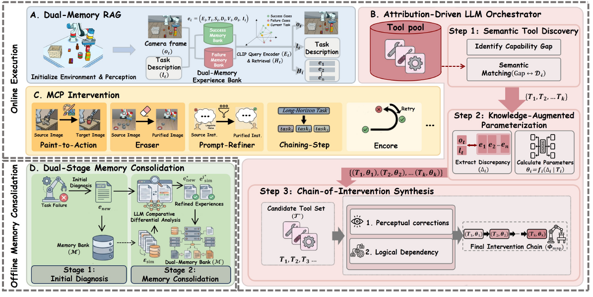
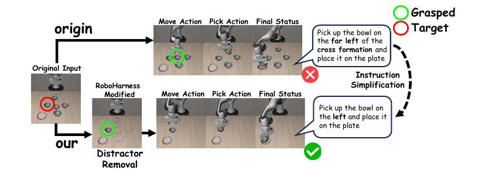

# [RoboHarness: A Memory-Augmented Policy Harness for Vision-Language-Action Model Robustness via In-Context Adaptation](https://arxiv.org/abs/2603.24060)

> **Brief:** RoboHarness improves a frozen VLA by changing its **visual inputs, instructions, and execution flow**. A vision-language orchestrator retrieves both successful and failed experiences, selects corrective tools, and lets the original VLA execute under the modified context. After execution, asynchronous memory consolidation revises the stored diagnoses and intervention strategies without updating model weights.

**Source:** Li et al., 2026; supplied PDF, arXiv v3 dated August 12, 2026. These notes follow its method, simulation experiments, and reported implementation details.

## Convenient Links

- [Paper](https://arxiv.org/abs/2603.24060)
- [Project and source code](https://github.com/LZY-1021/RoboHarness)
- Related systems: [Harness VLA](./Harness_VLA.md), [Show-Harness](./Show_Harness.md)
- VLA backbones: [pi0](../Policies/Pi_0.md), [pi0.5](../Policies/Pi_0_5.md), [SmolVLA](../Policies/SmolVLA.md)
- Background: [RAG](../../../Agent_Systems/RAG_Systems.md), [Agent Memory](../../../Agent_Systems/Memory_Systems.md), [MCP](../../../Agent_Systems/MCP_Protocol.md)

## 1. Why Adapt the Context Instead of the Policy?

A robot may already possess the motor skill needed to pick up a bowl but fail because several bowls look identical, distractors dominate the image, or the instruction differs from familiar training phrasing. Retrying the unchanged policy can repeat the same mistake.

RoboHarness asks whether the failure can be corrected **outside the VLA**:

1. Recall similar successes and failures to identify what might be wrong.
2. Modify the observation, wording, or execution schedule to address that problem.
3. Reuse the frozen policy's existing control capability.
4. Store the outcome and revise earlier explanations when new evidence contradicts them.

This motivates the two central design choices. **Dual memory** provides both strategies to reuse and mistakes to avoid; **tool-based intervention** turns the resulting diagnosis into an actual change to policy execution. Retrieval alone would not remove a distractor or recover a dropped object.

The paper calls this attribution-driven or causal reasoning. Operationally, it is a VLM comparing historical cases and proposing explanations, not a formal causal-identification procedure with guaranteed correct diagnoses.

## 2. Architecture and Online Data Flow



*Paper Figure 3. The online path retrieves success/failure memories and constructs a parameterized intervention chain. The offline path records the latest outcome and revises related memories. The VLA remains the low-level policy being adapted through this external system.*

### 2.1 What Each Component Receives and Produces

| Component | Input | Output |
|---|---|---|
| Dual-Memory RAG | Initial image observation and instruction | Similar successful and failed experiences |
| Vision-language orchestrator | Current context, retrieved cases, tool descriptions | Failure hypothesis, selected tools, parameters, and execution order |
| MCP intervention layer | Parameterized tool chain | Modified images/instructions and execution-control rules |
| Frozen VLA | Its normal policy inputs, with the selected modifications | Robot actions/action chunks |
| Offline consolidation | New execution trace and related memories | New experience plus revised historical diagnoses and plans |

```text
Initial observation + task instruction
  -> CLIP-based retrieval from success and failure memory
  -> Qwen3-VL-32B diagnoses a discrepancy
  -> select tools, set parameters, order interventions
  -> apply visual/language corrections and execution rules
  -> frozen VLA generates robot actions
  -> collect execution trace and outcome
  -> asynchronous diagnosis + cross-experience consolidation
  -> updated memory for future tasks
```

A compact way to express the policy-side interface is

$$
(o'_t,\ell'_t,\kappa)=\operatorname{Apply}(\Phi_{\mathrm{MCP}},o_t,\ell),
\qquad
A_t=\pi_\vartheta(o'_t,\ell'_t,q_t).
$$

Here $\Phi_{\mathrm{MCP}}$ is the selected intervention chain, $o'_t$ and $\ell'_t$ are the modified observation and instruction, $q_t$ represents any robot state required by the backbone, and $\kappa$ denotes subtask/retry control rules. This is a schematic summary: $\kappa$ governs execution around the VLA rather than becoming an assumed extra neural input. The policy weights $\vartheta$ stay fixed.

**The memories primarily condition the orchestrator.** The paper does not require a new VLA memory encoder, shared Transformer attention with the orchestrator, or direct concatenation of whole retrieved trajectories into the VLA's context.

### 2.2 Separate Task-Level Reasoning from Low-Level Control

The reported schedule performs observation, retrieval, diagnosis, and orchestration at **task level before rollout**. The selected execution plan then operates at chunk/control-flow level; the methodology diagram labels execution as occurring every $N$ steps without specifying one universal value of $N$.

Thus, the 32B orchestrator is not queried for every motor action. Tool rules can govern subtask boundaries and retries during rollout, while expensive diagnosis is kept outside the ordinary policy loop. In multi-task settings, the paper proposes overlapping the next task's orchestration with the current task's execution.

## 3. Dual Memory: Remember What Worked and What Failed

### 3.1 What an Experience Contains

The bank has two partitions:

$$
\mathcal{M}=\mathcal{M}_{\mathrm{succ}}\cup\mathcal{M}_{\mathrm{fail}}.
$$

Each experience has the semi-structured form

$$
e_i=(E_i,T_i,S_i,D_i,V_i,O_i,\mathcal{I}_i).
$$

| Field | Meaning |
|---|---|
| $E_i$ | Multimodal embedding of the task instance |
| $T_i$ | Natural-language task description |
| $S_i$ | Binary success indicator |
| $D_i$ | Diagnostic annotation, including a failure explanation when unsuccessful |
| $V_i$ | Execution-video keyframe representations |
| $O_i$ | Scene description as object-attribute pairs |
| $\mathcal{I}_i$ | Extensible metadata, such as keyframe ranges, successful execution length, and rollback settings |

This stores more than a successful motion demonstration. It also records **the conditions, intervention, and outcome**, so a later task can reuse a useful correction or avoid a previously ineffective one.

### 3.2 How Retrieval Becomes Contrastive Guidance

A pretrained CLIP-based representation embeds the current observation/instruction pair. The paper summarizes retrieval as

$$
\mathcal{H}_t=\operatorname{TopK}_{e_i\in\mathcal{M}}
\operatorname{Sim}\!\left(E(o_t,\ell),E_i\right).
$$

The intended retrieved context contains positive success exemplars and negative failure precedents. For example, a success might show that isolating a target bowl helped, while a failure warns that changing only its color did not resolve clutter-related confusion.

**Contrastive retrieval here means reasoning across successes and failures**, not training with a contrastive loss. CLIP is already pretrained, and no new retrieval-loss optimization is introduced. The paper does not specify a numerical top-$k$, an exact image/text embedding-fusion recipe, or a quota for each memory partition, so these should not be inferred from the notation.

## 4. From Diagnosis to a Tool Chain

### 4.1 Select, Parameterize, Then Order

The orchestrator is **Qwen3-VL-32B**. It compares the current observation and instruction with retrieved cases, then follows three steps:

1. **Select tools:** match the suspected problem to natural-language tool descriptions.
2. **Set parameters:** identify the relevant image regions, desired appearance, rewritten instruction, or execution/retry bounds.
3. **Order the calls:** correct perception before physical retry and satisfy dependencies between interventions.

Its output is an ordered chain

$$
\Phi_{\mathrm{MCP}}=(T_1,\theta_1)\rightarrow\cdots\rightarrow(T_m,\theta_m).
$$

The $\theta_i$ are **tool arguments**, not learned model weights. For example, `Paint-to-Action -> Encore` means changing misleading visual input before retrying a failed segment, rather than replaying the same failure under the same perception.

Model Context Protocol (MCP) provides the modular tool interface; it is not a new robot policy. The paper instantiates five tools and allows additional tools to be integrated through their descriptions and interfaces.

### 4.2 The Five Interventions

| Tool | Failure addressed | What actually changes |
|---|---|---|
| **Paint-to-Action** | Appearance/domain shift or ambiguous target identity | SAM3 segments the target; visual overlays or replacement textures modify its appearance in the policy image |
| **Eraser** | Distractor-induced confusion | SAM3 masks irrelevant objects; OpenCV Telea inpainting removes their image regions before policy inference |
| **Prompt-Refiner** | Noisy wording or unfamiliar instruction structure | Rewrites the task into concise wording aligned with successful cases |
| **Chaining-Step** | Compounding errors across a long task | Splits the instruction into aligned subtasks with execution and buffer durations |
| **Encore** | Stagnation, slips, or failed key segments | Resets execution counters, performs rollback, and retries selected key steps |

Paint-to-Action uses parameters such as color/texture, material, and target mask. Eraser uses distractor descriptions and masks. Prompt-Refiner supplies the refined instruction. Chaining-Step assigns execution steps $N_e$ and buffer steps $N_b$ to each segment. Encore uses a retry interval $[s_s,s_e]$ and wait duration $N_w$, where $s_s,s_e$ are step indices, not robot states.



*Paper Figure 5. The example combines distractor erasure with simpler target wording. Erasure changes the observation presented to the VLA; it does not physically remove the surrounding objects.*

This distinction matters: visually hiding a distractor does not make it disappear as a collision obstacle. Likewise, visual overlays and rewritten color descriptions must remain consistent with the intended physical target, rather than silently changing the user's goal.

### 4.3 Temporal Tools Do More Than Rewrite a Prompt

**Chaining-Step** assigns short instructions and execution windows to a longer sequence. Figure 1's sorting task becomes milk-to-basket, pudding-to-plate, and cream-cheese-to-basket, with control-flow reset/buffer intervals between subtasks. The same VLA handles each segment; the harness manages which instruction is active and when execution moves on.

**Encore** is a recovery procedure rather than an unconstrained "try again" prompt. The paper describes rollback using an averaged reverse trajectory, counter resets, and re-execution from a selected keyframe if horizon-limit success validation fails. It does not establish that reversing robot motion exactly restores displaced objects or reverses contact dynamics.

The figures' "Reset & Buffer" and "Reset & Retry" labels should therefore not be read as a general guarantee of simulator-state restoration or safe physical undo. The detailed reset semantics and retry budget need to be checked in an implementation before transferring the method to hardware.

### 4.4 Carrying One Example Through the Pipeline

Consider an illustrative task: "pick up the left bowl and place it on the plate," with several visually similar distractors.

1. Embed the current scene and instruction; retrieve nearby successful and failed cases.
2. Compare them: successful clutter-removal cases support an interference hypothesis, while failed highlighting-only cases warn that repainting may be insufficient.
3. Select Eraser and, if necessary, Prompt-Refiner. Segment only irrelevant bowls, preserve the target and destination, and simplify wording without changing the target relation.
4. Feed the modified image and instruction to the frozen VLA. It still generates the reaching, grasping, and placement actions.
5. If a contact segment fails, a configured Encore intervention can retry the relevant steps; it cannot compensate for every missing motor capability.
6. Store the outcome and compare it with related histories. New evidence may revise an earlier explanation from "appearance mismatch" to "distractor interference."

The adaptation is therefore **retrieve -> diagnose -> change execution context -> observe -> revise memory**, not just nearest-neighbor imitation.

## 5. Offline Consolidation and What Stays Frozen

### 5.1 Two Stages, Two Different Jobs

After task termination, the asynchronous workflow first turns the raw execution trace $\mathcal{T}_{\mathrm{raw}}$ into a new experience:

$$
e_{\mathrm{new}}=\operatorname{InitDiag}(o,\mathcal{T}_{\mathrm{raw}}),
\qquad
\mathcal{M}\leftarrow\mathcal{M}\cup\{e_{\mathrm{new}}\}.
$$

It then retrieves related experiences $\mathcal{E}_{\mathrm{sim}}$ and jointly refines their descriptions and correction plans:

$$
(e_{\mathrm{new}}^*,\mathcal{E}_{\mathrm{sim}}^*)
=\operatorname{MemConsol}(e_{\mathrm{new}},\mathcal{E}_{\mathrm{sim}}).
$$

**Initial Diagnosis records the latest case; consolidation can correct old cases.** This prevents the bank from merely accumulating possibly mistaken explanations. "Offline" means outside the active rollout, not a separate gradient-training phase.

### 5.2 Initialization Is Experience Collection, Not Fine-Tuning

The bank is cold-started by a preliminary inference pass on standard **LIBERO-Object and LIBERO-Spatial** tasks. The authors state that this initialization does not expose the bank to the evaluation-time OOD perturbations.

The VLA backbones are **pi0, pi0.5, and SmolVLA**. RoboHarness adds no parameter fine-tuning: changes occur in external memory, tool arguments, image/instruction preprocessing, and control flow. This does not mean the underlying VLA, CLIP, SAM3, or Qwen model was never pretrained.

There is no new policy-training loss, optimizer, epoch schedule, or end-to-end learning pipeline to reproduce from this paper. The relevant preparation is the pretrained components plus initial execution traces. Exact checkpoint preparation and some retrieval/consolidation settings are not fully specified in the supplied eight-page PDF.

One evaluation boundary remains important: the framework is designed to update memory after tasks, but the paper does not fully specify whether memory is cleared or carried forward between every reported rollout and task ordering. The results should not be interpreted as memory-free first-attempt generalization.

## 6. Evaluation and Mechanism Evidence

### 6.1 What Is Tested?

The paper reports **25 tasks** and **199 randomized rollouts per task**, primarily in LIBERO simulation. It uses:

- **LIBERO-PRO:** selected Spatial/Object tasks under position swaps and task-level semantic changes. Table III reports six position-shift tasks and fourteen task-shift tasks, not every suite/cell used in other papers.
- **LIBERO-RoboHarness:** five challenge families created by modifying LIBERO assets and instructions: Visual Focus, Clutter Removal, Noisy Prompt, Execution Fragility, and Task Chaining.

The first three target recognition and language failures. Execution Fragility probes unstable maneuvers, while Task Chaining measures completion through a multi-subtask sequence. These tests match the intended intervention types; they are not a broad real-world hardware benchmark.

### 6.2 Main Results

Selected Figure 8 success rates are shown as **baseline -> with RoboHarness**:

| Challenge | pi0.5 | SmolVLA | pi0 |
|---|---:|---:|---:|
| Visual Focus | 1.7% -> 76.9% | 0.0% -> 92.0% | 0.0% -> 83.9% |
| Clutter Removal | 31.8% -> 74.4% | 10.6% -> 55.8% | 65.2% -> 83.1% |
| Noisy Prompt | 17.1% -> 93.9% | 0.0% -> 98.3% | 0.0% -> 74.9% |
| Execution Fragility | 94.5% -> 94.8% | 88.5% -> 90.9% | 84.7% -> 87.5% |

The largest improvements occur when the task is within the policy's motor capability but its input/context is misleading. Execution Fragility gains are much smaller because the baselines already succeed frequently. For Task Chaining, the final-subtask success rates with RoboHarness are **96.0%, 91.5%, and 89.9%** for pi0.5, SmolVLA, and pi0 respectively; these should not be confused with earlier-subtask completion rates.

Table III reports the following for pi0.5 on the selected LIBERO-PRO tasks:

| Perturbation | Baseline | RoboHarness | Absolute gain |
|---|---:|---:|---:|
| Position-level shifts | 2.33% | 57.2% | 54.87 percentage points |
| Task-level shifts | 0.86% | 55.2% | 54.34 percentage points |

These are improvements over this paper's own frozen-policy baselines. They should not be directly ranked against Harness VLA's or Show-Harness's numbers, which use different checkpoints, task selections, and evaluation regimes.

### 6.3 Does Dual Memory Help Beyond Adding Tools?

The memory-partition ablation measures **reasoning/intervention turns needed to reach a successful intervention plan**, not robot timesteps:

| Memory setting | Mean turns reported |
|---|---:|
| No Memory | 7.40, with frequent timeout |
| Success Only | 1.47 |
| Success + Failure | 1.07 |

Successes suggest useful actions; failures rule out tempting but ineffective ones. This explains why the combination can reduce plan search and variance. The paper also evaluates a Failure Only setting in Figure 9, but its exact mean is not stated in the prose.

The consolidation ablation uses a **Clutter Removal variant** with pi0.5:

| Configuration | Success rate | Interpretation |
|---|---:|---|
| No RAG | 19.2% | Orchestrator and tools without retrieved guidance can choose unhelpful interventions |
| Limited RAG | 48.8% | Single-stage attribution helps but can retain unnecessary corrections |
| Rich RAG | 60.1% | Dual-stage refinement produces a more targeted intervention chain |

For example, Table IV contrasts redundant repainting/background changes with a consolidated plan that removes the distracting bowls while preserving the target and plate. This supports **memory quality**, not merely memory size. Because it is a variant, the 60.1% result is not the same experimental cell as the main Clutter Removal result of 74.4%.

The paper also uses Qwen3-VL-32B to judge reasoning quality. Those scores are model-based qualitative evidence, not independent proof that the inferred failure causes are correct.

### 6.4 Runtime: Amortized Cost Is Not Call Latency

Table II amortizes overhead over a **1,000-step LIBERO task**, with baseline rollout measured on an RTX 4090:

| Component | Mean amortized ms per rollout step |
|---|---:|
| Baseline rollout | 15.31 |
| RAG retrieval | 0.005 |
| VLM orchestration | 7.20 |
| SAM3 + overlay | 0.16 |
| SAM3 + removal | 0.16 |

For example, $7.20\text{ ms}\times1{,}000=7.20\text{ s}$ of orchestration cost is distributed across the reference rollout. It does **not** mean a Qwen orchestration call takes 7.2 ms. Pre-rollout reasoning avoids querying the VLM at control frequency, but it still has a startup cost; pipelining can hide some latency only when subsequent tasks are available.

## 7. Relation to the Other Harness Notes

| System | Main intervention point | Low-level action generator | Memory emphasis |
|---|---|---|---|
| **RoboHarness** | Visual/language input correction and execution-flow tools | Original frozen VLA | Contrast successful/failed cases; revise diagnoses through consolidation |
| **Harness VLA** | Choose between analytic control and a bounded contact-rich VLA primitive | Analytic controllers plus frozen VLA | Re-ground task procedures and reuse global operating rules |
| **Show-Harness** | Select incremental semantic movement/gripper units | Deterministic interpreter and conventional controller | Recent-action context; optional fine-tuning from semantic demonstrations |

RoboHarness therefore keeps the VLA as the main manipulation policy and changes the conditions under which it runs. It is neither a replacement semantic-action controller nor primarily a library of analytic transport and VLA contact primitives.

## 8. Takeaways and Limits

- **Main contribution:** a retrieval-guided intervention loop whose external memory improves through comparison and revision, while the robot policy stays frozen.
- **Where it helps:** failures caused by ambiguous perception, unfamiliar instructions, poorly managed horizons, or recoverable execution segments, provided the required motor skill already exists.
- **Where caution is needed:** image erasure can hide physical obstacles; incorrect rewrites can change intent; rollback is not guaranteed to reverse contacts; mistaken diagnoses can enter and propagate through memory.
- **Evidence boundary:** results are primarily simulation-based and the supplied paper leaves some retrieval, reset, and cross-rollout memory-update details unspecified. Hardware safety and broader contact-skill generalization are not established by these scores.

**Mental model:** use successes to suggest a correction, failures to constrain it, tools to change the VLA's execution context, and consolidation to improve the next diagnosis.
