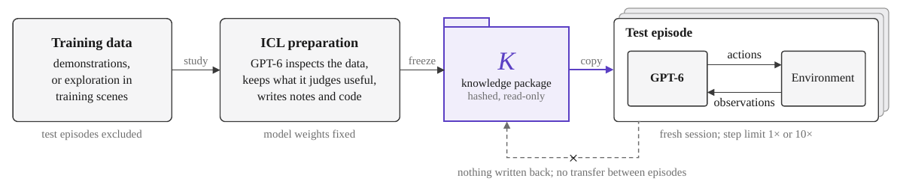
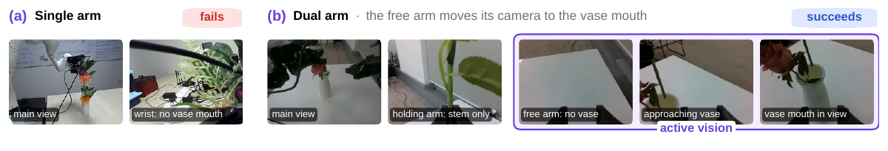

# [SenseNova-RoboRSI: Has GPT-6-Astra Achieved Embodied Intelligence?](https://arxiv.org/abs/2610.22471)

> **Brief:** This report studies GPT-6-Astra as a frozen embodied agent across 12 simulation benchmarks and eight real-robot configurations. Its main contribution is an evaluation of **demonstration-derived in-context knowledge, extended execution budgets, and control-harness design**. Strong benchmark completion does not yet translate into efficient, reliable deployment: physical verification, irreversible failures, and preservation of earlier progress remain bottlenecks.

**Source:** Joint Research Team, 2026; supplied PDF, arXiv:2610.22471v2 dated October 19, 2026. Method, numbers, and qualifications below follow this version, including Appendices C–E. This is a system/evaluation report, not the introduction of a newly trained robot foundation model.

## Convenient Links

- [Paper](https://arxiv.org/abs/2610.22471)
- [Project](https://www.sensenova.ai/has-gpt-6-astra-achieved-embodied-intelligence)
- [Open-source framework: SenseNova-RoboRSI](https://github.com/OpenSenseNova/SenseNova-RoboRSI)
- Related systems: [Harness VLA](./Harness_VLA.md), [Show-Harness](./Show_Harness.md), [RoboHarness](./RoboHarness.md), [EmbodiedRSI](./EmbodiedRSI.md)
- Background: [pi0.5](../Policies/Pi_0_5.md), [LIBERO](../Datasets/LIBERO.md), [Agent Memory](../../../Agent_Systems/Memory_Systems.md), [Tool Interfaces](../../../Agent_Systems/Tool_Registry_and_Function_Calling.md)

## 1. What Does a High Embodied Benchmark Score Establish?

A general multimodal model can understand a request such as “fold the glasses,” yet still need numerical motion references, a usable robot interface, and repeated visual correction to carry it out. Measuring only final success hides how much those resources contribute.

The report therefore proceeds through four connected questions:

1. **What can a frozen agent achieve with benchmark training demonstrations?** Distill them into reusable files and code, then test without weight updates.
2. **What does additional interaction buy?** Continue unfinished episodes to determine whether the agent can recover, rather than merely execute an initial plan.
3. **Which harness makes interaction productive?** Vary action representations, action chunking, feedback, memory compression, and collaboration with a learned VLA.
4. **Do those advantages survive deployment?** Remove demonstration packages, count real elapsed time, and examine physical robots and a continuously evolving household prototype.

The resulting distinction is between **embodied competence under supplied resources** and **practical embodied intelligence under deployment constraints**. The authors argue that the former has advanced substantially; the experiments do not establish the latter as solved.

## 2. From Demonstrations to a Frozen Agent

### 2.1 Preparation Changes External Knowledge, Not Weights



*Paper Figure 2. Preparation produces a hashed, read-only knowledge package. Each test episode receives its own copy and a fresh session; neither model weights nor the package learn from test outcomes.*

For each task, GPT-6-Astra studies the permitted training demonstrations or training-scene exploration and constructs a knowledge package $K$. Schematically,

$$
K=\operatorname{Prepare}_{\theta}(\mathcal{D}_{\mathrm{train}}),
\qquad
A_k=F_{\theta}(\ell,o_k,h_k;K).
$$

Here $\theta$ denotes the fixed model parameters, $\ell$ the instruction, $o_k$ the permitted observation at decision $k$, $h_k$ the current episode's interaction history, and $A_k$ the proposed action or action sequence. `Prepare` and $F$ summarize agent/tool workflows, not additional learned neural modules.

The same frozen $K$ is available to every test episode of that task. Held-out test episodes and evaluator-private information are excluded from preparation. During evaluation:

- The agent can retrieve references, execute helpers, and revise decisions using the current episode's feedback.
- History accumulates **within** the episode, but test experiences do not transfer **between** episodes.
- Neither $K$ nor $\theta$ is updated from test outcomes.

This is **demonstration-informed inference-time adaptation**. Calling it ICL does not mean that it consists only of a few examples pasted into a prompt; substantial numerical data and executable controllers can live in external files.

### 2.2 What Knowledge Must Be Retained to Generate Actions?

The paper observes six recurring package components, chosen by the agent rather than imposed as a mandatory template:

| Component | Retained information | Role during execution |
|---|---|---|
| Task guidance | Goals, stages, object roles, ordering constraints | Select the next operation |
| Motion references | Trajectories, grasps, phase anchors | Supply numerical candidates for manipulation |
| Visual references | Demonstration frames and contact-region crops | Ground objects and compare intermediate states |
| Executable helpers | Forward/inverse kinematics, retrieval, action-generation code | Convert references and current geometry into actions |
| Checks and recovery | Completion evidence, failure symptoms, corrective procedures | Decide whether to continue, adjust, or retry |
| Metadata and provenance | Robot specifications, conventions, sources, validation notes | Interpret stored states/actions correctly |

These components connect semantic reasoning to motor execution. A textual instruction can choose a grasp phase, a helper can retrieve its numerical configuration, and visual evidence can test whether that configuration worked in the current scene.

Packages differ by benchmark. Bench2Dex and DexJoCo emphasize dexterous hand configurations and motion phases; SIMPLE retains numerical training trajectories and chunk-modification helpers; navigation packages retain landmarks, stopping guidance, and recovery strategies. LIBERO-PRO mainly uses textual strategies and recovery knowledge from separate exploration rather than reusable evaluation action sequences.

The package is therefore more than a script to replay. For example, in Bench2Dex Ball Box Loading, the agent remaps reference joints and compensates for a **4–5 cm workspace-height difference** while preserving the demonstrated bimanual support geometry. However, the package-usage analysis does not causally isolate the contribution of each stored component.

### 2.3 The Runtime Loop and Its Controllers

```text
Task + frozen package + current episode history
                        |
          Inspect allowed images and robot state
                        |
       Retrieve references / run numerical helpers
                        |
         Choose action representation and horizon
                        |
      Harness translates commands for the embodiment
                        |
       Local controller executes robot action steps
                        |
        Fresh observations -> verify -> revise/recover
```

“Direct control” means the agent chooses physical targets through tools; it does not mean that a language model emits motor torques or replaces inverse kinematics and servo control. The paper distinguishes:

| Level | Responsibility | Example |
|---|---|---|
| **System 2** | Reason over observations, propose/revise actions, check outcomes | GPT-6-Astra |
| **System 1**, when enabled | Supply learned visuomotor action proposals | RoboDojo-fine-tuned pi0.5 |
| **System 0** | Track targets and maintain local motor/whole-body control | IK, whole-body control, vendor locomotion controller |

The large benchmark study primarily examines the agent's own control, while Section 3 separately tests collaboration with System 1. System 0 remains necessary in both cases.

Observation and control interfaces are **benchmark-specific**. RoboDojo exposes head/wrist RGB and robot proprioception, with bounded Cartesian end-effector targets and IK at 25 Hz. Bench2Dex uses absolute active-joint targets at 20 Hz; DexJoCo uses end-effector poses plus 16 hand-joint targets per arm at 30 Hz. SIMPLE executes model-selected physical chunks at 50 Hz through official whole-body controllers.

Permitted information is also not identical everywhere: RoboDojo excludes depth, object poses, contacts, and evaluator diagnostics, whereas BEHAVIOR uses RGB-D and the LIBERO-Long adapter supplies released ordered-skill and instance-pose feedback. “Unified protocol” refers to preparation and evaluation rules, not one identical sensor/API configuration.

## 3. Why More Action Steps Can Help—and What They Do Not Measure

Let $B$ denote a benchmark's standard action-step budget. The extended setting allows up to $10B$ steps. An unfinished episode continues with its environmental consequences and history; it is not repeatedly reset until a favorable trial succeeds.

Additional steps help only if feedback enables a useful correction. In DexJoCo Fold Glasses, for example, the agent changes to a side approach, checks the grasp with a test lift, and completes the task after exceeding the standard budget. The numerical reference supplies a starting strategy; observation-driven revision makes the extra budget productive.

An action step, a model decision, and elapsed time are different quantities. A single decision can emit multiple actions, and each action may run for multiple control steps. In the simulation study, inference generally occurs while the simulator is paused, so:

$$
\text{action-step budget}\ne\text{model-call budget}\ne\text{wall-clock budget}.
$$

Consequently, 10× steps do not mean 10× tokens or 10× elapsed time. Episodes can stop early on success or terminal failure, and some extra interaction cannot recover a spill or an unreachable dropped object.

**Reporting detail:** Table 2 distinguishes separately run 1× evaluations, in which the budget is included in the agent's context, from the 1× cutoff of runs evaluated up to 10×. These values sometimes differ. Appendix continuations also vary: Bench2Dex reconstructs archived timeout states through checked action replay; DexJoCo resumes the live simulator in a fresh session carrying the episode history. They preserve episode state/history rather than introducing independent reset attempts.

## 4. What the Twelve-Benchmark Study Shows

### 4.1 Results Require Their Information and Budget Conditions

The following reproduces **Table 2 success rates (%)**, keeping its two kinds of 1× result separate. Most rows use ICL; RoboLab has no training set and is zero-shot. Published comparison methods in the paper use standard budgets, so an extended-budget result is not a matched-resource ranking.

| Benchmark | Separate 1× run | 1× cutoff of extended run | Up to 10× |
|---|---:|---:|---:|
| LIBERO-Long++ | 97.5 | 97.5 | 100.0 |
| LIBERO-PRO | 98.3 | 98.3 | 99.3 |
| LIBERO-Ultra-Long | 82.2 | 82.2 | 98.9 |
| RoboDojo | 54.2† | 27.6 | 81.9 |
| RoboLab, zero-shot | 57.1 | 57.1 | 69.2 |
| SIMPLE | 96.3 | 97.5 | 98.8 |
| BEHAVIOR | 37.0 | — | — |
| DexJoCo | 78.2 | 78.2 | 87.3 |
| Bench2Dex | 25.6 | 25.6 | 61.5 |
| VLN-CE RxR | 82.0 | 84.0 | 90.0 |
| VLN-CE R2R | 80.0 | 85.0 | 88.0 |
| LHPR-VLN | 21.1 | 25.4 | 28.9 |

† **RoboDojo's 54.2% includes a VLA.** Its direct-control ICL study in Appendix C.3 reports 27.62% at 1× and 81.90% at 10×. Thus the 54.2% and 81.9% cells are not a single unchanged controller's budget curve. BEHAVIOR is evaluated only at 1× because its standard horizon is already large.

The largest useful budget gains occur in tasks requiring repeated physical correction: direct-control RoboDojo rises by **54.28 percentage points**, and Bench2Dex by **35.9 points**. By contrast, LHPR-VLN remains below 30% despite extended execution, indicating that more interaction alone does not resolve long-horizon progress tracking.

### 4.2 Coverage and Comparability Limits

The headline values summarize different evaluation cohorts:

- **LIBERO:** PRO covers 800 episodes; Long++ and Ultra-Long cover 120 and 90 episodes respectively. PRO's reported 1× boundary is the first of 10,000 environment steps or 100 planner turns, with its continuation using a cumulative step budget.
- **RoboDojo:** 42 tasks, five layouts each, totaling 210 direct-control ICL episodes. The eight Open tasks have no task-specific demonstrations and share knowledge prepared from the other 34 tasks. Open achieves 15.0% at 1× and 67.5% at 10×, the lowest extended-budget group success.
- **Dexterous control:** Bench2Dex uses 78 episodes across 26 tasks and 12 arm–hand embodiments; DexJoCo uses 55 episodes across 11 tasks. Published policy baselines use larger, separately evaluated cohorts.
- **Navigation:** R2R and RxR each use 100 val-unseen episodes. LHPR-VLN uses a manually filtered 114-episode subset whose target objects are visible along reference routes, rather than the full 205-episode unseen split. Appendix C.8 retains prior successes and better per-episode metric values in extended navigation reporting.
- **SIMPLE:** the 96.3%/98.8% ICL comparison in Table 11 uses **Matched-8**, eight complete task–level cells with 80 episodes. It does not estimate all six tasks; outcome-selected PickBetweenTables results are excluded. Table 2's separate continuation-cutoff column should not replace this matched comparison.
- **BEHAVIOR:** one rollout on public-test episode 0 for each of 100 challenge tasks, producing 37 successes; this is not evaluation across all 1,000 BEHAVIOR-1K activities.

The report compares against published results rather than matching model compute, sensors, latency, and test counts across all methods. Figure 4's unlimited-budget “upper bound” additionally assumes that all nonterminal timeouts could eventually succeed; it is a hypothetical bound, not an observed result.

### 4.3 Does ICL Improve More Than Final Success?

SIMPLE provides a clearer zero-shot/ICL comparison on **Common-4**, a separate 120-episode set covering four tasks (Table 12):

| Quantity | Zero-shot | ICL |
|---|---:|---:|
| Success at 1×, all 120 episodes | 70.8% | 90.8% |
| Mean action steps, 81 episodes solved in both settings | 376.9 | 210.4 |
| Mean test tokens on those matched successes | 2.64M | 6.40M |
| Mean test wall time on those matched successes | 47.0 min | 31.4 min |

ICL reduces physical action steps by **44.2%** on the matched successes, but uses more tokens. Preparation adds **8.34M tokens and 90.4 minutes per task**, paid once. The 90.8% result is only one success above the published Psi-0 result of 108/120 (90.0%), so it does not establish statistical superiority.

This explains both the power and the limitation of the package: it can replace physical trial and error with retrieval and computation, but preparation, context processing, and task-specific coverage remain costs.

## 5. Which Harness Makes Reasoning Useful for Control?

### 5.1 Review Learned Actions Before Executing Them

The RoboDojo ablation uses a RoboDojo-fine-tuned **pi0.5 as System 1** and GPT-6-Astra as System 2. It tests three collaboration patterns:

1. **Standalone VLA:** execute the learned policy directly.
2. **Open-loop delegation:** GPT specifies subgoals, and the VLA executes joint-action sequences without GPT reviewing the proposed motions.
3. **Closed-loop review:** convert VLA proposals through forward kinematics into candidate end-effector motions; GPT accepts, modifies, or rejects them **before execution**.

The third interface exposes proposed physical effects in a space the reasoner can inspect. Its feedback loop is stronger than checking only whether a long delegated subtask eventually succeeded.

Selected Figure 7/Table 13 results follow. Success is the **unweighted mean across five RoboDojo categories**, not the task-weighted aggregate in Table 5. Most ablations use three seeds per task; ICL-only uses the main study's evaluation.

| Configuration | Success | Tokens per episode |
|---|---:|---:|
| Direct GPT baseline, one absolute EEF action | 15.56% | 2.560M |
| Standalone pi0.5 | 6.91% | — |
| GPT + VLA open-loop | 5.83% | 0.387M |
| GPT + VLA closed-loop, review one proposal | 23.61% | 7.664M |
| GPT + VLA closed-loop, review four proposals | 25.83% | 2.796M |
| Direct GPT + ICL | 29.67% | 9.567M |
| ICL + VLA closed-loop, review two proposals | 54.17% | 19.335M |

Delegating subgoals alone does not rescue the VLA. Reviewing four proposals instead of one reduces tokens by **63.5%** while slightly improving success; combining review with ICL is strongest but most expensive. The experiments support action-level supervision as a useful mechanism, not the claim that adding a VLA always improves control.

### 5.2 Action Semantics and Feedback Frequency Are Separate Choices

For the direct-control baseline, the paper varies **what one action means** and **how many actions occur before another model decision**:

| Change from the 15.56%, 2.560M baseline | Success | Tokens |
|---|---:|---:|
| Relative directional movement commands | 18.06% | 1.908M |
| Direct joint-angle control | 9.72% | 1.120M |
| Fixed chunk of four EEF actions | 11.39% | 0.435M |
| Adaptive chunk of 1–4 EEF actions | 20.00% | 1.146M |

Directional commands reduce the burden of predicting absolute geometry. Joint-angle control requires the model to handle a more indirect mapping from desired object interaction to robot motion. Fixed long chunks save calls but postpone correction; adaptive chunking can use short horizons near contact and longer ones when feedback is less critical.

The meaning of $L$ differs across these experiments: here it is the number of **agent-generated EEF actions per decision**; in VLA collaboration it is the number of **VLA proposals reviewed per call**. They should not be interpreted as an identical low-level control duration.

Appendix C.10 provides another interface result: BEHAVIOR success rises from **1% with a 23-dimensional joint-space interface to 37% with a 21-dimensional end-effector interface**. This is evidence that action representation matters, but not a fully cost-controlled proof that reasoning alone solves manipulation.

### 5.3 Better Feedback and Shorter History Help More Than More Agents

Appendix D separately adds individual agent components:

| Addition | Success | Tokens | Main implication |
|---|---:|---:|---|
| Planning subagent | 19.44% | 2.96M | Explicit stages help, especially memory tasks |
| Execution subagent | 15.28% | 2.55M | Another action-generating agent does not improve the baseline |
| Feedback subagent | 24.72% | 2.74M | Dedicated outcome assessment gives the largest component gain |
| History compression | 21.11% | 0.86M | Preserve useful state without repeatedly processing the full trace |

Compression retains the latest **four turns** and summarizes earlier interaction in at most **2,000 tokens**. Its benefit connects directly to the long-episode cost problem; feedback connects to the need to verify physical consequences. These are separate ablations, so their gains should not be added as though a combined configuration had been measured.

### 5.4 Training Boundary

There is **no new pretraining, post-training, or fine-tuning of GPT-6-Astra** in these experiments, and no new policy loss or optimizer schedule. ICL constructs external knowledge. The collaboration ablation uses an already RoboDojo-fine-tuned pi0.5, whose training should not be confused with the frozen agent's preparation. The report does not provide the underlying frontier model's pretraining corpus or recipe.

## 6. What Changes on Eight Physical Robot Configurations?

### 6.1 Zero-Shot Still Includes Deployment Context

Real-world trials remove demonstrations and demonstration-derived packages. The agent receives tool schemas, robot limits, camera information, controller conventions, and, depending on the platform, human-written grasp presets or task guidance. Galaxea also uses an agent-written profile from motion-free familiarization with documentation and live interface probes.

Thus, **zero-shot means no task/robot-specific model training or demonstration package**, not an absence of robot engineering or expert context. The platforms do not expose high-level semantic `pick`, `place`, or `insert` skills, but lower-level controllers and grasp configurations still shape what the agent can do.

Trials normally use a **60-minute wall-clock budget**, with platform-specific exceptions. An operator holds an emergency stop, and humans judge the physical outcome. Folding criteria are not standardized across platforms, so their success counts do not imply equal fold quality.

Selected Appendix E results retain their small denominators:

| Configuration | Reported tasks and successes/trials |
|---|---|
| Franka 3 + Robotiq gripper | Block stacking **6/6**; cloth folding **2/4**; plug insertion **0/3** |
| Franka Panda + Franka Hand | Tape-roll stacking **3/3**; towel folding **2/2**; cloth folding **1/2**; plug insertion **0/5** |
| PiPER + Pika gripper | Container nesting **3/3**; cloth folding **3/3**; plug insertion **0/3** |
| Dual AgileX Piper grippers | **14/14** trials across 12 tasks, including sorting, bimanual holding, folding, and flower insertion |
| Tianji M6S + Wuji hands | With human-written grasp scripts: toy **3/3**, bottle **1/3** (success followed human feedback); model-written grasp code **0/3** |
| Galaxea R1 Pro | Washer/button task **2/2**, judged on the button press; flower collection **0/2**; six tabletop tasks **9/9** |
| AgileX Tracer + xArm7 | Navigation and search **9/23** across five tasks |
| Unitree G1 + Wuji hands | Toy pick-and-drop **2/3**; separate turn/approach/stop task **3/3** |

The G1 uses GPT as System 2 over System 0 arm and vendor locomotion interfaces, without a task-trained System 1 policy. Manipulation and walking are **separate experiments**, not evidence of one integrated mobile-manipulation routine.

### 6.2 Active Vision Is a Control Decision



*Paper Figure 9. A single-arm wrist view cannot see the vase mouth beneath the held flower. In the dual-arm example, the free arm moves its wrist camera until the mouth is visible, enabling insertion.*

This extends the feedback argument from Section 5: the agent need not merely interpret the image it receives; it can act to obtain a more informative image. The example is qualitative evidence of active sensing, not an isolated quantitative ablation proving that a second arm alone causes the improvement.

### 6.3 Physical Time Removes the Simulation Advantage

On hardware, a failed attempt consumes more than action steps. Protective stops terminate some folding/insertion runs; repeated hand motions reach a **62°C** temperature threshold on Tianji; torso overheating ends both Galaxea flower-collection attempts. These are observed limits to prolonged recovery.

Latency is also substantial. The two successful G1 manipulation trials take about **74.5 and 87.8 minutes**. Across archived calls, median request latency is **24.84 seconds**, and API requests account for **88.8–91.7%** of elapsed run time. These measurements establish slow supervisory feasibility, not high-frequency visuomotor responsiveness.

Simulation already exposes the computational cost: Table 4 reports about **1.04M test tokens and 53.1 minutes** per LIBERO-Long++ episode at 1×, versus **8.89M and 110.9 minutes** for Ultra-Long. RoboDojo averages **38.63M test tokens and 216.6 minutes** at 10× (Table 5). Preparation is additional, accounting conventions differ, and some token totals are lower bounds because usage logs are partial. The paper's approximate dollar conversion relies on about 98% cached input tokens; it is an experiment-specific estimate, not a general API price.

## 7. Why Remaining Failures Motivate a Different Benchmark

### 7.1 Three Failures That More Steps Do Not Automatically Fix

| Failure | Example in the paper | Missing capability |
|---|---|---|
| **Verifying physical success** | A mug appears aligned with a peg, but its handle is not actually supported; puzzle corrections undo a nearly complete assembly | Check contact, support, and alignment rather than visual plausibility alone |
| **Recovering from consequential actions** | Liquid spills or a peg falls out of reach | Recognize irreversible changes and revise what remains achievable |
| **Preserving earlier progress** | Adjusting an already hung headphone knocks it off; a toolbox lid will not remain open during loading | Track persistent prerequisites and recheck previously achieved conditions |

These failures explain why larger budgets plateau. A model may know the next intended step while misunderstanding the state from which that step must begin. Repeated correction then consumes resources or destroys useful progress.

### 7.2 Evaluate a Deployment in a World That Keeps Running

The proposed benchmark changes three assumptions together:

1. **Start from human needs.** A request such as “make breakfast” allows multiple useful outcomes. Judge the explicit request (**Intent**) and implicit obligations (**Duty**), such as closing the refrigerator and turning off an unused burner.
2. **Provide no in-domain demonstrations.** The agent must discover an unfamiliar home and embodiment. Experience can persist across requests within one deployment, but resets between deployments. This differs from the frozen, isolated test episodes of Section 2.
3. **Advance world time during deliberation.** Inference, tool use, and communication consume simulated world time under the previous command; host simulation/rendering overhead is excluded. Outcomes must be assessed over the trajectory and for some time after the agent declares completion.

The shift is from checking whether a goal holds at one instant to judging **what was accomplished, when, and with which side effects**. Serving toast promptly may be more useful than producing a larger breakfast too late. A refrigerator closed at the end does not erase several minutes left open; a cooked egg can later burn while the model reasons.

The Isaac Sim household proof of concept uses an AgiBot G2, onboard sensing, contact-based grasping, and no demonstrations. Its reported examples show displaced desk objects, a refrigerator left open from **300 to 765 seconds**, a body position that blocks reaching into the fridge, a sink overflowing, and an egg charring during delayed burner shutdown.

These are **a few qualitative demonstrations, not a scored benchmark leaderboard**. Building a full benchmark still requires validated judges, credible contact/fluid/thermal physics, reproducible latency measurement, and enough repeated deployments to distinguish systems reliably.

## 8. Takeaways and Relation to Other Harnesses

Compared with [Harness VLA](./Harness_VLA.md), which makes a frozen VLA one callable contact skill, this report explicitly studies **review of VLA-proposed motions before execution** and the cost of that review. Compared with [Show-Harness](./Show_Harness.md), which emphasizes semantic movement units, it examines several action spaces and shows that their suitability depends on the embodiment and controller. Unlike [RoboHarness](./RoboHarness.md), the main simulation protocol does **not** consolidate new test experiences into shared memory: its knowledge package stays frozen.

The central result is conditional but substantial: a general frozen model can exploit demonstrations, numerical helpers, and repeated feedback to achieve strong embodied benchmark performance. The unresolved system problem is making that competence transfer without task-specific packages, verify real physical state, preserve progress, and act within the time and mechanical limits of deployment.
