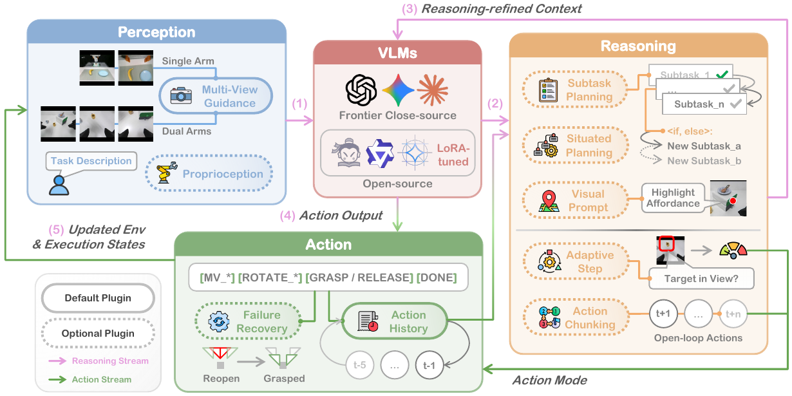
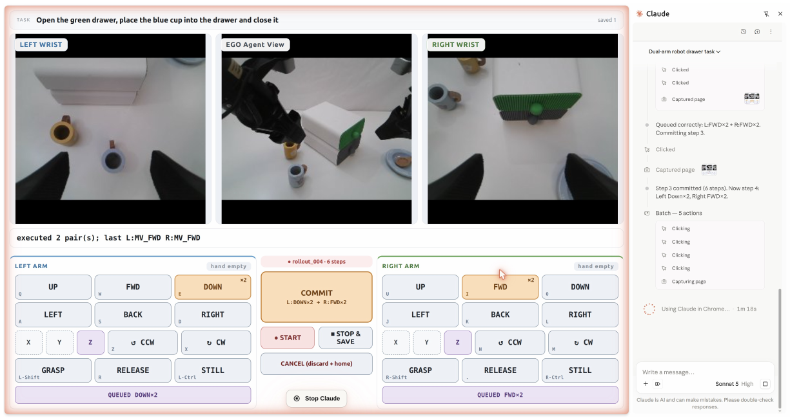

# [Show-Harness: Just a VLM Agent Can Play Robots](https://arxiv.org/abs/2609.10522)

> **Brief:** Show-Harness lets a VLM control robots through small semantic actions such as `MV_LEFT`, `MV_DOWN`, and `GRASP`. An embodiment-specific interpreter converts these symbols into bounded robot motions. The same interface supports zero-shot frontier VLMs, lightweight fine-tuning of small VLMs, and GUI-based demonstration collection, **without a separate learned VLA executor**.

**Source:** Chen et al., Show Lab, National University of Singapore, 2026; supplied PDF, arXiv v1 dated September 9, 2026. Implementation and evaluation details below follow this version and its appendix.

## Convenient Links

- [Paper](https://arxiv.org/abs/2609.10522)
- [Project, code, models, and data](https://showlab.github.io/Show-Harness)
- [Demonstration dataset](https://huggingface.co/showlab/Show-Harness-Data)
- Related notes: [Harness VLA](./Harness_VLA.md), [Hi Robot](../Policies/Pi_Hi_Robot.md), [pi0.5](../Policies/Pi_0_5.md)
- Background: [Agent Systems](../../../Agent_Systems/Agent_Basics.md), [Tool Interfaces](../../../Agent_Systems/Tool_Registry_and_Function_Calling.md)

## 1. What Should the VLM Decide?

A robot agent needs to connect semantic intent, such as "put the banana on the plate," to physical movement. Two common interfaces place that connection elsewhere:

- A **VLA** learns to generate robot-specific actions from images and instructions.
- A **high-level agent** chooses a skill such as grasping or calls a learned VLA, leaving the detailed movement to that executor.

Show-Harness instead asks whether a VLM can make the movement decisions itself if its controls resemble a small game-controller vocabulary. It predicts "move left one step" rather than joint angles, Cartesian coordinates, or an entire grasp skill.

This separates **deciding the next physical adjustment** from **implementing that adjustment on a particular robot**. The VLM does the former; a deterministic interpreter and conventional robot controller do the latter. "Direct VLM control" therefore means direct responsibility for fine-grained decisions, not direct torque output or the absence of control software.

## 2. The Perception-to-Action Pipeline



*Paper Figure 3. Multi-view observations, state feedback, planning, and recent actions form the context for the VLM. Its semantic actions produce physical changes that are observed on the next iteration. The full plugin arrangement primarily describes the frontier-agent mode; the default fine-tuned controller uses a smaller context.*

### 2.1 One Interface, Two Model Configurations

With instruction $\ell$, observation $o_t=(I_t,p_t)$, and recent interaction history $h_t$, the paper writes

$$
c_t=\Phi_{\mathcal{P}}(\ell,o_t,h_t),
\qquad
a_t=\pi(c_t)\in\mathcal{A},
\qquad
u_t=g_E(a_t;s_t).
$$

Here $I_t$ contains camera views, $p_t$ is proprioception, $\Phi_{\mathcal{P}}$ builds context using the enabled plugins, $\pi$ is the VLM, and $\mathcal{A}$ is the semantic action space. The interpreter $g_E$ converts action $a_t$ into robot control $u_t$ for embodiment $E$, using its internal setpoint state $s_t$.

```text
Instruction + current camera views + recent actions
        + state / plan / recovery context when enabled
                            |
                  VLM selects semantic action
                            |
             e.g. MV_LEFT, MV_DOWN, GRASP
                            |
            Embodiment-specific action interpreter
            direction mapping + step size + limits
                            |
            Cartesian / IK / operational-space control
                            |
                  Robot executes bounded motion
                            |
              Fresh images and execution feedback
```

The **frontier mode** uses the same VLM in two prompted roles: a planner builds visually checkable subtasks, and a controller selects semantic actions. These are model calls and runtime context, not two jointly trained neural branches. The **fine-tuned mode** normally uses a small VLM directly as the controller, without a separate planner.

### 2.2 What Is an Action Unit?

| Units | Meaning |
|---|---|
| `MV_FWD`, `MV_BACK` | One forward/backward end-effector displacement under the defined view convention |
| `MV_LEFT`, `MV_RIGHT` | One left/right displacement |
| `MV_UP`, `MV_DOWN` | One upward/downward displacement |
| `ROTATE_CW`, `ROTATE_CCW` + axis | An incremental rotation around the specified $x$, $y$, or $z$ axis |
| `GRASP`, `RELEASE` | Close/open the gripper |
| `DONE` | Declare completion; the frontier controller checks its current stage criterion, while the default fine-tuned controller checks the full task |

The ordinary single-arm prompt exposes six translations, two gripper commands, and `DONE`. Rotation is enabled for tasks that need it. Joint dual-arm control predicts an action for each arm and adds `STILL` for an idle arm.

**`GRASP` is a gripper command, not an autonomous grasping policy.** The VLM must first approach, align, and lower the gripper through movement units. This is the central difference from calling a contact-rich VLA primitive.

Directions follow explicit camera/reference-view conventions, not an assumed universal robot-base coordinate system. For close grasp alignment the wrist view is prioritized; otherwise the global view provides target-relative guidance. A new embodiment must implement the same model-facing meaning consistently.

### 2.3 How a Symbol Becomes Robot Motion

The interpreter maintains a pose setpoint $s_t=(x_t,Q_t)$, with position $x_t\in\mathbb{R}^3$ and orientation matrix $Q_t\in SO(3)$. For movement actions:

$$
s_{t+1}=\Pi_E\left(
x_t+\sigma_tR_Ed_a,
\exp\!\left(\theta_t[R_Er_a]_\times\right)Q_t
\right).
$$

- $d_a$ is the signed translation direction; it is zero for a pure rotation.
- $r_a$ is the signed rotation axis; it is zero for a pure translation.
- $R_E$ maps the semantic directions/axes into the robot's motion frame.
- $\sigma_t$ and $\theta_t$ set translation and rotation increments.
- $[v]_\times$ is the skew-symmetric matrix representing cross product with $v$; its matrix exponential produces a rotation.
- $\Pi_E$ enforces configured workspace and per-step motion limits.

For example, if `MV_LEFT` corresponds to $d_a=(-1,0,0)$ in the configured semantic frame and $\sigma_t=0.02$ m, the position increment is $0.02R_Ed_a$. It does not require the VLM to predict a new continuous coordinate. Gripper commands bypass this pose update.

Franka tracks Cartesian setpoints with impedance control; AgileX uses inverse kinematics and streamed joint targets; simulation uses corresponding operational-space commands. This isolates robot-specific control from semantic decisions. Deterministic command translation does **not** imply deterministic contact outcomes or a general safety guarantee: configured bounds block specified violations, while perception and execution can still fail.

## 3. Why the Surrounding Harness Matters

Small action units alone do not tell a model which view to trust, whether an object was actually grasped, or when to stop. The plugins supply that missing context and execution discipline.

| Plugin group | What it contributes | Failure it addresses |
|---|---|---|
| Multi-View Guidance + Proprioception | Camera roles and textual height, step-size, contact, and gripper feedback | Ambiguous visual alignment or repeated motion into contact |
| Subtask Planning | Ordered stages with visually checkable completion criteria | Skipping necessary stages, such as lifting before transport |
| Situated Planning | Delay uncertain branches until evidence is available | Committing to a target before inspecting a hidden object |
| Visual Prompt | A dedicated model call identifies and marks the relevant affordance | Confusing an object with the specific handle/part to manipulate |
| Adaptive Step + Action Chunking | Adjust motion size and the interval between model queries | Either slow execution or coarse/open-loop overshoot |
| Action History + Failure Recovery | Recent moves, grasp diagnostics, and return to the grasp stage | Oscillation or transporting an empty gripper |

In default zero-shot experiments, history holds **five recent actions**. All listed plugins are enabled except Situated Planning and Visual Prompt, which are activated for relevant tasks.

### 3.1 Adapt Motion Size and Feedback Frequency Separately

**Adaptive Step** changes the distance represented by one movement unit: the default uses a 2 cm fine step when the target is visible in the wrist view and a 4 cm coarse step otherwise.

**Action Chunking** changes how often the VLM is queried: when the target is far away, it can emit a short sequence of semantic movement units executed open-loop before obtaining new feedback. Near interaction, the controller returns to single-action decisions.

Thus, "feedback after each action" describes the ordinary atomic loop, not a claim that the VLM re-observes between every element of an open-loop chunk. These chunks are sequences of semantic commands, not continuous trajectories produced by a diffusion/flow action expert.

### 3.2 A Worked Execution Example

For "put the banana on the plate," the frontier planner creates grasp, lift, transport, place, release, and retreat stages, each with an observable completion criterion.

1. Use the global image to locate the banana and move toward it, taking coarse steps or a short chunk while it is distant.
2. Once the banana is visible in the wrist view, use smaller, single-step corrections to center its graspable region between the fingers, then descend.
3. Emit `GRASP`. Check images and gripper feedback instead of assuming a close command succeeded.
4. If the close is empty, recovery resets the gripper and returns to the grasp stage. Recent-action context discourages repeating the same failed close without repositioning.
5. After a verified grasp, lift clear of the table, transport toward the plate, descend, release, and retreat; advance stages only when their criteria are satisfied.

The reasoning and the physical corrections remain linked through the same interface. No external learned grasp skill takes over the alignment phase.

## 4. Demonstrations and Lightweight Fine-Tuning

### 4.1 GUMI Makes Human and Model Actions Comparable



*Paper Figure 4. GUMI exposes the semantic actions as GUI controls and keystrokes. Humans and computer-use agents can operate the same single- or dual-arm interface; VLM controllers can also output the action units directly.*

GUMI is a data-collection interface, **not a required browser step for every deployed policy action**. It supports keyboard control, queued actions, and human intervention in agent rollouts without specialized teleoperation hardware.

Its data pipeline is:

```text
Human keyboard / browser agent selects semantic unit
  -> record pre-action camera observations and selected unit
  -> interpreter executes the corresponding robot command
  -> retain measured end-effector pose, gripper state, and trajectory
  -> assemble instruction + views + recent history -> action samples
  -> add a terminal DONE sample for each episode
```

This produces two supervision forms from the same collection: semantic-action labels for the small VLM, and corresponding continuous end-effector trajectories for VLA baselines. The cross-model comparison therefore matches demonstration sources, although architectures, pretrained weights, and interfaces still differ.

### 4.2 Training Data and What Is Held Out

| Collection | Episodes | Recorded decision steps | Purpose |
|---|---:|---:|---|
| Real Franka | 101 | 4,969 | Single-arm semantic-policy training |
| Real AgileX | 63 | 2,805 | Joint training across the two embodiments |
| Real total | 164 | 7,774 | Main fine-tuned model and matched-data VLA baselines |
| ManiSkill + RoboLab simulation | 230 | 13,523 | Separate simulation-only training for sim-to-real evaluation |

All collected translation units use 2 cm steps. Each real training example uses global and wrist images, the instruction, recent actions, and the selected action. Adding one terminal sample per real episode gives $7{,}774+164=7{,}938$ samples, consistent with Appendix 7.1's approximately 7.9K training samples.

The real corpus covers 19 platform-specific tasks, including some stacking and shelf rearrangement. It also includes 19 Franka recovery episodes trimmed to corrective segments, so the training set contains examples of recovering from empty grasps rather than only clean demonstrations.

For the main ten object-receptacle evaluations, block, banana, and tennis ball are represented in training; teddy bear and chess piece are held out. Both the fine-tuned VLM and trainable VLA baselines use demonstrations from **both** real embodiments. Their two-arm-platform evaluation is therefore not transfer to an entirely unseen training embodiment.

### 4.3 Objective and Model Structure

The default small model is **Qwen3.5-2B**, fine-tuned to output semantic action names using its existing language-model vocabulary. There is no dedicated continuous action head and no added special action-token vocabulary. An action name may occupy multiple native tokenizer tokens despite being called an "action unit."

For target action-text tokens $y_1,\ldots,y_m$, the paper's action cross-entropy can be expanded as

$$
\mathcal{L}(\theta)=
-\sum_{(\ell,o,h,a)\in\mathcal{D}}
\sum_{j=1}^{m}
\log p_\theta\left(y_j\mid
\Phi_{\mathcal{P}_{\min}}(\ell,o,h),y_{<j}\right).
$$

The minimal context $\mathcal{P}_{\min}$ contains the task, current multi-view images, and short action history. **Default fine-tuning does not train the full frontier planning/reasoning pipeline** or require generated reasoning traces as targets.

| Setting | Paper configuration |
|---|---|
| Adaptation | Rank-64 LoRA on all language-model linear layers; about 3% of model parameters updated |
| Frozen components | Vision encoder and multimodal projector |
| Training | 40 epochs; effective batch size 32 |
| Optimizer schedule details reported | Learning rate $10^{-4}$, cosine decay, warmup ratio 0.1 |
| Inputs / precision | $256\times256$ camera views; bf16 |
| Compute | Less than 2 hours on one H200 for Qwen3.5-2B; described as feasible on 24 GB-class GPUs |

During inference the adapted VLM receives the minimal context, emits one action unit, and uses the same interpreter as the frontier model. This is supervised fine-tuning of a pretrained VLM, not new robot-model pretraining or reinforcement learning.

### 4.4 Keep Three Adaptation Settings Distinct

- **Zero-shot (ZS):** the default Gemini-3.1 Pro frontier model runs the harness without robot-policy fine-tuning, using medium thinking effort and explicit control conventions. Zero-shot does not mean an unconfigured controller or an absence of foundation-model pretraining.
- **Fine-tuned (FT):** a small VLM learns semantic control from demonstrations and uses minimal context by default. A frontier planner is added only in specified reasoning experiments.
- **Video-conditioned in-context execution:** a VLM analyst converts ordered demonstration frames into a textual task outline, which conditions planning and subsequent control. There is no weight update; the analyst does not recover a continuous robot trajectory from video.

## 5. Results and What They Establish

### 5.1 Main Real-Robot Evaluation

The platforms are a 7-DoF Franka Research 3 and 6-DoF AgileX arms with parallel-jaw grippers. Main tasks combine five objects with a plate or bowl, using 10 randomized-placement trials per task and a default 50-step episode cap. Local inference uses an RTX 5090; frontier models use APIs.

Selected Table 2 results are below. H-VLA is Harness VLA and RATS is a code-as-policy baseline **as evaluated in this paper**, not their results on other benchmarks.

| Setting | pi0.5 | GR00T | H-VLA | RATS | Show ZS | Show FT |
|---|---:|---:|---:|---:|---:|---:|
| Ten object-receptacle tasks, 100 trials | 39% | 35% | 50% | 57% | **89%** | 86% |
| Four visual/environment shifts, 80 trials | 50% | 42.5% | 63.8% | 65% | **100%** | 93.8% |
| Sim-to-real, 20 trials | 0% | 0% | - | - | - | **65%** |
| Franka + AgileX Plate tasks, 100 trials | 41% | 36% | 49% | 52% | **93%** | 87% |

The four-shift row is **recomputed from the table's background, lighting, viewpoint, and distractor counts**, excluding sim-to-real for every method. The paper's combined environment averages include sim-to-real only where reported, so its ZS 100% and FT 88% do not average the same set of conditions. Simulation-only FT succeeds in 13/20 real trials; the ZS model is not evaluated under that training-transfer protocol.

The results support the interface in this small-data, parallel-gripper setting. They do not establish that semantic actions universally outperform continuous VLAs, or that a model co-trained on Franka and AgileX generalizes to every unseen robot.

### 5.2 Ablations Explain Why It Works

On the five Plate tasks, the default zero-shot configuration achieves **96%**. Figure 9 connects the gain to specific parts of the loop:

| Change | Success | Interpretation |
|---|---:|---|
| Global view only | 58% | Close-up wrist evidence matters for alignment |
| Remove proprioception | 68% | Images alone leave height/contact/gripper ambiguities |
| Remove subtask planning | 60% | Correct motion order, such as lift before transport, is not automatic |
| Remove action history | 76% | Recent actions help avoid oscillation and timeouts |
| Remove failure recovery | 72% | Empty grasps must be detected before transport |
| Disable action chunking | 96% | Preserves accuracy but requires more model calls |
| Force chunking throughout | 74% | Open-loop execution is harmful near precise interaction |

Selective chunking reduces model queries from 32 to 26 at the same 96% success. These are query counts, not measured end-to-end speedups. Adaptive steps likewise balance fine-only timeouts against coarse-only overshoot.

On dedicated tasks, Visual Prompt improves handle-aware grasping from **40% to 85%**, and Situated Planning improves hidden-object search from **35% to 85%**. Their limited effect on ordinary tasks motivates enabling them only when needed.

### 5.3 Is the Benefit Just the Action Names?

The action-representation study varies translation labels and written movement conventions while holding the rest of the harness fixed:

| Interface | Success over 20 trials |
|---|---:|
| Semantic names + explicit conventions | 20/20 |
| Semantic names only | 18/20 |
| Arbitrary symbols + explicit conventions | 19/20 |
| Arbitrary symbols without conventions | 1/20 |

The result is more specific than "language labels make control easy": **explicit, consistent action-effect mappings do most of the grounding work**. Without them, discovering controls from visual changes is difficult; semantic names mainly provide a helpful prior.

### 5.4 Physical Flexibility Does Not Replace Reasoning

The interpreter allows smaller translation steps, composed diagonal movements, and repeated rotations without changing the model's output interface. For example, FT trained on carrot orientations of $0^\circ$ and $45^\circ$ achieves **70%** at an unseen $90^\circ$, using repeated $15^\circ$ rotation units; pi0.5 achieves 20% in that experiment.

However, on two reasoning-intensive tasks, the minimal FT controller reaches only **10%** versus **85%** for ZS with Situated Planning. Giving FT the same frontier-generated subtask instructions raises it to **70%**. Learning the control vocabulary is therefore not equivalent to acquiring the full planner's reasoning capability.

**Source caution:** Figure 6 and its prose disagree on several exact capability-analysis values, including fine-grained-control and video-conditioned FT results. The qualitative conclusions are consistent, but those conflicting percentages are not treated here as settled measurements. The main Table 2 and plugin results above are reported separately.

## 6. How It Differs from Harness VLA

| Question | Harness VLA | Show-Harness |
|---|---|---|
| What does the agent output? | Calls to analytic primitives or a frozen `VLA_ACT` | Incremental semantic movements and gripper commands |
| Who decides contact-rich motion? | A pretrained VLA generates action chunks inside the selected primitive | The VLM chooses successive local adjustments; conventional controllers track them |
| What does a grasp command mean? | A VLA call can perform the contact-rich grasp phase | `GRASP` closes the gripper after VLM-guided alignment |
| What supports reuse? | Reference-task procedures, global operating rules, and re-grounding | Shared action meanings, embodiment interpreters, and optional semantic-policy fine-tuning |
| What feedback/context is central? | Outcome checks between primitive calls, task/global memory | Frequent action-level visual/state feedback, recent-action history, and planning plugins |

Both put a foundation model in a feedback loop, but at different action granularities. Harness VLA preserves a learned contact specialist; Show-Harness tests how much manipulation can be achieved by a VLM making fine-grained decisions through transparent controls. Neither eliminates engineering of perception, controllers, limits, or recovery.

## 7. Takeaways and Limits

- **Main contribution:** a shared semantic control interface connecting VLM reasoning, deterministic robot execution, human/agent demonstration collection, and inexpensive supervised adaptation.
- **Transfer boundary:** reusing the vocabulary requires calibrated interpreters and consistent observation/action conventions. It does not make camera geometry, reachability, or contact dynamics identical across robots.
- **Current bottleneck:** valid action outputs and plausible plans are easier than reliable fine-grained grounding; more thinking can add latency without improving success. Small evaluation counts and primarily parallel-jaw tasks limit broad conclusions.
- **Safety and contact:** bounded motion commands are useful constraints, not complete collision or grasp guarantees. Dexterous hands, humanoids, richer force/tactile feedback, and harder contact-rich tasks remain beyond the demonstrated scope.

**Mental model:** expose small controls that a VLM can understand, make their physical meaning consistent, and use feedback to compose them into manipulation. GUMI records the same decisions so smaller VLMs can learn to use the interface.
