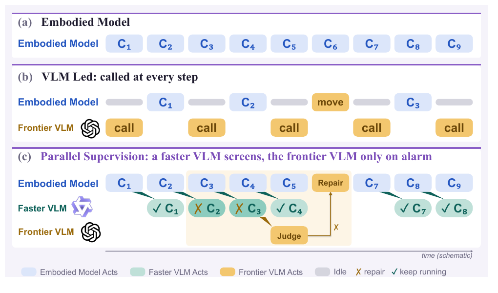
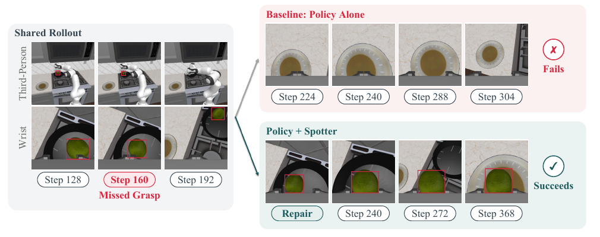

# [Spotter: Let the Embodied Model Lead, and the VLM Reflect for It](https://arxiv.org/abs/2609.36808)

> **Brief:** Spotter helps a robot policy recover from manipulation failures **without changing the policy's weights**. The policy normally controls the robot, while a vision-language model (VLM) examines its recent behavior in parallel. When a failure is confirmed, the VLM takes control, performs a short physical repair, and checks whether it worked. This improves task completion while letting ordinary successful motion continue during supervision.

**Source:** Li et al., 2026; supplied PDF, arXiv:2609.36808v2 dated October 31, 2026, including Appendices A–C. The explanations and results below follow this version.

## Convenient Links

- [Paper](https://arxiv.org/abs/2609.36808), [official code](https://github.com/zqc3117/Spotter)
- Related systems: [Harness VLA](./Harness_VLA.md), [RoboHarness](./RoboHarness.md), [AdaHVLA](./AdaHVLA.md), [SenseNova-RoboRSI](./SenseNova_RoboRSI.md)
- Policy background: [pi0.5](../Policies/Pi_0_5.md), [Hi Robot](../Policies/Pi_Hi_Robot.md)
- Agent background: [Memory Systems](../../../Foundations/Agent_Systems/Memory_Systems.md), [Tool Interfaces](../../../Foundations/Agent_Systems/Tool_Registry_and_Function_Calling.md)

## 1. Why Does Noticing a Failed Grasp Still Leave a Recovery Problem?

Suppose the task is to move a lime from a pan to a plate. The robot closes its gripper beside the lime, then moves toward the plate with nothing in its hand. Its motion resembles a successful demonstration, but the prerequisite for transport—actually holding the object—is missing.

A useful supervisor must solve two problems: **find a different action that can repair the failure**, and **recognize whether that correction worked**. The paper first tests whether the embodied policy can supply these abilities itself. Those experiments explain why Spotter adds a separate repair mechanism.

### 1.1 The Tested Policies Seldom Recover by Retrying

The authors test Cosmos Policy, a world action model that produces actions and imagined future observations, and pi0.5, a vision-language-action (VLA) policy that maps visual and language inputs to actions. An **oracle detector** uses privileged simulator information to identify failed grasps on RoboCasa pick-and-place tasks. This gives the policies an ideal starting point for diagnosis: the experiment already knows exactly when a grasp failed.

Each method receives up to three correction attempts. A correction succeeds if any attempt lifts the object; this measures grasp recovery, not completion of the whole task.

| Correction method | Cosmos Policy | pi0.5 |
|---|---:|---:|
| Restore the pre-failure state and resample with three seeds | 7.50% | 8.75% |
| Describe the failure through language, up to three rounds | Unsupported for arbitrary instructions | 9.69% |
| Fine-tune on recovery data, then repeat resampling | 8.13% | 8.44% |

Each setting contains **320 failed grasps**. Resampling restores the simulator to the start of the failed action sequence. Language feedback instead starts from the failed physical state. Cosmos Policy supports only its trained official instructions, so free-form feedback is tested only with pi0.5.

All these rates remain below 10%. The authors attribute this to training mainly on successful demonstrations: states after a failure receive little coverage. Only about **3% of their ordinary rollouts** yield recovery data meeting their collection requirements. The result concerns these checkpoints and training procedures; it does not establish that recovery can never be learned.

For the lime example, detecting the miss and asking the same policy to try again usually does not supply the missing correction. Spotter therefore needs a way to change the robot's behavior directly.

### 1.2 Choosing Among More Attempts Also Needs a Reliable Judge

Perhaps the policy can generate several attempts and a scorer can select one. The authors test this using **eight candidates from each saved state**, sampled from Cosmos Policy with different seeds. A candidate includes proposed actions and imagined future images. Each candidate is executed for 32 steps to determine whether it grasps the object.

The scorers use different evidence:

| Scorer | What its score is based on |
|---|---|
| Cosmos value head | The policy's own learned estimate of the candidate's value |
| Consistency-Consensus | Agreement between a candidate's imagined future and the average imagined future of the eight candidates |
| GeoBoN | Geometric consistency between imagined images from different camera views |
| RCS | How well the model reconstructs an imagined future after noise is added to it |
| VLM judge | A VLM's estimate of grasp success from nearby images and the candidate's imagined future |

For each saved state, every successful candidate is paired with every failed one. **Pairwise ranking accuracy** is the fraction of pairs in which the successful candidate receives the higher score; ties get half credit. An accuracy of 0.5 means the scorer is no better than random ordering. States with no mixture of successes and failures cannot test this distinction and are excluded.

The value head and Consistency-Consensus work better just before ordinary grasps than immediately after failed grasps. GeoBoN and RCS remain near random. Even the VLM reaches only **53% with GPT and 51% with Qwen after failure**, versus 57% and 53% at normal states. The comparison uses **991 post-failure states / 10,974 pairs** and **432 normal states / 4,853 pairs**, with uncertainty estimated by bootstrap resampling over states.

A further diagnostic, **Consistency-Exploring**, compares the imagined future with the candidate's actual executed outcome. It needs information unavailable before execution, so it cannot serve as an online selector.

These tests motivate giving the repair system richer evidence: what the robot already tried, how its state changed, and whether previous corrections helped. Spotter combines that history with tools that let the VLM perform a correction itself.

## 2. How Can Supervision Run Without Stopping Every Action?

*Paper Figure 3. A policy acting alone can continue after an unnoticed error. A VLM-led controller waits for reasoning before each operation. Spotter overlaps supervision with policy execution and pauses for repair when an error is confirmed. Block widths are schematic; the lead limit explained below is omitted.*

### 2.1 First Separate Robot Execution from Reviewing Its Outcome

Three units are needed to read the timeline:

- A **step** is one environment/control update.
- An **action chunk** is the sequence of actions executed before querying the policy again. A policy can predict more actions than the executor actually uses.
- A **supervision window** is the recorded evidence from one or more finished chunks: time-ordered camera images, actions, and robot-state measurements. These measurements are called **telemetry**, such as end-effector pose and gripper opening.

“Completed,” “pending,” and “routine” describe different aspects of this process:

| Description | Meaning | Example in the lime task |
|---|---|---|
| **Completed chunk/window** | The actions have finished executing and their evidence has been recorded; the outcome may still be unchecked | The gripper closed and the arm lifted |
| **Pending window** | Completed evidence is waiting for supervision to catch up | The robot has begun moving toward the plate while the recorded grasp is still awaiting review |
| **Routine window** | Screening finds no alarm condition in the recorded behavior | An ordinary reach passes screening without triggering an alarm-based judge call |
| **Flagged window** | Screening finds evidence requiring closer attention | Images and gripper measurements suggest the grasp missed |

A window can therefore be **completed and pending at the same time**. Completed means the motion finished; it does not mean the task succeeded. Similarly, routine is a screening outcome, not proof that no error occurred.

For instruction $\ell$, RGB images $I_t$, and robot state $q_t$, the frozen policy with parameters $\theta$ predicts an action sequence $A_t$:

$$
A_t=\pi_\theta(I_t,q_t,\ell),
\qquad \theta\text{ fixed}.
$$

The executor runs the configured portion as a chunk. Three components then divide the work:

| Component | Role |
|---|---|
| **Embodied policy** | Generate ordinary manipulation actions from the current images, robot state, and instruction |
| **Local screener $S$** | Examine completed evidence cheaply and flag possible errors |
| **VLM judge $J$** | Inspect suspicious behavior with episode history, decide whether repair is needed, perform it, and verify its effect |

Qwen3.8-27B serves as the screener. The judge is either Qwen3.8-27B or GPT-6 Astra; **Spotter (GPT) still uses Qwen for screening**. These are separate runtime responsibilities, not jointly trained branches of a new policy.

### 2.2 Screening Escalates Suspicion; the Judge Confirms the Repair Need

When a chunk finishes, its evidence becomes available and the policy can continue while screening runs. If supervision falls behind, the next check combines **all completed unchecked chunks**, rather than keeping only the latest one. This preserves the failed grasp even if the arm has already moved away.

Let $z_i$ be the images and telemetry recorded for chunk $i$. If supervision has checked through chunk $j$ and chunk $n$ is the latest completed one, the screener examines the accumulated window $z_{j+1:n}$. It produces risk $r_n$ and a flag $f_n$:

$$
r_n=S(z_{j+1:n}),
\qquad
f_n=\mathbf{1}\{r_n\geq\tau\;\lor\;E_n\;\lor\;F_n\}.
$$

Here $\tau$ is the risk threshold, $E_n$ denotes empty-gripper evidence, and $F_n$ denotes a failed or invalid screening call. The indicator is one if any alarm condition holds. Defaults use a 0–10 risk scale with **$\tau=3$**. A low threshold favors catching failures, accepting some false alarms.

The full configuration calls the judge after **two consecutive flagged screening checks**. This counts checks, not chunks: one check may cover several chunks. Newly screened empty-gripper evidence can trigger the judge immediately if there has been no intervention in the previous two checks.

Empty-gripper evidence uses a physical heuristic: fingers closing unusually far can indicate that no object is between them. It flags closure below **12 mm**, or below **4 mm on mug tasks**, where a successful handle grasp may leave only 6–12 mm of opening. The heuristic can be wrong, which is why a screening flag still needs judgment.

The judge reads the suspicious evidence with earlier attempts and actions. If it finds no problem, execution continues. If it confirms an error, the system pauses the policy and begins repair. **Screening selects evidence for closer attention; the judge decides whether to take control.**

The supervisor uses deployment camera images, robot state, and commanded-action history. It receives neither object poses nor the benchmark's success predicate. Only the evaluator uses that privileged information for scoring and episode termination. Camera depth is available internally to the repair executor, but the VLM itself does not see it.

### 2.3 A Lead Limit Keeps Delayed Evidence Useful

Parallel supervision creates a risk: the robot may act for too long before an old failure is reviewed. Spotter limits this delay.

Let $j$ be the latest checked chunk. With lead limit $K$, the policy may start chunk $i$ only if

$$
i-j\leq K.
$$

For example, if supervision has checked through chunk 3 and $K=2$, the robot can start chunks 4 and 5. It must wait before chunk 6 until supervision advances. If both chunks finish before another check, their records are combined into the next supervision window.

The default settings show how this rule relates to physical execution:

| Full-context setting | Cosmos Policy | pi0.5 |
|---|---:|---:|
| Executed chunk | 16 steps | First 25 of 50 predicted steps |
| Screening interval | Every two chunks: 32 steps | Every chunk: 25 steps |
| Lead limit $K$ | 4 chunks | 2 chunks |
| Maximum lead in policy steps | 64 | 50 |

Thus **chunk size**, **screening frequency**, and **allowed lead** control different things. Every completed chunk contributes evidence, but Cosmos does not require a separate screening call after every chunk. The short-context pi0.5 setting also screens every two chunks.

Execution pauses at a chunk boundary when the lead limit prevents the next chunk, or when an error is confirmed. The bound is measured in chunks, not seconds; it limits stale supervision but cannot guarantee that every damaging action is caught in time.

## 3. How Does a Diagnosis Become a Repair That Can Be Checked?

### 3.1 The Judge Acts Through Explicit Motion Tools

Knowing that the lime was missed does not itself move the gripper. The judge must translate its diagnosis into executable actions.

A decision returns a verdict $v$, diagnosis $\delta$, expected observable effect $e$, and plan $p$, using the current window and episode history $h_n$:

$$
(v,\delta,e,p)=J(z_{j+1:n},h_n),
\qquad
v\in\{\text{ok},\text{intervene},\text{giveup}\}.
$$

An **ok** verdict leaves the policy running. **Intervene** requests control and supplies a repair plan. **Giveup** reports that the judge cannot provide a viable repair. The plan is a short sequence of **motion primitives**: callable actions with specific physical effects.

| Primitive | Effect |
|---|---|
| Move to point | Move to a world-coordinate target or a pixel target converted to 3-D by the executor |
| Move by offset | Translate the end effector relative to its current position |
| Lift | Raise the end effector |
| Rotate wrist | Change wrist orientation |
| Set gripper | Open or close the gripper |
| Retreat | Return the arm to a recorded earlier pose selected by the judge |
| Move both arms | Execute synchronized bimanual motion |
| Act | Run the embodied policy for a specified chunk size within the repair |
| Hand back | End takeover and resume ordinary policy execution |

A repair runs in **segments**: part of the plan executes, then the judge receives a fresh image and execution log before choosing the next part. Policy chunks executed inside a repair are also screened before the next repair decision. This gives the judge feedback during the correction.

Each repair is limited to **eight primitives and three segments**; full configurations permit at most **eight interventions per episode**. Motion, gripper actions, and controller calibration all consume the same task-step budget as ordinary policy actions.

For image-based targets, the VLM chooses a pixel and the executor supplies metric geometry. Let $D$ be the calibrated depth map and $\mathbf{x}_w$ the desired 3-D world target. For pixel row $r$, column $c$, and depth $d=D[r,c]$, Appendix C's inverse projection can be summarized in conventional camera notation as

$$
\mathbf{x}_w
=R_{wc}\!\left(dK_{\mathrm{cam}}^{-1}[c,r,1]^\top\right)
+\mathbf{t}_{wc}+\Delta z\,\mathbf{e}_z.
$$

$K_{\mathrm{cam}}$ contains camera intrinsics; $(R_{wc},\mathbf{t}_{wc})$ transforms camera coordinates into world coordinates. The optional offset $\Delta z$ moves the target along the vertical unit vector $\mathbf{e}_z$. This converts a selected image location into a reachable 3-D target. The executor uses **one calibrated depth sample**, so inaccurate pixel selection or depth can still spoil contact.

### 3.2 Reflection Means Testing a Physical Consequence

A repair is not complete merely because the commanded motions ran. The judge states an **expectation**: something that should be observable if its correction worked. For a regrasp, this might concern gripper opening during a lift.

After ordinary execution resumes, the **next supervised window receives a judge check even if the screener raises no flag**. This is an **observation-only check**: it must first say whether the expectation held and cannot initiate another repair in that same check.

- If the expectation holds, the judge must not repeat the repair.
- If it fails, a later intervention must change the kind of repair instead of merely trying another offset.

This closes the reasoning loop: **diagnose → act → observe the expected effect → revise if needed**. It reduces repeated corrections that were never tested. The check remains a model's interpretation of camera evidence and telemetry, not a ground-truth success signal.

### 3.3 Follow the Missed Lime Grasp Through the Whole Loop

*Paper Figure 1. The grasp misses at step 160; by step 192 the arm has left the pan. Spotter returns the arm to an earlier pose and corrects its lateral alignment. The scene is not restored to an earlier simulator state.*

The example connects the scheduling and repair mechanisms:

1. **Execute and record.** The gripper misses, then the policy moves toward the plate. The failed attempt is already completed, but its evidence may still be pending.
2. **Review the accumulated evidence.** Screening includes the missed grasp even though execution has advanced. The judge reads that history and a fresh repair image to understand both the mistake and the current state.
3. **Change the action.** The attempt was offset to the left. The repair retreats to an earlier arm pose and shifts the gripper right before reattempting.
4. **Resume and verify.** The policy continues from the repaired physical state. The next supervised window is used to check the expected effect before any later repair.

**Retreat moves the arm; it does not rewind the scene.** Objects keep their changed positions and contacts are not undone. A lime still on the table can be located again, but an object dropped out of view or reach may be unrecoverable. This distinguishes Spotter's deployed repair from the simulator restoration used in Section 1's diagnostic resampling experiment.

## 4. What Experience Does the Supervisor Use?

### 4.1 Frozen Weights Still Allow History and Retrieved Knowledge

Spotter introduces no new policy pretraining or gradient-based post-training. Main simulation experiments use released Cosmos Policy and pi0.5 checkpoints; RoboTwin pi0.5 is trained on clean data only. The real-robot pi0.5 is separately fine-tuned on teleoperated demonstrations for its three tasks.

The recovery fine-tuning in Section 1 is a **diagnostic baseline**, not required to use Spotter. The supplied paper does not provide a complete optimizer/data-size recipe for that baseline or real-robot fine-tuning.

The supervisor nevertheless benefits from prepared experience:

| Information | How it is obtained | What changes during evaluation |
|---|---|---|
| **General lessons** | GPT explores separate learning episodes and distills reusable physical advice | A frozen library of 77 entries is read, not updated |
| **One retrieved example**, when enabled | An episode is selected from a separately prepared example library | The system retrieves an example of up to 12 images |
| **Current episode history** | Images, telemetry, actions, diagnoses, and previous repairs accumulate as the robot acts | The context grows, but model weights stay fixed |

General lessons remove privileged and scene-specific information. An example lesson can advise grasping a long bottle near its middle to reduce slipping. Exploration may reset the simulator during preparation; evaluation uses held-out object instances and disjoint seeds, and does not reset the scene for recovery.

The paper calls operation without an example **“zero-shot,” but the general-lesson library is still available**. Its **1-shot** setting additionally retrieves one example, preferring the same policy/task, then the same task, similar tasks, and finally the broader library. Thus 1-shot can use relevant prior experience without updating weights, and need not mean transfer to a wholly unseen task.

### 4.2 Longer Context Changes More Than the Amount of History

The judge needs enough history to recognize that a proposed correction repeats an earlier failed attempt. Prompts therefore include camera montages, robot-state measurements, action history, remaining budget, lessons, tools, and the previous repair expectation.

The short and full settings differ in several ways:

| Configuration | Short context | Full context / 1-shot |
|---|---|---|
| Recent telemetry | 3 chunks | 40 for Cosmos; 10 for pi0.5 |
| Recent Qwen judge turns retained | 3 | 20 |
| Context restart threshold | 22K tokens | 110K tokens |
| Intervention cap | 3 | 8 |
| Ordinary judge trigger | 1 flagged check | 2 consecutive flagged checks |

Older material is summarized; Qwen restarts with a recap when needed. GPT uses server-side conversation continuation. Consequently, short-versus-full success rates do not isolate the effect of context length: the trigger and repair budget also change.

Qwen3.8-27B-FP8 runs through the vLLM inference server, one replica on each of four H20 GPUs. Its full context permits 131,072 tokens and 60 images, versus 32,768 tokens and 20 images in the short setting. Screening uses temperature 0 and up to 120 output tokens; judgment uses temperature 0.2 and up to 3,000, with thinking disabled. GPT uses medium reasoning effort. These settings matter when interpreting latency and compute cost.

## 5. Do Repairs Improve Completion Under a Fair Action Budget?

### 5.1 RoboCasa Separates Repair Gains from More Action Steps

The main simulation study uses **24 RoboCasa tasks × 50 episodes = 1,200 episodes per evaluation**. Eight tasks involve pick-and-place; sixteen operate mechanisms such as doors, drawers, faucets, and appliances.

A repair consumes actions, so giving Spotter more steps than its baseline would confound the comparison. The main study gives **both Spotter and its matched policy-only baseline 1.8× the official task-step limit**, charging repair steps to that same limit.

Selected Table 4 overall success rates are:

| Method | Cosmos Policy | pi0.5 |
|---|---:|---:|
| Policy alone, official 1.0× budget | 66.7% | 62.5% |
| Policy alone, matched 1.8× budget | 67.9% | 64.3% |
| Spotter Qwen, short context | 69.3% | 67.1% |
| Spotter Qwen, full context | 71.7% | 68.4% |
| Spotter Qwen, 1-shot | 71.8% | 70.4% |
| Spotter GPT, with screener | 70.0% | 68.8% |
| Spotter GPT, no screener | 72.0% | 70.8% |
| Spotter GPT, 1-shot | **73.5%** | **71.8%** |

Simply extending the baseline budget adds only **1.2 and 1.8 percentage points**. Spotter GPT 1-shot adds **5.6 and 7.5 points over the matched 1.8× baselines**. Pick-and-place gains are 10.3 and 9.0 points, versus 3.3 and 6.7 on mechanism tasks. A fixed retreat-and-retry procedure stays near the original policy even with oracle detection, supporting the need to choose a better correction.

The ablations expose two tradeoffs. One example barely changes Qwen/Cosmos overall, **71.7% → 71.8%**, because pick-and-place gains offset mechanism-task losses; Qwen/pi0.5 improves **68.4% → 70.4%**. Removing the GPT screener adds two points on both backbones, so cheaper filtering sacrifices some supervision effectiveness.

Harness VLA with Qwen reaches **71.3%/69.1% with the success predicate**, and **65.2%/60.5% without it**. These are the paper's reruns with 40 interaction rounds and a 5,000-step budget. Different information and budgets prevent treating those rows as a controlled ranking against Spotter.

### 5.2 RoboTwin and Hardware Test Broader Forms of Repair

On the **RoboTwin 2.0 Hard simulation benchmark**, the main study evaluates 50 tasks with ten episodes each. Under matched 1.8× limits, pi0.5 reaches **47.2%**, Spotter Qwen 1-shot **51.2%**, and Spotter GPT 1-shot **57.0%**. The stronger judge helps more on these longer bimanual tasks. Other published models shown in Figure 4 use different source protocols and are not controlled comparisons.

On a **Franka Research 3**, the fine-tuned pi0.5 and Spotter GPT 1-shot receive ten trials per task:

| Task | pi0.5 alone | With Spotter |
|---|---:|---:|
| Stack cups | 6/10 | 8/10 |
| Cube into cup | 7/10 | 10/10 |
| Cube into cup, then another cube onto plate | 3/10 | 7/10 |
| Total | 16/30 (53.3%) | 25/30 (83.3%) |

These trials show that physical recovery can work without simulator rollback. They cover only one robot and three tasks; demonstration counts and real-hardware timing are not fully specified in the PDF.

### 5.3 Detection and Correction Use Episode-Level Denominators

The paper also asks whether interventions occur in useful cases and whether one repair suffices. Let $I$ be intervened episodes, $E\subseteq I$ those the baseline fails on the same scene, and $C\subseteq E$ those made successful by a single repair. It defines

$$
\mathrm{Detection}=\frac{|E|}{|I|},
\qquad
\mathrm{Correction}=\frac{|C|}{|E|}.
$$

Detection asks: **among episodes receiving an intervention, how many correspond to a baseline failure?** It resembles intervention precision; it does not measure recall over all failures or accuracy of each local diagnosis. About 85% of Qwen-intervened episodes correspond to baseline failures.

Correction asks: **among those baseline-failure cases, how many become successful with one repair?** With one example, the rates are **13.5% for Qwen and 19.2% for GPT**. These help explain improved final completion, but they differ from Section 1's grasp-lifting metric over three attempts at saved failure states.

## 6. Does Parallel Reasoning Remove the Time Cost?

Parallelism can hide a check while the robot is moving. It cannot hide all repair motion or repeated reasoning on a difficult episode. Table 5 separates those effects; scene construction is excluded.

| Backbone and configuration | All episodes | Successful episodes | Failed episodes |
|---|---:|---:|---:|
| Cosmos alone, 1.8× | 63 s | 34 s | 125 s |
| Cosmos + Spotter Qwen, full | 181 s | 47 s | 521 s |
| Cosmos + Harness VLA Qwen | 260 s | 146 s | 545 s |
| pi0.5 alone, 1.8× | 37 s | 23 s | 62 s |
| pi0.5 + Spotter Qwen, full | 126 s | 39 s | 313 s |
| pi0.5 + Harness VLA Qwen | 253 s | 164 s | 451 s |

Successful full-context Spotter episodes add **13/16 seconds** on the two backbones. Difficult failed episodes cost much more, increasing the overall average. Each method's successful and failed sets can differ, so these columns do not necessarily compare identical episodes. The Harness VLA rows also use the privileged information and larger budget described above.

Relative to blocking execution for the same checks, Qwen supervision hides about **36/30 seconds per episode** behind Cosmos/pi0.5 motion. On successful episodes, the judge is called only 0.6 times on average and almost never repairs. This explains why keeping the policy in control is useful: successful behavior usually needs screening rather than repeated planning.

Wall time and model usage still differ. Adding one example raises average Qwen tokens from **87K to 218K** on Cosmos and **77K to 170K** on pi0.5, while wall time changes little. For GPT/Cosmos, screening cuts tokens from **456K to 156K** compared with judging every window, at a two-point success cost. Counts include cached input—reused prompt content—so they are not output-token totals.

RoboCasa GPT times are omitted because they include network latency. A separate **150-episode supplementary RoboTwin run**, with matched 1.8× limits and no privileged information, gives GPT Spotter and GPT-led control 56% success, with successful episodes taking **72 s versus 155 s**. Qwen Spotter reaches 53% in 56 s, versus Qwen-led 42%; policy-only reaches 48% in 42 s. Qwen timing there assumes one H200 serving one request at a time. These figures belong to that smaller study, not the main 500-episode result.

## 7. What Is Distinctive About This System, and Where Can It Fail?

Spotter's design connects three needs exposed by the initial experiments: history helps diagnose what went wrong, motion tools let the supervisor change the physical attempt, and an explicit expectation makes it check whether that change helped.

Compared with [Harness VLA](./Harness_VLA.md), Spotter keeps the policy as the default executor and calls on the VLM selectively. Compared with [RoboHarness](./RoboHarness.md), its emphasis is bounded parallel supervision and physical repair; the evaluated lesson/example libraries stay frozen. Compared with [AdaHVLA](./AdaHVLA.md), reflection revises the current repair and expected outcome rather than rewriting surrounding controller software between rollouts.

Each part also introduces a limit. Screening may miss a meaningful error; the judge may misread contact; a selected depth target may be inaccurate; and delayed detection cannot recover an object that is already out of reach. The experiments support useful recovery under the tested budgets and tasks. They do not independently isolate every contribution of history, reflection, retrieval, and scheduling, especially where short/full configurations change several settings together.
