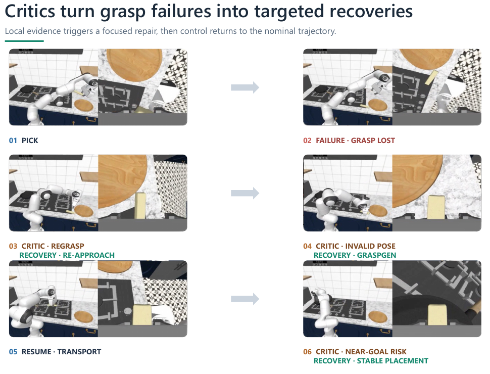
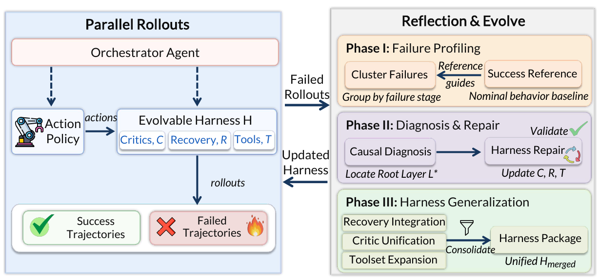
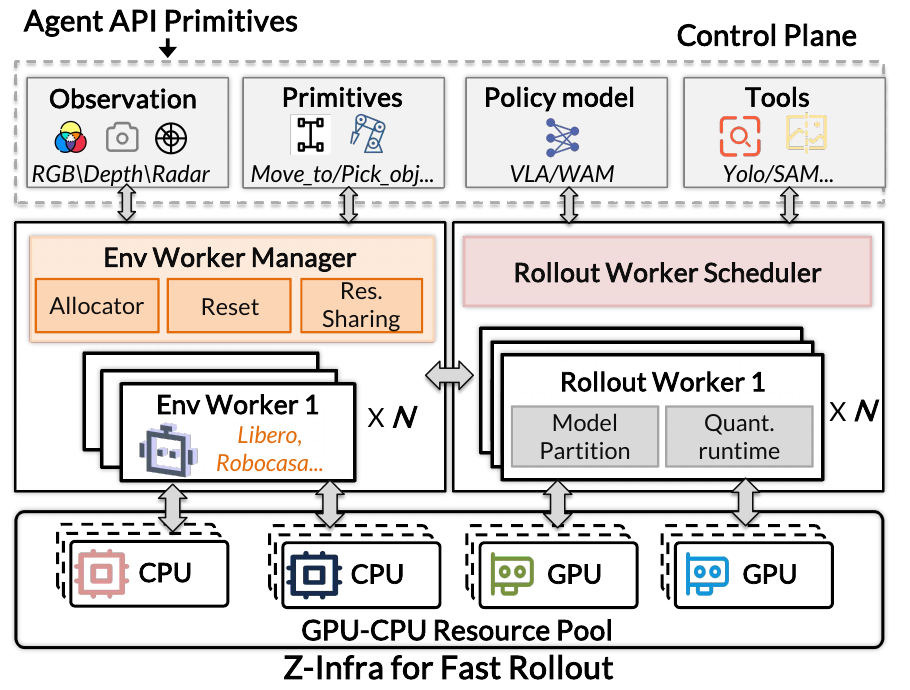

# [Zetta ζ: An Efficient Closed-Loop Embodied Harness for Self-Evolving Physical Intelligence](https://arxiv.org/abs/2608.16590)

> **Brief:** Zetta improves a frozen robot policy by changing the **software that monitors and redirects its execution**. During a task, code-based checks identify physical problems and request targeted recoveries. Between rollout batches, agents analyze recurring failures, revise those checks and recoveries, and validate the changes before reuse. **Z-Infra**, its companion infrastructure, makes the repeated simulation experiments faster.

**Source:** Ding et al., 2026; supplied 47-page PDF, arXiv:2608.16590v1 dated August 17, 2026, with August 18 on the title page, including Appendices A–D. The results below distinguish the Goal-only headline from the broader LIBERO-Pro evaluation.

## Convenient Links

- [Paper](https://arxiv.org/abs/2608.16590), [project](https://air-embodied-brain.github.io/zetta)
- Related systems: [Harness VLA](./Harness_VLA.md), [AdaHVLA](./AdaHVLA.md), [EmbodiedRSI](./EmbodiedRSI.md), [RegenHarness](./RegenHarness.md), [Spotter](./Spotter.md)
- Policies and benchmarks: [pi0.5](../Policies/Pi_0_5.md), [GR00T N1 background](../Policies/GR00T_N1.md), [LIBERO](../Datasets/LIBERO.md), [RoboCasa365](../Datasets/RoboCasa365.md)
- Background: [Agent Memory](../../../Foundations/Agent_Systems/Memory_Systems.md), [Skill Systems](../../../Foundations/Agent_Systems/Skill_Systems.md)

## 1. Why Improve the Checks as Well as the Actions?

Consider placing a wine bottle into a bowl. The robot grasps the bottle and moves toward the bowl, but loses its grasp during lifting. Continuing the transport motion now moves an empty gripper. Even a good placing routine cannot help unless the system first notices that the bottle is missing and reacquires it.

A vision-language-action (**VLA**) policy maps observations and instructions to robot actions. It may already receive fresh observations during execution, yet still fail to recognize or correct this change in physical state. Zetta adds an explicit layer for deciding **whether execution remains valid, what should repair it, and when ordinary control may resume**.

The paper calls this surrounding software a **harness**. Its central idea is to improve both sides of a failure–recovery pair: the check that recognizes the problem and the behavior that resolves it. A fixed “retry” script cannot cover every failure, and a better detector is of little use without an appropriate correction.

Zetta separates work across three timescales:

| When it operates | What happens | What changes |
|---|---|---|
| During an episode | Check execution, invoke recovery, verify the resulting state | The robot's physical state and current control mode |
| After a batch of rollouts | Analyze repeated failures and propose code changes | Candidate monitoring and recovery programs |
| Before adopting a reusable version | Consolidate patches and test them across seeds | The validated harness used in later rollouts |

An **episode**, or rollout here, is one complete task attempt. A **seed** identifies a reproducible randomized environment setup. “Self-evolution” means revising external programs using this experience; the base policy's weights remain fixed.

## 2. How Does Zetta Control One Episode?

### 2.1 Separate Evidence, Decisions, and Physical Actions

The harness contains three kinds of component:

$$
\mathcal{H}=(C,R,\mathcal{T}).
$$

| Component | Meaning | Bottle-to-bowl example |
|---|---|---|
| **Runtime critics $C$** | Executable monitoring functions that report evidence and suggest a control change | Report that the arm is moving but the bottle is no longer retained |
| **Recovery playbooks $R$** | Procedures for responding to particular failure mechanisms | Stop transport, restage the gripper, and attempt a different grasp |
| **Tools $\mathcal{T}$** | Callable implementations that perform monitoring, planning, or motion | Generate a feasible grasp pose or execute controlled placement |

A **runtime critic** is a monitoring program; it need not be a learned reinforcement-learning value function. A **playbook** describes the recovery procedure, while a tool implements an operation that procedure needs. Evolution can add or rewrite tools as well as adjust existing ones.

Two components stay fixed: the action policy and the **Orchestrator**, the paper's name for the reasoning agent that approves control changes. The critic supplies a proposal; the Orchestrator decides whether its evidence justifies an intervention.

For policy observation $o_t$, task goal $g$, and fixed parameters $\theta$, ordinary actions come from

$$
a_t=\pi_\theta(o_t,g),
\qquad \theta\text{ fixed}.
$$

The Orchestrator can change which tool controls execution without changing this policy. Its own reasoning operator also stays fixed; different critic evidence and available recovery tools can still lead it to different decisions.

### 2.2 A Check Must Establish What Physically Happened

An **action chunk** is a short block of motor commands executed before the next control decision. After a policy or recovery chunk, the system collects a **state window** $W_t$: recent actions, observations, and physical measurements used to judge progress.

The case studies check quantities such as:

- commanded versus realized end-effector motion: did the arm move as requested?
- gripper opening, contact on both fingers, and object–gripper drift: is the object actually retained?
- target-relative progress: is a held object moving toward the destination?
- support, containment, and separation after release: was placement completed without disturbing the object?

These checks distinguish an issued command from its physical outcome. “Close the gripper” is an action; “the bottle remains held while lifting” is evidence that acquisition worked.

Formally, the critic returns a proposal $P_t$ containing evidence $e_t$ and suggested mode $\hat{\sigma}_t$. The Orchestrator selects the actual mode $\sigma_t$:

$$
P_t=C(W_t)=\langle e_t,\hat{\sigma}_t\rangle,
\qquad
\sigma_t=\mathcal{A}_{\mathrm{orch}}
(P_t,R,\mathcal{T},\mathcal{K}).
$$

Here $\mathcal{K}$ is task knowledge: milestones, success conditions, and constraints. Mode zero means ordinary policy control; positive modes select specialized tools or recoveries. A **milestone** is an intermediate task condition, such as acquiring the bottle before transporting it.

The runtime sequence is therefore: **execute → collect evidence → check → approve a control choice → execute the chosen policy or recovery**. It is closed-loop because measured outcomes can change which action comes next. The critic does not independently move the robot or declare success. Official task predicates—simulator rules checking the required goal—determine task completion.

The evaluated information is richer than RGB alone. Appendix critics use simulator grasp predicates, contact information, and relative object geometry; diagnosis can also inspect internal simulator state. These inputs should not be assumed available to a camera-only real robot.

The paper describes frequent code checks, including checks at action-chunk boundaries in the appendices. It does not specify a universal frequency in Hz or establish that a large language model reasons at every motor timestep.

### 2.3 Finishing a Recovery Is Not Enough to Hand Control Back

Suppose the recovery closes the gripper again. Immediately resuming transport can repeat the failure if the new contact is unstable. Zetta therefore uses a **re-entry contract**: a condition that must hold before returning control to the base policy.

The original failure evidence must be cleared, and contact must be stable enough for normal execution. For physical state $s_t$, the paper writes

$$
\Psi(s_t)=
\mathbf{1}[\operatorname{FailureCleared}(s_t)]
\land
\mathbf{1}[\operatorname{Stability}(s_t)>\gamma].
$$

$\Psi=1$ permits re-entry; the indicator terms require both conditions. $\gamma$ is an acceptance threshold for the stability measure, which uses force/torque-related physical signals.

For the bottle example, this means checking retention after the regrasp before continuing toward the bowl. The formula expresses that requirement, but the paper does not fully specify the stability score, threshold, or observation duration. It is an abstract handover criterion rather than a complete contact-controller implementation.

### 2.4 Different Problems Need Different Recoveries Within the Same Episode

*Paper Figure 12, a RoboCasa pick-and-place episode. Grasp loss leads to re-approach; an infeasible regrasp leads to grasp generation; near-goal risk leads to stable placement. These are successive physical repairs within one task attempt.*

Figure 12 shows why a single generic retry is insufficient:

1. **The object slips.** The critic reports grasp loss, so transport is interrupted and the robot re-approaches.
2. **The proposed regrasp is infeasible.** Repeating it would not solve the geometry problem. Recovery invokes **[GraspGen](../Grasping/GraspGen.md)**, a tool that generates a feasible grasp pose.
3. **The new grasp is verified.** Ordinary transport can resume.
4. **Placement becomes risky near the goal.** A placement recovery handles final alignment and release, followed by verification.

Appendices C/D spell out related procedures for stove pick-and-place and bottle-to-bowl tasks. A failed grasp causes release, restaging, and a fresh object-relative proposal. **Failed-grasp memory** records rejected attempts so recovery does not keep choosing equivalent proposals within its retry budget.

If transport stalls while the grasp remains stable, the response instead preserves that grasp and switches to finer alignment. Near the destination, placement lowers the object until support or containment is established, releases, and retreats until gripper–object separation is confirmed.

The control choice follows the physical evidence: losing the object calls for reacquisition; being misaligned while still holding it calls for alignment. Those conditions are what the next part of Zetta learns to recognize and repair more reliably.

## 3. How Does a Failure Become a Better Harness?

*Paper Figure 2. The left side executes episodes using the current harness. The right side uses their evidence to profile failures, diagnose and patch their mechanisms, then consolidate validated changes into a version used for later episodes.*

### 3.1 Record Progress So the Final Failure Can Be Explained

Development starts with policy-only rollouts. Their traces record observations, actions, milestone completion, and physical signals such as contact forces and collision intensity. Records are append-only so later diagnosis can inspect how a failure developed.

Infrastructure failures are separated from policy failures. A simulator crash or network outage is rerun with the same logical seed instead of being treated as evidence that a grasp strategy needs repair.

Successful episodes provide references indexed by milestone. Failed episodes are first localized using the **first missing milestone**. An illustrative bottle-task sequence is: approach → acquire → transport while retaining → contain in bowl → release. If acquisition happened but retained transport did not, the investigation should focus on that transition.

This identifies a missing outcome, but not necessarily the event that caused it. The **earliest observable divergence** asks when the failed trace first departs from successful behavior at a comparable stage. The bottle separating from the fingers during lifting may explain why it never reached the bowl.

Thus, milestone analysis narrows **where progress stopped**, while divergence analysis looks for **what went wrong earlier**. The paper describes a state-distance test for divergence, but does not fully specify its metric and numerical thresholds.

### 3.2 Group Similar Mechanisms Before Proposing a Fix

Failures are clustered using divergence context, missing milestones, relative poses, and active tools. This avoids treating every “object not placed” outcome as the same problem.

Each cluster has a **medoid seed**: a representative actual failure near the cluster's center in its failure-feature space. Detailed diagnosis begins there, then checks whether the explanation fits the other members. One isolated success after a patch is not enough to establish that it repaired the shared mechanism.

The diagnosis agent inspects layers in this order:

| Layer | Question before changing code |
|---|---|
| Evaluation | Do the recorded milestone and success checks correctly describe the task? |
| Critic | Was the important event missed or falsely reported? |
| State representation | Are object poses and contact information correct? |
| Planning/control | Does execution fail despite correct state information? |
| Recovery | Is the recovery procedure itself causing the problem? |
| Parameters | Do control gains or thresholds need adjustment? |

The purpose is to fix the earliest effective layer rather than immediately tuning motion parameters. If the bottle is lost but the system never checks retention, changing the transport trajectory does not address the missing check.

Visual diagnosis is anchored to one selected camera view. If that view is insufficient, the agent checks simulator state and physical signals rather than switching views in a way that may confuse spatial reasoning. “Causal diagnosis” here produces a mechanism hypothesis that is subsequently tested through changed execution.

### 3.3 Patch Detection and Recovery, Then Test a Fresh Episode

The repair agent changes the required subset of $C$, $R$, and $\mathcal{T}$. For grasp loss, that might mean adding a retention check and connecting it to a bounded release–restage–regrasp procedure.

Validation has two distinct steps:

1. **Diagnostic replay:** does the revised critic recognize the divergence in the original failure?
2. **Fresh closed-loop execution:** from the initial state, does the changed harness complete the task while following the intervention and re-entry rules?

The second step matters because recognizing an old failure does not show that a repair works. Intervening changes future states, and a correction can introduce a new problem.

A concrete example appears in **LIBERO-Pro Goal-T2**, the bottle-to-bowl task. Selected internal versions achieve **10%** with the frozen policy, **15%** after pregrasp staging changes, and **95%** after a retained-object critic addresses grasp loss before transport.

The paper calls this an **“Aha moment”**: a sharp gain after identifying the decisive physical bottleneck. These points are selected code revisions inside an evolution process. They are not neural-training checkpoints or evidence that every added revision yields such a jump.

### 3.4 Replace Seed-Specific Patches with Reusable Conditions

A patch that moves to one stored coordinate may work only for its original setup. The generalization agent consolidates local patches into conditions and procedures that refer to current physical relationships.

For example, grasping relative to the live object's pose and placing relative to the live destination can survive changes in their positions. The system can reuse this logic by **rebinding** which object and receptacle are being manipulated, without replaying an old trajectory.

The resulting versioned package separates:

| Package part | What it stores |
|---|---|
| `SKILL.md` | Milestones, decision rules, and re-entry conditions |
| `tools/` | Executable critics and tool implementations |
| `plans/` | Recovery procedures selected by failure evidence |
| `params/` | Operating thresholds and numerical settings |

The prescribed admission rule requires **100% success on the originating historical failure cluster**, followed by evaluation on separate held-out seeds. The 100% requirement applies to those known failures, not to all future episodes.

If a held-out failure is used to revise the harness, it becomes development data. New unseen seeds must replace it for final validation. Otherwise, tuning a patch on an episode and then counting that episode as an unseen test would conceal overfitting.

Writing $\mathcal{D}_{\mathrm{fail}}^{(k)}$ for failure traces at iteration $k$, the update is

$$
\mathcal{H}_{k+1}=
\mathcal{A}_{\mathrm{evo}}
\bigl(\mathcal{D}_{\mathrm{fail}}^{(k)},\mathcal{H}_k\bigr).
$$

$\mathcal{A}_{\mathrm{evo}}$ comprises diagnosis, repair, and generalization agents. It proposes changes to programs; validation determines whether they are retained. The paper's analogy to gradient descent describes bounded updates in code/skill space, not gradients through the simulator or updates to policy weights.

## 4. Why Does Zetta Need Its Own Rollout Infrastructure?

### 4.1 Evolution Requires Many Independent Experiments

The preceding process repeatedly executes baseline episodes, replays failures, tests patches, and checks unseen seeds. Slow rollout production therefore limits how much experience evolution can use.

**Z-Infra** separates environment execution from neural-model serving. A simulator needs its own mutable physical state, whereas many episodes can share access to policy and perception models. Keeping these responsibilities separate permits parallel episodes without duplicating every resource for every agent.

*Paper Figure 3. The control plane routes requests; environment workers maintain independent simulations; rollout workers serve neural models. The agent specifies what operation it needs, while infrastructure chooses where it runs.*

| Layer | Responsibility |
|---|---|
| **Control plane / Gateway** | Track sessions, route requests, admit work, and monitor worker health |
| **Environment workers** | Maintain separate simulation states; reset, step, and render environments |
| **Rollout workers** | Run policy/perception models on GPUs and batch compatible requests |

A **session** is a long-lived environment instance; multiple episodes can run in it, each beginning with a reset. The distinction avoids repeatedly rebuilding all resources for every attempt.

For a `policy_step` call, the environment worker supplies observations, a model worker returns actions, and the environment worker executes them. A routing token sends the answer to the correct session while other sessions make progress. `policy_infer` only predicts actions; `action_step` executes supplied actions; `run_episode` keeps the complete rollout inside the workers.

### 4.2 Share Resources Without Sharing Episode State

Compatible MuJoCo environments reuse compiled, read-only model structure and rendering resources, while each slot retains its own mutable physics and episode state. Resetting one slot therefore does not reset another. A C++ stepping path reduces Python overhead in control, physics, and rendering.

Model requests are batched only when their model identity, input modalities, and tensor shapes match. Bounded queues limit incoming work when workers are saturated. If an environment worker fails, affected sessions are marked lost and can be recreated; exact mid-episode restoration is not promised.

For PyTorch pi0.5, Z-Infra also separates the **vision-language encoder**, which processes observations/instructions, from the **action expert**, which converts its representations into actions. Independent scheduling and GPU activation sharing reduce average inference latency by **53%** and improve **goodput by 2.4× under a 200 ms target**. Goodput counts requests completed within that latency target.

An optional quantization path applies **W8A8**, meaning 8-bit weights and activations, to compute-heavy prefix multilayer perceptrons while retaining other modules in 16-bit BF16. It gives **1.18–1.32× inference speedup on RTX 4090** without success degradation in the tested LIBERO setting.

These changes make experiments cheaper. Whether the harness learns better recovery must still be established by task-success measurements.

## 5. What Do the Final Success Rates Measure?

### 5.1 Separate Harness Adaptation from Policy Training and Final Testing

Zetta uses existing policies and evolves their surrounding software:

| Benchmark | Frozen base policy | Development per task | Final evaluation per task |
|---|---|---|---|
| LIBERO-Pro | pi0.5 | 50 seeds excluding seeds 1–20 | Seeds 1–20 |
| RoboCasa | Previously post-trained GR00T N1.5 | 50 random seeds | 50 disjoint seeds |

For LIBERO-Pro, the benchmark setup targets the largest failure cluster and states a stopping criterion of at least 50% success on the targeted development seeds. The method section separately prescribes the 100% historical-cluster admission rule above; the PDF does not fully explain how these criteria are coordinated. Final scores come from separate test seeds. The harness experiments use **eight RTX 4090 GPUs**.

There is no additional VLA pretraining or fine-tuning during this process. The new experience is stored in rollout evidence and executable software. The PDF does not fully specify agent-model configuration, numerical episode horizons, total repair budgets, or every detector threshold, which limits exact reproduction.

The information-access distinction from Section 2 also matters: simulator contact, object geometry, and official predicates support these experiments. The scores do not isolate performance under sensor-only observation restrictions.

### 5.2 LIBERO-Pro Tests Changes in Goals and Object Positions

LIBERO-Pro perturbs tasks from the original LIBERO benchmark. Zetta evaluates ten Goal tasks and ten LIBERO-10 tasks under each of two settings:

- **T: task/instruction redirection.** Redirect the instruction to another valid object or goal.
- **S: position swapping.** Rearrange relevant objects while keeping the instruction fixed.

This yields **40 task-setting pairs**, not every suite in the full LIBERO-Pro benchmark. LIBERO-10 is also called Long in the paper.

Table 3 reports:

| Setting | Frozen pi0.5 | Zetta | Absolute gain |
|---|---:|---:|---:|
| Goal-T | 31.0% | 92.5% | 61.5 points |
| Goal-S | 38.0% | 89.0% | 51.0 points |
| LIBERO-10-T | 50.0% | 63.0% | 13.0 points |
| LIBERO-10-S | 9.0% | 40.0% | 31.0 points |
| All 40 settings | 32.00% | **71.13%** | 39.13 points |

The abstract's **90.8%** is consistent with the **Goal-only average**: $(92.5+89.0)/2=90.75\%$, with a corresponding baseline of 34.5%. The broader 40-setting score is 71.13%.

Zetta improves 32 task-setting pairs and matches eight. The smaller LIBERO-10 gains and remaining zero-success settings show that stronger local recovery does not resolve every multi-stage task.

### 5.3 RoboCasa Evaluates Eighteen Atomic Tasks

The RoboCasa result covers the complete **18-task Atomic-Seen split of RoboCasa 1.0.1**: individual operations such as navigation, object transfer, and appliance manipulation. “Seen” names the task partition; the final environment seeds are still held out. This does not evaluate the full RoboCasa365 task collection.

Table 2 gives the following selected results:

| Task | Frozen GR00T N1.5 | Zetta |
|---|---:|---:|
| PickPlaceSinkToCounter | 58% | 96% |
| PickPlaceDrawerToCounter | 48% | 86% |
| SlideDishwasherRack | 76% | 94% |
| CloseBlenderLid | 50% | 100% |
| All 18 tasks | 73.56% | **93.56%** |

The aggregate is a **macro-average**: each task contributes equally to the average success rate. Its 20-point gain shows useful harness adaptation across this task set, including contact-rich manipulation. It is not a measurement of general real-world deployment reliability.

## 6. Does Accumulated Experience Help Beyond the Repaired Episode?

### 6.1 More Validated Mechanisms Improve the Same Task Collection

Across four cumulative global repair rounds, RoboCasa success rises

$$
73.56\%\rightarrow78.71\%\rightarrow84.85\%
\rightarrow90.54\%\rightarrow93.56\%.
$$

Each checkpoint retains previously validated critics, recoveries, and tools. Thus later versions can handle several failure mechanisms rather than replacing one successful correction with another.

These rounds differ from the within-episode sequence in Figure 12: one chains physical repairs during an attempt; the other adds reusable capabilities across software versions. The upward curve supports improvement with the reported experience budget, but does not independently isolate critics, recovery code, extra tools, and infrastructure through a comprehensive component ablation.

### 6.2 Transfer Tests Whether the Physical Rule Is Reusable

On **PnP-Stove**, a counter-to-stove pick-and-place task, evolution adds pregrasp alignment, regrasp after loss, and stable placement. The accumulated harness is then applied to related target tasks **without additional target-task evolution**:

| Transfer task | Parent policy | Transferred harness |
|---|---:|---:|
| PnP-Sink | 58% | 82% |
| PnP-Cabinet | 62% | 80% |
| PnP-Toaster | 72% | 90% |
| Average | 64% | 84% |

The transfer scores are distinct from independently evolved task-specific results in Table 2. They test whether the existing correction mechanisms work when the live object and destination are changed.

A second source, **TurnOffStove**, supplies target-localization, collision-aware approach, and stable-contact mechanisms. Their transfer to three related articulated-interaction tasks raises average success from **64% to 80%**. LIBERO-Pro transfer comparisons similarly match seeds, policy random-number settings, checkpoints, and execution budgets across alternatives.

Here **“zero-shot” refers to harness evolution**: the target gets no additional repair-development rounds. It does not mean the frozen policy never encountered related tasks in its original training. The demonstrated reuse concerns related physical failure mechanisms.

## 7. How Much Faster Does Z-Infra Make the Experiments?

The infrastructure comparison uses **eight A100 GPUs**, identical model checkpoints, and identical action budgets on LIBERO Goal. **Concurrency** is the number of simultaneously active rollouts. **Throughput** counts completed valid episodes per minute; **latency** measures how long one episode takes.

Figure 15 reports:

| Concurrency | Zetta + Z-Infra | Zetta without Z-Infra | RPent |
|---|---:|---:|---:|
| 8 | 12.18 episodes/min | 2.71 | 1.10 |
| 16 | 22.09 episodes/min | 2.88 | 1.72 |
| 32 | 32.8 episodes/min | Out of memory | Out of memory |
| 64 | 35.1 episodes/min | Out of memory | Out of memory |

RPent is the paper's agent-in-the-loop baseline, which pays language-model-call overhead along the execution path.

At the same concurrency of 16, Z-Infra provides **7.7×** the throughput of Zetta without it and **12.8×** that of RPent. Episode latency is about **43 s versus 112 s and 513 s**. At concurrency 64, throughput reaches 35.1 episodes/min while latency rises to 95 s: completing more episodes overall can still mean a longer wait for an individual episode.

The headline **20.6× throughput** compares peak rates at different supported concurrency levels. The abstract's **11.1× “inference” speedup** should also be kept separate from the 53% neural-inference latency reduction in Section 4: the main infrastructure plots measure episode wall-clock time.

One runtime detail remains unresolved. Section 2 specifies an online reasoning Orchestrator approving mode changes, whereas Section 4.6 attributes low overhead to agents running offline and lightweight critics running online. The PDF does not fully reconcile these descriptions. It establishes a code-based monitoring path, but not a language-model call at every check.

## 8. What Distinguishes Zetta from Other Robot Agent Systems?

[Spotter](./Spotter.md) focuses on parallel screening, VLM judgment, physical repair, and checking its effect during execution. Zetta additionally makes the executable monitoring and recovery programs themselves the subject of repeated, validated revision.

Like [AdaHVLA](./AdaHVLA.md), it changes software around a fixed policy. Its distinctive emphasis is the coupled **failure check → targeted recovery → verified re-entry** mechanism, together with infrastructure for testing revisions at scale. [Harness VLA](./Harness_VLA.md), [EmbodiedRSI](./EmbodiedRSI.md), and [RegenHarness](./RegenHarness.md) provide related perspectives on tool use and improving external control logic.

The reported quantitative evidence is simulation-based; extending the approach to real robots is future work in the conclusion. Its strongest supported result is that accumulated, validated monitoring and recovery code can substantially improve frozen policies on the tested task distributions. Simulator-state access, unspecified settings, and limited component ablations constrain how far those results can be generalized.
