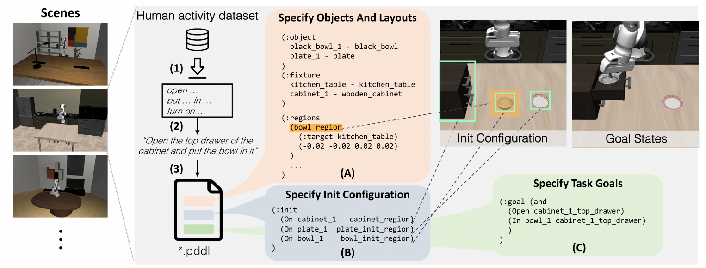
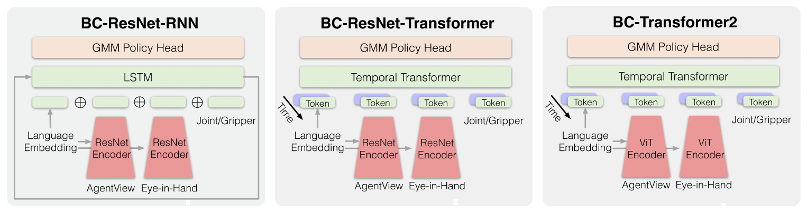

# [LIBERO: Benchmarking Knowledge Transfer for Lifelong Robot Learning](https://arxiv.org/abs/2306.03310)

> **Brief:** LIBERO is a simulation benchmark for **lifelong robot learning**, with a procedural task generator, **130 manipulation tasks**, and **50 human demonstrations per task**. Its central contribution is to separate spatial, object, and behavioral knowledge transfer, then measure how policies acquire new skills while retaining earlier ones. The original experiments expose a tradeoff between learning new tasks and preventing forgetting.

**Source:** Liu et al., NeurIPS 2023, Datasets and Benchmarks Track; local paper [2306.pdf](../../../../tmp/2306.pdf), arXiv:2306.03310v2, October 14, 2023, including Appendices A–E. Results below follow this version's lifelong imitation-learning protocol.

## Convenient Links

- [Paper](https://arxiv.org/abs/2306.03310), [project](https://libero-project.github.io/), [official code](https://github.com/Lifelong-Robot-Learning/LIBERO), [documentation](https://lifelong-robot-learning.github.io/LIBERO/html/)
- Related datasets and environments: [Open X-Embodiment](./Open_X_Embodiment.md), [RoboCasa365](./RoboCasa365.md)
- Related policies: [Diffusion Policy](../Policies/Diffusion_Policy.md), [OpenVLA](../Policies/OpenVLA.md)

## 1. What Knowledge Must Survive Learning a New Task?

Consider a robot that has learned to put a bowl on a plate. A new instruction might select an identical bowl at another location, replace the bowl with a different object, or ask the robot to open a drawer and place the bowl inside. These changes require different kinds of transfer:

- **Declarative knowledge:** which objects exist, what they are, and how they relate spatially.
- **Procedural knowledge:** which actions and motion sequences accomplish a goal.

A robot can preserve object recognition while forgetting how to grasp, or retain a placing motion while selecting the wrong bowl. Consequently, classification-style continual-learning benchmarks cannot fully characterize forgetting in manipulation: small action errors can change later observations and eventually prevent task completion.

LIBERO frames this as **lifelong learning in decision-making (LLDM)**. A task is

$$
\mathcal{T}^k=(\mu_0^k,g^k),
\qquad g^k:\mathcal{S}\rightarrow\{0,1\},
$$

where $\mu_0^k$ specifies initial configurations and $g^k$ checks the goal. Tasks share the state space $\mathcal{S}$, action space $\mathcal{A}$, transition dynamics, and horizon in the paper's formulation. A task-conditioned policy learns tasks $1,\ldots,K$ sequentially and should remain successful on **all tasks encountered so far**.

The defining constraint is data access: when task $k$ arrives, complete datasets from earlier tasks are no longer assumed available. A method may preserve parameters or an allowed replay memory. Joint training on all tasks is a separate reference setting.

To determine which knowledge is lost, the benchmark must control what changes between tasks. This motivates its task generator and curated suites.

## 2. Turn an Instruction into a Testable Task

*Paper Figure 2, cropped from PDF page 4. A language instruction is paired with objects, an initial configuration, and a conjunction of simulator-checkable goal predicates.*

LIBERO builds on **robosuite** and generates tasks in three connected steps:

1. **Choose a behavior and instruction.** Extract language descriptions from Ego4D human-activity annotations, summarize them into behavioral templates, and instantiate templates with simulator-supported objects.
2. **Specify the initial distribution.** Select a compatible scene and describe objects, placement regions, and initial object states in a PDDL-based file. These choices determine $\mu_0$.
3. **Specify success.** Construct a conjunction of unary predicates, such as an object being open, and binary predicates, such as one object being inside another.

For “open the top drawer of the cabinet and put the bowl in it,” the essential goal is

$$
g(s)=
\operatorname{Open}(\text{top drawer};s)
\land
\operatorname{In}(\text{bowl},\text{top drawer};s).
$$

The simulator terminates successfully when all required predicates hold. The conjunction specifies a successful state; action ordering follows from the task's physical requirements and policy execution.

This construction connects language to reproducible evaluation. The instruction tells the policy what to do; the symbolic specification lets the simulator determine whether it succeeded. Ego4D supplies **behavioral inspiration**, while the manipulation demonstrations used for training are collected separately in simulation.

The generator is extensible, but the published benchmark fixes its task sets. An expandable generator does not make the released dataset an unlimited collection.

## 3. Control the Shift, Then Add Entangled Tasks

### 3.1 Four Suites, with a Separate Pretraining Split

| Task collection | Tasks | Controlled change or role | Knowledge emphasized |
|---|---:|---|---|
| **LIBERO-Spatial** | 10 | Put a bowl on a plate; distinguish identical bowls through their spatial relations | Declarative spatial knowledge |
| **LIBERO-Object** | 10 | Pick and place different object types | Declarative object knowledge |
| **LIBERO-Goal** | 10 | Keep objects and spatial relations fixed while changing the requested goal | Procedural knowledge |
| **LIBERO-100** | 100 | Vary objects, scenes, interactions, and required skills together | Entangled knowledge transfer |
| ↳ **LIBERO-90** | 90 of the 100 | Short-horizon tasks used for robot-policy pretraining | Source experience |
| ↳ **LIBERO-Long** | 10 of the 100 | Long-horizon tasks used for downstream lifelong evaluation | Transfer and retention under greater difficulty |

The first three suites are collectively called **LIBERO-X**. In Spatial, selecting the correct bowl changes while the broad manipulation behavior remains similar. Goal reverses that emphasis: the scene remains fixed, but the robot must learn different behaviors. These controls help interpret a performance change instead of attributing every failure to a mixture of perception and control.

LIBERO-100 then asks whether the same conclusions hold when knowledge types interact. Its split gives a concrete pretraining question: does experience on 90 shorter tasks help a robot sequentially learn ten longer ones?

There are **130 distinct released tasks**: $10+10+10+100$. LIBERO-90 and LIBERO-Long partition the final 100; they are not additional tasks. The main lifelong comparisons use four **ten-task streams**: Spatial, Object, Goal, and Long.

### 3.2 Demonstrations Supply the Learning Signal

Human experts teleoperate the robot with a **3Dconnexion SpaceMouse**, providing **50 high-quality trajectories per task**. Across 130 tasks, this is $130\times50=6500$ demonstrations.

A trajectory contains observations and manipulation actions. The baseline policies use an external agent-view image, an eye-in-hand image, and joint/gripper information, together with the instruction. The two views help identify the target and observe local interactions; temporal context helps resolve partial observability.

These are demonstrations for **behavioral cloning (BC)**. Simulator success predicates evaluate execution, while expert actions provide the supervised training targets. The original comparisons therefore study lifelong imitation learning, even though the environment can also support other learning algorithms.

## 4. How Does the Policy Learn and Execute?

### 4.1 The Supervised Objective Approximates a Sequential Decision Problem

Let $\mathcal{D}^k$ contain demonstrations for task $k$, $\ell_k$ be its instruction, and $h_t=o_{\le t}$ represent observation history. A task's BC loss can be written as

$$
\mathcal{L}_{\mathrm{BC}}^k(\theta)=
\mathbb{E}_{\tau\sim\mathcal{D}^k}
\left[
-\sum_t\log\pi_\theta(a_t\mid h_t,\ell_k)
\right].
$$

History is introduced because a single image need not reveal the state needed for control. The implemented recurrent or temporal models summarize observation sequences rather than receiving the simulator's full state.

Ideally, the learner would minimize the average loss over every task seen so far. The lifelong constraint prevents unrestricted joint access to those datasets, so the learning algorithm must approximate retention through replay, regularization, or parameter allocation.

### 4.2 Compare Spatial and Temporal Representations

*Paper Figure 6, cropped from PDF page 17. Left to right: ResNet-RNN, ResNet-T, and ViT-T. All three produce action distributions through a GMM head; their visual, temporal, and language-fusion mechanisms differ.*

| Policy | Visual representation | Temporal representation | Language conditioning |
|---|---|---|---|
| **ResNet-RNN** | ResNet | LSTM | FiLM modulation of visual features and language input to the LSTM |
| **ResNet-T** | ResNet | Transformer decoder | ResNet uses language modulation; language also enters as a temporal token |
| **ViT-T** | Vision Transformer | Transformer decoder | Language tokens enter both visual and temporal transformers |

The default task representation is a **768-dimensional pretrained BERT embedding**. This language encoder's pretraining is separate from the LIBERO-90 robot-policy pretraining studied later.

The temporal Transformers use a maximum sequence length of **10**, with four layers and six attention heads; the LSTM baseline has two layers and hidden size 1024. The paper approximately matches architecture computation at **13.5 GFLOPs**.

Each baseline predicts a Gaussian mixture over continuous end-effector actions:

$$
\pi_\theta(a_t\mid h_t,\ell_k)
=
\sum_{m=1}^{M}
w_m\,\mathcal{N}(a_t;\mu_m,\Sigma_m),
\qquad
w_m\geq0,\quad \sum_m w_m=1.
$$

For $M$ mixture components, the head produces weights $w_m$, means $\mu_m$, and covariances $\Sigma_m$ conditioned on the policy representation. During execution, the robot samples an action, acts, receives another observation, and repeats. This supports multiple plausible action choices in demonstrations. The GMM is a **baseline policy choice**, not a requirement imposed on every method evaluated in LIBERO.

## 5. What Changes When Earlier Data Disappear?

The paper compares five training strategies with the same BC backbone:

| Strategy | Retention mechanism | Main tradeoff |
|---|---|---|
| **SeqL** | Sequential fine-tuning without an explicit retention mechanism | Adapt freely, but risk overwriting previous skills |
| **ER** | Mix current-task data with stored experience from earlier tasks | Preserve earlier behavior at a memory and replay cost |
| **EWC** | Penalize changes to parameters estimated important for earlier tasks | Restrict forgetting, potentially restricting useful adaptation |
| **PackNet** | Train, prune, fine-tune, and freeze task-specific parameter allocations | Protect old parameters while reducing capacity available for later tasks |
| **MTL** | Train jointly with all task datasets available | Reference performance with broader data access |

MTL provides a useful joint-training reference; its measured score is not a mathematical upper bound on every lifelong method.

For EWC, the added penalty has the form

$$
\mathcal{L}_{\mathrm{EWC}}^k(\theta)
=
\mathcal{L}_{\mathrm{BC}}^k(\theta)
+
\frac{\lambda}{2}
\sum_r \widetilde{F}_r
(\theta_r-\theta_{k-1,r}^{*})^2,
$$

Here, $\theta_{k-1}^{*}$ is the previous task's parameter checkpoint, and $\widetilde{F}_r$ estimates parameter $r$'s importance through a diagonal empirical Fisher estimate. The implementation uses an online moving average with decay **0.9** and $\lambda=5\times10^4$.

Appendix B.1 describes ER with capacity up to **1,000 trajectories** and **32 replay trajectories per update** alongside current-task training data. PackNet selects **25%** of parameters in its pruning step, fine-tunes the selected allocation for another **50 epochs**, and freezes it. The appendix specifies that its reported evaluation metrics are calculated **before this additional fine-tuning stage**.

These choices expose the central tension: protecting previous behavior can reduce the freedom or capacity needed to learn the next task. The evaluation must therefore measure acquisition and retention separately.

## 6. Measure Learning Speed and Forgetting from Rollouts

### 6.1 Training and Checkpoint Selection

Appendix D specifies the following main protocol:

| Setting | Original paper |
|---|---|
| Data and optimization per incoming task | 50 demonstrations, 50 training epochs |
| Optimizer | Adam; batch size 32 |
| Learning rate | Cosine schedule from $10^{-4}$ to $10^{-5}$ for each task |
| Current-task evaluation | Every 5 epochs; 20 test rollouts per checkpoint |
| Rollout limit | 600 steps |
| Task-boundary checkpoint | Best current-task success rate |
| Retention evaluation | At the selected checkpoint, 20 rollouts on each earlier task |
| Repetitions | Seeds 100, 200, 300 |
| Main comparison grid | 4 suites × 3 architectures × 5 strategies × 3 seeds = 180 runs |

The selected best checkpoint is carried forward to the next task. Consequently, the reported protocol includes **rollout-based model selection**, which should be matched when comparing results.

Success rate is necessary because low BC loss alone does not establish reliable control. Appendix E.2 shows that EWC can have low loss and poor execution, while ER can have higher loss and better success. A small prediction error may compound after the robot leaves demonstrated states.

### 6.2 The Three Metrics Answer Different Questions

Let $c_{i,j,e}$ be success rate on task $j$ after learning $i-1$ tasks and training for $e$ epochs on incoming task $i$. Evaluations use $e\in\{0,5,\ldots,50\}$.

Define $c_{i,i}=\max_e c_{i,i,e}$ and let $e_i^*$ be the earliest epoch attaining that maximum. For earlier tasks, $c_{i,j}=c_{i,j,e_i^*}$. When computing the current-task learning curve, the paper holds $c_{i,i,e}$ at its peak for every $e\geq e_i^*$, reflecting best-checkpoint selection.

**Forward transfer (FWT)** averages success while learning each incoming task:

$$
\operatorname{FWT}_k
=
\frac{1}{11}
\sum_{e\in\{0,5,\ldots,50\}}c_{k,k,e}.
$$

Higher FWT rewards faster acquisition and higher success within the training budget. It includes training on task $k$: it is **not a zero-shot score or a gain relative to an independently trained baseline**. Even the first task contributes to FWT.

**Negative backward transfer (NBT)** measures the drop from a task's selected success rate after learning later tasks:

$$
\operatorname{NBT}_k
=
\frac{1}{K-k}
\sum_{i=k+1}^{K}(c_{k,k}-c_{i,k}),
\qquad k<K.
$$

Lower is better. Because the formula uses signed differences, improvement on an earlier task can produce a negative contribution. The printed equation does not specify the endpoint convention for $k=K$, which has no subsequent tasks; a reproduction should state how it handles this endpoint.

**Area under the success-rate curve (AUC)** combines initial acquisition with subsequent retention:

$$
\operatorname{AUC}_k
=
\frac{
\operatorname{FWT}_k+
\sum_{i=k+1}^{K}c_{i,k}
}{K-k+1}.
$$

The paper reports task-averaged metrics. Its AUC is this normalized combination of learning and retention scores, so it should be distinguished from final-checkpoint success.

For example, suppose a bowl task is first in a three-task stream. Its learning-curve average is 0.60, its selected success is 0.80, and later success rates are 0.70 and 0.40. Then $\operatorname{NBT}_1=0.25$ and $\operatorname{AUC}_1=(0.60+0.70+0.40)/3\approx0.57$. Learning the task well initially does not prevent a low score once later training erodes that skill.

## 7. What Do the Main Results Establish?

Values below are fractions in $[0,1]$. The paper's tables report means and standard errors over three seeds.

### 7.1 Retention Can Improve While Acquisition Gets Worse

Holding the policy fixed to **ResNet-T**, Table 2 gives:

| Strategy | Long FWT ↑ | Long NBT ↓ | Long AUC ↑ | Spatial AUC ↑ | Object AUC ↑ | Goal AUC ↑ |
|---|---:|---:|---:|---:|---:|---:|
| SeqL | **0.54 ± 0.01** | 0.63 ± 0.01 | 0.15 ± 0.00 | 0.20 ± 0.01 | 0.26 ± 0.02 | 0.22 ± 0.00 |
| ER | 0.48 ± 0.02 | 0.32 ± 0.04 | **0.32 ± 0.01** | 0.56 ± 0.01 | 0.44 ± 0.06 | 0.49 ± 0.02 |
| EWC | 0.13 ± 0.02 | 0.22 ± 0.03 | 0.02 ± 0.00 | 0.06 ± 0.01 | 0.16 ± 0.02 | 0.06 ± 0.00 |
| PackNet | 0.22 ± 0.01 | **0.08 ± 0.01** | 0.25 ± 0.00 | **0.63 ± 0.00** | **0.60 ± 0.05** | **0.75 ± 0.01** |
| MTL reference | — | — | 0.48 ± 0.01 | 0.83 ± 0.00 | 0.54 ± 0.02 | 0.80 ± 0.01 |

*Bold identifies the best sequential strategy in each displayed column; it does not assert statistical significance.*

SeqL has the **highest FWT in all four suites**, but strong forgetting reduces its AUC. Thus, the evaluated lifelong mechanisms improve retention at an acquisition cost.

PackNet achieves high AUC on the controlled suites, but its low Long FWT limits overall Long performance. The authors hypothesize that parameter partitioning leaves insufficient capacity for harder tasks. This is an interpretation of the results, rather than a direct capacity measurement.

ER offers the strongest Long AUC among these sequential methods and performs reasonably across all suites. EWC demonstrates why low forgetting alone is insufficient: a learner that acquires little has little successful behavior to preserve.

### 7.2 Architecture Conclusions Depend on the Learning Algorithm

To isolate architecture effects, the following subset of Table 1 holds ER fixed and reports **mean AUC**:

| Policy | Long | Spatial | Object | Goal |
|---|---:|---:|---:|---:|
| ResNet-RNN | 0.08 | 0.29 | 0.17 | 0.26 |
| ResNet-T | **0.32** | **0.56** | 0.44 | **0.49** |
| ViT-T | 0.25 | 0.50 | **0.57** | 0.38 |

Temporal Transformers outperform the recurrent baseline in these comparisons. Within the Transformer policies, ResNet-T is stronger under ER except on Object, where ViT-T benefits.

Changing the lifelong algorithm changes the comparison: with PackNet, **ViT-T reaches 0.34 ± 0.01 Long AUC**, exceeding ResNet-T's **0.25 ± 0.00**. The paper finds no significant difference between these two architectures on the other three PackNet suites.

The supported conclusion is conditional: visual representation, temporal modeling, and the retention mechanism interact. These experiments do not establish a universally best visual encoder.

## 8. Do Language, Task Order, and Pretraining Change the Story?

### 8.1 Language Can Function Primarily as a Task Identifier

On Long with **ER + ResNet-T**, Table 3 compares:

| Task embedding | Dimension | AUC |
|---|---:|---:|
| BERT | 768 | 0.32 ± 0.01 |
| CLIP | 512 | 0.35 ± 0.01 |
| GPT-2 | 768 | 0.30 ± 0.01 |
| Task-ID through BERT | 768 | 0.33 ± 0.01 |

“Task-ID” means encoding a string such as **“Task 5” with pretrained BERT**; it is not a one-hot vector. The paper finds no statistically significant difference among these encodings.

This ablation limits what success demonstrates about language understanding. Distinct task embeddings may identify behaviors adequately in a fixed demonstrated task set, even without exploiting the full semantics of an instruction. The result does not establish generalization to unseen paraphrases or novel instruction compositions.

### 8.2 Task Order Changes Which Transfer Is Available

Figure 4 compares ER and PackNet with ResNet-T under **five task orderings**. Performance varies for both, with statistically significant differences across orderings for PackNet.

Ordering matters because prior skills determine the starting point for the next task. It also changes when PackNet allocates capacity and which tasks must survive the longest sequence of subsequent updates. These mechanisms explain why one ordering cannot establish robustness to an arbitrary task stream.

### 8.3 Robot-Policy Pretraining Is a Separate Training Stage

The pretraining experiment uses this sequence:

1. **Pretrain:** jointly apply BC to the 90 short-horizon LIBERO-90 tasks for 50 epochs.
2. **Select:** save checkpoints every five epochs and choose the best-performing checkpoint for each architecture.
3. **Adapt sequentially:** initialize the policy from that checkpoint and learn the ten LIBERO-Long tasks under the downstream lifelong algorithm.
4. **Compare:** evaluate against training the corresponding lifelong learner from scratch; include joint MTL as a reference.

Figure 5 compares five algorithm–architecture combinations. The observed result is that **basic supervised BC pretraining can hurt downstream lifelong performance**.

The distinction between stages matters: Long tasks still supply demonstrations and receive training. This experiment measures the effect of initialization on subsequent learning and retention; it is not zero-shot transfer from LIBERO-90 to Long. Its negative result concerns the tested pretraining recipe, not all possible forms of robot pretraining.

## 9. How Should LIBERO Results Be Interpreted?

A result should identify the task subset, demonstration budget, training regime, task order, checkpoint-selection rule, and reported metric. The original paper's lifelong AUC, a jointly trained policy's average success, and success on previously unseen tasks answer different questions.

The released demonstrations and predicates support comparisons of other policy families, including the [Diffusion Policy](../Policies/Diffusion_Policy.md) and [OpenVLA](../Policies/OpenVLA.md) notes in this repository. Their LIBERO evaluations should be read under their own protocols. The original paper establishes simulation-based manipulation transfer under sequential imitation learning; real-world transfer, unrestricted language understanding, and robustness outside its task distributions require additional evidence.
