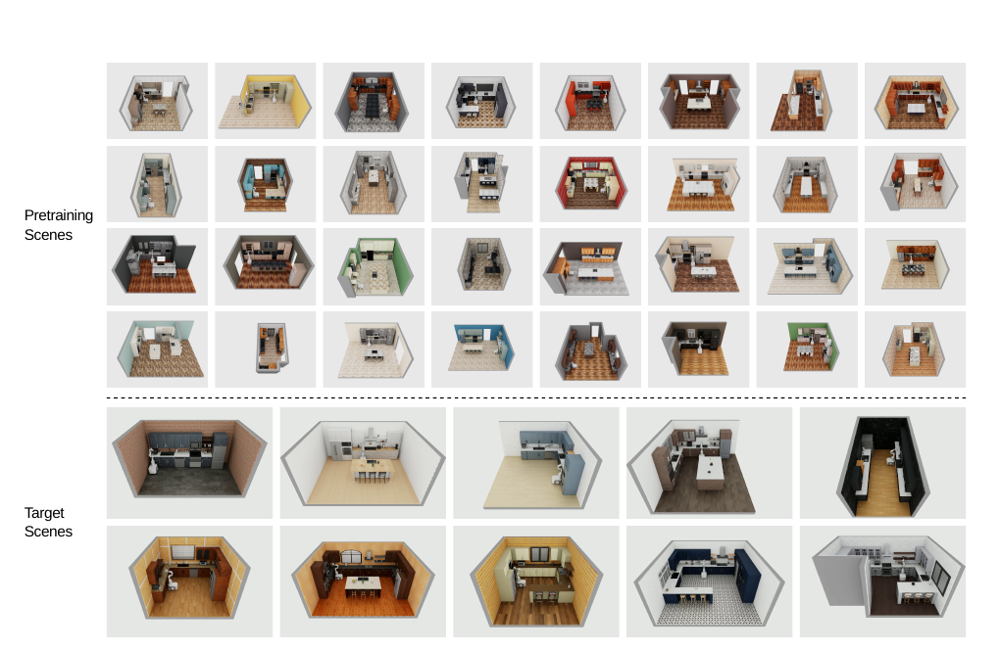
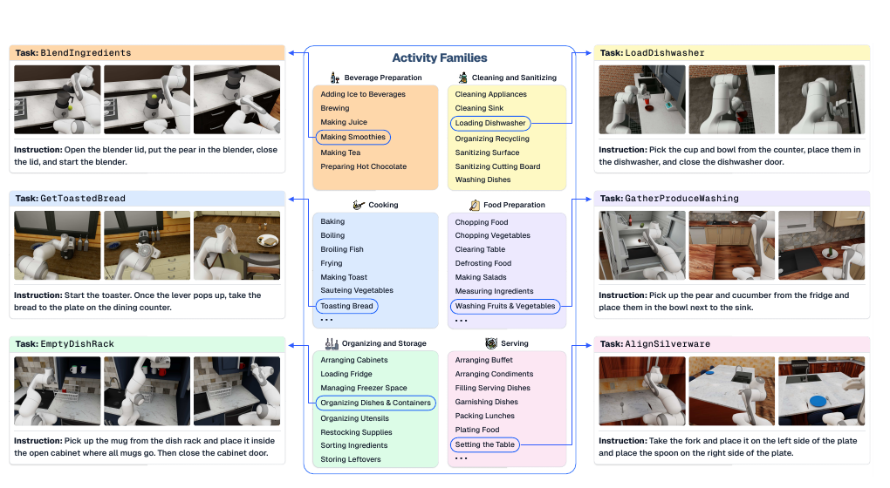

# [RoboCasa365: A Large-Scale Simulation Framework for Training and Benchmarking Generalist Robots](https://proceedings.iclr.cc/paper_files/paper/2026/hash/a05003fdb1e9562ab0c0a9719ea4de10-Abstract-Conference.html)

> **Brief:** RoboCasa365 combines **365 kitchen tasks, 2,500 pretraining kitchens, separate target kitchens, and large demonstration datasets** to study generalist robot learning. Its main contribution is a controlled benchmark for multi-task training, simulation pretraining followed by target adaptation, and lifelong learning. The experiments show useful transfer from broad demonstration data, while long-horizon composition, physical variation, and forgetting remain difficult.

**Source:** Nasiriany et al., ICLR 2026; [published proceedings PDF](https://proceedings.iclr.cc/paper_files/paper/2026/file/a05003fdb1e9562ab0c0a9719ea4de10-Paper-Conference.pdf), including Appendices A–I, accessed November 6, 2026. All tables below report this paper's experiments. Later release changes are identified separately in Section 8.

## Convenient Links

- [Paper and supplementary material](https://proceedings.iclr.cc/paper_files/paper/2026/hash/a05003fdb1e9562ab0c0a9719ea4de10-Abstract-Conference.html)
- [Project](https://robocasa.ai/), [official code](https://github.com/robocasa/robocasa), [documentation](https://robocasa.ai/docs/build/html/introduction/overview.html)
- Related benchmarks: [LIBERO](./LIBERO.md), [Open X-Embodiment](./Open_X_Embodiment.md)
- Evaluated policy families: [Diffusion Policy](../Policies/Diffusion_Policy.md), [pi0](../Policies/Pi_0.md), [pi0.5](../Policies/Pi_0_5.md), [GR00T N1 background](../Policies/GR00T_N1.md)
- Related agent evaluations: [Spotter](../Agentic_Systems/Spotter.md), [SenseNova-RoboRSI](../Agentic_Systems/SenseNova_RoboRSI.md)

## 1. What Must a Generalist-Robot Benchmark Separate?

A robot may learn to put a bowl into one microwave but fail when the appliance changes, when the bowl must first be fetched from another counter, or when a new task combines familiar actions differently. A single success rate does not distinguish these problems.

RoboCasa365 makes three experimental questions explicit:

1. **Task coverage:** can one language-conditioned policy learn many behaviors and execute unseen compositions?
2. **Transfer:** does broad simulation experience reduce the target demonstrations needed in different kitchens?
3. **Retention:** after learning harder tasks, does the policy preserve earlier skills?

The simulator, datasets, and splits are designed together to expose these questions. RoboCasa365 is not a new policy architecture: it supplies the environments, training experience, and evaluation protocols on which several policies are compared.

## 2. Build Task Diversity on Top of Environment Diversity

### 2.1 A Kitchen Is a Layout–Style Combination



*Paper Figure 2. The top shows samples from the 2,500 pretraining kitchens; the bottom shows all ten target kitchens. These scene partitions enable adaptation and environment-transfer experiments.*

RoboCasa365 extends RoboCasa with **50 new layouts and 50 styles**, whose combinations yield $50\times50=2500$ pretraining kitchens. Layouts approximate real homes sourced from US real-estate listings; styles select fixtures, appliances, and textures.

The target partition uses **ten fixed layout–style pairs**, not all $10\times10$ combinations. Its styles do not share fixture, appliance, or environment-texture instances with the pretraining styles. Thus, the headline 2,500 refers to pretraining kitchens; ten target kitchens are additional.

The asset collection includes the earlier 2,509 objects across 153 categories, new objects across 57 categories, and **456 interactive fixture/appliance instances across 12 categories**. Articulated fridges, ovens, dishwashers, mixers, and other appliances support behaviors beyond tabletop pick-and-place.

This variation serves an experimental purpose: matching task semantics across different kitchens tests whether a policy learned a transferable procedure rather than one layout's pixels and coordinates.

### 2.2 Tasks Compose Skills into Kitchen Activities



*Paper Figure 3. Six activity families organize 60 activities, with task examples showing different objects, fixtures, and skill sequences. LLM-generated blueprints guide task design; executable simulator tasks are implemented afterward.*

The suite contains **65 atomic tasks and 300 composite tasks**. Atomic tasks instantiate foundational skills such as pick-and-place, opening doors/drawers, turning levers/knobs, pressing buttons, insertion, and navigation. Composite tasks combine these operations into activities such as preparing drinks, storing food, or loading a dishwasher. Across the full suite, **220 tasks require mobility** and 145 do not.

For composite-task construction, LLMs first propose activities and then blueprints specifying task intent, objects, fixtures, and skill sequences. The authors implement the corresponding task code. The LLM's role here is **benchmark construction**, not an assumed runtime planner for every evaluated policy.

Consider the held-out composite task `WaffleReheat`: open a microwave, place a bowl containing a waffle inside, close the door, and activate the appliance. Its operations are individually familiar, but success requires correct ordering, contact, and preservation of the bowl's placement. New appliance geometry adds an environment-transfer challenge on top of the compositional one.

The suite includes a long tail of tasks with up to 16 subtasks, while demonstrations are usually 10–60 seconds long and sometimes exceed three minutes. Longer execution therefore tests more than visual recognition: mistakes can block the prerequisites for later actions.

### 2.3 Observation, Action, and Success Interfaces

The simulator is built on **robosuite and MuJoCo**, with CPU physics and GPU rendering. The policy/control interface runs at **20 Hz**, and multiple asynchronous environments support parallel data generation and evaluation.

The reported demonstrations use a **Franka Panda on an Omron mobile base**. The framework can support other embodiments, but the main benchmark does not itself establish transfer to unseen robot bodies.

For language instruction $\ell$, the evaluated policies receive

$$
o_t=(I_t^{\mathrm{wrist}},I_t^{\mathrm{left}},I_t^{\mathrm{right}},q_t),
\qquad
a_t\sim\pi_\theta(\cdot\mid o_{\leq t},\ell).
$$

The three RGB views are **$256\times256$**; $q_t$ includes base pose, end-effector pose, and gripper state. The history/action-chunk interface depends on the policy family rather than being identical across all models.

The action space has **12 dimensions**: seven arm/gripper commands (three translation, three rotation, one gripper), plus five for mobile-base translation/rotation, torso height, and a mode gating base control. A low-level operational-space controller executes the arm commands.

Tasks expose a binary simulator success condition. Appendix G evaluates **30 rollouts per task at a specified checkpoint**, each with a task-dependent maximum horizon. An episode succeeds if the condition is reached within that horizon; reported averages are over tasks. These are full-task completion measurements, not average subtask progress or a VLM's judgment of success.

## 3. Demonstrations and Splits Determine What “Unseen” Means

### 3.1 Three Data Collections Have Different Roles

Table 7 gives the following inventory:

| Dataset | Tasks | Kitchens | Demos/task | Total demos | Hours |
|---|---:|---:|---:|---:|---:|
| Human pretraining | 300 | 2,500 | 100 | 30,000 | 404 |
| MimicGen pretraining | 60 atomic | 2,500 | 10,000 | 600,000 | 1,615 |
| Human target | 50 | 10 | 500 | 25,000 | 208 |

This gives **55,000 human demonstrations / 612 hours**, plus 600,000 synthetic demonstrations. MimicGen uses human demonstrations as seeds for generating additional executions in varied configurations; it does not supply synthetic experience for every composite task.

Each episode stores language, actions, proprioception, and the three camera streams. Human pretraining covers **65 atomic and 235 composite tasks**. The simulator's 365-task scope is broader than this 300-task pretraining set and the selected 50-task target benchmark.

**Source consistency:** the inventory and Section 3.4 report 404 human-pretraining hours, whereas Section 4.2 says 411. This note uses Table 7's consistent $404+208=612$ hour accounting rather than treating them as separate datasets.

### 3.2 Target Tasks Are Split by Pretraining Exposure

The 50 target tasks comprise:

- **Atomic: 18 tasks**, represented in pretraining.
- **Composite-Seen: 16 tasks**, represented in pretraining.
- **Composite-Unseen: 16 tasks**, absent from the pretraining task collection.

The last label concerns exposure in **RoboCasa365's pretraining demonstrations**, not all data used to build the released foundation models. Once a Composite-Unseen policy is fine-tuned on that task's target demonstrations, its evaluation is no longer task-zero-shot. For `WaffleReheat`, this is the difference between composing known skills without a demonstration of that task and learning from 50–500 demonstrations of it in target kitchens.

Task novelty and environment novelty are separate axes:

| Experiment | Learning data | Evaluation kitchens | Meaning of Composite-Unseen |
|---|---|---|---|
| Multi-task learning | Human data for 300 pretraining tasks | Pretraining kitchens | Unseen task, evaluated zero-shot |
| Pretraining-only transfer | Broad pretraining data, no target adaptation | Target kitchens | Unseen task and no target demonstrations |
| Target adaptation | Target data, optionally after broad pretraining | Target kitchens | Absent from pretraining, but supervised during adaptation |
| Lifelong learning | New task groups introduced sequentially | Pretraining kitchens | Retention and acquisition across phases |

Without these distinctions, a target-adapted success rate can easily be mistaken for zero-shot compositional generalization.

## 4. Training Protocol: Adapt Existing Policies, Then Compare Regimes

RoboCasa365 experiments use language-conditioned Diffusion Policy, pi0, pi0.5, and GR00T N1.5. The three VLA families start from publicly released pretrained checkpoints; the diffusion baseline uses a ResNet visual encoder with FiLM conditioning from CLIP language embeddings and a transformer diffusion head.

For the multi-task experiment, Appendix G reports:

| Policy | Batch size | Updates | Adaptation detail |
|---|---:|---:|---|
| Diffusion Policy | 192 | 250K | 12-layer transformer, embedding dimension 512 |
| pi0 / pi0.5 | 64 | 75K each | Default full fine-tuning; about 48 hours on GH200 |
| GR00T N1.5 | 128 | 120K | Vision/language encoders frozen under the default configuration |

These are not equal-compute or identical-parameter-update comparisons. The paper explicitly cautions against treating the model ranking as an intrinsic superiority claim.

The remaining principal studies use **GR00T N1.5**. For foundation-model experiments, the sequence is:

```text
Released GR00T N1.5 checkpoint
  -> 80K updates on RoboCasa365 pretraining data
  -> separate 60K-update adaptation for each target task split
  -> evaluate the corresponding adapted policies in target kitchens
```

Each target split is adapted independently: the aggregate target result combines evaluations from the split-specific models, rather than necessarily describing one policy jointly adapted to all 50 tasks.

“Target only” omits **RoboCasa365 pretraining**; it still uses the released foundation-model initialization. It does not mean training GR00T's entire architecture from random weights. Likewise, RoboCasa365's “pretraining” is additional robot-domain training of an existing model, not a newly specified web-scale foundation-model pretraining recipe.

The objectives follow the underlying policy implementations: denoising for Diffusion Policy and flow-based action generation for the VLA baselines. RoboCasa365 does not introduce a new shared optimization objective or a single architecture used in every experiment.

## 5. Results: Learning Tasks, Transferring Experience, and Preserving Skills

### 5.1 Multi-Task Training Leaves Composite Tasks Difficult

Table 1 trains one policy per method on **Human300** and evaluates the 50 selected tasks in pretraining kitchens. Values are task success rates (%):

| Policy | Atomic | Composite-Seen | Composite-Unseen | Average |
|---|---:|---:|---:|---:|
| Diffusion Policy | 15.7 | 0.2 | 1.25 | 6.1 |
| pi0 | 36.3 | 5.2 | 0.7 | 15.0 |
| pi0.5 | 39.6 | 7.1 | 1.2 | 16.9 |
| GR00T N1.5 | 43.0 | 9.6 | 4.4 | 20.0 |

The task-weighted average includes 18 atomic and 32 composite tasks. Atomic competence does not automatically compose: even GR00T succeeds on fewer than one in ten familiar composite tasks and 4.4% of unseen ones. These are the paper's baseline results, not current leaderboard scores.

### 5.2 Broad Pretraining Reduces Target-Data Requirements

Table 2 evaluates in **target kitchens**. Pretraining uses Human300 plus MimicGen's 60 atomic tasks, followed by separate target-split adaptation when applicable:

| Training regime | Target demos/task | Atomic | Composite-Seen | Composite-Unseen | Average |
|---|---:|---:|---:|---:|---:|
| Pretraining only | 0 | 41.9 | 0.0 | 0.2 | 15.1 |
| Target only | 50 | 38.7 | 11.0 | 11.2 | 21.0 |
| Target only | 150 | 50.6 | 22.7 | 27.5 | 34.3 |
| Target only | 500 | 60.6 | 35.0 | 33.3 | 43.7 |
| Pretraining + target | 50 | 56.9 | 25.4 | 22.7 | 35.9 |
| Pretraining + target | 150 | 59.1 | 34.6 | 30.8 | 42.2 |
| Pretraining + target | 500 | 68.5 | 40.6 | 42.1 | 51.1 |

Pretraining plus **50 demonstrations/task reaches 35.9%**, comparable to target-only learning with **150 demonstrations/task at 34.3%**. This is the basis for the paper's approximate **3× target-data-efficiency** claim; it is not a 3× reduction in total training data or compute, since pretraining consumes substantial extra experience.

With 500 target demonstrations, sequential training improves the average from 43.7% to 51.1%. The Composite-Unseen result of 42.1% reflects **supervised target adaptation**, whereas the pretraining-only value of 0.2% measures performance without it. These rows therefore answer different generalization questions.

### 5.3 More Synthetic Data Does Not Automatically Improve Transfer

Table 4 varies the pretraining mixture. The following reproduces overall target-kitchen averages after adaptation:

| RoboCasa365 pretraining data | 50 target demos/task | 500 target demos/task |
|---|---:|---:|
| None | 21.0% | 43.7% |
| Human50 | 34.7% | 50.0% |
| Human300 | **40.0%** | **52.5%** |
| Human300 + MG60 | 35.9% | 51.1% |

Human300 performs better than adding the much larger synthetic atomic dataset. The authors attribute this to variable synthetic-demonstration quality and identify learning from mixed-quality data as an open problem. It does not establish that MimicGen data is always harmful; sampling mixtures and training schedules also matter.

Expanding Human50 to Human300 helps, especially in the low-target-data setting. For Composite-Unseen at 50 demonstrations/task, success rises from **23.8% to 32.3%**. Both task breadth and the number of human demonstrations increase, so this is not a size-controlled isolation of task diversity alone.

### 5.4 More Kitchens Improve Environment Transfer

Appendix H.1 fixes a set of **17 atomic tasks**, generates pretraining data with MimicGen, and varies scene diversity:

| Pretraining kitchens | Zero-shot in target kitchens | After 50 target demos/task |
|---|---:|---:|
| 5: five layouts, one style | 29.6% | 53.3% |
| 25: five layouts, five styles | 39.6% | 56.7% |
| 2,500: fifty layouts, fifty styles | 44.7% | 62.4% |

This supports training with varied layouts and visual/fixture configurations, both for direct transfer and subsequent adaptation. It is a separate atomic-task experiment, not another measurement of Table 2's entire 50-task suite.

The robustness study gives a complementary result: in the main adapted model, paraphrasing instructions reduces composite success only modestly (**40.6% → 38.3%** seen; **42.1% → 39.2%** unseen). Camera, initial-joint, or initial-base perturbations reduce these scores to roughly **28–32%**. Familiar task wording is therefore not the only, or largest, remaining generalization bottleneck.

### 5.5 Lifelong Learning Exposes Forgetting

The lifelong benchmark introduces four phases: **65 atomic tasks**, then three groups of **20 new composite tasks**, with 2–3, 4–5, and 6+ stages respectively. It uses pretraining kitchens; the atomic phase includes human and MimicGen data, while later phases use human data for the newly introduced tasks. GR00T trains for 100K updates initially and 60K per subsequent phase.

Table 3 evaluates the current and all earlier groups after each phase:

| After phase | Atomic | 2–3 stages | 4–5 stages | 6+ stages |
|---|---:|---:|---:|---:|
| 1 | 41.5% | — | — | — |
| 2 | 13.9% | 24.5% | — | — |
| 3 | 13.9% | 4.8% | 11.3% | — |
| 4 | 10.6% | 1.7% | 2.7% | 4.3% |

Two mechanisms are visible: newly learned longer tasks become harder, and performance on earlier tasks collapses. Atomic success falling **41.5% → 10.6%** is forgetting under sequential adaptation, not evidence that the atomic test tasks themselves changed. The experiment is a baseline exposing retention problems, not a proposed solution using replay or regularization.

## 6. Additional Adaptation Results and Physical Transfer

### 6.1 The Training Schedule Matters

Appendix H jointly trains on pretraining data and all target data for 120K updates, reaching **22.5%** average target success, versus 51.1% for the main sequential configuration. The update budgets and mixtures differ, so this supports the reported adaptation recipe rather than proving that joint co-training is intrinsically inferior.

A separate LoRA comparison reaches **1.2%** average multi-task success versus 20.0% for the default GR00T adaptation. The paper calls the latter “full fine-tuning,” while its default vision/language encoders remain frozen. This result concerns the tested LoRA configuration; the PDF does not fully specify its rank/placement, so it should not be generalized to every parameter-efficient adaptation method.

### 6.2 Simulation Helps Real Tasks After Real-Data Adaptation

The physical experiment uses a DROID Panda setup with three cameras and **140 real demonstrations**: 30 for each of three tasks and 50 for a two-item dish-rack task.

- **Real Only:** adapt released GR00T N1.5 on real demonstrations.
- **Sim-and-Real:** first train on the 150 highest-performing simulation tasks, then co-fine-tune on real demonstrations and corresponding simulation data for the four tasks. Simulation images are re-rendered to match real camera views.

Table 5 reports:

| Task | Real Only | Sim-and-Real |
|---|---:|---:|
| Close electric-kettle lid | 70% | 70% |
| Toaster-oven item to counter | 70% | 100% |
| Counter item to cabinet | 52% | 84% |
| Two sink items onto dish rack | 55% | 65% |
| Reported average | 61.8% | 79.8% |

This is **simulation-assisted adaptation with real demonstrations**, not zero-shot sim-to-real deployment. The roughly 18-percentage-point gain combines simulation mid-training, matched-camera rendering, and mixed sim/real adaptation; the experiment does not independently isolate all three contributions.

**Reporting qualification:** the prose specifies 20 trials/task, but Table 5's 52% and 84% are not multiples of 5%. Its caption reports an 18.1-point average gain, while the displayed rounded averages differ by 18.0. The table is retained as reported; exact success counts and statistical precision cannot be reconstructed from the PDF.

## 7. What the Remaining Errors Reveal

Appendix I identifies failures that connect the quantitative results to physical behavior:

- **Contact and placement:** mugs are misaligned under a coffee machine; bowls are dropped or left on microwave edges; stove controls are not actuated correctly.
- **Long-horizon state preservation:** while loading a toaster rack, the robot can push it back before placing the second item, destroying a prerequisite for the remaining work.
- **Navigation and object assignment:** the robot fails to bring a distant mug to a cabinet, drops items before reaching the destination, or places them in the wrong receptacle.
- **Distinct dynamics:** transferring food out of a pan requires motion unlike ordinary pick-and-place and benefits less from familiar demonstrations.

For `WaffleReheat`, knowing the instruction is insufficient if the bowl is not actually supported inside the appliance or the door cannot close afterward. The benchmark therefore probes the link between semantic task understanding, contact execution, and carrying progress through a sequence. Its binary completion metric does not separately diagnose each of these causes; videos and per-task analysis remain necessary.

## 8. How to Interpret and Reuse the Benchmark

Compared with [LIBERO](./LIBERO.md), RoboCasa365 emphasizes room-scale kitchens, mobility, substantial appliance variation, and multiple training regimes in addition to retention. Compared with [Open X-Embodiment](./Open_X_Embodiment.md), it provides controlled simulation and evaluation partitions rather than a heterogeneous collection of real robot trajectories.

Three boundaries matter when comparing future papers:

1. **Name the data and adaptation regime.** Human300, Human300+MG60, target-only, and target-adapted results represent different information budgets. Composite-Unseen remains a pretraining-exposure label after target adaptation.
2. **Name the evaluation environment and horizon.** Pretraining-kitchen evaluation, target-kitchen transfer, and physical deployment are distinct. The paper uses 30 simulation trials/task and task-dependent horizons; this is not automatically the protocol used by later agent papers.
3. **Record the software version.** The official project reports a **1.5× horizon increase in v1.0.1 on May 12, 2026**, after the published paper's preparation. Later software/leaderboard scores should not be substituted into these paper tables without checking the evaluation configuration. [Official release notes](https://robocasa.ai/)

The strongest finding is that diverse prior experience makes target learning more effective, while task composition and continual retention remain weak under the evaluated methods. The evidence is primarily simulation-based and kitchen-specific, with limited physical validation. It does not establish reliable whole-home autonomy or equivalence between simulator completion and unrestricted real-world success.
