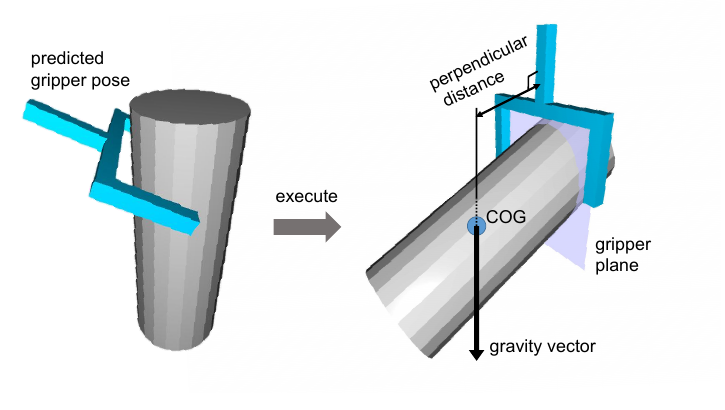
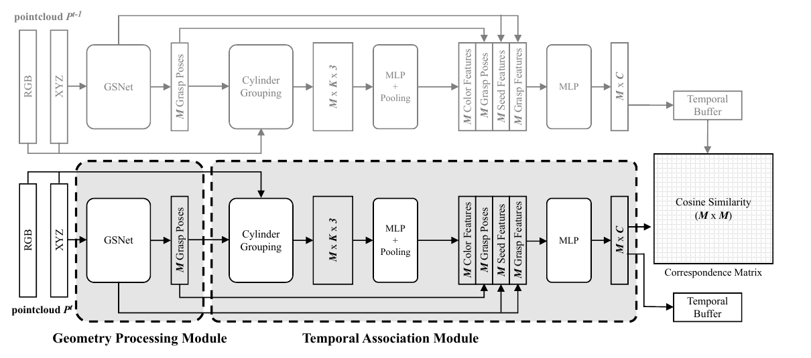

# [AnyGrasp: Robust and Efficient Grasp Perception in Spatial and Temporal Domains](https://arxiv.org/abs/2212.08333)

> **Brief:** AnyGrasp combines **dense grasp detection, center-of-mass-aware ranking, and learned grasp correspondence across frames**. A geometry module predicts parallel-jaw grasp candidates from a point cloud, while a temporal module associates candidates using geometric, pose, and local RGB features. A robot controller can then follow a consistent grasp on a moving object instead of independently selecting a new grasp in every image.

**Source:** Fang et al., IEEE Transactions on Robotics, 2023; supplied PDF, arXiv:2212.08333v2 dated June 6, 2023. Method and reported measurements below follow this version, including Algorithm 1 and the appendix. The released SDK may differ from the paper's experimental implementation.

## Convenient Links

- [Paper](https://arxiv.org/abs/2212.08333)
- [Project](https://graspnet.net/anygrasp.html)
- [Official SDK and examples](https://github.com/graspnet/anygrasp_sdk)
- [GraspNet note](./GraspNet.md)
- Related systems: [Spotter](../Agentic_Systems/Spotter.md), [Harness VLA](../Agentic_Systems/Harness_VLA.md)
- Background: [Modern Robotics](../../../Foundations/Books/Robotics/Modern_Robotics.md)

## 1. Why Is a Good Grasp in One Image Not Enough?

[GraspNet](./GraspNet.md) predicts grasp poses from observed geometry. Two additional issues arise during execution:

1. A nominally feasible grasp near the end of a long object can slip or rotate during transport because the object's weight is poorly balanced.
2. On a moving object, independently choosing a high-scoring grasp in each frame can switch contact regions or targets. Following the nearest pose in camera coordinates also need not preserve the same grasp relative to the object.

AnyGrasp addresses these issues through **stability-aware spatial prediction** and **temporal association**. It builds its geometry module on **GSNet, the graspness-based detector from the 2021 Graspness paper**, rather than simply adding tracking to the original 2020 GraspNet architecture.

Its output retains the grasp representation

$$
G=[R\;\mathbf{t}\;w],\qquad
R\in SO(3),\quad\mathbf{t}\in\mathbb{R}^3.
$$

The paper calls this **7-DoF**: six pose degrees of freedom plus jaw width $w$. This does not refer to a seven-joint robot arm. AnyGrasp predicts grasp targets and their correspondence, while robot-specific planning and control execute them.

## 2. Spatial Prediction: Generate Many Grasps, Then Prefer Stable Ones

### 2.1 GSNet Supplies Graspable Points and Views

The geometry module receives a single-view XYZ point cloud. A 3D convolutional backbone produces per-point features, followed by these stages:

| Stage | Prediction or operation | Why it is introduced |
|---|---|---|
| Objectness and graspness | Object/background mask and graspability heatmap | Avoid spending most candidates on background or poor grasp regions |
| Graspable FPS | Select **1024 seed points** using the mask/heatmap | Cover promising regions while retaining spatial diversity |
| Graspable probabilistic view selection | Predict **300 approach-view scores** per seed and select a view | Find a feasible direction for inserting the gripper |
| Cylinder grouping | Gather local features aligned with the selected approach | Express contact geometry in a consistent local frame |
| Grasp head | Predict quality and jaw width over angle/depth combinations | Produce complete grasp candidates |

Like GraspNet, the representation decomposes grasping into a surface point, approach direction, in-plane rotation, approach depth, and width. The change is that **graspness guides candidate selection before local grasp prediction**, and AnyGrasp adds stability information to the final head.

Original GSNet evaluates 12 rotations and four approach depths. AnyGrasp adds a shallow depth for small objects:

$$
d\in\{0.005,0.01,0.02,0.03,0.04\}\ \mathrm{m}.
$$

The modified head outputs

$$
12\times5\times2+12=132
$$

values per seed: 60 quality scores, 60 widths, and 12 stability scores. Stability is predicted per rotation and shared across depth choices. This distinguishes **the full set of angle/depth candidates** from the single best grasp per seed used by the temporal module later.

### 2.2 A Stability Score Approximates Weight Balance

*Paper Figure 1. The stability label measures perpendicular distance between the gripper plane and object COG. The paper assumes that the gripper is moved to a vertical transport orientation after grasping.*

The center of mass cannot generally be measured from a partial point cloud. For training labels, the authors assume a **solid rigid object with uniform density** and compute its center from the mesh. A grasp's label is the distance from this center to its gripper plane, normalized by the maximum such distance for that object.

Writing $\mathbf{c}_O$ for the estimated object center and $\Pi_G$ for the gripper plane, this label construction is

$$
a^*(G)=
\frac{\operatorname{dist}(\mathbf{c}_O,\Pi_G)}
{\max_{G'\in\mathcal{G}_O}\operatorname{dist}(\mathbf{c}_O,\Pi_{G'})}
\in[0,1].
$$

$\mathcal{G}_O$ denotes annotated grasps on the object. Despite being called a **stable score** in the paper, **lower is better**: a smaller distance is intended to reduce the unbalanced gravity moment under the assumed transport motion.

At inference, the predicted penalty $\hat a(G)$ modifies nominal grasp quality:

$$
q_{\mathrm{final}}(G)=q_{\mathrm{grasp}}(G)\bigl(1-\hat a(G)\bigr).
$$

This favors a balanced grasp among otherwise feasible candidates. It does not estimate actual material density, payload, contact force, or a calibrated success probability. Hollow objects and uneven mass distributions can violate the label assumption.

For example, a grasp near the end of a long bottle may have good local contact geometry. The stability penalty can favor a more central grasp before the robot commits to transport. The remaining problem is preserving that chosen grasp as the bottle moves; this motivates the temporal module.

## 3. Temporal Association: Follow a Grasp Relative to the Object

*Paper Figure 2. Each frame produces grasp poses and descriptors. Current descriptors are compared with cached descriptors using cosine similarity. Color, predicted pose, and two levels of geometry features contribute to the descriptor.*

### 3.1 Learn Correspondence from Static Scenes Viewed Differently

The training dataset contains static scenes rather than trajectories of moving objects. However, each scene is recorded from **256 viewpoints**. Adjacent views provide observation pairs with known camera and object poses, allowing the same physical grasp to be expressed in both images.

For grasps on the same object, transform both poses into the **object frame** and compute

$$
\Delta_R=\arccos\!\left(
\frac{\operatorname{tr}(R_1^\top R_2)-1}{2}\right),
\qquad
\Delta_t=\|\mathbf{t}_1-\mathbf{t}_2\|_2,
$$

$$
d(G_1,G_2)=\frac{\Delta_t}{w_{\max}}
+\gamma\frac{\Delta_R}{\pi}.
$$

Grasps on different objects have infinite distance; same-object pairs with $d\leq\sigma$ are positive correspondences. Thus the target is **the same grasp region/orientation on the object**, not whichever candidate remains closest in the current camera frame.

The PDF reports $w_{\max}=0.01$ m, $\gamma=0.1$, and $\sigma=0.1$. Although $w_{\max}$ is named maximum gripper width, its printed value differs from the Robotiq-85 hardware opening; it is retained here as the reported label-normalization setting.

Known object poses construct these **training labels**. Inference matches descriptors without requiring ground-truth object poses or explicit object-level 6D tracking. Viewpoint pairs supply useful relative-motion supervision, but do not cover all dynamics, deformation, or appearance changes of moving objects.

### 3.2 Construct One Descriptor per Seed's Best Grasp

For each of the $M=1024$ seeds, the geometry module chooses its highest-scoring grasp. The association module combines:

- **Seed features:** geometric context before view selection.
- **Grasp features:** geometry associated with the selected approach before the final grasp head.
- **Local color features:** RGB values from **16 points** grouped in an approach-aligned cylinder, processed by an MLP and pooling.
- **Pose parameters:** flattened rotation and translation, **12 values** in total; width is not included in this particular pose-feature vector.

An MLP maps the concatenation to a **256-dimensional descriptor** $\mathbf{f}(G)$. Geometry generation uses XYZ; the temporal descriptor additionally uses RGB as an appearance cue. The pairwise correspondence score is

$$
s_{\mathrm{corr}}(G_1,G_2)=
\frac{\mathbf{f}(G_1)^\top\mathbf{f}(G_2)}
{\|\mathbf{f}(G_1)\|_2\|\mathbf{f}(G_2)\|_2}.
$$

Comparing all descriptors from two frames gives an **$M\times M$ correspondence matrix**. It supports many possible matches, rather than assuming one object has only one valid grasp.

### 3.3 Contrastive Training Connects Descriptors to Physical Correspondence

For anchor grasp $G_i^1$ in the first view, define positives in the second view as

$$
\mathcal{P}(i)=\{k:d(G_i^1,G_k^2)\leq\sigma\}.
$$

The supervised contrastive objective pulls these descriptors together:

$$
\mathcal{L}_{\mathrm{assoc}}=
-\sum_i\frac{1}{|\mathcal{P}(i)|}
\sum_{k\in\mathcal{P}(i)}
\log\frac{
\exp(s_{\mathrm{corr}}(G_i^1,G_k^2)/\tau)}
{\sum_{j=1}^{M}\exp(s_{\mathrm{corr}}(G_i^1,G_j^2)/\tau)}.
$$

This is paper Equation 7 for anchors with positive matches; **$\tau=0.1$**. The numerator rewards object-consistent grasp pairs, while the denominator separates competing candidates.

At inference, only the current frame needs a forward pass. Previous descriptors are cached in a temporal buffer. Tracking $n$ selected grasps requires an **$n\times M$** comparison against current candidates; high-correspondence feasible candidates become the updated targets. This buffer stores appearance/geometry descriptors, not a learned simulator of future motion.

## 4. Data and Training: Geometry First, Association Second

The model is trained on an extended GraspNet-1Billion collection of **268 scenes and 144 training objects**. The extension adds 168 scenes containing 104 new objects to the original training collection. Mesh-based antipodal labels are projected into real RGB-D scenes using annotated object poses, with simplified gripper/scene collision checks.

Three annotation additions enable the method: the 5 mm approach depth, the COG-based stability penalty, and cross-view grasp correspondence. This combines **real sensor noise with analytical labels**, rather than learning the detector solely from rendered depth or robot trial-and-error.

| Setting | Paper configuration |
|---|---|
| Point-cloud voxel size | 5 mm |
| Seeds / descriptor dimension | $M=1024$, $C=256$ |
| Local RGB grouping | 16 points per grasp |
| Optimizer | Adam; initial learning rate $10^{-3}$ |
| Learning-rate decay | Polynomial schedule, power 0.9 |
| Geometry training | From scratch, batch size 4 |
| Association training | Freeze geometry weights; batch contains four adjacent-view pairs |
| Compute | One 2080 Ti GPU |

Geometry losses follow GSNet: objectness classification and smooth-L1 regression for graspability and grasp parameters, with the additional stable-score prediction. The paper delegates detailed geometry-loss specification to GSNet. Association uses the contrastive loss above. There is no language-model pretraining, reinforcement-learning phase, or test-time weight update in the reported system.

Augmentations include horizontal flips, camera-$Z$ rotations within $\pm30°$, and translations of $\pm0.2$ m in $X/Y$ and $[-0.1,0.2]$ m in $Z$. Association training additionally removes scene objects with probability 0.2. Total training epochs and some implementation details are not specified in the supplied PDF.

## 5. Turn Continuous Perception into Robot Motion

### 5.1 Static Picking Still Needs Filtering and Planning

Learned obstacle awareness does not impose a hard collision constraint. The implementation therefore processes the **top 100 grasps** with two GPU operations:

1. **Explicit collision detection:** check observed points against a gripper approximated by three boxes.
2. **Gripper centering:** translate along the jaw-closing direction so the fingers have similar travel distances to the observed outermost contact points. This reduces the chance that one finger pushes the object away before the other contacts it.

Both use the partial point cloud; occluded contacts and unobserved obstacles remain uncertain. The pair of operations takes about **80 ms for 100 candidates** in the reported setup.

The static experiment uses a UR5, Robotiq-85 with soft rubber fingertips, and an overhead RealSense camera. It restricts candidates to the plate workspace and an approach direction within **25° of vertical**, selects a high-scoring unoccluded grasp, and creates a waypoint **10 cm behind it along the approach axis**. The UR5 moves through waypoint and grasp, closes, lifts, and transfers the object to a bin.

Camera-to-base and grasp-to-TCP calibration remain necessary; see [GraspNet's frame-conversion explanation](./GraspNet.md#7-from-a-grasp-pose-to-a-robot-tcp-target). These controllers and constraints are part of the evaluated system, not outputs learned by the grasp network.

### 5.2 Dynamic Picking Adds Association, Servoing, and Short-Horizon Extrapolation

For swimming robot fish, the system uses a **Flexiv Rizon, wrist-mounted RealSense L515, and extended parallel jaws**. The wrist view reduces overhead-camera occlusion, while the L515 supports the close viewing distances needed for tracking.

Algorithm 1 proceeds as follows:

1. Detect candidates and initially choose a high-quality grasp.
2. In each new frame, choose a feasible candidate with high descriptor similarity to the preceding target.
3. Store selected poses in a **ten-pose motion buffer** and extrapolate a near-future grasp using recent motion, compensating for the time required to close the gripper.
4. Servo toward a pre-grasp target **3.5 cm behind** the extrapolated pose. The implementation retains yaw and removes the other two rotation components for stability.
5. Commit to approach-and-close when 3D target distance is at most **5.5 cm**, horizontal distance at most **2 cm**, and orientation difference at most **20°**.
6. Lift and release the fish, then reinitialize. If tracking/workspace visibility is lost, return to the ready pose and clear the buffer.

The descriptor cache and ten-pose motion buffer serve different purposes: **association identifies the same grasp; motion history predicts where it will be when closure occurs**. The latter is a controller-level extrapolation, not a learned dynamics model. The distance thresholds trigger final execution rather than certify final grasp accuracy.

For a turning fish, a nearest-pose heuristic can jump to another contact region or similar nearby fish. Learned association instead favors the same object-relative grasp. However, a mistaken identity match contaminates the motion buffer, and a sudden speed change can invalidate extrapolation even when correspondence is correct. With a wrist camera, all target poses must also be transformed using the camera's current robot pose before servoing.

## 6. What Do the Experiments Establish?

### 6.1 Attempt Success and Bin Completion Are Different Metrics

The paper distinguishes

$$
\mathrm{AttemptSuccess}=
\frac{\#\text{successful grasp attempts}}{\#\text{all grasp attempts}},
\qquad
\mathrm{Completion}=
\frac{\#\text{objects successfully removed}}{\#\text{objects presented}}.
$$

An object can eventually be removed after several failures, so high completion does not imply the same per-attempt success. On **over 300 unseen daily objects**, Table I reports these attempt-centric rates:

| Object group | Dex-Net 4.0 | AnyGrasp | Human subjects |
|---|---:|---:|---:|
| Hardware | 59.3% | 81.5% | 91.4% |
| Snack | 52.3% | 100.0% | 93.9% |
| Ragdoll | 87.4% | 100.0% | 96.6% |
| Toy | 72.8% | 93.1% | 91.8% |
| Household | 64.6% | 85.5% | 94.4% |
| Overall | 72.2% | **93.3%** | 93.9% |

Overall object-centric completion is **98.9%, 99.8%, and 100.0%** respectively. These physical system measurements differ from GraspNet's analytical top-$k$ AP.

“Comparable to humans” applies to a constrained comparison: **two volunteers**, matching parallel-jaw opening and soft fingertip material, and no tactile correction after contact. Robot experiments use two independent trials per condition; each volunteer clears the plate twice. This is not comparison with unrestricted human hands or general manipulation skill.

The experiment also permits an operator to push objects that scatter outside the plate workspace back into it. A trial ends after the detector fails to produce grasp poses ten times. Thus, the bin-clearing result includes specified lab procedures rather than fully unattended operation in arbitrary environments.

### 6.2 Runtime Measures Include More Than Network Inference

Reported grasp prediction takes approximately **100 ms**, and the static grasp decision including collision checks and adjustment takes **less than 200 ms**. The experiments run on an RTX 2060 workstation. The UR5 system achieves **over 900 mean picks per hour**, so throughput also depends on arm travel, jaw speed, and transfer distance.

Humans reach roughly 1,000–1,200 picks/hour on average and over 1,500 at maximum speed in this setting. Similar grasp accuracy therefore does not establish identical execution speed. The dynamic perception system is separately reported at **7 Hz**; these measurements should not be treated as one universal latency for every configuration.

### 6.3 Dynamic Grasping and Its Failure Modes

Five trials start with eight moving robot fish each. AnyGrasp achieves **75.47% attempt success**, reported as 75.5% in the prose, versus **62.5%** for the nearest-grasp heuristic. The heuristic takes **12.7% longer** on successful grasps on average.

Nearly half of the observed failures are slips in low-friction water despite an apparently good grasp pose. Other failures include prediction ahead of or behind the fish after speed changes, poor contact geometry that pushes the fish away, and correspondence switches between similar fish. These results support temporal association plus servoing in this setup, while exposing the difference between tracking a plausible target and making stable contact.

## 7. What the Ablations Say About Stability and Data

**COG awareness:** on one long, heavy object, each condition receives 25 attempts. Without stable-score ranking, there are **16 in-hand slips, including three failed grasps**; with it, **11 slips, including two failures**. This supports a limited stability benefit, but is a small, object-specific ablation rather than a broad causal estimate across the whole test set.

**Real versus simulated sensing:** the authors render the same scenes, train comparable models, and add Gaussian depth noise for a sim-to-real variant. Noise helps, but real-sensor training remains better on analytical benchmark evaluation and physical bin picking. The gap is larger for novel objects. The experiment tests these renderers and noise augmentations; it does not establish that simulation training is intrinsically insufficient.

**Annotation density versus data diversity:** reducing per-object grasp-label density or image count by 10×/50× causes similar degradation, while reducing the number of distinct scenes is worse. At 50× scene reduction, the paper reports only two training scenes and failure to converge. This supports dense automatic annotations and diverse clutter layouts as complementary data resources. The plots do not provide complete numerical tables, so exact AP changes are not reconstructed here.

**Sensor and object limits:** the D435 experiments include observed depth variations up to approximately $\pm5$ mm. The paper also shows qualitative thin-fragment picking and deformable-tube grasp tracking. Its test-object collection excludes objects with large transparent or black surfaces because of depth-sensing limitations, and adversarial objects remain harder than the daily-object set.

## 8. Relation to GraspNet and Remaining Limits

| Question | GraspNet, CVPR 2020 | AnyGrasp, 2023 |
|---|---|---|
| Main geometry model | PointNet++ with ApproachNet and OperationNet | GSNet-based graspness selection and local grasp prediction |
| Additional stability signal | Tolerance to perturbation, used for within-bin reranking | COG-related penalty multiplying grasp quality |
| Approach depths | 1, 2, 3, 4 cm | Adds 0.5 cm |
| Temporal information | Static grasp detection | Learned cross-frame grasp descriptors and cached association |
| Execution evidence | Analytical benchmark and physical label validation | Full bin-picking systems and dynamic fish-catching experiments |

AnyGrasp's main progression is **dense geometry → stability-aware ranking → object-consistent correspondence → controller-driven dynamic execution**. The model supplies perceptual targets; servo control, motion extrapolation, calibration, and collision handling remain separate parts of the system.

The paper does not provide tactile slip correction or a general recovery policy. A gripper approaching the object can occlude the very region being tracked, repeated failed grasps are not automatically learned from, and inferred COG can differ from true mass distribution. These limits explain why successful pre-contact tracking and high bin-completion rates do not imply reliable grasping of every material, motion, or contact condition.
