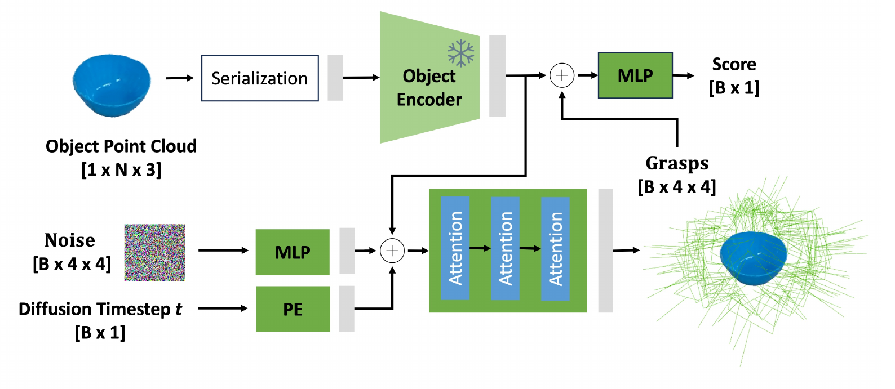
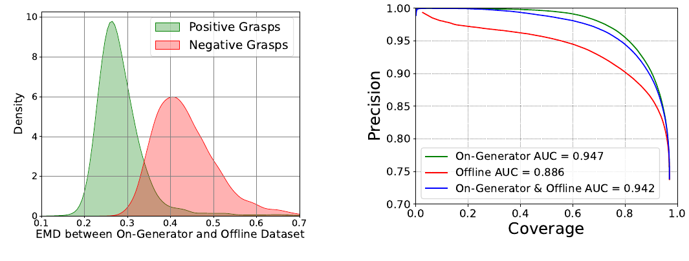

# [GraspGen: A Diffusion-based Framework for 6-DOF Grasping with On-Generator Training](https://arxiv.org/abs/2507.13097)

> **Brief:** GraspGen generates diverse **6-DoF gripper poses from an object's point cloud**, then ranks them with a learned success classifier. Its main contribution is **on-generator training**: train that classifier on the trained generator's own proposals, labeled through simulation, so it learns the mistakes it will encounter at inference. The framework supports parallel-jaw and suction grippers and combines grasp prediction with a separate motion planner for execution in clutter.

**Source:** Murali et al., 2025; supplied 21-page PDF, arXiv:2507.13097v1 dated July 17, 2025, with July 18 on the title page, including Appendix Sections 6.1–6.10. Results below follow this version.

## Convenient Links

- [Paper](https://arxiv.org/abs/2507.13097), [project](https://graspgen.github.io)
- Related grasp models: [GraspNet](./GraspNet.md), [AnyGrasp](./AnyGrasp.md)
- A system using grasp generation for recovery: [Zetta](../Agentic_Systems/Zetta.md)
- Background: [Diffusion Policy](../Policies/Diffusion_Policy.md), [Modern Robotics](../../../Books/Robotics/Modern_Robotics.md)

## 1. What Must a Grasp Generator Supply?

Imagine picking a mug from a shelf. Several hand poses may hold it securely, but a side approach can hit the shelf wall, and a top approach may be unreachable. Returning only one plausible pose leaves the planner little room to work. Returning many unranked poses shifts the problem to choosing which ones are worth trying.

GraspGen separates these needs:

1. **Generation:** propose many spatially diverse grasps compatible with the object's shape.
2. **Evaluation:** score the proposals so unsuccessful ones can be removed.
3. **Execution:** let a motion planner select reachable, collision-free approaches from the remaining poses.

The learned model is **object-centric**: its input is a point cloud $\mathcal{X}\in\mathbb{R}^{N\times3}$ containing $N$ observed points on the chosen object. Selecting and segmenting that object happens upstream. Training can then use individual objects instead of synthesizing every clutter arrangement; the planner later handles surrounding obstacles. The model does not need an exact object mesh or object-pose estimate at inference, but it does depend on the quality of the segmented geometry.

A grasp pose is a rigid transform

$$
G=
\begin{bmatrix}
R & \mathbf{t}\\
\mathbf{0}^{\top} & 1
\end{bmatrix}
\in SE(3),
\qquad
R\in SO(3),\quad \mathbf{t}\in\mathbb{R}^{3}.
$$

$SO(3)$ denotes 3-D rotations and $SE(3)$ rigid poses. $R$ determines gripper orientation and $\mathbf{t}$ its position. The six degrees of freedom are three translation and three rotation coordinates. The output is a gripper pose, not six robot joint angles or a complete arm trajectory.

Unlike the width-augmented representations in [GraspNet](./GraspNet.md) and [AnyGrasp](./AnyGrasp.md), this framework focuses on pose generation for a specified gripper. The experiments use gripper-specific data/models for Franka Panda, Robotiq-2F-140, and a suction cup; they do not demonstrate one model adapting to arbitrary new grippers without training.

The remaining question is how to represent many valid poses without reducing them to one average pose. This motivates diffusion.

## 2. How Does Diffusion Produce Diverse Grasp Poses?

GraspGen uses a conditional **denoising diffusion probabilistic model (DDPM)**. Training teaches it to remove noise added to successful grasps, using object shape as context. At inference, repeatedly applying this learned denoising process turns random samples into grasp proposals.

### 2.1 Express the Grasp Relative to the Observed Object

Training a generator on absolute camera coordinates would make the same local grasp look different whenever the object moves. GraspGen first centers both the point cloud and grasp translations at the point cloud's mean $\bar{\mathbf{x}}$.

Translation and rotation also have different numerical scales. The paper scales translations by $\kappa$:

$$
\mathcal{X}_c=\{\mathbf{x}-\bar{\mathbf{x}}:\mathbf{x}\in\mathcal{X}\},
\qquad
\widetilde{\mathbf{t}}
=\kappa(\mathbf{t}-\bar{\mathbf{x}}).
$$

The scale is computed from positive training grasps: average the reciprocal of each object's grasp-translation extent, using the paper's maximum-minus-minimum statistic. The reported value on **Franka-ACRONYM**, the Franka-gripper portion of an earlier simulated grasp dataset, is **$\kappa=3.27$**. This balances coordinates for learning; it does not physically resize the object or robot.

The default rotation representation is a **three-dimensional Lie-algebra rotation vector**: its direction gives the rotation axis and its magnitude the angle. It can be converted back to a valid rotation matrix. Thus denoising operates on translation and rotational coordinates, not on sixteen independently perturbed entries of the homogeneous matrix. Appendix 6.6.3 reports scaling input coordinates to $[-1,1]$.

At the end, the translation is decoded as $\mathbf{t}=\widetilde{\mathbf{t}}/\kappa+\bar{\mathbf{x}}$. Centering, normalization, and decoding must use consistent units and frame conventions.

### 2.2 Learn to Remove Noise Conditioned on Shape

*Paper Figure 2, cropped from PDF page 4. The point-cloud encoder conditions iterative grasp generation; its features are later reused by the scoring head. $N$ is the number of object points and $B$ the number of candidate grasps. The encoder is frozen when training the discriminator. The displayed $4\times4$ matrices denote poses; diffusion uses their coordinate representation.*

The object encoder is **PointTransformerV3 (PTv3)**. It serializes the unstructured cloud into an order suitable for Transformer processing and extracts shape features. This replaces the PointNet++ backbone common in earlier grasp generators.

The denoising network combines:

- object features, describing the shape around which grasps should form;
- the current noisy grasp, embedded by a multilayer perceptron (MLP);
- the diffusion timestep, encoded to indicate how much noise remains.

Attention layers use these inputs to predict the noise to remove. If $g_0$ is an encoded successful grasp, $\widetilde g_\tau$ its noisy version at diffusion step $\tau$, and $\epsilon$ the added noise, the training objective is

$$
\mathcal{L}_{\mathrm{gen}}
=
\mathbb{E}_{g_0,\tau,\epsilon}
\left[
\left\|
\epsilon-\varphi_\theta(\tau,\widetilde g_\tau,\mathcal{X}_c)
\right\|_2^2
\right].
$$

$\varphi_\theta$ is the noise predictor with learned parameters $\theta$. Successful grasps supply the targets; no failed-grasp labels or discriminator scores enter this generator objective. The paper uses separate diffusion schedulers for translation and rotation, rather than one shared schedule.

At inference, sample $B$ noise vectors and repeatedly denoise them while conditioning on the same object cloud. The reported configuration uses **10 denoising steps**. These are neural inference iterations before executing a grasp, not ten physical robot actions.

Different initial noise samples produce different proposals. For the shelf mug, this can supply several orientations and contact regions, increasing the chance that the downstream planner finds a usable one.

## 3. Why Train the Scorer on the Generator's Own Proposals?

### 3.1 Positive-Only Generation Still Produces Failures

Learning from successful grasps does not ensure every generated sample succeeds. A nearly correct pose may put one finger slightly inside the object; another may miss the object entirely.

A classifier trained on an ordinary **offline dataset** sees the successes and failures produced by that dataset's sampling procedure. Those failures may differ from the diffusion model's mistakes. For example, ACRONYM samples initially collision-free poses, so its negative examples do not cover every small penetration the learned generator can produce.

For the mug example, imagine a generated pose that almost surrounds the rim but intersects it slightly. It can resemble a positive training grasp while lying outside the offline negative examples. A scorer needs examples of precisely this kind of generated error.

### 3.2 Generate, Simulate, Then Learn Success Classification

**On-generator training** makes the scorer's training inputs come from the generator it will later evaluate. Algorithm 1 follows this order:

1. Train the diffusion generator using successful offline grasps.
2. Run that trained generator on the training objects.
3. Simulate its proposals and label each as successful or unsuccessful.
4. Train the success classifier on these generated, labeled proposals.

The paper samples **2,000 grasps for each of about 7,000 training objects**, creating an additional dataset comparable in scale to the initial offline collection for one embodiment.

The classifier, called the **discriminator**, predicts a sigmoid score $D_\psi(\mathcal{X},g)\in[0,1]$ for candidate grasp $g$, with trainable head parameters $\psi$. For simulator label $y\in\{0,1\}$, its binary cross-entropy loss is

$$
\mathcal{L}_{\mathrm{disc}}
=
-\mathbb{E}_{(\mathcal{X},g,y)}
\left[
y\log D_\psi(\mathcal{X},g)
+(1-y)\log\bigl(1-D_\psi(\mathcal{X},g)\bigr)
\right].
$$

This is supervised success classification. The generator is not trained adversarially against this discriminator, and the recipe does not update model weights during robot deployment.

### 3.3 Reuse Shape Features Instead of Re-encoding Every Candidate

The discriminator **freezes and reuses the generator's object encoder**. It concatenates the object embedding with each candidate's pose representation and trains the final MLP scoring head.

The object geometry is therefore encoded once and reused across candidates. Older evaluators represented each grasp by transformed gripper points and processed a combined object–gripper cloud, repeating expensive geometry processing.

Appendix 6.6.2 reports **21× less GPU memory at the same batch size** than the evaluator in **Mousavian et al.'s 2019 “6-DOF GraspNet.”** That is a different work from the [2020 GraspNet-1Billion paper](./GraspNet.md).

Generation supplies variety, on-generator labels teach which proposals fail, and encoder reuse makes evaluating many proposals practical. The scorer still evaluates the object–gripper relationship; it does not know whether a robot arm can reach that pose through a cluttered scene.

## 4. Where Do the Training Labels and Sensor Robustness Come From?

### 4.1 Simulated Objects and Three Gripper Embodiments

The released dataset is summarized as **8,515 objects and 53.1 million labeled grasps** in Table 3. The construction first filters Objaverse to **36,366 CC-BY meshes** overlapping LVIS object categories, then selects the 8,515-object subset to match the approximate scale of ACRONYM.

Section 3.3 describes **2,000 sampled transforms per object**, approximately **17 million grasps per gripper**:

| Gripper | How labels are obtained |
|---|---|
| Franka Panda parallel jaws | Close around the object and simulate shaking; success requires stable contact afterward |
| Robotiq-2F-140 adaptive parallel jaws | The same simulation-based stability procedure with that gripper's geometry |
| 30 mm suction cup | An analytical suction model |

The jaw-gripper labels use Isaac simulation following the ACRONYM-style pipeline. The suction labels are analytical, so the three embodiments do not share an identical physical labeling test.

The initial dataset trains the generator on positives. A second simulation pass labels the trained generator's proposals for the discriminator. These are separate data-generation stages.

### 4.2 Train for Partial Geometry and Imperfect Segmentation

A complete mesh-sampled point cloud and a single-view depth cloud expose different geometry. GraspGen tests complete-only, partial-only, and **50/50 mixed** training. The mixed variant handles both observation types better overall than relying on one type alone.

For transfer to real sensing, the reported augmentations include randomized orientation after centering, camera viewpoints, point subsampling, and simulated segmentation errors.

The last is especially important for object-centric prediction. If a mug mask includes pixels from the shelf behind it, back-projection creates false object points. To simulate this, the authors render objects on support surfaces and **dilate their masks**, adding surrounding pixels. Training on these contaminated clouds teaches the model to ignore some outliers instead of confidently placing grasps on them.

This improves robustness, but accurate depth and instance segmentation remain prerequisites. The paper reports roughly **3,000 V100 GPU-hours for data generation and training combined**. It does not give a complete optimizer, learning-rate, batch-size, epoch, or scheduler-parameter recipe.

## 5. How Do Predicted Poses Become Robot Actions?

At deployment, the stages are:

1. Select the target object and form its segmented point cloud.
2. Center it, encode its geometry, and sample a batch of grasps through diffusion.
3. Decode poses, score them, and remove low-quality proposals.
4. Give high-scoring candidates to the motion planner.
5. Execute a feasible approach, close or activate the gripper, then retract and transfer the object.

The two main inference choices are **how many grasps to sample** and **what score threshold to keep**. A strict threshold can leave too few candidates after planning filters, so Appendix 6.10 recommends considering threshold and sample count together. A sigmoid score is a learned ranking signal, not a guarantee of successful execution.

Coordinate conversion also matters. If $G$ is the generated grasp frame, $C$ the camera frame, $B$ the robot base, and TCP the tool-center-point frame used by the controller, the standard conversion is

$$
{}^{B}T_{\mathrm{TCP}}
=
{}^{B}T_C\,
{}^{C}T_G\,
{}^{G}T_{\mathrm{TCP}}.
$$

Each $\,{}^{A}T_B$ maps coordinates from frame $B$ into frame $A$. Camera extrinsics supply $\,{}^{B}T_C$; the grasp-to-TCP convention supplies $\,{}^{G}T_{\mathrm{TCP}}$. This explains the deployment bookkeeping; it is not an additional learned module. See also [GraspNet's grasp-to-TCP explanation](./GraspNet.md#7-from-a-grasp-pose-to-a-robot-tcp-target).

In the real-robot experiments, the planner receives the **top 100 grasp poses** and filters candidates with collisions or no inverse-kinematics solution. It can then plan toward a feasible member of the goal set.

Returning to the shelf mug, the classifier may reject a pose intersecting the rim, while the planner rejects another whose approach collides with the shelf. A remaining pose can be usable even if it was not the highest-scoring one. This is why grasp diversity, success ranking, and scene-level planning are complementary.

## 6. What Validates the Generator and Scorer?

### 6.1 Precision Measures Success; Coverage Measures Useful Variety

The isolated-object evaluation uses a **free-floating gripper**, without robot-arm reachability constraints. The main Franka comparison uses **ACRONYM**, with **815 test objects and 2,000 proposed grasps per object**, about 1.6 million simulated grasp executions per method.

For a retained set of predicted grasps:

- **Precision** is the fraction that succeed in simulation.
- **Coverage** is the fraction of reference positive grasps matched by predictions, using the paper's nearest-neighbor matching with a **1 cm threshold**.

Many successful poses concentrated on one small region can have high precision but limited coverage. Broad coverage gives a planner more alternatives when obstacles or arm kinematics eliminate some grasps.

Varying the score threshold yields a **precision–coverage curve**; its **area under the curve (AUC)** summarizes the quality–diversity tradeoff. It is not a robot task-success percentage.

Figure 3 reports:

| Method | Franka-ACRONYM precision–coverage AUC |
|---|---:|
| GraspGen | **0.94668** |
| M2T2 | 0.63592 |
| DexDiffuser | 0.34356 |
| SE3-Diff | 0.19957 |

Models use the same training data and splits in this comparison. M2T2 uses a contact-point-based grasp formulation. The paper's **SE3-Diff baseline is a reimplementation** with PointNet++ input encoding and DDPM sampling; it ranks by approximate likelihood. DexDiffuser is adapted to pose-only pinch/suction grasping from its original dexterous formulation.

The table evaluates combined generation and ranking. It supports the resulting pipeline, but does not by itself isolate which architecture or training choice caused the gain. AnyGrasp is absent from these cluster-based simulation comparisons because its deployment license restricted the authors' setup; it is evaluated on hardware below.

On the Robotiq dataset, Figure 9 reports AUC **0.68873** for GraspGen, **0.24265** for M2T2, and **0.43190** for SE3-Diff paired with GraspGen's discriminator. The suction comparison instead reports generator coverage, rather than a full precision–coverage AUC. These embodiment results therefore use different evaluation settings and are not interchangeable scores.

### 6.2 Does Matching the Scorer's Data Distribution Help?

*Paper Figure 6, cropped from PDF page 7. Left: distribution distances are larger for negative grasps than positives. Right: precision as coverage increases; on-generator-only discriminator training gives the strongest curve.*

The authors compare offline and generated pose distributions using **Earth Mover's Distance**: match equally sized pose samples while minimizing total translation-plus-rotation distance. Appendix 6.8 uses 500 poses from each distribution and averages five random subsamples per object.

The larger shift for negative grasps supports the proposed explanation: the generator's failures differ more from offline negatives than its successes differ from offline positives.

Changing the discriminator's training data gives these AUCs in Figure 6:

| Discriminator training data | AUC |
|---|---:|
| On-generator only | **0.947** |
| Offline only | 0.886 |
| On-generator + offline | 0.942 |

The on-generator-only result improves AUC by **0.061** over offline-only training. Adding offline samples does not improve it further in this experiment. This is the direct evidence that exposing the classifier to the generator's own errors is useful.

### 6.3 Which Other Design Choices Matter?

Three ablations clarify the rest of the method:

| Question | Reported evidence | Interpretation |
|---|---|---|
| Should training include both complete and partial clouds? | Figure 5: mixed training gives AUC **0.93955** on complete input and **0.80596** on partial input | Observation coverage matters; complete-only training reaches only 0.54540 on partial input |
| Does the point-cloud encoder matter? | Table 5: PTv3 versus PointNet++ improves translation error **3.724 → 3.126 cm** and coverage **79.15 → 84.86%** | Better shape encoding improves generated poses |
| Is one rotation representation decisive? | Table 4: 6D rotation, Euler, and Lie-algebra versions have similar coverage, about **84.8%** | The tested rotation format is less decisive than an appropriately normalized learning problem |

The translation errors in Table 5 measure generated-pose agreement with references; they are not final robot-placement errors. These ablations also use their own settings, so their AUC values should not be substituted for the main comparison.

## 7. Do Better Grasp Poses Improve Complete Robot Execution?

### 7.1 FetchBench Includes Planning and Retraction

FetchBench evaluates **100 procedural scenes × 60 tasks = 6,000 executions**, using a Franka Panda. It includes perception, grasp prediction, motion planning, and object transfer in baskets, shelves, tables, and drawers.

To focus the comparison on grasp prediction, the authors give **ground-truth scene collision meshes to cuRobo**. This removes collision-map estimation errors from the simulated planner comparison.

Two outcomes are reported: **grasp success** checks acquisition, while **task success** requires completing the grasp-to-place task. Figure 4's bar labels give:

| Method | Overall grasp success | Overall task success |
|---|---:|---:|
| Contact-GraspNet | 34.2% | 26.1% |
| M2T2 | 43.3% | 33.4% |
| GraspGen, partial cloud | 51.1% | 39.1% |
| GraspGen, complete cloud | 53.3% | 41.2% |
| Oracle with dataset grasps | 65.3% | 49.4% |

With partial clouds, GraspGen adds **7.8 grasp-success points** and **5.7 task-success points** over M2T2. The remaining gap between grasp and task success shows why a good contact pose is insufficient: the object can slip or collide during retraction.

Even the oracle cannot solve every task. Stable grasps can be inaccessible, retraction may have no feasible path, and the planner can fail. These results support better grasp generation within the tested pipeline, not a complete solution to manipulation in clutter.

### 7.2 Real Hardware Tests Transfer from Simulated Training

The hardware system uses a **UR10 with Robotiq-2F-140** and an extrinsically calibrated RealSense D435. SAM2 provides instance segmentation, FoundationStereo estimates depth, NVBlox supplies collision mapping, and cuRobo plans motion. The grasp model is trained on simulation data without real-robot fine-tuning.

Table 1 reports:

| Method | Isolated objects | Table clutter | Basket | Shelf | Overall |
|---|---:|---:|---:|---:|---:|
| GraspGen | **90.5%** | **83.3%** | **80.0%** | **71.4%** | **81.3%** |
| M2T2 | 81.0% | 75.0% | 40.0% | 14.3% | 52.6% |
| AnyGrasp | 85.7% | **83.3%** | 42.9% | 42.9% | 63.7% |

The overall values match the unweighted averages of the four setting rates. The PDF does not provide complete trial counts or confidence intervals, making sampling uncertainty difficult to assess.

These are **the GraspGen paper's baseline reruns**, not the original AnyGrasp paper's results. The implementations also need deployment adaptations:

- M2T2 uses a rotated/workspace-cropped cloud; Appendix 6.4 additionally specifies using its Franka checkpoint with a fixed **−10 cm $z$ offset** for the Robotiq experiment.
- AnyGrasp uses a camera-$z$ translation offset to better match its training distribution.
- The authors omit non-maximum suppression, which removes nearby duplicate grasps, because the planner benefits from multiple pose goals.

GraspGen's largest gains appear in basket and shelf settings, where many candidates are removed by collision and kinematic constraints. The result is consistent with the value of diverse, object-focused proposals. It also depends on the surrounding perception and planning stack; it does not measure the grasp model in isolation.

## 8. How Does GraspGen Fit with the Other Grasping Notes?

[GraspNet](./GraspNet.md) predicts dense candidates through a structured approach-direction and local-geometry pipeline. [AnyGrasp](./AnyGrasp.md) adds stability-aware ranking and correspondence across frames. GraspGen instead emphasizes **object-conditioned diffusion and a classifier trained on generated failures**. It does not provide AnyGrasp-style temporal grasp tracking.

Its generated poses can serve higher-level systems such as [Zetta](../Agentic_Systems/Zetta.md), which decides when a new grasp is needed and verifies recovery afterward. GraspGen supplies candidate geometry and ranking; task reasoning and execution supervision remain separate responsibilities.

The paper identifies depth quality, segmentation errors, and difficulty with cuboid objects as remaining limitations. Its evidence supports a strong grasp-proposal-and-ranking module across the tested embodiments, while scene understanding, reachable motion, stable retraction, and task completion still require the surrounding robot system.
