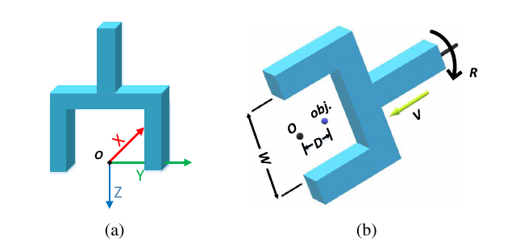
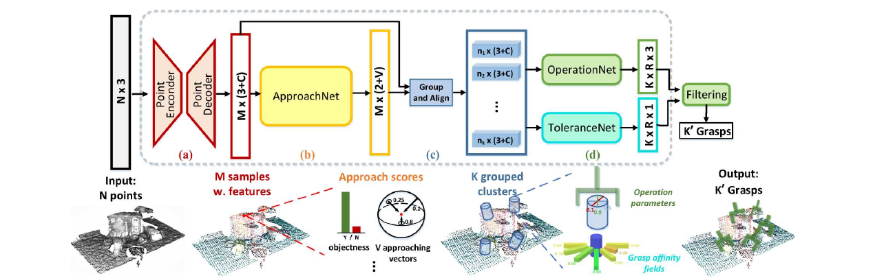

# [GraspNet-1Billion: A Large-Scale Benchmark for General Object Grasping](https://openaccess.thecvf.com/content_CVPR_2020/html/Fang_GraspNet-1Billion_A_Large-Scale_Benchmark_for_General_Object_Grasping_CVPR_2020_paper.html)

> **Brief:** GraspNet predicts **6-DoF parallel-jaw grasp poses from a scene point cloud**. Its network separates approach-direction prediction from local grasp-parameter prediction, then estimates tolerance to perturbations to improve ranking. The accompanying GraspNet-1Billion dataset supplies real RGB-D observations, dense analytical grasp labels, and a common evaluation protocol.

**Source:** Fang et al., CVPR 2020; supplied final conference PDF, pp. 11444–11453. This note focuses on the network in Section 4, with the dataset and evaluation explaining its supervision and results. Numbers follow this final paper rather than the earlier dataset-only preprint or later repository improvements.

## Convenient Links

- [Paper](https://openaccess.thecvf.com/content_CVPR_2020/html/Fang_GraspNet-1Billion_A_Large-Scale_Benchmark_for_General_Object_Grasping_CVPR_2020_paper.html)
- [Project and dataset](https://graspnet.net/)
- [Official baseline implementation](https://github.com/graspnet/graspnet-baseline)
- [Dataset and evaluation API](https://github.com/graspnet/graspnetAPI)
- [AnyGrasp: stability-aware grasp detection and temporal association](./AnyGrasp.md)
- Related notes: [Modern Robotics](../../../Foundations/Books/Robotics/Modern_Robotics.md), [Spotter](../Agentic_Systems/Spotter.md), [Harness VLA](../Agentic_Systems/Harness_VLA.md)

## 1. What Does the Network Produce?

Given a partial scene point cloud, GraspNet predicts multiple candidate grasps rather than recognizing a single object pose. Each grasp specifies a **gripper position, orientation, and opening width**, together with scores for selecting among alternatives. The paper writes

$$
G=[R\;\mathbf{t}\;w],
\qquad
R\in SO(3),\quad\mathbf{t}\in\mathbb{R}^3,\quad w\in\mathbb{R}.
$$

$R$ and $\mathbf{t}$ define the grasp frame relative to the camera; $w$ is the required jaw opening. The six pose degrees of freedom are translation and rotation; width is an additional gripper parameter.

This is the network commonly used to generate candidate grasp/TCP targets. The remaining connection to a robot is essential: **the predicted grasp frame must be calibrated into the robot's base and tool conventions**, and a motion planner must find a reachable, collision-free approach. A high grasp score alone does not establish arm reachability or provide a joint trajectory. Section 7 makes this conversion explicit.

## 2. Why Factor a Grasp into Approach and Operation Parameters?

Directly regressing nine rotation-matrix entries requires the network to learn orthogonality and determinant constraints. Grasping also admits many valid orientations for the same object, making a single continuous target restrictive.

GraspNet instead starts from a candidate surface point $\mathbf{p}$ and decomposes its grasp into:

| Quantity | Meaning | Prediction strategy |
|---|---|---|
| $\mathbf{v}$ | Unit approach direction | Score predefined directions on a sphere |
| $d$ | Approach distance between the grasp point and gripper-frame origin | Evaluate discrete depth bins |
| $\theta$ | In-plane rotation around the approach axis | Rotation bins with refinement described in the paper |
| $w$ | Gripper opening | Regression |
| $s$ | Analytical grasp-quality score | Regression |
| $T$ | Tolerance to perturbation | Regression and ranking refinement |



*Paper Figure 4. A grasp is parameterized relative to a surface point. The approach vector and in-plane rotation determine orientation; approach distance and width describe how the gripper surrounds the object. The figure's rotation label should not be confused with the full matrix $R$ above.*

This decomposition enables a coarse-to-fine procedure: first identify promising locations and approach directions using scene context, then examine geometry aligned with each approach to predict the contact configuration. The tolerance estimate finally distinguishes a fragile high-scoring grasp from one whose neighbors also work.

## 3. From Point Cloud to Ranked Grasp Candidates



*Paper Figure 5. PointNet++ supplies seed features; ApproachNet selects promising approach directions; local cylindrical regions are grouped and aligned before OperationNet and ToleranceNet predict grasp parameters and robustness.*

### 3.1 Reconstruct Geometry and Select Seed Points

The model input is an **$N\times3$ point cloud**, not an RGB-language sequence. A depth image can be back-projected with camera intrinsics $K_{\mathrm{cam}}$:

$$
\mathbf{x}_c=zK_{\mathrm{cam}}^{-1}[u,v,1]^\top,
$$

where $(u,v)$ is a pixel and $z$ is metric depth. RGB belongs to the dataset, but the proposed network uses point coordinates as its input. Camera calibration and depth scaling determine whether the resulting geometry is meaningful.

A PointNet++ encoder-decoder captures local and scene geometry. Farthest-point sampling provides **$M=1024$ seed points**, each with **$C=256$ feature channels**. Spreading seeds over the scene gives the later stages multiple possible grasp locations without requiring an object mesh or object-pose estimate at inference.

### 3.2 ApproachNet: Where Could the Gripper Enter?

At every seed, ApproachNet predicts:

- Two logits for whether the point is a feasible grasp point.
- Quality scores for **$V=300$ predefined approach directions**.

Its output therefore has shape $M\times(2+V)=1024\times302$. Direction scores represent the best grasp quality attainable from each view, rather than a single mutually exclusive object-class label. Multiple directions can be useful.

Training labels connect this prediction to the dense grasp annotations:

1. Background points are negative.
2. Object points with at least one valid grasp reference within **5 mm** are positive.
3. Object points without such a nearby reference are ignored rather than automatically declared ungraspable.
4. A view's target is the **maximum annotated grasp score from that direction**, with the view-regression loss restricted to directions having a ground-truth reference within **5°**.

The approach loss combines binary classification and masked smooth-L1 score regression:

$$
\mathcal{L}_A=
\frac{1}{N_{\mathrm{cls}}}\sum_i\operatorname{CE}(c_i,c_i^*)
+\frac{\lambda_1}{N_{\mathrm{reg}}}\sum_{i,j}m_{ij}
\operatorname{SL1}(s_{ij},s_{ij}^*).
$$

Here $c_i$ is the point's class prediction, $s_{ij}$ its score for view $j$, and $m_{ij}$ selects positive points with an angularly matched reference. Asterisks denote targets; $N_{\mathrm{cls}}$ and $N_{\mathrm{reg}}$ normalize their respective terms. This restates paper Equation 5 with the mask made explicit.

The output narrows the geometric search: OperationNet can now focus on how a gripper arriving from a promising direction should close around the object.

### 3.3 Align Cylindrical Regions Before Predicting Contact Geometry

For each candidate point/direction, the network groups points in cylinders aligned with $\mathbf{v}$. It evaluates **four approach-distance bins**:

$$
d\in\{0.01,0.02,0.03,0.04\}\ \mathrm{m}.
$$

Cylinder points are sampled to a fixed count and transformed into a local frame centered on the seed. In the paper, its local $z$-axis follows the approach direction. Writing an orthonormal basis as $Q(\mathbf{v})=[\mathbf{e}_1\;\mathbf{e}_2\;\mathbf{v}]$, the geometric purpose is

$$
\mathbf{x}_{\mathrm{local}}=Q(\mathbf{v})^\top(\mathbf{x}_c-\mathbf{p}).
$$

This equation summarizes the alignment, rather than prescribing a replacement for the implementation's basis construction. Once aligned, the same local shape can be processed similarly even when its approach direction differs in camera coordinates. The cylinder also supplies the nearby geometry needed to reason about jaw opening and contact, which a seed feature alone would not fully describe.

### 3.4 OperationNet: How Should the Gripper Close?

OperationNet predicts in-plane rotation, grasp quality, and width for the aligned regions. Because a parallel-jaw gripper is symmetric under a half-turn, the paper covers **$0$–$180°$ with 12 rotation bins**, rather than duplicating the full circle. It also describes normalized rotation residuals for refinement.

Approach distance is handled through the four grouped depth candidates. Rotation, width, distance, and approach direction together determine a complete grasp configuration. The surface seed is an anchor for this parameterization; it should not be sent directly as a robot TCP position without decoding the grasp-frame convention.

Paper Equation 6 sums the operation loss over depth bins, combining rotation classification, smooth-L1 quality regression, and smooth-L1 width regression. It uses sigmoid cross-entropy for the binned rotation targets. The prose also mentions residual prediction, but does not fully specify its separate loss/decoding details; the supplied PDF is not a complete tensor-level implementation specification.

### 3.5 ToleranceNet: Prefer Grasps That Survive Small Errors

A grasp can have good nominal force closure yet fail after a small localization or execution error. **Grasp affinity fields (GAFs)** add information about that neighborhood.

For an annotated grasp, the authors search neighboring positions for the largest perturbation it can tolerate while retaining quality **$s>0.5$**. ToleranceNet predicts this perturbation tolerance $T$ with smooth-L1 loss. It is a robustness label derived from nearby grasp quality, not a force/torque prediction or a guarantee under arbitrary disturbances.

The paper's inference refinement is:

1. Decode predicted grasp poses and their quality scores.
2. Divide candidates into **ten score bins**, reflecting the ten annotation quality levels.
3. Reorder grasps **within each bin** using predicted tolerance.

Thus, tolerance refines the ranking without replacing the primary quality grouping. The paper does not describe multiplying quality and tolerance into one universal probability.

For example, two grasps around a bottle may fall in the same quality bin, but one has a wider neighborhood of valid positions. Tolerance-based ranking favors that candidate because a small point-cloud or positioning error is less likely to destroy the grasp. This is the reason to predict robustness after learning nominal feasibility.

## 4. Where Do the Supervision Signals Come From?

### 4.1 Real Observations, Analytical Grasp Labels

The final dataset contains **190 cluttered scenes, 88 objects, and 97,280 RGB-D images**. Each scene is observed at 256 viewpoints by two cameras, RealSense D435 and Azure Kinect, giving $190\times256\times2=97{,}280$ images. The object set comprises 32 YCB objects, 13 Dex-Net adversarial objects, and 43 additional objects.

The annotations contain **over 1.1 billion grasp poses** according to the dataset overview, plus object poses, masks, bounding boxes, camera poses, and meshes. These are dense candidates across viewpoints and scenes, not a billion independent physical robot trials.

The two-stage annotation pipeline makes the network's factorization practical:

1. **Object level:** sample surface points, approach views, in-plane angles, and depths on object meshes; determine gripper width and score each candidate analytically.
2. **Scene level:** transform object-frame grasps into the measured scene using annotated object poses, then reject candidates colliding with the simplified scene/gripper model.

Object poses are manually annotated/refined at the first viewpoint and propagated using calibrated camera poses. Those object poses and meshes support **label generation and evaluation**; the proposed network does not require their ground truth at inference.

### 4.2 Quality Is a Friction-Based Label

The annotation procedure tests force closure at friction coefficients in steps of 0.1. Let $\mu_*$ denote the smallest successful tested coefficient. The quality label is

$$
s=1.1-\mu_*.
$$

A grasp that works with lower friction receives a larger score: $\mu_*=0.1$ gives $s=1.0$, whereas $\mu_*=1.0$ gives $s=0.1$. This supplies the direction-quality targets, OperationNet score targets, and the threshold used for tolerance labels.

The score is **not an empirically calibrated success probability**. It measures analytical force closure under the model's geometry, contacts, and friction assumptions. Scene collision filtering further removes geometrically invalid candidates, but real robot kinematics, gripper geometry, and approach-path collisions remain deployment concerns.

### 4.3 Training and Generalization Settings

The scene split is **100 training / 90 test scenes**. The test set has 30 scenes each for seen objects, unseen but similar objects, and novel objects. These categories distinguish familiar geometry from more substantial object generalization.

| Setting | Paper configuration |
|---|---|
| Input sampling | 20,000 points per training scene |
| Backbone | PointNet++, four set-abstraction layers and two feature-propagation layers |
| Abstraction radii | 0.04, 0.1, 0.2, 0.3 m |
| Neighbor counts | 64, 32, 16, 16 |
| Downsampled point counts | 2048, 1024, 512, 256; propagated to 1024 seeds |
| Head MLP widths | ApproachNet: (256, 302, 302); OperationNet: (128, 128, 36); ToleranceNet: (128, 64, 12) |
| Optimizer / batch size | Adam / 4 |
| Learning rate | $10^{-3}$ initially; $10^{-4}$ after epoch 60; $10^{-5}$ after epoch 100 |
| Compute | One NVIDIA RTX 2080 |

The end-to-end objective is

$$
\mathcal{L}=\mathcal{L}_A+\alpha\mathcal{L}_{\mathrm{op}}
+\beta\mathcal{L}_{\mathrm{tol}},
\qquad \alpha=0.5,\quad\beta=0.1.
$$

Internal weights are $\lambda_1=0.5$ for view-score regression, $\lambda_2=1.0$ for operation quality, and $\lambda_3=0.2$ for width. These are supervised training losses on grasp annotations, not reinforcement learning or trajectory imitation. The paper does not report a separate foundation-model pretraining/post-training pipeline, and its total epoch count is not specified.

## 5. How Is a Predicted Grasp Evaluated?

Counting matches to a finite list of labeled grasps would penalize valid alternatives in a continuous pose space. GraspNet therefore evaluates submitted grasps analytically: associate the enclosed points with an object, assess grasp validity under the benchmark model, and test force closure at the chosen friction coefficient.

Let $y_i(\mu)$ indicate whether ranked candidate $i$ is valid at friction $\mu$. The paper's metric is

$$
\operatorname{Precision@}k(\mu)=\frac{1}{k}\sum_{i=1}^{k}y_i(\mu),
\qquad
\operatorname{AP}_{\mu}=\frac{1}{50}\sum_{k=1}^{50}
\operatorname{Precision@}k(\mu).
$$

The reported aggregate AP averages $\operatorname{AP}_{\mu}$ over **$\mu\in\{0.2,0.4,0.6,0.8,1.0\}$**. Smaller $\mu$ is more demanding. Although called AP, this definition averages **top-$k$ precision**, rather than the conventional area under a precision–recall curve.

Pose NMS reduces duplicate grasps before evaluation. The final paper delegates its detailed settings to supplementary material; thresholds from the earlier preprint should not be silently imported into this version. The benchmark's simplified collision model also excludes full robot-arm motion planning, so AP should not be interpreted as end-to-end physical task success.

## 6. Results: Nominal Quality and Robustness Both Matter

### 6.1 Network Comparison

Table 3 reports the following AP values as **RealSense / Kinect**:

| Method | Seen | Unseen similar | Novel |
|---|---:|---:|---:|
| GG-CNN | 15.48 / 16.89 | 13.26 / 15.05 | 5.52 / 7.38 |
| Chu et al. | 15.97 / 17.59 | 15.41 / 17.36 | 7.64 / 8.04 |
| GPD | 22.87 / 24.38 | 21.33 / 23.18 | 8.24 / 9.58 |
| Liang et al. | 25.96 / 27.59 | 22.68 / 24.38 | 9.23 / 10.66 |
| **GraspNet** | **27.56 / 29.88** | **26.11 / 27.84** | **10.55 / 11.51** |

The proposed point-cloud network outperforms these evaluated baselines, while the drop on novel objects shows that large annotation volume does not eliminate geometry-generalization difficulty. These are **the 2020 paper's results**; the official repository separately reports improved numbers with collision-detection postprocessing, which should not be mixed into this table.

### 6.2 Ablations Test the Representation and Tolerance Hypotheses

Table 4 evaluates the seen-object Kinect subset:

| Configuration | AP | $\operatorname{AP}_{0.8}$ | $\operatorname{AP}_{0.4}$ |
|---|---:|---:|---:|
| Full model | 29.88 | 36.19 | 19.31 |
| Directly regress approach direction and in-plane rotation | 23.74 | 33.28 | 12.15 |
| Remove ToleranceNet from inference | 28.53 | 35.62 | 16.33 |

Direct regression loses **6.14 AP points**, supporting the orientation factorization and binning strategy. Removing tolerance loses **1.35 points overall**, with a larger reduction at stricter friction $0.4$. The latter is consistent with ranking grasps by neighborhood robustness, rather than nominal quality alone.

### 6.3 The Physical Experiment Validates Labels

The paper uses a **Flexiv Rizon arm and RealSense D435**, ten objects, and 100 sampled grasps per setting to compare analytical quality levels $s=1.0,0.5,0.1$. High-scoring annotations achieve approximately **96% mean physical grasp success**.

This result validates the relationship between the **generated ground-truth labels** and physical grasping. It is not a claim that the network achieves 96% success on arbitrary novel scenes. Object poses are obtained using ArUco markers for this experiment, rather than testing the complete perception-to-motion pipeline under unknown object poses.

## 7. From a Grasp Pose to a Robot TCP Target

The paper deliberately separates grasp detection from robot-specific planning. The following is a deployment interpretation of its output, not an additional learned component or a robot-control procedure evaluated by the network benchmark.

Use ${}^{A}T_B$ to mean the rigid transform mapping coordinates in frame $B$ into frame $A$. For camera $C$, robot base $B$, predicted grasp frame $G$, and commanded TCP frame $E$:

$$
{}^CT_G=
\begin{bmatrix}R&\mathbf{t}\\0&1\end{bmatrix},
\qquad
{}^BT_E={}^BT_C\;{}^CT_G\;{}^GT_E.
$$

- ${}^BT_C$: calibrated camera-to-base transform. For a wrist camera, compute it using the current robot pose and hand–eye calibration.
- ${}^CT_G$: decoded network grasp pose with its defined gripper origin and axes.
- ${}^GT_E$: fixed conversion from the model's grasp frame to the robot's configured TCP frame.

If the configured TCP exactly matches the grasp frame, the last transform is identity. Otherwise, omitting it introduces a systematic positional or rotational error even when perception is correct. Gripper width $w$ must also be translated into the real gripper's opening command.

As an illustrative frame-conversion check, assume identity rotations, grasp translation $(0.10,-0.05,0.60)$ m in the camera frame, camera translation $(0.40,0.10,0.20)$ m in the base frame, and matching grasp/TCP frames. The target translation is then $(0.50,0.05,0.80)$ m in the base frame. For a rotated camera, the grasp translation must first be rotated; adding translations alone is insufficient.

The complete execution chain is therefore:

```text
Metric depth + camera calibration
  -> scene point cloud
  -> GraspNet candidate poses, widths, quality, and tolerance
  -> candidate ranking/filtering
  -> camera-to-base and grasp-to-TCP conversion
  -> reachability and collision checks for the actual robot/gripper
  -> plan a pre-grasp, approach, close, and lift
  -> observe whether the grasp succeeded
```

This explains both the value and the boundary of the model: **GraspNet supplies geometrically grounded grasp candidates; robot control turns a selected candidate into an executed grasp.** Sensor noise, occluded geometry, unusual objects, gripper mismatch, and contact uncertainty can still cause failure. A system such as [Spotter](../Agentic_Systems/Spotter.md) addresses the later verification/recovery problem, which this grasp detector does not solve by itself.
