# [Cosmos 3: Omnimodal World Models for Physical AI](https://arxiv.org/abs/2606.02800v4)

> **Brief:** Cosmos 3 is a family of models that understands scenes and generates language, images, video, audio, and actions. Its robot-policy contribution is to **predict future video and robot actions together**, after learning from visual data and several kinds of motion. The DROID specialist turns that shared model into a policy that outputs chunks of absolute joint-position commands for a Franka arm.

**Source:** NVIDIA, 2026, [139-page technical report, v4](https://arxiv.org/pdf/2606.02800v4). This note focuses on the shared architecture, action representations, training, DROID deployment, and robotics experiments, including relevant appendices. Leaderboard images below are historical snapshots from the report.

## Convenient Links

- [Official project](https://research.nvidia.com/labs/cosmos-lab/cosmos3/), [Cosmos repository](https://github.com/nvidia/cosmos), [training framework](https://github.com/nvidia/cosmos-framework)
- Checkpoints: [Cosmos3-Nano](https://huggingface.co/nvidia/Cosmos3-Nano), [Cosmos3-Super](https://huggingface.co/nvidia/Cosmos3-Super), [Cosmos3-Nano-Policy-DROID](https://huggingface.co/nvidia/Cosmos3-Nano-Policy-DROID)
- Related policies: [GR00T 2](./GR00T_2.md), [Fast-WAM](./Fast_WAM.md), [pi0.5](./Pi_0_5.md), [MolmoAct2](./MolmoAct2.md)
- Background: [Diffusion Policy](./Diffusion_Policy.md), [Open X-Embodiment](../Datasets/Open_X_Embodiment.md), [LIBERO](../Datasets/LIBERO.md), [Real-Time Chunking](../Inference/RTC.md)

## 1. What Is Shared, and What Becomes a Robot Policy?

Suppose a robot must put a cup in a tray. It needs to recognize the cup and tray, choose commands, and anticipate how those commands change the scene. These are related problems, but their outputs differ: a sentence describing the scene cannot be sent to a joint controller, and a plausible video does not specify the arm's native commands.

Cosmos 3 connects these problems through a shared model family. The same core architecture supports visual understanding and continuous generation, with different inputs, outputs, and training stages.

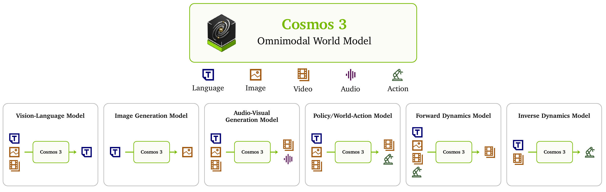

*Figure 1. The six boxes are different input/output configurations. For robotics, distinguish a policy that chooses actions from a forward model that predicts the consequences of supplied actions and an inverse model that infers actions from observed change.*

This is broader than a robot policy. The reported DROID controller is a **specialized checkpoint**, obtained by adapting the shared model to robot demonstrations and a particular command interface.

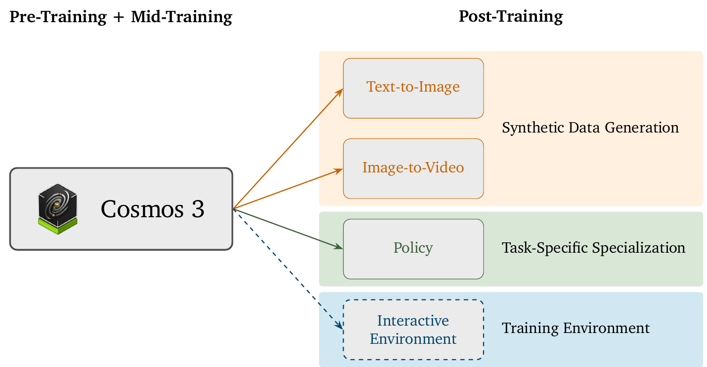

*Figure 2. Shared training supplies the starting point for separately post-trained image, video, and policy models. The dashed interactive-environment branch describes a future direction in the report, rather than a demonstrated general-purpose robot-training simulator.*

Three names matter throughout the note:

| Name | What it denotes | How to read its robot results |
|---|---|---|
| Cosmos3-Nano | General model after pre-training and mid-training | A starting point for action modeling and downstream adaptation |
| Cosmos3-Super | Larger general model | Evaluated on understanding and generation, including adapted forward dynamics |
| Cosmos3-Nano-Policy-DROID | Nano post-trained on DROID | The checkpoint used for the main closed-loop manipulation evaluations |

Separate image/video specialists also exist. Results from those weights should not be attributed automatically to the DROID policy.

**Table 2, model variants, selected configuration columns.** Each model has a reasoner tower and a generator tower. The total counts include both towers; Nano is not an 8B model with one set of weights serving both roles. KV heads are the attention heads producing keys and values.

| Variant | Total parameters | Layers per tower | Hidden width | Attention heads / KV heads |
|---|---:|---:|---:|---:|
| Edge | 4B | 28 | 2,048 | 16 / 8 |
| Nano | 16B | 36 | 4,096 | 32 / 8 |
| Super | 64B | 64 | 5,120 | 64 / 8 |

Nano and Super inherit their language/vision backbone from Qwen3-VL-8B and Qwen3-VL-32B. Edge uses a custom 2B backbone. The report's primary released general models are Nano and Super; the Edge experiments below should not be confused with the Nano DROID deployment.

## 2. Three Questions Turn One Trajectory into Three Learning Tasks

Before explaining the network, identify what it is being asked to predict. A recorded trajectory contains observations and actions. By revealing different parts, Cosmos 3 trains three related tasks.

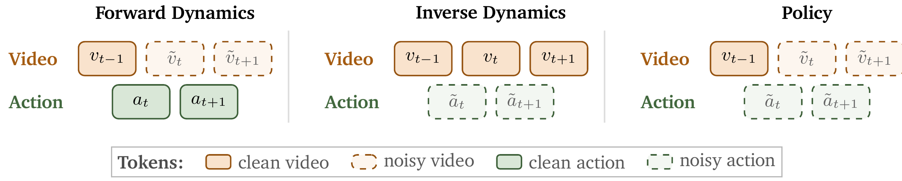

*Figure 4. Solid boxes are known conditioning data; dashed boxes are noisy quantities to predict. An action between two visual states describes their transition. Language is omitted from this diagram.*

Let $v_{t-1}$ denote the observed scene before a transition, $a_t$ the action during it, and $v_t$ the resulting scene. The subscript here orders observations and transitions; it does not specify a hardware control frequency.

Carry the cup example through each mode:

| Mode | What is supplied | What is predicted | Cup example |
|---|---|---|---|
| **Forward dynamics (FD)** | Initial observation and action sequence | Future video | Given the arm's reach-and-close motion, predict whether the gripper approaches and contacts the cup |
| **Inverse dynamics (ID)** | Observed video before and after motion | Actions explaining that change | Given video of the gripper reaching the cup, infer the corresponding motion |
| **Policy / world-action modeling** | Task and observed context | Future actions and video jointly | Given “put the cup in the tray,” generate commands together with an anticipated visual continuation |

The distinction changes what information is available. In inverse dynamics, the after-image is an input because the transition has already been recorded. During policy deployment, that future observation does not exist. Its visual representation must be generated along with the actions.

This gives each data source a useful role. Videos with motion estimates can teach the relationship between movement and visible change. Robot demonstrations additionally connect that relationship to controllable actions. However, sharing a prediction problem does not yet reconcile the very different numerical action spaces of a camera, a human hand, and a robot arm. That is the next interface problem.

## 3. How Can Different Bodies Share Action Knowledge?

### 3.1 Describe Geometric Change Before Mapping It to a Controller

A human demonstration may record wrist motion and fingertips, while a robot dataset records joint commands or end-effector poses. Directly treating their columns as interchangeable would assign different meanings to the same number. Cosmos 3 first converts many sources into a common description of **geometric motion and grasp state**.

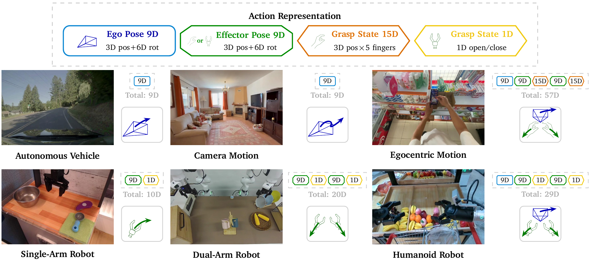

*Figure 3. Motion contributes 3 translation values and a 6-value rotation representation per pose. Grasp contributes either one gripper-state value or 15 fingertip-position values per hand. “6D rotation” uses six numbers to represent a rotation with three physical degrees of freedom.*

The building blocks are:

- **Ego pose:** movement of the agent's observation frame, such as a head camera or vehicle-mounted camera.
- **Effector pose:** movement of a wrist or robot end-effector frame.
- **Grasp state:** the current manipulation configuration. Robot grippers use a continuous open/close value; human hands use five fingertip positions, each with three coordinates in the wrist frame.

Pose motion is measured **relative to the preceding pose**. If $T_t$ is a rigid transform describing a frame's pose at time $t$, then

$$
\Delta T_t=T_{t-1}^{-1}T_t.
$$

The inverse expresses the new pose in the previous frame's coordinates. Translation is therefore not necessarily along a fixed world axis.

**Illustrative frame example.** Suppose the previous gripper's local $x$ axis points along world $+y$. Moving 2 cm in world $+y$, without rotating, gives a relative translation $(0.02,0,0)$ m in that preceding gripper frame. Recording $(0,0.02,0)$ would instead describe the displacement in world coordinates. The frame convention must be known to interpret the same three values correctly.

Grasp state follows a different rule: it records the current state rather than a temporal difference. If the recorded gripper value remains 0.3 at two successive steps, the new grasp channel is still 0.3. Replacing it with zero would discard the current grasp configuration. The paper uses an OpenCV-style pose convention with $z$ along the fingers/gripper and $x$ to the right; generated 6D rotations are converted to rotation matrices using the paper's singular value decomposition (SVD) procedure.

These components produce different vector lengths:

| Domain | Components | Values per action |
|---|---|---:|
| Camera / vehicle motion | One ego-pose change | 9 |
| Single arm | One effector-pose change + one gripper state | 10 |
| Dual arm | Two effector/gripper pairs | 20 |
| Humanoid | Ego motion + two effector/gripper pairs | 29 |
| Human egocentric motion | Ego motion + two wrist changes + two fingertip configurations | 57 |

These are **pseudo-actions** derived from state changes. They describe motion without reproducing every source's motor controller. That abstraction supports transfer, but a wrist displacement alone does not establish which joint command, torque, or contact force will realize it.

### 3.2 Different Interfaces Feed a Shared Latent Space

Different vector lengths still cannot enter one transformer directly. Cosmos 3 uses a separate learned input projection and output projection for each action domain $k$:

$$
 z=W_{\mathrm{in}}^{(k)}x+b_{\mathrm{in}}^{(k)},
 \qquad
 \hat{x}=W_{\mathrm{out}}^{(k)}z+b_{\mathrm{out}}^{(k)}.
$$

Here $x$ is that domain's action vector, $z$ is a shared-width latent vector, and $\hat{x}$ is a decoded prediction in the original domain's coordinates. Action channels are normalized using training statistics to comparable ranges, roughly $[-1,1]$.

For Nano, a 10-value single-arm vector and a 57-value human vector are each projected to width 4,096 through different matrices. The transformer can process both at that width; their output heads still recover different kinds of actions. A 57-value human output is not silently interpreted as a robot command.

The **DROID specialist later replaces this generic action interface with absolute joint-position actions**. Keeping those stages separate prevents a common misunderstanding: the general model's relative-pose representation is not the native command sent to the deployed Franka controller.

## 4. How Do Reasoning and Joint Generation Interact?

### 4.1 Convert Each Modality into Tokens with a Known Role

The model needs a representation for both understanding an observed image and generating an image. Those roles use different encoders.

| Information | Conversion | Role |
|---|---|---|
| Language | Discrete language tokens | Predict text one token at a time and condition generation |
| Images/video for understanding | Trainable vision transformer (ViT), patch size $16\times16$, with $2\times2$ merging | Supply visual features to the reasoner |
| Images/video for generation | Frozen Wan2.2-TI2V-5B variational autoencoder (VAE), then latent patches | Represent observed or predicted visual content compactly |
| Audio | Frozen audio autoencoder | Continuous audio latents at 25 tokens/s |
| Actions | Domain-specific projections from Section 3 | Continuous action latents |

A **token** is a feature vector processed by the transformer. A **latent** is a compressed numerical representation; a predicted visual latent is not yet an RGB image. The video autoencoder compresses time by $4\times$ and space by $16\times16$; a further $2\times2$ patch merge gives an effective spatial factor of $32\times32$.

The encoders make the modalities compatible in width. Learned modality embeddings tell the network whether a vector represents language, vision, audio, or action. The next problem is to let continuous predictions use the language/vision context while preserving ordinary causal text generation.

### 4.2 Two Towers Meet at Attention, with One-Way Information Flow

Cosmos 3 uses a **Mixture-of-Transformers (MoT)**: an autoregressive reasoner and a diffusion generator process different parts of one sequence.

- **Autoregressive (AR)** means a text prediction reads preceding context, without reading later text or generated future tokens.
- **Diffusion (DM)** here means continuous targets start noisy and are refined together over several evaluations.

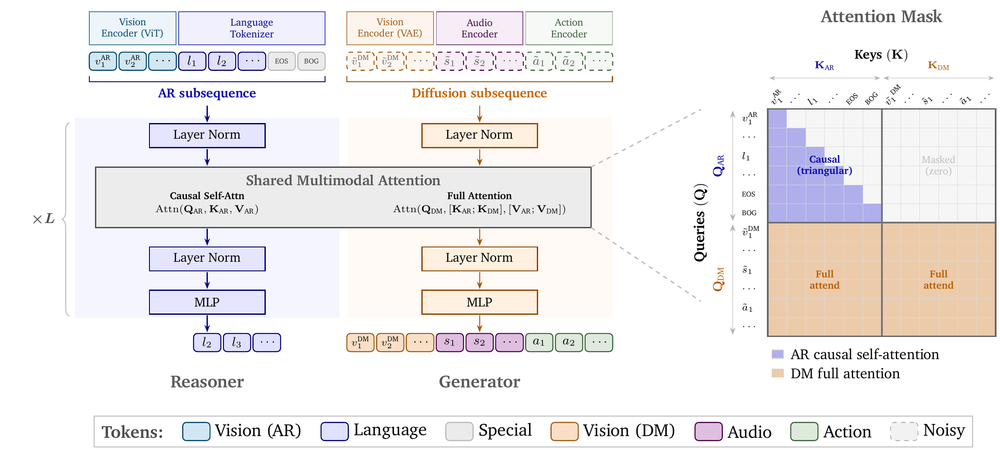

*Figure 5. The AR prefix is on the left and the continuous generation sequence on the right. Each tower has its own normalization, attention projections, and feed-forward weights. The shared attention operation lets generator queries read reasoner context.*

This is routing by token type, rather than a learned sparse-expert gate. Language and optional understanding features form the AR prefix, ending with special end-of-sentence and beginning-of-generation tokens. Continuous generation tokens follow. Within the DM sequence, clean conditioning tokens precede noisy targets.

The attention mask determines which information can be read:

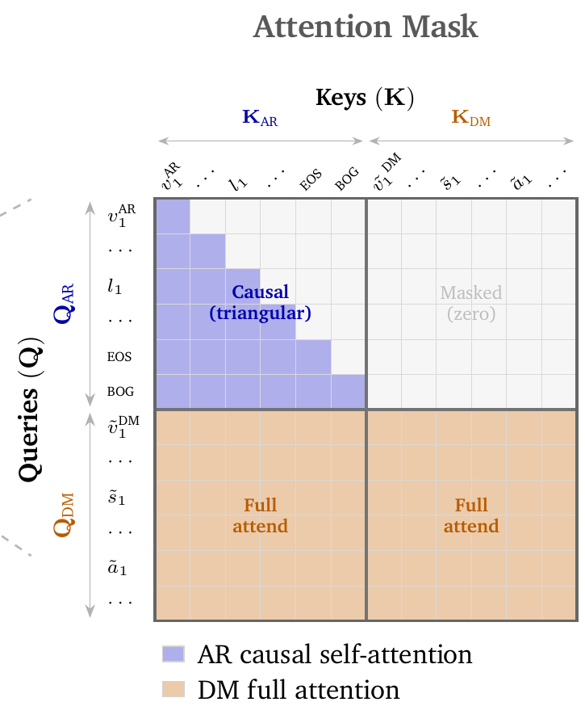

*Figure 5, attention-mask detail. Read each row as a query asking which columns it may access. AR rows cannot read DM columns. DM rows can read the AR context and the continuous sequence.*

Writing $Q$, $K$, and $V$ for attention queries, keys, and values, the two paths are

$$
O_{\mathrm{AR}}=\operatorname{Attn}_{\mathrm{causal}}
 (Q_{\mathrm{AR}},K_{\mathrm{AR}},V_{\mathrm{AR}}),
$$

$$
O_{\mathrm{DM}}=\operatorname{Attn}_{\mathrm{full}}
 (Q_{\mathrm{DM}},[K_{\mathrm{AR}};K_{\mathrm{DM}}],
 [V_{\mathrm{AR}};V_{\mathrm{DM}}]).
$$

The brackets concatenate accessible tokens. The two towers produce their projections independently; “shared attention” does not mean they share one learned set of query/key/value matrices.

**Follow one cup prediction.** The instruction and observed context condition generation. An action query can read representations of the cup, the task, and the future video currently being denoised. A noisy future-video query can also read the candidate actions. Their representations can therefore become mutually consistent. In contrast, an AR text query cannot read that unfinished future video. The architecture does not implement a loop in which the language reasoner observes, checks, and revises every generated future.

This one-way dependency also saves work. With fixed conditioning, the AR keys and values can be computed once and cached across denoising steps. New observations or a new instruction require corresponding conditioning; this cache is not an automatically maintained memory of the robot's entire history.

## 5. How Are Video and Action Tokens Aligned in Time?

Putting tokens next to one another does not establish that they describe the same moment. A video latent, an audio latent, and a robot command can arrive at different rates. If each simply advanced the same positional counter by one, the model would confuse token count with elapsed time.

Cosmos 3 uses three-dimensional rotary positional embeddings, **3D MRoPE**, with coordinates $(t,h,w)$. Video varies in time and space; actions and audio use time with $h=w=0$. Language follows a one-dimensional ordering by assigning the same index to all three coordinates.

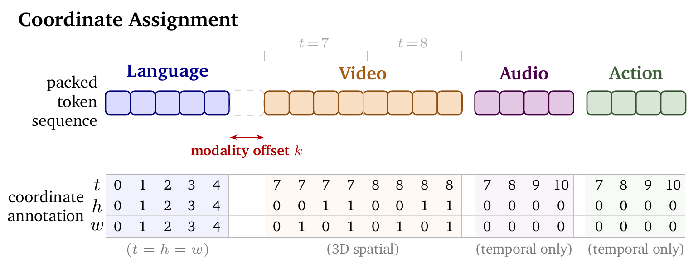

*Figure 6, left panel. The three rows beneath the tokens assign temporal, height, and width coordinates. Audio/action tokens carry temporal coordinates without image-grid coordinates.*

To align physical time, the model scales the temporal increment using **temporal steps per second (TPS)**. Its base is 24-FPS video divided by the video autoencoder's temporal compression of four:

$$
\mathrm{TPS}_{\mathrm{base}}=24/4=6,
\qquad
\Delta t_{\mathrm{coord}}=\frac{6}{\mathrm{TPS}_{\mathrm{modality}}}.
$$

**Illustrative one-second comparison using the paper's rates:**

| Stream | Tokens or samples per physical second | Coordinate increment per step | Coordinate span for one second |
|---|---:|---:|---:|
| 24-FPS video after temporal compression | 6 | 1 | 6 |
| Audio: 48 kHz, hop size 1,920 | 25 | 0.24 | 6 |
| Actions sampled at 15 Hz | 15 | 0.4 | 6 |

For example, five action intervals cover $5/15=1/3$ second and advance the coordinate by $5\times0.4=2$. Two video-latent intervals cover the same duration and advance it by $2\times1=2$. The alignment depends on physical duration rather than adjacency in the serialized sequence.

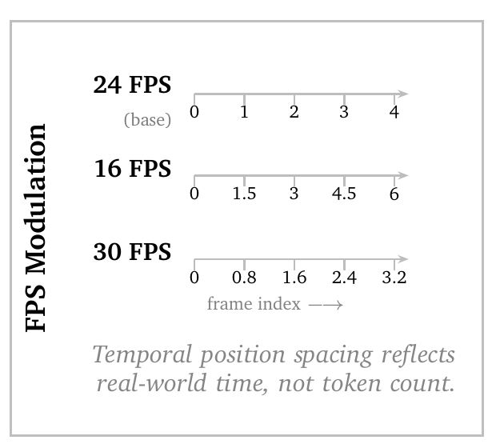

*Figure 6, right panel. The frame-level illustration spaces 16-FPS frames farther apart than 30-FPS frames. This panel illustrates rate scaling; the table above additionally accounts for the video's latent temporal compression.*

A separate fixed positional gap of 15,000 separates AR and DM ranges to reduce generation artifacts. It is an embedding-coordinate offset, not a 15,000-second delay.

This representation supplies a common clock. It does not itself supply robot calibration or enforce contact physics. Its timing claim is tested on controlled-FPS video generation, discussed in Section 13; that experiment does not measure a policy's control-loop frequency.

## 6. How Does Noise Become Future Video and Actions?

The generator learns to recover continuous targets from corrupted versions. During training, the correct video/action sequence is known; during inference, the unknown target starts from noise. The observed context stays available throughout refinement.

Cosmos 3 uses **rectified flow**. For a clean target latent $x_0$, random noise $\epsilon$, and a noise level $\sigma\in[0,1]$, training constructs

$$
x_\sigma=(1-\sigma)x_0+\sigma\epsilon.
$$

At $\sigma=0$ the target is clean; at $\sigma=1$ it is noise. The model predicts the velocity $\epsilon-x_0$ along this interpolation, using a mean-squared-error loss on target tokens. Clean conditioning tokens are excluded from that prediction loss.

**Illustrative scalar calculation.** Take one normalized latent coordinate with $x_0=0.2$, $\epsilon=0.8$, and $\sigma=0.5$. The input is $x_\sigma=0.5$, and the target velocity is $0.6$. Predicting $0.3$ gives squared error $(0.3-0.6)^2=0.09$. Predicting $0.6$ gives zero loss for this coordinate.

Generation runs the noise level backward, toward zero. In a simplified Euler step with $\Delta\sigma=-0.1$, that velocity changes $0.5$ to $0.5-0.1\times0.6=0.44$, toward the clean value 0.2. This example explains the direction of refinement, rather than specifying the report's full sampler. The coordinate is a latent value, not a joint displacement; **denoising time is distinct from elapsed robot time**.

In policy mode, the unknown action tokens and future-video tokens participate in the same joint refinement. Their attention connections from Section 4 let each use the other's evolving representation. Only the decoded action output becomes a robot command.

During mid-training, action loss receives a weight of 10 relative to its unweighted mean-squared error. For example, visual loss 0.04 and action loss 0.001 would contribute $0.04+10\times0.001=0.05$ before other terms. This changes training emphasis. It does not multiply the robot's executed action by ten.

## 7. What Is Learned at Each Training Stage?

A model trained on ordinary video has no reason to know the joint interface of a Franka arm. Conversely, learning only from Franka demonstrations would discard much broader visual experience. The curriculum connects those sources gradually.

### 7.1 First Train Understanding, Then Use It to Condition Generation

The reasoner learns language and visual understanding through next-token prediction, followed by supervised fine-tuning on physical-AI tasks. It supplies the language/vision context read by the generator.

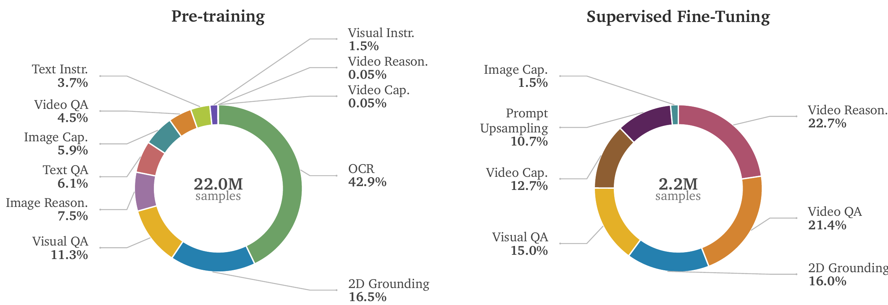

*Figure 7. Each ring divides one training stage by capability. OCR means reading text in images; grounding means locating a referred object or region. The larger pre-training set and smaller specialized fine-tuning set have different compositions.*

**Table 3, reasoner curriculum.** Image/video rows count media samples; the text-only row counts conversations.

| Modality | Pre-training | Supervised fine-tuning |
|---|---:|---:|
| Image–text | 18,814,952 | 1,051,513 |
| Video–text | 1,016,299 | 1,079,200 |
| Text only | 2,170,762 | 40,960 |
| **Total** | **22,002,013** | **2,171,673** |

The approximately 24.2M examples span robotics, driving, infrastructure, and general understanding. Pre-training runs for two epochs with a 16k maximum sequence length. Fine-tuning mixes pre-training and specialized data in a 1:4 ratio for 8,200 steps at global batch size 512.

The resulting reasoner initializes the generator's corresponding transformer weights. During generator training, reasoner weights are frozen while generation-specific weights learn continuous prediction. Thus the final setup combines a trained conditioning model with a separately trained generative path; it does not jointly update both towers on every video or robot batch.

### 7.2 Learn Visual Dynamics Before Adding Action Supervision

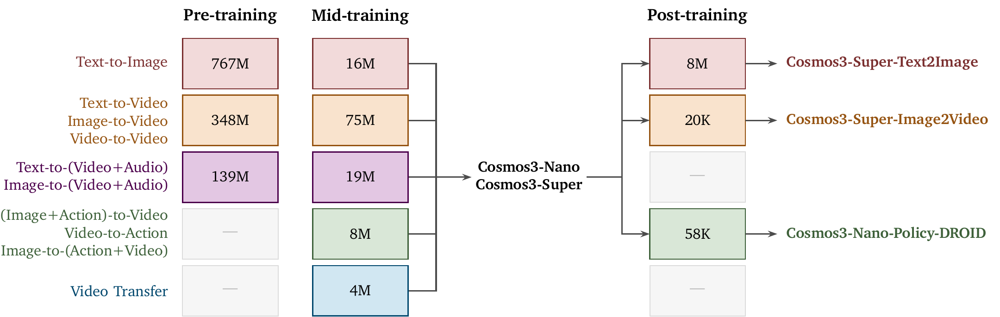

*Figure 8. Read left to right. Actions are absent from generator pre-training, enter mid-training, and receive DROID-specific supervision during policy post-training. Counts are rounded training-sample counts; the 58K policy samples are not 58K evaluation trials.*

| Stage | Data and objective | What becomes available afterward |
|---|---|---|
| Generator pre-training (**PT**) | 767M images, 347.7M video clips, and an audio–video subset of about 139M clips; continuous generation | A model of visual/audio content and change, without action supervision at this stage |
| Generator mid-training (**MT**) | Continue visual generation while adding action-conditioned tasks and controlled video transfer | General Nano/Super checkpoints with action-related representations |
| DROID post-training | Filtered robot demonstrations, joint-action supervision, current state and camera inputs | Nano policy adapted to the deployed arm and controller |

The audio–video subset overlaps the video collection and should not be added as a disjoint extra set of videos. Video-transfer tasks use control representations such as depth or edges to condition generated RGB video; these are not robot joint commands.

Pre-training includes text-to-image, text-to-video, image-to-video, and video continuation, with stated sampling ratios 20%, 56%, 16%, and 8%. Observed visual frames remain clean while only target frames are noised. This teaches the distinction between context already seen and continuation to generate.

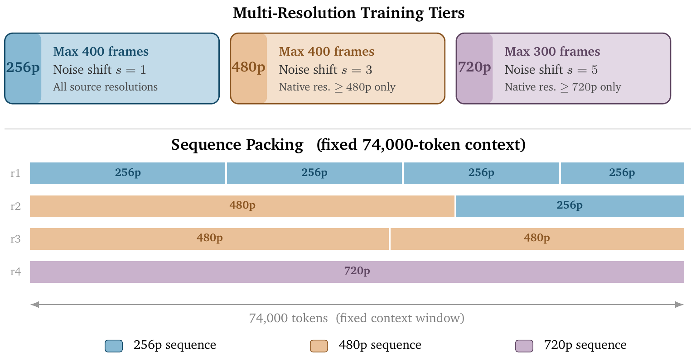

*Figure 10, left panel. Each row packs separate sequences into a 74,000-token context. Their attention is isolated across samples, so neighboring training clips do not become one fictitious continuous event.*

Resolution trades off detail against context cost. The report supports 256p, 480p, and 720p profiles and varies duration within a fixed token budget. Its base visual training profiles are separate from the DROID camera/control profile in Section 9.

**Table 6, complete mid-training stream allocation.** These are sampling probabilities, not percentages of stored files or hours.

| Stream | Sampling share |
|---|---:|
| Image | 10% |
| Video | 32% |
| Video with audio | 8% |
| Action-related tasks | 25% |
| General video transfer | 20% |
| Driving video transfer | 5% |

The action stream includes FD, ID, and policy configurations from Section 2. Mid-training is therefore broader than imitation learning from robot commands. The action-loss weight is 10, and the reported learning rate for generator pre-training and mid-training is $10^{-4}$.

Scale is substantial: Nano uses 31.05T pre-training tokens and 2.4T mid-training tokens; Super uses 17.86T and 1.9T. The corresponding runs use 1,024 and 2,048 GB200 GPUs. These are training resources, not the two-GPU DROID serving setup.

## 8. Which Experiences Supply the Action Prior?

### 8.1 Most Action-Related Hours Come from Human Motion

The mid-training action collection contains about **8.4M episodes and 61.3K hours**. “Action data” here includes estimated geometric motion from human and camera video, not exclusively robot commands.

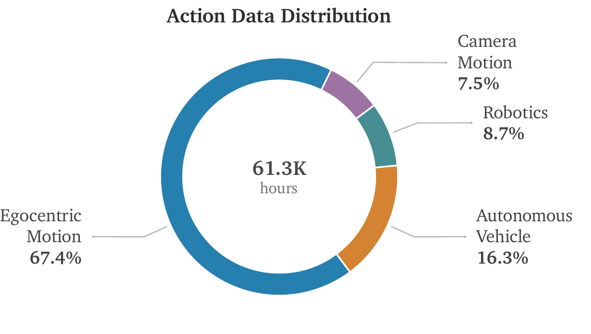

*Figure 9. Human egocentric motion contributes 67.4%, vehicle motion 16.3%, robotics 8.7%, and camera motion 7.5% of reported hours. Rounded percentages do not sum exactly to 100%.*

Human data provides head motion, wrists, and hand configuration across many interactions. Camera-motion data is extracted from videos with estimated camera poses. Robot trajectories supply manipulation examples from several bodies. Their shared geometric interface lets those sources contribute to one model, while the domain projections preserve different action layouts.

**Table 4, robotics subset.** The source reports these task counts across heterogeneous datasets; they should not be read as a uniformly annotated count of distinct semantic skills.

| Embodiment | Reported tasks | Episodes | Hours |
|---|---:|---:|---:|
| AgiBot | 338 | 239.4K | 4.37K |
| Franka Panda | 67.5K | 76.3K | 442 |
| Google Robot | 599 | 87.2K | 351 |
| WidowX-250 | 21.8K | 50.4K | 100.1 |
| UMI | 43 | 38.3K | 67 |
| UR | 114 | 25.0K | 35 |
| **Total, as reported** | **90.4K** | **516.7K** | **5.36K** |

Mid-training retains failed and idle behavior: a forward model needs examples of unsuccessful and uneventful transitions as well as successful ones. The DROID policy later filters failures and idle frames because its immediate objective is to imitate useful task execution. The filters differ because the learning questions differ.

### 8.2 Synthetic Video Adds Controlled Physical Situations

A second source of experience is simulation-generated video. It can vary bodies, environments, and events while retaining simulator annotations. It does not automatically provide the final policy with an executable command interface.

**Table 22, selected overview columns.** Counts describe the report's synthetic-data overview, rather than a common number of robot demonstrations. Available annotations vary by corpus.

| Corpus | Overview clips | Main situations | Examples of accompanying information |
|---|---:|---|---|
| PhyxSim | 76,489 | Physical object interactions | Depth, segmentation, physics state, camera metadata |
| RobotSim | 208,022 | Robot motion, manipulation, collision | Camera metadata and selected depth/physics annotations |
| DriveSim | 264,000 | Driving scenes | RGB video and captions |
| SynHuman | 236,937 | Human motion | Depth and camera metadata |
| Warehouse | 122,952 | Warehouse activity | Depth, segmentation, boxes, camera metadata |

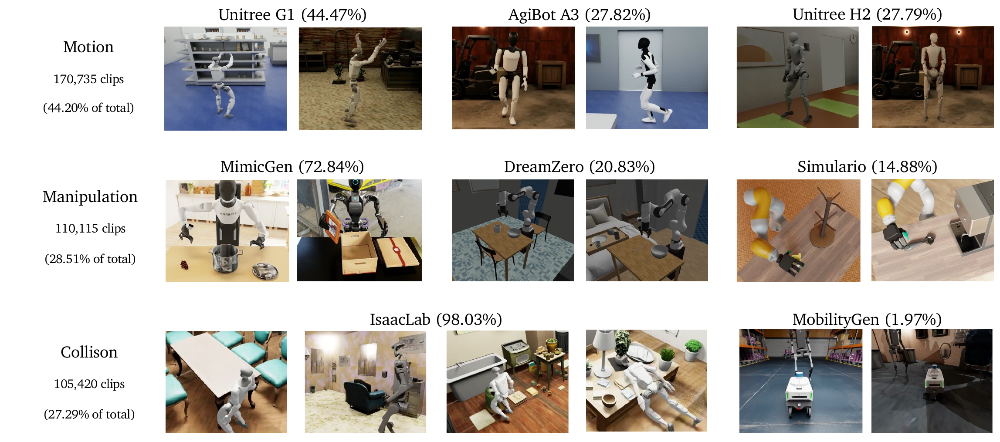

*Figure 32. The public RobotSim release illustrated here spans motion, manipulation, and collision. Its release inventory is 386,270 clips, a different reported count from Table 22's 208,022-clip overview. The figure's counts and percentages are retained as printed; they should not be treated as the DROID policy's training allocation.*

The useful connection is additional visual experience of physical situations. Whether that improves robot control requires downstream evidence; video-quality improvements alone cannot establish it. Section 13 separates the corresponding ablation from actual task-success experiments.

## 9. How Does Nano Become the DROID Policy?

### 9.1 Replace the Generic Action Interface with the Arm's Commands

The general model knows geometric motion patterns, but the deployed controller expects a specific command space. DROID post-training establishes that mapping.

The platform is a **7-DoF Franka Panda arm with a Robotiq 2F-85 gripper**. DROID's original collection contains about 76K trajectories, 350 hours, 86 tasks, and 564 scenes. The policy recipe removes failed demonstrations and community-identified idle frames, then applies random image augmentations.

Starting from mid-trained Nano, the authors freshly initialize the action encoder, action decoder (a multilayer perceptron, or MLP), and action embedding tokens for **absolute joint-position prediction**. Their learning rate is five times the other parameters' rate; the base post-training rate is $2\times10^{-4}$. This gives the new command interface more opportunity to adapt while retaining the learned generative backbone. The recipe learns from demonstrations with the generative prediction objective; the report does not describe a reinforcement-learning stage for this DROID policy.

One policy call consumes:

- The task instruction.
- Current proprioception: measured information about the robot's own configuration.
- Three camera observations, arranged into one image canvas.

It predicts **32 future absolute joint-position actions**, together with auxiliary future visual latents. The report does not specify enough detail to infer the full action-vector packing or a particular gripper coordinate from the arm's seven degrees of freedom alone.

**Illustrative command distinction.** If one joint is measured at 0.40 rad and the first predicted reference is 0.45 rad, the command is “track 0.45 rad.” Interpreting 0.45 as an increment and adding it to the measurement would instead request 0.85 rad. Neither the general model's relative end-effector pose nor a noisy latent coordinate can be substituted for this absolute joint reference. Actual joint motion still depends on the controller and physical arm.

### 9.2 Preserve Which Camera Shows Which View

The wrist view is $360\times640$ pixels, stated as height × width. Two external views, each $180\times320$, are placed side by side underneath. The resulting DROID canvas is **$540\times640$**.

This layout gives a close view of contact and wider views of the arm and scene. Without a consistent layout, similar image locations could refer to different physical cameras across samples, making the spatial evidence ambiguous.

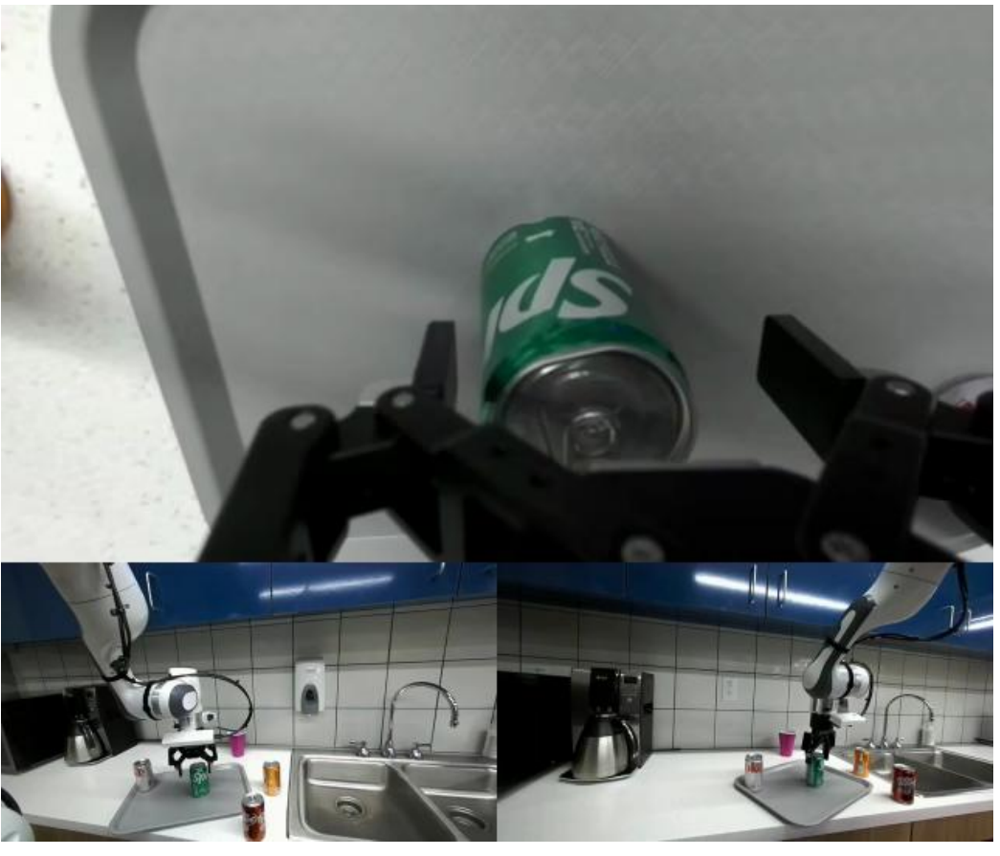

*Figure 30, camera panel. The base action-data example places a wrist view above two external views.*

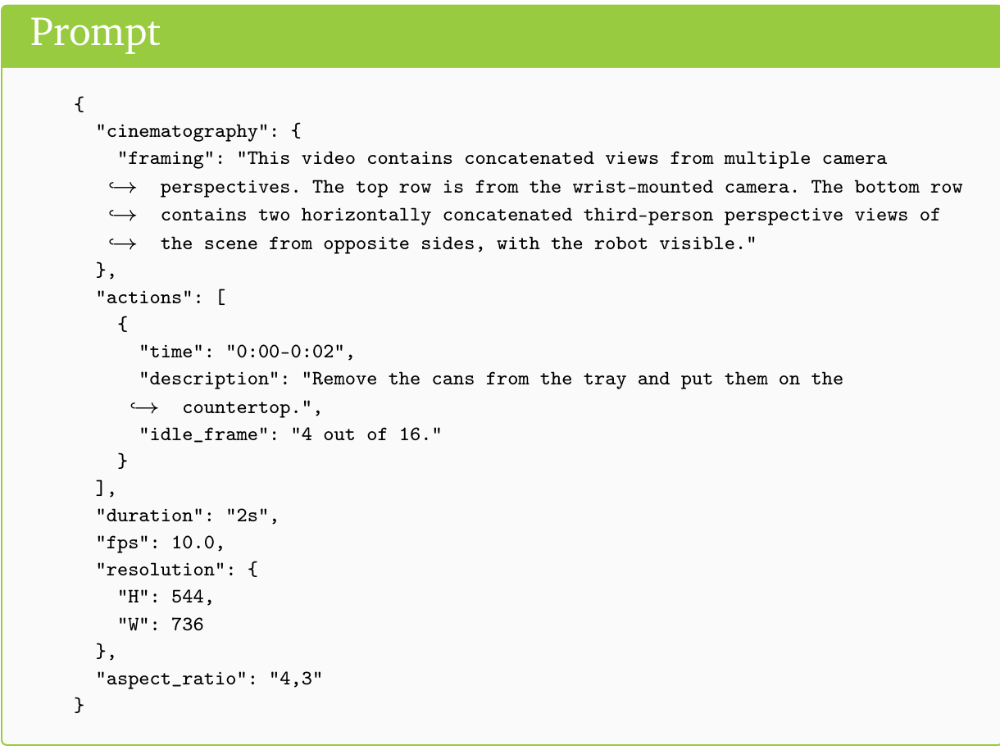

*Figure 30, prompt panel, separated for readability. Its printed 10-FPS, $544\times736$ example is not the DROID specialist's $540\times640$ canvas or 15-Hz command execution profile.*

The base generator uses structured descriptions of framing, action, duration, frame rate, and resolution. These metadata help interpret heterogeneous training clips. DROID policy post-training instead uses the dataset's official short task instructions. The paper's use of Claude-Opus-4.6 for base prompt expansion does not imply that a separate prompt-expansion call is required inside each DROID control step.

## 10. What Happens During Deployment, and at Which Rate?

Follow a call from sensing to execution:

1. **Read the current context.** Assemble the instruction, measured state, and three camera views.
2. **Compute fixed conditioning.** The AR path supplies context for the generator; its keys and values can be reused during this call's denoising steps.
3. **Refine two unknown futures.** Four denoising steps jointly generate the action chunk and future visual latents.
4. **Decode actions.** Convert action latents into the 32 absolute joint-position references. Skip RGB decoding of predicted video to save that rendering work.
5. **Execute through Franky.** The Franky joint-position controller sends references to the arm at 15 Hz. Subsequent real observations are needed for further closed-loop decisions.

Skipping the visual autoencoder's decoder does **not** skip future-video-token generation. The action path still uses the joint model's visual representations.

**Table 21, action-related sampling rows.** CFG is classifier-free guidance, which combines conditioned and unconditioned model predictions during generation. A noise shift changes the denoising schedule.

| Use | Denoising steps | Noise shift | CFG scale |
|---|---:|---:|---:|
| Forward dynamics | 50 | 5 | 1 |
| Inverse dynamics | 50 | 5 | 1 |
| DROID policy | 4 | 5 | 3 |

DROID serving uses two RTX Pro 6000 GPUs and parallelizes the conditioned and unconditioned guidance branches. Guidance scale 3 influences generated predictions; it is not a threefold gain applied to final joint commands. The policy uses a null negative prompt.

Three timing quantities must remain separate:

| Quantity | Meaning | What the report establishes |
|---|---|---|
| 15 Hz | Rate of executing joint-position references | Reported deployment setting |
| $32/15\approx2.13$ s | Nominal time spanned by 32 action samples at that rate | A command-horizon calculation |
| 4 denoising steps | Neural refinement iterations per generated chunk | Reported policy sampler |

**Illustrative horizon calculation:** the first 15 reference samples account for roughly one second of planned commands, and the whole chunk for about 2.13 seconds. That is not a measurement of inference latency. Four denoising steps are also not four physical robot steps.

The report does not give the precise model-call latency, how much of each chunk is executed before replanning, or a complete scheduling protocol. Therefore, it does not establish 15 full model calls per second or that the arm always executes all 32 commands open-loop. The conditioning cache persists across denoising within a fixed call; the report does not specify an additional long-term recurrent policy memory.

## 11. Does the Policy Complete Tasks?

### 11.1 First Separate Understanding, Prediction, and Control

The opening results table mixes several capabilities. Their numbers answer different questions. Peak signal-to-noise ratio (PSNR) measures agreement between predicted and reference pixels; higher values in decibels (dB) mean closer visual reconstruction.

**Table 1, selected robotics entries, reorganized by question.** The forward-dynamics and policy entries use downstream-adapted models. Scores in different rows have different units and cannot be averaged into one robotics score.

| Question | Reported measure | Nano | Super |
|---|---|---:|---:|
| Can it answer robotics-related visual questions? | Robotics reasoning aggregate score | 55.1 | 57.8 |
| Can it predict video given robot actions? | Adapted robotics FD PSNR, dB, rounded | 25.5 | 26.0 |
| Can its adapted policy complete RoboLab tasks? | Success rate with specific instructions, % | 39.7 | Not reported |

The first row tests understanding; the second tests agreement with recorded visual outcomes. The third executes a policy and checks task completion. The control evidence therefore starts with that third kind of experiment.

### 11.2 RoboLab: Better Overall Success, with Important Remaining Failures

RoboLab-120 evaluates 120 language-conditioned simulation tasks using **vague, default, and specific** instructions. This tests how much performance depends on the user stating exactly what to do. For the reported specific-instruction comparison, ten rollouts per task total 1,200 trials.

**Table 19, complete Overall columns.** Entries are task success rates (%), using DROID-fine-tuned checkpoints. PT-init means post-training starts before action mid-training; the final DROID policy starts after it.

| Policy | Vague | Default | Specific |
|---|---:|---:|---:|
| **Cosmos3-Nano-Policy-DROID, MT-init** | **20.6** | **36.8** | **39.7** |
| Cosmos3-Nano, PT-init | 16.7 | 28.1 | 30.2 |
| pi0.5 | 15.2 | 28.0 | 28.1 |
| DreamZero | 14.9 | 25.7 | 23.9 |
| pi0-FAST | 9.2 | 15.5 | 14.9 |
| paligemma-binning | 3.1 | 3.4 | 5.5 |
| GR00T N1.6 | 5.4 | 7.2 | 5.3 |
| pi0 | 2.8 | 5.0 | 3.5 |

The MT-versus-PT comparison is especially informative: the architecture and downstream task are held fixed while the initialization includes additional action mid-training. Under specific instructions, success rises from 30.2% to 39.7%, a **9.5 percentage-point gain**. Compared with pi0.5, the gain is 11.6 points in that column.

Instruction detail still matters: the final policy's overall score falls from 39.7% with specific instructions to 20.6% with vague ones. A model that can act does not necessarily resolve an underspecified goal reliably.

**Table 19, selected difficulty columns.** This excerpt exposes a limit hidden by the overall mean.

| Policy | Simple, specific | Moderate, specific | Complex, specific | Complex, vague |
|---|---:|---:|---:|---:|
| Cosmos3-Nano-Policy-DROID | 42.0 | 40.3 | 29.4 | 4.1 |
| Cosmos3-Nano, PT-init | 32.8 | 29.5 | 21.8 | 7.1 |
| pi0.5 | 29.8 | 31.0 | 14.7 | 5.3 |
| DreamZero | 25.8 | 26.7 | 10.6 | 4.1 |

The final policy leads these specific-instruction comparisons, but not every cell: its 4.1% on complex vague tasks is below PT-init and pi0.5. Overall improvement should not be restated as universal dominance. This note follows Table 19's values; nearby report prose gives a different DreamZero specific score.

### 11.3 Physical Robots: Demonstrations and Preference Ratings

Simulation can repeat controlled tasks, but real sensing and contact can differ. The report also includes physical DROID execution.

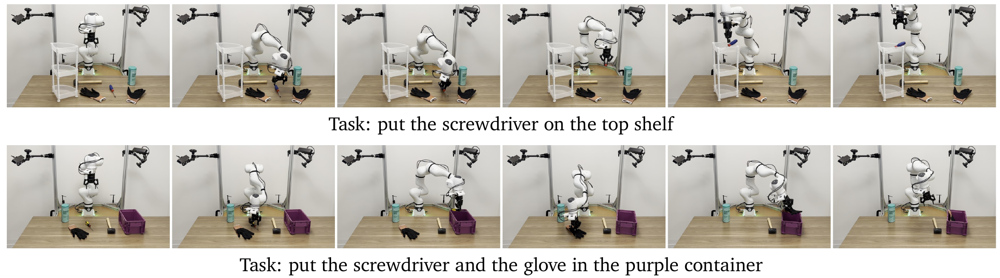

*Figure 25. Read each row from left to right. The first task places a screwdriver on the top shelf; the second places the screwdriver and glove in a purple container. These are qualitative successful trajectories, rather than an estimate of success across all tasks.*

RoboArena supplies a broader real-world comparison through distributed, double-blind A/B trials. Evaluators compare two policies, and the benchmark aggregates pairwise preferences into a rating. That rating is neither a percentage of completed tasks nor directly comparable with RoboLab's success rate.

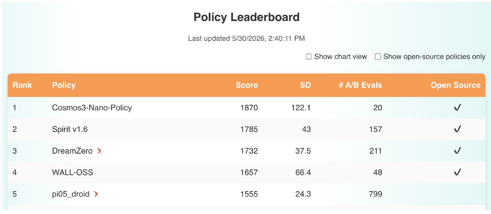

*Figure 26. Historical RoboArena snapshot, May 30, 2026. Columns include rating, reported standard deviation, and number of A/B evaluations. Cosmos has rating 1,870 with SD 122.1 from 20 comparisons in this snapshot.*

The top position supports strong early real-world preference results. Its limited comparison count and large reported uncertainty qualify the ranking: for example, pi0.5-DROID has 799 comparisons in the same image. The figure does not establish a current leaderboard position or a 100%-successful physical policy.

### 11.4 MolmoSpaces: Transfer without Benchmark-Specific Tuning

The authors submit the same DROID policy and hyperparameters used for RoboLab/RoboArena to MolmoSpaces, without benchmark-specific tuning. Its manipulation tasks vary scenes and objects, providing another test beyond DROID demonstrations.

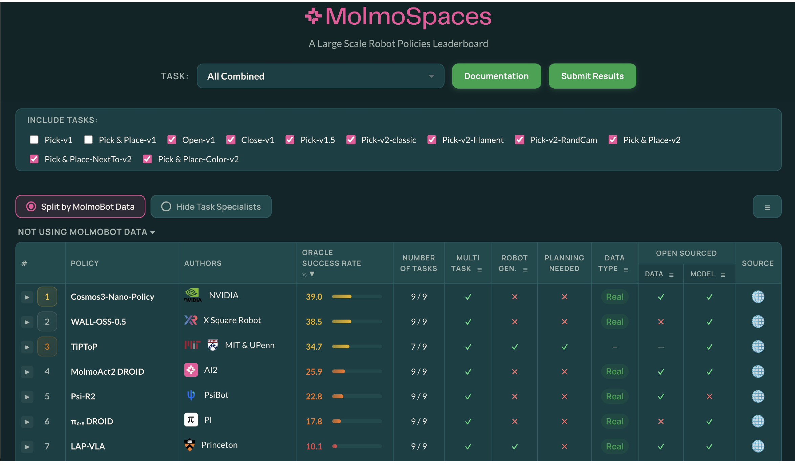

*Figure 27. Historical June 20, 2026 snapshot under the displayed All Combined task selection. The reported score is 39.0% oracle success. Preserve the task selection when comparing this number with other evaluations.*

Here **oracle success** counts an episode if the task-success condition is satisfied at any recorded step; it need not remain satisfied at the final step. This metric definition is clarified by the benchmark's [official evaluation code](https://github.com/allenai/molmospaces/blob/main/scripts/benchmarks/eval_to_csv.py), which distinguishes any-step from final-step success. It does not mean that an oracle supplies actions to the policy.

For example, a simulated placement that briefly satisfies the task and then loses the object can count under any-step success while failing a final-step check. Thus 39.0% is useful transfer evidence under the shown protocol, but cannot be interpreted as stable physical completion on 39% of arbitrary real-world tasks.

## 12. What Transfers, and How Much Adaptation Is Still Needed?

### 12.1 Action Mid-Training Speeds Up Adaptation

The DROID results test one deployed body. LIBERO-10 asks a different question: does the shared action prior help a model adapt to another embodiment/environment? Both initializations are post-trained on the new setting, then evaluated with 50 rollouts per task, totaling 500 per checkpoint.

**Table 20, complete results.** Values are closed-loop task success rates.

| Initialization | 500 iterations | 1,000 | 1,500 | 2,000 |
|---|---:|---:|---:|---:|
| MT-init | 24.6% | 91.4% | 95.8% | 97.4% |
| PT-init | 0.0% | 73.8% | 93.4% | 95.2% |

At 1,000 iterations, the gap is 17.6 points. At 2,000, it narrows to 2.2 points. This supports **faster adaptation**, especially early in training, rather than showing that every new body works without training. Both models eventually become strong under this supervised adaptation recipe.

### 12.2 Cross-Domain Training Helps Some Partners More Than Others

A shared action space permits co-training, but extra data can also interfere. Figure 28 tests pairs of domains instead of assuming that every mixture helps every target.

Read each heatmap as follows:

- A **row** fixes the domain being evaluated.
- A **column** identifies the added training domain.
- A **diagonal** cell trains only on the row domain for 2,000 steps.
- An **off-diagonal** cell uses a 50/50 mixture for 4,000 steps. This matches row-domain exposure, while using more total optimization than the single-domain baseline.

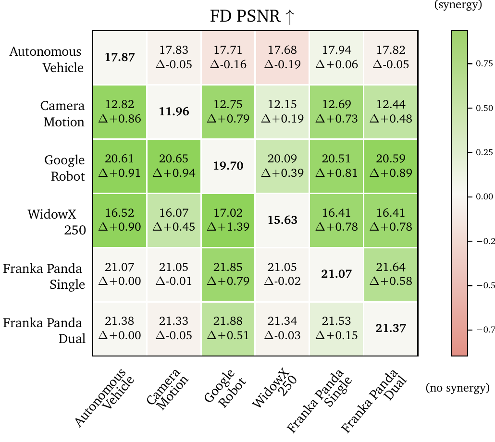

*Figure 28, FD panel. Higher PSNR means closer predicted video. Each off-diagonal delta compares against the diagonal in its row; green indicates improvement.*

**Worked reading of one cell.** WidowX-250 alone reaches 15.63 dB. In the WidowX row and Google Robot column, the score becomes 17.02 dB: $17.02-15.63=1.39$ dB better. Google Robot motion data helps predict WidowX's visual transitions under this paired-training protocol. The reverse transfer is a separate cell, since helping one domain does not guarantee equal benefit to the other.

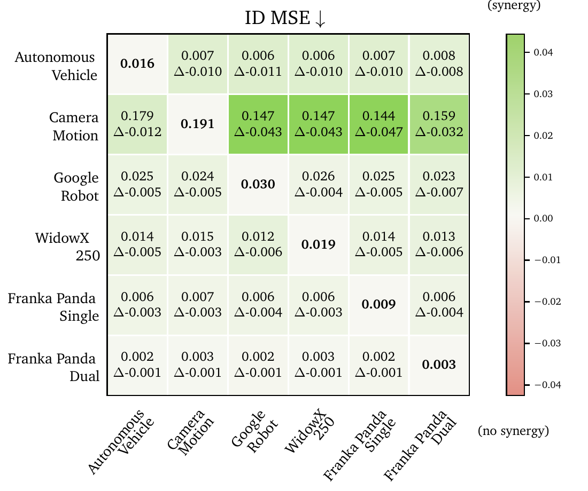

*Figure 28, ID panel. Lower action mean-squared error is better. Negative numerical error changes can therefore indicate improvement; the green color denotes benefit, not necessarily a positive raw delta.*

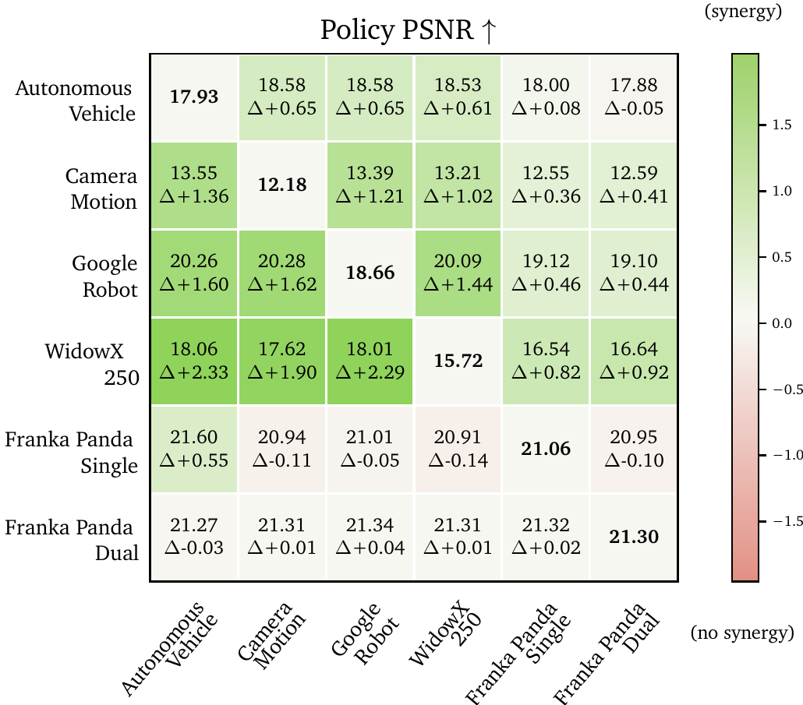

*Figure 28, policy PSNR panel. These are visual-prediction scores in joint policy mode, not task-completion percentages.*

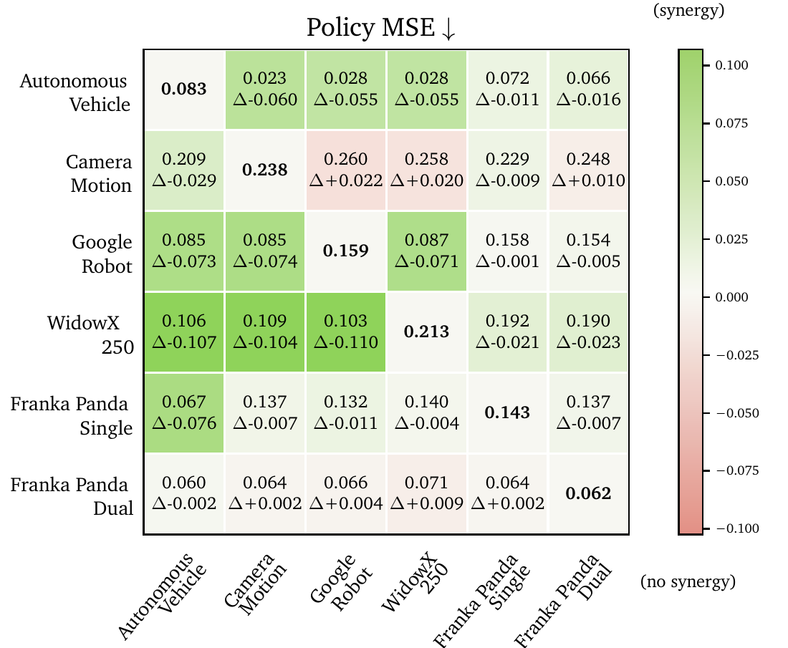

*Figure 28, policy action-MSE panel. Lower values mean actions closer to the reference under the experiment's representation.*

The report states that policy-mode PSNR and MSE are the **minimum across four rollouts**. Because higher PSNR and lower MSE are desirable, that convention selects different favorable directions; it should not be described simply as “best of four” for both metrics.

The maps show broad gains for several camera and robot domains, alongside negative or negligible cells. The small Franka subsets in this study contain only 23 hours for single-arm and 4 hours for dual-arm data; they are not the entire Franka inventory in Table 4. Their near-saturated single-domain results help explain why added data gives smaller gains on those rows.

These experiments isolate useful cross-domain prediction structure under matched target exposure. They do not establish equal-compute superiority or a closed-loop success improvement for every mixture.

### 12.3 Human Motion Can Supply a Useful Starting Point

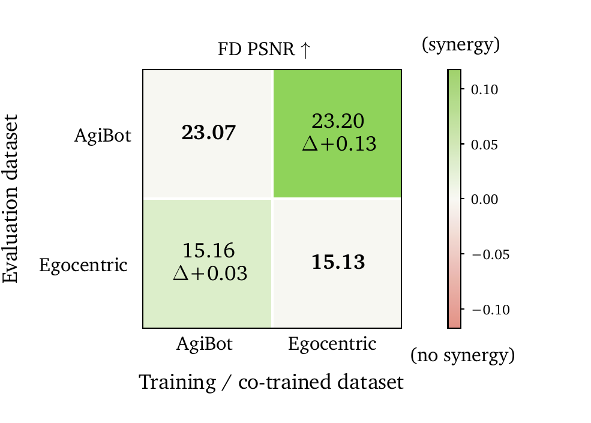

*Figure 29a. Rows are evaluation domains and columns are training partners. The diagonal is single-domain FD; adding egocentric data raises AgiBot from 23.07 to 23.20 dB.*

The reverse change, from 15.13 to 15.16 dB for egocentric prediction, is smaller. These modest asymmetric gains show shared information without implying that human and robot action spaces have become identical.

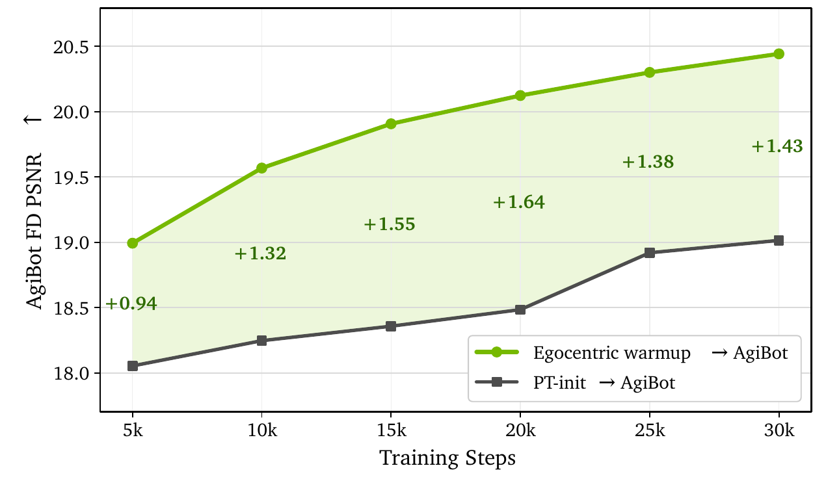

*Figure 29b. Both curves adapt to AgiBot; the green model first receives egocentric warmup. The vertical axis is FD PSNR, and the horizontal axis is subsequent training steps.*

At 5K steps, warmup gives a reported 0.94 dB advantage; at 30K, 1.43 dB. This supports an initialization benefit from human motion. The measured outcome is **robot-video prediction**, so an additional control experiment would be needed to quantify its effect on robot task success.

## 13. Does the Model Predict the Consequences of Its Actions?

### 13.1 Forward Dynamics Improves after Action Mid-Training

A policy might choose good actions without producing accurate future video. Conversely, an accurate predictor might be given actions that never accomplish the goal. The report evaluates dynamics separately to test the model's ability to describe consequences.

For DROID forward dynamics, the input is an initial image and **16 end-effector actions**; the output is 16 future frames. This experiment uses a different action interface and horizon from the deployed 32-joint-command policy.

**Table 18, selected forward-dynamics columns.** Higher peak signal-to-noise ratio (**PSNR**, in dB) means predicted pixels are closer to reference video. PT/MT variants are adapted to the same downstream domain before evaluation.

| Model / initialization | Human egocentric FD | Robotics FD |
|---|---:|---:|
| Cosmos3-Super, MT | 16.19 | 26.04 |
| Cosmos3-Super, PT | 15.34 | 22.69 |
| Cosmos3-Nano, MT | 16.12 | 25.52 |
| Cosmos3-Nano, PT | 15.22 | 23.24 |
| LOME | 9.36 | Not reported |
| Ctrl-World | Not reported | 22.99 |

For Nano robotics FD, the initialization change raises PSNR by $25.52-23.24=2.28$ dB. The gain occurs after downstream adaptation, consistent with mid-training supplying a reusable dynamics prior. LOME's egocentric result is also subject to the report's noted distribution shift; the comparison does not imply that every specialist is intrinsically weaker on its own training distribution.

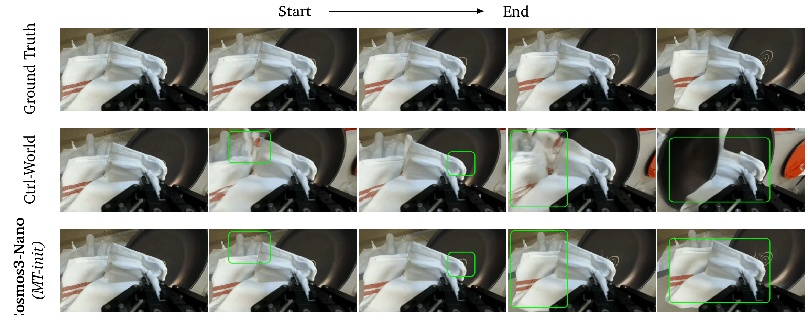

*Figure 24. Columns progress through time; rows show recorded video, Ctrl-World, and Cosmos3-Nano initialized from MT. Green boxes identify compared regions with visible hand/fabric artifacts in the baseline.*

The example helps interpret pixel fidelity, but PSNR is not a task-success metric or a contact-physics certificate. It can also penalize a plausible alternative future that differs from the particular recorded outcome.

### 13.2 Compare Jointly Predicted Video with Executing the Same Commands

A more direct consistency check starts from one simulator state, generates actions and video together, then executes **that exact action chunk** in the simulator. Predicted video is compared with the resulting simulator video, rather than with an unrelated successful demonstration.

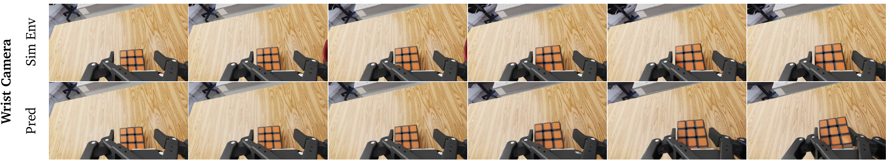

*Figure 37, wrist-camera rows. “Sim Env” is the observed consequence of executing the generated chunk; “Pred” is its jointly generated visual prediction, initialized from the same state.*

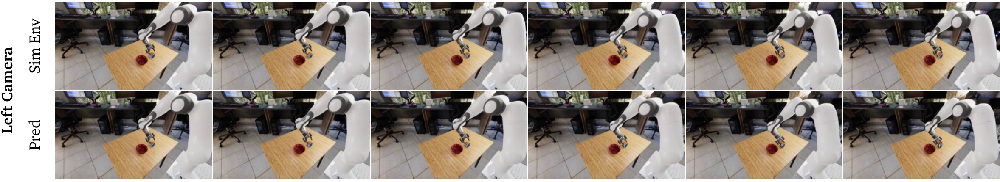

*Figure 37, left external-camera rows. The same comparison is easier from a relatively stable viewpoint than from a camera moving with the gripper.*

The DROID-post-trained policy is tested on held-out RoboLab scenes. Reported PSNR is **23.19 dB for the left external view and 17.33 dB for the wrist view**. The moving wrist view reveals previously unseen content, making its future harder to predict.

**Why consistency and usefulness differ:** imagine an illustrative policy that predicts no movement and an unchanged image. If executing its commands also leaves everything still, the prediction can match execution closely even though the cup never reaches the tray. The consistency test asks whether the predicted consequence matches the commands; task-success tests ask whether those consequences accomplish the instruction. Both are needed.

Joint attention provides a route for future-video features to inform actions. These results do not separately isolate the benefits of auxiliary video supervision during training from the benefits of generated visual tokens during inference.

## 14. Which Ablations Support the Design Choices?

### 14.1 Sharing Action Modes Helps Action Prediction, with a Visual Tradeoff

**Table 31, complete PushT results.** This uses Cosmos3-Edge, not the Nano DROID policy. Policy coverage measures overlap of the pushed T-shaped block with its target, aggregated over 50 initial states and ten rollouts each; it is not binary task success.

| Training setting | FD PSNR, dB ↑ | ID action MSE ↓ | Policy coverage ↑ |
|---|---:|---:|---:|
| Separate single-mode checkpoints, 2K steps each | 27.13 | $1.11\times10^{-3}$ | 74.1% |
| Joint FD/ID/policy checkpoint, 6K steps | 26.22 | $3.09\times10^{-4}$ | 77.3% |

Each mode gets the same optimization exposure; the joint model receives more total steps than any one single-mode model. Joint training reduces ID error by about 72% and improves coverage by 3.2 percentage points, while FD loses 0.91 dB. This supports shared action structure with a measurable tradeoff, rather than improvement on all outputs.

### 14.2 Better Understanding Helps Physical Video Generation

**Table 28, selected columns.** Both models use the Nano architecture and train a generator from scratch for 90K iterations on 256 GPUs; only the understanding tower's initialization differs. These are PAIBench video-generation scores, not robot completion rates.

| Generation task | Understanding tower | Domain score | Robot category | Quality score |
|---|---|---:|---:|---:|
| Text-to-video | Cosmos3 reasoner | 75.7 | 71.3 | 73.0 |
| Text-to-video | Qwen3-VL | 73.7 | 66.5 | 73.0 |
| Image-to-video | Cosmos3 reasoner | 80.8 | 77.0 | 78.1 |
| Image-to-video | Qwen3-VL | 80.0 | 74.0 | 78.0 |

The robot-category text-to-video gain is 4.8 points while the quality score is unchanged. This is consistent with better physical-domain conditioning, rather than merely sharper images. It does not isolate a downstream robot-policy gain from changing the reasoner.

### 14.3 A Common Clock Improves Motion Fidelity

**Table 29, complete settings.** Four otherwise matched models generate 5-second clips across 10-, 15-, 24-, and 30-FPS bands, using roughly 100 prompts per band and three seeds. VQ is perceptual video quality. Motion fidelity (MF) measures agreement with reference motion magnitude while penalizing variability across seeds. The composite averages VQ × MF within FPS bands.

| FPS conditioning | VQ ↑ | MF ↑ | Composite ↑ |
|---|---:|---:|---:|
| None | 12.89 | 0.6626 | 8.51 |
| Text only | 12.99 | 0.7169 | 9.28 |
| MRoPE scaling only | 13.03 | 0.7409 | 9.63 |
| Text + MRoPE scaling | 12.84 | 0.7649 | 9.81 |

The composite improves while perceptual quality changes little. This supports the timing representation in Section 5: both explicit rate metadata and coordinate scaling help temporal behavior. It does not establish the DROID policy's inference speed or verify exact timing of every generated contact.

### 14.4 Synthetic Data Gives Selective Gains

**Table 26, selected columns, all model rows.** Each variant fine-tunes the same Nano baseline with the indicated synthetic source; “All” mixes all five. Scores are PAIBench-G text-to-video measures. The Robot column judges generated robot scenes, not physical robot trials.

| Added data | Overall | Quality | Robot | Human |
|---|---:|---:|---:|---:|
| Baseline | 79.67 | 72.46 | 87.37 | 85.46 |
| DriveSim | 79.76 | 72.55 | 88.26 | 84.91 |
| RobotSim | 79.66 | 72.72 | 87.60 | 84.99 |
| Warehouse | 79.74 | 72.48 | 87.97 | 85.01 |
| PhyxSim | 79.62 | 72.56 | 88.17 | 84.77 |
| SynHuman | 79.79 | 72.41 | 88.60 | 85.08 |
| All | 79.77 | 72.56 | 87.68 | 84.99 |

Benefits depend on the target: all five-source mixing raises Robot by 0.31 but lowers Human by 0.47. SynHuman gives the largest Robot value in this table, despite not being the robot-specific corpus. Source names alone therefore do not predict transfer, and the small overall changes do not support a claim of uniform improvement.

## 15. What Does Cosmos 3 Establish as a Robot Policy?

The strongest evidence is the combination of a shared model and **measured downstream adaptation**: action mid-training improves DROID policy success and accelerates LIBERO adaptation; joint predictions also show useful agreement between generated actions and visual consequences.

Several boundaries matter when applying that result:

- **Shared architecture still needs compatible interfaces.** A new embodiment requires meaningful state/action mappings and, in the demonstrated cases, downstream training. The generic geometry is not an automatic controller for every body.
- **Imagined futures are learned predictions.** Joint generation does not enforce rigid-body mechanics, valid contact, or successful task completion. It is also distinct from explicitly searching and ranking multiple candidate plans.
- **Generalization is conditional.** RoboLab success remains below 40% overall even with specific instructions, and complex vague tasks are particularly weak. The report's physical preference ranking is an early snapshot with limited trials.
- **Serving cost and timing remain relevant.** The demonstrated policy uses two substantial GPUs; a 15-Hz command stream does not provide a measured 15-Hz model-call rate.
- **The full data recipe is not entirely public.** The large action prior includes proprietary human egocentric and driving data. Public checkpoints and selected datasets do not by themselves reproduce the complete training corpus.

Compared with [GR00T 2](./GR00T_2.md), the shared idea is future-video/action modeling. Cosmos 3 additionally places continuous generation beside an autoregressive understanding tower and studies several action modes and non-robot motion domains in the same family. Its DROID policy is the concrete bridge from that broad foundation to executable manipulation, with its own post-training data, action interface, and deployment settings.
