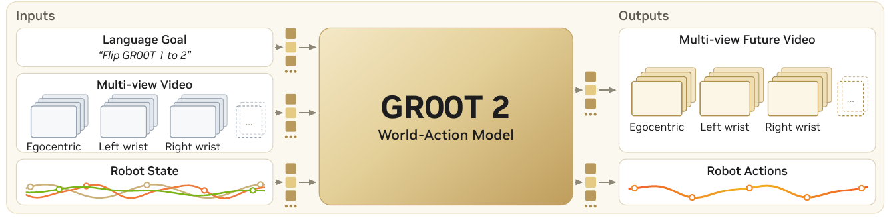
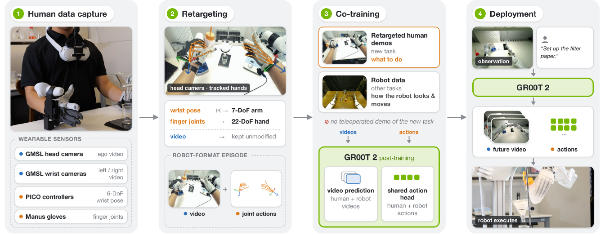
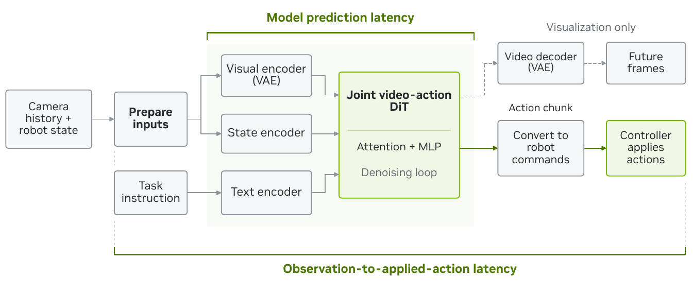

# [GR00T 2: Scaling Robot Foundation Models for Generalization, Dexterity, and Adaptation](https://research.nvidia.com/labs/gear/gr00t-2)

> **Brief:** GR00T 2 is a robot policy that **jointly predicts future camera observations and robot actions**. This world-action formulation lets human video teach visual interactions while robot trajectories teach executable control. A shared 2B-parameter transformer supports different bodies through embodiment-specific interfaces; demonstrations, reinforcement learning, and an external agent provide distinct ways to adapt or extend it.

**Source:** NVIDIA, November 2026, [135-page whitepaper](https://research.nvidia.com/labs/gear/gr00t-2/assets/gr00t2_whitepaper.pdf). This note follows the paper's model, training stages, transfer experiments, and deployment systems, including the relevant appendices.

## Convenient Links

- [Official project](https://research.nvidia.com/labs/gear/gr00t-2)
- Related policies: [GR00T N1](./GR00T_N1.md), [Fast-WAM](./Fast_WAM.md), [pi0.5](./Pi_0_5.md), [pi0.6*](./Pi_0_6.md)
- Background: [Diffusion Policy](./Diffusion_Policy.md), [Real-Time Chunking](../Inference/RTC.md), [GRPO](../../../Foundations/Preference_Alignment/GRPO.md)
- Systems and data: [ASPIRE](../Agentic_Systems/ASPIRE.md), [Harness VLA](../Agentic_Systems/Harness_VLA.md), [RoboCasa365](../Datasets/RoboCasa365.md)

## 1. Why Learn to Predict Video as Well as Actions?

A person can demonstrate how to place filter paper in a funnel, unfold it, and wet it. A robot watching that demonstration can observe the desired interaction, but the video does not directly specify its motor commands. The person's fingers have different dimensions and joints; the cameras may also view the contact from different angles.

Two kinds of knowledge are therefore needed:

- **Task knowledge:** which object interactions accomplish the procedure, such as opening the paper inside the funnel.
- **Embodiment knowledge:** how a particular body sees and performs those interactions. An *embodiment* includes the robot's sensors, kinematics, and action interface.

Training only on robot actions limits learning to data with compatible control labels. Human video is much more abundant, but normally has no robot joint commands. GR00T 2 introduces a target that both kinds of data can supply: **how the visible scene changes during an interaction**. Where action labels exist, it also learns the commands accompanying that change.

This produces a **world-action model (WAM)**. At deployment, action generation can read representations of the future scene being generated by the same transformer. For Filter Paper Setup, the model can represent the expected hand–paper–funnel interaction while producing wrist and finger commands.

That is the proposed connection between visual experience and control. It is learned from data: predicting a plausible future does not establish that the physical robot will realize it. The controller must execute the commands, and subsequent camera observations must show what actually happened.

## 2. What Happens Inside One Policy Call?

### 2.1 Observe the Recent Past and Predict Two Kinds of Future

A policy call takes recent observations and returns a sequence of commands. It does not correspond to one motor-control tick.

*Whitepaper Figure 1, input/output panel, cropped from PDF page 4. Both predicted video and actions come from the WAM; only the actions are sent to the robot controller.*

The inputs establish three things: what the scene is doing, where the robot currently is, and what it should accomplish.

| Input | Information provided |
|---|---|
| Camera history | Motion and contact seen from complementary head/top and wrist views |
| Proprioception | Measured robot state, such as wrist poses and finger-joint positions |
| Language instruction | The requested task or current operation |
| Embodiment configuration | Which state/action modules and coordinate conventions to use |

**Proprioception** means measurements of the robot's own body. Images may show that the hand is near the funnel, while proprioception identifies the configuration from which the next command will act.

The model receives 0.8 s of images at 5 frames per second, at $224\times320$ resolution, from up to four cameras. The serving profiles use five history frames per camera: samples at $-0.8,-0.6,-0.4,-0.2,0$ seconds illustrate how five samples span 0.8 s. This camera sampling rate differs from the rate at which action commands are executed.

The outputs are:

- **Future visual latents:** compressed numerical representations of predicted camera images.
- **An action chunk:** several future commands generated together, rather than a single command.

For common manipulation profiles, the chunk contains 48 actions. If an embodiment uses $d_a$ numbers per action, the output has shape $48\times d_a$. Those numbers have embodiment-specific meanings. The human-to-Sharpa recipe uses wrist poses and hand joints; the G1 humanoid instead uses whole-body motion representations and gripper widths. Sharing the policy does not make these command spaces interchangeable.

### 2.2 Put Images, State, and Actions into a Shared Transformer

The core starts from **Cosmos-Predict2.5-2B**, a video diffusion transformer pretrained to model how scenes evolve. A **diffusion transformer (DiT)** refines noisy candidate outputs through repeated neural-network evaluations.

Raw images and joint vectors cannot simply be concatenated as if they had the same meaning. GR00T 2 first converts them into **tokens**: vectors of a common feature width that the transformer can process together.

The conversion proceeds as follows:

1. **Compress the images.** A frozen Wan 2.1 video **variational autoencoder (VAE)** maps camera streams into visual latents. It compresses time by $4\times$ and each spatial dimension by $8\times$. “Frozen” means its weights are not updated in policy training.
2. **Identify the views.** Visual latents are divided into patches, giving 280 tokens per latent frame and camera at the stated image resolution. Learned view embeddings identify which camera each token represents.
3. **Encode the instruction.** A frozen Cosmos-Reason1 vision-language model encodes the language. The DiT reads those features through **cross-attention**, which lets its evolving tokens retrieve information from the instruction.
4. **Encode the body and candidate commands.** Small embodiment-specific **multilayer perceptrons (MLPs)** map measured state and noisy action vectors into the transformer's feature width. A matching action decoder maps refined action representations back into that body's command space.

The **2B parameter count refers to the shared transformer core**; frozen feature encoders are additional components.

The embodiment modules solve an interface problem. A parallel gripper and a five-fingered hand need different input/output coordinates, while the shared transformer can still learn interactions such as holding a container or inserting a part. The model does not discover a new robot's motor conventions merely from receiving its name; deployment requires compatible camera and action mappings and, where needed, adaptation data.

This differs from [GR00T N1](./GR00T_N1.md), where vision-language features condition a separate action transformer. GR00T 2's central computation jointly generates visual futures and actions in a video-derived transformer.

### 2.3 How Can Actions Read a Future That Has Not Happened?

The future is a generated representation, not an extra sensor input. At the beginning of a prediction, neither the future video nor the action chunk is known. They start from noise and are refined together under the observed history, state, and instruction.

Inside the DiT, video tokens attend across times and camera views. **Action tokens can attend to all video tokens, including the future tokens currently being generated.** Here, attention means reading and combining information from those representations.

For the filter-paper example, follow one call:

1. The real observations show paper near the funnel and the current hand configuration.
2. The model refines candidate visual latents and candidate wrist/finger commands.
3. During refinement, action tokens can read visual features representing the anticipated interaction, such as the hand and paper moving into the funnel.
4. The action decoder produces commands. The controller executes part of the chunk.
5. New real images reveal the resulting configuration and condition the next call.

There is no need to render the predicted latents into visible RGB frames before executing commands. Rendering is useful for inspection; the action path already reads the latent features. However, **skipping RGB rendering does not remove the computation used to generate future visual latents**.

The paper describes joint generation, rather than an explicit procedure that renders several plans, scores them, and selects one. It also leaves open how much of the benefit comes from future-video supervision during training versus access to predicted futures during inference. The architecture enables this connection; the experiments do not isolate every part of its contribution.

## 3. How Does Training Connect Visual Interactions to Control?

### 3.1 Different Data Sources Fill Different Gaps

A video model can know how an interaction looks without knowing a robot's action interface. Conversely, robot demonstrations can teach that interface while covering relatively few tasks. GR00T 2 combines sources with complementary information.

| Source | Reported scale | What it contributes |
|---|---:|---|
| Selected Human-1M inventory | 402,730 hours; about 13.75M episodes | Broad coverage of objects, environments, and human interactions |
| Robot-aligned human collection | 3,000 hours within the human-data program | Demonstrations with viewpoints, speed, and strategies chosen for robot transfer |
| UMI-10K | 10,184 hours; 942k episodes; 2,897 tasks | Task-focused demonstrations captured with handheld parallel grippers |
| Robot teleoperation | About 23.5k hours; 1.16M episodes | Actual robot observations and control supervision |

Human-1M names the approximately one-million-hour source corpus; the selected inventory used here is smaller. The robot-aligned human collection is a specialized part of the human data, not another million-hour source.

**UMI**, the Universal Manipulation Interface, records a person moving a handheld gripper, including camera views, poses, and opening width. The person demonstrates directly with the device. **Teleoperation** instead records a person controlling the robot.

The robot mixture includes YAM parallel-gripper arms, arms with Sharpa or Wuji dexterous hands, Unitree G1, and DROID Franka data. Human examples can supply tracked hand-pose trajectories; they do not all provide native robot commands.

Language labels are also needed to connect a recorded interval to its intended operation. A long video may contain grasping paper, opening it, and wetting it. Timestamped annotations tell the model which instruction belongs to each interval. The **Flora** data engine supplies action boundaries, instructions, and outcome/reward annotations for the relevant pipelines.

### 3.2 What Does “Learn to Denoise” Mean?

Training has access to a recorded future. Inference does not. Flow matching teaches the model a refinement rule using those recorded targets, then applies the learned rule to new observations.

Consider one training window. Its past images, measured state, and instruction form the context. Later recorded frames and action commands are the desired outputs. Training mixes these outputs with noise and asks the model to predict how to refine them.

A scalar example makes the operation concrete. Using the paper's **noise-minus-data velocity convention**, a linear interpolation can be written as

$$
x_\sigma=(1-\sigma)x^*+\sigma\epsilon,
\qquad
v^*=\epsilon-x^*.
$$

Here $x^*$ is one clean target coordinate, $\epsilon$ is sampled noise, and $\sigma\in[0,1]$ is the noise level. At $\sigma=1$, the candidate is pure noise; at $\sigma=0$, it is the target. The target velocity $v^*$ describes how the candidate changes with the noise level; it is not a physical robot velocity. Because refinement decreases $\sigma$, a step subtracts the corresponding amount of $v^*$.

For an illustrative normalized action coordinate, let $x^*=0.6$ and $\epsilon=-0.2$. At $\sigma=0.75$,

$$
x_{0.75}=0.25(0.6)+0.75(-0.2)=0,
\qquad v^*=-0.8.
$$

Reducing the noise level by $\Delta\sigma=0.25$ with the ideal velocity gives

$$
x_{0.50}=x_{0.75}-\Delta\sigma\,v^*
=0-0.25(-0.8)=0.2.
$$

The candidate has moved from 0 toward 0.6. During training, the target supplies the correct velocity. During inference, the network must **predict** that velocity from the context and current noisy candidate. The real sampler operates on whole visual/action arrays; these numbers illustrate refinement, not a robot joint trajectory or the full sampling schedule.

Video and action losses teach complementary parts of this mapping. Schematically,

$$
\mathcal L_{\mathrm{WAM}}
=\lambda_v\mathcal L_{\mathrm{video}}
+m_a\lambda_a\mathcal L_{\mathrm{action}}.
$$

$\mathcal L_{\mathrm{video}}$ and $\mathcal L_{\mathrm{action}}$ supervise visual and action refinement, and $\lambda_v,\lambda_a$ weight them. The availability indicator $m_a$ is one when valid action labels exist and zero otherwise. This mask is explanatory notation for the paper's rule.

Thus, a video without valid action labels still teaches visual prediction. Its missing actions are **excluded from action supervision**, rather than treated as zero commands. A robot trajectory supplies both losses, connecting visible change to executable behavior.

### 3.3 Why Use Three Pretraining Stages?

Adding robot outputs to an unadapted video model would require it to learn embodied visual interactions and their control interfaces at once. The paper instead builds these capabilities in order:

1. **Single-view video pretraining.** Start from Cosmos-Predict2.5-2B and predict future video from egocentric human and robot observations. This adapts its visual prior to hands, objects, and manipulation before action learning.
2. **Multi-view video–action training.** Add embodiment-specific state/action modules and jointly train video and actions, using multiple views where available. Robot trajectories provide robot commands; tracked human motion supplies action supervision in its corresponding representation.
3. **Robot-upweighted video–action training.** Continue the same joint objective while increasing robot-data weight, particularly YAM. The model retains broad human experience while spending more updates on robot observations and control.

The shared transformer and relevant state/action modules learn during this process; the video VAE and language encoder remain frozen. The resulting checkpoint is the **pretrained policy**. Subsequent target-task fine-tuning or RL changes that checkpoint further.

The main pretraining run uses 1,024 GB300 GPUs, bfloat16 arithmetic, and DeepSpeed ZeRO-2, which partitions gradients and optimizer state while replicating model weights. Section 4.7 reports a per-device batch of 16 and variable-length token packing to reduce padding. The paper does not provide one complete numerical optimizer, learning-rate, and step schedule covering all three stages.

### 3.4 Does Human Video Help the Physical Robot?

The human-data scaling experiment asks whether broad visual experience improves execution when downstream robot data are held fixed. Models use 0%, 1%, 10%, or 100% of the human-data share and are then post-trained on the same target Dexter teleoperation data.

**Dexter** is the Tianji bimanual robot with two 22-degree-of-freedom Sharpa hands. Across 72 tasks, physical success rises from **18% to 41%** between the 0% and 100% settings. The model is therefore transferring something useful to actual robot execution, rather than only producing better-looking videos.

Two qualifications matter. Larger data shares also receive longer training, and the 0% setting skips the shared human-video pretraining stage. This is evidence for the combined human-data training recipe, rather than a fixed-compute measurement of data quantity alone. The real-robot evaluation uses three trials per task. Generated-video rollout scores reported alongside it are a different metric.

## 4. How Does a Human Demonstration Become a Skill on Another Body?

### 4.1 Combine “This Task” with “This Robot”

**Cross-embodiment adaptation**, called **X-Adapt**, addresses a missing task–body combination: the model has demonstrations of the target task from one body and experience of the target robot on other tasks.

For Filter Paper Setup, human demonstrations show the procedure. Task-agnostic robot **play data** show the target robot interacting with objects on other tasks. They do not demonstrate filter-paper setup.

Neither source supplies the complete combination by itself:

| Available experience | What it establishes | What remains missing |
|---|---|---|
| Human performing the target task | Task sequence, contacts, and motion strategy | The target robot's appearance and execution behavior |
| Target robot performing other tasks | How that body looks and moves | The new task's procedure |
| Co-training from the cross-embodiment pretrained checkpoint | A learned connection between task and body | Success still depends on alignment and transfer quality |

This adaptation changes policy weights. It differs from running the unchanged pretrained checkpoint zero-shot.

### 4.2 Follow the Human-to-Sharpa Pipeline

*Whitepaper Figure 12, cropped from PDF page 18. Human demonstrations supply the new task; robot play supplies target-body experience. Motion labels are converted while the human video remains unmodified.*

The pipeline makes the sources compatible before asking the model to generalize:

1. **Capture aligned observations and motion.** A person performs the task wearing head/wrist cameras, wrist trackers, and motion-capture gloves. Camera placement and movement speed are chosen to resemble robot operation.
2. **Retarget the motion.** Inverse kinematics converts tracked wrist and fingertip targets into compatible arm/hand motion. Retargeting preserves useful contact geometry, such as thumb–index pinching, rather than copying human finger angles onto differently shaped robot fingers.
3. **Put both sources into a common training format.** This recipe uses 62-dimensional state/action representations: wrist poses and hand joints. Wrist action targets are relative to the current state, while hand-joint targets are absolute.
4. **Co-train with target-robot play.** Sample human-task and robot-play episodes 1:1. Both teach video prediction, and converted human and robot actions train the same target action head.
5. **Deploy from fresh robot observations.** Give the adapted model the robot's images, state, and instruction. It predicts futures and commands for the robot's current configuration.

For example, a recorded human demonstration may show the paper being opened inside the funnel. Retargeting supplies compatible wrist/finger labels, but the images still show human hands. Robot play teaches the model how Sharpa hands appear and respond. At deployment, the model must generate a new continuation from the actual robot scene; it does not replay the human video.

The paper's four human-transfer tasks reach 65%, 30%, 10%, and 50% success over 20 trials each, with no task-specific robot teleoperation. For Filter Paper Setup, removing the human-task demonstrations produces 0% success: robot play alone does not supply the missing procedure. Removing cross-embodiment pretraining also severely reduces transfer under the same downstream recipe.

**“No teleoperation” here means no teleoperated demonstration of the target task.** The target-robot play pool itself includes teleoperation. This is robot-grounded adaptation from human task demonstrations.

### 4.3 Appearance Transfer Does Not Remove Geometry or Control Mismatches

The Gripper UMI → YAM experiments show why co-training alone is insufficient. Handheld and robot cameras view the same grasp differently; their grippers and action coordinates also differ.

The recipe therefore makes three kinds of adjustment:

- **Observation alignment:** re-render handheld wrist views to approximately match YAM's camera field of view and viewing direction.
- **Action alignment:** convert wrist/grasp-site frames, gripper-opening conventions, and normalization to the target action interface.
- **Robot grounding:** co-train with YAM play and use its action head.

For a concrete control mismatch, UMI records where the handheld gripper actually moved. YAM demonstrations distinguish the commanded pose from the measured follower state: the arm lags by about four frames, or 133 ms at 30 Hz, and can settle with a load-dependent offset. Robot data teach this command–measurement relationship; handheld pose trajectories alone do not.

Figure 14 provides a visual example of grounding. From the same YAM start image, a model trained on UMI alone predicts human arms and handheld fingers. Co-training with YAM play changes the predicted body to YAM's arms. This demonstrates a change in predicted appearance; physical trials are still needed to assess control.

With 41–75 handheld episodes per task, the adapted model achieves **60% Toy Dumptruck Assembly** and **50% NIST Board Disassembly** success, each over ten trials. Removing wrist-view alignment reduces both to **0%**. This supports the need to align geometry rather than expecting the shared transformer to absorb every mismatch.

The no-UMI-pretraining checkpoint reaches 20% and 0%, but it also comes from an earlier run with different training history and small model differences. That comparison supports the value of the overall pretraining recipe without isolating UMI data alone. Likewise, shared-head versus separate-head experiments also change action conventions and produce mixed task results.

### 4.4 Other Capture Pipelines Remove Different Gaps

**DexUMI** is a wearable dexterous exoskeleton. For its matching XHAND robot hand, it reproduces joint structure, contact surfaces, wrist-camera placement, and force-recording format. Because the device already resembles the target hand, this setup can adapt from DexUMI demonstrations without robot play.

Recorded fingertip forces are converted into torque-related action targets. At execution, predicted torques adjust stiffness and position targets so the hand can apply the learned interaction. **Force is an output; touch is not a policy input.** Retargeting DexUMI to a different Sharpa hand reintroduces mismatches and requires camera alignment and robot play.

A separate **human → simulation → robot** route solves a different problem. One human video seeds object/motion reconstruction; an RL expert learns the task in simulation; its randomized rollouts produce 1,500 training episodes per task for GR00T 2. Nail driving then succeeds in 9/10 physical trials. Here, zero-shot refers to deployment from simulation to reality after substantial simulated training, rather than immediate execution after watching one video.

## 5. How Are Action Chunks Executed Quickly and Smoothly?

### 5.1 Separate Prediction Iterations from Robot Time

Generating a chunk involves repeated model computation. Executing that chunk involves sending commands over physical time. These are different axes.

For a common manipulation profile,

$$
48\ \text{actions}/30\ \mathrm{Hz}=1.6\ \mathrm{s}.
$$

Several recipes execute the first 30 actions, or 1 s, before replacing the remaining plan using fresh observations. Thus, the model can predict beyond the portion that will actually be executed. Replanning limits dependence on an increasingly inaccurate old prediction.

The sampling schedule **2v4a** means two video-refinement events and four action-refinement events for the whole chunk:

| Refinement event | Video computation | Action computation |
|---|---|---|
| 1 | Joint update | Update the full candidate action chunk |
| 2 | Reuse visual/state attention features | Action-only update |
| 3 | Joint update | Update the full candidate action chunk |
| 4 | Reuse visual/state attention features | Action-only update |

A cached action-only pass reuses the preceding joint pass's attention keys and values: stored features that action tokens read. It avoids recomputing the visual path at every action refinement.

**Four refinements do not mean four executed robot actions.** They produce the entire 48-action chunk. Deployment profiles vary: the timing experiments use 2v2a for Dexter, 2v4a for YAM, and an optimized 1v2a for G1.

### 5.2 Turbo Reduces the Visual Work

Most generated tokens represent video. Turbo reduces that burden by using Wan 2.2's higher-compression VAE while retaining the **2B transformer, joint prediction objective, and action horizon**.

Spatial compression rises from $8\times$ to $16\times$ per dimension. For a $224\times320$ image, the spatial latent grids are

$$
(224/8)\times(320/8)=28\times40=1120,
$$

$$
(224/16)\times(320/16)=14\times20=280.
$$

These counts are latent-grid positions, before patch tokenization. Halving both dimensions gives one quarter as many positions, explaining the **fourfold spatial-grid reduction**. The model's input/output projections are adapted to the new representation.

Turbo therefore saves visual computation without shrinking the shared transformer. Its lower dexterous-task success, discussed in Section 6, shows that this efficiency comes with a capability tradeoff. The comparison does not establish compression as the only cause of the gap.

### 5.3 Faster Prediction Is Only Part of Response Time

*Whitepaper Figure 60, cropped from PDF page 114. The upper bracket measures request-time model work; the lower path also includes observation preparation, communication, and controller scheduling. Future RGB decoding is optional visualization.*

A robot scene continues changing while the model computes. Serving therefore reduces repeated work and overhead: reuse text features while the instruction and checkpoint are unchanged, reuse visual features during action-only passes, compile GPU operations, and prefetch visual encoding where supported.

Selected median **model-prediction** times from Table 27 are:

| Model / embodiment | Hardware | Baseline → optimized |
|---|---|---:|
| GR00T 2 / Dexter | RTX 5090 | 449.20 → 152.78 ms |
| GR00T 2 / YAM | DGX Station GB300 | 386.06 → 54.00 ms |
| Turbo / G1 | Onboard Jetson Thor, 120 W | 720.41 → 123.97 ms |

Each pair uses the same checkpoint and input profile. However, optimized Dexter/YAM move VAE encoding before the request, whereas G1 includes encoding and also reduces denoising steps. The numbers describe complete serving configurations, not a controlled measurement of one optimization or the full sensor-to-motor delay.

### 5.4 Account for Actions Already Committed During Inference

Fast inference does not by itself make adjacent chunks agree. While a new chunk is being computed, the controller continues executing old commands. A prediction based on an earlier observation can otherwise replace those commands with an incompatible continuation.

**Real-Time Chunking (RTC)** conditions the new prediction on the old commands already committed for execution. In the paper's 25 Hz evaluation, a 160 ms inference delay spans four command intervals. Those four commands cannot be revised by a prediction that arrives afterward; the new plan must continue from them.

The paper uses **noisy-prefix RTC**. During fine-tuning, Gaussian noise perturbs the committed prefix so the policy learns not to rely too rigidly on the previous plan. During inference, it receives the actual clean committed commands. The purpose is to combine continuity with the ability to correct behavior using new images.

After 5k adaptation steps on eight RoboDojo precision tasks, RTC is compared with asynchronous execution of the same fine-tuned weights, with prefix conditioning disabled:

| Simulated delay | Naive asynchronous success | Noisy-prefix RTC success |
|---|---:|---:|
| 160 ms | 32.83% | 34.75% |
| 320 ms | 15.00% | 21.42% |

These use 1,200 matched episodes per condition. At 320 ms, the 95th-percentile cross-chunk commanded jerk falls 87.2%; **jerk** measures changes in acceleration. This is command smoothness, not a guarantee about every physical joint motion. Clean-prefix RTC also reaches 21.42% success at that delay, so noisy-prefix training is not uniformly better.

A separate phase-conditioned retiming method accelerates tolerant phases, such as transport, while preserving slower precision phases. It shortens mean successful completion time by 15–26% on three tasks. Predicting faster, handing off smoothly, and completing a task faster are distinct improvements.

## 6. What Do the Pretrained and Supervised Results Establish?

### 6.1 Zero-Shot Transfer and Few-Shot Adaptation

The **Dexter-50** benchmark withholds target-task demonstrations on Dexter, while allowing those tasks to appear in human or YAM data. It tests a new task–robot combination.

| Target-task Dexter data | How the checkpoint is used | Mean success |
|---|---|---:|
| None | Run the pretrained policy unchanged | 40% |
| One episode per task | Fine-tune with LoRA | 71% |
| Five episodes per task | Fine-tune with LoRA | 95% |

**Low-rank adaptation (LoRA)** trains small weight updates rather than all pretrained weights. Here, rank-32 adapters are added to every linear layer in the transformer; pretrained weights, state/action heads, VAE, and text encoder stay frozen. Training retains the joint video/action objective.

Each demonstration supplies 100 spaced training windows. Windows with higher frozen-model loss are sampled more often so difficult phases receive more updates. A run takes about 30 minutes on one RTX 5090; adapters are merged into the weights for serving.

The pattern is consistent with a policy that often knows the procedure but needs target-hand examples to execute a difficult step. The paper shows cases where zero-shot behavior reaches for the right objects but fails to open a lid or drawstring bag, then succeeds after adaptation.

Two distinctions prevent overreading the headline numbers:

- Completing **40 of 50 tasks at least once** measures task coverage; it differs from the **40% average trial success**.
- The 50 tasks were selected from those reaching at least 80% with five demonstrations. The 95% result describes this selected learnable set, rather than arbitrary new tasks.

A separate 71-task Dexter evaluation uses three trials per task and reports 49.8% success for GR00T 2, 36.6% for Turbo, 26.3% for pi0.5, and 18.3% for GR00T 1.7. That is a different task set from Dexter-50.

### 6.2 Supervised Post-Training Tests Complete Task Sequences

**Supervised fine-tuning (SFT)** adapts the pretrained policy on target-task demonstrations. The long-horizon benchmarks ask whether it can chain many precise operations into a completed task.

| Post-training benchmark | GR00T 2 | Turbo | Strongest listed baseline |
|---|---:|---:|---:|
| Six YAM tasks | 71.7% | 65.0% | 12.5%, pi0.5 |
| Seven dexterous-hand tasks | 68.6% | 34.3% | 0.7%, GR00T 1.7 |

These are mean **end-to-end success rates**. Task progress instead gives partial credit for completed stages. Truck Assembly illustrates the difference: GR00T 2 reaches 98% progress but 65% success. Nearly completing a sequence is insufficient when one unfinished fastening step makes the final object incorrect.

The results support strong post-training capability on these tasks and reveal a larger full-model/Turbo gap for dexterous manipulation. They do not isolate architecture from all differences in pretraining and data.

The evaluations generally use up to 20 trials per task. Truck Assembly also gives GR00T 2 and Turbo easier starts than the baselines; GR00T 2 succeeds in 35% on the original starts. Its main table row is therefore not a matched-start comparison. The large aggregate gaps are informative, but high progress and selected benchmark success should not be read as near-perfect deployment reliability.

## 7. How Does Reinforcement Learning Improve Precision?

### 7.1 Explore New Actions Through the Denoising Process

Demonstrations can teach a reasonable approach to a connector while leaving small alignment errors unresolved. **Reinforcement learning (RL)** adds feedback from the policy's own attempts: did the resulting interaction succeed?

The challenge is that GR00T 2 generates commands through several video/action refinement steps. The exact probability of a final action chunk is unavailable, yet likelihood-based policy updates need probabilities to compare old and new behavior.

The paper introduces **Coefficients-Preserving Sampling (CPS)** during RL rollouts:

1. Run the current policy from a task/reset configuration.
2. Inject fresh noise into action refinement, restricted to coordinates in the chunk prefix that will actually execute.
3. Keep video refinement deterministic given its initial latent; its features continue conditioning actions.
4. Record the intermediate action-denoising transitions and the attempt's binary success/failure return.
5. Update the policy using the probabilities of those transitions.

CPS supplies an explicit Gaussian distribution for each action transition. Its mean comes from the model's refinement prediction, while its noise enables alternative executed motions. The method can therefore compare how likely a recorded transition is under the updated versus rollout-generating policy.

The update adapts **Group Relative Policy Optimization (GRPO)**. An **advantage** measures whether an attempt's return is above or below a comparison baseline. Positive-advantage transitions are encouraged and negative-advantage ones discouraged, with a clipped likelihood ratio limiting each update. Only selected joint passes are scored; gradients flow through the shared transformer and state/action modules without backpropagating through the entire sampled chain.

Thus, RL changes the generative policy itself, using success/failure feedback on exploration rather than requiring a target command at every step.

### 7.2 Why Remember Earlier Returns for Each Reset Context?

A **reset context** is a task paired with a scene layout. Several attempts from the same context form a group. Comparing only current-group returns cannot distinguish the attempts when every one succeeds or every one fails: their relative advantages become zero.

The paper adds a historical mean for each context. It asks whether current outcomes are better or worse than this context's earlier performance, even when the current group is uniform.

For context $g$ and attempt $i$,

$$
b_{g,i}
=
\frac{h_gm_g+\sum_{j\ne i}R_{g,j}}
{h_g+N_g-1},
\qquad
A_{g,i}=R_{g,i}-b_{g,i}.
$$

- $R_{g,i}\in\{0,1\}$ is the attempt's failure/success return.
- $N_g$ is the number of current attempts.
- $m_g$ is the historical mean return for this context.
- $h_g$ is its weight, equivalent to that many pseudo-observations.
- $b_{g,i}$ combines history with the **other** current attempts, excluding attempt $i$.
- $A_{g,i}$ is the advantage used to encourage or discourage the sampled behavior.

Take an illustrative group of four attempts after the first visit, with $h_g=2$:

| Historical success $m_g$ | All four current returns | Baseline for each attempt | Advantage |
|---|---|---:|---:|
| 0.75 | All fail | $(2(0.75)+0)/5=0.30$ | $0-0.30=-0.30$ |
| 0.25 | All succeed | $(2(0.25)+3)/5=0.70$ | $1-0.70=0.30$ |
| 0 | All fail | 0 | 0 |

The first group signals regression; the second signals improvement. The third shows the limitation: history does not create a success signal where neither past nor current attempts provide one.

On the first visit, $h_g=0$ because no history exists; initialize its historical mean from that group's average after computing advantages. On later visits, use $h_g=2$ and, after computing the round's advantages, update the historical mean toward the current group mean with coefficient 0.25. In the first table row, $m_g$ becomes $0.25(0)+0.75(0.75)=0.5625$. Unvisited contexts keep their history. Updating afterward ensures the baseline uses earlier experience rather than overwriting it with the group being evaluated.

This table persists across training rounds and checkpoints. It is **training history about reset contexts**, separate from the policy's short camera history during execution. AutoRL, a research agent, discovered the basis of the recipe through about 35 days of simulation experiments before its use in these post-training runs.

### 7.3 Direct RL, Self-Imitation, and Residual RL Change Different Things

Exploration can discover successful behavior; retaining that behavior is a separate learning problem. The paper compares three routes from the same SFT base:

| Method | What is trained | Learning signal |
|---|---|---|
| Direct GRPO | GR00T 2 itself | Successful and failed exploration attempts |
| GRPO-induced self-imitation | GR00T 2, restarted from the original SFT checkpoint | Supervised video/action targets from successful GRPO rollouts |
| Residual RL | A small corrective policy; GR00T 2 stays frozen | RL experience, including human-assisted training |

**Self-imitation does not continue from the GRPO weights.** It returns to the same initial SFT weights and trains once on the successful trajectories that GRPO discovered, using the original joint video/action objective. It reuses the collected experience without another round of robot collection.

**Residual RL** instead trains a Soft Actor-Critic controller for designated precision stages. It accumulates bounded correction offsets and composes them with GR00T 2's end-effector targets. For example, an offset can correct a slightly misplaced approach without changing the foundation model. A zero new residual increment preserves the current offset; zero offset recovers the base target.

Independent evaluations use 50 trials per task, common reset distributions/time limits, and no human intervention during evaluation:

| Task | SFT | Residual RL | GRPO | Self-imitation |
|---|---:|---:|---:|---:|
| Fixed-pipe fittings | 66% | 76% | 86% | 88% |
| Finger placement | 58% | 84% | 72% | 98% |
| Cable insertion | 76% | 82% | 92% | 94% |
| Charger insertion | 40% | 70% | 94% | 96% |

The charger result shows a large precision improvement after direct RL. Self-imitation's high scores support separating exploration from supervised consolidation. Residual RL also helps, but human-assisted training prevents interpreting the table as an optimizer-only comparison.

At this sample size, the paper finds the direct-GRPO gains on fittings and charger insertion statistically significant at 5%; its gains on the other two tasks are inconclusive. Fitting resets are harder than those in Section 6's SFT benchmark, so those scores should not be merged.

### 7.4 A Learned Simulator Supplies Additional Experience

GR00T 2's internally predicted future is part of policy computation. **DreamDojo** is a separate learned environment used to generate RL training experience.

DreamDojo is adapted first to multi-view robot episodes and then to a few hundred successful/failed target-task rollouts. The training loop becomes:

~~~text
GR00T 2 generates actions
  -> DreamDojo predicts resulting multi-view observations
  -> a learned completion detector provides a reward
  -> the predicted observations become GR00T 2's next inputs
  -> collect trajectories and update the policy
~~~

The simulator carries visual history; the last commanded action approximates proprioceptive state. Because later calls consume its own predictions, errors can accumulate over an episode.

This route reduces dependence on physical interaction during policy rollouts, but it still needs task-specific data to construct the simulator. The decisive test is outside that simulator: average physical success rises from **43% to 72%** on four tasks. Success measured only inside the learned model could instead reward exploiting its prediction errors.

## 8. What Does an External Agent Add to the Policy?

### 8.1 Coordinate, Check, and Repair Across Longer Tasks

GR00T 2 predicts short action chunks from 0.8 s of camera history. A long assembly may require remembering completed stages, deciding what to do after a dropped part, and checking whether a screw is actually fastened. The paper adds a higher-level multimodal agent for this task management.

The agent can inspect images/state, call GR00T 2 with an instruction, stop it, and invoke **code-as-policy (CaP)** skills. CaP skills are executable programs combining perception and geometric control tools, such as localizing and retrieving a dropped component.

A dropped-wheel recovery can proceed as follows:

1. Observe that assembly has stalled and the wheel is no longer where expected.
2. Stop policy execution so a recovery tool can control the robot.
3. Localize and recover the part with a CaP skill.
4. Inspect fresh observations to check whether the repair restored a usable state.
5. Resume GR00T 2 if that check succeeds. Returning from the recovery tool alone does not establish that the part has been recovered.

The repair changes the physical state and subsequent instruction; it does not require updating policy weights online. A single control worker coordinates the tools so they do not issue competing commands.

On cluttered Hot Wheels assembly, 100 trials per setting separate two improvements: **23% after SFT → 78% with corrective demonstrations → 97% with agent assistance**. Corrective demonstrations use **DAgger (Dataset Aggregation)**, which adds expert behavior from states encountered by the policy. Agent assistance then supplies online monitoring and repair.

These trials start from randomly dumped parts. They are harder than Section 6's arranged-layout benchmark; its 85% Hot Wheels score is not the baseline for this experiment. Human help during evaluation counts as failure.

### 8.2 Visual Targets Clarify Where the Agent Wants the Robot to Act

Language can specify an operation yet leave the intended object or destination ambiguous. The **WAM API** adds grasp/release points drawn on a current camera image. A filled disc marks the grasp location, a cross marks release, and color identifies the arm.

For an illustrative instruction to move an object with the left hand, the agent could mark grasp pixel $(120,180)$ and release pixel $(250,100)$ in magenta. The points identify locations in that camera image; the policy must still produce an appropriate approach, grasp, transport, and release from its learned skills and observations. Points alone do not specify operations such as pouring or scooping.

The base policy has not learned these marker meanings. It therefore receives **additional mid-training**: grasp/release events in existing demonstrations generate projected point labels, and the model is trained for 20k steps with AdamW at $5\times10^{-5}$. A language-only comparison uses matching data, cameras, schedule, and compute.

At execution, a rule-based **harness** passes the instruction/points to the policy and decides when to ask the agent again. A release event, a completion-checker signal, or 45 s without a step end triggers a new agent turn. The agent then decides whether to advance, retry, replan, or finish. A gripper release or checker signal prompts reassessment; neither by itself proves physical success.

Compared with agent language guidance alone, language plus points raises benchmark-mean success from **44.2% to 76.8%** on short-horizon tasks and **1.7% to 53.3%** on long-horizon tasks. These are equal-weight benchmark means rather than pooled trial rates; the short-horizon Dexter benchmark uses an earlier model implementation.

The marker-trained policy is then steered on new tasks without task-specific policy fine-tuning, and the agent is used zero-shot. Neither statement means that the policy learned to interpret markers without training.

### 8.3 Read Full-System Scores as Full-System Results

In simulation, ASPIRE discovers task programs that combine policy calls with perception and control. Development trials select either the program or direct policy execution as each task's default executor; an agent monitors and repairs during testing.

| Configuration | RoboCasa365 success | RoboDojo success, layout bank 0 |
|---|---:|---:|
| SFT policy | 67.2% | 35.2% |
| SFT + RL | 72.4% | 40.8% |
| SFT + agentic execution | 81.8% | 72.3% |
| SFT + RL + agentic execution | 88.0% | 75.8% |

Programs and executor choices are developed on seeds disjoint from testing. The table supports complementary benefits from policy improvement and task-level execution. The best row includes learned policies, task programs, online reasoning, and recovery; it does not measure an unchanged pretrained policy.

RoboDojo here uses one of three official layout banks; the separate three-bank SFT result is 35.5%. Leaderboard comparisons in the whitepaper are snapshots dated November 6, 2026.

## 9. How Does Turbo Control a Humanoid While Maintaining Balance?

### 9.1 Predict Desired Motion Slowly and Stabilize the Body Quickly

A humanoid must keep balancing while it reaches, walks, or bends down. An approximately 1 Hz policy call cannot directly replace the much faster feedback needed to track motion and maintain balance.

The G1 system uses **SONIC**, a learned whole-body controller, between Turbo and the joint controllers:

~~~text
Optional reasoning agent: choose the task / provide guidance
  -> GR00T 2 Turbo, about 1 Hz:
       predict 1.6 s of whole-body motion tokens + gripper widths
  -> SONIC, 50 Hz:
       combine the current motion token with measured robot state
       output joint-position targets while maintaining balance
  -> robot PD controller, 1000 Hz:
       track the joint-position targets
~~~

A **motion token** is a compact numerical representation of desired whole-body movement. It is neither a word nor a direct torque command. Gripper widths bypass SONIC.

The timing is consistent: $1.6\ \mathrm{s}\times50\ \mathrm{Hz}=80$ motion steps per Turbo chunk. At nominal rates, SONIC updates 50 times between policy replans, and the PD controller runs 20 tracking updates per SONIC step. This lets fast feedback continue while the next task-directed chunk is computed.

Turbo runs onboard Jetson Thor; SONIC runs onboard Orin NX. The 124 ms prediction latency is different from the configured roughly 1 Hz replanning rate.

### 9.2 What Does the Fixed-Controller Comparison Show?

The G1 experiments post-train policies on the same demonstrations and use the same SONIC controller. They test the policy's motion generation with the lower control layer held fixed.

| Real G1 task | Trials | GR00T 1.7 | GR00T 2 Turbo |
|---|---:|---:|---:|
| Popcorn serving | 48 | 83.3% | 100% |
| Table clean-up | 30 | 73.3% | 93.3% |
| Ground pick-up | 30 | 50.0% | 83.3% |
| Whole-body spill clean-up | 30 | 43.3% | 46.7% |

These scores require complete tasks, not partial progress. Popcorn serving succeeds in all 48 tested runs, while spill clean-up remains difficult at 14/30. Strong performance on one family does not imply equal reliability across whole-body behaviors.

The paper also generates varied simulated scenes around recorded whole-body motions. On out-of-distribution tabletop pick-and-place, both GR00T 1.7 and Turbo start at 6.7% with real data alone; adding simulated demonstrations raises them to 40.0% and 63.3%. This supports simulation augmentation in this setting. With 30 trials per cell, the difference between the two co-trained models is suggestive rather than conclusive ($p\approx0.12$), so it does not establish a general WAM advantage from simulation.

## 10. What Remains Unresolved?

The paper makes a broad systems argument: human experience supplies coverage, robot data ground control, post-training improves execution, and agents extend memory and recovery. Its evidence should be read with the boundaries between those contributions intact.

**Measurement is part of the method.** GearArena compares checkpoints in blinded, randomized head-to-head trials so station, operator, and day effects are shared. Its snapshot contains 16,044 graded episodes and 11,767 pairwise comparisons across 71 checkpoints. Bradley–Terry ratings estimate relative performance from those comparisons; they are not absolute task-success probabilities.

Calibrated physics simulation also helps screen checkpoints. Across 25 YAM tasks and 14 GR00T 2 checkpoints, simulated and physical success have Pearson correlation 0.92. That supports checkpoint selection for the tested family, not universal fidelity for contact-rich tasks or RL policies that might exploit simulator errors.

The main open questions follow from the mechanisms:

- **Which prediction matters?** Visual supervision and access to imagined futures coexist; their individual contributions, useful resolution, and prediction horizon remain unsettled.
- **How much grounding is enough?** Cross-embodiment transfer still depends on camera/action alignment and suitable robot experience. The minimum target-body data requirement is unknown.
- **Where should memory live?** The base policy's history is short. Long-term task state in agentic results comes from the surrounding system.
- **How should force enter control?** DexUMI supports force-related outputs, but GR00T 2 does not take tactile feedback as an input.
- **Can success be verified reliably?** The paper reports partly driven screws that both policy and agent judged complete. Predicted completion, an execution ending, and verified physical success remain separate events.
- **What reliability is established?** Selected tasks and small trial counts support the reported capability gains. They do not establish near-perfect success or the data, robot time, and human effort needed for arbitrary deployments.
