# [pi0.6*: A VLA That Learns From Experience](https://www.pi.website/download/pistar06.pdf)

> **Brief:** pi0.6* learns from demonstrations, autonomous robot attempts, and human corrections through **RECAP**. A separate value model turns episode outcomes into estimates of action quality. The VLA learns both better and worse recorded behavior under different input labels; at deployment, it is asked for the better-behavior distribution. Repeated data collection and offline retraining improve both reliability and execution speed.

**Source:** Physical Intelligence et al., 2025, [the paper](https://www.pi.website/download/pistar06.pdf), 18 pages; [archival arXiv version](https://arxiv.org/abs/2511.14759v2). The starred policy and its training recipe are the focus of this note; the filename retains the pi0.6 family name.

## Convenient Links

- [Project and demonstrations](https://www.pi.website/blog/pistar06)
- Start here: [Model names and stages](#1-pi06-pi06-and-recap-what-is-being-improved), [Value versus advantage](#4-how-does-recap-judge-a-recorded-action), [Training rounds](#6-how-is-experience-retained-across-training-rounds), [Results](#9-what-do-the-results-and-ablations-establish)
- Related policies: [pi0.5](./Pi_0_5.md), [Knowledge Insulation](./Pi_0_5_KI.md), [FAST](./Pi_0_FAST.md), [Real-Time Chunking](../Inference/RTC.md)
- Background: [Reinforcement Learning](../../../Foundations/Books/Reinforcement_Learning/Reinforcement_Learning_An_Introduction.md), [PPO](../../Reinforcement_Learning/PPO.md)

## 1. pi0.6, pi0.6*, and RECAP: What Is Being Improved?

Suppose a robot has almost folded a shirt, but an arm movement crumples it. Demonstrations of clean folding may not show that particular mistake or how to recover from it. Simply copying the robot's new rollout would teach it to repeat the mistake. Keeping only completely successful episodes would discard useful experience about the failure and its recovery.

There is also a speed problem. A demonstration can be correct but hesitant. Matching it more faithfully does not directly distinguish a fluent fold from a slow one. RECAP needs a training signal that rewards **successful completion and efficient progress**, including progress made inside imperfect episodes.

RECAP stands for **RL with Experience and Corrections via Advantage-conditioned Policies**. It combines three operations:

**Collect attempts and outcome labels → learn a value model → relabel recorded actions and train the VLA.**

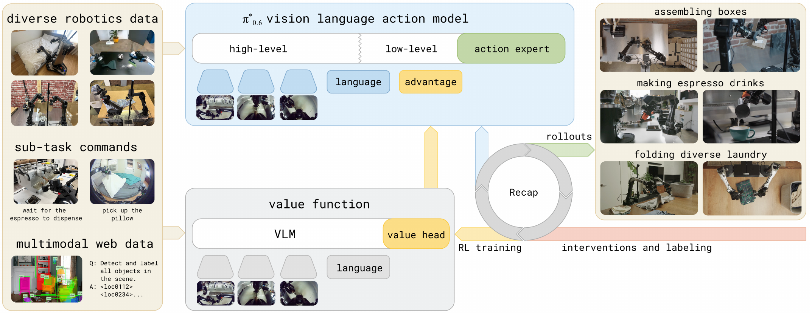

*Paper Figure 1, PDF page 1. The left supplies general pretraining data; the right supplies task experience and corrections. The return path represents training updates, rather than a critic selecting every action during deployment.*

### 1.1 The Star Already Applies Before Task-Specific Deployment

| Name or stage | What it means | What it has learned from |
|---|---|---|
| **pi0.6** | Supervised base VLA, improved from pi0.5 | Diverse robot demonstrations and vision-language data |
| **pi0.6* offline-RL pretrain** | Generalist VLA with advantage conditioning | The existing multi-task demonstration mixture, evaluated by a learned value model |
| **Offline RL + SFT** | Initial specialist for a target task, written $\pi_\ell^0$ | Task demonstrations; their indicator is fixed to positive during this supervised fine-tuning stage |
| **pi0.6* after RECAP experience** | Specialist retrained after one or more collection rounds | Accumulated demonstrations, autonomous attempts, and optional human corrections |
| **RECAP** | The collection/value-training/policy-training procedure | A method, rather than another model architecture |

The star does not mean that every named checkpoint has already practiced the target task autonomously. The generalist is first pretrained with offline RL, then specialized and improved with deployment data. Keeping these stages separate is necessary to interpret the experimental baselines.

## 2. What Produces an Action, and What Supplies Training Feedback?

### 2.1 The VLA and Critic Have Different Jobs

A **vision-language-action model (VLA)** maps camera observations, robot state, and instructions to robot actions. pi0.6 also predicts a textual next subtask, such as “pick up the coffee cup,” before generating a low-level action chunk.

A **critic**, or value model, estimates how favorable an observed situation is for completing the requested task under the behavior represented in the dataset. It supplies training labels; it is not the arm controller.

| Part | Paper's implementation | Operational role |
|---|---|---|
| **VLA vision/language backbone** | SigLIP vision encoder and Gemma 3 language backbone, shown as about 400M and 4B parameters in Figure 3 | Interpret images/instructions and predict text and discrete action tokens |
| **Continuous action expert** | 860M parameters; flow matching | Generate chunks of joint-position and gripper commands |
| **Value model** | Separate smaller VLM; about 670M total, shown as SigLIP 400M + Gemma 270M | Estimate task-conditioned returns for labeling training examples |

*Component summary from Section V and Figure 3. The paper identifies more multi-robot data, the Gemma 3 4B backbone, and the larger action expert as changes from pi0.5.*

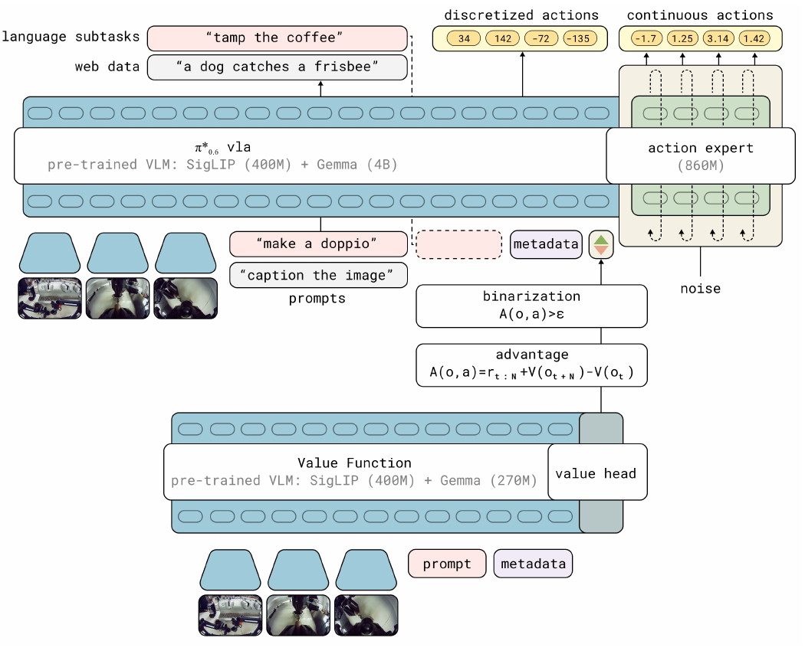

*Paper Figure 3, PDF page 4. Read upward through the policy from observations and prompts to outputs. The value-model path computes an advantage and a binary label used before the action outputs.*

### 2.2 Put the Improvement Request Where It Can Affect Actions

Let $o_t$ contain camera images and measured joint/gripper state. Let $\ell$ contain the task instruction and metadata, and $\hat\ell$ be the predicted next subtask. The model's sequence is

**Observation and task → next-subtask text → advantage indicator → action representations.**

The indicator is an explicit text input, `Advantage: positive` or `Advantage: negative`. Because it appears **after** the subtask and **before** actions, it conditions the action predictions without changing the preceding subtask likelihood in the described implementation.

There are two representations of the same action target:

- **FAST tokens:** a discrete, tokenized action representation used for next-token training.
- **Continuous action chunk:** the command sequence generated by the action expert for execution.

FAST predictions are not fed into the action expert as its input. Both action representations are conditioned on the observations and subtask, with the advantage label added for pi0.6*.

Training follows **Knowledge Insulation (KI)**. The continuous-action loss trains the action expert but stops its gradient before the VLM backbone. The backbone still learns through next-token objectives, including FAST actions, subtask text, and vision-language data. Stopping one gradient path does not freeze the entire VLM.

This architecture explains where an improvement label can act. The next question is how RECAP obtains that label from physical outcomes.

## 3. How Do Episode Outcomes Become a Useful Value Estimate?

### 3.1 Charge for Time and Penalize Failure

Human raters label whether an episode succeeded. RECAP turns that sparse outcome into a return using a cost at each nonterminal step and an additional cost for failure:

$$
r_t=
\begin{cases}
0, & t=T\text{ and the episode succeeds},\\
-C_{\mathrm{fail}}, & t=T\text{ and the episode fails},\\
-1, & \text{otherwise}.
\end{cases}
$$

Here $T$ is the final trajectory index and $C_{\mathrm{fail}}$ is a large failure penalty. The undiscounted **return-to-go** is

$$
R_t=\sum_{t'=t}^{T}r_{t'}.
$$

For an **illustrative raw-unit example**, a successful completion after ten nonterminal steps has return $-10$. A failure after two steps with an illustrative $C_{\mathrm{fail}}=100$ has return $-2-100=-102$. A successful completion in six steps has return $-6$, which is better than $-10$.

Thus the reward ranks **faster success above slower success**, while a sufficiently large terminal penalty prevents quick failure from looking attractive. The example's penalty and step counts are invented for explanation, not reported hyperparameters or seconds.

### 3.2 Learn Expected Outcome, Rather Than Memorizing an Episode's Countdown

The critic estimates

$$
V^{\pi_{\mathrm{ref}}}(o_t,\ell)
=\mathbb E[R_t\mid o_t,\ell,\pi_{\mathrm{ref}}].
$$

The **reference behavior** $\pi_{\mathrm{ref}}$ is what produced the current training data: demonstrations initially, then a mixture including earlier deployed policies. It is not an ideal expert that is independently available at every state.

The distinction between an observed return and a predicted value matters. An episode provides one realized future; the model learns an expectation across similar observations and outcomes. A partly folded shirt may usually be finished quickly, even if one particular attempt later fails.

Because failure has a terminal penalty, value is not merely a stopwatch in uncertain states. Suppose, illustratively, similar states have a 75% chance of return $-10$ and a 25% chance of return $-102$. Their expected value is

$$
0.75(-10)+0.25(-102)=-33.
$$

That value combines remaining work and failure risk. It does not mean the model predicts exactly 33 seconds to completion.

### 3.3 Why Predict a Distribution over 201 Bins?

RECAP represents the value as probabilities over **201 return bins**. Each training observation is paired with the episode's observed return-to-go, discretized into a target bin. Cross-entropy training encourages the critic to assign probability to that bin. The scalar estimate is then

$$
V(o_t,\ell)=\sum_{b=1}^{201}p_\phi(b\mid o_t,\ell)\,v_b,
$$

where $v_b$ is the return represented by bin $b$, and $\phi$ denotes critic parameters. The two-outcome example above illustrates how an uncertain distribution becomes one expected value.

The paper normalizes values per task using its maximum episode length, into a negative range ending at successful completion value zero. This prevents a long task's raw countdown from automatically dominating a shorter task. The numerical examples here use raw return units for readability. Advantage calculations must keep reward, value, and threshold in compatible units.

The critic itself is fitted to **Monte Carlo targets from complete episodes**, rather than trained with a temporal-difference target made from its own next prediction. A later advantage calculation does use a future predicted value; that is a different operation.

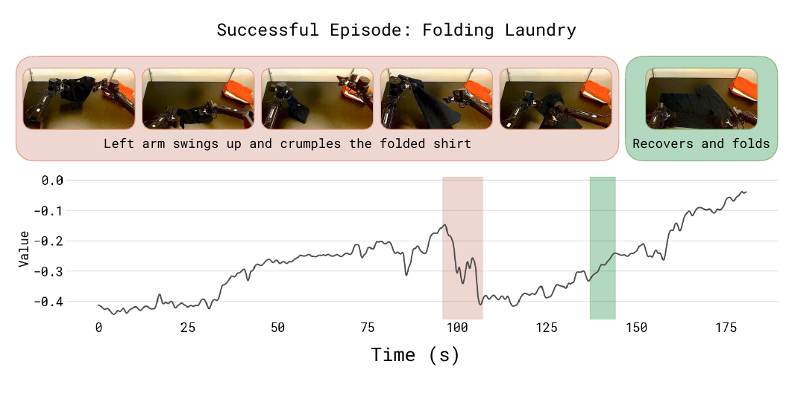

*Paper Figure 4, left panel, PDF page 5. Time runs horizontally and value vertically. Value drops when an arm crumples the shirt, then rises during recovery.*

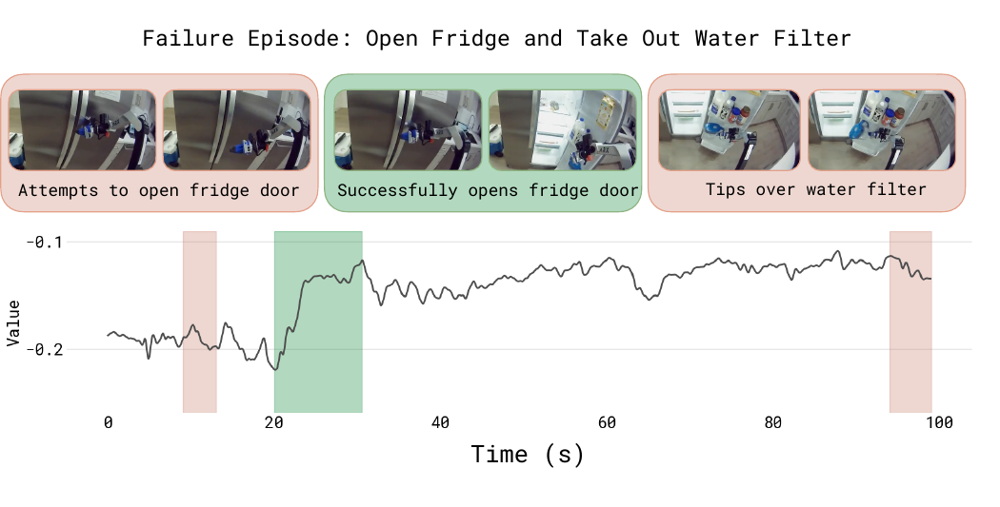

*Paper Figure 4, right panel, PDF page 5. Opening the fridge raises value before tipping the filter lowers it. Splitting the figure preserves the event labels and axes at a readable size.*

These traces illustrate state evaluation across time. A successful episode can contain a substantial setback, while a failed episode can contain real progress. An episode-level success/failure label alone cannot distinguish those regions.

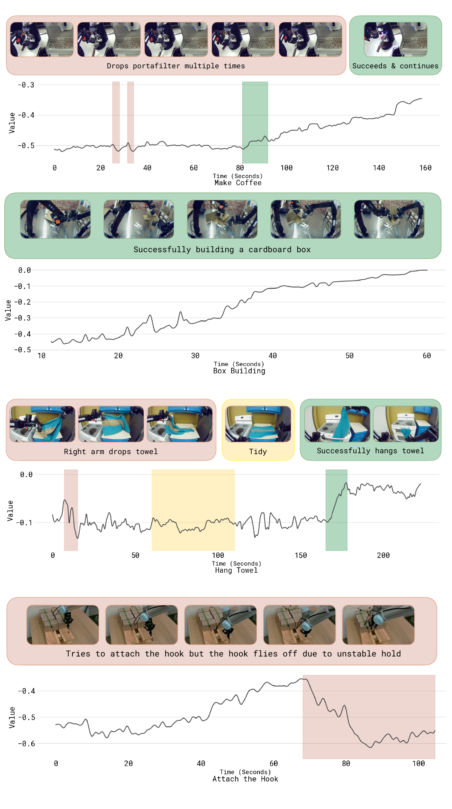

*Paper Figure 13, PDF page 17. Red regions mark setbacks, green regions mark progress, and yellow marks oscillation. These are qualitative examples, not a calibrated failure-detection benchmark.*

The model can associate dropped objects or unstable manipulation with worse expected outcomes in these examples. That does not establish that every value change is correct: observations can omit contact information or hide a failure. RECAP's improvement depends on the critic's judgments being useful enough to label actions.

## 4. How Does RECAP Judge a Recorded Action?

### 4.1 A Rising Value Is Not Sufficient: Progress Must Pay for Its Time

An action's **advantage** asks whether its observed consequences were better than expected from the starting state. RECAP compares the cost incurred over a window with the change in predicted value:

$$
\hat A_t=
\underbrace{\sum_{j=0}^{N-1}r_{t+j}}_{\text{cost incurred}}
+\underbrace{V(o_{t+N},\ell)}_{\text{predicted future return}}
-\underbrace{V(o_t,\ell)}_{\text{starting expectation}}.
$$

Here $N$ is a trajectory lookahead, not an action-chunk length or flow-model sampling step. With the $-1$ step cost, the value increase must exceed the time spent for the advantage to be positive.

Take an **illustrative five-step window**, before task normalization, starting at $V(o_t)=-20$:

| Observed development | Value after five steps | Advantage calculation | Interpretation |
|---|---:|---:|---|
| Faster progress | $-10$ | $-5-10-(-20)=+5$ | Remaining expected cost improved by ten while spending only five |
| Expected progress | $-15$ | $-5-15-(-20)=0$ | Improvement exactly paid for the elapsed steps |
| Stall | $-20$ | $-5-20-(-20)=-5$ | Time was spent without reducing remaining work |
| Crumple the shirt | $-24$ | $-5-24-(-20)=-9$ | Time was spent and the expected future became worse |

Recovery can then be valuable: from $-24$ to $-12$ over another five steps gives $-5-12+24=+7$. This can label a useful repair even if some later mistake causes the complete episode to fail.

Conversely, an action inside a successful episode need not have positive advantage. Reaching the goal in exactly the expected remaining time has advantage near zero. **Success describes the episode; advantage compares local behavior with a reference expectation.**

The paper uses **$N=50$ during downstream post-training**. Pretraining instead uses a full-episode Monte Carlo estimate to avoid a second critic inference for each example; an indexing ambiguity in that appendix formula is noted in Section 10. Do not convert $N=50$ directly into wall-clock time without knowing the trajectory sampling convention.

### 4.2 “Positive” Means Above the Task's Chosen Threshold

The continuous advantage becomes a binary input label:

$$
I_t=\mathbf 1[\hat A_t>\epsilon_\ell].
$$

The threshold $\epsilon_\ell$ is task-specific. The comparison is strict: equality produces the negative label. For illustrative values:

| Threshold | Estimated advantage | Label |
|---:|---:|---|
| $2$ | $3$ | Positive |
| $2$ | $2$ | Negative: equality does not pass |
| $-4$ | $-1$ | Positive: above this selected threshold, despite being below zero |

The names therefore denote a **selected better-behavior class**, not necessarily the mathematical sign of the advantage. Raising the threshold selects a smaller, more demanding class.

Appendix F gives these calibration targets:

| Training phase/data | Treatment of the indicator |
|---|---|
| Generalist pretraining | Choose a per-task threshold so about 30% of demonstration samples are positive, estimated on a random 10,000-point sample |
| Initial task SFT | Fix demonstration indicators to positive |
| Typical downstream experience | Choose a threshold targeting roughly 40% positive labels on rollout data |
| T-shirts/shorts speed improvement | Use a stricter threshold, roughly 10% positive |
| Expert correction actions | Override the estimated label and set it to positive |

*Threshold summary from Section V-D and Appendix F. The percentages describe labeling/calibration, not task success rates. The indicator is attached to action examples, so an episode need not have a uniform label.*

The stricter laundry setting has a specific purpose: demonstrations already succeed reliably but are slow, so selecting a narrower better-behavior class emphasizes improvement over that reliable baseline. Expert corrections instead rely on an assumption that the operator's repair is good; the override does not prove this assumption on each action.

### 4.3 Future Information Is Used for Training Labels

The post-training estimate uses a later observation $o_{t+N}$. That information is available when processing a recorded trajectory. It is not an input from the future available to the robot at decision time.

At deployment, the policy is simply **requested to generate positive-class behavior**. It does not first observe the future to determine the label of an action it has not taken. The following section explains how supervised conditional training makes that request meaningful.

## 5. How Do These Labels Change a Flow-Matching Policy?

### 5.1 Learn Separate Behavior Distributions Instead of Deleting Bad Attempts

Once actions have labels, policy training becomes supervised conditional learning. The policy learns which actions appear under the positive condition and which appear under the negative condition. An unconditional path also learns the complete data distribution.

For an **illustrative fixed context**, suppose the data contains ten attempts with these labels:

| Behavior | All samples | Positive | Negative |
|---|---:|---:|---:|
| Brisk fold | 6 | 4 | 2 |
| Hesitant fold | 4 | 1 | 3 |
| **Total** | **10** | **5** | **5** |

Unconditional imitation allocates 60% probability to the brisk behavior. Among positive examples, its frequency is $4/5=80\%$. Under the negative condition it is $2/5=40\%$. One model can learn these different distributions because the condition is part of its input.

At deployment, asking for the positive condition therefore shifts probability toward the better-labeled behavior. This toy example illustrates distribution selection, not an actual binary choice between two named motion scripts. The real policy generates continuous action chunks.

The conceptual objective is

$$
\mathcal L_\pi=
\mathbb E_{\mathcal D}\left[
-\log\pi_\theta(a_t\mid o_t,\ell)
-\alpha\log\pi_\theta(a_t\mid I_t,o_t,\ell)
\right].
$$

The first term models all behavior without a quality request; the second models behavior with its recorded label. Negative examples contribute to learning rather than being silently removed. A successful recovery inside a failed rollout can also receive its own positive label.

In practice, RECAP **omits the advantage indicator on 30% of training examples**, replacing explicit tuning of the balance $\alpha$. Those examples still train the policy; only the condition is absent. This 30% dropout is different from the pretraining target of 30% positive labels. One controls whether a label is shown; the other controls which label an action receives.

### 5.2 Why This Is Convenient for a Flow Policy

PPO-style updates generally need action likelihoods or likelihood ratios. For a flow-matching action generator, evaluating the exact continuous-action likelihood is awkward. RECAP instead keeps the usual supervised token and flow losses and changes their conditioning input.

The discrete side uses next-token training for subtask text and FAST actions. For the continuous side, let $a$ denote a clean action chunk and $\omega$ Gaussian noise with the same shape. The training example at flow time $\eta$ is

$$
x_\eta=\eta a+(1-\eta)\omega,
\qquad \eta\in[0,1].
$$

This **flow time** indexes artificial noise corruption: zero gives noise, and one gives the clean target. It is not the physical robot time $t$.

Using the paper's noise-minus-action target convention, the action-expert loss has the form

$$
\mathcal L_{\mathrm{flow}}=
\mathbb E_{\eta,\omega}\left[
\lambda(\eta)\left\|\omega-a-f_\theta(x_\eta,c)\right\|^2
\right],
$$

where $c=(o_t,\ell,\hat\ell,I_t)$ is the available context, and $\lambda(\eta)$ denotes the loss weight written as $\alpha_\eta$ in the paper. It is separate from the conditional/unconditional balance above.

For an **illustrative single normalized action component**, take $a=0.4$, $\omega=-0.2$, and $\eta=0.5$. Then $x_\eta=0.1$ and the target is $\omega-a=-0.6$. With unit loss weight:

- Predicting $f_\theta=-0.3$ gives squared error $(-0.6+0.3)^2=0.09$.
- Predicting $f_\theta=-0.6$ gives zero error.

The negative target is not a command to move the joint negatively. In Appendix C's one-step likelihood interpretation, the predicted mean is $\omega-f_\theta$; the correct prediction gives $-0.2-(-0.6)=0.4$, recovering the action target. The deployed policy uses its flow sampler over a whole chunk; this calculation only explains the training term and its sign convention.

The paper motivates the combined discrete likelihood and flow objective through a likelihood lower bound. It does not require exact continuous likelihood evaluation for ordinary RECAP training. KI then routes these losses through the appropriate model parts, as described in Section 2.

## 6. How Is Experience Retained Across Training Rounds?

The dataset grows across rounds even though the specialized models are reinitialized from shared pretrained checkpoints. This separates **retaining experience** from **continuing optimization from yesterday's specialist weights**.

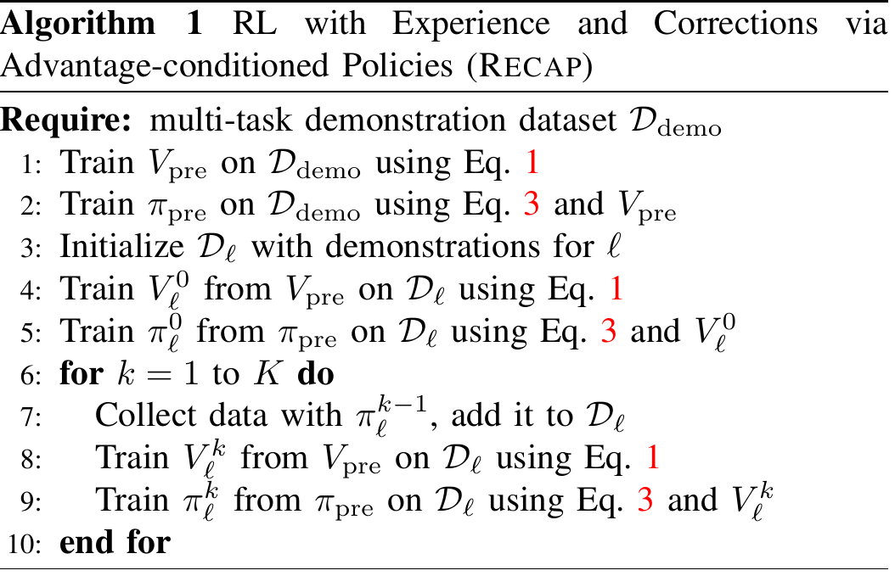

*Paper Algorithm 1, PDF page 6. In the loop, “from” identifies the initialization checkpoint. The task dataset accumulates across iterations; the next critic and policy start from their respective pretrained checkpoints.*

| Stage | Data used | Critic/policy initialization and output |
|---|---|---|
| **Generalist pretraining** | Diverse multi-task, multi-robot demonstrations, plus the VLA's co-training data | Train $V_{\mathrm{pre}}$ and advantage-conditioned $\pi_{\mathrm{pre}}$ |
| **Task initialization** | Target-task demonstrations $\mathcal D_\ell^0$ | Fine-tune from the pretrained checkpoints; task SFT with positive labels produces $\pi_\ell^0$ |
| **Collect round $k$** | Execute $\pi_\ell^{k-1}$; record attempts, outcomes, and optional expert corrections | Add this batch $\mathcal B_\ell^k$ to the existing task data |
| **Fit critic** | All task data collected so far | Start from $V_{\mathrm{pre}}$ and fit $V_\ell^k$ |
| **Fit policy** | The same accumulated data, relabeled using the updated critic and correction overrides | Start from $\pi_{\mathrm{pre}}$ and fit $\pi_\ell^k$ |
| **Next collection** | Deploy the newly trained specialist | Keep its weights fixed during collection, then repeat offline updates if needed |

The persistent state is

$$
\mathcal D_\ell^k=
\mathcal D_\ell^{k-1}\cup\mathcal B_\ell^k.
$$

For example, round 1 can discover shirts crumpled by the policy itself. Round 2 training can still use those attempts, their repairs, and the original demonstrations. Recomputing labels with a newer critic can also change how the same old action is judged.

The authors report that restarting from the pretrained checkpoints helps avoid drift over multiple rounds. It does not erase experience, because that experience remains in the aggregated dataset. Conversely, this is not concurrent online weight adaptation while a robot is manipulating a shirt: collection and retraining happen in alternating batches.

Corrections and autonomous data serve complementary purposes. An operator can show recovery from a large mistake or introduce an action the policy rarely explores. Autonomous attempts reveal the policy's own error states and whether its routine actions are slow or inefficient. Treating every correction as positive is a practical supervision choice, not a guarantee that human interventions are uniformly fast or correct.

## 7. What Happens During Robot Deployment?

### 7.1 Execute the Positive-Conditioned VLA Without an Online Critic

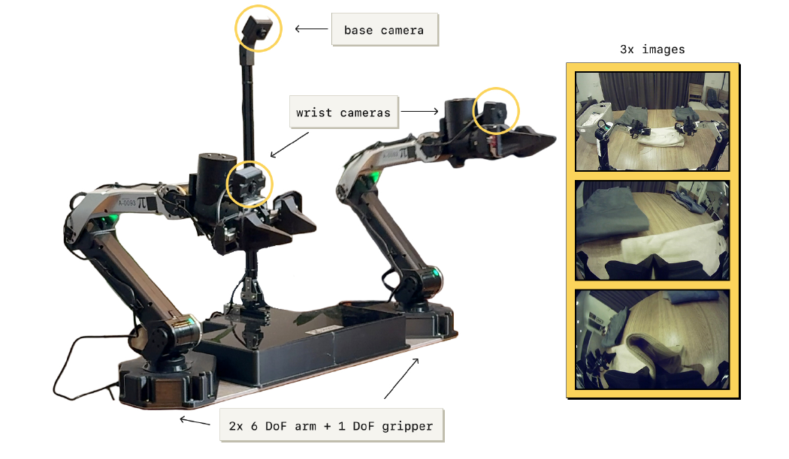

*Paper Figure 5, PDF page 7. Iterative-improvement experiments use a static bimanual setup with two 6-DoF arms, parallel-jaw grippers, and three cameras. The generalist pretraining data covers additional robot platforms.*

The VLA receives images and joint/gripper positions, predicts the next subtask at a lower frequency, and generates joint-position/gripper action chunks. The physical commands run at **50 Hz**. This rate is not the rate of text-subtask prediction, critic labeling, or weight updates. The paper uses $H$ for action-chunk length without specifying a numerical value here.

The default evaluation requests `Advantage: positive`, corresponding to guidance strength $\beta=1$. The critic has already supplied training labels; ordinary deployment does not need to run it to rank each generated action.

This removes a possible misunderstanding: positive conditioning is a learned request for a behavior distribution, not an online certificate that a particular motion will improve the task.

### 7.2 Optional Guidance Strengthens the Same Preference

The paper's idealized improved distribution can be written

$$
\hat\pi_\beta(a\mid o,\ell)\propto
\pi_{\mathrm{ref}}(a\mid o,\ell)
\left[
\frac{\pi_{\mathrm{ref}}(a\mid I=1,o,\ell)}
{\pi_{\mathrm{ref}}(a\mid o,\ell)}
\right]^\beta.
$$

The ratio measures how much more common an action is in the positive class than in all behavior. At $\beta=1$, cancellation leaves the positive-conditioned distribution. Classifier-free guidance (CFG) uses conditional and unconditional predictions to approximately sharpen this preference when $\beta>1$.

Reuse the **illustrative** brisk/hesitant example from Section 5:

| Guidance strength | Brisk behavior probability | Hesitant behavior probability |
|---|---:|---:|
| $\beta=0$ | 60% | 40% |
| $\beta=1$ | 80% | 20% |
| $\beta=2$ | About 91.4% | About 8.6% |

For the last row, the unnormalized weights are $0.6(0.8/0.6)^2=16/15$ and $0.4(0.2/0.4)^2=0.1$; normalizing gives $32/35$ and $3/35$.

This categorical example explains the reweighting principle, not exact probabilities for a learned continuous robot policy. In practice, strong guidance can push action samples toward extremes of the learned distribution. The authors primarily use the training threshold to obtain a good positive policy, with moderate CFG values such as **1.5–2.5** where helpful.

Do not confuse three controls: **$\epsilon_\ell$ selects training labels; conditioning dropout trains the unconditional path; $\beta$ changes inference-time guidance**. A larger value of one is not interchangeable with a larger value of another.

## 8. How Are Tasks, Data, and Metrics Defined?

### 8.1 The Evaluation Is Physical and Multi-Stage

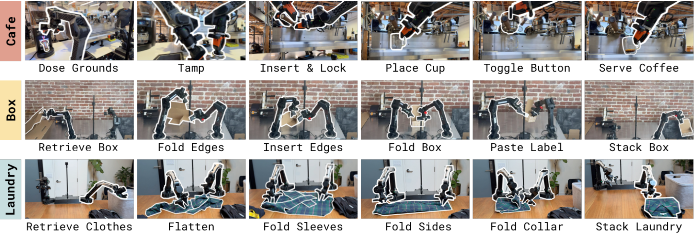

*Paper Figure 2, PDF page 2. Each row shows the stages of a physical task. Completing a local action, such as grasping a portafilter, is only one prerequisite for finishing the whole sequence.*

The evaluation involves deformable clothing and cardboard, liquid handling, and constrained manipulation. The controlled tasks have explicit acceptance conditions:

| Task | What must be completed | Time limit and scope |
|---|---|---|
| **T-shirts and shorts** | Retrieve an item from a basket, flatten, fold, and stack it in the designated table corner | 200 s; variable initial conditions |
| **Diverse laundry** | Correctly fold and stack the target item | 500 s; trained on 11 item types, but quantitative comparison uses a challenging **button-up shirt** |
| **Targeted failure removal** | Fold an adversarially positioned orange T-shirt with its collar centered and facing up | 200 s; a deliberately narrow ablation |
| **Double-shot espresso** | Grind, tamp, lock the portafilter, extract, and serve without critical mistakes | 200 s; quantitative results cover this drink, rather than every cafe behavior |
| **Box assembly** | Turn a flat sheet into an assembled, labeled, and stacked packaging box | 600 s; also report intermediate-stage scores |

*Task summary paraphrased from Section VI-A. The 11 laundry types include towels, shirts, sweaters, jeans, shorts, polos, skirts, socks, and underwear; the plotted diverse-laundry score is not an average over those categories.*

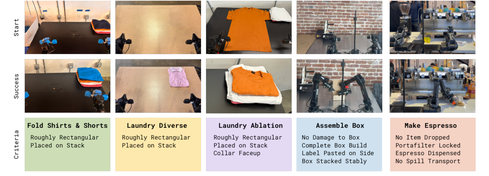

*Paper Figure 6, PDF page 8. Read each column from initial state to successful outcome and then to its criteria. The three laundry columns are different test settings, not interchangeable measurements of the same task.*

### 8.2 Experience Includes Different Forms of Human Involvement

The reported experience budgets vary by task:

| Task | Reported collection budget | Source qualification |
|---|---|---|
| T-shirts/shorts | 300 autonomous trajectories per iteration across four robots | Main iterative experiment uses no expert corrections |
| Diverse laundry | 450 evaluation episodes and 287 correction episodes | Appendix F |
| Cafe | 414 autonomous episodes and 429 correction episodes in one iteration | Appendix F |
| Box assembly | Main text: 600 autonomous trials and 360 intervention trials per iteration | Appendix F instead calls the first 600 demonstrations |
| Targeted failure removal | Main text: two iterations of 600 trajectories, without additional demonstrations or interventions | Appendix F separately lists about 1,000 autonomous and $280+378$ correction episodes for this ablation |

*Reported budgets from Section VI-C and Appendix F. The last two descriptions are not fully reconciled in the paper; they should not be silently combined into one clean accounting of assistance.*

An episode with an expert correction is different from a fully autonomous attempt. Human outcome labeling and scene resets are additional work even where execution uses no corrections. The results therefore show learning from substantial physical experience, rather than a robot improving with no human involvement.

### 8.3 Success and Throughput Answer Different Questions

**Success rate** is the fraction of episodes meeting the task's quality and time criteria, based on human annotations. **Throughput** is successful completions per hour, combining reliability with execution speed.

For a counted evaluation duration $T_{\mathrm{eval}}$ in seconds,

$$
\text{throughput}=\frac{3600\,N_{\mathrm{success}}}{T_{\mathrm{eval}}}.
$$

An **illustrative comparison** counts all attempt durations and assumes 100 attempts with 90 successes:

| Mean attempt duration | Success rate | Counted total time | Throughput |
|---|---:|---:|---:|
| 90 s | 90% | 9,000 s | $3600\cdot90/9000=36$ successes/hour |
| 60 s | 90% | 6,000 s | $3600\cdot90/6000=54$ successes/hour |

The second policy has 50% higher throughput with identical success rate. This is why faster, fluent behavior matters even after easy-task reliability is high. These are invented numbers, not the paper's measurements or a claim about how operator/reset time is charged in its plots.

## 9. What Do the Results and Ablations Establish?

### 9.1 Interpret the Training Stages Before Comparing Bars

The main plots compare the supervised pi0.6 pretrain, advantage-conditioned offline-RL pretrain, task SFT, and the final policy trained on deployment experience. Some laundry plots additionally show pi0.5. The names in Section 1 identify what each bar has been trained on.

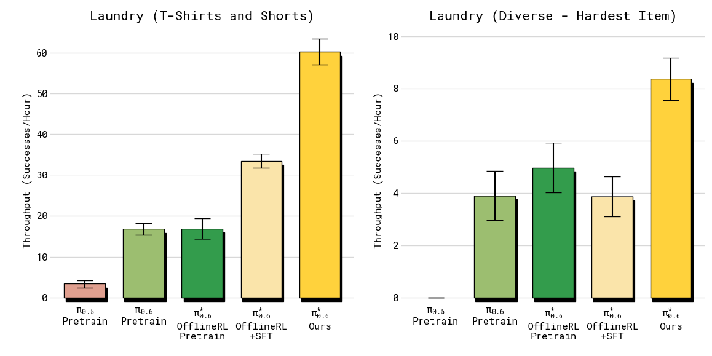

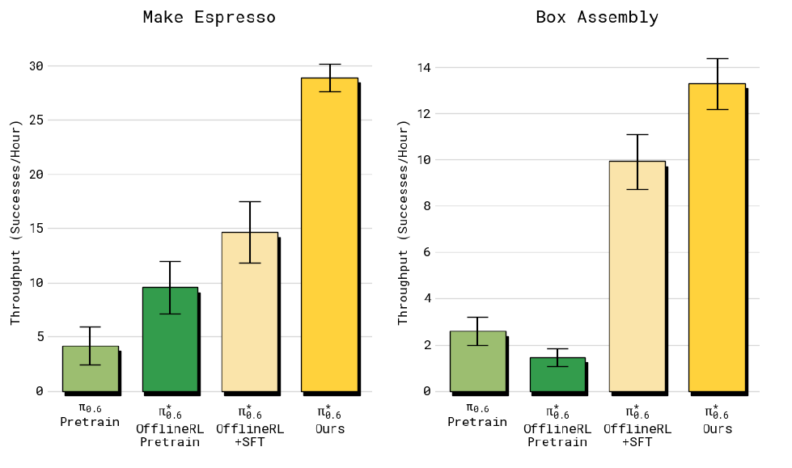

*Paper Figure 7, PDF page 9, split into laundry and espresso/box panels for readability. Each axis measures successful completions per hour, and error bars are standard errors. Yellow bars are the final experience-trained policy.*

The main comparison for learning from deployment is **offline RL + SFT versus the final policy**, rather than supervised pretrain versus the final system. The latter includes several additional training stages at once.

Approximate final endpoints read from the plots are:

| Evaluation | Final throughput | Final success endpoint shown in Figure 8 |
|---|---:|---|
| T-shirts/shorts | About 60 successes/hour | About 96% |
| Diverse-laundry button-up shirt | About 8 successes/hour | About 74% |
| Double-shot espresso | About 29 successes/hour | About 92% |
| Box assembly | About 13 successes/hour | Individual stages around 90–96%; not a single overall-success bar |

*Rounded visual readings from Figures 7–8, not a numerical source table. They are intended to explain scale, not recover exact means or significance tests.*

The authors report more than doubling throughput on diverse laundry and espresso from adding deployment experience, with substantial reductions in failure. Simple laundry already succeeds reliably after SFT, so much of its remaining improvement is execution speed. Diverse laundry remains clearly less reliable than the easier task despite a large improvement.

### 9.2 Read the Box Bars as Stage Scores

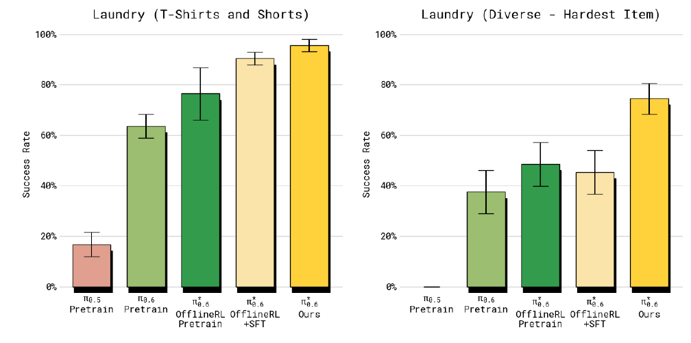

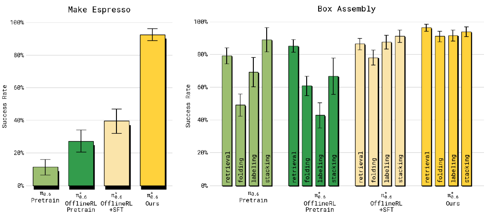

*Paper Figure 8, PDF page 9, split into two panel groups. Error bars are standard errors. The box panel groups four stages within each policy, whereas the laundry and espresso panels show complete-task success.*

For boxes, retrieving a sheet does not establish that it was folded, labeled, and placed successfully. The final model is more consistently strong across the displayed stages, but stage percentages should not be presented as one measured end-to-end percentage. Multiplying them would also require a known conditional scoring protocol; the plot alone does not supply that information.

Likewise, throughput and failure reduction are different improvements. A higher success rate can reduce repeated failures while faster execution raises the rate of completed work. The plotted combination supports the paper's practical claim more clearly than either metric alone.

### 9.3 Additional Collection Rounds Can Help Without Monotonic Improvement

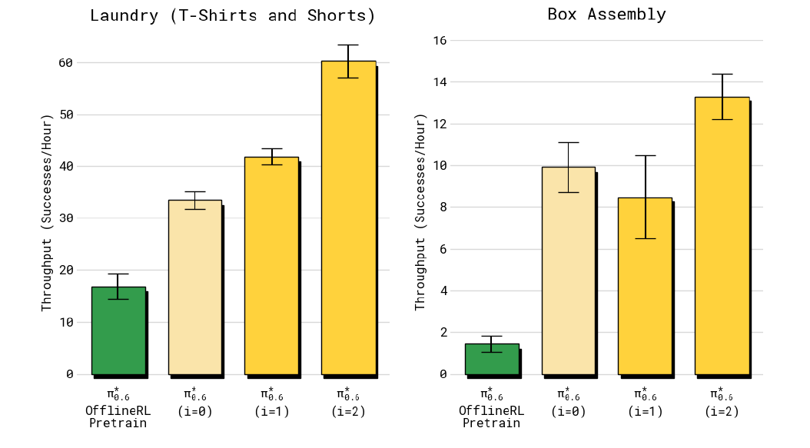

*Paper Figure 9, PDF page 10. The offline-RL pretrain precedes task specialization; $i=0$ is the initial specialist, followed by collection/training iterations $i=1$ and $i=2$.*

Laundry throughput rises across the two rounds. Box throughput first declines and then improves, showing why extra data and retraining should be evaluated rather than assumed to produce an immediate gain. The plotted initial-specialist and final box bars are roughly 10 and 13 completions/hour; the text also describes a roughly twofold box improvement without making its numerical baseline clear. The figure does not support interpreting $i=0\to i=2$ as exactly a doubling.

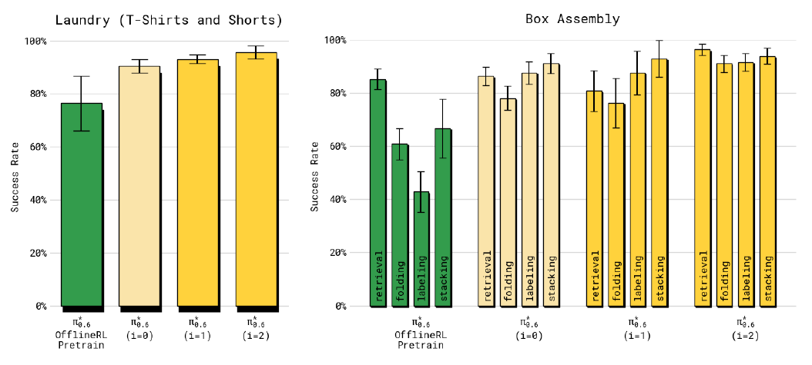

*Paper Figure 10, PDF page 10. Compare this with Figure 9: the same training rounds can change speed and success by different amounts.*

On simple laundry, reliability becomes high early, while later training still improves throughput. On boxes, stage reliability continues changing across iterations. This is consistent with the objective's two pressures: avoid expensive failure and reduce the cost of successful completion. It does not establish guaranteed improvement at every finite-data training round.

### 9.4 Same Experience, Different Policy Extraction

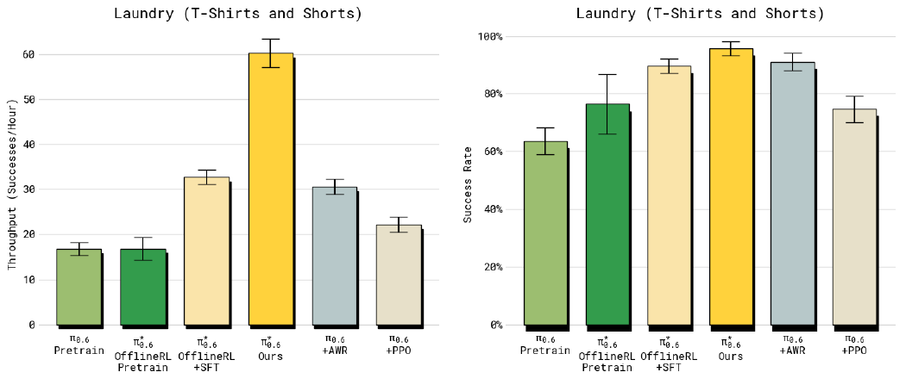

*Paper Figure 11, PDF page 10. Left: throughput; right: success. The comparison uses the same collected on-robot data, changing the policy-learning approach.*

**Advantage-weighted regression (AWR)** favors high-advantage examples by weighting their imitation loss. RECAP instead learns condition-specific distributions while retaining low-quality data in training. In this experiment, AWR attains reasonably high success but much lower throughput than RECAP, illustrating that learning reliable behavior need not produce fluent behavior.

The **PPO comparison** uses a flow/diffusion likelihood approximation and a modified trust-region constraint to stabilize training on reused data. The authors report needing a small constraint setting, 0.01. This is not a comparison with every possible online PPO implementation.

Data availability is controlled, but the whole training recipe is not identical: the AWR and PPO descriptions start from the supervised pi0.6 checkpoint, while RECAP uses its advantage-conditioned training route. The evidence favors the reported RECAP recipe on this task/data setting; it does not isolate one architectural token or one loss term as the sole cause.

### 9.5 A Narrow Failure Criterion Can Change What the Policy Learns

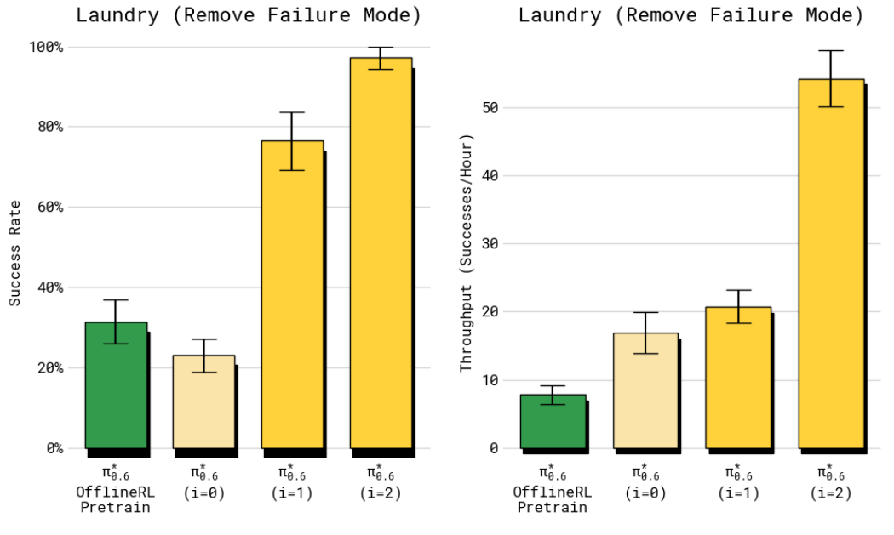

*Paper Figure 12, PDF page 10. The acceptance criterion requires the folded shirt's collar to be centered and facing upward. This is a targeted task variant, not a general diverse-laundry score.*

The reported final success is **97% after two iterations**. The experiment asks whether the same learning machinery can change a specific undesirable behavior when the outcome definition makes it a failure. It supports targeted behavioral adaptation, rather than showing that the policy discovered a new task without a useful initial policy.

Section VI-C.4 describes this as autonomous-only improvement without additional demonstrations or interventions. The conflicting correction counts in Appendix F, listed in Section 8, limit how precisely its assistance budget can be reconstructed.

## 10. What Is Demonstrated, and What Still Needs Clarification?

The central evidence is that an expressive VLA can improve through **alternating physical experience and offline conditional training**, using the same broad method across cloth, coffee preparation, and cardboard manipulation. The paper also reports long deployments, including 13 hours of espresso making and more than two hours folding novel laundry in a new home. Those demonstrations extend the setting, while the controlled plots have the narrower task definitions above.

Several dependencies remain:

- **Human work:** outcome annotation, optional teleoperation, and episode resets remain part of the system. Long execution is not proof that all collection and recovery labor is autonomous.
- **Useful initial behavior:** exploration largely uses policy stochasticity and human corrections. Learning a refinement from a workable policy is different from discovering arbitrary tasks from scratch.
- **Critic accuracy:** local advantages depend on learned values and imperfect observations. Binary labels and positive conditioning do not guarantee that each generated action improves the real task.
- **Corrections are trusted:** forcing intervention actions positive can propagate a poor correction; it is an assumption about supervision quality.
- **Offline batches:** policy/critic weights are retrained between collection phases, rather than adapted continuously during execution.
- **Scope of comparisons:** whole-task success, box-stage success, throughput, and qualitative long deployments support different conclusions and should remain separate.

The paper also leaves some reproduction details ambiguous. The main text and Appendix F differ on correction use for targeted failure removal and on whether one box-data batch consists of autonomous trials or demonstrations. Appendix F's pretraining advantage formula prints an episode-total reward sum starting at zero, while the generic return-to-go formulation starts at the current step. These expressions are not generally interchangeable. The worked $N$-step examples in this note follow the main advantage definition; an implementation should resolve the pretraining indexing rather than silently assume the two formulas are identical.
