# [pi0.7: A Steerable Generalist Robotic Foundation Model with Emergent Capabilities](https://arxiv.org/abs/2604.15483v2)

> **Brief:** pi0.7 is a roughly 5B-parameter vision-language-action policy trained to distinguish **what to do, what the next useful state looks like, and how well or quickly to act**. Detailed subtask instructions, visual subgoals, and execution metadata let it learn from demonstrations, autonomous attempts, and mixed-quality behavior. The resulting generalist approaches specialist performance on several seen tasks and transfers skills to new instructions and task–robot combinations. An optional, separate image-generating world model supplies visual subgoals.

**Source:** Physical Intelligence et al., April 2026, [25-page paper, arXiv:2604.15483v2](https://arxiv.org/pdf/2604.15483v2), revised April 24, 2026. This note covers the policy, context conditioning, training, asynchronous execution, and evaluation, including the appendix.

## Convenient Links

- [Official project and robot demonstrations](https://www.pi.website/pi07)
- Related policies: [pi0.6* / RECAP](./Pi_0_6.md), [pi0.5](./Pi_0_5.md), [MEM](./Pi_MEM.md), [Knowledge Insulation](./Pi_0_5_KI.md), [FAST](./Pi_0_FAST.md)
- Deployment: [Real-Time Chunking](../Inference/RTC.md)
- Compare visual prediction approaches: [GR00T 2](./GR00T_2.md), [Cosmos 3](./Cosmos_3.md)

## 1. Why Is More Robot Data Not Enough?

Imagine two recordings of folding a shirt. In one, the robot folds it neatly and quickly. In the other, it misses a grasp, crumples the cloth, and eventually completes a rough fold. Both might carry the same instruction: “fold the shirt.”

If that instruction is the only explanation of the behavior, training treats both recordings as examples of what to do under the same request. A generative policy can represent several behaviors, but its conditioning does not identify which one is desirable. Simply adding more recordings can add useful situations and undesirable strategies together.

Keeping only perfect demonstrations avoids some ambiguity, but discards states encountered after mistakes and behavior from autonomous robots. It also limits learning from specialists whose successful rollouts could teach the generalist new proficiency. Reinforcement learning (RL) is one way those specialists were trained.

pi0.7 adds information that explains **which behavior each recording represents**. During training, an imperfect fold is labeled with its actual quality, duration, and mistakes. At deployment, the model is asked for the high-quality, efficient, mistake-free kind of behavior. Visual subgoals and detailed instructions further specify the intended interaction.

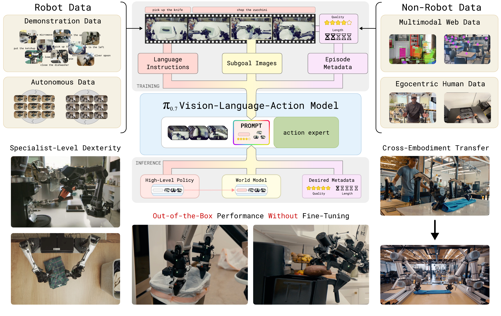

*Figure 1. The upper half shows diverse robot and non-robot sources and their conditioning signals. The lower half shows inference-time prompting and example capabilities. The contribution is a training and conditioning recipe built on an existing policy architecture.*

The paper calls the model **steerable** because changing its context can request different behaviors without changing its weights. It also studies **compositional generalization**: using familiar skills in a new combination, such as opening an unfamiliar appliance, placing food inside, and closing it.

Those claims require different tests. Performing a known espresso task without task-specific fine-tuning is different from performing a new task, and following a person's live instructions is different from choosing every instruction autonomously. The evaluation sections keep these settings separate.

## 2. Which Model Chooses the Subtask, Which Imagines It, and Which Moves the Robot?

### 2.1 The Architecture Has Three Distinct Roles

A **vision-language-action model (VLA)** maps observations and context to robot commands. pi0.7 combines a vision-language backbone with a smaller continuous-action expert. Two optional supporting models supply semantic instructions and visual subgoals.

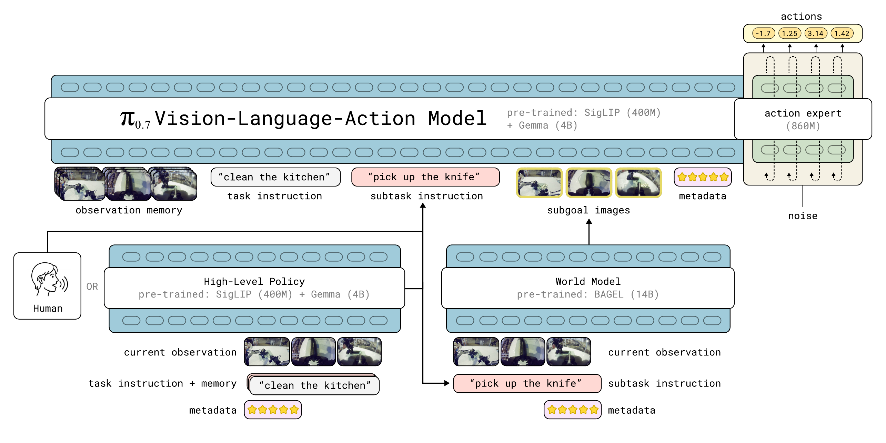

*Figure 2. Follow the arrows from the bottom: a human or high-level policy chooses a subtask; the world model predicts its visual outcome; the VLA uses these inputs and observation history to generate an action chunk. The separate world model is additional to the roughly 5B policy.*

| Component | Inputs and output | Implementation in the paper |
|---|---|---|
| **Low-level VLA** | Camera/state history and prompt → robot action chunk | Gemma 3 4B vision-language backbone, MEM (Multi-Scale Embodied Memory) history encoder, 860M action expert; roughly 5B total |
| **High-level semantic policy** | Current observation, task, and past subtask history → next subtask instruction | Gemma 3-based policy; a human can provide the instruction instead |
| **Subgoal world model** | Current views, subtask, and metadata → desired near-future views | Separate BAGEL-derived 14B model |

*Component summary from Sections IV–VII and Appendix C. The paper describes the VLA's 4B backbone as including its approximately 400M vision encoder; do not add the vision encoder again when interpreting the approximate total.*

The low-level policy predicts **50 future action steps together**, called an action chunk. These are robot commands, not fifty instructions such as “open the drawer.” The executor usually consumes only part of the chunk before obtaining a revised one from newer observations.

### 2.2 Follow One Interaction through the Components

Consider the paper's reverse food-transfer task: put food from a microwave into a fridge, despite training data favoring the opposite direction.

1. The overall task says where the food should end up.
2. A human or high-level policy supplies the current subtask, such as opening the microwave.
3. If visual-goal conditioning is enabled, the world model receives the current camera views and this subtask, then generates views showing an appropriate near-future outcome.
4. pi0.7 uses the real observations, robot state, subtask, generated views, and metadata to generate commands.
5. New camera observations show what actually happened. Later decisions use those observations, rather than treating the generated image as evidence of success.

A generated image can clarify the intended spatial result, but it does not move the door or certify that the door opened. Similarly, a high-level instruction selects an intent; the action expert must still realize that intent with the current robot.

## 3. What Does the Prompt Actually Tell the Policy?

Let $o_t$ denote current camera views and measured robot state. Let $o_{t-T:t}$ denote the available recent history. The paper trains a conditional policy

$$
\pi_\theta(a_{t:t+H}\mid o_{t-T:t},C_t),
\qquad
C_t=\{\ell,\hat\ell_t,g_t,m,c\},
$$

where $\theta$ denotes policy weights, $T$ the observation lookback window, and $H$ the action horizon in the paper's sequence notation. The implementation predicts 50 action steps per chunk. The five context entries divide the work:

| Entry | Meaning | What ambiguity it resolves |
|---|---|---|
| $\ell$ | Overall task instruction | What final task is requested? |
| $\hat\ell_t$ | Current subtask instruction | Which part should happen now? |
| $g_t$ | Optional multi-view visual subgoal | What spatial outcome should this part produce? |
| $m$ | Quality, duration, and mistake metadata | Which execution style or quality does the example represent? |
| $c$ | Joint-space or end-effector control identifier | What do the predicted command coordinates mean? |

### 3.1 Subtasks Specify the Immediate Intent

“Put food on the table” leaves several immediate actions possible: open the microwave, grasp the plate, move to the table, or place the plate. Segment-level instructions identify which action is appropriate at the current stage.

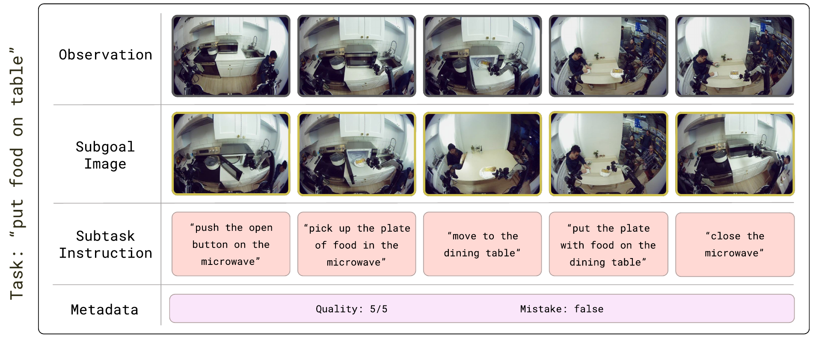

*Figure 3, kitchen example. Columns show stages of one task. Each stage includes a real observation, a visual subgoal, and a subtask instruction. Read down a column to see the complementary information provided for that decision.*

The distinction matters when the same scene admits several reasonable actions. If a microwave is open and a plate is visible, “take out the plate” and “close the microwave” require different commands. Detailed subtask labels teach the model to use language to resolve the choice, rather than always repeat the most common sequence for that scene.

The subtask can come from a learned high-level policy, live human coaching, or be omitted when the remaining context suffices. Changing it changes the action request; it does not update the low-level policy weights.

### 3.2 Visual Subgoals Specify a Result That Words May Leave Ambiguous

An instruction such as “fold the shirt” can identify a skill without specifying which edge should move where. A picture can show the intended cloth arrangement and gripper relationship directly.

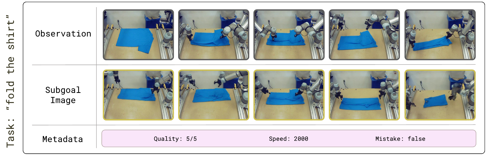

*Figure 3, folding example. The observation and subgoal rows differ even though the task remains the same. Metadata describes execution quality and duration; it does not replace the spatial goal.*

For $n$ camera views, the goal is $g_t=[G_t^1,\ldots,G_t^n]$. Each $G_t^i$ depicts a desired near-future state from camera $i$. A front view can show where an object should end up; a wrist view can clarify the local grasp.

**Illustrative decision example.** Suppose the cloth's left edge and right edge are both reachable. “Make the next fold” leaves the choice ambiguous. A subgoal showing the left edge aligned with the center supplies evidence for moving that edge. The policy predicts commands conditioned on both the current cloth and the target arrangement. It does not directly subtract image pixels and treat the result as a joint displacement.

This is goal conditioning, labeled **GC** in result plots. Unlike a world-action model that jointly generates a video and actions inside one policy, pi0.7 obtains its goal images from a separate generator. That generator's training is explained in Section 6.

### 3.3 Metadata Separates Desired Behavior from Recorded Mistakes

The metadata describes the training episode or segment, rather than the object's identity:

| Field | Training label | Deployment request |
|---|---|---|
| **Speed** | Total episode length in timesteps, discretized in 500-step intervals | The task's 15th-percentile episode length |
| **Quality** | Human-rated execution quality, from 1 to 5 | 5 |
| **Mistake** | Whether a segment contains a mistake, such as a missed grasp | False |

A lower episode length means faster completion. “Speed: 2000” therefore names a duration category, not a velocity of 2,000 units or a command to move a joint by 2,000 radians. The paper's example maps lengths around 1,750–2,250 steps to the 2,000-step bin; it does not specify how exact bin-boundary ties are handled.

**Illustrative two-recording example:**

| Recording | Task text | Duration bin | Quality | Mistake in this segment |
|---|---|---:|---:|---|
| Neat, efficient fold | Fold the shirt | 2,000 | 5 | False |
| Slow fold with a missed grasp | Fold the shirt | 4,000 | 2 | True |

Without metadata, both feed the same task-conditioned distribution. With metadata, training can associate different actions with different execution conditions. At test time, requesting quality 5 and mistake false selects the learned desirable-behavior distribution. The slower recording can still contribute information about the states encountered during folding.

The labels are known after observing training behavior. At deployment, they become **requests**, not predictions that success is guaranteed. Setting “Mistake: false” cannot prevent every missed grasp. The 15th-percentile duration also asks for behavior resembling relatively fast examples; it is not a hard deadline enforced by the controller.

This differs from [RECAP](./Pi_0_6.md), where a learned value model supplies advantage labels for action-quality conditioning. Here the main metadata comes from recorded episode length and human annotations. pi0.7 can distill rollouts from RL-trained specialists without itself running RECAP inside each control decision.

### 3.4 The Control Identifier Changes the Meaning of Actions

The prompt includes $c\in\{\mathrm{joint},\mathrm{ee}\}$, where **ee** means end-effector. Joint-space commands specify the robot's joints; end-effector commands specify the tool's target pose. A numerical inverse-kinematics solver converts the latter into target joint positions before the robot's proportional–derivative (**PD**) controller executes them.

A request to change a wrist pose is not numerically interchangeable with a joint-position vector. Labeling the control mode prevents training from treating these different coordinate systems as one unlabeled output space. The experiments use both during training, while the main cross-embodiment comparisons use joint-space control.

### 3.5 Train Missing-Context Cases so the Policy Can Run without Every Field

Always providing a future image would make action training easier, but would encourage dependence on an input that might be unavailable at deployment. pi0.7 randomly omits parts of the prompt during training.

| Training omission | Reported setting |
|---|---|
| Provide visual subgoals | Only 25% of examples in a batch |
| Omit subtask text among examples with visual goals | 30% |
| Omit all episode metadata | 15% |
| Additionally omit individual speed/quality/mistake fields | 5% per field |
| Omit control mode | Never |

**Illustrative expected counts:** in 100 training examples, about 25 receive visual goals. Of those, $25\times0.30=7.5$ omit subtask text on average, while 17.5 retain it. Fractional counts describe expectations over many batches. Thus the model sees cases where the image must carry the subtask's intent, and many cases where no future image is supplied at all.

The components are not interchangeable. Language chooses an intent, images specify a spatial result, metadata selects execution style, and the control label defines the command interface. Dropout teaches flexibility across combinations; it does not guarantee equal performance for every missing-input configuration.

## 4. How Does the Policy Use History and Produce Commands?

### 4.1 Compress Recent Visual History without Discarding Robot State

One image may hide information needed for the next action. For instance, a gripper can occlude an object it was approaching, or the scene may not reveal whether the robot has already poured one scoop.

pi0.7 inherits the [MEM](./Pi_MEM.md) history encoder. It accepts up to four views: front, two wrists, and an optional rear view. Each view can include up to six history frames, sampled with a one-second stride. Temporal and spatial compression maps the history into the token budget used for one frame, limiting the cost passed to the language backbone.

The images and policy subgoal images are resized to $448\times448$ pixels. **Proprioception**, meaning the measured state of the robot's own body, is linearly projected into the backbone's feature width. Each history state gets its own token; dropping a history image also masks its corresponding state token.

**Illustrative occlusion example.** At an earlier observation the cup handle was visible. In the current view the hand blocks it. Recent visual history can retain evidence of the handle's location, while current joint state identifies the configuration from which the next motion acts. The old image provides context, not a replacement for measuring where the arm is now.

During training, history is dropped with probability 0.3, and the optional rear view is also dropped with probability 0.3. One-second history sampling does not mean commands are executed once per second.

The high-level policy additionally receives past subtask history. This semantic history can distinguish stages such as “one scoop completed” from “second scoop still needed,” while low-level video history preserves recent physical detail. The paper builds on MEM rather than specifying a new unlimited-history memory algorithm; it does not give a complete policy for history padding or every reset condition.

### 4.2 Continuous Actions and FAST Tokens Supply Different Training Paths

The action expert reads backbone activations and refines 50 noisy action tokens using flow matching. Each token corresponds to one future action step; action tokens can attend to one another, allowing the chunk to be generated as a coordinated sequence. Flow-matching time is the neural refinement variable, not the robot's physical clock.

Training also represents the demonstrated action sequence with **FAST**, a discrete action tokenizer. Its tokens supply next-token supervision to the vision-language backbone. The continuous action expert supplies commands for execution.

Under **Knowledge Insulation (KI)**:

- Discrete action/text prediction trains the backbone through cross-entropy.
- The continuous flow loss trains the action expert, while its gradient is stopped before reaching the backbone.
- The action expert still reads backbone information; stopping that gradient does not freeze every part of the VLA.

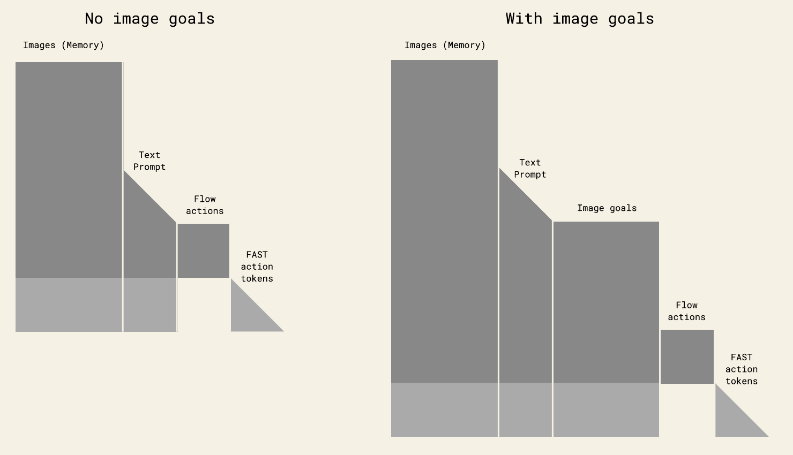

*Figure 19, first two policy panels. Gray regions permit attention; blank regions block it, and triangular regions impose causal order. Visual-goal tokens form an additional block when present. FAST and flow-action outputs do not read each other.*

**Follow a training example.** A demonstrated grasp supplies both a FAST-token target and a continuous command target. The backbone learns useful scene-to-action features from predicting the discrete representation. The action expert learns to generate the continuous chunk from those features. It does not first wait for generated FAST tokens and then translate them into continuous actions.

The attention mask and gradient stop solve different problems: the mask determines which representations a prediction may read; KI determines which parameters a loss updates.

## 5. How Is the Diverse Training Data Used?

### 5.1 Learn Conditional Behavior from Several Sources

The policy is trained with an approximate conditional log-likelihood objective,

$$
\max_\theta\;\mathbb E_{\mathcal D}
 [\log\pi_\theta(a_{t:t+H}\mid o_{t-T:t},C_t)].
$$

Here $\mathcal D$ is the training mixture. For the continuous action expert, flow matching supplies a tractable training objective rather than an exact closed-form likelihood. pi0.7's central change is to make $C_t$ informative enough that heterogeneous behavior is useful supervision.

| Source | What it contributes | Qualification |
|---|---|---|
| Multi-robot demonstrations | Task execution across static/mobile, single-arm/bimanual platforms | Includes lower-quality and failed episodes |
| Autonomous rollouts and human interventions | States and strategies encountered by deployed policies | Actual quality and mistakes are annotated |
| pi0.6* experience | Skilled execution learned by RL specialists | Transfers expertise through data, rather than an online critic selecting pi0.7 actions |
| Open-source robot datasets | Additional robots and interactions | Requires compatible training interfaces |
| Egocentric human data and other non-robot data | Broader visual and semantic knowledge | Human video does not directly supply every target robot's motor commands |
| Web visual/language tasks | Localization, attributes, question answering, captioning, text | Auxiliary understanding objectives, not executed robot commands |

The world model also learns from robot/human video and web image-editing/video datasets. Its generated goals provide another route for that knowledge to influence control.

The authors exclude autonomous rollouts from generalization-focused evaluation tasks from training. Conversely, some seen-task evaluations deliberately compare a generalist that has learned from prior specialists' rollouts. “Out of the box” therefore means no new task-specific fine-tuning for that evaluation; it does not mean the task or related experience was absent from all pre-training data.

The paper describes sources and important settings, but does not provide a complete numerical inventory of training hours, mixture weights, or optimizer schedule for reproducing the entire VLA run.

### 5.2 Train the Policy to Tolerate Imperfect or Delayed Visual Goals

Real future images and generated future images differ. Training only on pristine recorded targets could make the policy brittle when its world model produces an imperfect goal.

For examples assigned real visual goals, the paper samples:

- With probability 0.25, the image at the end of the current annotated subtask segment.
- With probability 0.75, an image sampled uniformly from 0–4 seconds into the future.

This split is conditional on selecting real goal images. It is separate from the earlier rule that visual goals appear in only 25% of batch examples. Additional examples use goals sampled from the world model, exposing the policy to generated-image quality during training; the exact generated-versus-real ratio is not specified.

**Illustrative sampling example.** For a current observation at 10 seconds in a segment ending at 16 seconds, the first branch selects the frame at 16 seconds. The second branch selects somewhere from 10 to 14 seconds. These teach the policy to use goals at different temporal distances. The endpoint branch is not necessarily a four-second goal.

The subgoal is an intended destination, not a precise arrival-time constraint. This matters when generation takes time and the robot has moved before a refreshed goal becomes available.

## 6. How Does the Separate World Model Produce Subgoal Images?

A language instruction may name the correct operation without grounding its geometry on the current robot. The world model fills that gap by generating a visual continuation conditioned on the present scene.

It is initialized from **BAGEL**, a 14B mixture-of-transformers image-understanding/generation model. Each robot training example contains a carefully segmented subtask instruction, three current camera views, and three target views taken at the segment's end. High-quality temporal segmentation matters: pairing “grasp the handle” with an image after an unrelated later action would teach an inconsistent goal.

Two encodings preserve complementary information:

| World-model path | Input size, width × height | Purpose |
|---|---|---|
| Vision transformer (**ViT**) → 7B language/understanding backbone | $448\times336$ | Semantic scene and instruction understanding |
| Variational autoencoder (**VAE**) → 7B generation backbone | $512\times384$ | Fine visual detail and generation of goal latents |

*Appendix C. These are world-model image sizes; the VLA's own observation/goal input is $448\times448$.*

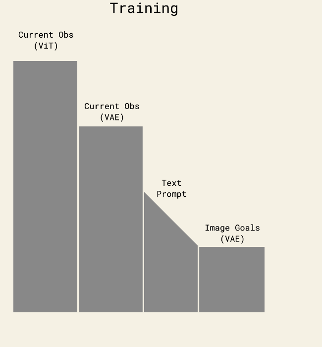

*Figure 19, goal-generator training panel. Current observations have ViT and VAE encodings; noisy target goals use the VAE representation. Gray blocks allow the target to read conditioning information.*

**Concrete training pair.** For a segment labeled “open the fridge,” the current views show the closed or partly opened door, while the target views show the recorded endpoint of that segment. The generator learns a conditional image distribution connecting those inputs. At test time, it samples a corresponding target from the current scene, without receiving a real future observation.

The model is also trained with egocentric human video, image-editing datasets, and other video data to preserve broader semantic knowledge. This can help propose an appropriate visual interaction for an unfamiliar object or robot configuration. It remains a learned image prediction: there is no explicit rigid-body or contact solver guaranteeing that the pictured result is reachable.

## 7. How Does Runtime Prompting Become a Continuous Control Loop?

### 7.1 Keep the Latest Subtask and Goal while Replanning Actions

Algorithm 1 combines slow context updates with faster action generation. At initialization, it establishes a subtask, generates an initial visual goal if enabled, and samples the first action chunk. Metadata and control mode are set for the requested run.

During execution, three kinds of state persist:

| Persistent information | When it changes |
|---|---|
| Current subtask instruction | High-level policy or human supplies a new semantic step |
| Most recently available visual goal | A new world-model result finishes |
| Remaining action chunk | Commands are consumed; a new chunk is generated with real-time chunking |

A goal-generation request is triggered when **either** the subtask changes **or** four seconds have elapsed since the last subgoal was produced, whichever happens first. It is not necessary for both conditions to hold. The world model and high-level policy run asynchronously; the VLA uses their latest available results.

**Illustrative timeline.** Suppose a goal was produced at time 0. If the subtask changes at 1.5 seconds, request a new goal then; do not wait for the four-second timer. If the subtask does not change, the timer triggers a refresh after four seconds. While an asynchronous refresh is running, action execution continues using the available context. The rule requests a new prediction; it does not establish that the previous subtask succeeded.

The algorithm initializes goals for the current run. The paper does not describe retaining an old episode's goal as long-term memory, nor a detailed synchronization protocol for every possible race between instruction and image updates.

### 7.2 Distinguish Command Frequency, Chunk Horizon, and Replanning Interval

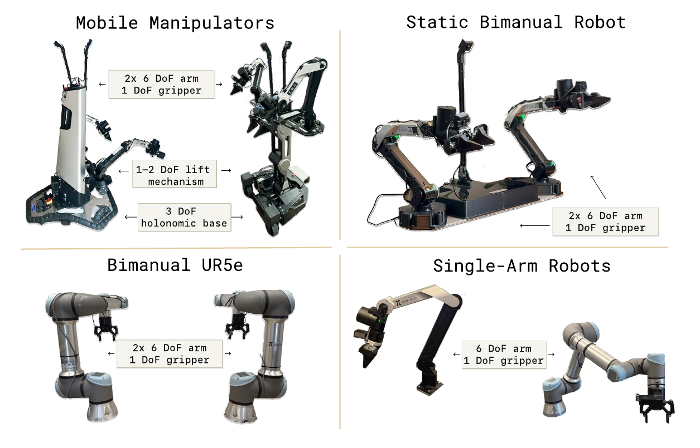

*Figure 4. These platforms differ in reach, morphology, and camera configuration. DoF in the diagram means degrees of freedom. All use parallel-jaw grippers. The UR5e runs at 20 Hz; the other evaluated platforms run at 50 Hz.*

All experiments use **five denoising steps** to generate a **50-step action chunk**, executing $\hat H\in\{15,25\}$ steps before replanning.

| Quantity | At 50-Hz control | At 20-Hz control |
|---|---:|---:|
| Nominal time represented by 50 commands | 1.0 s | 2.5 s |
| 15 executed commands | 0.30 s | 0.75 s |
| 25 executed commands | 0.50 s | 1.25 s |

*Arithmetic illustrating the reported rates and chunk sizes. The table lists possible combinations, not an assignment of every replanning setting to every task. A sample-count horizon is distinct from the timestamp difference between the first and last sample.*

Five denoising iterations do not mean five physical commands, and a 50-Hz controller does not require fifty full VLA calls each second.

Inference delay creates a further problem: while the next chunk is being computed, the arm is already executing the previous one. A new chunk planned as though the arm had remained still could jump discontinuously when it arrives.

pi0.7 uses **training-time Real-Time Chunking (RTC)**. Training simulates delays of 0–12 control steps and conditions action prediction on the commands already committed during that delay. At 50 Hz, 12 steps correspond to $12/50=0.24$ s. This trains the next chunk to continue the ongoing trajectory. That 240-ms figure describes simulated delay at 50 Hz, not a measured latency shared by every platform.

### 7.3 Guidance Strengthens Metadata Conditioning during Denoising

Even with a good-behavior request, a policy trained on mixed behavior may not follow that condition strongly enough. **Classifier-free guidance (CFG)** amplifies how the condition changes the denoising prediction.

The paper applies it to episode metadata. One branch retains the desired metadata; the other omits it while keeping the remaining context. If $s_+$ and $s_-$ denote their action-score predictions at the same noisy action state, the paper writes the guided direction as

$$
s_{\mathrm{guided}}=s_+ +\beta(s_+-s_-).
$$

These scores describe a direction for refining the noisy action distribution. They are not final joint angles or a motor gain. The coefficient $\beta$ controls extrapolation beyond the ordinary metadata-conditioned prediction.

**Illustrative scalar example.** If $s_+=0.3$, $s_-=0.1$, and $\beta=1.7$, the result is $0.3+1.7(0.2)=0.64$. When the branches agree, their difference is zero and guidance changes nothing. When $\beta=0$, it reduces to the ordinary conditioned branch. The reported policy settings use $\beta\in\{1.3,1.7,2.2\}$.

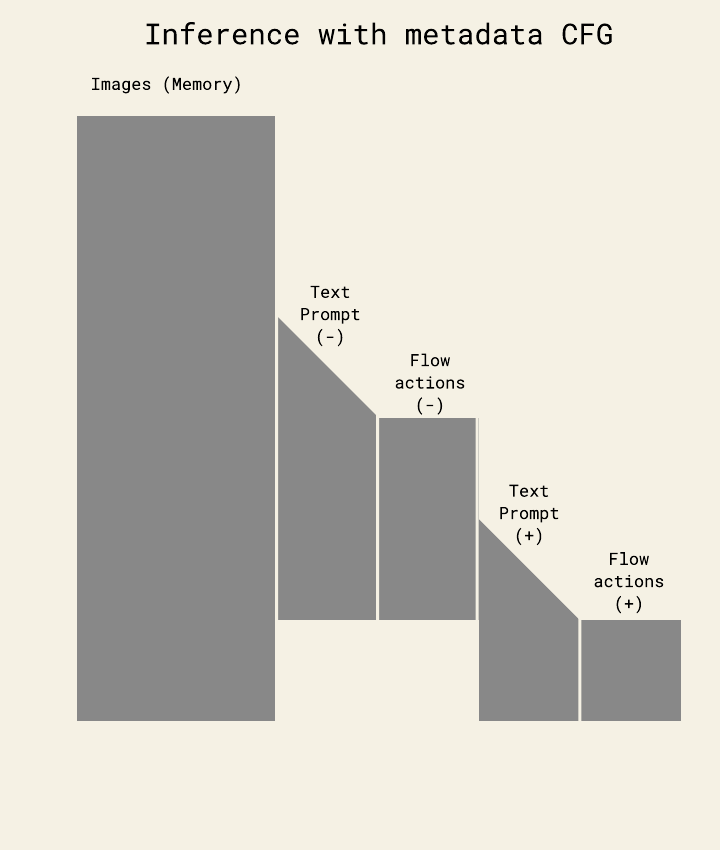

*Figure 19, policy CFG panel. The two branches share image context but cannot read one another's condition-specific text or action predictions. Packing them into an attention tree saves repeated conditioning work without mixing the branches.*

The world model also uses guidance, with three groups of text/image conditioning rather than the policy's two metadata branches.

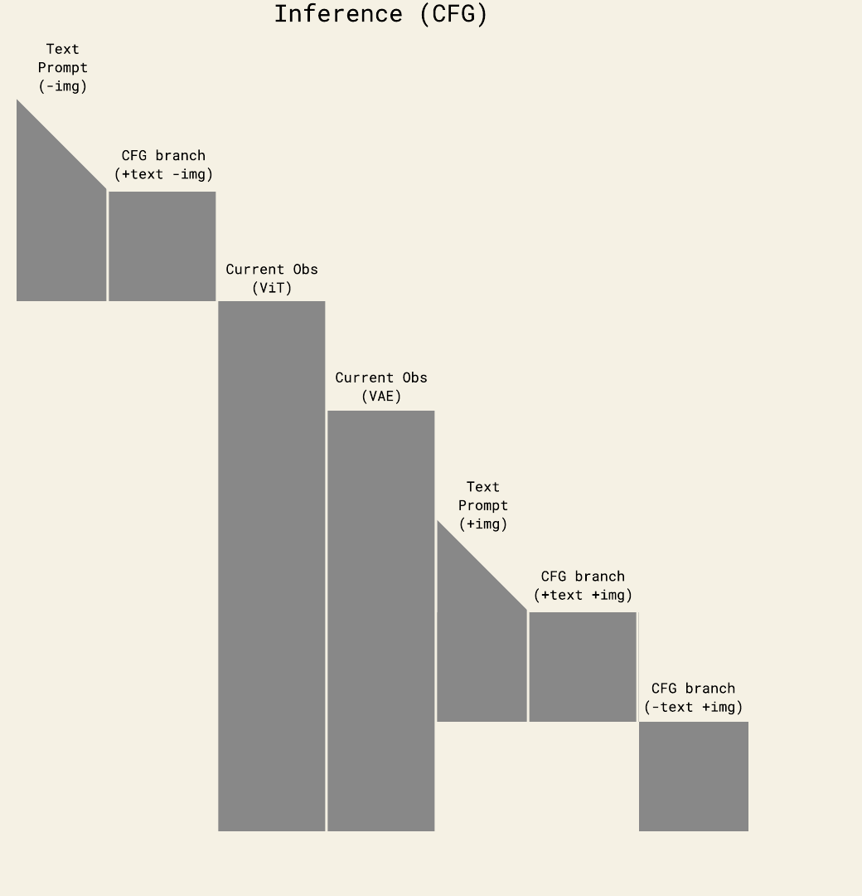

*Figure 19, goal-generator inference panel. Its three conditioning groups differ from the policy's metadata guidance. Both mechanisms steer generated distributions; neither verifies execution success.*

### 7.4 Image Generation Has a Separate Compute Budget

| Inference path | Reported setup and latency |
|---|---|
| Minimal VLA: three cameras, five denoising steps, training-time RTC | 38 ms on one H100 |
| VLA with MEM encoder and subgoal inputs | Up to 127 ms in the reported worst case |
| BAGEL-derived subgoal generator | 1.25 s for 25 denoising steps on four H100s |

*Appendix D. The high-level policy is also Gemma 3-based and served on H100 hardware. The world-model timings include its text/image guidance and use four-way tensor parallelism, 8-bit matrix multiplications, and optimized attention.*

The 38-ms setting omits features present in the heavier policy profile. It should not be cited as the full visual-goal system's latency. Conversely, the 1.25-second goal-generation time is amortized by asynchronous execution and relatively infrequent goal updates; it is not paid before every motor command. Initial goal generation and the effects of stale or mistaken goals remain relevant to the system's behavior.

## 8. Does One Generalist Match Task Specialists?

### 8.1 Read Each Metric as a Different Claim

The experiments use physical robots across seen tasks, new environments, new task–robot combinations, and newly composed tasks. Their metrics should not be mixed.

| Metric | What it measures | What it does not establish |
|---|---|---|
| **Task success rate** | Fraction of episodes meeting the task's completion criterion | How quickly successful episodes finish |
| **Task progress** | Rubric score normalized by the task's maximum | That the full task completed |
| **Throughput** | Successful completions per hour | A universal speed across tasks |
| **Instruction-following success** | Fraction of individual requested instructions correctly followed | Fraction of entire multi-instruction sequences completed |

Appendix G defines the task rubrics. **Illustrative shirt-folding example:** the maximum is six points: three for folds and up to three for final quality. A three-point episode has 50% progress but is not successful, since success requires all six points. Averaging progress across episodes is different from counting how many reach six.

For throughput, an illustrative 20 successes/hour versus a 10-success/hour reference gives normalized throughput 2.0. **Figure 6 normalizes by the specialist; Figure 7 normalizes by pi0.7.** A bar at 1.0 therefore has a different reference in the two figures.

### 8.2 Seen Dexterous Tasks: No Task-Specific Fine-Tuning at Evaluation

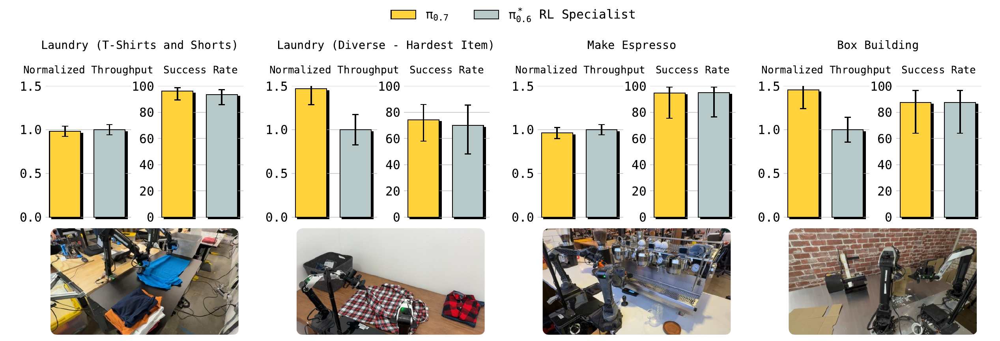

*Figure 6, upper row. Yellow is the generalist pi0.7; gray is the corresponding pi0.6* RL specialist. Each task has separate normalized-throughput and success-rate axes. The photos identify the physical setups.*

On these tasks, the generalist approaches specialist reliability and reaches higher throughput on diverse laundry and box building. The comparison asks whether specialist-level skill can be consolidated into one model. It is not a claim of learning espresso with no espresso experience: the training mixture can include prior specialist rollouts.

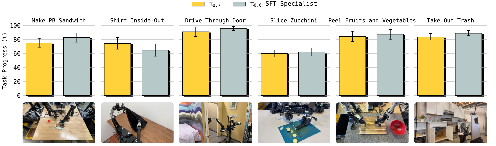

*Figure 6, lower row. These bars use task progress rather than the two metrics above. SFT means supervised fine-tuning; each gray specialist was adapted to its task.*

The generalist is broadly competitive, but does not win every task. For example, its zucchini-slicing progress is only around 60%, similar to the specialist. The evidence is consolidation of substantial dexterity across tasks, rather than universal completion.

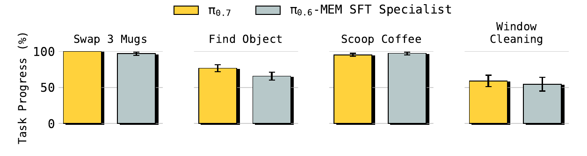

*Figure 8. pi0.7 is compared with task-specific pi0.6-MEM specialists on swapping mugs, finding an object, scooping coffee, and window cleaning. Values are task progress.*

These tasks connect the history mechanism to behavior. Swapping three mugs requires tracking which one has already been placed; looking only at the current arrangement can lose that information. The results show that the generalist can use memory effectively without a separate fine-tuned specialist for each test. They do not isolate which part of MEM causes every improvement.

The plots retain source error bars. The report does not supply a complete set of per-task sample counts and uncertainty definitions for all plots, so small visual differences should not be treated as precise statistical rankings.

## 9. What Generalizes Beyond the Training Task or Environment?

### 9.1 New Environments and Unusual References

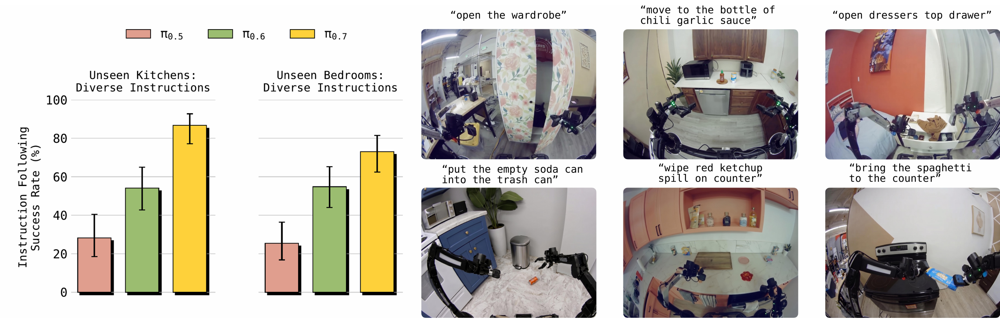

*Figure 9. Four unseen kitchens and two unseen bedrooms contain 14 scenarios with sequences of 3–6 instructions. The bars measure the fraction of instructions followed, while the images show example requests and environments.*

pi0.7 substantially improves over pi0.5 and pi0.6 in these cluttered scenes. Because the denominator is instructions, high performance does not imply that the same fraction of complete sequences succeeds. Errors can accumulate over a multi-stage task.

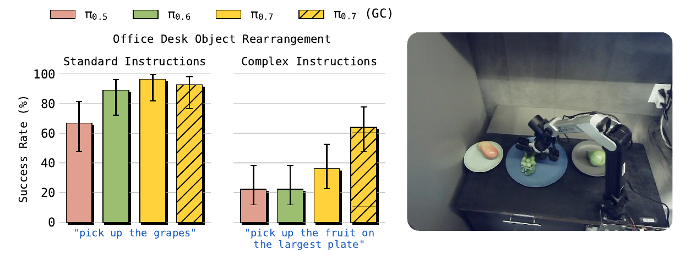

*Figure 10. Standard requests name familiar objects directly. Complex requests require a relation or functional interpretation, such as choosing the fruit on the largest plate. Hatched bars add generated subgoals.*

Naming an object and resolving a relation are different problems. If two plates contain fruit, “pick up the fruit” does not test whether the model identifies the largest plate first. The complex condition makes that reasoning relevant to action selection. Visual goals further improve pi0.7 here: roughly 35% success without them becomes roughly 65% with them, read approximately from the plotted complex-instruction bars.

### 9.2 Ask for the Opposite of the Dataset's Usual Behavior

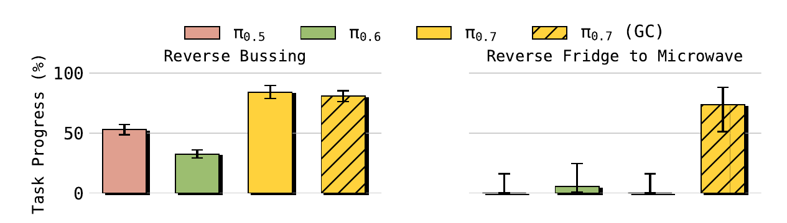

*Figure 11. Reverse Bussing asks for trash in the dishes bin and dishes in the trash. Reverse Fridge to Microwave asks for the reverse route: food goes from microwave to fridge. The metric is rubric-based task progress.*

These settings make a shortcut visible. A policy that recognizes the scene but ignores the instruction could reproduce its usual sorting or transfer direction. pi0.7 is more able to override that pattern. On the reverse food-transfer task, the generated-goal variant is crucial; language-only pi0.7 remains near zero while the visual-goal variant makes substantial progress.

This is evidence that the extra visual context can change the chosen interaction. It also shows that the optional generator is a meaningful part of some reported capabilities, rather than an interchangeable visualization of an already successful language-only policy.

### 9.3 Transfer a Task to a Robot That Did Not Practice It

An **embodiment** includes the robot's morphology, cameras, reachable workspace, and control interface. Zero-shot cross-embodiment transfer here means **no task-specific data on the target robot**, rather than no prior data of any kind from that robot.

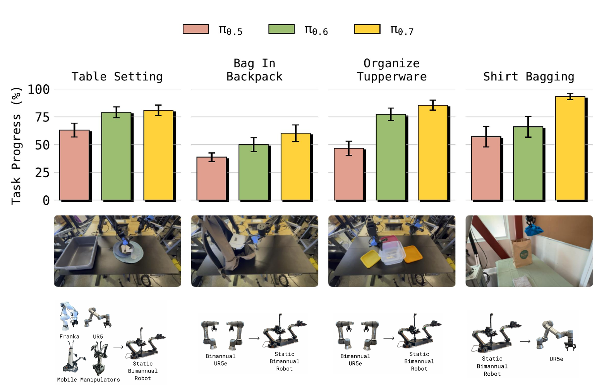

*Figure 12, rearrangement panels. Small robot diagrams show the training-to-test transfer direction. Some simpler cases transfer well even for older policies; larger changes expose a stronger pi0.7 advantage.*

Table setting already has multi-robot training coverage. Bag-in-backpack and Tupperware transfer from larger UR5e arms to a smaller bimanual platform. Shirt bagging transfers from a small bimanual robot to a larger **single-arm UR5e**. That last case requires a new strategy because the target cannot hold a bag with one arm while inserting a shirt with the other.

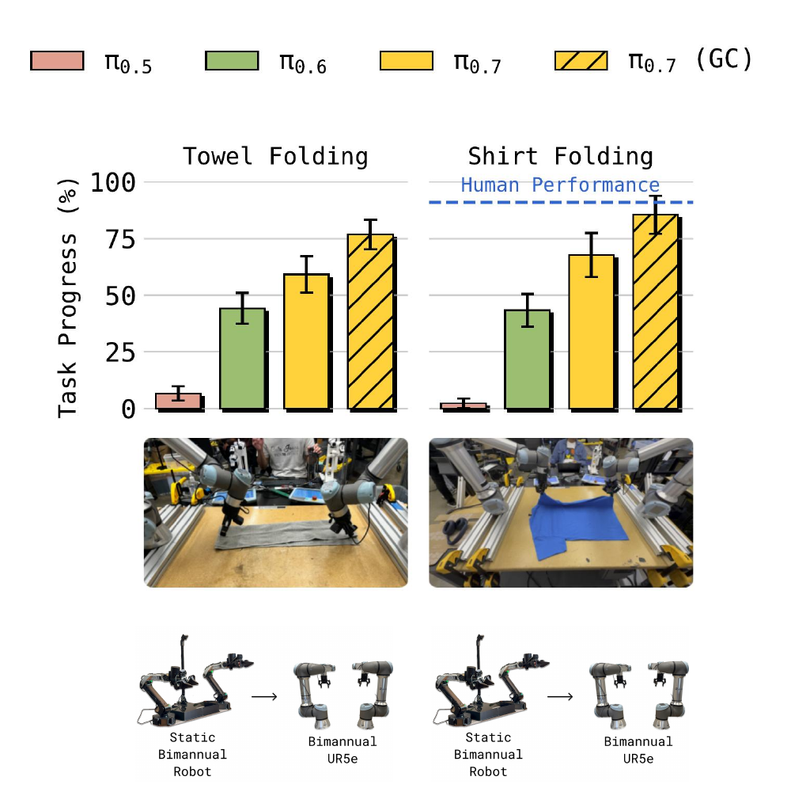

*Figure 12, folding panels. There is no laundry-folding training data on the target UR5e system. Generated goals improve transfer further. The dashed human reference is task progress, not a 100% target.*

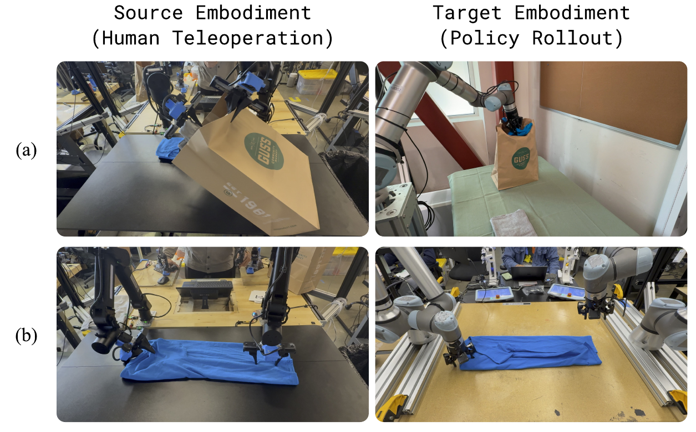

*Figure 13. Panel (a) contrasts bimanual source behavior with single-arm bagging. Panel (b) contrasts a tilted source grasp with a more vertical target grasp during folding.*

This illustrates why copying source joint trajectories would be inadequate. The target has different reach, arm placement, and inertia. A transferable policy must preserve the intended object interaction while adapting the movement that realizes it. The examples show such changes; they do not prove that the model will discover a suitable strategy for every unseen morphology.

### 9.4 Compare Folding with Experienced Human Operators under the Same Transfer Constraint

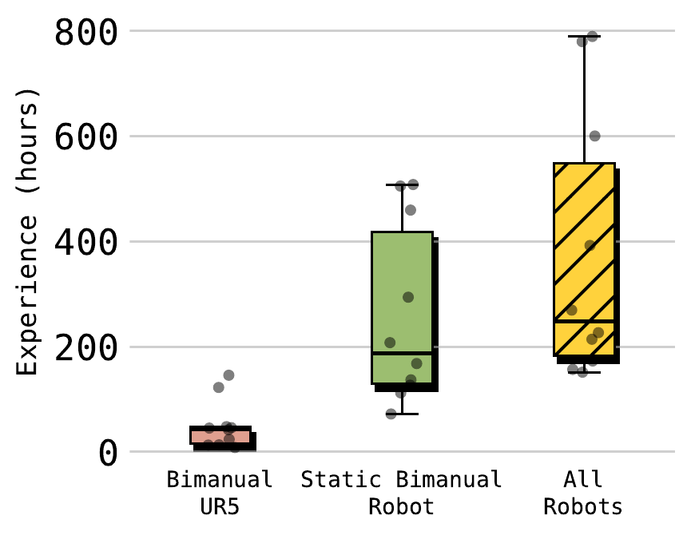

*Figure 21. Experience is reported separately for the UR5e, source robot, and all robots. Operators rank in the top 2% by experience, with a mean of about 375 hours across platforms.*

Each of ten operators attempts shirt folding three times on the target UR5e, with no practice period for that task–robot combination. Humans and policy share the flattened starting configuration, time limit, and scoring rubric.

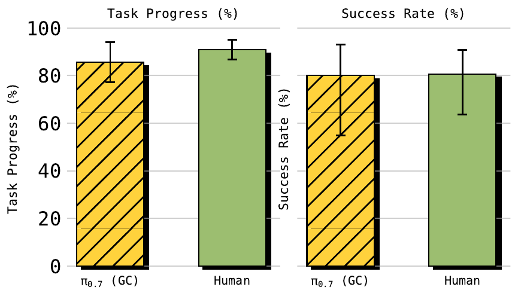

*Figure 22. Left: normalized task progress. Right: full-task success. The policy uses generated visual goals.*

| Reported measure | pi0.7 with visual goals | Human operators |
|---|---:|---:|
| Task progress | 85.6% | 90.9% |
| Success rate | 80.0% | 80.6% |

*Values reported in Appendix F. The source reports 30 human trials and these aggregate percentages; this note preserves its reported values rather than inferring individual success counts.*

The result supports comparable performance in this particular transfer test. It does not compare the policy with humans who have practiced folding on that robot, nor establish equal ability across arbitrary manipulation tasks.

## 10. Can Prompting Teach a New Task, and When Is Training Still Required?

### 10.1 Short Unseen Interactions Can Work Directly

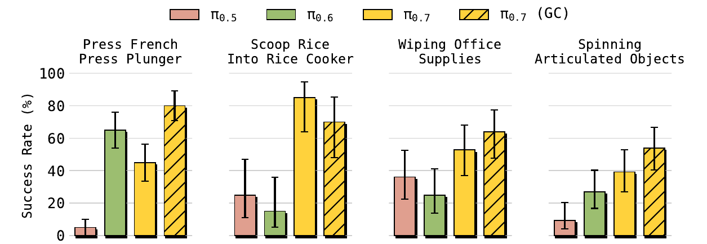

*Figure 17. Tests include pressing a French-press plunger, scooping rice, wiping office objects, and spinning articulated objects. These are success rates; robot demonstrations were not deliberately collected for these tasks.*

pi0.7 can compose familiar manipulation patterns for these interactions. The benefit of generated goals varies: French-press performance improves, while scooping rice does not improve in the plotted comparison. Extra visual context is useful in some cases, rather than uniformly superior to direct language prompting.

### 10.2 Long Unseen Tasks Need Someone to Choose the Steps

Loading an unfamiliar air fryer requires several decisions, and “cook a sweet potato” does not by itself reliably elicit the whole procedure. The authors instead **coach** the policy with live subtask instructions.

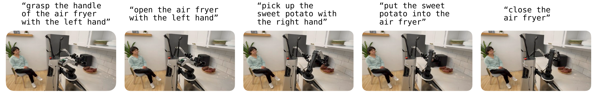

*Figure 14. A person names the next operation: grasp the handle, open the basket, pick up the potato, insert it, and close the appliance. The VLA supplies robot actions for each request.*

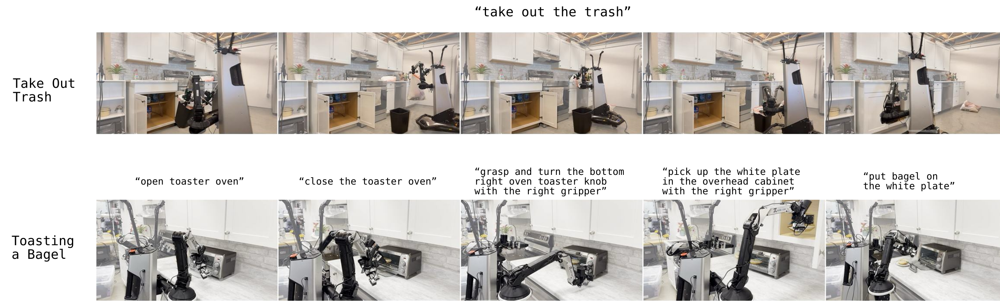

*Figure 5. Trash removal uses one coarse task instruction for a learned procedure. Bagel toasting, absent as a deliberately collected robot task, is decomposed into detailed instructions by coaching. Similar-looking long trajectories can therefore involve different levels of autonomy.*

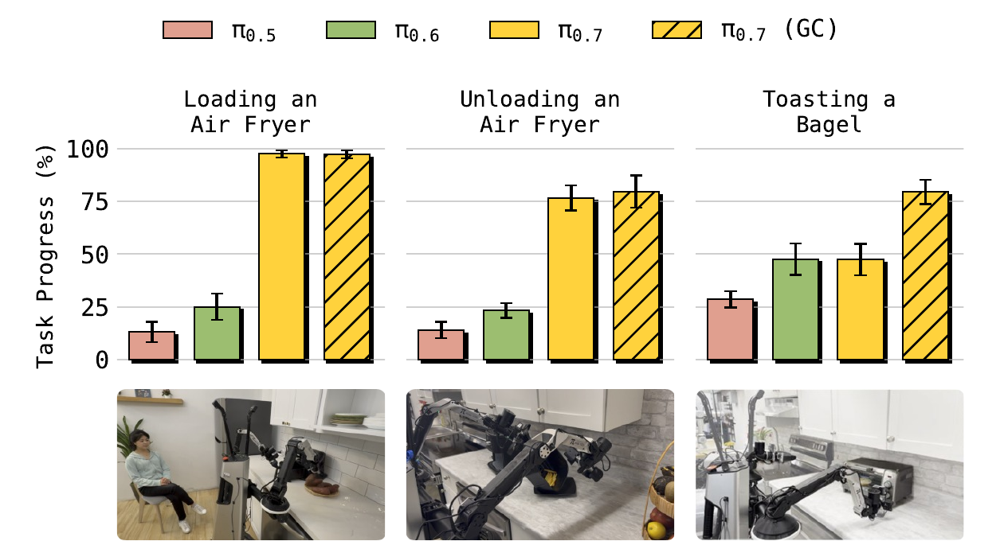

*Figure 15. All compared models receive coaching; hatched pi0.7 additionally receives generated goals. The bars measure task progress, not binary success.*

The test holds access to human subtask instructions broadly comparable while asking whether the low-level policy can execute unfamiliar requests. pi0.7 follows those instructions much better than prior models; generated goals particularly help bagel toasting. This demonstrates coached composition, rather than autonomous discovery of the full task sequence.

### 10.3 Train a High-Level Policy on the Coaching, Then Remove the Live Coach

Successful coaching produces records of which instruction was appropriate under each observation and subtask history. The authors use those records to train a high-level policy that supplies future instructions automatically.

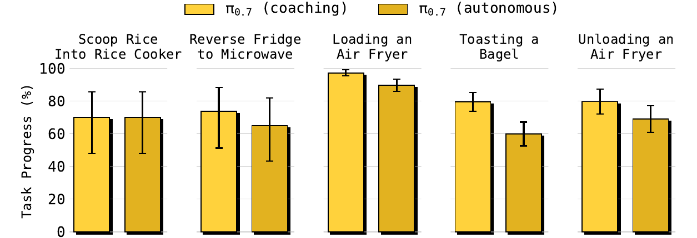

*Figure 16. Light yellow is live coaching; darker yellow is the resulting autonomous high-level policy. The evaluation spans five tasks, with some remaining performance gaps.*

For the air fryer, the first policy executes “open the basket” when the person requests it. After high-level training, the instruction generator selects that step from the task, observation, and history, then later selects insertion and closure. Low-level execution skill is reused through the same language interface.

This avoids collecting additional **teleoperated action demonstrations**, but it does involve new coaching experience and high-level training. “Autonomous after coaching” should not be described as an entirely untrained, zero-shot long-horizon policy.

## 11. Do the Ablations Support the Proposed Explanation?

### 11.1 Autonomous Data and Metadata Both Matter

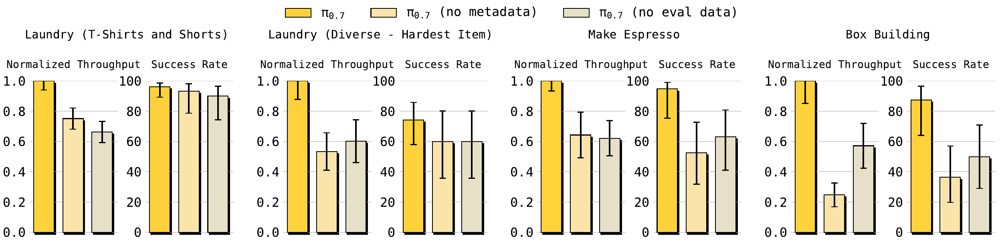

*Figure 7. The full recipe is compared with training without metadata and without autonomous evaluation episodes. Throughput is normalized by the full pi0.7 model, rather than by a specialist.*

Removing autonomous data tests access to specialist rollouts and deployment states. Removing metadata tests whether the model can contextualize the resulting mixed-quality behavior. Both removals reduce performance, particularly throughput. The design supports their complementary roles; it does not isolate every contribution of source quality, strategy diversity, and extra data volume.

### 11.2 More Mixed-Quality Data Helps Only if Its Differences Are Explained

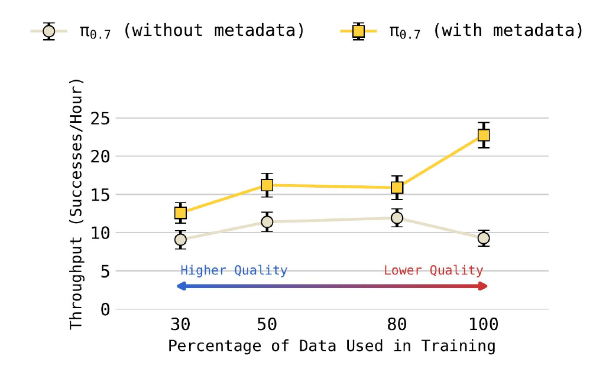

*Figure 18, left. The x-axis includes the top 30%, 50%, 80%, and 100% of laundry data ranked by quality and speed. Larger subsets add lower-quality examples. The y-axis is successful completions per hour.*

Eight models compare four subsets with and without metadata. The metadata-conditioned curve has a strong overall upward trend as data expands, while the unconditioned curve can decline when the lowest-quality examples are included. Small differences between intermediate points do not establish monotonic improvement at every increment.

This is the empirical version of the opening shirt example. Metadata lets additional recordings teach useful states and skills while identifying their execution quality. The experiment couples quantity and quality deliberately; it does not show that arbitrary mislabeled or irrelevant data always helps.

### 11.3 Control Dataset Size When Testing Task Diversity

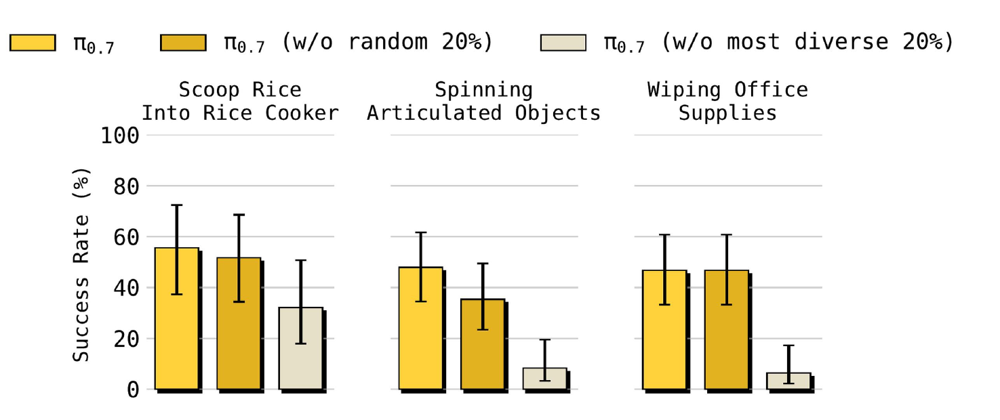

*Figure 18, right. Compare the two reduced-data models: both retain 80%, but one removes the most task-diverse 20% while the other removes a random 20%.*

If the only comparison were full data versus reduced diverse data, a drop could simply result from fewer examples. The random-removal control keeps the quantity matched. Its stronger performance supports a contribution from the omitted task diversity under this selection procedure, rather than quantity alone.

### 11.4 The Transfer Gain Is Not Simply a Switch to End-Effector Control

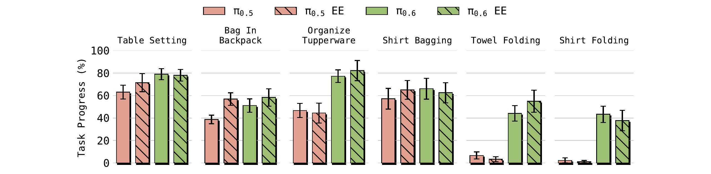

*Figure 20. Solid bars use joint-space control; hatched bars use end-effector control for pi0.5 and pi0.6. The metric is task progress across the same transfer tasks.*

End-effector control might appear to simplify transfer by hiding differences in joint layout. This comparison finds no clear general advantage for that change alone. It motivates using joint-space control for the main comparisons, while leaving room for task-specific effects. The new policy's gains cannot be attributed solely to giving older baselines a different action-coordinate choice.

## 12. What Should Be Retained from the Paper?

pi0.7's main lesson is that **diverse data needs context that explains its diversity**. Subtasks distinguish immediate intent, visual goals distinguish spatial outcomes, metadata distinguishes execution style, and control labels distinguish command interfaces. The architecture then turns those conditions and recent observations into executable action chunks.

The strongest evidence combines specialist comparisons, deliberately conflicting instructions, task–robot transfer, and data-controlled ablations. Important boundaries remain:

- **Seen-task proficiency and unseen-task transfer are different.** The generalist can inherit specialist experience; that does not make every evaluation novel.
- **Zero-shot transfer concerns a task–robot combination.** It does not imply that the target body's control interface was never represented in training.
- **Visual-goal results include another substantial model.** The 14B generator and its four-H100 serving setup are additional to the VLA, and some capabilities depend strongly on it.
- **Coaching and autonomy require different claims.** Live human instructions supply decisions; subsequent high-level training can automate those decisions without new teleoperated action demonstrations.
- **Novelty is difficult to audit completely.** The authors acknowledge that related skills or incidental task fragments may exist in their large robot, human, and web datasets even when a task was not deliberately collected.
- **Broad transfer is still imperfect.** The discussion reports unseen-task or unseen task–robot success commonly in the 60–80% range, below the often-above-90% performance on seen tasks. These are broad reported ranges, not one aggregate benchmark score.

Relative to [pi0.6*](./Pi_0_6.md), this paper emphasizes consolidating diverse experience into a steerable generalist. Relative to [Cosmos 3](./Cosmos_3.md) and [GR00T 2](./GR00T_2.md), its visual future is a separately generated subgoal used as context, rather than a video jointly predicted with actions inside the same action model. That distinction explains both how non-robot visual knowledge can help and why the optional goal generator has its own training and deployment cost.
