# [Pi_RLT: RL Token — Bootstrapping Online RL with Vision-Language-Action Models](https://www.pi.website/download/rlt.pdf)

> **Brief:** RLT makes a pretrained vision-language-action model useful for fast online reinforcement learning without updating the whole VLA during robot practice. A learned **RL token** compresses the VLA's observations into a small state representation. A lightweight actor and critic then use that representation to improve action chunks, with the actor guided toward actions proposed by the frozen VLA. The experiments target difficult manipulation stages such as aligning a screwdriver or inserting a connector.

**Source:** Charles Xu et al., Physical Intelligence, 2026, [official paper](https://www.pi.website/download/rlt.pdf) and [archived manuscript, arXiv:2604.23073v2](https://arxiv.org/abs/2604.23073v2), 13 pages. The explanations and crops use the authors' archived PDF because the official download was inaccessible during preparation. **Pi_RLT** is this repository's name for the note; the paper calls the method **RLT** and builds on **pi0.6**, rather than introducing a new numbered pi model.

## Convenient Links

- [Project page and robot videos](https://www.pi.website/research/rlt)
- Read the method: [RL token](#2-how-does-the-rl-token-preserve-useful-vla-information), [Actor and reference actions](#3-why-does-the-actor-need-both-a-state-token-and-a-reference-action), [Chunked critic learning](#5-how-does-the-critic-learn-from-sparse-success-labels)
- Related policies: [pi0.6* / RECAP](./Pi_0_6.md), [pi0.5-KI](./Pi_0_5_KI.md), [Diffusion Policy](./Diffusion_Policy.md)
- Background: [SAC](../../Reinforcement_Learning/SAC.md), [Reinforcement Learning: An Introduction](../../../Foundations/Books/Reinforcement_Learning/Reinforcement_Learning_An_Introduction.md)

## 1. Why Improve One Difficult Stage Instead of Retraining the Whole VLA?

A robot can pick up an electric screwdriver and bring it near a screw, yet repeatedly miss the screw head. The earlier motions require broad recognition and coordination; final contact requires much finer alignment. A model that performs the first part competently can therefore remain slow or unreliable at the last part.

The paper's screwdriver setup makes this sensitivity concrete: the tool tip is about **10 cm from the grasp point**. An **illustrative** one-degree rotation about that grasp point can displace the tip by about $0.1\sin(1^\circ)\approx1.75$ mm. This is a simplified lever-arm calculation, not a measured error, but it explains why a seemingly small rotation can matter for sub-millimeter alignment.

More demonstrations may help, but copying hesitant demonstrations can also preserve pauses and repeated probing. Reinforcement learning instead asks which behavior actually completes the task. The difficulty is making that learning affordable: every physical trial takes time, and repeatedly training a billion-parameter VLA on a small new dataset is expensive.

RLT divides the work:

| Component | What it contributes | What changes during online RL? |
|---|---|---|
| **Task-adapted pi0.6 VLA** | Rich visual features and plausible action proposals | Frozen |
| **RL-token encoder** | A compact state representation derived from VLA features | Frozen after its preparation stage |
| **Small actor** | A distribution over improved action chunks | Updated from replay data |
| **Small critic** | Estimates the discounted outcome of a state/action chunk | Updated from replay data |

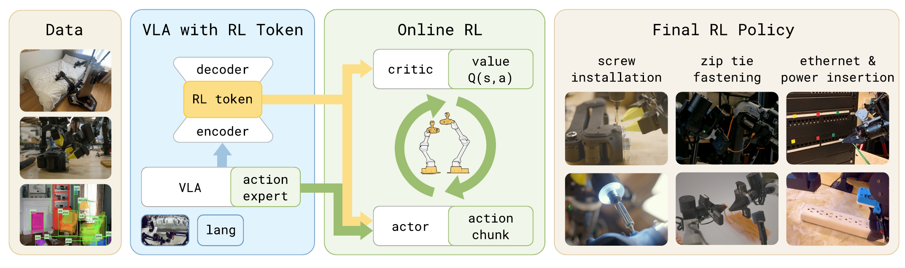

*Paper Figure 1, PDF page 1. The encoder/decoder prepares the representation; the online loop trains the actor and critic. The VLA supplies both information about the scene and an initial proposal for how to act.*

This differs from [RECAP](./Pi_0_6.md), which alternates experience collection with offline training of an advantage-conditioned VLA. RLT freezes the prepared VLA during online learning and concentrates updates on small networks, usually for one selected task stage. The next problem is giving those networks enough information without passing them the VLA's entire token sequence.

## 2. How Does the RL Token Preserve Useful VLA Information?

### 2.1 A Token Here Is a Continuous State Vector

The actor needs to know where the connector and socket are and how they are aligned. Raw camera images are large inputs for a small online learner. A generic image encoder is an alternative, but it may discard manipulation-relevant information that the VLA already learned from robot data.

RLT therefore compresses the **final-layer VLA embeddings**. An embedding is a numerical vector representing an input token after the VLA has processed its context. The paper's diagram shows $M$ input embeddings, each with 2,048 coordinates, compressed into one **2,048-dimensional RL token**.

Figure 2 shows a SigLIP vision encoder (about 400M parameters), a Gemma backbone (4B), and an 860M action expert. The online networks use the compact readout instead of updating those large modules.

This RL token is a learned numerical readout, rather than a generated word, an action command, or a discrete quality label. It changes with the current observation even though the network producing it is frozen during online RL.

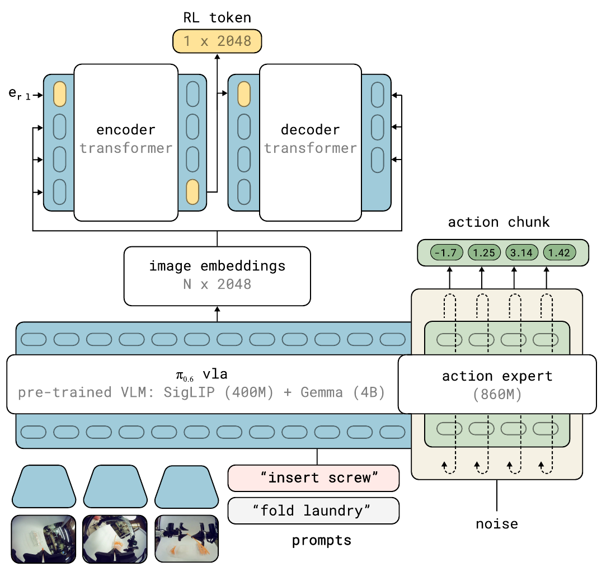

*Paper Figure 2, PDF page 4. The small encoder reads the VLA embeddings and a learned special token. The decoder reconstructs the input embeddings from the resulting readout. The original VLA action expert remains a separate source of reference actions.*

Let $z_{1:M}$ be the VLA's final-layer embeddings and $e_{\mathrm{rl}}$ a learned input embedding for the special token. The encoder processes the augmented sequence, and RLT keeps its output at the last position:

$$
z_{\mathrm{rl}}=g_\phi([z_1,\ldots,z_M,e_{\mathrm{rl}}])_{M+1}.
$$

The subscript $M+1$ selects the special token's output vector; it does not concatenate every encoder output into a large state. The learned encoder parameters are denoted by $\phi$.

### 2.2 Reconstruction Gives the Compression a Training Signal

Merely appending a token does not teach it what to remember. RLT trains a decoder to reconstruct the original VLA embeddings using the RL token and preceding ground-truth embeddings:

$$
\bar z_i=\operatorname{stopgrad}(z_i),\qquad
\hat z_i=h_\phi\!\left(d_\phi([z_{\mathrm{rl}},\bar z_{1:i-1}])\right)_i,
$$

$$
\mathcal L_{\mathrm{ro}}
=\mathbb E_{\mathcal D}\left[\sum_{i=1}^{M}\|\hat z_i-\bar z_i\|^2\right].
$$

Here $d_\phi$ is the decoder, $h_\phi$ projects its output back to the embedding dimension, and $\mathcal D$ is the task demonstration dataset. **Autoregressive reconstruction** means that prediction $i$ receives the earlier embeddings, not the target embedding $i$ itself. Stop-gradient makes those embeddings fixed targets for this loss.

Why must the readout preserve information rather than just average everything? Consider an **illustrative scalar version** with ordered inputs $(0.3,-0.1)$ or $(-0.1,0.3)$. Both have mean $0.1$. A readout retaining only that mean cannot distinguish their first targets: at the first decoder position, there are no earlier embeddings to reveal the order. Predicting $0.1$ incurs squared error $0.04$ for either first target. A learned readout that retains the distinction can let the decoder predict the appropriate value.

The real model learns from high-dimensional VLA features, rather than these two scalars. Reconstruction encourages the readout to retain information; it does not prove that every detail relevant to contact or future reward survives compression. The later RL-token ablation tests whether this representation is useful in practice.

### 2.3 Prepare the Interface Before Freezing It

The preparation objective combines two separate training paths:

$$
\mathcal L_{\mathrm{prepare}}
=\mathcal L_{\mathrm{ro}}(\phi)+\alpha\mathcal L_{\mathrm{VLA}}(\theta_{\mathrm{VLA}}).
$$

The reconstruction loss trains the added encoder/decoder while treating the VLA as frozen with respect to that loss. Optional supervised VLA fine-tuning trains the VLA through its own imitation objective; $\alpha=0$ disables that optional path. The experiments fine-tune on task demonstrations while learning the token, using **2,000–10,000 gradient steps**.

After preparation, both the VLA and token-producing encoder are frozen. The reconstruction decoder provides a training objective and is unnecessary for computing the online state. For control, the small networks receive

$$
x_t=(z_{\mathrm{rl},t},s_t^p),
$$

where $s_t^p$ is proprioceptive information such as joint state or end-effector pose. Each experimental task uses a fixed instruction, and the authors omit language embeddings from the readout construction for that setting. This is not evidence that the online learner was tested across freely changing instructions.

Compression solves the state-input problem. It does not by itself tell a newly initialized actor which of many possible movements is sensible. RLT also supplies the VLA's proposed action.

## 3. Why Does the Actor Need Both a State Token and a Reference Action?

### 3.1 The Proposal Identifies a Plausible Way to Move

The RL token describes the situation. A sampled **reference action chunk**, $\tilde a_{1:C}$, describes one way the VLA proposes acting in that situation. RLT conditions its actor on both:

$$
\pi_\theta(a_{1:C}\mid x,\tilde a_{1:C})
=\mathcal N\!\left(\mu_\theta(x,\tilde a_{1:C}),\sigma^2 I\right).
$$

The mean comes from a small neural network; the Gaussian standard deviation is small and fixed. The actor outputs the **complete command chunk**, rather than a residual that must be added to the VLA output.

The reference also preserves the VLA's choice among different valid motion patterns. In an **illustrative one-coordinate example**, suppose an object can be approached from the left or right, with normalized commands near $-1$ and $+1$. A single Gaussian without the sampled proposal could place its mean near zero, between the two useful modes. Conditioning on a sampled $+1$ proposal tells the actor which approach to refine. A different sampled proposal can select the other mode under the same scene representation.

This is a reason to pass the proposal into the actor, rather than assuming that a state summary alone makes a simple Gaussian policy express the VLA's multimodal behavior.

### 3.2 The Regularizer Makes Deviation Earn Its Cost

An input proposal is not a constraint. An actor maximizing an imperfect critic could still depart from it dramatically. RLT therefore minimizes

$$
\mathcal L_\pi
=\mathbb E\left[-Q_\psi(x,a_{1:C})
+\beta\|a_{1:C}-\tilde a_{1:C}\|_2^2\right].
$$

The critic rewards predicted task completion; the second term charges for changing the proposed chunk. The coefficient $\beta$ sets that tradeoff. This is a **soft penalty**, not a hard limit on how far the actor may move.

For an **illustrative single normalized command**, let the VLA propose $\tilde a=0.2$ and set $\beta=2$:

| Actor's candidate | Predicted $Q$ | Deviation cost | Actor loss $-Q+\text{cost}$ |
|---:|---:|---:|---:|
| $0.2$ | $0.60$ | $2(0.2-0.2)^2=0$ | $-0.60$ |
| $0.3$ | $0.80$ | $2(0.3-0.2)^2=0.02$ | **$-0.78$** |
| $0.8$ | $0.90$ | $2(0.8-0.2)^2=0.72$ | $-0.18$ |

The middle candidate wins: its predicted improvement justifies a small edit, while the largest edit costs too much. With $\beta=0$, the last candidate wins solely because its predicted value is highest. These numbers are invented, and the real penalty sums across all coordinates and steps in the chunk.

Two functions are therefore distinct: **conditioning supplies a candidate behavior; regularization controls how readily learning departs from it**. Neither guarantees that the critic's preferred edit succeeds physically.

### 3.3 Reference Dropout Prevents Blind Copying

Conditioning and regularization also create a shortcut: early in training, the actor may simply copy the reference while the critic is still uninformative. RLT masks the reference **input** to zeros on **50% of training samples**, forcing the actor to learn an action-generation path from the state as well.

For example, the same state $x$ and recorded reference $(0.2,0.4)$ may be presented to the actor as either $(x,(0.2,0.4))$ or $(x,(0,0))$. In the masked case, the actor still predicts a complete action chunk. The zeros remove conditioning information; they are not an instruction to command zero motion, and the stated deviation penalty remains anchored to the recorded reference.

At inference, the reference is **always provided**. Dropout trains the actor to avoid total dependence on copying while retaining the proposal's useful mode information when available. It is different from removing the deviation penalty, and different from replacing the VLA with a policy trained from scratch.

## 4. Why Learn Ten Actions at Once?

### 4.1 Chunking Shortens the Learning Horizon

Sparse rewards make credit assignment difficult. A successful insertion may follow hundreds of unrewarded motor commands. A single-step critic must learn how those many small steps connect to the final outcome.

RLT instead evaluates **action chunks**: short sequences treated as one actor/critic decision. The paper uses these different time scales:

| Quantity | Setting | Meaning |
|---|---|---|
| Robot control rate | **50 Hz** | One low-level command every 20 ms |
| VLA prediction horizon $H$ | **50 actions** | A one-second proposal |
| RL chunk length $C$ | **10 actions** | Execute a 0.2-second prefix, then obtain a new observation/proposal |
| Action dimension $d$ | **14 per step** | A **140-dimensional** RL chunk, $C\times d$ |

The experiments use delta-action control (Appendix C); the scalar examples in Section 3 use normalized coordinates, rather than physical distances.

A ten-second critical phase contains 500 low-level commands, but only 50 non-overlapping ten-step decisions. This **illustrative duration** shows the reduction in decision horizon, not a reduction in the number of physical commands. Each chunk still contains ten separate commands.

Shorter chunks also allow more frequent correction than executing the VLA's full one-second proposal. The tradeoff remains: the ten commands are executed open loop within a chunk. RLT does not claim feedback after every motor command from its actor.

### 4.2 The Sparse Reward Also Encourages Earlier Success

A human labels the episode's end: successful completion gives $+1$, failure gives $0$, and intermediate rewards are zero. The return is discounted with $\gamma<1$.

With an **illustrative per-control-step discount** $\gamma=0.99$, success at step 50 contributes $0.99^{50}\approx0.605$, whereas success at step 100 contributes $0.99^{100}\approx0.366$ from the same starting time. Thus successful earlier completion can have greater value even without a dense speed reward. The paper does not report this numerical discount; it is chosen only to illustrate the mechanism.

The critic consequently estimates **discounted success**, not a pure success probability or a measured execution time. Chunking must preserve this time dependence: skipping ten primitive steps requires $\gamma^{10}$ in the bootstrap, rather than applying just one factor of $\gamma$.

## 5. How Does the Critic Learn from Sparse Success Labels?

### 5.1 Fit the Outcome of the Executed Chunk

The critic $Q_\psi(x,a_{1:C})$ predicts the return of a state and a candidate chunk. It does not take only the VLA proposal, because the actor or a human may execute a different chunk. **The executed action determines the observed transition.**

For a complete $C$-step transition, the terminal-aware form of paper Equation 3 is

$$
\hat Q=
\sum_{j=0}^{C-1}\gamma^j r_{t+j}
+m\gamma^C\mathbb E_{a'\sim\pi_\theta}
\left[\min_{i\in\{1,2\}}Q_{\psi_i'}(x',a')\right],
$$

$$
\mathcal L_Q=\mathbb E_{\mathcal B}\left[(\hat Q-Q_\psi(x,a_{1:C}))^2\right].
$$

Here $x'=x_{t+C}$, $\mathcal B$ is the replay buffer, and $m=0$ after an episode terminates, otherwise $m=1$. An episode ending before a full chunk must be handled as a truncated terminal transition. The paper's compact expectation suppresses the next actor's reference-action conditioning.

The target networks $\psi_i'$ supply comparatively stable bootstrap estimates. Following TD3, the implementation uses **two critics** and the smaller target value, reducing the tendency to exploit optimistic estimates. The actor learns from the critic; the critic learns from observed rewards plus this future estimate. Unlike the Monte Carlo value fitting in RECAP, this is **temporal-difference bootstrapping**.

### 5.2 A Worked Nonterminal, Success, and Failure Comparison

Use **illustrative** $C=10$, $\gamma=0.99$, and two next-state target values $0.8$ and $0.9$:

| Transition | Chunk rewards | Future bootstrap | Target $\hat Q$ |
|---|---|---|---:|
| Not finished | All zero | Use $\min(0.8,0.9)=0.8$ | $0.99^{10}(0.8)\approx0.724$ |
| Success on the chunk's tenth step | Only the last reward is $1$ | None: episode ended | $0.99^9\approx0.914$ |
| Terminal failure | All zero | None: episode ended | $0$ |

If the critic currently predicts $0.6$ for the first row, the squared error is approximately $(0.724-0.6)^2\approx0.015$. Updating toward the target lets an unrewarded chunk become valuable because it leads to a promising next state.

The success row also explains two easily missed details: its reward is discounted nine times within the chunk, and the terminal state contributes no future value. A failure must not borrow value from the next reset episode. Repeated replay updates can propagate these outcome differences to earlier actions.

These calculations explain the learning signal. They do not make sparse rewards informative before any useful outcomes have been observed. RLT still relies on competent VLA warmup behavior and optional human corrections to collect useful experience.

## 6. How Is Experience Collected and Reused?

### 6.1 Keep a Growing Replay Buffer While Updating Small Networks

The online stage begins with VLA-only **warmup**: execute the prepared VLA for $N_{\mathrm{warm}}$ steps to fill the replay buffer. The paper names this warmup budget without specifying one universal numerical value. The actor and critic begin from newly initialized small networks; they do not inherit the VLA action expert's weights.

After warmup, each chunk boundary follows this sequence:

1. Observe the scene and robot state; compute $x_t$ and a fresh VLA reference chunk.
2. Let the actor generate the next ten actions, unless a human intervenes.
3. Execute the selected actions and record the resulting observations, rewards, and episode termination.
4. Add transitions to replay, then train the actor and critics on sampled old and new transitions.
5. Continue with the updated actor while retaining the frozen VLA and token encoder.

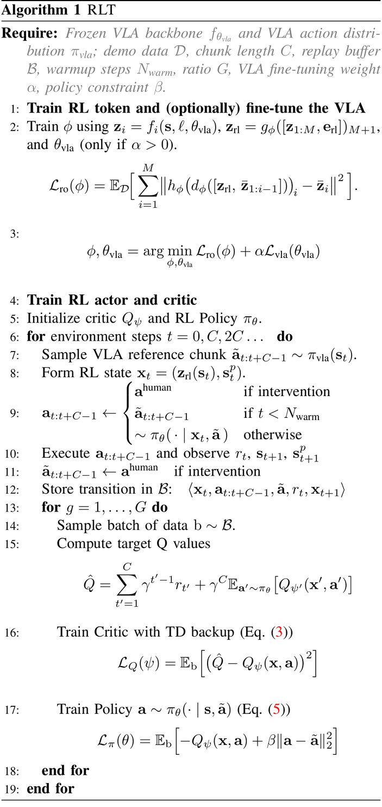

*Paper Algorithm 1, PDF page 5. The preparation stage precedes the online loop. Warmup, actor control, and human intervention are separate execution branches; the replay entry records both the executed action and its reference.*

The persistent learned state consists of the replay data, actor/critic weights, and critic target networks. A new observation produces a new RL-token value, but does not retrain its encoder. Episode termination resets the physical attempt and stops its return; accumulated replay experience remains available across attempts.

Rollout and learning run **asynchronously**. The authors report an update-to-data ratio of **5** and **two critic updates per actor update**. These are optimizer/data scheduling choices, not five new physical trials for every action. Reusing replay data saves interaction, while learning still depends on the quality and diversity of the collected transitions.

### 6.2 Corrections Change Both What Happened and What the Actor Should Stay Near

During intervention, teleoperated commands replace the actor's output. The replay entry therefore stores the **human action as the executed action**. It also replaces the VLA reference with that human action.

Suppose the VLA proposes moving straight forward, but the operator first makes a lateral alignment adjustment. Keeping the old reference would penalize the actor for imitating that useful adjustment. Storing the corrected action as the reference makes the deviation penalty encourage the correction instead. The critic still evaluates the actual resulting transition.

This is different from assigning every human action a positive advantage label, as in RECAP. RLT uses the correction as data and as the policy anchor; sparse episode rewards and TD learning supply the value signal.

### 6.3 Overlapping Windows Extract More Training Samples

Although actor decisions use ten-step chunks, observations are recorded at intermediate control steps. RLT samples replay windows with **stride two**:

- First window: actions $a_0,\ldots,a_9$, starting from $x_0$.
- Next window: actions $a_2,\ldots,a_{11}$, starting from $x_2$.
- Next window: actions $a_4,\ldots,a_{13}$, starting from $x_4$.

Each window uses the actual executed sequence and its corresponding next state. A window may cross a collection-time chunk boundary; off-policy learning can still use it. Windows must respect episode endings.

At 50 Hz, starts spaced two control steps apart give roughly **25 replay samples per second**, apart from boundary effects. They are overlapping views of the same experience, not 25 independent trials, extra robot execution, or evidence that the full VLA is queried online at 50 Hz.

## 7. Which Part of a Task Does RLT Control?

RLT usually improves the **critical phase**, meaning the stage where precise contact dominates failure or delay. The base VLA still handles easier stages such as pickup and transport. This focuses limited online experience on the bottleneck.

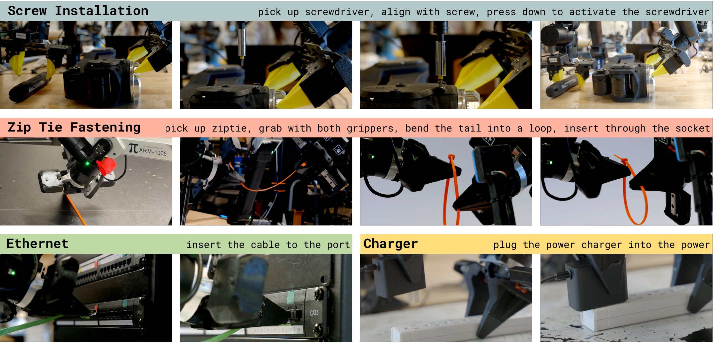

*Paper Figure 3, PDF page 6. Each sequence includes preparation as well as the difficult contact stage. A successful insertion from an already aligned starting state is a different test from completing the whole sequence.*

| Task | Critical difficulty | Important observation or geometric constraint |
|---|---|---|
| **Screw installation** | Align an electric screwdriver with an M3 screw and drive it | Sub-millimeter alignment; tool-tip motion amplifies rotation at the grasp; useful views come from the opposite wrist camera |
| **Zip tie fastening** | Thread the tail through the narrow locking slot | Bimanual control of a deformable object, with millimeter-scale alignment |
| **Ethernet insertion** | Align the connector with a recessed port and insert decisively | Position, orientation, and contact dynamics all matter |
| **Charger insertion** | Align a plug with a power strip and insert it | Prongs/socket may be hard to observe; the paper describes centimeter-level alignment for this task |

*Task summary paraphrased from Section VI-A. The tasks have different precision demands; the paper's sub-millimeter motivation should not be applied as an identical tolerance to all four.*

During training, an operator chooses when to hand control from the VLA to the RL policy, then labels the RL attempt as success or failure. For screwdriver and zip tie, training first uses controlled critical-phase starts, then advances to states produced by running the earlier task stages.

The authors describe an optional final short VLA fine-tuning stage that predicts the handoff using the operator's switches as labels. This can automate switching at test time. It is separate from the online actor/critic phase, in which the VLA remains frozen. The paper does not establish a fully autonomous improvement pipeline: rewards, corrections, switching supervision, and resets still involve humans.

## 8. What Training and Evaluation Budgets Do the Results Include?

### 8.1 Minutes of Robot Data Are Only One Part of the Cost

| Item | Reported setting | How to interpret it |
|---|---|---|
| Task demonstrations | **1–10 hours per task** | Collected before online RL; used to prepare the VLA/token interface |
| Preparation | **2,000–10,000 gradient steps** | Supervised task adaptation and readout training |
| Online experience | **400–1,000 episodes**, depending on task | About **15 minutes to 5 hours of actual robot data**, excluding resets and other overhead |
| Small networks | Two-layer MLPs, hidden width **256**, for zip tie/Ethernet/charger | Actor and critics start from scratch on prepared features |
| Screw networks | Three-layer MLPs, hidden width **512** | Larger networks for the harder task |
| Controlled evaluation | **50 episodes per task** | Slightly randomized starts immediately before the critical phase |
| Full-task evaluation | Screwdriver and zip tie | Start at home, run earlier VLA stages, then enter the RL-controlled phase |

*Settings from Sections VI-A/B and Appendix B. The readout uses two wrist-camera images and one base-camera image; auxiliary state includes task-dependent joint or end-effector information.*

The title's fast online improvement therefore assumes a pretrained VLA, task demonstrations, and prepared features. For the Ethernet learning curves, **five minutes of critical-phase data correspond to about 40 minutes of total experiment time** in the Figure 7 caption. Data efficiency and elapsed experiment time must remain separate.

### 8.2 Success Rate and Throughput Measure Different Outcomes

**Success rate** is the proportion of attempts judged successful by the human-provided binary criterion. **Throughput** is successful completions per **ten minutes**. Its units differ from the per-hour throughput used in the RECAP note.

For counted evaluation time $T$ seconds,

$$
\text{throughput}=\frac{600N_{\mathrm{success}}}{T}.
$$

An **illustrative** set of 50 attempts with 40 successes and mean duration five seconds has throughput $600(40)/(50\cdot5)=96$ successes per ten minutes. Halving the mean duration raises it to 192 without changing the 80% success rate. Conversely, reducing failures can raise throughput even if successful attempts take the same time.

The example counts attempt durations and assumes that accounting convention for illustration; it does not specify how every reset or operator delay is charged in the paper's plots. Critical-phase throughput is particularly high because pickup and transport are outside that evaluation interval. It cannot be read as whole-task production throughput.

## 9. What Improves over the Base VLA?

### 9.1 Separate Critical-Phase Gains from Whole-Task Gains

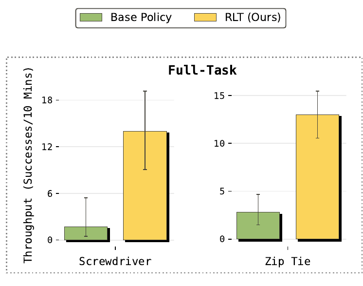

*Paper Figure 4, full-task panels, PDF page 8. Green is the prepared base VLA; yellow is RLT. Throughput counts successes per ten minutes. The original legend is repeated above each panel group for readability.*

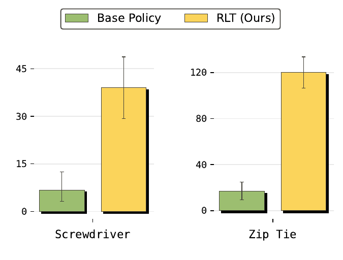

*Paper Figure 4, screwdriver/zip-tie critical phases. Their rates exclude earlier task stages and use different numerical scales from the full-task panels.*

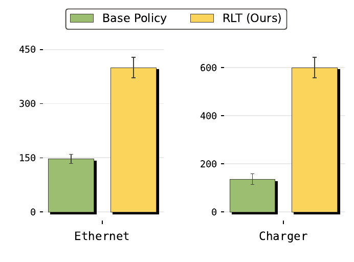

*Paper Figure 4, Ethernet/charger critical phases. All rates remain successes per ten minutes; the vertical scales differ between tasks.*

The base comparison already includes task-specific VLA fine-tuning. RLT's improvement is therefore over a prepared task policy, rather than over an untouched generalist checkpoint. Across the plotted tasks, online practice improves successful completion rate per unit time.

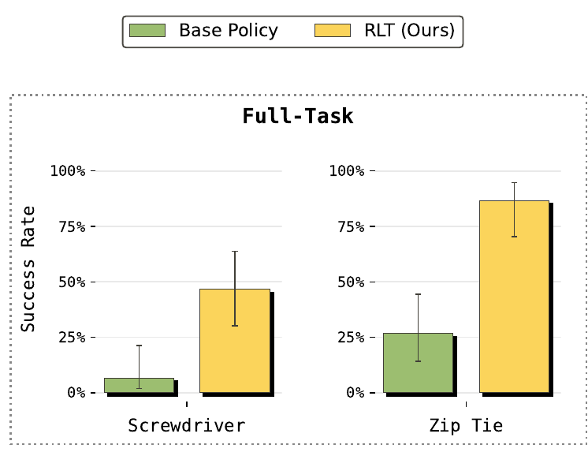

*Paper Figure 5, full-task panels, PDF page 8. The legend retains the same base/RLT colors. Error bars are shown, but their statistical convention is not specified in these captions; they should not be relabeled as a particular confidence interval.*

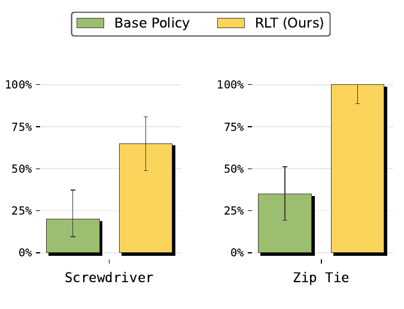

*Paper Figure 5, screwdriver/zip-tie critical phases. Starting immediately before the difficult stage produces higher success than completing the full sequence.*

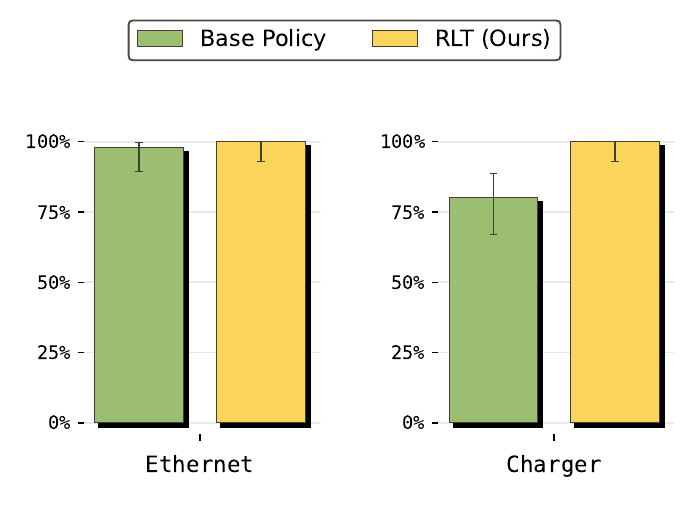

*Paper Figure 5, Ethernet/charger critical phases. Ethernet already has high base-policy reliability, so its throughput gain mainly reflects speed.*

Selected **approximate visual readings** help interpret the comparisons:

| Evaluation | Base success | RLT success | What this tests |
|---|---:|---:|---|
| Screwdriver, critical phase | About 20% | About 65% | Refinement of the precision bottleneck |
| Zip tie, critical phase | About 35% | About 100% | Threading from controlled, partly completed starts |
| Ethernet, critical phase | Already near 100% | Near 100% | Mainly faster execution at similar reliability |
| Charger, critical phase | About 80% | About 100% | Reliability and speed improvements |
| Screwdriver, full task | About 6% | About 47% | Refinement under failures and state variation from earlier stages |
| Zip tie, full task | About 26% | About 86% | Transfer from controlled critical-phase training to complete execution |

*Selected Figure 5 readings, rounded rather than an exact numerical source table. The 20%→65% screwdriver critical-phase comparison is also stated in the paper's introduction.*

Full-task screwdriver remains difficult despite a large improvement. Its final success is lower than critical-phase success because earlier stages can fail or produce harder entry states. For full tasks, the text's approximately 40% and 60% success increases correspond to roughly **40 and 60 percentage points** in the plotted screwdriver and zip-tie comparisons, rather than relative multipliers.

The headline speedup of up to about 3× concerns the difficult task stages. Throughput gains can be larger because they combine speed with fewer failures. Neither the critical-phase speedup nor its success rate should be applied automatically to complete-task execution.

### 9.2 The Ethernet Timing Distribution Shows More Than a Mean

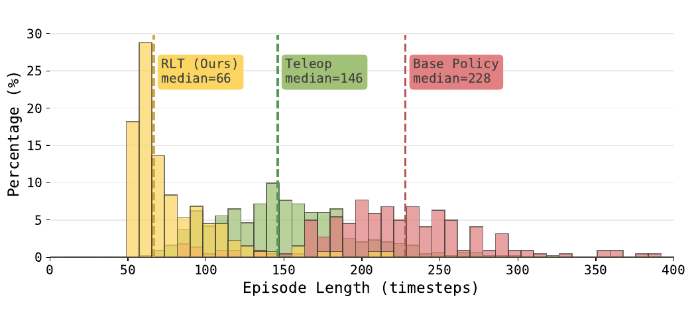

*Paper Figure 9, PDF page 9. Horizontal position is episode length in control timesteps; vertical height is percentage of sampled episodes. Dashed lines identify medians: RLT 66, teleoperation 146, and base VLA 228 steps.*

At 50 Hz, those medians correspond to **1.32 s**, **2.92 s**, and **4.56 s**. The base/RLT median ratio is about 3.45, while teleoperation/RLT is about 2.21. These are ratios of this plotted median statistic, not the paper's separate mean-step comparison or a universal task speedup.

The authors report that the base VLA repeatedly approaches, retreats, and probes. RLT learns a more continuous insertion, sometimes applying pressure and small wiggles to exploit compliance. The paper says this particular strategy was absent from its demonstrations. The histogram supports faster sampled executions; the videos and qualitative observations support the strategy interpretation. Neither establishes that all human operators or all initial conditions would be slower.

## 10. What Do Baselines and Ablations Actually Isolate?

### 10.1 Compare the Reported Recipes under Their Experimental Conditions

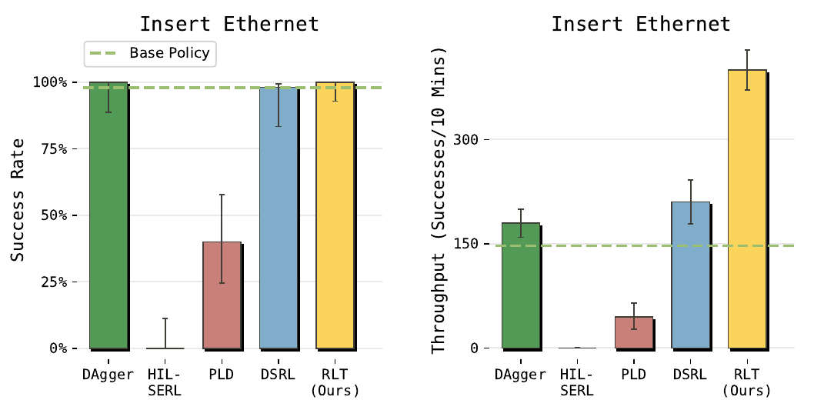

*Paper Figure 6, PDF page 8. Left is success rate; right is throughput. The dashed line marks base-policy performance. DAgger and DSRL reach high success, but RLT completes successful attempts faster.*

| Baseline | What changes relative to RLT | Result and comparison limit |
|---|---|---|
| **DAgger** | Fine-tune the VLA on demonstrations plus the same human intervention data | High success with less speed gain; imitation follows demonstrated behavior rather than optimizing task return |
| **HIL-SERL** | Small actor/critic with a generic ResNet representation and single-step control | Fails in this implementation; Appendix C identifies 50 Hz control versus the original 10 Hz and removal of an action-space bounding box as important difficulties |
| **Probe-Learn-Distill (PLD)** | Learn single-step residual corrections to VLA actions; pretrain a critic on 50 base-policy rollouts with Cal-QL | Poor success in this setting; the comparison changes action horizon and policy construction, not just representation |
| **DSRL** | Learn a latent-noise policy steering the frozen VLA's flow generation | High success but lower throughput; action search remains mediated by the VLA generator |

*Baseline summary from Section VI-B/C and Appendix C. The authors match data amounts for RL comparisons, while initialization and use of demonstrations differ by recipe; HIL-SERL is initialized with 20 demonstration episodes.*

The evidence supports RLT as a useful recipe for this high-frequency sparse-reward setting. It does not establish that single-step RL or the baseline algorithms generally cannot work with different control rates, action bounds, rewards, or tuning.

### 10.2 Distinguish Learning Speed from Final Performance

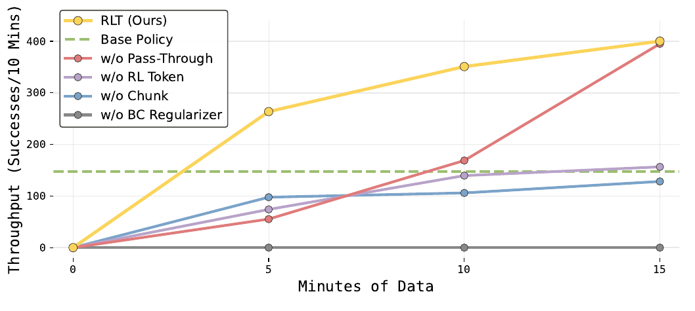

*Paper Figure 7, PDF page 9. The horizontal axis is minutes of collected critical-phase data, rather than total wall-clock training time. Yellow RLT learns quickly; removing pass-through eventually catches up but incurs slower early progress.*

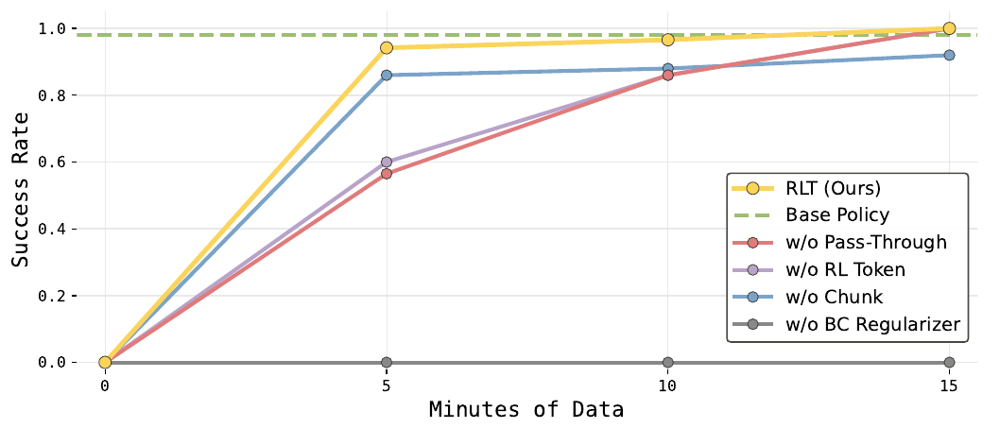

*Paper Figure 8, PDF page 9. Compare this with Figure 7: reaching high success does not imply matching throughput. Poor early success also means more failures during data collection.*

| Ablation | Observed effect | What can be concluded |
|---|---|---|
| **Without RL token** | Generic ResNet-10 features yield about 50% lower final throughput, as reported in the text | VLA-derived features help this task; the study does not separately isolate reconstruction from every possible VLA pooling alternative |
| **Without chunks** | Single-step policy struggles to match the base policy | This also replaces the RL token with ResNet-10 because full VLA querying at 50 Hz is impractical, so it is **not a pure chunk-length ablation** |
| **Without BC regularizer** | Largest single degradation | Unconstrained critic-driven exploration is unreliable in the limited-data setting |
| **Without reference pass-through** | Slower learning and more failures; eventually similar final throughput on Ethernet | The proposal input primarily improves learning efficiency and early behavior here, rather than being necessary for the same final endpoint |

*Interpretation of Figures 7–8 and Section VI-C. “BC regularizer” denotes the squared action-reference penalty, not a separate pretraining stage.*

Taken together, the experiments explain the division of work. The RL token supplies useful state information, chunking makes delayed outcomes easier to learn from, the reference identifies plausible behavior, and regularization keeps exploration near that behavior. The tests are concentrated on Ethernet for these detailed comparisons; they do not independently validate each component across all four tasks.

## 11. What Remains Limited or Unspecified?

RLT demonstrates targeted online improvement from a competent VLA with a lightweight learning system. Its strongest evidence concerns precision-critical manipulation on four tasks, with full-task testing on two of them.

- **Human and preparation cost:** task demonstrations, reward labels, corrections, handoff supervision, and resets remain part of the workflow. Minutes of online data are not the full cost of learning.
- **Task specificity:** a frozen generalist supplies the prior, but the readout and online policies are prepared for individual fixed-instruction tasks. Broad language-conditioned generalization after RL is not established by these tests.
- **Feedback limits:** the RL token comes from visual/proprioceptive inputs and is compressed. It is not a guarantee of complete state observability, nor does chunked execution eliminate contact uncertainty.
- **Dependence on useful exploration:** the VLA prior and interventions help obtain successful experience. The method is not demonstrated as learning arbitrary manipulation from an uninformative starting policy.
- **Experimental scope:** controlled critical-phase starts, full tasks, and the Ethernet ablations answer different questions. Some component comparisons change more than one factor.
- **Reproduction details:** the paper gives network sizes and several scheduling settings, but does not specify universal values for the discount, Gaussian noise scale, regularization weight, or warmup budget. The numerical examples above illustrate their roles without inventing reported settings.
