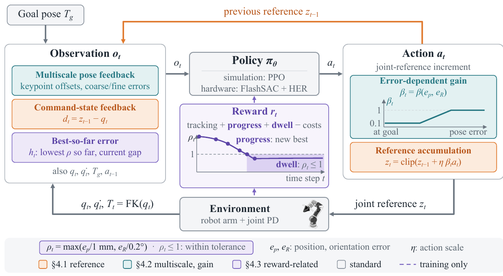
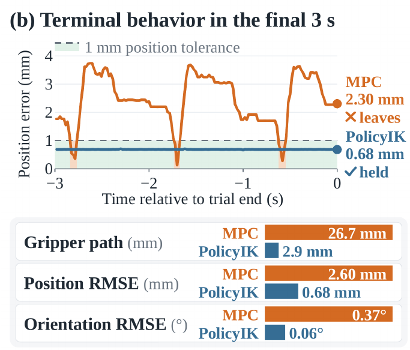

# [PolicyIK: High-Precision Inverse Kinematics for Robot Arms with Reinforcement Learning](https://arxiv.org/abs/2611.05372v1)

> **Brief:** PolicyIK learns a **low-level, goal-conditioned inverse-kinematics controller**. It repeatedly adjusts joint-position commands so that the arm reaches a requested end-effector pose and stays there. Its central design combines accumulated command state, pose-error features at two scales, smaller updates near the goal, and separate rewards for improving accuracy and holding it.

**Source:** Liu et al., 2026; [29-page paper PDF, arXiv:2611.05372v1, November 3, 2026](https://arxiv.org/pdf/2611.05372v1), including Appendices A–J. Simulation learning, direct hardware learning, and retries during deployment are distinguished below.

## Convenient Links

- [Paper HTML](https://arxiv.org/html/2611.05372v1), [code linked by the paper](https://github.com/Tinaliu0123/PolicyIK)
- Background: [Modern Robotics: Inverse Kinematics](../../../Foundations/Books/Robotics/Modern_Robotics.md#chapter-6-inverse-kinematics), [PPO](../../Reinforcement_Learning/PPO.md), [SAC](../../Reinforcement_Learning/SAC.md)
- Application context: [pi0.5](./Pi_0_5.md), [LIBERO](../Datasets/LIBERO.md)

## 1. What Must the Controller Accomplish?

Suppose a robot is asked to put its gripper at a particular point and keep it pointed downward. Reaching the correct position with the wrong orientation is insufficient. Briefly passing through the correct pose and then sagging away is also insufficient. The controller must **reach the requested position and orientation, then maintain both**.

An **end-effector pose** specifies the position and orientation of the robot's tool frame. **Inverse kinematics (IK)** converts that pose request into joint motion. A seven-joint arm can often reach one tool pose with several different joint configurations; local numerical methods can also stall near joint limits or singularities, where some tool motions are difficult to produce.

Execution adds another problem. A **joint-position reference** is the commanded angle that a motor controller tries to track. The measured joint angle can differ from it because of gravity, finite controller gains, and other physical effects. Computing a kinematically correct joint configuration therefore does not ensure that the physical arm settles at the requested pose.

PolicyIK learns a feedback rule for updating those joint references through interaction with the arm. Its place in the control stack is:

```text
Desired end-effector pose
  -> PolicyIK reads joint measurements and pose error
  -> updated joint-position references
  -> joint proportional–derivative (PD) controller
  -> arm motion
  -> new joint measurements and pose error
  -> next PolicyIK update
```

A higher-level vision-language-action (VLA) model can supply the pose requests. PolicyIK itself consumes numerical robot/goal feedback and produces joint-reference updates; it does not interpret camera images or choose which object to manipulate.

The paper focuses on **1 mm position error and 0.2° orientation error**. These are simultaneous tolerances, not interchangeable measures of a single distance.

## 2. Why Accumulate Commands Instead of Rebuilding Them from Measured Angles?

### 2.1 A Zero Action Should Preserve the Command That Holds the Arm

The key distinction is between the **commanded joint angle** $z$ and the **actual measured angle** $q$. PolicyIK changes the command; the motor controller and the arm's physical dynamics determine the resulting motion.

**Why can holding 30° require a command of 32°?** Consider one joint controlled by a PD controller, with no separate gravity compensation. Its motor torque is

$$
\tau_{\mathrm{PD}}=K_p(z-q)-K_d\dot q.
$$

$K_p$ is the proportional gain, which converts position error into torque. $K_d$ is the damping gain, and $\dot q$ is measured joint velocity. The first term pushes the joint toward its reference; the second opposes motion.

At rest, $\dot q=0$, so the damping term is zero. If gravity pulls the joint downward, the motor must still supply a holding torque. Without separate compensation, that torque requires a **nonzero command–measurement gap**. Writing $\tau_g$ for the torque needed to balance gravity, static equilibrium requires $K_p(z-q)=\tau_g$.

Suppose the load and controller gain are such that holding the actual joint at **30°** requires a **2° offset**. The command must then be **32°**. The motor pushes toward 32°, gravity pulls the other way, and their torques balance at an actual angle of 30°. These are illustrative numbers, not a measured paper result. With radian-based gains, the 2° offset is $\pi/90$ rad.

**What happens when the policy outputs zero?** Let $\Delta q_t$ be the requested change to the reference. Assume the joint is at rest at $q_t=30^\circ$, the previous command is $z_{t-1}=32^\circ$, and neither command is clipped by a limit:

| Reference update rule | Command for $\Delta q_t=0$ | Immediate physical consequence |
|---|---|---|
| Measured-angle update<br>$z_t=q_t+\Delta q_t$ | $30^\circ+0=30^\circ$ | Position error becomes zero, so the gravity-balancing PD torque disappears initially |
| Accumulated update (PolicyIK)<br>$z_t=z_{t-1}+\Delta q_t$ | $32^\circ+0=32^\circ$ | The 2° offset remains, preserving the holding torque |

In the first case, gravity starts moving the joint away from 30°. As position and velocity errors develop, PD torque appears again, but the original holding condition has been lost. To maintain it, the policy would need to recreate the offset with a nonzero output at every update.

In the second case, a zero update preserves the command that already works. **Zero policy output means “keep the current reference”; the PD controller continues producing holding torque.**

**PolicyIK learns and retains that reference.** For the seven-joint arm, its actor produces $a_t$, and the scaled reference increment is $\Delta q_t=\eta\beta_ta_t$. The paper uses

$$
z_t=\operatorname{clip}\!\left(
z_{t-1}+\eta\,\beta_t a_t,\ q^{\mathrm{lo}},q^{\mathrm{hi}}
\right),
\qquad
d_t=z_{t-1}-q_t.
$$

- $a_t$ is the actor's seven-component output.
- $\eta$ sets the overall update scale.
- $\beta_t$ adjusts that scale according to pose error, explained in Section 3.
- $q^{\mathrm{lo}}$ and $q^{\mathrm{hi}}$ bound the reference in the simulation formulation.
- $d_t$ is **command-state feedback**: the previous reference minus the measured joints. In the example, it exposes the retained 2° offset to the policy.

Through interaction, PolicyIK learns which reference produces the desired actual pose. Once that reference works, small or zero updates can preserve it. Appendix A gives the static-balance argument behind this design.

The initial reference equals the initial measured joint configuration. Hardware uses a slightly relaxed reference bound near joint limits, described in Section 5.

### 2.2 Why Must the Policy Observe the Previous Command?

Imagine two runs with the same measured angle of 30°, but previous references of 30° and 32°. A zero update produces different next commands and therefore different subsequent motion.

Joint measurements alone do not identify which situation the controller is in. Feeding back $d_t$ exposes the accumulated reference state, allowing the policy to decide whether to preserve or adjust the existing offset.

Accumulation and feedback solve different parts of the problem: accumulation **retains** useful commands, while feedback lets the policy **know what is being retained**. The next issue is making very small remaining pose errors visible enough to correct.

## 3. How Does the Policy Handle Both Large Motions and Tiny Residual Errors?

### 3.1 Represent Position and Orientation Together

A gripper can reach the correct **position** while pointing in the wrong **direction**. For example, rotating it 90° about its own origin leaves that origin's position unchanged. A position-error vector alone would report zero, even though the requested pose has not been reached.

PolicyIK captures both parts of the pose by attaching **three virtual points** to the tool. In the simulation setup, their local offsets are $c_1=(0.3,0,0)^\top$, $c_2=(0,0.3,0)^\top$, and $c_3=(0,0,0.3)^\top$, in meters: one along each local tool axis. They are geometric points computed from the robot model, not markers detected in camera images.

When the tool translates, all three points move together. When it rotates, points away from the rotation axis move even if the tool origin stays fixed. Comparing their current and desired positions therefore exposes both translation and rotation errors.

**Convert each local offset into a point in the robot base frame.** Forward kinematics (FK) gives the current tool pose from measured joints:

$$
T_t=(R_t,p_t)=\operatorname{FK}(q_t),
\qquad
T_g=(R_g,p_g).
$$

$p_t$ and $p_g$ are the current and goal tool-origin positions. $R_t$ and $R_g$ are rotation matrices that map local tool coordinates into the base frame. The position error $e_p$ is the distance between the origins; the orientation error $e_R$ is the rotation angle needed to align the orientations.

For a local offset $c_i$, multiplication by $R$ gives its direction in base coordinates, and adding $p$ places it relative to the tool origin. PolicyIK subtracts the resulting current point from its target:

$$
\Delta k_{i,t}
=
\underbrace{p_g+R_gc_i}_{\text{target point position}}
-
\underbrace{p_t+R_tc_i}_{\text{current point position}},
\qquad i=1,2,3.
$$

Each $\Delta k_{i,t}$ is a three-dimensional position-error vector. Stacking the three vectors gives **nine values**. They provide a redundant geometric representation of the pose's **six degrees of freedom**—three for translation and three for rotation—rather than nine independent motions.

**A 90° rotation makes the mechanism concrete.** For this illustrative calculation, set the shared tool-origin position to zero: $p_t=p_g=(0,0,0)^\top$. Let the goal orientation be the identity rotation, while the current tool is rotated +90° about the Z-axis.

The first virtual point lies along the tool's local X-axis, $c_1=(0.3,0,0)^\top$. Its target and current positions are

$$
\begin{aligned}
p_g+R_gc_1&=(0.3,0,0)^\top,\\
p_t+R_tc_1&=(0,0.3,0)^\top,\\
\Delta k_{1,t}&=(0.3,-0.3,0)^\top\ \mathrm{m}.
\end{aligned}
$$

The tool-origin position error is zero, but the virtual-point error is nonzero because the orientation is wrong. The Z-axis point stays fixed in this particular rotation; the X- and Y-axis points reveal the mismatch. Using all three noncollinear points avoids relying on one point that could lie on the rotation axis.

These keypoint differences supply a unified geometric pose representation. PolicyIK also uses explicit translation and rotation error channels: Section 3.2 explains how their coarse and fine scales expose tiny residuals, and Section 3.3 explains how action scaling changes the size of the correction.

### 3.2 Make Small Errors Large Enough in the Input

Features normalized over an entire workspace can make a submillimeter residual numerically tiny. PolicyIK adds six-dimensional pose-error channels at **coarse and fine scales**:

| Channels | Translation scale | Rotation scale | Purpose |
|---|---:|---:|---|
| Coarse | 1 cm | 20° | Resolve the approach as the arm gets close |
| Fine | 0.5 mm | 0.25° | Resolve small residuals around the target pose |

For each scale, translation error is expressed in the current tool frame and divided by the translation scale. Rotation error is represented by an axis–angle vector and divided by the rotation scale. Each component is clipped to $[-1,1]$.

For example, a 0.2° rotation error occupies only **1%** of the coarse rotation scale but **80%** of the fine scale. The physical error is unchanged; the fine channels make it prominent in the policy's input. Large errors saturate those channels, while the keypoint features and other state inputs retain broader geometric information.

### 3.3 Reduce the Update Scale Only When Both Errors Are Small

Making tiny errors visible in the input is only half the problem: the policy must also produce suitably small corrections. PolicyIK therefore **uses a larger update scale far from the target and a smaller scale near it**. This allows fast approach motion followed by precise adjustment.

Recall the command update from Section 2.1. Before clipping the command to its limits,

$$
z_t=z_{t-1}+\underbrace{\eta\beta_t a_t}_{\Delta q_t}.
$$

Here $a_t$ is the actor's output, $\eta$ is the base action scale, and $\beta_t$ is an error-dependent multiplier. Their product $\Delta q_t$ changes the **commanded joint angles**, rather than specifying how far the physical joints must actually move.

In simulation, $\eta=0.0625$ and $\beta_t$ ranges from $0.1$ to $1$. For an illustrative output of $a_t=0.4$ for one joint:

| Situation | Gain $\beta_t$ | Reference increment $\eta\beta_t a_t$ |
|---|---:|---:|
| Far from the target | 1.0 | 0.025 rad |
| Close to the target in both position and orientation | 0.1 | 0.0025 rad |

The same policy output produces a **ten times smaller correction** near the goal. The actor still determines the update's direction and magnitude: even at the minimum gain, an output of zero preserves the reference. The gain does not impose a minimum movement.

**Both position and orientation determine the scale.** PolicyIK computes a position-based gain $\beta_p$ from the distance error $e_p$ and an orientation-based gain $\beta_R$ from the angular error $e_R$, then takes

$$
\beta_t=\max(\beta_p,\beta_R).
$$

| Position error | Orientation error | Resulting update scale |
|---|---|---|
| Large | Small | Large |
| Small | Large | Large |
| Small | Small | Small |

For example, the gripper may already be at the correct position but still point in the wrong direction. Its small position gain should not reduce the scale needed to correct orientation. Taking the **maximum** keeps a larger scale available for that correction; taking the minimum would reduce it as soon as just one error became small.

The transition is gradual. Each gain increases linearly from $0.1$ to $1$ over its error interval: **0.5–9.31 mm** for position and **0.415–2.328°** for orientation. Below its lower threshold, a gain stays at $0.1$; above its upper threshold, it stays at $1$. Consequently, the combined gain reaches its minimum only when **both** errors are below their lower thresholds. A disturbance that moves the tool away from the goal can make larger updates available again; the gain depends on current error, not elapsed time.

Section 3.2 thus adjusts the **input** so the policy can notice a tiny residual; this section adjusts the **output** so it can correct that residual with a small reference change. Together, they address both perceiving the remaining error and acting precisely enough to remove it.

## 4. Why Rewarding “Get Closer” Is Not Enough

### 4.1 Both Tolerances Must Hold at Once

A reward that adds position and orientation improvements can favor correcting the easy error while leaving the other outside tolerance. PolicyIK instead measures the worst tolerance violation:

$$
\rho_t
=
\max\left\{
\frac{e_p(t)}{1\,\mathrm{mm}},
\frac{e_R(t)}{0.2^\circ}
\right\},
\qquad
b_t=\min\{b_{t-1},\rho_t\}.
$$

$\rho_t$ is the **tolerance-normalized error**. It is at most one exactly when both errors satisfy their thresholds. $b_t$ records the best value reached for the current goal.

For example, 2 mm and 0.1° give $\rho_t=\max(2,0.5)=2$. Improving orientation further cannot compensate for the remaining position error. Position must improve before the limiting error decreases.

### 4.2 Reward Acquiring Accuracy and Keeping It Separately

PolicyIK must learn two abilities: **reach an accurate pose**, then **hold that pose**. Briefly passing through the target is insufficient. The reward therefore pays separately for attaining better accuracy and for remaining within tolerance.

Read these rewards using the normalized error $\rho_t$ from Section 4.1: **$\rho_t\leq1$ means both position and orientation satisfy their tolerances**; $\rho_t>1$ means at least one does not. For example, 0.5 mm position error and 0.1° orientation error give $\rho_t=\max(0.5,0.5)=0.5$, an accurate pose. The running best $b_t$ is the smallest $\rho$ reached so far for this goal; it never increases, even if the arm drifts away.

The reward combines six functions:

| Term | What it teaches |
|---|---|
| **Tracking** | Give a higher score to poses closer to the target, guiding the broad approach |
| **New-best improvement** | Reward a lower error than ever achieved for this goal, with emphasis near the tolerance boundary |
| **Potential-based shaping** | Provide feedback for reducing current error, including recovery toward an earlier best |
| **Backslide cost** | Penalize error above the best already achieved; cap the penalty so large reconfigurations remain possible |
| **Dwell** | Reward every control step spent within both tolerances |
| **Motion and joint-margin costs** | Discourage rapidly changing actions, joint velocity, and approaching joint limits; the limit cost applies only while $\rho_t>10$, away from the final correction |

The *potential* in potential-based shaping is a scalar value derived from current error, higher closer to the goal. Shaping uses its change to provide feedback on progress even when the robot has not beaten its earlier record.

**A six-step example separates progress, recovery, and holding.** The following errors are illustrative, not experimental results. Treat step 1 as the starting observation, so $b_1=\rho_1=3.0$:

| Step | Current error $\rho_t$ | Best so far $b_t$ | New-best reward? | Dwell reward |
|---|---:|---:|---|---:|
| 1 | 3.0 | 3.0 | Starting point | 0 |
| 2 | 0.8 | 0.8 | Yes | 1 |
| 3 | 1.5 | 0.8 | No | 0 |
| 4 | 1.0 | 0.8 | No | 1 |
| 5 | 0.8 | 0.8 | No | 1 |
| 6 | 0.8 | 0.8 | No | 1 |

- **Step 1 → 2: acquire accuracy.** Error falls from 3.0 to 0.8, setting a new record and entering tolerance. Both new-best improvement and dwell pay.
- **Step 2 → 3: lose accuracy.** Error rises to 1.5 while the best remains 0.8. The backslide cost penalizes this gap, and dwell stops because the pose is outside tolerance.
- **Step 3 → 4: recover toward the goal.** Error falls from 1.5 to 1.0. Shaping supplies recovery feedback, but there is no new-best reward because $1.0>0.8$. Dwell resumes because equality counts as within tolerance; a backslide cost still applies because the pose is worse than the earlier best.
- **Step 4 → 5: regain the old best.** Error returns to 0.8. Shaping rewards this recovery and the backslide cost becomes zero, but matching a record earns no new-best reward. Dwell continues to pay.
- **Step 5 → 6: hold.** Error stays at 0.8. There is no new record, but dwell continues to pay. Improving below 0.8 later would earn a new-best reward again.

These terms apply together; the table shows only improvement and dwell. **New-best improvement rewards accuracy not previously attained; shaping guides recovery; dwell rewards continued success.** Returning repeatedly to an old best cannot collect the same improvement payment again.

**Why does holding need a separate reward?** The dwell term is simply

$$
r_t^{\mathrm{dwell}}
=\mathbb{1}[\rho_t\leq1]
=\begin{cases}
1, & \rho_t\leq1,\\
0, & \rho_t>1.
\end{cases}
$$

The indicator $\mathbb{1}$ equals one when its condition holds and zero otherwise. Staying within tolerance for 100 control steps therefore earns 100 units from this term before discounting and the other reward terms. Improvement alone pays nothing for staying at the same accuracy. The paper reports that removing dwell made policies more likely to touch the tolerance and then leave it. Training consequently continues after first success, so the robot experiences and receives rewards for holding the pose.

Finally, the policy must know the record against which its progress is judged. The same current error of 1.0 could be a new best or a loss from an earlier 0.8. Its observation therefore includes **running-best features** $h_t$: the previous best $b_{t-1}$ and the gap $\rho_t-b_{t-1}$, clipped and scaled. This history resets when the goal changes.

### 4.3 Put the Components Back into One Control Loop



*Paper Figure 2, cropped from PDF page 5. Feedback identifies both geometric error and retained command state. The gain scales the learned update before accumulation. The dashed reward path is for training; inference uses the trained policy and continuing feedback.*

The simulation policy receives a **54-dimensional observation**:

| Input group | Dimensions | Meaning |
|---|---:|---|
| Joint positions relative to a nominal configuration, and velocities | 14 | Current arm configuration and motion |
| Goal position | 3 | Target location in the robot base frame |
| Three keypoint differences | 9 | Geometric position/orientation mismatch |
| Coarse and fine pose-error channels | 12 | Error at the two useful scales |
| Running-best features $h_t$ | 2 | Best accuracy and current loss of progress |
| Command-state feedback $d_t$ | 7 | Previous reference relative to measured joints |
| Previous action | 7 | The preceding update |

One inference cycle reads the measured joints, computes FK and the error features, evaluates the actor, scales its action, updates the joint reference, and lets the PD controller track that reference. Fresh measurements start the next cycle.

The **actor** is the network producing actions. Training also uses a **critic**, which estimates future return; the critic is not needed to issue deployed commands. Policy weights stay fixed during evaluation, while the reference and error-history state continue to change.

## 5. How Are the Simulation and Physical Policies Trained?

### 5.1 Simulation Supplies Reachable Goals and Large-Scale Interaction

The simulation policy learns with **Proximal Policy Optimization (PPO)** in Isaac Sim. Goals are generated by sampling a feasible joint configuration and applying FK to it. This ensures that a kinematic solution exists, but the policy receives the goal pose rather than the generating joint configuration.

| Setting | Simulation recipe |
|---|---|
| Arm | Fixed-base, seven-degree-of-freedom OpenArm |
| Physics / policy rate | 60 Hz / 30 Hz |
| Joint tracking | PD control under gravity, without gravity feedforward |
| Network | Two hidden layers of 256 units with exponential linear unit (ELU) activations |
| Parallel environments | 4,096 |
| Training rollout | 12 s; replace the goal every 4 s without resetting the arm |
| PPO budget | 13,000 epochs, about $1.28\times10^9$ transitions |
| PPO update | 24 steps/environment, five optimization passes, minibatches of 24,576 |
| Discount / advantage estimation | $\gamma=0.99$; generalized advantage estimation parameter 0.95 |
| Learning rate | Starts at $10^{-3}$ and adapts to a Kullback–Leibler (KL) divergence target of 0.01 |

The deployment checkpoint averages the last 20 saved checkpoints with greater weight on recent ones. Thus, the main single-attempt result already includes **checkpoint averaging**, although it does not include retries.

The source configuration pool starts with 200,000 samples. After filtering and excluding evaluation configurations, training uses 157,504 possible starts and 104,599 possible goals in the specified workspace. The 4,120 test start–goal pairs share no configuration with training; no test goal is within both strict tolerances of a training goal.

The sampled configurations generate feasible goals; RL rewards from executed motions train the compact controller. There is no VLA pretraining stage.

### 5.2 Physical Learning Spends Computation to Save Robot Experience

The OpenArm hardware policy is trained **directly on the arm, without simulation initialization**, using **FlashSAC**, a variant of Soft Actor-Critic (SAC). Its actor has two residual blocks of width 128; the hardware observation has 72 dimensions and includes additional pose information.

Hardware training uses 120,000 online transitions at 10 Hz, plus **22,500 scripted demonstration transitions** from 150 tasks. Demonstrations move toward known reachable joint configurations through the same action interface; they are not human task demonstrations such as picking up an object.

Three sampling choices concentrate learning where it matters:

1. **Reverse curriculum:** begin with starts near the goal, learn terminal correction and holding, then expand to harder starts. A growing pool of 3,000 large-reconfiguration tasks supplies longer motions.
2. **Near-goal replay:** draw 75% of each replay source from states within ten tolerance units—1 cm and 2°—so approach trajectories do not overwhelm terminal-regulation examples.
3. **Hindsight Experience Replay (HER):** relabel some transitions with poses reached later or at the current step. Current-pose goals teach holding; small perturbations around them teach tolerance-scale corrections.

Each batch contains 25% demonstration data and 75% online data. Batch size is 1,024, Adam learning rate is $3\times10^{-4}$, and the learner performs about 2.5 gradient updates per online transition, including updates during physical resets.

A **latent-alignment critic** also addresses large rotations that require an initial detour in joint space. It separately embeds state–action information and the goal, then feeds their element-wise squared feature difference into a head predicting probabilities over 201 possible return values. This can learn that a geometrically close pose is still several actions away. It is a training architecture, not an extra IK solver at inference.

### 5.3 Hardware Changes the Command Interface Near Limits

Hardware uses $\eta=0.03$ rad and $\beta_{\min}=0.03$, with a 0.25 rad bound on how far the reference may lead measured joints.

A hard reference clip can prevent holding a goal near a joint limit when its required holding offset points beyond that limit. The hardware recipe therefore permits a **2° relaxation of the reference bound while the measured joint remains inside its limit**; once the measured joint reaches the bound, further outward updates are rejected.

This changes the reference, not the intended physical joint limit. It also means that the exact simulation clipping rule is not the whole hardware implementation.

## 6. What Do the Simulation Results Establish?

### 6.1 Define Success Before Comparing Rates

For each 5.3 s attempt, the simulation reports:

- **Strict success:** average position error over the final second is at most 1 mm, and average orientation error is at most 0.2°.
- **Coarse success:** the same averages satisfy 1 cm and 2°.
- **Containment:** both strict thresholds hold at **every sample** of the final second.

A trajectory can pass the average-error test while briefly leaving tolerance. Median terminal errors are reported across all test tasks, including failures; they do not describe only the successful subset.

Table 1 evaluates the same 4,120 held-out tasks:

| Controller | Strict success | Coarse success | Median position / orientation error |
|---|---:|---:|---:|
| Tuned UMI-RL | 0.00% | 16.38% | 16.65 mm / 4.25° |
| Damped least squares (DLS) | 50.41% | 64.42% | 0.94 mm / 0.15° |
| Resolved-rate quadratic programming (QP) | 56.21% | 63.98% | 0.57 mm / 0.11° |
| Kinematic model-predictive control (MPC) | 56.33% | 64.78% | 0.54 mm / 0.10° |
| PolicyIK, one attempt | 93.49% | 96.56% | 0.25 mm / 0.04° |
| PolicyIK with deployment retries | 98.92% | 99.43% | 0.25 mm / 0.04° |

PolicyIK's rates are means over three training seeds; its single-attempt strict result is $93.49\pm0.20\%$. The classical controllers are tuned on disjoint tasks and receive gravity compensation in simulation, which the main PolicyIK recipe does not receive. UMI-RL adapts an existing full-pose tracking recipe with a comparable interaction budget; its failure here shows the importance of terminal-precision design in this setting, not the impossibility of other learned controllers.

Single-attempt **containment is 92.4%**, close to but distinct from 93.5% strict success. On many classical-controller failures, a joint stays near its limit and local pose correction stalls. This helps explain why small median errors can coexist with limited workspace coverage.

The two-layer actor takes **0.035 ms per forward pass** on one AMD EPYC 9454 CPU core at batch size one. This measures neural inference, not the complete sensing/control loop.

### 6.2 The 98.9% Result Adds Attempts, Not More Training

The deployment protocol handles two kinds of failure:

1. **Small residual:** if the failed attempt's terminal-window position error is within 1 cm, retry with a goal adjusted to oppose the observed final position/orientation bias.
2. **Remaining failure:** allow up to eight transient-goal attempts. Each first requests a displaced/rotated temporary pose for 40 steps, then the original goal for 120 steps, encouraging a different arm configuration.

Each attempt restarts from the task's original start configuration. Every attempt is scored against the **original goal**, including the corrected-goal case.

For intuition, if a run consistently finishes 2 mm to the right, requesting a point shifted left may cancel the bias. Success still means reaching the original requested point. This is an explanatory example of the correction.

Appendix C separates the increments:

| Setting | Strict success | Mean attempts |
|---|---:|---:|
| Final checkpoint alone | 92.30% | 1.000 |
| Checkpoint average | 93.49% | 1.000 |
| Add error-corrected goal | 94.80% | 1.036 |
| Add transient-goal retries | 98.92% | 1.212 |

The unchanged median error shows that retries mainly recover difficult failures in the distribution's tail. **98.9% is a policy-plus-retry result**, with a different execution budget from one-attempt baselines.

### 6.3 Ablations Test the Explanations Above

Table 7 removes components under matched simulation training budgets:

| Variant | Strict success | What it tests |
|---|---:|---|
| Full PolicyIK | 93.49% | Complete formulation |
| Remove command-state feedback | 84.26% | Whether the policy needs to observe retained command state |
| Anchor updates at measured joints, also without command-state feedback | 30.77% | Whether retaining the previous reference matters |
| Remove fine pose channels | 88.41% | Whether tiny errors need dedicated input scales |
| Replace adaptive gain with tuned fixed gain | 89.13% | Whether one update scale serves both approach and precision |
| Remove progress rewards | 91.66% | Incentive to acquire terminal accuracy |
| Remove dwell reward | 91.54% | Incentive to sustain terminal accuracy |

The two reference variants both use 47-dimensional observations, so **84.26% → 30.77% isolates the anchor change**. Comparing the measured-joint variant directly with Full changes both the anchor and feedback. It retains 95.90% coarse success despite poor strict success: moving near the goal and regulating it precisely are different capabilities.

Dwell has a more specific effect than its modest strict-rate change suggests. Among tasks that ever enter tolerance, removing dwell raises the share not contained in the final second from **2.43% to 7.83%**, while entry times remain similar. That is evidence for learning to stay after arriving.

## 7. Does the Same Formulation Work on Physical Arms?

### 7.1 Measure Reaching and Sustained Holding Separately

The physical OpenArm tests use 60 pose tasks and score a 25 s execution budget:

- **Reached:** both errors remain within 1 mm and 0.2° for at least 0.5 s.
- **Held:** both errors remain within tolerance throughout the final five seconds.
- **Terminal error:** errors averaged over the final second, then summarized by the median across tasks.

All methods use matching requested starts/goals and a joint-position motor layer with gravity feedforward. Crucially, pose error is computed from **joint encoders and the robot's FK model**, not external Cartesian metrology.

Table 3 reports:

| Controller | Reached | Held for final 5 s | Median position / orientation error |
|---|---:|---:|---:|
| DLS | 48/60 | 17/60 | 0.65 mm / 0.13° |
| Resolved-rate QP | 48/60 | 16/60 | 0.57 mm / 0.14° |
| Kinematic MPC | 46/60 | 15/60 | 0.81 mm / 0.18° |
| Adapted OpenArm QP | 32/60 | 11/60 | 0.99 mm / 0.23° |
| PolicyIK | 54/60 | 43/60 | 0.50 mm / 0.12° |

The clearest gain is holding: **71.7% versus at most 28.3%**. PolicyIK does not merely pass through accurate poses more often; it preserves them longer. At a shorter 15 s budget, its five-second holding count is 27/60, so available approach time still matters.



*Paper Figure 6(b), cropped from PDF page 9. This example shows the final three seconds. MPC's position error repeatedly crosses the dashed 1 mm threshold; PolicyIK remains below it. RMSE means root-mean-square error. The lower summaries describe this example, not aggregate benchmark results.*

Hardware ablations remove the latent-alignment critic, far-task selection, and relaxed reference bound **together**. Holding changes from 40/60 to 43/60 at 25 s, while reaching changes from 46/60 to 54/60. This supports the combined recipe without isolating each component's contribution.

The implementations also differ in control rate and command constraints: the hardware policy runs at 10 Hz, classical references at 50 Hz, and their lead/bound settings differ. The comparison matches tasks and time budgets, not every admissible command.

### 7.2 xArm7 Tests Another Training Instance, Not One Universal Checkpoint

Appendix J trains **separate xArm7 policies**, one in simulation and one directly on the physical arm, using the FlashSAC recipe. The physical policy starts without simulation weights.

Both policies hold all 60 standard-reaching tasks and all 60 large-rotation tasks within tolerance during seconds 20–25. DLS, QP, and MPC also hold 60/60 standard tasks and 59/60 large-rotation tasks; the built-in IK holds 59/60 and 45/60, respectively.

This demonstrates applicability to another robot through retraining. It does not demonstrate zero-shot transfer of OpenArm weights, and the one-task gap to tuned classical methods on large rotations is small. Several classical methods have lower median errors on xArm7, so PolicyIK's claim here concerns reliable tolerance satisfaction rather than the smallest possible error.

## 8. Can It Execute Commands from a VLA?

The application experiment places PolicyIK beneath **pi0.5-LIBERO**:

```text
Images + instruction
  -> pi0.5: relative end-effector commands at 20 Hz
  -> shared fixed adapter modeling the Panda operational-space controller
  -> desired end-effector pose
  -> PolicyIK: joint-reference updates at 30 Hz
  -> joint PD controller -> side-mounted OpenArm in simulation
```

The adapter accounts for the command semantics expected by the VLA. All compared low-level controllers use it, so replacing IK does not also replace the upstream pose interpretation. The VLA's gripper signal separately commands opening or closing; PolicyIK controls the arm pose.

PolicyIK is **retrained from random initialization for the side-mounted arm**, because the gravity direction changes. It learns pose regulation without pick-and-place demonstrations. This transfers the control formulation to a new mounting configuration; it is not unchanged-checkpoint deployment.

Ten adapted LIBERO-Object tasks use 50 official initial states each and three runs per state, giving **1,500 episodes per controller**. Task success is LIBERO's object-placement predicate, not the IK pose tolerance.

| Low-level controller | Pick-and-place success |
|---|---:|
| Default DLS | 90.8% |
| Hand-tuned DLS | 96.7% |
| Hand-tuned QP | 90.8% |
| PolicyIK | 95.7% |

PolicyIK supports high task success and improves over default DLS, especially near the mount where joint limits affect grasping. **It does not outperform hand-tuned DLS in this experiment.** Its useful result is a learned pose controller that can execute VLA commands without pick-and-place training or an online Jacobian/optimization solve.

## 9. What Should the Reader Conclude?

PolicyIK's contribution is a formulation for learning **precise closed-loop pose regulation**. Retained references preserve holding offsets; command-state feedback makes them observable; fine error channels and adaptive scaling enable terminal corrections; improvement and dwell rewards teach reaching and staying separately.

The evidence has several boundaries:

- **An IK update still needs a robot model for feedback.** PolicyIK avoids an online Jacobian-based solver, but uses FK to compute pose/error features.
- **Hardware accuracy is model-relative.** Encoder/FK tolerance satisfaction does not independently establish absolute physical tool accuracy under calibration errors or structural deflection.
- **Training and deployment costs differ.** The actor is small and fast, but simulation uses roughly 1.28 billion transitions; hardware additionally uses scripted demonstrations and extensive replay.
- **The highest rates use specific protocols.** Retrying raises simulation success; hardware holding and VLA task success use different criteria.
- **Embodiment applicability requires training.** The tested xArm7 and side-mount results do not establish a universal arm-independent checkpoint.
- **Pose regulation is narrower than general manipulation.** Goal sampling establishes kinematic reachability in the evaluated workspace; it does not establish general obstacle-avoidance planning or success on arbitrary contact tasks.
