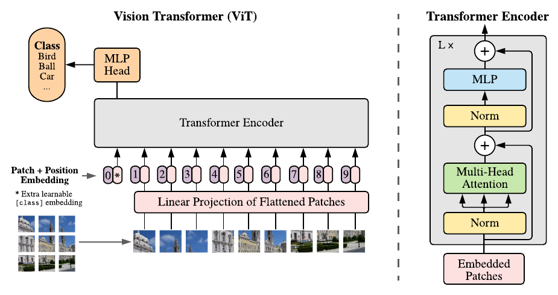
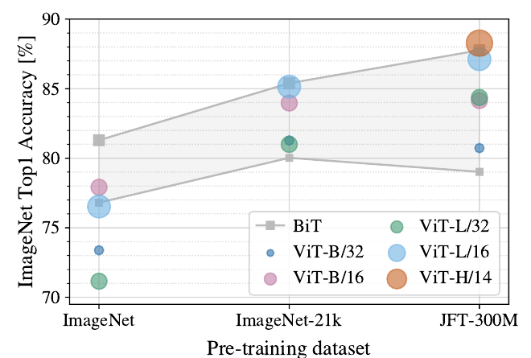

# [ViT: An Image is Worth 16x16 Words](https://arxiv.org/abs/2010.11929)

> **Brief:** **Vision Transformer (ViT)** treats an image as a sequence of embedded patches and applies a standard Transformer encoder. Its main result is that large-scale supervised pretraining can make this simple architecture competitive with strong CNNs, despite having fewer built-in assumptions about images.

**Source:** Dosovitskiy et al., *An Image is Worth 16x16 Words: Transformers for Image Recognition at Scale*, ICLR 2021. These notes follow the supplied paper, including its architecture, transfer experiments, and appendix ablations.

## Convenient Links

- [Paper](https://arxiv.org/abs/2010.11929)
- [Official code and pretrained models](https://github.com/google-research/vision_transformer)
- Building blocks: [Multi-Head Attention](../../Attention_Machanisms/MHA.md), [LayerNorm](../../Norm/LayerNorm.md), [GELU](../../Activation_Layers/GELU.md)
- Related notes: [DINOv2](./DINOv2.md), [DINOv3](./DINOv3.md), [CLIP](../Vision_Language_Models/CLIP.md)

## 1. Why Patches, and Why Scale?

A Transformer accepts a sequence, whereas an image is a spatial grid. Treating every pixel as a token would create $224^2=50{,}176$ tokens for a $224\times224$ image, making global attention expensive because its attention matrix grows quadratically with sequence length.

ViT instead groups pixels into **non-overlapping patches**. With $16\times16$ patches, the same image becomes only $14\times14=196$ patch tokens. A linear projection makes these patches compatible with an otherwise standard Transformer.

This solves the input and computation problem, but introduces a learning problem: unlike a CNN, the encoder does not enforce local neighborhoods or translation equivariance in every layer. It must learn useful spatial relationships from data. The paper therefore studies **architecture and pretraining scale together**, rather than claiming that replacing convolutions with attention is sufficient on small datasets.

## 2. From Image to Prediction



*Paper Figure 1. Patches become tokens; a class token gathers image information through self-attention, and its final representation feeds the classifier. Each encoder block uses pre-LayerNorm and residual connections.*

### 2.1 Patch Embedding: Pixels Become Tokens

Let $x\in\mathbb{R}^{H\times W\times C}$ be an image, with height $H$, width $W$, and $C$ channels. For patch side length $P$, assuming $H$ and $W$ are divisible by $P$:

$$
N=\frac{HW}{P^2},
\qquad
x_p\in\mathbb{R}^{N\times(P^2C)}.
$$

Each row $x_p^i$ contains all pixel values of one flattened patch. A **shared, trainable projection** $E\in\mathbb{R}^{(P^2C)\times D}$ maps every patch to the encoder width $D$:

$$
e_i=x_p^iE\in\mathbb{R}^{D}.
$$

For **ViT-B/16 at $224\times224$ resolution**, each RGB patch has $16^2\times3=768$ values, and $E$ maps it to a 768-dimensional token. The equal input/output dimensions are coincidental: other patch sizes and model widths need not match.

This is a continuous feature projection, **not** a discrete visual vocabulary or a CNN feature extractor. In an implementation, a convolution with kernel size and stride both equal to $P$ can perform the same non-overlapping patch projection.

### 2.2 Class and Position Embeddings: What and Where?

Patch embeddings describe local content, but the classifier also needs a whole-image representation and a way to distinguish spatial arrangements. ViT therefore prepends one learned class token and adds learned positional embeddings:

$$
z_0=[x_{\mathrm{class}};e_1;\ldots;e_N]+E_{\mathrm{pos}},
\qquad
E_{\mathrm{pos}}\in\mathbb{R}^{(N+1)\times D}.
$$

- **Class token:** a learned vector shared across input images, not the ground-truth class label. Its hidden state becomes image-dependent as it attends to patch tokens.
- **Position embeddings:** one learned vector per sequence position, including the class-token position. Patches are ordered by scanning the grid row by row; the embeddings are added once before the encoder.

Without position information, self-attention treats the patch tokens as an unordered collection: rearranging whole patches would not change the class-token output. Position embeddings let the model distinguish, for example, an object above another object from the reverse arrangement.

The original ViT uses **learned absolute 1D embeddings**, not sinusoidal embeddings or RoPE. Although indexed as a sequence, they can learn 2D spatial relationships from the consistent patch layout.

### 2.3 Encoder: Tokens Exchange Information

The token sequence now contains content, positions, and a place to collect the image representation. Each of $L$ encoder blocks updates it through attention and a token-wise MLP:

$$
z'_\ell=z_{\ell-1}+\operatorname{MSA}(\operatorname{LN}(z_{\ell-1})),
$$

$$
z_\ell=z'_\ell+\operatorname{MLP}(\operatorname{LN}(z'_\ell)),
\qquad \ell=1,\ldots,L.
$$

For one attention head, with normalized input $u$ and head dimension $d_h$:

$$
Q=uW_Q,\quad K=uW_K,\quad V=uW_V,
\qquad
\operatorname{Attention}(u)=
\operatorname{softmax}\left(\frac{QK^\top}{\sqrt{d_h}}\right)V.
$$

Multiple heads are concatenated and output-projected. Attention is **global and bidirectional**, with no causal mask: every patch and the class token can read all tokens from the first layer. The MLP then transforms each token independently using two linear layers with GELU between them.

Thus, **attention mixes information between locations; the MLP transforms features within each token**. Unlike a hierarchical CNN, standard ViT keeps the token count and hidden width constant throughout the encoder; it does not progressively downsample the image grid.

### 2.4 Readout and Model Sizes

The normalized final class-token state is the image representation:

$$
h=\operatorname{LN}(z_L^{\mathrm{class}})\in\mathbb{R}^{D}.
$$

A classification head converts $h$ into class scores. The paper uses an **MLP with one hidden layer and tanh during pretraining**, then replaces it with a **single linear layer during downstream fine-tuning**. The tanh belongs to the pretraining head; the encoder MLPs use GELU.

The complete ViT-B/16 example, for batch size $B$, is:

```text
RGB images                       [B, 224, 224, 3]
  -> flatten non-overlapping patches [B, 196, 768]
  -> shared patch projection         [B, 196, 768]
  -> prepend CLS + add positions     [B, 197, 768]
  -> 12 Transformer encoder blocks   [B, 197, 768]
  -> final LN of CLS                 [B, 768]
  -> classification head             [B, number of classes]
```

*Shapes omit augmentation/preprocessing details; this example uses the pretraining resolution, not the higher resolutions used for many transfer results.*

| Variant | Blocks $L$ | Width $D$ | MLP hidden width | Heads | Parameters reported in Table 1 |
|---|---:|---:|---:|---:|---:|
| ViT-Base | 12 | 768 | 3,072 | 12 | 86M |
| ViT-Large | 24 | 1,024 | 4,096 | 16 | 307M |
| ViT-Huge | 32 | 1,280 | 5,120 | 16 | 632M |

In **ViT-L/16**, `L` specifies encoder size and `/16` specifies patch side length, not the number of patches. At fixed image resolution, halving $P$ gives four times as many patches and roughly sixteen times as many attention-score entries. This describes the quadratic attention component, not a sixteenfold increase in every operation or measured runtime.

The paper also tests a **hybrid**: CNN feature maps replace raw image patches before projection. This is an alternative architecture, not a hidden CNN inside the standard ViT described above.

## 3. How Training Produces a Transferable Encoder

### 3.1 Supervised Pretraining Pipeline

The architecture alone does not provide useful visual features. The main experiments learn the projection, position/class embeddings, encoder, and classifier jointly from labeled images:

```text
Labeled pretraining images
  -> image preprocessing / training crops at 224 x 224
  -> patch embedding + CLS + positions
  -> Transformer encoder -> CLS representation -> pretraining head
  -> supervised classification loss against image labels
  -> backpropagation through the entire model
```

For a single-label classification task, the objective can be written as

$$
p_\theta(c\mid x)=\operatorname{softmax}(g_\theta(h(x)))_c,
\qquad
\mathcal{L}_{\mathrm{cls}}=-\mathbb{E}_{(x,y)}\log p_\theta(y\mid x),
$$

where $g_\theta$ is the classification head and $y$ is the image label. This illustrates single-label supervision, not a claim that every pretraining dataset has exactly one label per image.

The main results are **not** based on predicting text, reconstructing pixels, or contrastive image-text learning. The paper includes a preliminary masked-patch self-supervision experiment, but it is separate from the supervised pretraining responsible for the headline results.

| Pretraining source | Scale reported in the paper | Why it is included |
|---|---|---|
| ImageNet-1k | 1.3M images, 1k classes | Test the limited-data regime |
| ImageNet-21k | 14M images, 21k classes | Test larger, publicly available pretraining |
| JFT-300M | 303M images, 18k classes | Test large-scale pretraining; an in-house dataset |

The authors remove pretraining duplicates of downstream test images. Downstream labels are used later for adaptation, so transfer accuracy should not be interpreted as zero-shot recognition.

**Training settings:** Adam with $\beta_1=0.9$, $\beta_2=0.999$, batch size 4,096, and 10,000 steps of learning-rate warmup. Appendix Table 3 makes the dataset-specific differences explicit:

| Dataset | Schedule | Weight decay | Dropout | Epochs |
|---|---|---:|---:|---|
| JFT-300M | Linear decay after warmup | 0.1 | 0 | 7 or 14, depending on model/run |
| ImageNet-21k | Linear decay after warmup | 0.03 | 0.1 | 30 or 90, depending on model/run |
| ImageNet-1k | Cosine decay after warmup | 0.3 | 0.1 | 300 |

For example, JFT ViT-B/16 uses base learning rate $8\times10^{-4}$ for 7 epochs, whereas ViT-H/14 uses $3\times10^{-4}$ for 14 epochs. The paper does not use one universal schedule or regularization setting for all datasets.

### 3.2 Fine-Tuning: Reuse Features, Replace the Label Space

Pretraining learns a visual representation, but its output classes need not match the target task. For a downstream dataset with $K$ classes, ViT:

1. Keeps the pretrained patch projection, class/position embeddings, and encoder.
2. Removes the entire pretraining MLP head and installs a zero-initialized $D\times K$ linear classifier.
3. Fine-tunes the **whole model** using target-task labels, usually at higher image resolution.

The default fine-tuning setup uses SGD with momentum 0.9, batch size 512, cosine learning-rate decay, no weight decay, and global gradient-norm clipping at 1. The default resolution is $384\times384$; learning rate and training duration depend on the target dataset.

The paper also reports **few-shot linear evaluation**: freeze the encoder and fit a regularized least-squares classifier using a small labeled subset. This is a different protocol from full fine-tuning and is still supervised adaptation, not zero-shot evaluation.

### 3.3 Higher Resolution: Why Position Interpolation Is Necessary

Higher-resolution images can preserve details useful for recognition. ViT keeps patch size $P$ fixed, so increasing resolution increases token count rather than changing the patch projection.

For the running `/16` example:

$$
224\times224\longrightarrow14\times14=196\text{ patches},
\qquad
384\times384\longrightarrow24\times24=576\text{ patches}.
$$

The attention and MLP weights still work, but the pretrained position table has only 197 entries, while the new sequence needs 577. Adapt it by:

1. Separating the class-token positional vector from the patch positional vectors.
2. Reshaping the 196 patch vectors into a $14\times14\times D$ grid.
3. Interpolating that grid in **two spatial dimensions** to $24\times24\times D$.
4. Flattening it back into patch order and reattaching the unchanged class-token positional vector.

Fine-tuning then adjusts the model at the new resolution. Interpolation solves the positional-table mismatch; it does not remove the additional attention cost of a longer sequence.

### 3.4 Inference

For a fine-tuned classifier: preprocess an image at the chosen resolution, form tokens, run the encoder once, and apply the downstream head to the final class-token representation. A softmax gives single-label class probabilities. There is no token-by-token generation, text prompt, or iterative denoising.

## 4. What the Experiments Establish

### 4.1 More Data Changes Which Architecture Wins



*Paper Figure 3. ViT trails the BiT ResNet range with ImageNet-only pretraining but becomes stronger as pretraining data grows. Larger ViTs also benefit more from scale. The horizontal axis names datasets; it is not a uniformly spaced sample-count axis.*

This is the empirical answer to Section 1's learning problem: CNN locality and weight-sharing assumptions are useful when data is limited, while ViT can learn effective spatial structure at scale.

For example, Appendix Table 5 reports these ImageNet top-1 accuracies after fine-tuning at $384\times384$:

| Pretraining dataset | ViT-B/16 | ViT-L/16 |
|---|---:|---:|
| ImageNet-1k | 77.91% | 76.53% |
| ImageNet-21k | 83.97% | 85.15% |
| JFT-300M | 84.15% | 87.12% |

The larger model is worse in the smallest-data setting but better with larger pretraining. These are results under the paper's recipes, **not proof that every ViT requires hundreds of millions of images**. Experiments on random JFT subsets provide complementary evidence: ResNets are stronger on smaller subsets, while ViTs improve more as data grows.

### 4.2 Transfer Accuracy and Compute

Selected means from paper Table 2 are shown below; standard deviations are omitted. Accuracy is in percent, and VTAB is the average over 19 tasks with 1,000 training examples per task.

| Model / pretraining | ImageNet | CIFAR-100 | VTAB-19 | Pretraining TPUv3-core-days |
|---|---:|---:|---:|---:|
| ViT-L/16 / ImageNet-21k | 85.30 | 93.25 | 72.72 | 230 |
| ViT-L/16 / JFT-300M | 87.76 | 93.90 | 76.28 | 680 |
| ViT-H/14 / JFT-300M | **88.55** | **94.55** | **77.63** | 2,500 |
| BiT-L ResNet152x4 / JFT-300M | 87.54 | 93.51 | 76.29 | 9,900 |

For this table's ImageNet results, ViT-L/16 is fine-tuned at resolution 512 and ViT-H/14 at 518, with Polyak averaging factor 0.9999. Thus, these results should not be mixed with the $384\times384$ settings in Section 4.1. Other evaluated benchmarks include ImageNet-ReaL, CIFAR-10, Oxford-IIIT Pets, and Oxford Flowers-102.

The strongest ViT beats the listed CNN on these transfer metrics with substantially lower reported pretraining cost. However, **core-days are not inference latency**, and cross-paper training costs also depend on schedules and optimizers. In the paper's more controlled scaling study, ViT uses roughly **2-4 times less pretraining compute** to reach comparable mean transfer accuracy over five datasets.

### 4.3 Which Design Choices Actually Matter?

The ablations connect the results back to the architecture:

| Question | Evidence | Interpretation |
|---|---|---|
| Do positions matter? | ImageNet 5-shot linear accuracy: 61.38% without positions versus 64.21% with default learned 1D positions | Patch content alone loses useful layout information |
| Must positions explicitly encode a 2D grid? | Learned 2D positions give 64.00% in the same ablation | Learned 1D positions suffice in this setting; this does not make position information unnecessary |
| Is the class token essential? | Global average pooling works similarly after tuning its learning rate | The class token is one effective readout, not the only viable one |
| Must a CNN supply local features first? | Hybrids help at smaller compute budgets, but their advantage vanishes at larger scale | A CNN front end is useful in some regimes, not required for the main result |

Representation analysis also finds both local and global attention heads in early layers, and spatial structure in learned position embeddings. Global access therefore does not force every head to attend uniformly across the image; spatial behavior can emerge through learning.

## 5. Scope and Limitations

- **Less image-specific bias is not no bias:** patch construction already imposes local grouping, and positional interpolation explicitly uses the 2D grid.
- **Data and compute still matter:** the best model relies on large, in-house JFT pretraining. Good low-data downstream transfer does not imply cheap training from scratch.
- **High resolution is costly:** smaller patches or larger images lengthen the sequence and increase global-attention cost.
- **The main evidence concerns classification transfer:** reusable patch tokens do not by themselves establish strong detection, segmentation, or robot-control performance.
- **Architecture and objective are separate choices:** ViT specifies the image encoder. The original paper mainly trains it with labels; later methods such as DINOv2 and CLIP use ViT-style encoders with different learning objectives.

**Takeaway:** Patch projection makes images tractable as token sequences; positional embeddings preserve layout; global attention builds an image representation; large supervised pretraining makes that weakly image-biased architecture effective; downstream fine-tuning adapts the representation and resolution to a new classification task.
